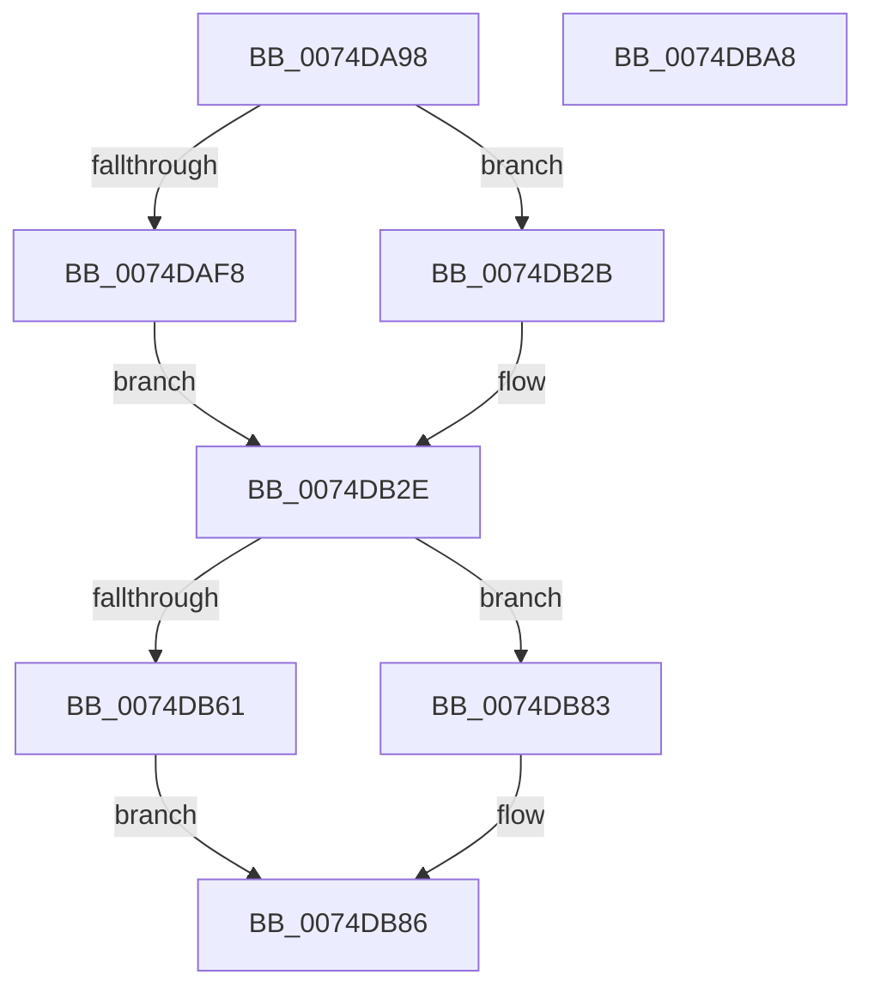

# ObInitializeProcessor

- RVA: `0x0074DA98`–`0x0074DBA9` (길이 `273` bytes)
- VA: `0x000000014074DA98`
- 실행 섹션: `PAGE`
- PDB 이름 있음: `예`; PDB Function 태그: `아니요`
- unwind 정보 RVA: `0x000C9154`
- 디코드: `68`개 명령, `273/273` bytes 표시
- 미해석 바이트: `0` (있으면 어셈블리에 `.byte`로 보존)

> 이 문서는 커널 이미지의 기계어와 PDB 기호를 분석해 생성했습니다. 4번과 5번은 함수 원형과 자료형을 바이너리 사용 방식에서 추정한 C 해석이며 원본 소스 복구 결과는 아닙니다.

## 1. Dependencies

- 직접 호출 지점: **5**; 고유 호출 대상: **3**
- 직접 호출자로 확인된 함수: **2**
- RIP 상대 이미지 참조: **3**

### Outgoing calls
- `0x0074DAB3` → [MmIsThisAnNtAsSystem](../../text/4B/MmIsThisAnNtAsSystem_function_004B2860.md) (function, `0x004B2860`)
- `0x0074DAE4` → [ExAllocatePool2](../../poolcode/B8/ExAllocatePool2_function_00B820F0.md) (function, `0x00B820F0`)
- `0x0074DB24` → [ExInitializeSystemLookasideList](../../pagelk/B7/ExInitializeSystemLookasideList_function_00B7E57C.md) (function, `0x00B7E57C`)
- `0x0074DB54` → [ExAllocatePool2](../../poolcode/B8/ExAllocatePool2_function_00B820F0.md) (function, `0x00B820F0`)
- `0x0074DB7C` → [ExInitializeSystemLookasideList](../../pagelk/B7/ExInitializeSystemLookasideList_function_00B7E57C.md) (function, `0x00B7E57C`)

### Direct callers
- [KiStartDynamicProcessor](KiStartDynamicProcessor_function_007456C8.md) at `0x007458FC`
- [ObInitSystem](../../init/C7/ObInitSystem_function_00C71C7C.md) at `0x00C7203D`

### Static image references
- `0x0074DABB` → RVA `0x00E27380` (`.data`; read)
- `0x0074DAE9` → RVA `0x00EFAC00` (`.data`; read)
- `0x0074DB40` → RVA `0x00E27300` (`.data`; read)

## 2. Other-region calls and transfers

- 다른 실행 섹션으로 향하는 call: **5**
  - `0x0074DAB3` → [MmIsThisAnNtAsSystem](../../text/4B/MmIsThisAnNtAsSystem_function_004B2860.md) (`PAGE` → `.text`)
  - `0x0074DAE4` → [ExAllocatePool2](../../poolcode/B8/ExAllocatePool2_function_00B820F0.md) (`PAGE` → `POOLCODE`)
  - `0x0074DB24` → [ExInitializeSystemLookasideList](../../pagelk/B7/ExInitializeSystemLookasideList_function_00B7E57C.md) (`PAGE` → `PAGELK`)
  - `0x0074DB54` → [ExAllocatePool2](../../poolcode/B8/ExAllocatePool2_function_00B820F0.md) (`PAGE` → `POOLCODE`)
  - `0x0074DB7C` → [ExInitializeSystemLookasideList](../../pagelk/B7/ExInitializeSystemLookasideList_function_00B7E57C.md) (`PAGE` → `PAGELK`)
- 별도 외부 분기/꼬리 이동을 확인하지 못했습니다.

## 3. Assembly (complete function range)

```asm
0074DA98  48 89 5C 24 08                  mov qword ptr [rsp + 8], rbx
0074DA9D  48 89 6C 24 10                  mov qword ptr [rsp + 0x10], rbp
0074DAA2  48 89 74 24 18                  mov qword ptr [rsp + 0x18], rsi
0074DAA7  57                              push rdi
0074DAA8  41 54                           push r12
0074DAAA  41 56                           push r14
0074DAAC  48 83 EC 30                     sub rsp, 0x30
0074DAB0  48 8B F9                        mov rdi, rcx
0074DAB3  E8 A8 4D D6 FF                  call 0x1404b2860
0074DAB8  40 8A E8                        mov bpl, al
0074DABB  4C 8D 35 BE 98 6D 00            lea r14, [rip + 0x6d98be]
0074DAC2  F6 D8                           neg al
0074DAC4  4C 89 B7 48 08 00 00            mov qword ptr [rdi + 0x848], r14
0074DACB  BA 80 00 00 00                  mov edx, 0x80
0074DAD0  41 B8 4F 62 43 49               mov r8d, 0x4943624f
0074DAD6  66 1B F6                        sbb si, si
0074DAD9  66 83 E6 10                     and si, 0x10
0074DADD  66 83 C6 10                     add si, 0x10
0074DAE1  8D 4A C0                        lea ecx, [rdx - 0x40]
0074DAE4  E8 07 46 43 00                  call 0x140b820f0
0074DAE9  4C 8D 25 10 D1 7A 00            lea r12, [rip + 0x7ad110]
0074DAF0  48 8B D8                        mov rbx, rax
0074DAF3  48 85 C0                        test rax, rax
0074DAF6  74 33                           je 0x14074db2b
0074DAF8  40 F6 DD                        neg bpl
0074DAFB  4C 89 64 24 28                  mov qword ptr [rsp + 0x28], r12
0074DB00  BA 00 02 00 00                  mov edx, 0x200
0074DB05  41 B9 4F 62 43 49               mov r9d, 0x4943624f
0074DB0B  66 1B C9                        sbb cx, cx
0074DB0E  41 B8 40 00 00 00               mov r8d, 0x40
0074DB14  66 83 E1 20                     and cx, 0x20
0074DB18  66 83 C1 20                     add cx, 0x20
0074DB1C  66 89 4C 24 20                  mov word ptr [rsp + 0x20], cx
0074DB21  48 8B C8                        mov rcx, rax
0074DB24  E8 53 0A 43 00                  call 0x140b7e57c
0074DB29  EB 03                           jmp 0x14074db2e
0074DB2B  49 8B DE                        mov rbx, r14
0074DB2E  BA 80 00 00 00                  mov edx, 0x80
0074DB33  48 89 9F 40 08 00 00            mov qword ptr [rdi + 0x840], rbx
0074DB3A  41 BE 4F 62 4E 4D               mov r14d, 0x4d4e624f
0074DB40  48 8D 2D B9 97 6D 00            lea rbp, [rip + 0x6d97b9]
0074DB47  45 8B C6                        mov r8d, r14d
0074DB4A  48 89 AF 58 08 00 00            mov qword ptr [rdi + 0x858], rbp
0074DB51  8D 4A C0                        lea ecx, [rdx - 0x40]
0074DB54  E8 97 45 43 00                  call 0x140b820f0
0074DB59  48 8B D8                        mov rbx, rax
0074DB5C  48 85 C0                        test rax, rax
0074DB5F  74 22                           je 0x14074db83
0074DB61  4C 89 64 24 28                  mov qword ptr [rsp + 0x28], r12
0074DB66  45 8B CE                        mov r9d, r14d
0074DB69  BA 01 00 00 00                  mov edx, 1
0074DB6E  66 89 74 24 20                  mov word ptr [rsp + 0x20], si
0074DB73  41 B8 F8 00 00 00               mov r8d, 0xf8
0074DB79  48 8B C8                        mov rcx, rax
0074DB7C  E8 FB 09 43 00                  call 0x140b7e57c
0074DB81  EB 03                           jmp 0x14074db86
0074DB83  48 8B DD                        mov rbx, rbp
0074DB86  48 8B 6C 24 58                  mov rbp, qword ptr [rsp + 0x58]
0074DB8B  33 C0                           xor eax, eax
0074DB8D  48 8B 74 24 60                  mov rsi, qword ptr [rsp + 0x60]
0074DB92  48 89 9F 50 08 00 00            mov qword ptr [rdi + 0x850], rbx
0074DB99  48 8B 5C 24 50                  mov rbx, qword ptr [rsp + 0x50]
0074DB9E  48 83 C4 30                     add rsp, 0x30
0074DBA2  41 5E                           pop r14
0074DBA4  41 5C                           pop r12
0074DBA6  5F                              pop rdi
0074DBA7  C3                              ret
0074DBA8  CC                              int3
```

## 4. C-style interpretation (structured pseudocode)

```c
__int64 __fastcall ObInitializeProcessor(__int64 a1)
{
    __int64 result;
    __int64 v_rbp;
    __int64 v_rsi;
    __int64 v_rsp;
    unsigned __int64 v_stack_m20;
    unsigned __int16 v_stack_m28;
    unsigned __int64 v_stack_p10;
    unsigned __int64 v_stack_p18;
    unsigned __int64 v_stack_p8;

    v_stack_p8 = v_rbx;
    v_stack_p10 = v_rbp;
    v_stack_p18 = v_rsi;
    v_rsp = (v_rsp) - (48);
    result = MmIsThisAnNtAsSystem(a1, a2, a3, a4);
    result = (unsigned __int8)(-(result));
    *(unsigned __int64 *)(a1 + 2120) = v_rip + 7182526;
    v_rsi = (unsigned __int16)((v_rsi) & (16));
    v_rsi = (unsigned __int16)((v_rsi) + (16));
    result = ExAllocatePool2(128 - 64, 128, (unsigned int)(0x4943624FULL), a4);
    if (result == 0) goto loc_0074DB2B;
    v_rbp = (unsigned __int8)(-((unsigned __int8)(result)));
    v_stack_m20 = v_rip + 8048912;
    a1 = (unsigned __int16)((128 - 64) & (32));
    a1 = (unsigned __int16)((a1) + (32));
    v_stack_m28 = (unsigned __int16)(a1);
    result = ExInitializeSystemLookasideList(result, 512, 64, (unsigned int)(0x4943624FULL));
    goto loc_0074DB2E;
loc_0074DB2B:
loc_0074DB2E:
    *(unsigned __int64 *)(a1 + 2112) = v_rip + 7182526;
    *(unsigned __int64 *)(a1 + 2136) = v_rip + 7182265;
    result = ExAllocatePool2(128 - 64, 128, (unsigned int)((unsigned int)((unsigned int)(0x4D4E624FULL))), (unsigned int)(0x4943624FULL));
    if (result == 0) goto loc_0074DB83;
    v_stack_m20 = v_rip + 8048912;
    v_stack_m28 = (unsigned __int16)(v_rsi);
    result = ExInitializeSystemLookasideList(result, 1, 248, (unsigned int)((unsigned int)((unsigned int)(0x4D4E624FULL))));
    goto loc_0074DB86;
loc_0074DB83:
loc_0074DB86:
    result = 0;
    *(unsigned __int64 *)(a1 + 2128) = v_rip + 7182265;
    v_rsp = (v_rsp) + (48);
    return result;
}
```

## 5. (Beta) C Style

```c
int64_t ObInitializeProcessor(void *Arg1)
{
    uint8_t *arg1 = (uint8_t *)Arg1;

    int64_t result;
    int64_t local_rbp;
    int64_t local_rsi;
    int64_t local_rsp;
    uint64_t v_stack_m20;
    uint16_t v_stack_m28;
    uint64_t v_stack_p10;
    uint64_t v_stack_p18;
    uint64_t v_stack_p8;

    v_stack_p8 = local_rbx;
    v_stack_p10 = local_rbp;
    v_stack_p18 = local_rsi;
    local_rsp = (local_rsp) - (48);
    result = MmIsThisAnNtAsSystem(Arg1, a2, a3, a4);
    result = (uint8_t)(-(result));
    *(uint64_t *)(arg1 + 0x848) = v_rip + 7182526;
    local_rsi = (uint16_t)((local_rsi) & (16));
    local_rsi = (uint16_t)((local_rsi) + (16));
    result = ExAllocatePool2(128 - 64, 128, (uint32_t)(0x4943624FULL), a4);
    if (result == 0) goto loc_0074DB2B;
    local_rbp = (uint8_t)(-((uint8_t)(result)));
    v_stack_m20 = v_rip + 8048912;
    Arg1 = (uint16_t)((128 - 64) & (32));
    Arg1 = (uint16_t)((Arg1) + (32));
    v_stack_m28 = (uint16_t)(Arg1);
    result = ExInitializeSystemLookasideList(result, 512, 64, (uint32_t)(0x4943624FULL));
    goto loc_0074DB2E;
loc_0074DB2B:
loc_0074DB2E:
    *(uint64_t *)(arg1 + 0x840) = v_rip + 7182526;
    *(uint64_t *)(arg1 + 0x858) = v_rip + 7182265;
    result = ExAllocatePool2(128 - 64, 128, (uint32_t)((uint32_t)((uint32_t)(0x4D4E624FULL))), (uint32_t)(0x4943624FULL));
    if (result == 0) goto loc_0074DB83;
    v_stack_m20 = v_rip + 8048912;
    v_stack_m28 = (uint16_t)(local_rsi);
    result = ExInitializeSystemLookasideList(result, 1, 248, (uint32_t)((uint32_t)((uint32_t)(0x4D4E624FULL))));
    goto loc_0074DB86;
loc_0074DB83:
loc_0074DB86:
    result = 0;
    *(uint64_t *)(arg1 + 0x850) = v_rip + 7182265;
    local_rsp = (local_rsp) + (48);
    return result;
}
```

### 관측된 메모리 오프셋

구조체 형식이 확인되지 않은 접근은 인자 기준의 오프셋으로만 기록했습니다.

| 기준 인자 | 오프셋 표현 | 폭 (bit) | 접근 |
|---|---:|---:|---|
| `Arg1` | `+ 0x840` | `64` | `W` |
| `Arg1` | `+ 0x848` | `64` | `W` |
| `Arg1` | `+ 0x850` | `64` | `W` |
| `Arg1` | `+ 0x858` | `64` | `W` |

## 6. Execution-region graph

[열기: 2D/3D 그래프와 함수 탐색 컨트롤 패널](../../../control-panel.html?section=page&rva=0x0074DA98&view=graph)

- 2D 그래프는 위에서 아래로 흐르고, 3D 그래프는 빈 공간을 드래그해 회전합니다. Shift+드래그는 이동, 휠은 확대·축소, 함수 노드 선택은 대상 보고서 이동입니다.

### Static fallback


