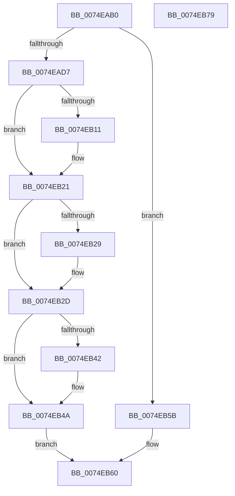

# ObIsDosDeviceLocallyMapped

- RVA: `0x0074EAB0`–`0x0074EB7A` (길이 `202` bytes)
- VA: `0x000000014074EAB0`
- 실행 섹션: `PAGE`
- PDB 이름 있음: `예`; PDB Function 태그: `아니요`
- unwind 정보 RVA: `0x000BEF48`
- 디코드: `58`개 명령, `202/202` bytes 표시
- 미해석 바이트: `0` (있으면 어셈블리에 `.byte`로 보존)

> 이 문서는 커널 이미지의 기계어와 PDB 기호를 분석해 생성했습니다. 4번과 5번은 함수 원형과 자료형을 바이너리 사용 방식에서 추정한 C 해석이며 원본 소스 복구 결과는 아닙니다.

## 1. Dependencies

- 직접 호출 지점: **6**; 고유 호출 대상: **6**
- 직접 호출자로 확인된 함수: **0**
- RIP 상대 이미지 참조: **0**

### Outgoing calls
- `0x0074EAD7` → [PsGetCurrentServerSiloGlobals](../../text/2F/PsGetCurrentServerSiloGlobals_function_002FE1F0.md) (function, `0x002FE1F0`)
- `0x0074EAFC` → [KeAbPreAcquire](../../text/21/KeAbPreAcquire_function_00210230.md) (function, `0x00210230`)
- `0x0074EB1C` → [ExfAcquirePushLockSharedEx](../../text/21/ExfAcquirePushLockSharedEx_function_0021044C.md) (function, `0x0021044C`)
- `0x0074EB45` → [ExfReleasePushLockShared](../../text/26/ExfReleasePushLockShared_function_00263440.md) (function, `0x00263440`)
- `0x0074EB4D` → [KeAbPostRelease](../../text/2E/KeAbPostRelease_function_002E1600.md) (function, `0x002E1600`)
- `0x0074EB52` → [KeLeaveGuardedRegion](../../text/2E/KeLeaveGuardedRegion_function_002E2C40.md) (function, `0x002E2C40`)

### Direct callers
- 이 함수 시작 RVA로 연결되는 직접 call은 확인되지 않았습니다. 간접 호출은 완전히 역산할 수 없습니다.

### Static image references
- 디코드된 RIP-relative 메모리 참조가 없습니다.

## 2. Other-region calls and transfers

- 다른 실행 섹션으로 향하는 call: **6**
  - `0x0074EAD7` → [PsGetCurrentServerSiloGlobals](../../text/2F/PsGetCurrentServerSiloGlobals_function_002FE1F0.md) (`PAGE` → `.text`)
  - `0x0074EAFC` → [KeAbPreAcquire](../../text/21/KeAbPreAcquire_function_00210230.md) (`PAGE` → `.text`)
  - `0x0074EB1C` → [ExfAcquirePushLockSharedEx](../../text/21/ExfAcquirePushLockSharedEx_function_0021044C.md) (`PAGE` → `.text`)
  - `0x0074EB45` → [ExfReleasePushLockShared](../../text/26/ExfReleasePushLockShared_function_00263440.md) (`PAGE` → `.text`)
  - `0x0074EB4D` → [KeAbPostRelease](../../text/2E/KeAbPostRelease_function_002E1600.md) (`PAGE` → `.text`)
  - `0x0074EB52` → [KeLeaveGuardedRegion](../../text/2E/KeLeaveGuardedRegion_function_002E2C40.md) (`PAGE` → `.text`)
- 별도 외부 분기/꼬리 이동을 확인하지 못했습니다.

## 3. Assembly (complete function range)

```asm
0074EAB0  48 89 5C 24 08                  mov qword ptr [rsp + 8], rbx
0074EAB5  48 89 6C 24 10                  mov qword ptr [rsp + 0x10], rbp
0074EABA  48 89 74 24 20                  mov qword ptr [rsp + 0x20], rsi
0074EABF  57                              push rdi
0074EAC0  41 56                           push r14
0074EAC2  41 57                           push r15
0074EAC4  48 83 EC 20                     sub rsp, 0x20
0074EAC8  8D 71 FF                        lea esi, [rcx - 1]
0074EACB  4C 8B F2                        mov r14, rdx
0074EACE  83 FE 19                        cmp esi, 0x19
0074EAD1  0F 87 84 00 00 00               ja 0x14074eb5b
0074EAD7  E8 14 F7 BA FF                  call 0x1402fe1f0
0074EADC  65 48 8B 0C 25 88 01 00 00      mov rcx, qword ptr gs:[0x188]
0074EAE5  45 33 C0                        xor r8d, r8d
0074EAE8  33 D2                           xor edx, edx
0074EAEA  48 8B E8                        mov rbp, rax
0074EAED  48 8D 58 78                     lea rbx, [rax + 0x78]
0074EAF1  66 FF 89 E6 01 00 00            dec word ptr [rcx + 0x1e6]
0074EAF8  48 8B CB                        mov rcx, rbx
0074EAFB  90                              nop
0074EAFC  E8 2F 17 AC FF                  call 0x140210230
0074EB01  48 8B F8                        mov rdi, rax
0074EB04  33 C0                           xor eax, eax
0074EB06  44 8D 78 11                     lea r15d, [rax + 0x11]
0074EB0A  F0 4C 0F B1 3B                  lock cmpxchg qword ptr [rbx], r15
0074EB0F  74 10                           je 0x14074eb21
0074EB11  4C 8B CB                        mov r9, rbx
0074EB14  4C 8B C7                        mov r8, rdi
0074EB17  33 D2                           xor edx, edx
0074EB19  48 8B CB                        mov rcx, rbx
0074EB1C  E8 2B 19 AC FF                  call 0x14021044c
0074EB21  45 33 C0                        xor r8d, r8d
0074EB24  48 85 FF                        test rdi, rdi
0074EB27  74 04                           je 0x14074eb2d
0074EB29  C6 47 0A 01                     mov byte ptr [rdi + 0xa], 1
0074EB2D  44 39 44 B5 0C                  cmp dword ptr [rbp + rsi*4 + 0xc], r8d
0074EB32  49 8B C7                        mov rax, r15
0074EB35  0F 95 C2                        setne dl
0074EB38  41 88 16                        mov byte ptr [r14], dl
0074EB3B  F0 4C 0F B1 03                  lock cmpxchg qword ptr [rbx], r8
0074EB40  74 08                           je 0x14074eb4a
0074EB42  48 8B CB                        mov rcx, rbx
0074EB45  E8 F6 48 B1 FF                  call 0x140263440
0074EB4A  48 8B CB                        mov rcx, rbx
0074EB4D  E8 AE 2A B9 FF                  call 0x1402e1600
0074EB52  E8 E9 40 B9 FF                  call 0x1402e2c40
0074EB57  33 C0                           xor eax, eax
0074EB59  EB 05                           jmp 0x14074eb60
0074EB5B  B8 0D 00 00 C0                  mov eax, 0xc000000d
0074EB60  48 8B 5C 24 40                  mov rbx, qword ptr [rsp + 0x40]
0074EB65  48 8B 6C 24 48                  mov rbp, qword ptr [rsp + 0x48]
0074EB6A  48 8B 74 24 58                  mov rsi, qword ptr [rsp + 0x58]
0074EB6F  48 83 C4 20                     add rsp, 0x20
0074EB73  41 5F                           pop r15
0074EB75  41 5E                           pop r14
0074EB77  5F                              pop rdi
0074EB78  C3                              ret
0074EB79  CC                              int3
```

## 4. C-style interpretation (structured pseudocode)

```c
__int64 __fastcall ObIsDosDeviceLocallyMapped(__int64 a1, __int64 a2, int a3)
{
    __int64 result;
    __int64 v_rsp;
    unsigned __int64 v_stack_p10;
    unsigned __int64 v_stack_p20;
    unsigned __int64 v_stack_p8;

    v_stack_p8 = v_rbx;
    v_stack_p10 = v_rbp;
    v_stack_p20 = v_rsi;
    v_rsp = (v_rsp) - (32);
    if (((unsigned int)(a1 - 1)) > 25) goto loc_0074EB5B;
    result = PsGetCurrentServerSiloGlobals(a1, a2, a3, a4);
    a3 = 0;
    a2 = 0;
    result = KeAbPreAcquire(result + 120, a2, a3, a4);
    result = 0;
    if (!(condition_is_equal)) {
        a4 = result + 120;
        a3 = 0;
        a2 = 0;
        a1 = result + 120;
        result = ExfAcquirePushLockSharedEx(a1, a2, a3, a4);
    }
    a3 = 0;
    if (result != 0) {
        *(unsigned __int8 *)(result + 10) = 1;
    }
    a2 = ((*(unsigned int *)(result + a1 - 1 * 4 + 12)) != 0) ? 1 : 0;
    *(unsigned __int8 *)(a2) = (unsigned __int8)(a2);
    result = result + 17;
    if ((*(unsigned int *)(result + a1 - 1 * 4 + 12)) != 0) {
        a1 = result + 120;
        result = ExfReleasePushLockShared(a1, a2, a3, a4);
    }
    result = KeAbPostRelease(result + 120, a2, a3, a4);
    result = KeLeaveGuardedRegion(result + 120, a2, a3, a4);
    result = 0;
    goto loc_0074EB60;
loc_0074EB5B:
loc_0074EB60:
    v_rsp = (v_rsp) + (32);
    return (unsigned int)(0xC000000DULL);
}
```

## 5. (Beta) C Style

```c
int64_t ObIsDosDeviceLocallyMapped(void *Arg1, void *Arg2, int32_t Arg3)
{
    uint8_t *arg1 = (uint8_t *)Arg1;
    uint8_t *arg2 = (uint8_t *)Arg2;

    int64_t result;
    int64_t local_rsp;
    uint64_t v_stack_p10;
    uint64_t v_stack_p20;
    uint64_t v_stack_p8;

    v_stack_p8 = local_rbx;
    v_stack_p10 = local_rbp;
    v_stack_p20 = local_rsi;
    local_rsp = (local_rsp) - (32);
    if (((uint32_t)(Arg1 - 1)) > 25) goto loc_0074EB5B;
    result = PsGetCurrentServerSiloGlobals(Arg1, Arg2, Arg3, a4);
    Arg3 = 0;
    Arg2 = 0;
    result = KeAbPreAcquire(result + 120, Arg2, Arg3, a4);
    result = 0;
    if (!(condition_is_equal)) {
        a4 = result + 120;
        Arg3 = 0;
        Arg2 = 0;
        Arg1 = result + 120;
        result = ExfAcquirePushLockSharedEx(Arg1, Arg2, Arg3, a4);
    }
    Arg3 = 0;
    if (result != 0) {
        *(uint8_t *)(result + 0xA) = 1;
    }
    Arg2 = ((*(uint32_t *)(result + arg1 - 0x1 * 4 + 0xC)) != 0) ? 1 : 0;
    *(uint8_t *)(arg2) = (uint8_t)(Arg2);
    result = result + 17;
    if ((*(uint32_t *)(result + arg1 - 0x1 * 4 + 0xC)) != 0) {
        Arg1 = result + 120;
        result = ExfReleasePushLockShared(Arg1, Arg2, Arg3, a4);
    }
    result = KeAbPostRelease(result + 120, Arg2, Arg3, a4);
    result = KeLeaveGuardedRegion(result + 120, Arg2, Arg3, a4);
    result = 0;
    goto loc_0074EB60;
loc_0074EB5B:
loc_0074EB60:
    local_rsp = (local_rsp) + (32);
    return (uint32_t)(0xC000000DULL);
}
```

### 관측된 메모리 오프셋

구조체 형식이 확인되지 않은 접근은 인자 기준의 오프셋으로만 기록했습니다.

| 기준 인자 | 오프셋 표현 | 폭 (bit) | 접근 |
|---|---:|---:|---|
| `Arg1` | `- 0x1` | `32` | `R` |
| `Arg2` | `+ 0x0` | `8` | `W` |

## 6. Execution-region graph

[열기: 2D/3D 그래프와 함수 탐색 컨트롤 패널](../../../control-panel.html?section=page&rva=0x0074EAB0&view=graph)

- 2D 그래프는 위에서 아래로 흐르고, 3D 그래프는 빈 공간을 드래그해 회전합니다. Shift+드래그는 이동, 휠은 확대·축소, 함수 노드 선택은 대상 보고서 이동입니다.

### Static fallback


