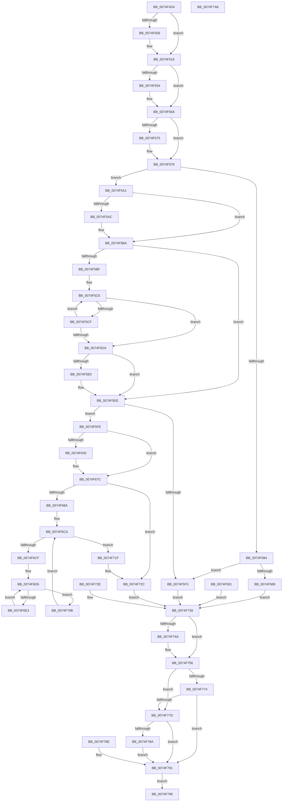

# ObQueryRefTraceInformation

- RVA: `0x0074F4D4`–`0x0074F7A7` (길이 `723` bytes)
- VA: `0x000000014074F4D4`
- 실행 섹션: `PAGE`
- PDB 이름 있음: `예`; PDB Function 태그: `아니요`
- unwind 정보 RVA: `0x000CB810`
- 디코드: `187`개 명령, `723/723` bytes 표시
- 미해석 바이트: `0` (있으면 어셈블리에 `.byte`로 보존)

> 이 문서는 커널 이미지의 기계어와 PDB 기호를 분석해 생성했습니다. 4번과 5번은 함수 원형과 자료형을 바이너리 사용 방식에서 추정한 C 해석이며 원본 소스 복구 결과는 아닙니다.

## 1. Dependencies

- 직접 호출 지점: **7**; 고유 호출 대상: **7**
- 직접 호출자로 확인된 함수: **1**
- RIP 상대 이미지 참조: **7**

### Outgoing calls
- `0x0074F510` → [ProbeForWrite](../8E/ProbeForWrite_function_008E91C0.md) (function, `0x008E91C0`)
- `0x0074F540` → [KeAbPreAcquire](../../text/21/KeAbPreAcquire_function_00210230.md) (function, `0x00210230`)
- `0x0074F565` → [ExfAcquirePushLockExclusiveEx](../../text/20/ExfAcquirePushLockExclusiveEx_function_0020FC90.md) (function, `0x0020FC90`)
- `0x0074F65E` → [memcpy](../../text/6C/memcpy_function_006C6840.md) (function, `0x006C6840`)
- `0x0074F751` → [ExfTryToWakePushLock](../../text/26/ExfTryToWakePushLock_function_00265DD0.md) (function, `0x00265DD0`)
- `0x0074F75D` → [KeAbPostRelease](../../text/2E/KeAbPostRelease_function_002E1600.md) (function, `0x002E1600`)
- `0x0074F762` → [KeLeaveGuardedRegion](../../text/2E/KeLeaveGuardedRegion_function_002E2C40.md) (function, `0x002E2C40`)

### Direct callers
- [ExpQuerySystemInformation](../A5/ExpQuerySystemInformation_function_00A57858.md) at `0x00A5901F`

### Static image references
- `0x0074F539` → RVA `0x00F0F580` (`.data`; read)
- `0x0074F548` → RVA `0x00F0F580` (`.data`; read/write)
- `0x0074F579` → RVA `0x00FC5010` (`ALMOSTRO`; read)
- `0x0074F5AC` → RVA `0x00F0F240` (`.data`; read)
- `0x0074F5BF` → RVA `0x00F0F280` (`.data`; read)
- `0x0074F63C` → RVA `0x00F0F242` (`.data`; read)
- `0x0074F654` → RVA `0x00F0F248` (`.data`; read)

## 2. Other-region calls and transfers

- 다른 실행 섹션으로 향하는 call: **6**
  - `0x0074F540` → [KeAbPreAcquire](../../text/21/KeAbPreAcquire_function_00210230.md) (`PAGE` → `.text`)
  - `0x0074F565` → [ExfAcquirePushLockExclusiveEx](../../text/20/ExfAcquirePushLockExclusiveEx_function_0020FC90.md) (`PAGE` → `.text`)
  - `0x0074F65E` → [memcpy](../../text/6C/memcpy_function_006C6840.md) (`PAGE` → `.text`)
  - `0x0074F751` → [ExfTryToWakePushLock](../../text/26/ExfTryToWakePushLock_function_00265DD0.md) (`PAGE` → `.text`)
  - `0x0074F75D` → [KeAbPostRelease](../../text/2E/KeAbPostRelease_function_002E1600.md) (`PAGE` → `.text`)
  - `0x0074F762` → [KeLeaveGuardedRegion](../../text/2E/KeLeaveGuardedRegion_function_002E2C40.md) (`PAGE` → `.text`)
- 별도 외부 분기/꼬리 이동을 확인하지 못했습니다.

## 3. Assembly (complete function range)

```asm
0074F4D4  4C 89 44 24 18                  mov qword ptr [rsp + 0x18], r8
0074F4D9  53                              push rbx
0074F4DA  56                              push rsi
0074F4DB  57                              push rdi
0074F4DC  41 54                           push r12
0074F4DE  41 55                           push r13
0074F4E0  41 56                           push r14
0074F4E2  41 57                           push r15
0074F4E4  48 83 EC 30                     sub rsp, 0x30
0074F4E8  44 8B E2                        mov r12d, edx
0074F4EB  4C 8B F9                        mov r15, rcx
0074F4EE  33 FF                           xor edi, edi
0074F4F0  44 8B F7                        mov r14d, edi
0074F4F3  65 48 8B 04 25 88 01 00 00      mov rax, qword ptr gs:[0x188]
0074F4FC  8A 88 32 02 00 00               mov cl, byte ptr [rax + 0x232]
0074F502  84 C9                           test cl, cl
0074F504  74 10                           je 0x14074f516
0074F506  41 8B D4                        mov edx, r12d
0074F509  44 8D 47 08                     lea r8d, [rdi + 8]
0074F50D  49 8B CF                        mov rcx, r15
0074F510  E8 AB 9C 19 00                  call 0x1408e91c0
0074F515  90                              nop
0074F516  BE 28 00 00 00                  mov esi, 0x28
0074F51B  89 74 24 70                     mov dword ptr [rsp + 0x70], esi
0074F51F  65 48 8B 04 25 88 01 00 00      mov rax, qword ptr gs:[0x188]
0074F528  48 83 CB FF                     or rbx, 0xffffffffffffffff
0074F52C  66 01 98 E6 01 00 00            add word ptr [rax + 0x1e6], bx
0074F533  90                              nop
0074F534  45 33 C0                        xor r8d, r8d
0074F537  33 D2                           xor edx, edx
0074F539  48 8D 0D 40 00 7C 00            lea rcx, [rip + 0x7c0040]
0074F540  E8 EB 0C AC FF                  call 0x140210230
0074F545  4C 8B E8                        mov r13, rax
0074F548  F0 48 0F BA 2D 2E 00 7C 00 00   lock bts qword ptr [rip + 0x7c002e], 0
0074F552  73 16                           jae 0x14074f56a
0074F554  4C 8D 05 25 00 7C 00            lea r8, [rip + 0x7c0025]
0074F55B  48 8B D0                        mov rdx, rax
0074F55E  48 8D 0D 1B 00 7C 00            lea rcx, [rip + 0x7c001b]
0074F565  E8 26 07 AC FF                  call 0x14020fc90
0074F56A  41 BA 01 00 00 00               mov r10d, 1
0074F570  4D 85 ED                        test r13, r13
0074F573  74 04                           je 0x14074f579
0074F575  45 88 55 0A                     mov byte ptr [r13 + 0xa], r10b
0074F579  8B 0D 91 5A 87 00               mov ecx, dword ptr [rip + 0x875a91]
0074F57F  F6 C1 02                        test cl, 2
0074F582  75 1D                           jne 0x14074f5a1
0074F584  44 3B E6                        cmp r12d, esi
0074F587  72 6A                           jb 0x14074f5f3
0074F589  41 88 3F                        mov byte ptr [r15], dil
0074F58C  E9 A8 01 00 00                  jmp 0x14074f739
0074F591  44 8B F0                        mov r14d, eax
0074F594  48 83 CB FF                     or rbx, 0xffffffffffffffff
0074F598  8B 74 24 70                     mov esi, dword ptr [rsp + 0x70]
0074F59C  E9 98 01 00 00                  jmp 0x14074f739
0074F5A1  44 0F B7 EF                     movzx r13d, di
0074F5A5  8B D1                           mov edx, ecx
0074F5A7  83 E2 20                        and edx, 0x20
0074F5AA  74 0E                           je 0x14074f5ba
0074F5AC  0F B7 35 8D FC 7B 00            movzx esi, word ptr [rip + 0x7bfc8d]
0074F5B3  83 C6 2A                        add esi, 0x2a
0074F5B6  89 74 24 70                     mov dword ptr [rsp + 0x70], esi
0074F5BA  F6 C1 10                        test cl, 0x10
0074F5BD  74 2F                           je 0x14074f5ee
0074F5BF  48 8D 0D BA FC 7B 00            lea rcx, [rip + 0x7bfcba]
0074F5C6  41 0F B7 C5                     movzx eax, r13w
0074F5CA  39 3C 81                        cmp dword ptr [rcx + rax*4], edi
0074F5CD  74 0B                           je 0x14074f5da
0074F5CF  66 45 03 EA                     add r13w, r10w
0074F5D3  66 41 83 FD 10                  cmp r13w, 0x10
0074F5D8  72 EC                           jb 0x14074f5c6
0074F5DA  66 45 85 ED                     test r13w, r13w
0074F5DE  74 0E                           je 0x14074f5ee
0074F5E0  41 0F B7 C5                     movzx eax, r13w
0074F5E4  8D 0C 80                        lea ecx, [rax + rax*4]
0074F5E7  8D 34 4E                        lea esi, [rsi + rcx*2]
0074F5EA  89 74 24 70                     mov dword ptr [rsp + 0x70], esi
0074F5EE  41 3B F4                        cmp esi, r12d
0074F5F1  76 0B                           jbe 0x14074f5fe
0074F5F3  41 BE 04 00 00 C0               mov r14d, 0xc0000004
0074F5F9  E9 3B 01 00 00                  jmp 0x14074f739
0074F5FE  4D 8D 67 28                     lea r12, [r15 + 0x28]
0074F602  4C 89 64 24 28                  mov qword ptr [rsp + 0x28], r12
0074F607  0F 57 C0                        xorps xmm0, xmm0
0074F60A  33 C0                           xor eax, eax
0074F60C  41 0F 11 07                     movups xmmword ptr [r15], xmm0
0074F610  41 0F 11 47 10                  movups xmmword ptr [r15 + 0x10], xmm0
0074F615  49 89 47 20                     mov qword ptr [r15 + 0x20], rax
0074F619  45 88 17                        mov byte ptr [r15], r10b
0074F61C  8B 05 EE 59 87 00               mov eax, dword ptr [rip + 0x8759ee]
0074F622  C1 E8 06                        shr eax, 6
0074F625  41 22 C2                        and al, r10b
0074F628  41 88 47 01                     mov byte ptr [r15 + 1], al
0074F62C  85 D2                           test edx, edx
0074F62E  74 4C                           je 0x14074f67c
0074F630  0F B7 05 09 FC 7B 00            movzx eax, word ptr [rip + 0x7bfc09]
0074F637  66 41 89 47 08                  mov word ptr [r15 + 8], ax
0074F63C  0F B7 05 FF FB 7B 00            movzx eax, word ptr [rip + 0x7bfbff]
0074F643  66 41 89 47 0A                  mov word ptr [r15 + 0xa], ax
0074F648  4D 89 67 10                     mov qword ptr [r15 + 0x10], r12
0074F64C  44 0F B7 05 EE FB 7B 00         movzx r8d, word ptr [rip + 0x7bfbee]
0074F654  48 8B 15 ED FB 7B 00            mov rdx, qword ptr [rip + 0x7bfbed]
0074F65B  49 8B CC                        mov rcx, r12
0074F65E  E8 DD 71 F7 FF                  call 0x1406c6840
0074F663  0F B7 0D D8 FB 7B 00            movzx ecx, word ptr [rip + 0x7bfbd8]
0074F66A  48 D1 E9                        shr rcx, 1
0074F66D  4D 8D 24 4C                     lea r12, [r12 + rcx*2]
0074F671  4C 89 64 24 28                  mov qword ptr [rsp + 0x28], r12
0074F676  41 BA 01 00 00 00               mov r10d, 1
0074F67C  8B 05 8E 59 87 00               mov eax, dword ptr [rip + 0x87598e]
0074F682  A8 10                           test al, 0x10
0074F684  0F 84 A2 00 00 00               je 0x14074f72c
0074F68A  45 0F B7 ED                     movzx r13d, r13w
0074F68E  42 8D 0C AD 00 00 00 00         lea ecx, [r13*4]
0074F696  41 03 CD                        add ecx, r13d
0074F699  89 8C 24 88 00 00 00            mov dword ptr [rsp + 0x88], ecx
0074F6A0  0F B7 C1                        movzx eax, cx
0074F6A3  66 41 2B C2                     sub ax, r10w
0074F6A7  66 03 C0                        add ax, ax
0074F6AA  66 41 89 47 18                  mov word ptr [r15 + 0x18], ax
0074F6AF  66 83 C0 02                     add ax, 2
0074F6B3  66 41 89 47 1A                  mov word ptr [r15 + 0x1a], ax
0074F6B8  4D 89 67 20                     mov qword ptr [r15 + 0x20], r12
0074F6BC  44 8B C7                        mov r8d, edi
0074F6BF  89 7C 24 24                     mov dword ptr [rsp + 0x24], edi
0074F6C3  4C 8D 3D B6 FB 7B 00            lea r15, [rip + 0x7bfbb6]
0074F6CA  45 3B C5                        cmp r8d, r13d
0074F6CD  73 50                           jae 0x14074f71f
0074F6CF  44 8B CF                        mov r9d, edi
0074F6D2  89 7C 24 20                     mov dword ptr [rsp + 0x20], edi
0074F6D6  47 8D 1C 80                     lea r11d, [r8 + r8*4]
0074F6DA  45 03 D9                        add r11d, r9d
0074F6DD  41 83 F9 04                     cmp r9d, 4
0074F6E1  73 28                           jae 0x14074f70b
0074F6E3  41 8B C0                        mov eax, r8d
0074F6E6  42 8D 0C CD 00 00 00 00         lea ecx, [r9*8]
0074F6EE  41 8B 14 87                     mov edx, dword ptr [r15 + rax*4]
0074F6F2  D3 EA                           shr edx, cl
0074F6F4  B8 FF 00 00 00                  mov eax, 0xff
0074F6F9  66 23 D0                        and dx, ax
0074F6FC  66 43 89 14 5C                  mov word ptr [r12 + r11*2], dx
0074F701  45 03 CA                        add r9d, r10d
0074F704  44 89 4C 24 20                  mov dword ptr [rsp + 0x20], r9d
0074F709  EB CB                           jmp 0x14074f6d6
0074F70B  B8 3B 00 00 00                  mov eax, 0x3b
0074F710  66 43 89 04 5C                  mov word ptr [r12 + r11*2], ax
0074F715  45 03 C2                        add r8d, r10d
0074F718  44 89 44 24 24                  mov dword ptr [rsp + 0x24], r8d
0074F71D  EB AB                           jmp 0x14074f6ca
0074F71F  8B 84 24 88 00 00 00            mov eax, dword ptr [rsp + 0x88]
0074F726  66 41 89 7C 44 FE               mov word ptr [r12 + rax*2 - 2], di
0074F72C  EB 0B                           jmp 0x14074f739
0074F72E  44 8B F0                        mov r14d, eax
0074F731  48 83 CB FF                     or rbx, 0xffffffffffffffff
0074F735  8B 74 24 70                     mov esi, dword ptr [rsp + 0x70]
0074F739  F0 48 0F C1 1D 3E FE 7B 00      lock xadd qword ptr [rip + 0x7bfe3e], rbx
0074F742  80 E3 06                        and bl, 6
0074F745  80 FB 02                        cmp bl, 2
0074F748  75 0C                           jne 0x14074f756
0074F74A  48 8D 0D 2F FE 7B 00            lea rcx, [rip + 0x7bfe2f]
0074F751  E8 7A 66 B1 FF                  call 0x140265dd0
0074F756  48 8D 0D 23 FE 7B 00            lea rcx, [rip + 0x7bfe23]
0074F75D  E8 9E 1E B9 FF                  call 0x1402e1600
0074F762  E8 D9 34 B9 FF                  call 0x1402e2c40
0074F767  B9 00 00 00 80                  mov ecx, 0x80000000
0074F76C  41 8D 04 0E                     lea eax, [r14 + rcx]
0074F770  85 C1                           test ecx, eax
0074F772  75 09                           jne 0x14074f77d
0074F774  41 81 FE 04 00 00 C0            cmp r14d, 0xc0000004
0074F77B  75 14                           jne 0x14074f791
0074F77D  48 8B 84 24 80 00 00 00         mov rax, qword ptr [rsp + 0x80]
0074F785  48 85 C0                        test rax, rax
0074F788  74 07                           je 0x14074f791
0074F78A  89 30                           mov dword ptr [rax], esi
0074F78C  EB 03                           jmp 0x14074f791
0074F78E  44 8B F0                        mov r14d, eax
0074F791  41 8B C6                        mov eax, r14d
0074F794  EB 00                           jmp 0x14074f796
0074F796  48 83 C4 30                     add rsp, 0x30
0074F79A  41 5F                           pop r15
0074F79C  41 5E                           pop r14
0074F79E  41 5D                           pop r13
0074F7A0  41 5C                           pop r12
0074F7A2  5F                              pop rdi
0074F7A3  5E                              pop rsi
0074F7A4  5B                              pop rbx
0074F7A5  C3                              ret
0074F7A6  CC                              int3
```

## 4. C-style interpretation (structured pseudocode)

```c
__int64 __fastcall ObQueryRefTraceInformation(__int64 a1, int a2, __int64 a3)
{
    __int64 result;
    __int64 v_r10;
    __int64 v_r11;
    __int64 v_r12;
    __int64 v_r13;
    __int64 v_rbx;
    __int64 v_rdi;
    __int64 v_rsi;
    __int64 v_rsp;
    unsigned __int64 v_stack_m40;
    unsigned int v_stack_m44;
    unsigned int v_stack_m48;
    unsigned __int64 v_stack_p18;
    unsigned int v_stack_p20;
    unsigned int v_stack_p8;

    v_stack_p18 = a3;
    v_rsp = (v_rsp) - (48);
    v_rdi = 0;
    result = *(unsigned __int64 *)(gs_base + (0 + 392));
    if ((unsigned __int8)(*(unsigned __int8 *)(*(unsigned __int64 *)(gs_base + (0 + 392)) + 562)) != 0) {
        a2 = (unsigned int)((unsigned int)(a2));
        a3 = v_rdi + 8;
        a1 = a1;
        result = ProbeForWrite(a1, a2, a3, a4);
    }
    v_stack_p8 = 40;
    v_rbx = (v_rbx) | (-1);
    a3 = 0;
    a2 = 0;
    result = KeAbPreAcquire(v_rip + 8126528, a2, a3, a4);
    if (!(condition_is_above_or_equal)) {
        a3 = v_rip + 8126501;
        a2 = result;
        a1 = v_rip + 8126491;
        result = ExfAcquirePushLockExclusiveEx(a1, a2, a3, a4);
    }
    if (result != 0) {
        *(unsigned __int8 *)(result + 10) = 1;
    }
    if ((((unsigned __int8)((unsigned int)(*(unsigned int *)(v_rip + 8870545)))) & (2)) != 0) goto loc_0074F5A1;
    if (((unsigned int)((unsigned int)(a2))) < 40) goto loc_0074F5F3;
    *(unsigned __int8 *)(a1) = 0;
    goto loc_0074F739;
loc_0074F5A1:
    a2 = (unsigned int)(((unsigned int)((unsigned int)((unsigned int)(*(unsigned int *)(v_rip + 8870545))))) & (32));
    v_rsi = 40;
    if (!(condition_is_equal)) {
        v_rsi = *(unsigned __int16 *)(v_rip + 8125581);
        v_rsi = (unsigned int)((v_rsi) + (42));
        v_stack_p8 = (unsigned int)(v_rsi);
    }
    if ((((unsigned __int8)((unsigned int)(*(unsigned int *)(v_rip + 8870545)))) & (16)) == 0) goto loc_0074F5EE;
loc_0074F5C6:
    if ((*(unsigned int *)(v_rip + 8125626 + 0 * 4)) == 0) goto loc_0074F5DA;
    v_r13 = (unsigned __int16)((0) + (1));
    if (((unsigned __int16)(v_r13)) < 16) goto loc_0074F5C6;
loc_0074F5DA:
    result = 0;
    if ((unsigned __int16)(v_r13) != 0) {
        result = (unsigned __int16)(v_r13);
        a1 = result + result * 4;
        v_rsi = v_rsi + a1 * 2;
        v_stack_p8 = (unsigned int)(v_rsi);
    }
    if (((unsigned int)(v_rsi)) <= ((unsigned int)((unsigned int)(a2)))) goto loc_0074F5FE;
loc_0074F5F3:
    goto loc_0074F739;
loc_0074F5FE:
    v_stack_m40 = a1 + 40;
    result = 0;
    *(unsigned __int64 *)(a1) = v_xmm0;
    *(unsigned __int64 *)(a1 + 16) = v_xmm0;
    *(unsigned __int64 *)(a1 + 32) = 0;
    *(unsigned __int8 *)(a1) = 1;
    result = (unsigned int)(((unsigned int)(*(unsigned int *)(v_rip + 8870382))) >> (6));
    result = (unsigned __int8)((result) & (1));
    *(unsigned __int8 *)(a1 + 1) = (unsigned __int8)(result);
    v_r10 = 1;
    v_r12 = a1 + 40;
    if (a2 != 0) {
        result = *(unsigned __int16 *)(v_rip + 8125449);
        *(unsigned __int16 *)(a1 + 8) = (unsigned __int16)(result);
        result = *(unsigned __int16 *)(v_rip + 8125439);
        *(unsigned __int16 *)(a1 + 10) = (unsigned __int16)(result);
        *(unsigned __int64 *)(a1 + 16) = a1 + 40;
        a3 = *(unsigned __int16 *)(v_rip + 8125422);
        a2 = *(unsigned __int64 *)(v_rip + 8125421);
        a1 = a1 + 40;
        result = memcpy(a1, a2, a3, a4);
        a1 = *(unsigned __int16 *)(v_rip + 8125400);
        a1 = (a1) >> (1);
        v_r12 = a1 + 40 + a1 * 2;
        v_stack_m40 = v_r12;
        v_r10 = 1;
    }
    if ((((unsigned __int8)((unsigned int)(*(unsigned int *)(v_rip + 8870286)))) & (16)) == 0) goto loc_0074F72C;
    a1 = (unsigned int)(((unsigned __int16)(v_r13) * 4) + ((unsigned int)((unsigned __int16)(v_r13))));
    v_stack_p20 = (unsigned int)(a1);
    result = (unsigned __int16)(((unsigned __int16)(a1)) - ((unsigned __int16)(v_r10)));
    result = (unsigned __int16)((result) + ((unsigned __int16)(result)));
    *(unsigned __int16 *)(a1 + 24) = (unsigned __int16)(result);
    result = (unsigned __int16)((result) + (2));
    *(unsigned __int16 *)(a1 + 26) = (unsigned __int16)(result);
    *(unsigned __int64 *)(a1 + 32) = v_r12;
    v_stack_m44 = 0;
loc_0074F6CA:
    if (0 >= ((unsigned int)((unsigned __int16)(v_r13)))) goto loc_0074F71F;
    v_stack_m48 = 0;
loc_0074F6D6:
    v_r11 = (unsigned int)((0 + 0 * 4) + (0));
    if (0 >= 4) goto loc_0074F70B;
    a2 = (unsigned int)(((unsigned int)(*(unsigned int *)(v_rip + 8125366 + 0 * 4))) >> ((unsigned __int8)(0 * 8)));
    a2 = (unsigned __int16)((a2) & (255));
    *(unsigned __int16 *)(v_r12 + v_r11 * 2) = (unsigned __int16)(a2);
    a4 = (unsigned int)((0) + ((unsigned int)(v_r10)));
    v_stack_m48 = (unsigned int)(a4);
    goto loc_0074F6D6;
loc_0074F70B:
    *(unsigned __int16 *)(v_r12 + v_r11 * 2) = 59;
    a3 = (unsigned int)((0) + ((unsigned int)(v_r10)));
    v_stack_m44 = (unsigned int)(a3);
    goto loc_0074F6CA;
loc_0074F71F:
    *(unsigned __int16 *)(v_r12 + (unsigned int)(v_stack_p20) * 2 - 2) = 0;
loc_0074F72C:
    goto loc_0074F739;
loc_0074F739:
    v_rbx = (unsigned __int8)((v_rbx) & (6));
    result = (unsigned int)(v_stack_p20);
    if (((unsigned __int8)(v_rbx)) == 2) {
        a1 = v_rip + 8125999;
        result = ExfTryToWakePushLock(a1, a2, a3, a4);
    }
    result = KeAbPostRelease(v_rip + 8125987, a2, a3, a4);
    result = KeLeaveGuardedRegion(v_rip + 8125987, a2, a3, a4);
    if ((((unsigned int)((unsigned int)(0x80000000ULL))) & ((unsigned int)((unsigned int)(0xC0000004ULL) + (unsigned int)(0x80000000ULL) * 1))) != 0) goto loc_0074F77D;
    if (((unsigned int)((unsigned int)(0xC0000004ULL))) != 0xC0000004ULL) goto loc_0074F791;
loc_0074F77D:
    if (v_stack_p18 == 0) goto loc_0074F791;
    *(unsigned int *)(v_stack_p18) = (unsigned int)(v_rsi);
    goto loc_0074F791;
loc_0074F791:
    goto loc_0074F796;
loc_0074F796:
    v_rsp = (v_rsp) + (48);
    return (unsigned int)((unsigned int)((unsigned int)(0xC0000004ULL)));
}
```

## 5. (Beta) C Style

```c
int64_t ObQueryRefTraceInformation(void *Arg1, int32_t Arg2, int64_t Arg3)
{
    uint8_t *arg1 = (uint8_t *)Arg1;

    int64_t result;
    int64_t local_r10;
    int64_t local_r11;
    int64_t local_r12;
    int64_t local_r13;
    int64_t local_rbx;
    int64_t local_rdi;
    int64_t local_rsi;
    int64_t local_rsp;
    uint64_t v_stack_m40;
    uint32_t v_stack_m44;
    uint32_t v_stack_m48;
    uint64_t v_stack_p18;
    uint32_t v_stack_p20;
    uint32_t v_stack_p8;

    v_stack_p18 = Arg3;
    local_rsp = (local_rsp) - (48);
    local_rdi = 0;
    result = *(uint64_t *)(gs_base + (0 + 0x188));
    if ((uint8_t)(*(uint8_t *)(*(uint64_t *)(gs_base + (0 + 0x188)) + 0x232)) != 0) {
        Arg2 = (uint32_t)((uint32_t)(Arg2));
        Arg3 = local_rdi + 8;
        Arg1 = Arg1;
        result = ProbeForWrite(Arg1, Arg2, Arg3, a4);
    }
    v_stack_p8 = 40;
    local_rbx = (local_rbx) | (-1);
    Arg3 = 0;
    Arg2 = 0;
    result = KeAbPreAcquire(v_rip + 8126528, Arg2, Arg3, a4);
    if (!(condition_is_above_or_equal)) {
        Arg3 = v_rip + 8126501;
        Arg2 = result;
        Arg1 = v_rip + 8126491;
        result = ExfAcquirePushLockExclusiveEx(Arg1, Arg2, Arg3, a4);
    }
    if (result != 0) {
        *(uint8_t *)(result + 0xA) = 1;
    }
    if ((((uint8_t)((uint32_t)(*(uint32_t *)(v_rip + 0x875A91)))) & (2)) != 0) goto loc_0074F5A1;
    if (((uint32_t)((uint32_t)(Arg2))) < 40) goto loc_0074F5F3;
    *(uint8_t *)(arg1) = 0;
    goto loc_0074F739;
loc_0074F5A1:
    Arg2 = (uint32_t)(((uint32_t)((uint32_t)((uint32_t)(*(uint32_t *)(v_rip + 0x875A91))))) & (32));
    local_rsi = 40;
    if (!(condition_is_equal)) {
        local_rsi = *(uint16_t *)(v_rip + 0x7BFC8D);
        local_rsi = (uint32_t)((local_rsi) + (42));
        v_stack_p8 = (uint32_t)(local_rsi);
    }
    if ((((uint8_t)((uint32_t)(*(uint32_t *)(v_rip + 0x875A91)))) & (16)) == 0) goto loc_0074F5EE;
loc_0074F5C6:
    if ((*(uint32_t *)(v_rip + 0x7BFCBA + 0x0 * 4)) == 0) goto loc_0074F5DA;
    local_r13 = (uint16_t)((0) + (1));
    if (((uint16_t)(local_r13)) < 16) goto loc_0074F5C6;
loc_0074F5DA:
    result = 0;
    if ((uint16_t)(local_r13) != 0) {
        result = (uint16_t)(local_r13);
        Arg1 = result + result * 4;
        local_rsi = local_rsi + Arg1 * 2;
        v_stack_p8 = (uint32_t)(local_rsi);
    }
    if (((uint32_t)(local_rsi)) <= ((uint32_t)((uint32_t)(Arg2)))) goto loc_0074F5FE;
loc_0074F5F3:
    goto loc_0074F739;
loc_0074F5FE:
    v_stack_m40 = Arg1 + 40;
    result = 0;
    *(uint64_t *)(arg1) = v_xmm0;
    *(uint64_t *)(arg1 + 0x10) = v_xmm0;
    *(uint64_t *)(arg1 + 0x20) = 0;
    *(uint8_t *)(arg1) = 1;
    result = (uint32_t)(((uint32_t)(*(uint32_t *)(v_rip + 0x8759EE))) >> (6));
    result = (uint8_t)((result) & (1));
    *(uint8_t *)(arg1 + 0x1) = (uint8_t)(result);
    local_r10 = 1;
    local_r12 = Arg1 + 40;
    if (Arg2 != 0) {
        result = *(uint16_t *)(v_rip + 0x7BFC09);
        *(uint16_t *)(arg1 + 0x8) = (uint16_t)(result);
        result = *(uint16_t *)(v_rip + 0x7BFBFF);
        *(uint16_t *)(arg1 + 0xA) = (uint16_t)(result);
        *(void **)(arg1 + 0x10) = Arg1 + 40;
        Arg3 = *(uint16_t *)(v_rip + 0x7BFBEE);
        Arg2 = *(uint64_t *)(v_rip + 0x7BFBED);
        Arg1 = Arg1 + 40;
        result = memcpy(Arg1, Arg2, Arg3, a4);
        Arg1 = *(uint16_t *)(v_rip + 0x7BFBD8);
        Arg1 = (Arg1) >> (1);
        local_r12 = Arg1 + 40 + Arg1 * 2;
        v_stack_m40 = local_r12;
        local_r10 = 1;
    }
    if ((((uint8_t)((uint32_t)(*(uint32_t *)(v_rip + 0x87598E)))) & (16)) == 0) goto loc_0074F72C;
    Arg1 = (uint32_t)(((uint16_t)(local_r13) * 4) + ((uint32_t)((uint16_t)(local_r13))));
    v_stack_p20 = (uint32_t)(Arg1);
    result = (uint16_t)(((uint16_t)(Arg1)) - ((uint16_t)(local_r10)));
    result = (uint16_t)((result) + ((uint16_t)(result)));
    *(uint16_t *)(arg1 + 0x18) = (uint16_t)(result);
    result = (uint16_t)((result) + (2));
    *(uint16_t *)(arg1 + 0x1A) = (uint16_t)(result);
    *(uint64_t *)(arg1 + 0x20) = local_r12;
    v_stack_m44 = 0;
loc_0074F6CA:
    if (0 >= ((uint32_t)((uint16_t)(local_r13)))) goto loc_0074F71F;
    v_stack_m48 = 0;
loc_0074F6D6:
    local_r11 = (uint32_t)((0 + 0 * 4) + (0));
    if (0 >= 4) goto loc_0074F70B;
    Arg2 = (uint32_t)(((uint32_t)(*(uint32_t *)(v_rip + 0x7BFBB6 + 0x0 * 4))) >> ((uint8_t)(0 * 8)));
    Arg2 = (uint16_t)((Arg2) & (255));
    *(uint16_t *)(local_r12 + local_r11 * 2) = (uint16_t)(Arg2);
    a4 = (uint32_t)((0) + ((uint32_t)(local_r10)));
    v_stack_m48 = (uint32_t)(a4);
    goto loc_0074F6D6;
loc_0074F70B:
    *(uint16_t *)(local_r12 + local_r11 * 2) = 59;
    Arg3 = (uint32_t)((0) + ((uint32_t)(local_r10)));
    v_stack_m44 = (uint32_t)(Arg3);
    goto loc_0074F6CA;
loc_0074F71F:
    *(uint16_t *)(local_r12 + (uint32_t)(v_stack_p20) * 2 - 0x2) = 0;
loc_0074F72C:
    goto loc_0074F739;
loc_0074F739:
    local_rbx = (uint8_t)((local_rbx) & (6));
    result = (uint32_t)(v_stack_p20);
    if (((uint8_t)(local_rbx)) == 2) {
        Arg1 = v_rip + 8125999;
        result = ExfTryToWakePushLock(Arg1, Arg2, Arg3, a4);
    }
    result = KeAbPostRelease(v_rip + 8125987, Arg2, Arg3, a4);
    result = KeLeaveGuardedRegion(v_rip + 8125987, Arg2, Arg3, a4);
    if ((((uint32_t)((uint32_t)(0x80000000ULL))) & ((uint32_t)((uint32_t)(0xC0000004ULL) + (uint32_t)(0x80000000ULL) * 1))) != 0) goto loc_0074F77D;
    if (((uint32_t)((uint32_t)(0xC0000004ULL))) != 0xC0000004ULL) goto loc_0074F791;
loc_0074F77D:
    if (v_stack_p18 == 0) goto loc_0074F791;
    *(uint32_t *)(v_stack_p18) = (uint32_t)(local_rsi);
    goto loc_0074F791;
loc_0074F791:
    goto loc_0074F796;
loc_0074F796:
    local_rsp = (local_rsp) + (48);
    return (uint32_t)((uint32_t)((uint32_t)(0xC0000004ULL)));
}
```

### 관측된 메모리 오프셋

구조체 형식이 확인되지 않은 접근은 인자 기준의 오프셋으로만 기록했습니다.

| 기준 인자 | 오프셋 표현 | 폭 (bit) | 접근 |
|---|---:|---:|---|
| `Arg1` | `- 0x2 + rax*2` | `16` | `W` |
| `Arg1` | `+ 0x0` | `8` | `W` |
| `Arg1` | `+ 0x0` | `128` | `R` |
| `Arg1` | `+ 0x0 + r11*2` | `16` | `W` |
| `Arg1` | `+ 0x0 + rcx*2` | `64` | `R` |
| `Arg1` | `+ 0x1` | `8` | `W` |
| `Arg1` | `+ 0x8` | `16` | `W` |
| `Arg1` | `+ 0xA` | `16` | `W` |
| `Arg1` | `+ 0x10` | `64` | `W` |
| `Arg1` | `+ 0x10` | `128` | `R` |
| `Arg1` | `+ 0x18` | `16` | `W` |
| `Arg1` | `+ 0x1A` | `16` | `W` |
| `Arg1` | `+ 0x20` | `64` | `W` |
| `Arg1` | `+ 0x28` | `64` | `R` |

## 6. Execution-region graph

[열기: 2D/3D 그래프와 함수 탐색 컨트롤 패널](../../../control-panel.html?section=page&rva=0x0074F4D4&view=graph)

- 2D 그래프는 위에서 아래로 흐르고, 3D 그래프는 빈 공간을 드래그해 회전합니다. Shift+드래그는 이동, 휠은 확대·축소, 함수 노드 선택은 대상 보고서 이동입니다.

### Static fallback


