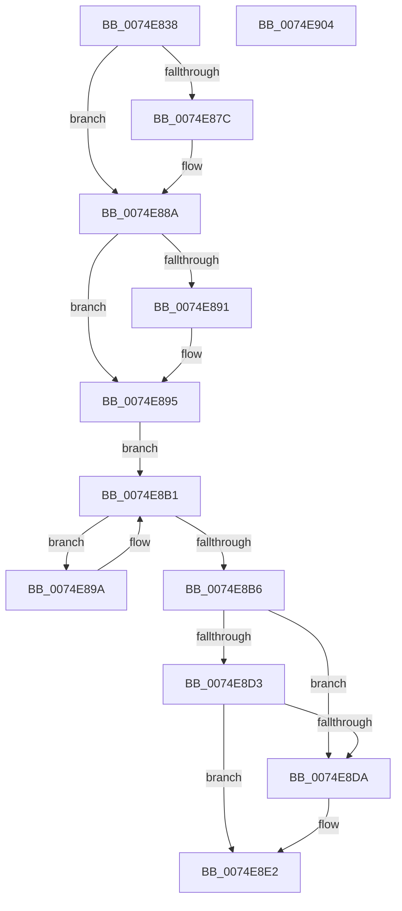

# ObRevokeHandles

- RVA: `0x0074E838`–`0x0074E905` (길이 `205` bytes)
- VA: `0x000000014074E838`
- 실행 섹션: `PAGE`
- PDB 이름 있음: `예`; PDB Function 태그: `아니요`
- unwind 정보 RVA: `0x0005C954`
- 디코드: `58`개 명령, `205/205` bytes 표시
- 미해석 바이트: `0` (있으면 어셈블리에 `.byte`로 보존)

> 이 문서는 커널 이미지의 기계어와 PDB 기호를 분석해 생성했습니다. 4번과 5번은 함수 원형과 자료형을 바이너리 사용 방식에서 추정한 C 해석이며 원본 소스 복구 결과는 아닙니다.

## 1. Dependencies

- 직접 호출 지점: **6**; 고유 호출 대상: **6**
- 직접 호출자로 확인된 함수: **1**
- RIP 상대 이미지 참조: **0**

### Outgoing calls
- `0x0074E86C` → [KeAbPreAcquire](../../text/21/KeAbPreAcquire_function_00210230.md) (function, `0x00210230`)
- `0x0074E885` → [ExfAcquirePushLockExclusiveEx](../../text/20/ExfAcquirePushLockExclusiveEx_function_0020FC90.md) (function, `0x0020FC90`)
- `0x0074E8AC` → [ObpHandleRevocationBlockRemoveInsertedObject](../9D/ObpHandleRevocationBlockRemoveInsertedObject_function_009D7E58.md) (function, `0x009D7E58`)
- `0x0074E8DD` → [ExfReleasePushLock](../../text/26/ExfReleasePushLock_function_002638D0.md) (function, `0x002638D0`)
- `0x0074E8E5` → [KeAbPostRelease](../../text/2E/KeAbPostRelease_function_002E1600.md) (function, `0x002E1600`)
- `0x0074E8EA` → [KeLeaveCriticalRegion](../../text/25/KeLeaveCriticalRegion_function_0025D8B0.md) (function, `0x0025D8B0`)

### Direct callers
- [SepDeleteLogonSessionTrack](../AA/SepDeleteLogonSessionTrack_function_00AA04E0.md) at `0x00AA05AE`

### Static image references
- 디코드된 RIP-relative 메모리 참조가 없습니다.

## 2. Other-region calls and transfers

- 다른 실행 섹션으로 향하는 call: **5**
  - `0x0074E86C` → [KeAbPreAcquire](../../text/21/KeAbPreAcquire_function_00210230.md) (`PAGE` → `.text`)
  - `0x0074E885` → [ExfAcquirePushLockExclusiveEx](../../text/20/ExfAcquirePushLockExclusiveEx_function_0020FC90.md) (`PAGE` → `.text`)
  - `0x0074E8DD` → [ExfReleasePushLock](../../text/26/ExfReleasePushLock_function_002638D0.md) (`PAGE` → `.text`)
  - `0x0074E8E5` → [KeAbPostRelease](../../text/2E/KeAbPostRelease_function_002E1600.md) (`PAGE` → `.text`)
  - `0x0074E8EA` → [KeLeaveCriticalRegion](../../text/25/KeLeaveCriticalRegion_function_0025D8B0.md) (`PAGE` → `.text`)
- 별도 외부 분기/꼬리 이동을 확인하지 못했습니다.

## 3. Assembly (complete function range)

```asm
0074E838  48 89 5C 24 08                  mov qword ptr [rsp + 8], rbx
0074E83D  48 89 6C 24 10                  mov qword ptr [rsp + 0x10], rbp
0074E842  48 89 74 24 18                  mov qword ptr [rsp + 0x18], rsi
0074E847  57                              push rdi
0074E848  48 83 EC 20                     sub rsp, 0x20
0074E84C  65 48 8B 04 25 88 01 00 00      mov rax, qword ptr gs:[0x188]
0074E855  48 8D 59 10                     lea rbx, [rcx + 0x10]
0074E859  48 8B F1                        mov rsi, rcx
0074E85C  45 33 C0                        xor r8d, r8d
0074E85F  33 D2                           xor edx, edx
0074E861  48 8B CB                        mov rcx, rbx
0074E864  66 FF 88 E4 01 00 00            dec word ptr [rax + 0x1e4]
0074E86B  90                              nop
0074E86C  E8 BF 19 AC FF                  call 0x140210230
0074E871  F0 48 0F BA 2B 00               lock bts qword ptr [rbx], 0
0074E877  48 8B F8                        mov rdi, rax
0074E87A  73 0E                           jae 0x14074e88a
0074E87C  4C 8B C3                        mov r8, rbx
0074E87F  48 8B D0                        mov rdx, rax
0074E882  48 8B CB                        mov rcx, rbx
0074E885  E8 06 14 AC FF                  call 0x14020fc90
0074E88A  33 ED                           xor ebp, ebp
0074E88C  48 85 FF                        test rdi, rdi
0074E88F  74 04                           je 0x14074e895
0074E891  C6 47 0A 01                     mov byte ptr [rdi + 0xa], 1
0074E895  48 8B 3E                        mov rdi, qword ptr [rsi]
0074E898  EB 17                           jmp 0x14074e8b1
0074E89A  48 8B CF                        mov rcx, rdi
0074E89D  41 B1 01                        mov r9b, 1
0074E8A0  48 8B 3F                        mov rdi, qword ptr [rdi]
0074E8A3  41 B8 01 00 00 00               mov r8d, 1
0074E8A9  48 8B D6                        mov rdx, rsi
0074E8AC  E8 A7 95 28 00                  call 0x1409d7e58
0074E8B1  48 3B FE                        cmp rdi, rsi
0074E8B4  75 E4                           jne 0x14074e89a
0074E8B6  0F 0D 0B                        prefetchw byte ptr [rbx]
0074E8B9  48 8B 03                        mov rax, qword ptr [rbx]
0074E8BC  48 8B C8                        mov rcx, rax
0074E8BF  48 83 E1 F0                     and rcx, 0xfffffffffffffff0
0074E8C3  48 83 F9 10                     cmp rcx, 0x10
0074E8C7  48 8D 50 F0                     lea rdx, [rax - 0x10]
0074E8CB  48 0F 46 D5                     cmovbe rdx, rbp
0074E8CF  A8 02                           test al, 2
0074E8D1  75 07                           jne 0x14074e8da
0074E8D3  F0 48 0F B1 13                  lock cmpxchg qword ptr [rbx], rdx
0074E8D8  74 08                           je 0x14074e8e2
0074E8DA  48 8B CB                        mov rcx, rbx
0074E8DD  E8 EE 4F B1 FF                  call 0x1402638d0
0074E8E2  48 8B CB                        mov rcx, rbx
0074E8E5  E8 16 2D B9 FF                  call 0x1402e1600
0074E8EA  E8 C1 EF B0 FF                  call 0x14025d8b0
0074E8EF  48 8B 5C 24 30                  mov rbx, qword ptr [rsp + 0x30]
0074E8F4  48 8B 6C 24 38                  mov rbp, qword ptr [rsp + 0x38]
0074E8F9  48 8B 74 24 40                  mov rsi, qword ptr [rsp + 0x40]
0074E8FE  48 83 C4 20                     add rsp, 0x20
0074E902  5F                              pop rdi
0074E903  C3                              ret
0074E904  CC                              int3
```

## 4. C-style interpretation (structured pseudocode)

```c
__int64 __fastcall ObRevokeHandles(__int64 a1, int a2, int a3)
{
    __int64 result;
    __int64 v_rbp;
    __int64 v_rsp;
    unsigned __int64 v_stack_p10;
    unsigned __int64 v_stack_p18;
    unsigned __int64 v_stack_p8;

    v_stack_p8 = v_rbx;
    v_stack_p10 = v_rbp;
    v_stack_p18 = v_rsi;
    v_rsp = (v_rsp) - (32);
    a3 = 0;
    a2 = 0;
    result = KeAbPreAcquire(a1 + 16, a2, a3, a4);
    if (!(condition_is_above_or_equal)) {
        a3 = a1 + 16;
        a2 = result;
        a1 = a1 + 16;
        result = ExfAcquirePushLockExclusiveEx(a1, a2, a3, a4);
    }
    v_rbp = 0;
    if (result != 0) {
        *(unsigned __int8 *)(result + 10) = 1;
    }
    goto loc_0074E8B1;
loc_0074E89A:
    result = ObpHandleRevocationBlockRemoveInsertedObject(*(unsigned __int64 *)(a1), a1, 1, 1);
loc_0074E8B1:
    if ((*(unsigned __int64 *)(*(unsigned __int64 *)(a1))) != a1) goto loc_0074E89A;
    a1 = (*(unsigned __int64 *)(a1 + 16)) & (-16);
    a2 = *(unsigned __int64 *)(a1 + 16) - 16;
    if (a1 <= 16) { a2 = 0; }
    if ((((unsigned __int8)(*(unsigned __int64 *)(a1 + 16))) & (2)) != 0) goto loc_0074E8DA;
    result = *(unsigned __int64 *)(a1 + 16);
    if ((((unsigned __int8)(*(unsigned __int64 *)(a1 + 16))) & (2)) != 0) {
        a1 = a1 + 16;
        result = ExfReleasePushLock(a1, a2, 1, 1);
    }
    result = KeAbPostRelease(a1 + 16, a2, 1, 1);
    result = KeLeaveCriticalRegion(a1 + 16, a2, 1, 1);
    v_rsp = (v_rsp) + (32);
    return result;
}
```

## 5. (Beta) C Style

```c
int64_t ObRevokeHandles(void *Arg1, int32_t Arg2, int32_t Arg3)
{
    uint8_t *arg1 = (uint8_t *)Arg1;

    int64_t result;
    int64_t local_rbp;
    int64_t local_rsp;
    uint64_t v_stack_p10;
    uint64_t v_stack_p18;
    uint64_t v_stack_p8;

    v_stack_p8 = local_rbx;
    v_stack_p10 = local_rbp;
    v_stack_p18 = local_rsi;
    local_rsp = (local_rsp) - (32);
    Arg3 = 0;
    Arg2 = 0;
    result = KeAbPreAcquire(Arg1 + 16, Arg2, Arg3, a4);
    if (!(condition_is_above_or_equal)) {
        Arg3 = Arg1 + 16;
        Arg2 = result;
        Arg1 = Arg1 + 16;
        result = ExfAcquirePushLockExclusiveEx(Arg1, Arg2, Arg3, a4);
    }
    local_rbp = 0;
    if (result != 0) {
        *(uint8_t *)(result + 0xA) = 1;
    }
    goto loc_0074E8B1;
loc_0074E89A:
    result = ObpHandleRevocationBlockRemoveInsertedObject(*(uint64_t *)(arg1), Arg1, 1, 1);
loc_0074E8B1:
    if ((*(uint64_t *)(*(uint64_t *)(arg1))) != Arg1) goto loc_0074E89A;
    Arg1 = (*(uint64_t *)(arg1 + 0x10)) & (-16);
    Arg2 = *(uint64_t *)(arg1 + 0x10) - 16;
    if (Arg1 <= 16) { Arg2 = 0; }
    if ((((uint8_t)(*(uint64_t *)(arg1 + 0x10))) & (2)) != 0) goto loc_0074E8DA;
    result = *(uint64_t *)(arg1 + 0x10);
    if ((((uint8_t)(*(uint64_t *)(arg1 + 0x10))) & (2)) != 0) {
        Arg1 = Arg1 + 16;
        result = ExfReleasePushLock(Arg1, Arg2, 1, 1);
    }
    result = KeAbPostRelease(Arg1 + 16, Arg2, 1, 1);
    result = KeLeaveCriticalRegion(Arg1 + 16, Arg2, 1, 1);
    local_rsp = (local_rsp) + (32);
    return result;
}
```

### 관측된 메모리 오프셋

구조체 형식이 확인되지 않은 접근은 인자 기준의 오프셋으로만 기록했습니다.

| 기준 인자 | 오프셋 표현 | 폭 (bit) | 접근 |
|---|---:|---:|---|
| `Arg1` | `+ 0x0` | `8` | `R` |
| `Arg1` | `+ 0x0` | `64` | `R` |
| `Arg1` | `+ 0x0` | `64` | `R/W` |
| `Arg1` | `+ 0x10` | `64` | `R` |

## 6. Execution-region graph

[열기: 2D/3D 그래프와 함수 탐색 컨트롤 패널](../../../control-panel.html?section=page&rva=0x0074E838&view=graph)

- 2D 그래프는 위에서 아래로 흐르고, 3D 그래프는 빈 공간을 드래그해 회전합니다. Shift+드래그는 이동, 휠은 확대·축소, 함수 노드 선택은 대상 보고서 이동입니다.

### Static fallback


