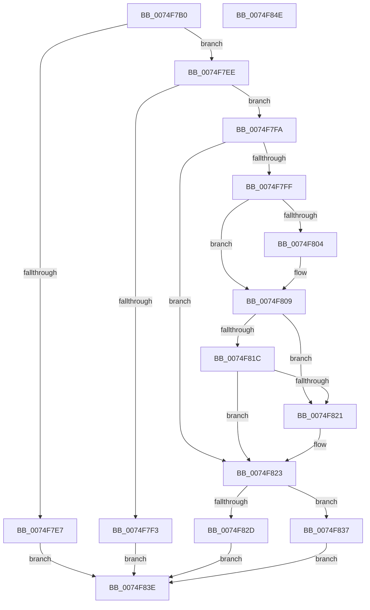

# ObSetRefTraceInformation

- RVA: `0x0074F7B0`–`0x0074F84F` (길이 `159` bytes)
- VA: `0x000000014074F7B0`
- 실행 섹션: `PAGE`
- PDB 이름 있음: `예`; PDB Function 태그: `아니요`
- unwind 정보 RVA: `0x000CB870`
- 디코드: `46`개 명령, `159/159` bytes 표시
- 미해석 바이트: `0` (있으면 어셈블리에 `.byte`로 보존)

> 이 문서는 커널 이미지의 기계어와 PDB 기호를 분석해 생성했습니다. 4번과 5번은 함수 원형과 자료형을 바이너리 사용 방식에서 추정한 C 해석이며 원본 소스 복구 결과는 아닙니다.

## 1. Dependencies

- 직접 호출 지점: **4**; 고유 호출 대상: **4**
- 직접 호출자로 확인된 함수: **1**
- RIP 상대 이미지 참조: **1**

### Outgoing calls
- `0x0074F7DE` → [SeSinglePrivilegeCheck](../87/SeSinglePrivilegeCheck_function_00871E20.md) (function, `0x00871E20`)
- `0x0074F804` → [ExRaiseDatatypeMisalignment](../89/ExRaiseDatatypeMisalignment_function_00899FD0.md) (function, `0x00899FD0`)
- `0x0074F830` → [ObpStartRuntimeStackTrace](../75/ObpStartRuntimeStackTrace_function_00750134.md) (function, `0x00750134`)
- `0x0074F837` → [ObpStopRuntimeStackTrace](../75/ObpStopRuntimeStackTrace_function_00750574.md) (function, `0x00750574`)

### Direct callers
- [NtSetSystemInformation](../AF/NtSetSystemInformation_function_00AF4A60.md) at `0x00AF5785`

### Static image references
- `0x0074F7D7` → RVA `0x00FD9A80` (`PAGEDATA`; read)

## 2. Other-region calls and transfers

- 다른 실행 섹션으로 향하는 call: **0**
- 별도 외부 분기/꼬리 이동을 확인하지 못했습니다.

## 3. Assembly (complete function range)

```asm
0074F7B0  48 89 5C 24 08                  mov qword ptr [rsp + 8], rbx
0074F7B5  48 89 74 24 10                  mov qword ptr [rsp + 0x10], rsi
0074F7BA  57                              push rdi
0074F7BB  48 83 EC 30                     sub rsp, 0x30
0074F7BF  8B FA                           mov edi, edx
0074F7C1  48 8B D9                        mov rbx, rcx
0074F7C4  65 48 8B 04 25 88 01 00 00      mov rax, qword ptr gs:[0x188]
0074F7CD  40 8A B0 32 02 00 00            mov sil, byte ptr [rax + 0x232]
0074F7D4  40 8A D6                        mov dl, sil
0074F7D7  48 8B 0D A2 A2 88 00            mov rcx, qword ptr [rip + 0x88a2a2]
0074F7DE  E8 3D 26 12 00                  call 0x140871e20
0074F7E3  84 C0                           test al, al
0074F7E5  75 07                           jne 0x14074f7ee
0074F7E7  B8 22 00 00 C0                  mov eax, 0xc0000022
0074F7EC  EB 50                           jmp 0x14074f83e
0074F7EE  83 FF 28                        cmp edi, 0x28
0074F7F1  73 07                           jae 0x14074f7fa
0074F7F3  B8 0D 00 00 C0                  mov eax, 0xc000000d
0074F7F8  EB 44                           jmp 0x14074f83e
0074F7FA  40 84 F6                        test sil, sil
0074F7FD  74 24                           je 0x14074f823
0074F7FF  F6 C3 07                        test bl, 7
0074F802  74 05                           je 0x14074f809
0074F804  E8 C7 A7 14 00                  call 0x140899fd0
0074F809  48 8D 0C 3B                     lea rcx, [rbx + rdi]
0074F80D  48 B8 00 00 FF FF FF 7F 00 00   movabs rax, 0x7fffffff0000
0074F817  48 3B C8                        cmp rcx, rax
0074F81A  77 05                           ja 0x14074f821
0074F81C  48 3B CB                        cmp rcx, rbx
0074F81F  73 02                           jae 0x14074f823
0074F821  8A 00                           mov al, byte ptr [rax]
0074F823  8A 03                           mov al, byte ptr [rbx]
0074F825  88 44 24 20                     mov byte ptr [rsp + 0x20], al
0074F829  84 C0                           test al, al
0074F82B  74 0A                           je 0x14074f837
0074F82D  48 8B CB                        mov rcx, rbx
0074F830  E8 FF 08 00 00                  call 0x140750134
0074F835  EB 07                           jmp 0x14074f83e
0074F837  E8 38 0D 00 00                  call 0x140750574
0074F83C  EB 00                           jmp 0x14074f83e
0074F83E  48 8B 5C 24 40                  mov rbx, qword ptr [rsp + 0x40]
0074F843  48 8B 74 24 48                  mov rsi, qword ptr [rsp + 0x48]
0074F848  48 83 C4 30                     add rsp, 0x30
0074F84C  5F                              pop rdi
0074F84D  C3                              ret
0074F84E  CC                              int3
```

## 4. C-style interpretation (structured pseudocode)

```c
__int64 __fastcall ObSetRefTraceInformation(__int64 a1, int a2)
{
    __int64 result;
    __int64 v_rsp;
    unsigned __int8 v_stack_m18;
    unsigned __int64 v_stack_p10;
    unsigned __int64 v_stack_p8;

    v_stack_p8 = v_rbx;
    v_stack_p10 = v_rsi;
    v_rsp = (v_rsp) - (48);
    result = SeSinglePrivilegeCheck(*(unsigned __int64 *)(v_rip + 8954530), (unsigned __int8)(*(unsigned __int8 *)(*(unsigned __int64 *)(gs_base + (0 + 392)) + 562)), a3, a4);
    if ((unsigned __int8)(result) != 0) goto loc_0074F7EE;
    goto loc_0074F83E;
loc_0074F7EE:
    if (((unsigned int)((unsigned int)(a2))) >= 40) goto loc_0074F7FA;
    goto loc_0074F83E;
loc_0074F7FA:
    if ((unsigned __int8)(*(unsigned __int8 *)(*(unsigned __int64 *)(gs_base + (0 + 392)) + 562)) == 0) goto loc_0074F823;
    result = (unsigned int)(0xC000000DULL);
    if ((((unsigned __int8)(a1)) & (7)) != 0) {
        result = ExRaiseDatatypeMisalignment(*(unsigned __int64 *)(v_rip + 8954530), (unsigned __int8)(*(unsigned __int8 *)(*(unsigned __int64 *)(gs_base + (0 + 392)) + 562)), a3, a4);
    }
    if ((a1 + (unsigned int)(a2) * 1) > result) goto loc_0074F821;
    if ((a1 + (unsigned int)(a2) * 1) < a1) {
        result = *(unsigned __int8 *)(result);
    }
    v_stack_m18 = (unsigned __int8)(*(unsigned __int8 *)(a1));
    if ((unsigned __int8)(*(unsigned __int8 *)(a1)) == 0) goto loc_0074F837;
    result = ObpStartRuntimeStackTrace(a1, (unsigned __int8)(*(unsigned __int8 *)(*(unsigned __int64 *)(gs_base + (0 + 392)) + 562)), a3, a4);
    goto loc_0074F83E;
loc_0074F837:
    result = ObpStopRuntimeStackTrace(a1, (unsigned __int8)(*(unsigned __int8 *)(*(unsigned __int64 *)(gs_base + (0 + 392)) + 562)), a3, a4);
    goto loc_0074F83E;
loc_0074F83E:
    v_rsp = (v_rsp) + (48);
    return result;
}
```

## 5. (Beta) C Style

```c
int64_t ObSetRefTraceInformation(int64_t Arg1, int32_t Arg2)
{
    int64_t result;
    int64_t local_rsp;
    uint8_t v_stack_m18;
    uint64_t v_stack_p10;
    uint64_t v_stack_p8;

    v_stack_p8 = local_rbx;
    v_stack_p10 = local_rsi;
    local_rsp = (local_rsp) - (48);
    result = SeSinglePrivilegeCheck(*(uint64_t *)(v_rip + 0x88A2A2), (uint8_t)(*(uint8_t *)(*(uint64_t *)(gs_base + (0 + 0x188)) + 0x232)), a3, a4);
    if ((uint8_t)(result) != 0) goto loc_0074F7EE;
    goto loc_0074F83E;
loc_0074F7EE:
    if (((uint32_t)((uint32_t)(Arg2))) >= 40) goto loc_0074F7FA;
    goto loc_0074F83E;
loc_0074F7FA:
    if ((uint8_t)(*(uint8_t *)(*(uint64_t *)(gs_base + (0 + 0x188)) + 0x232)) == 0) goto loc_0074F823;
    result = (uint32_t)(0xC000000DULL);
    if ((((uint8_t)(Arg1)) & (7)) != 0) {
        result = ExRaiseDatatypeMisalignment(*(uint64_t *)(v_rip + 0x88A2A2), (uint8_t)(*(uint8_t *)(*(uint64_t *)(gs_base + (0 + 0x188)) + 0x232)), a3, a4);
    }
    if ((Arg1 + (uint32_t)(Arg2) * 1) > result) goto loc_0074F821;
    if ((Arg1 + (uint32_t)(Arg2) * 1) < Arg1) {
        result = *(uint8_t *)(result);
    }
    v_stack_m18 = (uint8_t)(*(uint8_t *)(Arg1));
    if ((uint8_t)(*(uint8_t *)(Arg1)) == 0) goto loc_0074F837;
    result = ObpStartRuntimeStackTrace(Arg1, (uint8_t)(*(uint8_t *)(*(uint64_t *)(gs_base + (0 + 0x188)) + 0x232)), a3, a4);
    goto loc_0074F83E;
loc_0074F837:
    result = ObpStopRuntimeStackTrace(Arg1, (uint8_t)(*(uint8_t *)(*(uint64_t *)(gs_base + (0 + 0x188)) + 0x232)), a3, a4);
    goto loc_0074F83E;
loc_0074F83E:
    local_rsp = (local_rsp) + (48);
    return result;
}
```

## 6. Execution-region graph

[열기: 2D/3D 그래프와 함수 탐색 컨트롤 패널](../../../control-panel.html?section=page&rva=0x0074F7B0&view=graph)

- 2D 그래프는 위에서 아래로 흐르고, 3D 그래프는 빈 공간을 드래그해 회전합니다. Shift+드래그는 이동, 휠은 확대·축소, 함수 노드 선택은 대상 보고서 이동입니다.

### Static fallback


