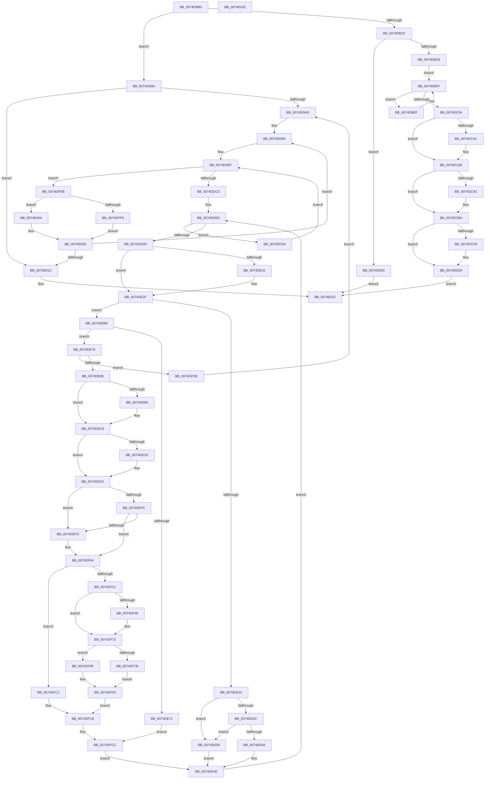

# ObShutdownSystem

- RVA: `0x0074DBB0`–`0x0074E033` (길이 `1,155` bytes)
- VA: `0x000000014074DBB0`
- 실행 섹션: `PAGE`
- PDB 이름 있음: `예`; PDB Function 태그: `아니요`
- unwind 정보 RVA: `0x000C7C30`
- 디코드: `296`개 명령, `1,155/1,155` bytes 표시
- 미해석 바이트: `0` (있으면 어셈블리에 `.byte`로 보존)

> 이 문서는 커널 이미지의 기계어와 PDB 기호를 분석해 생성했습니다. 4번과 5번은 함수 원형과 자료형을 바이너리 사용 방식에서 추정한 C 해석이며 원본 소스 복구 결과는 아닙니다.

## 1. Dependencies

- 직접 호출 지점: **34**; 고유 호출 대상: **17**
- 직접 호출자로 확인된 함수: **2**
- RIP 상대 이미지 참조: **12**

### Outgoing calls
- `0x0074DBFA` → [ObMakeTemporaryObject](../A7/ObMakeTemporaryObject_function_00A7F860.md) (function, `0x00A7F860`)
- `0x0074DC0F` → [RtlInitUnicodeString](../../text/42/RtlInitUnicodeString_function_0042A780.md) (function, `0x0042A780`)
- `0x0074DC43` → [ObReferenceObjectByName](../8C/ObReferenceObjectByName_function_008C4A00.md) (function, `0x008C4A00`)
- `0x0074DC50` → [ObMakeTemporaryObject](../A7/ObMakeTemporaryObject_function_00A7F860.md) (function, `0x00A7F860`)
- `0x0074DC59` → [ObfDereferenceObject](../../text/2F/ObfDereferenceObject_function_002F9350.md) (function, `0x002F9350`)
- `0x0074DC69` → [RtlInitUnicodeString](../../text/42/RtlInitUnicodeString_function_0042A780.md) (function, `0x0042A780`)
- `0x0074DC99` → [ObReferenceObjectByName](../8C/ObReferenceObjectByName_function_008C4A00.md) (function, `0x008C4A00`)
- `0x0074DCA6` → [ObMakeTemporaryObject](../A7/ObMakeTemporaryObject_function_00A7F860.md) (function, `0x00A7F860`)
- `0x0074DCAF` → [ObfDereferenceObject](../../text/2F/ObfDereferenceObject_function_002F9350.md) (function, `0x002F9350`)
- `0x0074DCBF` → [RtlInitUnicodeString](../../text/42/RtlInitUnicodeString_function_0042A780.md) (function, `0x0042A780`)
- `0x0074DCEF` → [ObReferenceObjectByName](../8C/ObReferenceObjectByName_function_008C4A00.md) (function, `0x008C4A00`)
- `0x0074DCFC` → [ObMakeTemporaryObject](../A7/ObMakeTemporaryObject_function_00A7F860.md) (function, `0x00A7F860`)
- `0x0074DD05` → [ObfDereferenceObject](../../text/2F/ObfDereferenceObject_function_002F9350.md) (function, `0x002F9350`)
- `0x0074DD0A` → [HalAdjustResourceList](../../text/48/HalAdjustResourceList_function_0048FDC0.md) (function, `0x0048FDC0`)
- `0x0074DD12` → [PsGetServerSiloGlobals](../../text/22/PsGetServerSiloGlobals_function_002250A0.md) (function, `0x002250A0`)
- `0x0074DD1A` → [ObCleanupSiloState](ObCleanupSiloState_function_0074D778.md) (function, `0x0074D778`)
- `0x0074DD26` → [ObfDereferenceObject](../../text/2F/ObfDereferenceObject_function_002F9350.md) (function, `0x002F9350`)
- `0x0074DD32` → [ObfDereferenceObject](../../text/2F/ObfDereferenceObject_function_002F9350.md) (function, `0x002F9350`)
- `0x0074DD3E` → [ObfDereferenceObject](../../text/2F/ObfDereferenceObject_function_002F9350.md) (function, `0x002F9350`)
- `0x0074DD4A` → [ObfDereferenceObject](../../text/2F/ObfDereferenceObject_function_002F9350.md) (function, `0x002F9350`)
- `0x0074DD56` → [ObfDereferenceObject](../../text/2F/ObfDereferenceObject_function_002F9350.md) (function, `0x002F9350`)
- `0x0074DD80` → [ExEnumHandleTable](../91/ExEnumHandleTable_function_0091DB20.md) (function, `0x0091DB20`)
- `0x0074DEA3` → [KeAbPreAcquire](../../text/21/KeAbPreAcquire_function_00210230.md) (function, `0x00210230`)
- `0x0074DEBD` → [ExfAcquirePushLockExclusiveEx](../../text/20/ExfAcquirePushLockExclusiveEx_function_0020FC90.md) (function, `0x0020FC90`)
- `0x0074DEFF` → [ExfReleasePushLock](../../text/26/ExfReleasePushLock_function_002638D0.md) (function, `0x002638D0`)
- `0x0074DF07` → [KeAbPostRelease](../../text/2E/KeAbPostRelease_function_002E1600.md) (function, `0x002E1600`)
- `0x0074DF0C` → [KeLeaveCriticalRegion](../../text/25/KeLeaveCriticalRegion_function_0025D8B0.md) (function, `0x0025D8B0`)
- `0x0074DF29` → [ExFreePoolWithTag](../../poolcode/B8/ExFreePoolWithTag_function_00B82870.md) (function, `0x00B82870`)
- `0x0074DF6D` → [guard_dispatch_icall](../../text/6B/guard_dispatch_icall_function_006BAAD0.md) (function, `0x006BAAD0`)
- `0x0074DF84` → [ObpDeleteSymbolicLinkName](../A7/ObpDeleteSymbolicLinkName_function_00A7BC80.md) (function, `0x00A7BC80`)
- `0x0074DF9A` → [ExFreePoolWithTag](../../poolcode/B8/ExFreePoolWithTag_function_00B82870.md) (function, `0x00B82870`)
- `0x0074DFB2` → [ObfDereferenceObject](../../text/2F/ObfDereferenceObject_function_002F9350.md) (function, `0x002F9350`)
- `0x0074DFBA` → [ObfDereferenceObject](../../text/2F/ObfDereferenceObject_function_002F9350.md) (function, `0x002F9350`)
- `0x0074E01C` → [ObpShutdownTraceLoggingProvider](../../init/C3/ObpShutdownTraceLoggingProvider_function_00C3C834.md) (function, `0x00C3C834`)

### Direct callers
- [PopGracefulShutdown](../../pagelk/B6/PopGracefulShutdown_function_00B6BEC8.md) at `0x00B6C068`
- [PopGracefulShutdown](../../pagelk/B6/PopGracefulShutdown_function_00B6BEC8.md) at `0x00B6C1B0`
- [sub_00B80364](../../pagelk/B8/Unknown_function_00B80364.md) at `0x00B803BE`

### Static image references
- `0x0074DBD8` → RVA `0x00F0F660` (`.data`; read)
- `0x0074DC04` → RVA `0x00B013D0` (` ?? ::NNGAKEGL::`string'`; read)
- `0x0074DC24` → RVA `0x00F0F658` (`.data`; read)
- `0x0074DC5E` → RVA `0x00B013F0` (` ?? ::NNGAKEGL::`string'`; read)
- `0x0074DCB4` → RVA `0x00B01400` (` ?? ::NNGAKEGL::`string'`; read)
- `0x0074DD1F` → RVA `0x00F0F668` (`.data`; read)
- `0x0074DD2B` → RVA `0x00F0F650` (`.data`; read)
- `0x0074DD43` → RVA `0x00F0F648` (`.data`; read)
- `0x0074DD60` → RVA `0x00FC6AB0` (`ALMOSTRO`; read)
- `0x0074DD6F` → RVA `0x0074E7C0` (`ObpShutdownCloseHandleProcedure`; read)
- `0x0074DDAD` → RVA `0x00000000` (`image boundary/outside`; read)
- `0x0074DDF6` → RVA `0x00FC6E4C` (`ALMOSTRO`; read)

## 2. Other-region calls and transfers

- 다른 실행 섹션으로 향하는 call: **24**
  - `0x0074DC0F` → [RtlInitUnicodeString](../../text/42/RtlInitUnicodeString_function_0042A780.md) (`PAGE` → `.text`)
  - `0x0074DC59` → [ObfDereferenceObject](../../text/2F/ObfDereferenceObject_function_002F9350.md) (`PAGE` → `.text`)
  - `0x0074DC69` → [RtlInitUnicodeString](../../text/42/RtlInitUnicodeString_function_0042A780.md) (`PAGE` → `.text`)
  - `0x0074DCAF` → [ObfDereferenceObject](../../text/2F/ObfDereferenceObject_function_002F9350.md) (`PAGE` → `.text`)
  - `0x0074DCBF` → [RtlInitUnicodeString](../../text/42/RtlInitUnicodeString_function_0042A780.md) (`PAGE` → `.text`)
  - `0x0074DD05` → [ObfDereferenceObject](../../text/2F/ObfDereferenceObject_function_002F9350.md) (`PAGE` → `.text`)
  - `0x0074DD0A` → [HalAdjustResourceList](../../text/48/HalAdjustResourceList_function_0048FDC0.md) (`PAGE` → `.text`)
  - `0x0074DD12` → [PsGetServerSiloGlobals](../../text/22/PsGetServerSiloGlobals_function_002250A0.md) (`PAGE` → `.text`)
  - `0x0074DD26` → [ObfDereferenceObject](../../text/2F/ObfDereferenceObject_function_002F9350.md) (`PAGE` → `.text`)
  - `0x0074DD32` → [ObfDereferenceObject](../../text/2F/ObfDereferenceObject_function_002F9350.md) (`PAGE` → `.text`)
  - `0x0074DD3E` → [ObfDereferenceObject](../../text/2F/ObfDereferenceObject_function_002F9350.md) (`PAGE` → `.text`)
  - `0x0074DD4A` → [ObfDereferenceObject](../../text/2F/ObfDereferenceObject_function_002F9350.md) (`PAGE` → `.text`)
  - `0x0074DD56` → [ObfDereferenceObject](../../text/2F/ObfDereferenceObject_function_002F9350.md) (`PAGE` → `.text`)
  - `0x0074DEA3` → [KeAbPreAcquire](../../text/21/KeAbPreAcquire_function_00210230.md) (`PAGE` → `.text`)
  - `0x0074DEBD` → [ExfAcquirePushLockExclusiveEx](../../text/20/ExfAcquirePushLockExclusiveEx_function_0020FC90.md) (`PAGE` → `.text`)
  - `0x0074DEFF` → [ExfReleasePushLock](../../text/26/ExfReleasePushLock_function_002638D0.md) (`PAGE` → `.text`)
  - `0x0074DF07` → [KeAbPostRelease](../../text/2E/KeAbPostRelease_function_002E1600.md) (`PAGE` → `.text`)
  - `0x0074DF0C` → [KeLeaveCriticalRegion](../../text/25/KeLeaveCriticalRegion_function_0025D8B0.md) (`PAGE` → `.text`)
  - `0x0074DF29` → [ExFreePoolWithTag](../../poolcode/B8/ExFreePoolWithTag_function_00B82870.md) (`PAGE` → `POOLCODE`)
  - `0x0074DF6D` → [guard_dispatch_icall](../../text/6B/guard_dispatch_icall_function_006BAAD0.md) (`PAGE` → `.text`)
  - `0x0074DF9A` → [ExFreePoolWithTag](../../poolcode/B8/ExFreePoolWithTag_function_00B82870.md) (`PAGE` → `POOLCODE`)
  - `0x0074DFB2` → [ObfDereferenceObject](../../text/2F/ObfDereferenceObject_function_002F9350.md) (`PAGE` → `.text`)
  - `0x0074DFBA` → [ObfDereferenceObject](../../text/2F/ObfDereferenceObject_function_002F9350.md) (`PAGE` → `.text`)
  - `0x0074E01C` → [ObpShutdownTraceLoggingProvider](../../init/C3/ObpShutdownTraceLoggingProvider_function_00C3C834.md) (`PAGE` → `INIT`)
- 별도 외부 분기/꼬리 이동을 확인하지 못했습니다.

## 3. Assembly (complete function range)

```asm
0074DBB0  40 55                           push rbp
0074DBB2  53                              push rbx
0074DBB3  56                              push rsi
0074DBB4  57                              push rdi
0074DBB5  41 54                           push r12
0074DBB7  41 55                           push r13
0074DBB9  41 56                           push r14
0074DBBB  41 57                           push r15
0074DBBD  48 8B EC                        mov rbp, rsp
0074DBC0  48 83 EC 78                     sub rsp, 0x78
0074DBC4  45 33 E4                        xor r12d, r12d
0074DBC7  85 C9                           test ecx, ecx
0074DBC9  0F 84 BB 01 00 00               je 0x14074dd8a
0074DBCF  83 F9 01                        cmp ecx, 1
0074DBD2  0F 84 88 01 00 00               je 0x14074dd60
0074DBD8  48 8B 3D 81 1A 7C 00            mov rdi, qword ptr [rip + 0x7c1a81]
0074DBDF  0F 57 C0                        xorps xmm0, xmm0
0074DBE2  4C 89 65 58                     mov qword ptr [rbp + 0x58], r12
0074DBE6  0F 11 45 E8                     movups xmmword ptr [rbp - 0x18], xmm0
0074DBEA  48 8B 1F                        mov rbx, qword ptr [rdi]
0074DBED  EB 10                           jmp 0x14074dbff
0074DBEF  48 8D 4B 50                     lea rcx, [rbx + 0x50]
0074DBF3  48 8B 1B                        mov rbx, qword ptr [rbx]
0074DBF6  48 89 4D 58                     mov qword ptr [rbp + 0x58], rcx
0074DBFA  E8 61 1C 33 00                  call 0x140a7f860
0074DBFF  48 3B DF                        cmp rbx, rdi
0074DC02  75 EB                           jne 0x14074dbef
0074DC04  48 8D 15 C5 37 3B 00            lea rdx, [rip + 0x3b37c5]
0074DC0B  48 8D 4D E8                     lea rcx, [rbp - 0x18]
0074DC0F  E8 6C CB CD FF                  call 0x14042a780
0074DC14  45 33 C9                        xor r9d, r9d
0074DC17  48 8D 45 58                     lea rax, [rbp + 0x58]
0074DC1B  48 89 44 24 38                  mov qword ptr [rsp + 0x38], rax
0074DC20  48 8D 4D E8                     lea rcx, [rbp - 0x18]
0074DC24  48 8B 05 2D 1A 7C 00            mov rax, qword ptr [rip + 0x7c1a2d]
0074DC2B  45 33 C0                        xor r8d, r8d
0074DC2E  4C 89 64 24 30                  mov qword ptr [rsp + 0x30], r12
0074DC33  41 8D 59 40                     lea ebx, [r9 + 0x40]
0074DC37  44 88 64 24 28                  mov byte ptr [rsp + 0x28], r12b
0074DC3C  8B D3                           mov edx, ebx
0074DC3E  48 89 44 24 20                  mov qword ptr [rsp + 0x20], rax
0074DC43  E8 B8 6D 17 00                  call 0x1408c4a00
0074DC48  85 C0                           test eax, eax
0074DC4A  78 12                           js 0x14074dc5e
0074DC4C  48 8B 4D 58                     mov rcx, qword ptr [rbp + 0x58]
0074DC50  E8 0B 1C 33 00                  call 0x140a7f860
0074DC55  48 8B 4D 58                     mov rcx, qword ptr [rbp + 0x58]
0074DC59  E8 F2 B6 BA FF                  call 0x1402f9350
0074DC5E  48 8D 15 8B 37 3B 00            lea rdx, [rip + 0x3b378b]
0074DC65  48 8D 4D E8                     lea rcx, [rbp - 0x18]
0074DC69  E8 12 CB CD FF                  call 0x14042a780
0074DC6E  48 8D 45 58                     lea rax, [rbp + 0x58]
0074DC72  45 33 C9                        xor r9d, r9d
0074DC75  48 89 44 24 38                  mov qword ptr [rsp + 0x38], rax
0074DC7A  48 8D 4D E8                     lea rcx, [rbp - 0x18]
0074DC7E  48 8B 05 D3 19 7C 00            mov rax, qword ptr [rip + 0x7c19d3]
0074DC85  45 33 C0                        xor r8d, r8d
0074DC88  4C 89 64 24 30                  mov qword ptr [rsp + 0x30], r12
0074DC8D  8B D3                           mov edx, ebx
0074DC8F  44 88 64 24 28                  mov byte ptr [rsp + 0x28], r12b
0074DC94  48 89 44 24 20                  mov qword ptr [rsp + 0x20], rax
0074DC99  E8 62 6D 17 00                  call 0x1408c4a00
0074DC9E  85 C0                           test eax, eax
0074DCA0  78 12                           js 0x14074dcb4
0074DCA2  48 8B 4D 58                     mov rcx, qword ptr [rbp + 0x58]
0074DCA6  E8 B5 1B 33 00                  call 0x140a7f860
0074DCAB  48 8B 4D 58                     mov rcx, qword ptr [rbp + 0x58]
0074DCAF  E8 9C B6 BA FF                  call 0x1402f9350
0074DCB4  48 8D 15 45 37 3B 00            lea rdx, [rip + 0x3b3745]
0074DCBB  48 8D 4D E8                     lea rcx, [rbp - 0x18]
0074DCBF  E8 BC CA CD FF                  call 0x14042a780
0074DCC4  48 8D 45 58                     lea rax, [rbp + 0x58]
0074DCC8  45 33 C9                        xor r9d, r9d
0074DCCB  48 89 44 24 38                  mov qword ptr [rsp + 0x38], rax
0074DCD0  48 8D 4D E8                     lea rcx, [rbp - 0x18]
0074DCD4  48 8B 05 7D 19 7C 00            mov rax, qword ptr [rip + 0x7c197d]
0074DCDB  45 33 C0                        xor r8d, r8d
0074DCDE  4C 89 64 24 30                  mov qword ptr [rsp + 0x30], r12
0074DCE3  8B D3                           mov edx, ebx
0074DCE5  44 88 64 24 28                  mov byte ptr [rsp + 0x28], r12b
0074DCEA  48 89 44 24 20                  mov qword ptr [rsp + 0x20], rax
0074DCEF  E8 0C 6D 17 00                  call 0x1408c4a00
0074DCF4  85 C0                           test eax, eax
0074DCF6  78 12                           js 0x14074dd0a
0074DCF8  48 8B 4D 58                     mov rcx, qword ptr [rbp + 0x58]
0074DCFC  E8 5F 1B 33 00                  call 0x140a7f860
0074DD01  48 8B 4D 58                     mov rcx, qword ptr [rbp + 0x58]
0074DD05  E8 46 B6 BA FF                  call 0x1402f9350
0074DD0A  E8 B1 20 D4 FF                  call 0x14048fdc0
0074DD0F  48 8B C8                        mov rcx, rax
0074DD12  E8 89 73 AD FF                  call 0x1402250a0
0074DD17  48 8B C8                        mov rcx, rax
0074DD1A  E8 59 FA FF FF                  call 0x14074d778
0074DD1F  48 8B 0D 42 19 7C 00            mov rcx, qword ptr [rip + 0x7c1942]
0074DD26  E8 25 B6 BA FF                  call 0x1402f9350
0074DD2B  48 8B 0D 1E 19 7C 00            mov rcx, qword ptr [rip + 0x7c191e]
0074DD32  E8 19 B6 BA FF                  call 0x1402f9350
0074DD37  48 8B 0D 1A 19 7C 00            mov rcx, qword ptr [rip + 0x7c191a]
0074DD3E  E8 0D B6 BA FF                  call 0x1402f9350
0074DD43  48 8B 0D FE 18 7C 00            mov rcx, qword ptr [rip + 0x7c18fe]
0074DD4A  E8 01 B6 BA FF                  call 0x1402f9350
0074DD4F  48 8B 0D 0A 19 7C 00            mov rcx, qword ptr [rip + 0x7c190a]
0074DD56  E8 F5 B5 BA FF                  call 0x1402f9350
0074DD5B  E9 C1 02 00 00                  jmp 0x14074e021
0074DD60  48 8B 0D 49 8D 87 00            mov rcx, qword ptr [rip + 0x878d49]
0074DD67  4C 8D 45 58                     lea r8, [rbp + 0x58]
0074DD6B  44 89 65 58                     mov dword ptr [rbp + 0x58], r12d
0074DD6F  48 8D 15 4A 0A 00 00            lea rdx, [rip + 0xa4a]
0074DD76  45 33 C9                        xor r9d, r9d
0074DD79  48 8B 89 00 03 00 00            mov rcx, qword ptr [rcx + 0x300]
0074DD80  E8 9B FD 1C 00                  call 0x14091db20
0074DD85  E9 97 02 00 00                  jmp 0x14074e021
0074DD8A  48 8B 1D D7 18 7C 00            mov rbx, qword ptr [rip + 0x7c18d7]
0074DD91  41 B8 01 00 00 00               mov r8d, 1
0074DD97  44 89 45 48                     mov dword ptr [rbp + 0x48], r8d
0074DD9B  4D 8B FC                        mov r15, r12
0074DD9E  41 8B F0                        mov esi, r8d
0074DDA1  45 8B F0                        mov r14d, r8d
0074DDA4  48 85 DB                        test rbx, rbx
0074DDA7  0F 84 6F 02 00 00               je 0x14074e01c
0074DDAD  4C 8D 1D 4C 22 8B FF            lea r11, [rip - 0x74ddb4]
0074DDB4  41 8B CC                        mov ecx, r12d
0074DDB7  89 4D 50                        mov dword ptr [rbp + 0x50], ecx
0074DDBA  83 F9 25                        cmp ecx, 0x25
0074DDBD  0F 83 28 02 00 00               jae 0x14074dfeb
0074DDC3  8B C1                           mov eax, ecx
0074DDC5  4C 8D 14 C3                     lea r10, [rbx + rax*8]
0074DDC9  4C 89 55 60                     mov qword ptr [rbp + 0x60], r10
0074DDCD  49 8B FA                        mov rdi, r10
0074DDD0  48 8B 17                        mov rdx, qword ptr [rdi]
0074DDD3  4D 8B CF                        mov r9, r15
0074DDD6  48 85 D2                        test rdx, rdx
0074DDD9  0F 84 F5 01 00 00               je 0x14074dfd4
0074DDDF  4C 8B 6A 08                     mov r13, qword ptr [rdx + 8]
0074DDE3  49 8D 45 D0                     lea rax, [r13 - 0x30]
0074DDE7  48 C1 E8 08                     shr rax, 8
0074DDEB  0F B6 C8                        movzx ecx, al
0074DDEE  41 0F B6 45 E8                  movzx eax, byte ptr [r13 - 0x18]
0074DDF3  48 33 C8                        xor rcx, rax
0074DDF6  0F B6 05 4F 90 87 00            movzx eax, byte ptr [rip + 0x87904f]
0074DDFD  48 33 C8                        xor rcx, rax
0074DE00  49 8B 84 CB 00 78 FC 00         mov rax, qword ptr [r11 + rcx*8 + 0xfc7800]
0074DE08  41 0F B6 4D EA                  movzx ecx, byte ptr [r13 - 0x16]
0074DE0D  48 89 45 D8                     mov qword ptr [rbp - 0x28], rax
0074DE11  F6 C1 02                        test cl, 2
0074DE14  74 19                           je 0x14074de2f
0074DE16  8B C1                           mov eax, ecx
0074DE18  4D 8D 65 D0                     lea r12, [r13 - 0x30]
0074DE1C  83 E0 03                        and eax, 3
0074DE1F  42 0F B6 84 18 80 FF F0 00      movzx eax, byte ptr [rax + r11 + 0xf0ff80]
0074DE28  4C 2B E0                        sub r12, rax
0074DE2B  48 8B 45 D8                     mov rax, qword ptr [rbp - 0x28]
0074DE2F  4D 85 FF                        test r15, r15
0074DE32  74 34                           je 0x14074de68
0074DE34  45 33 E4                        xor r12d, r12d
0074DE37  4D 3B EF                        cmp r13, r15
0074DE3A  75 1D                           jne 0x14074de59
0074DE3C  45 8B FC                        mov r15d, r12d
0074DE3F  44 3B F6                        cmp r14d, esi
0074DE42  76 15                           jbe 0x14074de59
0074DE44  49 8B FA                        mov rdi, r10
0074DE47  89 75 48                        mov dword ptr [rbp + 0x48], esi
0074DE4A  44 8B F6                        mov r14d, esi
0074DE4D  4C 8D 1D AC 21 8B FF            lea r11, [rip - 0x74de54]
0074DE54  E9 77 FF FF FF                  jmp 0x14074ddd0
0074DE59  4D 3B E9                        cmp r13, r9
0074DE5C  4D 8B FC                        mov r15, r12
0074DE5F  48 8B FA                        mov rdi, rdx
0074DE62  4D 0F 45 F9                     cmovne r15, r9
0074DE66  EB E5                           jmp 0x14074de4d
0074DE68  48 3B 05 F1 17 7C 00            cmp rax, qword ptr [rip + 0x7c17f1]
0074DE6F  75 08                           jne 0x14074de79
0074DE71  48 8B FA                        mov rdi, rdx
0074DE74  E9 53 01 00 00                  jmp 0x14074dfcc
0074DE79  48 3B 05 D0 17 7C 00            cmp rax, qword ptr [rip + 0x7c17d0]
0074DE80  0F 84 58 01 00 00               je 0x14074dfde
0074DE86  65 48 8B 04 25 88 01 00 00      mov rax, qword ptr gs:[0x188]
0074DE8F  4D 8D 75 E0                     lea r14, [r13 - 0x20]
0074DE93  45 33 C0                        xor r8d, r8d
0074DE96  33 D2                           xor edx, edx
0074DE98  49 8B CE                        mov rcx, r14
0074DE9B  66 FF 88 E4 01 00 00            dec word ptr [rax + 0x1e4]
0074DEA2  90                              nop
0074DEA3  E8 88 23 AC FF                  call 0x140210230
0074DEA8  F0 49 0F BA 2E 00               lock bts qword ptr [r14], 0
0074DEAE  48 89 45 E0                     mov qword ptr [rbp - 0x20], rax
0074DEB2  73 12                           jae 0x14074dec6
0074DEB4  4D 8B C6                        mov r8, r14
0074DEB7  48 8B D0                        mov rdx, rax
0074DEBA  49 8B CE                        mov rcx, r14
0074DEBD  E8 CE 1D AC FF                  call 0x14020fc90
0074DEC2  48 8B 45 E0                     mov rax, qword ptr [rbp - 0x20]
0074DEC6  45 33 C0                        xor r8d, r8d
0074DEC9  48 85 C0                        test rax, rax
0074DECC  74 04                           je 0x14074ded2
0074DECE  C6 40 0A 01                     mov byte ptr [rax + 0xa], 1
0074DED2  41 80 65 EB EF                  and byte ptr [r13 - 0x15], 0xef
0074DED7  41 0F 0D 0E                     prefetchw byte ptr [r14]
0074DEDB  49 8B 06                        mov rax, qword ptr [r14]
0074DEDE  48 8B C8                        mov rcx, rax
0074DEE1  48 83 E1 F0                     and rcx, 0xfffffffffffffff0
0074DEE5  48 83 F9 10                     cmp rcx, 0x10
0074DEE9  48 8D 50 F0                     lea rdx, [rax - 0x10]
0074DEED  49 0F 46 D0                     cmovbe rdx, r8
0074DEF1  A8 02                           test al, 2
0074DEF3  75 07                           jne 0x14074defc
0074DEF5  F0 49 0F B1 16                  lock cmpxchg qword ptr [r14], rdx
0074DEFA  74 08                           je 0x14074df04
0074DEFC  49 8B CE                        mov rcx, r14
0074DEFF  E8 CC 59 B1 FF                  call 0x1402638d0
0074DF04  49 8B CE                        mov rcx, r14
0074DF07  E8 F4 36 B9 FF                  call 0x1402e1600
0074DF0C  E8 9F F9 B0 FF                  call 0x14025d8b0
0074DF11  48 8B 0F                        mov rcx, qword ptr [rdi]
0074DF14  45 33 DB                        xor r11d, r11d
0074DF17  4D 39 5D D8                     cmp qword ptr [r13 - 0x28], r11
0074DF1B  0F 85 A0 00 00 00               jne 0x14074dfc1
0074DF21  48 8B 01                        mov rax, qword ptr [rcx]
0074DF24  33 D2                           xor edx, edx
0074DF26  48 89 07                        mov qword ptr [rdi], rax
0074DF29  E8 42 49 43 00                  call 0x140b82870
0074DF2E  4C 8B 75 D8                     mov r14, qword ptr [rbp - 0x28]
0074DF32  41 F6 46 42 08                  test byte ptr [r14 + 0x42], 8
0074DF37  75 39                           jne 0x14074df72
0074DF39  41 8B 4E 64                     mov ecx, dword ptr [r14 + 0x64]
0074DF3D  49 8D 55 F8                     lea rdx, [r13 - 8]
0074DF41  49 8B 86 98 00 00 00            mov rax, qword ptr [r14 + 0x98]
0074DF48  45 33 C0                        xor r8d, r8d
0074DF4B  44 88 44 24 40                  mov byte ptr [rsp + 0x40], r8b
0074DF50  45 33 C9                        xor r9d, r9d
0074DF53  4C 89 44 24 38                  mov qword ptr [rsp + 0x38], r8
0074DF58  89 4C 24 30                     mov dword ptr [rsp + 0x30], ecx
0074DF5C  49 8B CD                        mov rcx, r13
0074DF5F  48 89 54 24 28                  mov qword ptr [rsp + 0x28], rdx
0074DF64  41 8D 50 02                     lea edx, [r8 + 2]
0074DF68  4C 89 44 24 20                  mov qword ptr [rsp + 0x20], r8
0074DF6D  E8 5E CB F6 FF                  call 0x1406baad0
0074DF72  4C 3B 35 DF 16 7C 00            cmp r14, qword ptr [rip + 0x7c16df]
0074DF79  75 14                           jne 0x14074df8f
0074DF7B  49 8B CD                        mov rcx, r13
0074DF7E  89 75 48                        mov dword ptr [rbp + 0x48], esi
0074DF81  44 8B F6                        mov r14d, esi
0074DF84  E8 F7 DC 32 00                  call 0x140a7bc80
0074DF89  48 8B 7D 60                     mov rdi, qword ptr [rbp + 0x60]
0074DF8D  EB 04                           jmp 0x14074df93
0074DF8F  44 8B 75 48                     mov r14d, dword ptr [rbp + 0x48]
0074DF93  49 8B 4C 24 10                  mov rcx, qword ptr [r12 + 0x10]
0074DF98  33 D2                           xor edx, edx
0074DF9A  E8 D1 48 43 00                  call 0x140b82870
0074DF9F  33 C0                           xor eax, eax
0074DFA1  49 8B CD                        mov rcx, r13
0074DFA4  49 89 44 24 10                  mov qword ptr [r12 + 0x10], rax
0074DFA9  41 89 44 24 08                  mov dword ptr [r12 + 8], eax
0074DFAE  49 89 04 24                     mov qword ptr [r12], rax
0074DFB2  E8 99 B3 BA FF                  call 0x1402f9350
0074DFB7  48 8B CB                        mov rcx, rbx
0074DFBA  E8 91 B3 BA FF                  call 0x1402f9350
0074DFBF  EB 07                           jmp 0x14074dfc8
0074DFC1  44 8B 75 48                     mov r14d, dword ptr [rbp + 0x48]
0074DFC5  48 8B F9                        mov rdi, rcx
0074DFC8  4C 8B 55 60                     mov r10, qword ptr [rbp + 0x60]
0074DFCC  45 33 E4                        xor r12d, r12d
0074DFCF  E9 79 FE FF FF                  jmp 0x14074de4d
0074DFD4  8B 4D 50                        mov ecx, dword ptr [rbp + 0x50]
0074DFD7  FF C1                           inc ecx
0074DFD9  E9 D9 FD FF FF                  jmp 0x14074ddb7
0074DFDE  FF C6                           inc esi
0074DFE0  49 8B DD                        mov rbx, r13
0074DFE3  45 33 E4                        xor r12d, r12d
0074DFE6  E9 C2 FD FF FF                  jmp 0x14074ddad
0074DFEB  48 8D 4B D0                     lea rcx, [rbx - 0x30]
0074DFEF  FF CE                           dec esi
0074DFF1  0F B6 41 1A                     movzx eax, byte ptr [rcx + 0x1a]
0074DFF5  A8 02                           test al, 2
0074DFF7  74 11                           je 0x14074e00a
0074DFF9  83 E0 03                        and eax, 3
0074DFFC  42 0F B6 84 18 80 FF F0 00      movzx eax, byte ptr [rax + r11 + 0xf0ff80]
0074E005  48 2B C8                        sub rcx, rax
0074E008  EB 03                           jmp 0x14074e00d
0074E00A  49 8B CC                        mov rcx, r12
0074E00D  4C 8B FB                        mov r15, rbx
0074E010  48 8B 19                        mov rbx, qword ptr [rcx]
0074E013  48 85 DB                        test rbx, rbx
0074E016  0F 85 98 FD FF FF               jne 0x14074ddb4
0074E01C  E8 13 E8 4E 00                  call 0x140c3c834
0074E021  48 83 C4 78                     add rsp, 0x78
0074E025  41 5F                           pop r15
0074E027  41 5E                           pop r14
0074E029  41 5D                           pop r13
0074E02B  41 5C                           pop r12
0074E02D  5F                              pop rdi
0074E02E  5E                              pop rsi
0074E02F  5B                              pop rbx
0074E030  5D                              pop rbp
0074E031  C3                              ret
0074E032  CC                              int3
```

## 4. C-style interpretation (structured pseudocode)

```c
__int64 __fastcall ObShutdownSystem(int a1, __int64 a2, int a3, int a4)
{
    __int64 result;
    __int64 v_r11;
    __int64 v_r12;
    __int64 v_r15;
    __int64 v_rsi;
    __int64 v_rsp;
    unsigned __int64 v_stack_m58;
    unsigned __int64 v_stack_m60;
    unsigned __int64 v_stack_m68;
    unsigned __int8 v_stack_m78;
    unsigned __int64 v_stack_m80;
    unsigned __int64 v_stack_m88;
    unsigned __int8 v_stack_m90;
    unsigned __int64 v_stack_m98;
    unsigned int v_stack_p10;
    unsigned __int64 v_stack_p18;
    unsigned __int64 v_stack_p20;
    unsigned int v_stack_p8;

    v_rsp = (v_rsp) - (120);
    v_r12 = 0;
    if (a1 == 0) goto loc_0074DD8A;
    if (a1 == 1) goto loc_0074DD60;
    v_stack_p18 = 0;
    v_stack_m58 = v_xmm0;
    goto loc_0074DBFF;
loc_0074DBEF:
    v_stack_p18 = *(unsigned __int64 *)(*(unsigned __int64 *)(v_rip + 8133249)) + 80;
    result = ObMakeTemporaryObject(*(unsigned __int64 *)(*(unsigned __int64 *)(v_rip + 8133249)) + 80, a2, a3, a4);
loc_0074DBFF:
    if ((*(unsigned __int64 *)(*(unsigned __int64 *)(*(unsigned __int64 *)(v_rip + 8133249)))) != (*(unsigned __int64 *)(v_rip + 8133249))) goto loc_0074DBEF;
    result = RtlInitUnicodeString(v_stack_m58, v_rip + 3880901, a3, a4);
    a4 = 0;
    v_stack_m80 = v_stack_p18;
    a3 = 0;
    v_stack_m88 = 0;
    v_stack_m90 = 0;
    v_stack_m98 = *(unsigned __int64 *)(v_rip + 8133165);
    result = ObReferenceObjectByName(v_stack_m58, (unsigned int)((unsigned int)(a4 + 64)), a3, a4);
    if (!(sign_flag)) {
        a1 = v_stack_p18;
        result = ObMakeTemporaryObject(a1, (unsigned int)((unsigned int)(a4 + 64)), a3, a4);
        a1 = v_stack_p18;
        result = ObfDereferenceObject(a1, (unsigned int)((unsigned int)(a4 + 64)), a3, a4);
    }
    result = RtlInitUnicodeString(v_stack_m58, v_rip + 3880843, a3, a4);
    a4 = 0;
    v_stack_m80 = v_stack_p18;
    a3 = 0;
    v_stack_m88 = 0;
    v_stack_m90 = 0;
    v_stack_m98 = *(unsigned __int64 *)(v_rip + 8133075);
    result = ObReferenceObjectByName(v_stack_m58, (unsigned int)((unsigned int)(a4 + 64)), a3, a4);
    if (!(sign_flag)) {
        a1 = v_stack_p18;
        result = ObMakeTemporaryObject(a1, (unsigned int)((unsigned int)(a4 + 64)), a3, a4);
        a1 = v_stack_p18;
        result = ObfDereferenceObject(a1, (unsigned int)((unsigned int)(a4 + 64)), a3, a4);
    }
    result = RtlInitUnicodeString(v_stack_m58, v_rip + 3880773, a3, a4);
    a4 = 0;
    v_stack_m80 = v_stack_p18;
    a3 = 0;
    v_stack_m88 = 0;
    v_stack_m90 = 0;
    v_stack_m98 = *(unsigned __int64 *)(v_rip + 8132989);
    result = ObReferenceObjectByName(v_stack_m58, (unsigned int)((unsigned int)(a4 + 64)), a3, a4);
    if (!(sign_flag)) {
        a1 = v_stack_p18;
        result = ObMakeTemporaryObject(a1, (unsigned int)((unsigned int)(a4 + 64)), a3, a4);
        a1 = v_stack_p18;
        result = ObfDereferenceObject(a1, (unsigned int)((unsigned int)(a4 + 64)), a3, a4);
    }
    result = HalAdjustResourceList(a1, (unsigned int)((unsigned int)(a4 + 64)), a3, a4);
    result = PsGetServerSiloGlobals(result, (unsigned int)((unsigned int)(a4 + 64)), a3, a4);
    result = ObCleanupSiloState(result, (unsigned int)((unsigned int)(a4 + 64)), a3, a4);
    result = ObfDereferenceObject(*(unsigned __int64 *)(v_rip + 8132930), (unsigned int)((unsigned int)(a4 + 64)), a3, a4);
    result = ObfDereferenceObject(*(unsigned __int64 *)(v_rip + 8132894), (unsigned int)((unsigned int)(a4 + 64)), a3, a4);
    result = ObfDereferenceObject(*(unsigned __int64 *)(v_rip + 8132890), (unsigned int)((unsigned int)(a4 + 64)), a3, a4);
    result = ObfDereferenceObject(*(unsigned __int64 *)(v_rip + 8132862), (unsigned int)((unsigned int)(a4 + 64)), a3, a4);
    result = ObfDereferenceObject(*(unsigned __int64 *)(v_rip + 8132874), (unsigned int)((unsigned int)(a4 + 64)), a3, a4);
    goto loc_0074E021;
loc_0074DD60:
    v_stack_p18 = 0;
    a4 = 0;
    result = ExEnumHandleTable(*(unsigned __int64 *)(*(unsigned __int64 *)(v_rip + 8883529) + 768), v_rip + 2634, v_stack_p18, a4);
    goto loc_0074E021;
loc_0074DD8A:
    v_stack_p8 = 1;
    if (*(unsigned __int64 *)(v_rip + 8132823) == 0) goto loc_0074E01C;
loc_0074DDAD:
loc_0074DDB4:
loc_0074DDB7:
    v_stack_p10 = 0;
    if (0 >= 37) goto loc_0074DFEB;
    v_stack_p20 = *(unsigned __int64 *)(v_rip + 8132823) + 0 * 8;
loc_0074DDD0:
    if (*(unsigned __int64 *)(*(unsigned __int64 *)(v_rip + 8132823) + 0 * 8) == 0) goto loc_0074DFD4;
    result = (*(unsigned __int64 *)(*(unsigned __int64 *)(*(unsigned __int64 *)(v_rip + 8132823) + 0 * 8) + 8) - 48) >> (8);
    a1 = ((unsigned __int8)(result)) ^ (*(unsigned __int8 *)(*(unsigned __int64 *)(*(unsigned __int64 *)(*(unsigned __int64 *)(v_rip + 8132823) + 0 * 8) + 8) - 24));
    a1 = (a1) ^ (*(unsigned __int8 *)(v_rip + 8884303));
    v_stack_m68 = *(unsigned __int64 *)(v_rip - 7658932 + a1 * 8 + 16545792);
    result = *(unsigned __int64 *)(v_rip - 7658932 + a1 * 8 + 16545792);
    if ((((unsigned __int8)(*(unsigned __int8 *)(*(unsigned __int64 *)(*(unsigned __int64 *)(*(unsigned __int64 *)(v_rip + 8132823) + 0 * 8) + 8) - 22))) & (2)) != 0) {
        result = (unsigned int)(*(unsigned __int8 *)(*(unsigned __int64 *)(*(unsigned __int64 *)(*(unsigned __int64 *)(v_rip + 8132823) + 0 * 8) + 8) - 22));
        v_r12 = *(unsigned __int64 *)(*(unsigned __int64 *)(*(unsigned __int64 *)(v_rip + 8132823) + 0 * 8) + 8) - 48;
        result = (unsigned int)((result) & (3));
        result = *(unsigned __int8 *)(result + v_rip - 7658932 * 1 + 15794048);
        v_r12 = (v_r12) - (result);
        result = v_stack_m68;
    }
    if (0 == 0) goto loc_0074DE68;
    v_r12 = 0;
    if ((*(unsigned __int64 *)(*(unsigned __int64 *)(*(unsigned __int64 *)(v_rip + 8132823) + 0 * 8) + 8)) != 0) goto loc_0074DE59;
    if (1 <= 1) goto loc_0074DE59;
    v_stack_p8 = 1;
loc_0074DE4D:
    goto loc_0074DDD0;
loc_0074DE59:
    v_r15 = 0;
    if ((*(unsigned __int64 *)(*(unsigned __int64 *)(*(unsigned __int64 *)(v_rip + 8132823) + 0 * 8) + 8)) != 0) { v_r15 = 0; }
    goto loc_0074DE4D;
loc_0074DE68:
    if (result != (*(unsigned __int64 *)(v_rip + 8132593))) goto loc_0074DE79;
    goto loc_0074DFCC;
loc_0074DE79:
    if (result == (*(unsigned __int64 *)(v_rip + 8132560))) goto loc_0074DFDE;
    a3 = 0;
    a2 = 0;
    result = KeAbPreAcquire(*(unsigned __int64 *)(*(unsigned __int64 *)(*(unsigned __int64 *)(v_rip + 8132823) + 0 * 8) + 8) - 32, a2, a3, 0);
    v_stack_m60 = result;
    if (!(condition_is_above_or_equal)) {
        a3 = *(unsigned __int64 *)(*(unsigned __int64 *)(*(unsigned __int64 *)(v_rip + 8132823) + 0 * 8) + 8) - 32;
        a2 = result;
        a1 = *(unsigned __int64 *)(*(unsigned __int64 *)(*(unsigned __int64 *)(v_rip + 8132823) + 0 * 8) + 8) - 32;
        result = ExfAcquirePushLockExclusiveEx(a1, a2, a3, 0);
        result = v_stack_m60;
    }
    a3 = 0;
    if (result != 0) {
        *(unsigned __int8 *)(result + 10) = 1;
    }
    a1 = (*(unsigned __int64 *)(*(unsigned __int64 *)(*(unsigned __int64 *)(*(unsigned __int64 *)(v_rip + 8132823) + 0 * 8) + 8) - 32)) & (-16);
    a2 = *(unsigned __int64 *)(*(unsigned __int64 *)(*(unsigned __int64 *)(*(unsigned __int64 *)(v_rip + 8132823) + 0 * 8) + 8) - 32) - 16;
    if (a1 <= 16) { a2 = 0; }
    if ((((unsigned __int8)(*(unsigned __int64 *)(*(unsigned __int64 *)(*(unsigned __int64 *)(*(unsigned __int64 *)(v_rip + 8132823) + 0 * 8) + 8) - 32))) & (2)) != 0) goto loc_0074DEFC;
    result = *(unsigned __int64 *)(*(unsigned __int64 *)(*(unsigned __int64 *)(*(unsigned __int64 *)(v_rip + 8132823) + 0 * 8) + 8) - 32);
    if ((((unsigned __int8)(*(unsigned __int64 *)(*(unsigned __int64 *)(*(unsigned __int64 *)(*(unsigned __int64 *)(v_rip + 8132823) + 0 * 8) + 8) - 32))) & (2)) != 0) {
        a1 = *(unsigned __int64 *)(*(unsigned __int64 *)(*(unsigned __int64 *)(v_rip + 8132823) + 0 * 8) + 8) - 32;
        result = ExfReleasePushLock(a1, a2, a3, 0);
    }
    result = KeAbPostRelease(*(unsigned __int64 *)(*(unsigned __int64 *)(*(unsigned __int64 *)(v_rip + 8132823) + 0 * 8) + 8) - 32, a2, a3, 0);
    result = KeLeaveCriticalRegion(*(unsigned __int64 *)(*(unsigned __int64 *)(*(unsigned __int64 *)(v_rip + 8132823) + 0 * 8) + 8) - 32, a2, a3, 0);
    v_r11 = 0;
    if ((*(unsigned __int64 *)(*(unsigned __int64 *)(*(unsigned __int64 *)(*(unsigned __int64 *)(v_rip + 8132823) + 0 * 8) + 8) - 40)) != 0) goto loc_0074DFC1;
    a2 = 0;
    *(unsigned __int64 *)(*(unsigned __int64 *)(*(unsigned __int64 *)(v_rip + 8132823) + 0 * 8)) = *(unsigned __int64 *)(*(unsigned __int64 *)(*(unsigned __int64 *)(*(unsigned __int64 *)(v_rip + 8132823) + 0 * 8)));
    result = ExFreePoolWithTag(*(unsigned __int64 *)(*(unsigned __int64 *)(*(unsigned __int64 *)(v_rip + 8132823) + 0 * 8)), a2, a3, 0);
    if (((*(unsigned __int8 *)(v_stack_m68 + 66)) & (8)) == 0) {
        a1 = *(unsigned int *)(v_stack_m68 + 100);
        a2 = *(unsigned __int64 *)(*(unsigned __int64 *)(*(unsigned __int64 *)(v_rip + 8132823) + 0 * 8) + 8) - 8;
        result = *(unsigned __int64 *)(v_stack_m68 + 152);
        a3 = 0;
        v_stack_m78 = 0;
        a4 = 0;
        v_stack_m80 = 0;
        v_stack_m88 = a1;
        a1 = *(unsigned __int64 *)(*(unsigned __int64 *)(*(unsigned __int64 *)(v_rip + 8132823) + 0 * 8) + 8);
        v_stack_m90 = a2;
        a2 = a3 + 2;
        v_stack_m98 = 0;
        result = guard_dispatch_icall(a1, a2, a3, a4);
    }
    if (v_stack_m68 != (*(unsigned __int64 *)(v_rip + 8132319))) goto loc_0074DF8F;
    v_stack_p8 = 1;
    result = ObpDeleteSymbolicLinkName(*(unsigned __int64 *)(*(unsigned __int64 *)(*(unsigned __int64 *)(v_rip + 8132823) + 0 * 8) + 8), a2, a3, a4);
    goto loc_0074DF93;
loc_0074DF8F:
loc_0074DF93:
    a2 = 0;
    result = ExFreePoolWithTag(*(unsigned __int64 *)(v_r12 + 16), a2, a3, a4);
    result = 0;
    *(unsigned __int64 *)(v_r12 + 16) = 0;
    *(unsigned int *)(v_r12 + 8) = 0;
    *(unsigned __int64 *)(v_r12) = 0;
    result = ObfDereferenceObject(*(unsigned __int64 *)(*(unsigned __int64 *)(*(unsigned __int64 *)(v_rip + 8132823) + 0 * 8) + 8), a2, a3, a4);
    result = ObfDereferenceObject(*(unsigned __int64 *)(v_rip + 8132823), a2, a3, a4);
    goto loc_0074DFC8;
loc_0074DFC1:
loc_0074DFC8:
loc_0074DFCC:
    v_r12 = 0;
    goto loc_0074DE4D;
loc_0074DFD4:
    a1 = (unsigned int)(((unsigned int)(v_stack_p10)) + 1);
    goto loc_0074DDB7;
loc_0074DFDE:
    v_rsi = (unsigned int)((1) + 1);
    v_r12 = 0;
    goto loc_0074DDAD;
loc_0074DFEB:
    v_rsi = (unsigned int)((v_rsi) - 1);
    if ((((unsigned __int8)(*(unsigned __int8 *)(*(unsigned __int64 *)(*(unsigned __int64 *)(*(unsigned __int64 *)(v_rip + 8132823) + 0 * 8) + 8) - 48 + 26))) & (2)) == 0) goto loc_0074E00A;
    result = (unsigned int)((*(unsigned __int8 *)(*(unsigned __int64 *)(*(unsigned __int64 *)(*(unsigned __int64 *)(v_rip + 8132823) + 0 * 8) + 8) - 48 + 26)) & (3));
    a1 = (*(unsigned __int64 *)(*(unsigned __int64 *)(*(unsigned __int64 *)(v_rip + 8132823) + 0 * 8) + 8) - 48) - (*(unsigned __int8 *)(result + v_r11 * 1 + 15794048));
    goto loc_0074E00D;
loc_0074E00A:
loc_0074E00D:
    if (*(unsigned __int64 *)(0) != 0) goto loc_0074DDB4;
loc_0074E01C:
    result = ObpShutdownTraceLoggingProvider(0, a2, a3, a4);
loc_0074E021:
    v_rsp = (v_rsp) + (120);
    return result;
}
```

## 5. (Beta) C Style

```c
int64_t ObShutdownSystem(int32_t Arg1, int64_t Arg2, int32_t Arg3, int32_t Arg4)
{
    int64_t result;
    int64_t local_r11;
    int64_t local_r12;
    int64_t local_r15;
    int64_t local_rsi;
    int64_t local_rsp;
    uint64_t v_stack_m58;
    uint64_t v_stack_m60;
    uint64_t v_stack_m68;
    uint8_t v_stack_m78;
    uint64_t v_stack_m80;
    uint64_t v_stack_m88;
    uint8_t v_stack_m90;
    uint64_t v_stack_m98;
    uint32_t v_stack_p10;
    uint64_t v_stack_p18;
    uint64_t v_stack_p20;
    uint32_t v_stack_p8;

    local_rsp = (local_rsp) - (120);
    local_r12 = 0;
    if (Arg1 == 0) goto loc_0074DD8A;
    if (Arg1 == 1) goto loc_0074DD60;
    v_stack_p18 = 0;
    v_stack_m58 = v_xmm0;
    goto loc_0074DBFF;
loc_0074DBEF:
    v_stack_p18 = *(uint64_t *)(*(uint64_t *)(v_rip + 0x7C1A81)) + 80;
    result = ObMakeTemporaryObject(*(uint64_t *)(*(uint64_t *)(v_rip + 0x7C1A81)) + 80, Arg2, Arg3, Arg4);
loc_0074DBFF:
    if ((*(uint64_t *)(*(uint64_t *)(*(uint64_t *)(v_rip + 0x7C1A81)))) != (*(uint64_t *)(v_rip + 0x7C1A81))) goto loc_0074DBEF;
    result = RtlInitUnicodeString(v_stack_m58, v_rip + 3880901, Arg3, Arg4);
    Arg4 = 0;
    v_stack_m80 = v_stack_p18;
    Arg3 = 0;
    v_stack_m88 = 0;
    v_stack_m90 = 0;
    v_stack_m98 = *(uint64_t *)(v_rip + 0x7C1A2D);
    result = ObReferenceObjectByName(v_stack_m58, (uint32_t)((uint32_t)(Arg4 + 64)), Arg3, Arg4);
    if (!(sign_flag)) {
        Arg1 = v_stack_p18;
        result = ObMakeTemporaryObject(Arg1, (uint32_t)((uint32_t)(Arg4 + 64)), Arg3, Arg4);
        Arg1 = v_stack_p18;
        result = ObfDereferenceObject(Arg1, (uint32_t)((uint32_t)(Arg4 + 64)), Arg3, Arg4);
    }
    result = RtlInitUnicodeString(v_stack_m58, v_rip + 3880843, Arg3, Arg4);
    Arg4 = 0;
    v_stack_m80 = v_stack_p18;
    Arg3 = 0;
    v_stack_m88 = 0;
    v_stack_m90 = 0;
    v_stack_m98 = *(uint64_t *)(v_rip + 0x7C19D3);
    result = ObReferenceObjectByName(v_stack_m58, (uint32_t)((uint32_t)(Arg4 + 64)), Arg3, Arg4);
    if (!(sign_flag)) {
        Arg1 = v_stack_p18;
        result = ObMakeTemporaryObject(Arg1, (uint32_t)((uint32_t)(Arg4 + 64)), Arg3, Arg4);
        Arg1 = v_stack_p18;
        result = ObfDereferenceObject(Arg1, (uint32_t)((uint32_t)(Arg4 + 64)), Arg3, Arg4);
    }
    result = RtlInitUnicodeString(v_stack_m58, v_rip + 3880773, Arg3, Arg4);
    Arg4 = 0;
    v_stack_m80 = v_stack_p18;
    Arg3 = 0;
    v_stack_m88 = 0;
    v_stack_m90 = 0;
    v_stack_m98 = *(uint64_t *)(v_rip + 0x7C197D);
    result = ObReferenceObjectByName(v_stack_m58, (uint32_t)((uint32_t)(Arg4 + 64)), Arg3, Arg4);
    if (!(sign_flag)) {
        Arg1 = v_stack_p18;
        result = ObMakeTemporaryObject(Arg1, (uint32_t)((uint32_t)(Arg4 + 64)), Arg3, Arg4);
        Arg1 = v_stack_p18;
        result = ObfDereferenceObject(Arg1, (uint32_t)((uint32_t)(Arg4 + 64)), Arg3, Arg4);
    }
    result = HalAdjustResourceList(Arg1, (uint32_t)((uint32_t)(Arg4 + 64)), Arg3, Arg4);
    result = PsGetServerSiloGlobals(result, (uint32_t)((uint32_t)(Arg4 + 64)), Arg3, Arg4);
    result = ObCleanupSiloState(result, (uint32_t)((uint32_t)(Arg4 + 64)), Arg3, Arg4);
    result = ObfDereferenceObject(*(uint64_t *)(v_rip + 0x7C1942), (uint32_t)((uint32_t)(Arg4 + 64)), Arg3, Arg4);
    result = ObfDereferenceObject(*(uint64_t *)(v_rip + 0x7C191E), (uint32_t)((uint32_t)(Arg4 + 64)), Arg3, Arg4);
    result = ObfDereferenceObject(*(uint64_t *)(v_rip + 0x7C191A), (uint32_t)((uint32_t)(Arg4 + 64)), Arg3, Arg4);
    result = ObfDereferenceObject(*(uint64_t *)(v_rip + 0x7C18FE), (uint32_t)((uint32_t)(Arg4 + 64)), Arg3, Arg4);
    result = ObfDereferenceObject(*(uint64_t *)(v_rip + 0x7C190A), (uint32_t)((uint32_t)(Arg4 + 64)), Arg3, Arg4);
    goto loc_0074E021;
loc_0074DD60:
    v_stack_p18 = 0;
    Arg4 = 0;
    result = ExEnumHandleTable(*(uint64_t *)(*(uint64_t *)(v_rip + 0x878D49) + 0x300), v_rip + 2634, v_stack_p18, Arg4);
    goto loc_0074E021;
loc_0074DD8A:
    v_stack_p8 = 1;
    if (*(uint64_t *)(v_rip + 0x7C18D7) == 0) goto loc_0074E01C;
loc_0074DDAD:
loc_0074DDB4:
loc_0074DDB7:
    v_stack_p10 = 0;
    if (0 >= 37) goto loc_0074DFEB;
    v_stack_p20 = *(uint64_t *)(v_rip + 0x7C18D7) + 0 * 8;
loc_0074DDD0:
    if (*(uint64_t *)(*(uint64_t *)(v_rip + 0x7C18D7) + 0x0 * 8) == 0) goto loc_0074DFD4;
    result = (*(uint64_t *)(*(uint64_t *)(*(uint64_t *)(v_rip + 0x7C18D7) + 0x0 * 8) + 0x8) - 48) >> (8);
    Arg1 = ((uint8_t)(result)) ^ (*(uint8_t *)(*(uint64_t *)(*(uint64_t *)(*(uint64_t *)(v_rip + 0x7C18D7) + 0x0 * 8) + 0x8) - 0x18));
    Arg1 = (Arg1) ^ (*(uint8_t *)(v_rip + 0x87904F));
    v_stack_m68 = *(uint64_t *)(v_rip - 0x74DDB4 + Arg1 * 8 + 0xFC7800);
    result = *(uint64_t *)(v_rip - 0x74DDB4 + Arg1 * 8 + 0xFC7800);
    if ((((uint8_t)(*(uint8_t *)(*(uint64_t *)(*(uint64_t *)(*(uint64_t *)(v_rip + 0x7C18D7) + 0x0 * 8) + 0x8) - 0x16))) & (2)) != 0) {
        result = (uint32_t)(*(uint8_t *)(*(uint64_t *)(*(uint64_t *)(*(uint64_t *)(v_rip + 0x7C18D7) + 0x0 * 8) + 0x8) - 0x16));
        local_r12 = *(uint64_t *)(*(uint64_t *)(*(uint64_t *)(v_rip + 0x7C18D7) + 0x0 * 8) + 0x8) - 48;
        result = (uint32_t)((result) & (3));
        result = *(uint8_t *)(result + v_rip - 0x74DDB4 * 1 + 0xF0FF80);
        local_r12 = (local_r12) - (result);
        result = v_stack_m68;
    }
    if (0 == 0) goto loc_0074DE68;
    local_r12 = 0;
    if ((*(uint64_t *)(*(uint64_t *)(*(uint64_t *)(v_rip + 0x7C18D7) + 0x0 * 8) + 0x8)) != 0) goto loc_0074DE59;
    if (1 <= 1) goto loc_0074DE59;
    v_stack_p8 = 1;
loc_0074DE4D:
    goto loc_0074DDD0;
loc_0074DE59:
    local_r15 = 0;
    if ((*(uint64_t *)(*(uint64_t *)(*(uint64_t *)(v_rip + 0x7C18D7) + 0x0 * 8) + 0x8)) != 0) { local_r15 = 0; }
    goto loc_0074DE4D;
loc_0074DE68:
    if (result != (*(uint64_t *)(v_rip + 0x7C17F1))) goto loc_0074DE79;
    goto loc_0074DFCC;
loc_0074DE79:
    if (result == (*(uint64_t *)(v_rip + 0x7C17D0))) goto loc_0074DFDE;
    Arg3 = 0;
    Arg2 = 0;
    result = KeAbPreAcquire(*(uint64_t *)(*(uint64_t *)(*(uint64_t *)(v_rip + 0x7C18D7) + 0x0 * 8) + 0x8) - 32, Arg2, Arg3, 0);
    v_stack_m60 = result;
    if (!(condition_is_above_or_equal)) {
        Arg3 = *(uint64_t *)(*(uint64_t *)(*(uint64_t *)(v_rip + 0x7C18D7) + 0x0 * 8) + 0x8) - 32;
        Arg2 = result;
        Arg1 = *(uint64_t *)(*(uint64_t *)(*(uint64_t *)(v_rip + 0x7C18D7) + 0x0 * 8) + 0x8) - 32;
        result = ExfAcquirePushLockExclusiveEx(Arg1, Arg2, Arg3, 0);
        result = v_stack_m60;
    }
    Arg3 = 0;
    if (result != 0) {
        *(uint8_t *)(result + 0xA) = 1;
    }
    Arg1 = (*(uint64_t *)(*(uint64_t *)(*(uint64_t *)(*(uint64_t *)(v_rip + 0x7C18D7) + 0x0 * 8) + 0x8) - 0x20)) & (-16);
    Arg2 = *(uint64_t *)(*(uint64_t *)(*(uint64_t *)(*(uint64_t *)(v_rip + 0x7C18D7) + 0x0 * 8) + 0x8) - 0x20) - 16;
    if (Arg1 <= 16) { Arg2 = 0; }
    if ((((uint8_t)(*(uint64_t *)(*(uint64_t *)(*(uint64_t *)(*(uint64_t *)(v_rip + 0x7C18D7) + 0x0 * 8) + 0x8) - 0x20))) & (2)) != 0) goto loc_0074DEFC;
    result = *(uint64_t *)(*(uint64_t *)(*(uint64_t *)(*(uint64_t *)(v_rip + 0x7C18D7) + 0x0 * 8) + 0x8) - 0x20);
    if ((((uint8_t)(*(uint64_t *)(*(uint64_t *)(*(uint64_t *)(*(uint64_t *)(v_rip + 0x7C18D7) + 0x0 * 8) + 0x8) - 0x20))) & (2)) != 0) {
        Arg1 = *(uint64_t *)(*(uint64_t *)(*(uint64_t *)(v_rip + 0x7C18D7) + 0x0 * 8) + 0x8) - 32;
        result = ExfReleasePushLock(Arg1, Arg2, Arg3, 0);
    }
    result = KeAbPostRelease(*(uint64_t *)(*(uint64_t *)(*(uint64_t *)(v_rip + 0x7C18D7) + 0x0 * 8) + 0x8) - 32, Arg2, Arg3, 0);
    result = KeLeaveCriticalRegion(*(uint64_t *)(*(uint64_t *)(*(uint64_t *)(v_rip + 0x7C18D7) + 0x0 * 8) + 0x8) - 32, Arg2, Arg3, 0);
    local_r11 = 0;
    if ((*(uint64_t *)(*(uint64_t *)(*(uint64_t *)(*(uint64_t *)(v_rip + 0x7C18D7) + 0x0 * 8) + 0x8) - 0x28)) != 0) goto loc_0074DFC1;
    Arg2 = 0;
    *(uint64_t *)(*(uint64_t *)(*(uint64_t *)(v_rip + 0x7C18D7) + 0x0 * 8)) = *(uint64_t *)(*(uint64_t *)(*(uint64_t *)(*(uint64_t *)(v_rip + 0x7C18D7) + 0x0 * 8)));
    result = ExFreePoolWithTag(*(uint64_t *)(*(uint64_t *)(*(uint64_t *)(v_rip + 0x7C18D7) + 0x0 * 8)), Arg2, Arg3, 0);
    if (((*(uint8_t *)(v_stack_m68 + 0x42)) & (8)) == 0) {
        Arg1 = *(uint32_t *)(v_stack_m68 + 0x64);
        Arg2 = *(uint64_t *)(*(uint64_t *)(*(uint64_t *)(v_rip + 0x7C18D7) + 0x0 * 8) + 0x8) - 8;
        result = *(uint64_t *)(v_stack_m68 + 0x98);
        Arg3 = 0;
        v_stack_m78 = 0;
        Arg4 = 0;
        v_stack_m80 = 0;
        v_stack_m88 = Arg1;
        Arg1 = *(uint64_t *)(*(uint64_t *)(*(uint64_t *)(v_rip + 0x7C18D7) + 0x0 * 8) + 0x8);
        v_stack_m90 = Arg2;
        Arg2 = Arg3 + 2;
        v_stack_m98 = 0;
        result = guard_dispatch_icall(Arg1, Arg2, Arg3, Arg4);
    }
    if (v_stack_m68 != (*(uint64_t *)(v_rip + 0x7C16DF))) goto loc_0074DF8F;
    v_stack_p8 = 1;
    result = ObpDeleteSymbolicLinkName(*(uint64_t *)(*(uint64_t *)(*(uint64_t *)(v_rip + 0x7C18D7) + 0x0 * 8) + 0x8), Arg2, Arg3, Arg4);
    goto loc_0074DF93;
loc_0074DF8F:
loc_0074DF93:
    Arg2 = 0;
    result = ExFreePoolWithTag(*(uint64_t *)(local_r12 + 0x10), Arg2, Arg3, Arg4);
    result = 0;
    *(uint64_t *)(local_r12 + 0x10) = 0;
    *(uint32_t *)(local_r12 + 0x8) = 0;
    *(uint64_t *)(local_r12) = 0;
    result = ObfDereferenceObject(*(uint64_t *)(*(uint64_t *)(*(uint64_t *)(v_rip + 0x7C18D7) + 0x0 * 8) + 0x8), Arg2, Arg3, Arg4);
    result = ObfDereferenceObject(*(uint64_t *)(v_rip + 0x7C18D7), Arg2, Arg3, Arg4);
    goto loc_0074DFC8;
loc_0074DFC1:
loc_0074DFC8:
loc_0074DFCC:
    local_r12 = 0;
    goto loc_0074DE4D;
loc_0074DFD4:
    Arg1 = (uint32_t)(((uint32_t)(v_stack_p10)) + 1);
    goto loc_0074DDB7;
loc_0074DFDE:
    local_rsi = (uint32_t)((1) + 1);
    local_r12 = 0;
    goto loc_0074DDAD;
loc_0074DFEB:
    local_rsi = (uint32_t)((local_rsi) - 1);
    if ((((uint8_t)(*(uint8_t *)(*(uint64_t *)(*(uint64_t *)(*(uint64_t *)(v_rip + 0x7C18D7) + 0x0 * 8) + 0x8) - 0x30 + 0x1A))) & (2)) == 0) goto loc_0074E00A;
    result = (uint32_t)((*(uint8_t *)(*(uint64_t *)(*(uint64_t *)(*(uint64_t *)(v_rip + 0x7C18D7) + 0x0 * 8) + 0x8) - 0x30 + 0x1A)) & (3));
    Arg1 = (*(uint64_t *)(*(uint64_t *)(*(uint64_t *)(v_rip + 0x7C18D7) + 0x0 * 8) + 0x8) - 48) - (*(uint8_t *)(result + local_r11 * 1 + 0xF0FF80));
    goto loc_0074E00D;
loc_0074E00A:
loc_0074E00D:
    if (*(uint64_t *)(0) != 0) goto loc_0074DDB4;
loc_0074E01C:
    result = ObpShutdownTraceLoggingProvider(0, Arg2, Arg3, Arg4);
loc_0074E021:
    local_rsp = (local_rsp) + (120);
    return result;
}
```

## 6. Execution-region graph

[열기: 2D/3D 그래프와 함수 탐색 컨트롤 패널](../../../control-panel.html?section=page&rva=0x0074DBB0&view=graph)

- 2D 그래프는 위에서 아래로 흐르고, 3D 그래프는 빈 공간을 드래그해 회전합니다. Shift+드래그는 이동, 휠은 확대·축소, 함수 노드 선택은 대상 보고서 이동입니다.

### Static fallback


