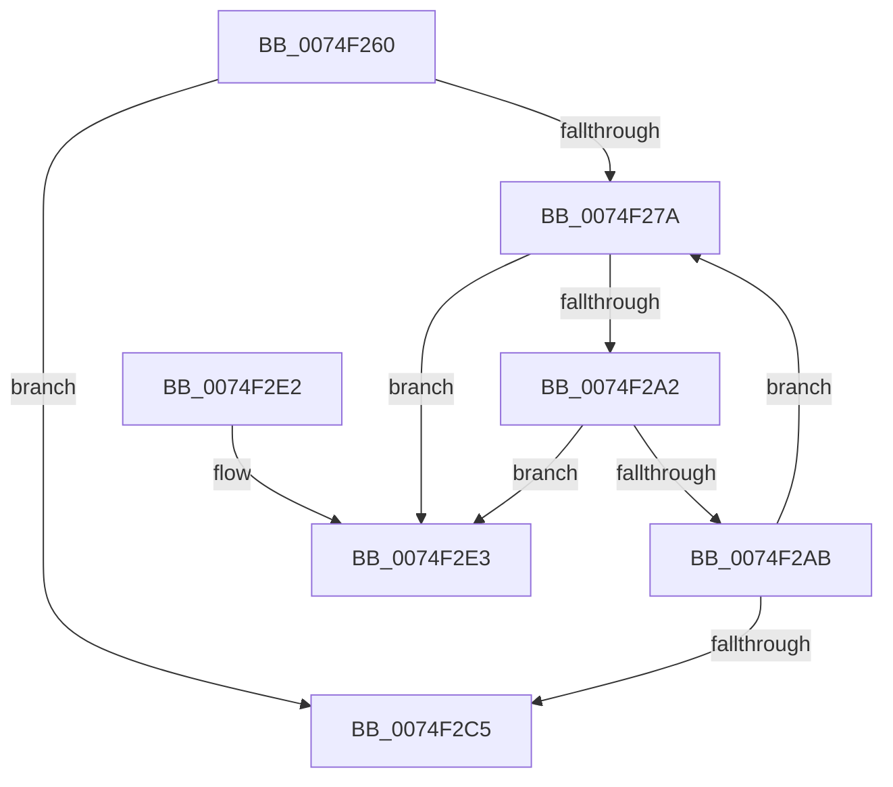

# ObUnRegisterCallbacks

- RVA: `0x0074F260`–`0x0074F2EA` (길이 `138` bytes)
- VA: `0x000000014074F260`
- 실행 섹션: `PAGE`
- PDB 이름 있음: `예`; PDB Function 태그: `아니요`
- unwind 정보 RVA: `0x0006383C`
- 디코드: `41`개 명령, `138/138` bytes 표시
- 미해석 바이트: `0` (있으면 어셈블리에 `.byte`로 보존)

> 이 문서는 커널 이미지의 기계어와 PDB 기호를 분석해 생성했습니다. 4번과 5번은 함수 원형과 자료형을 바이너리 사용 방식에서 추정한 C 해석이며 원본 소스 복구 결과는 아닙니다.

## 1. Dependencies

- 직접 호출 지점: **4**; 고유 호출 대상: **4**
- 직접 호출자로 확인된 함수: **0**
- RIP 상대 이미지 참조: **0**

### Outgoing calls
- `0x0074F28B` → [ExWaitForRundownProtectionRelease](../../text/2A/ExWaitForRundownProtectionRelease_function_002A4CB0.md) (function, `0x002A4CB0`)
- `0x0074F294` → [ObpLockObjectTypeExclusive](../9D/ObpLockObjectTypeExclusive_function_009DB5C4.md) (function, `0x009DB5C4`)
- `0x0074F2B6` → [ObpUnlockObjectType](../9D/ObpUnlockObjectType_function_009DB54C.md) (function, `0x009DB54C`)
- `0x0074F2CD` → [ExFreePoolWithTag](../../poolcode/B8/ExFreePoolWithTag_function_00B82870.md) (function, `0x00B82870`)

### Direct callers
- 이 함수 시작 RVA로 연결되는 직접 call은 확인되지 않았습니다. 간접 호출은 완전히 역산할 수 없습니다.

### Static image references
- 디코드된 RIP-relative 메모리 참조가 없습니다.

## 2. Other-region calls and transfers

- 다른 실행 섹션으로 향하는 call: **2**
  - `0x0074F28B` → [ExWaitForRundownProtectionRelease](../../text/2A/ExWaitForRundownProtectionRelease_function_002A4CB0.md) (`PAGE` → `.text`)
  - `0x0074F2CD` → [ExFreePoolWithTag](../../poolcode/B8/ExFreePoolWithTag_function_00B82870.md) (`PAGE` → `POOLCODE`)
- 별도 외부 분기/꼬리 이동을 확인하지 못했습니다.

## 3. Assembly (complete function range)

```asm
0074F260  48 89 5C 24 08                  mov qword ptr [rsp + 8], rbx
0074F265  48 89 74 24 10                  mov qword ptr [rsp + 0x10], rsi
0074F26A  57                              push rdi
0074F26B  48 83 EC 20                     sub rsp, 0x20
0074F26F  33 FF                           xor edi, edi
0074F271  48 8B F1                        mov rsi, rcx
0074F274  66 3B 79 02                     cmp di, word ptr [rcx + 2]
0074F278  73 4B                           jae 0x14074f2c5
0074F27A  8B DF                           mov ebx, edi
0074F27C  48 C1 E3 06                     shl rbx, 6
0074F280  48 83 C3 20                     add rbx, 0x20
0074F284  48 03 DE                        add rbx, rsi
0074F287  48 8D 4B 38                     lea rcx, [rbx + 0x38]
0074F28B  E8 20 5A B5 FF                  call 0x1402a4cb0
0074F290  48 8B 4B 20                     mov rcx, qword ptr [rbx + 0x20]
0074F294  E8 2B C3 28 00                  call 0x1409db5c4
0074F299  48 8B 0B                        mov rcx, qword ptr [rbx]
0074F29C  48 39 59 08                     cmp qword ptr [rcx + 8], rbx
0074F2A0  75 41                           jne 0x14074f2e3
0074F2A2  48 8B 43 08                     mov rax, qword ptr [rbx + 8]
0074F2A6  48 39 18                        cmp qword ptr [rax], rbx
0074F2A9  75 38                           jne 0x14074f2e3
0074F2AB  48 89 08                        mov qword ptr [rax], rcx
0074F2AE  48 89 41 08                     mov qword ptr [rcx + 8], rax
0074F2B2  48 8B 4B 20                     mov rcx, qword ptr [rbx + 0x20]
0074F2B6  E8 91 C2 28 00                  call 0x1409db54c
0074F2BB  0F B7 46 02                     movzx eax, word ptr [rsi + 2]
0074F2BF  FF C7                           inc edi
0074F2C1  3B F8                           cmp edi, eax
0074F2C3  72 B5                           jb 0x14074f27a
0074F2C5  BA 4F 62 46 6C                  mov edx, 0x6c46624f
0074F2CA  48 8B CE                        mov rcx, rsi
0074F2CD  E8 9E 35 43 00                  call 0x140b82870
0074F2D2  48 8B 5C 24 30                  mov rbx, qword ptr [rsp + 0x30]
0074F2D7  48 8B 74 24 38                  mov rsi, qword ptr [rsp + 0x38]
0074F2DC  48 83 C4 20                     add rsp, 0x20
0074F2E0  5F                              pop rdi
0074F2E1  C3                              ret
0074F2E2  CC                              int3
0074F2E3  B9 03 00 00 00                  mov ecx, 3
0074F2E8  CD 29                           int 0x29
```

## 4. C-style interpretation (structured pseudocode)

```c
__int64 __fastcall ObUnRegisterCallbacks(__int64 a1)
{
    __int64 result;
    __int64 v_rbx;
    __int64 v_rdi;
    __int64 v_rsp;
    unsigned __int64 v_stack_p10;
    unsigned __int64 v_stack_p8;

    v_stack_p8 = v_rbx;
    v_stack_p10 = v_rsi;
    v_rsp = (v_rsp) - (32);
    v_rdi = 0;
    if (0 >= (*(unsigned __int16 *)(a1 + 2))) goto loc_0074F2C5;
loc_0074F27A:
    v_rbx = (0) << (6);
    v_rbx = (v_rbx) + (32);
    v_rbx = (v_rbx) + (a1);
    result = ExWaitForRundownProtectionRelease(v_rbx + 56, a2, a3, a4);
    result = ObpLockObjectTypeExclusive(*(unsigned __int64 *)(v_rbx + 32), a2, a3, a4);
    if ((*(unsigned __int64 *)(*(unsigned __int64 *)(v_rbx) + 8)) != v_rbx) goto loc_0074F2E3;
    if ((*(unsigned __int64 *)(*(unsigned __int64 *)(v_rbx + 8))) != v_rbx) goto loc_0074F2E3;
    *(unsigned __int64 *)(*(unsigned __int64 *)(v_rbx + 8)) = *(unsigned __int64 *)(v_rbx);
    *(unsigned __int64 *)(*(unsigned __int64 *)(v_rbx) + 8) = *(unsigned __int64 *)(v_rbx + 8);
    result = ObpUnlockObjectType(*(unsigned __int64 *)(v_rbx + 32), a2, a3, a4);
    v_rdi = (unsigned int)((v_rdi) + 1);
    if (((unsigned int)(v_rdi)) < ((unsigned int)(*(unsigned __int16 *)(a1 + 2)))) goto loc_0074F27A;
loc_0074F2C5:
    result = ExFreePoolWithTag(a1, (unsigned int)(0x6C46624FULL), a3, a4);
    v_rsp = (v_rsp) + (32);
    return result;
loc_0074F2E3:
    return result;
}
```

## 5. (Beta) C Style

```c
int64_t ObUnRegisterCallbacks(void *Arg1)
{
    uint8_t *arg1 = (uint8_t *)Arg1;

    int64_t result;
    int64_t local_rbx;
    int64_t local_rdi;
    int64_t local_rsp;
    uint64_t v_stack_p10;
    uint64_t v_stack_p8;

    v_stack_p8 = local_rbx;
    v_stack_p10 = local_rsi;
    local_rsp = (local_rsp) - (32);
    local_rdi = 0;
    if (0 >= (*(uint16_t *)(arg1 + 0x2))) goto loc_0074F2C5;
loc_0074F27A:
    local_rbx = (0) << (6);
    local_rbx = (local_rbx) + (32);
    local_rbx = (local_rbx) + (Arg1);
    result = ExWaitForRundownProtectionRelease(local_rbx + 56, a2, a3, a4);
    result = ObpLockObjectTypeExclusive(*(uint64_t *)(local_rbx + 0x20), a2, a3, a4);
    if ((*(uint64_t *)(*(uint64_t *)(local_rbx) + 0x8)) != local_rbx) goto loc_0074F2E3;
    if ((*(uint64_t *)(*(uint64_t *)(local_rbx + 0x8))) != local_rbx) goto loc_0074F2E3;
    *(uint64_t *)(*(uint64_t *)(local_rbx + 0x8)) = *(uint64_t *)(local_rbx);
    *(uint64_t *)(*(uint64_t *)(local_rbx) + 0x8) = *(uint64_t *)(local_rbx + 0x8);
    result = ObpUnlockObjectType(*(uint64_t *)(local_rbx + 0x20), a2, a3, a4);
    local_rdi = (uint32_t)((local_rdi) + 1);
    if (((uint32_t)(local_rdi)) < ((uint32_t)(*(uint16_t *)(arg1 + 0x2)))) goto loc_0074F27A;
loc_0074F2C5:
    result = ExFreePoolWithTag(Arg1, (uint32_t)(0x6C46624FULL), a3, a4);
    local_rsp = (local_rsp) + (32);
    return result;
loc_0074F2E3:
    return result;
}
```

### 관측된 메모리 오프셋

구조체 형식이 확인되지 않은 접근은 인자 기준의 오프셋으로만 기록했습니다.

| 기준 인자 | 오프셋 표현 | 폭 (bit) | 접근 |
|---|---:|---:|---|
| `Arg1` | `+ 0x2` | `16` | `R` |

## 6. Execution-region graph

[열기: 2D/3D 그래프와 함수 탐색 컨트롤 패널](../../../control-panel.html?section=page&rva=0x0074F260&view=graph)

- 2D 그래프는 위에서 아래로 흐르고, 3D 그래프는 빈 공간을 드래그해 회전합니다. Shift+드래그는 이동, 휠은 확대·축소, 함수 노드 선택은 대상 보고서 이동입니다.

### Static fallback


