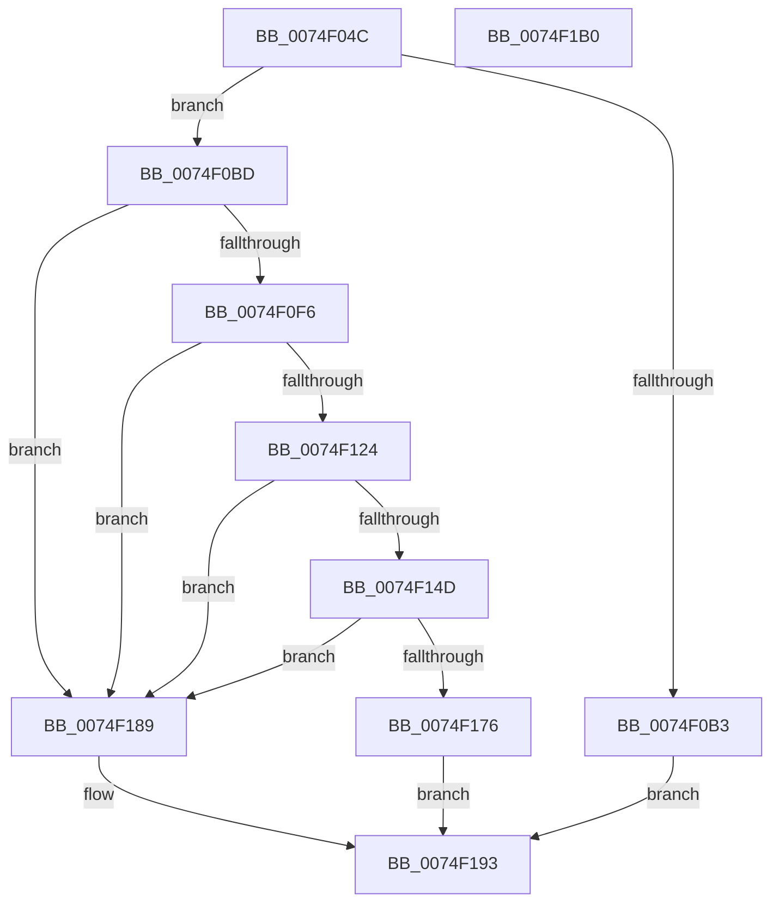

# ObpCreateDefaultObjectTypeSD

- RVA: `0x0074F04C`–`0x0074F1B1` (길이 `357` bytes)
- VA: `0x000000014074F04C`
- 실행 섹션: `PAGE`
- PDB 이름 있음: `예`; PDB Function 태그: `아니요`
- unwind 정보 RVA: `0x0005D7BC`
- 디코드: `97`개 명령, `357/357` bytes 표시
- 미해석 바이트: `0` (있으면 어셈블리에 `.byte`로 보존)

> 이 문서는 커널 이미지의 기계어와 PDB 기호를 분석해 생성했습니다. 4번과 5번은 함수 원형과 자료형을 바이너리 사용 방식에서 추정한 C 해석이며 원본 소스 복구 결과는 아닙니다.

## 1. Dependencies

- 직접 호출 지점: **10**; 고유 호출 대상: **6**
- 직접 호출자로 확인된 함수: **1**
- RIP 상대 이미지 참조: **3**

### Outgoing calls
- `0x0074F06F` → [RtlLengthSid](../../text/45/RtlLengthSid_function_0045D270.md) (function, `0x0045D270`)
- `0x0074F07D` → [RtlLengthSid](../../text/45/RtlLengthSid_function_0045D270.md) (function, `0x0045D270`)
- `0x0074F08B` → [RtlLengthSid](../../text/45/RtlLengthSid_function_0045D270.md) (function, `0x0045D270`)
- `0x0074F0A6` → [ExAllocatePool2](../../poolcode/B8/ExAllocatePool2_function_00B820F0.md) (function, `0x00B820F0`)
- `0x0074F0D7` → [memset](../../text/6C/memset_function_006C6C40.md) (function, `0x006C6C40`)
- `0x0074F0E7` → [RtlCreateAcl](../91/RtlCreateAcl_function_00916F00.md) (function, `0x00916F00`)
- `0x0074F119` → [RtlpAddKnownAce](../92/RtlpAddKnownAce_function_00929A20.md) (function, `0x00929A20`)
- `0x0074F142` → [RtlpAddKnownAce](../92/RtlpAddKnownAce_function_00929A20.md) (function, `0x00929A20`)
- `0x0074F16B` → [RtlpAddKnownAce](../92/RtlpAddKnownAce_function_00929A20.md) (function, `0x00929A20`)
- `0x0074F18E` → [ExFreePoolWithTag](../../poolcode/B8/ExFreePoolWithTag_function_00B82870.md) (function, `0x00B82870`)

### Direct callers
- [ObpInitObjectTypeSD](ObpInitObjectTypeSD_function_0074F1B8.md) at `0x0074F1E1`

### Static image references
- `0x0074F068` → RVA `0x00E67D48` (`.data`; read)
- `0x0074F074` → RVA `0x00FD9A68` (`PAGEDATA`; read)
- `0x0074F082` → RVA `0x00E67D58` (`.data`; read)

## 2. Other-region calls and transfers

- 다른 실행 섹션으로 향하는 call: **6**
  - `0x0074F06F` → [RtlLengthSid](../../text/45/RtlLengthSid_function_0045D270.md) (`PAGE` → `.text`)
  - `0x0074F07D` → [RtlLengthSid](../../text/45/RtlLengthSid_function_0045D270.md) (`PAGE` → `.text`)
  - `0x0074F08B` → [RtlLengthSid](../../text/45/RtlLengthSid_function_0045D270.md) (`PAGE` → `.text`)
  - `0x0074F0A6` → [ExAllocatePool2](../../poolcode/B8/ExAllocatePool2_function_00B820F0.md) (`PAGE` → `POOLCODE`)
  - `0x0074F0D7` → [memset](../../text/6C/memset_function_006C6C40.md) (`PAGE` → `.text`)
  - `0x0074F18E` → [ExFreePoolWithTag](../../poolcode/B8/ExFreePoolWithTag_function_00B82870.md) (`PAGE` → `POOLCODE`)
- 별도 외부 분기/꼬리 이동을 확인하지 못했습니다.

## 3. Assembly (complete function range)

```asm
0074F04C  48 8B C4                        mov rax, rsp
0074F04F  48 89 58 08                     mov qword ptr [rax + 8], rbx
0074F053  48 89 68 10                     mov qword ptr [rax + 0x10], rbp
0074F057  48 89 70 18                     mov qword ptr [rax + 0x18], rsi
0074F05B  48 89 78 20                     mov qword ptr [rax + 0x20], rdi
0074F05F  41 56                           push r14
0074F061  48 83 EC 30                     sub rsp, 0x30
0074F065  4C 8B F1                        mov r14, rcx
0074F068  48 8B 0D D9 8C 71 00            mov rcx, qword ptr [rip + 0x718cd9]
0074F06F  E8 FC E1 D0 FF                  call 0x14045d270
0074F074  48 8B 0D ED A9 88 00            mov rcx, qword ptr [rip + 0x88a9ed]
0074F07B  8B D8                           mov ebx, eax
0074F07D  E8 EE E1 D0 FF                  call 0x14045d270
0074F082  48 8B 0D CF 8C 71 00            mov rcx, qword ptr [rip + 0x718ccf]
0074F089  03 D8                           add ebx, eax
0074F08B  E8 E0 E1 D0 FF                  call 0x14045d270
0074F090  B9 00 01 00 00                  mov ecx, 0x100
0074F095  41 B8 44 61 63 6C               mov r8d, 0x6c636144
0074F09B  8D 78 2C                        lea edi, [rax + 0x2c]
0074F09E  03 FB                           add edi, ebx
0074F0A0  8B EF                           mov ebp, edi
0074F0A2  48 8D 57 14                     lea rdx, [rdi + 0x14]
0074F0A6  E8 45 30 43 00                  call 0x140b820f0
0074F0AB  48 8B D8                        mov rbx, rax
0074F0AE  48 85 C0                        test rax, rax
0074F0B1  75 0A                           jne 0x14074f0bd
0074F0B3  BF 9A 00 00 C0                  mov edi, 0xc000009a
0074F0B8  E9 D6 00 00 00                  jmp 0x14074f193
0074F0BD  0F 57 C0                        xorps xmm0, xmm0
0074F0C0  48 8D 73 14                     lea rsi, [rbx + 0x14]
0074F0C4  0F 11 03                        movups xmmword ptr [rbx], xmm0
0074F0C7  33 C0                           xor eax, eax
0074F0C9  4C 8B C5                        mov r8, rbp
0074F0CC  89 43 10                        mov dword ptr [rbx + 0x10], eax
0074F0CF  33 D2                           xor edx, edx
0074F0D1  48 8B CE                        mov rcx, rsi
0074F0D4  C6 03 01                        mov byte ptr [rbx], 1
0074F0D7  E8 64 7B F7 FF                  call 0x1406c6c40
0074F0DC  41 B8 02 00 00 00               mov r8d, 2
0074F0E2  8B D7                           mov edx, edi
0074F0E4  48 8B CE                        mov rcx, rsi
0074F0E7  E8 14 7E 1C 00                  call 0x140916f00
0074F0EC  8B F8                           mov edi, eax
0074F0EE  85 C0                           test eax, eax
0074F0F0  0F 88 93 00 00 00               js 0x14074f189
0074F0F6  48 8B 05 4B 8C 71 00            mov rax, qword ptr [rip + 0x718c4b]
0074F0FD  45 33 C0                        xor r8d, r8d
0074F100  BD 01 00 0F 00                  mov ebp, 0xf0001
0074F105  C6 44 24 28 00                  mov byte ptr [rsp + 0x28], 0
0074F10A  44 8B CD                        mov r9d, ebp
0074F10D  48 89 44 24 20                  mov qword ptr [rsp + 0x20], rax
0074F112  48 8B CE                        mov rcx, rsi
0074F115  41 8D 50 02                     lea edx, [r8 + 2]
0074F119  E8 02 A9 1D 00                  call 0x140929a20
0074F11E  8B F8                           mov edi, eax
0074F120  85 C0                           test eax, eax
0074F122  78 65                           js 0x14074f189
0074F124  48 8B 05 3D A9 88 00            mov rax, qword ptr [rip + 0x88a93d]
0074F12B  45 33 C0                        xor r8d, r8d
0074F12E  C6 44 24 28 00                  mov byte ptr [rsp + 0x28], 0
0074F133  44 8B CD                        mov r9d, ebp
0074F136  48 8B CE                        mov rcx, rsi
0074F139  48 89 44 24 20                  mov qword ptr [rsp + 0x20], rax
0074F13E  41 8D 50 02                     lea edx, [r8 + 2]
0074F142  E8 D9 A8 1D 00                  call 0x140929a20
0074F147  8B F8                           mov edi, eax
0074F149  85 C0                           test eax, eax
0074F14B  78 3C                           js 0x14074f189
0074F14D  48 8B 05 04 8C 71 00            mov rax, qword ptr [rip + 0x718c04]
0074F154  45 33 C0                        xor r8d, r8d
0074F157  C6 44 24 28 00                  mov byte ptr [rsp + 0x28], 0
0074F15C  44 8B CD                        mov r9d, ebp
0074F15F  48 8B CE                        mov rcx, rsi
0074F162  48 89 44 24 20                  mov qword ptr [rsp + 0x20], rax
0074F167  41 8D 50 02                     lea edx, [r8 + 2]
0074F16B  E8 B0 A8 1D 00                  call 0x140929a20
0074F170  8B F8                           mov edi, eax
0074F172  85 C0                           test eax, eax
0074F174  78 13                           js 0x14074f189
0074F176  2B F3                           sub esi, ebx
0074F178  B8 04 80 00 00                  mov eax, 0x8004
0074F17D  66 09 43 02                     or word ptr [rbx + 2], ax
0074F181  89 73 10                        mov dword ptr [rbx + 0x10], esi
0074F184  49 89 1E                        mov qword ptr [r14], rbx
0074F187  EB 0A                           jmp 0x14074f193
0074F189  33 D2                           xor edx, edx
0074F18B  48 8B CB                        mov rcx, rbx
0074F18E  E8 DD 36 43 00                  call 0x140b82870
0074F193  48 8B 5C 24 40                  mov rbx, qword ptr [rsp + 0x40]
0074F198  8B C7                           mov eax, edi
0074F19A  48 8B 7C 24 58                  mov rdi, qword ptr [rsp + 0x58]
0074F19F  48 8B 6C 24 48                  mov rbp, qword ptr [rsp + 0x48]
0074F1A4  48 8B 74 24 50                  mov rsi, qword ptr [rsp + 0x50]
0074F1A9  48 83 C4 30                     add rsp, 0x30
0074F1AD  41 5E                           pop r14
0074F1AF  C3                              ret
0074F1B0  CC                              int3
```

## 4. C-style interpretation (structured pseudocode)

```c
__int64 __fastcall ObpCreateDefaultObjectTypeSD(__int64 a1)
{
    __int64 result;
    __int64 v_rbx;
    __int64 v_rdi;
    __int64 v_rsi;
    __int64 v_rsp;
    unsigned __int8 v_stack_m10;
    unsigned __int64 v_stack_m18;
    unsigned __int64 v_stack_p10;
    unsigned __int64 v_stack_p18;
    unsigned __int64 v_stack_p20;
    unsigned __int64 v_stack_p8;

    *(unsigned __int64 *)(v_rsp + 8) = v_rbx;
    *(unsigned __int64 *)(v_rsp + 16) = v_rbp;
    *(unsigned __int64 *)(v_rsp + 24) = v_rsi;
    *(unsigned __int64 *)(v_rsp + 32) = v_rdi;
    v_rsp = (v_rsp) - (48);
    result = RtlLengthSid(*(unsigned __int64 *)(v_rip + 7441625), a2, a3, a4);
    result = RtlLengthSid(*(unsigned __int64 *)(v_rip + 8956397), a2, a3, a4);
    v_rbx = (unsigned int)(((unsigned int)((unsigned int)(result))) + ((unsigned int)(result)));
    result = RtlLengthSid(*(unsigned __int64 *)(v_rip + 7441615), a2, a3, a4);
    v_rdi = (unsigned int)((result + 44) + ((unsigned int)(v_rbx)));
    result = ExAllocatePool2(256, v_rdi + 20, (unsigned int)(0x6C636144ULL), a4);
    if (result != 0) goto loc_0074F0BD;
    goto loc_0074F193;
loc_0074F0BD:
    *(unsigned __int64 *)(result) = v_xmm0;
    result = 0;
    *(unsigned int *)(result + 16) = 0;
    a2 = 0;
    *(unsigned __int8 *)(result) = 1;
    result = memset(result + 20, a2, (unsigned int)((unsigned int)(v_rdi)), a4);
    result = RtlCreateAcl(result + 20, (unsigned int)((unsigned int)((unsigned int)(0xC000009AULL))), 2, a4);
    if (sign_flag) goto loc_0074F189;
    a3 = 0;
    v_stack_m10 = 0;
    v_stack_m18 = *(unsigned __int64 *)(v_rip + 7441483);
    result = RtlpAddKnownAce(result + 20, a3 + 2, a3, (unsigned int)((unsigned int)((unsigned int)(0xF0001ULL))));
    if (sign_flag) goto loc_0074F189;
    a3 = 0;
    v_stack_m10 = 0;
    v_stack_m18 = *(unsigned __int64 *)(v_rip + 8956221);
    result = RtlpAddKnownAce(result + 20, a3 + 2, a3, (unsigned int)((unsigned int)((unsigned int)(0xF0001ULL))));
    if (sign_flag) goto loc_0074F189;
    a3 = 0;
    v_stack_m10 = 0;
    v_stack_m18 = *(unsigned __int64 *)(v_rip + 7441412);
    result = RtlpAddKnownAce(result + 20, a3 + 2, a3, (unsigned int)((unsigned int)((unsigned int)(0xF0001ULL))));
    if (sign_flag) goto loc_0074F189;
    v_rsi = (unsigned int)((result + 20) - ((unsigned int)(result)));
    *(unsigned int *)(result + 16) = (unsigned int)(v_rsi);
    *(unsigned __int64 *)(a1) = result;
    goto loc_0074F193;
loc_0074F189:
    a2 = 0;
    result = ExFreePoolWithTag(result, a2, a3, (unsigned int)((unsigned int)((unsigned int)(0xF0001ULL))));
loc_0074F193:
    v_rsp = (v_rsp) + (48);
    return (unsigned int)((unsigned int)((unsigned int)((unsigned int)(result))));
}
```

## 5. (Beta) C Style

```c
int64_t ObpCreateDefaultObjectTypeSD(void *Arg1)
{
    uint8_t *arg1 = (uint8_t *)Arg1;

    int64_t result;
    int64_t local_rbx;
    int64_t local_rdi;
    int64_t local_rsi;
    int64_t local_rsp;
    uint8_t v_stack_m10;
    uint64_t v_stack_m18;
    uint64_t v_stack_p10;
    uint64_t v_stack_p18;
    uint64_t v_stack_p20;
    uint64_t v_stack_p8;

    *(uint64_t *)(local_rsp + 0x8) = local_rbx;
    *(uint64_t *)(local_rsp + 0x10) = local_rbp;
    *(uint64_t *)(local_rsp + 0x18) = local_rsi;
    *(uint64_t *)(local_rsp + 0x20) = local_rdi;
    local_rsp = (local_rsp) - (48);
    result = RtlLengthSid(*(uint64_t *)(v_rip + 0x718CD9), a2, a3, a4);
    result = RtlLengthSid(*(uint64_t *)(v_rip + 0x88A9ED), a2, a3, a4);
    local_rbx = (uint32_t)(((uint32_t)((uint32_t)(result))) + ((uint32_t)(result)));
    result = RtlLengthSid(*(uint64_t *)(v_rip + 0x718CCF), a2, a3, a4);
    local_rdi = (uint32_t)((result + 44) + ((uint32_t)(local_rbx)));
    result = ExAllocatePool2(256, local_rdi + 20, (uint32_t)(0x6C636144ULL), a4);
    if (result != 0) goto loc_0074F0BD;
    goto loc_0074F193;
loc_0074F0BD:
    *(uint64_t *)(result) = v_xmm0;
    result = 0;
    *(uint32_t *)(result + 0x10) = 0;
    a2 = 0;
    *(uint8_t *)(result) = 1;
    result = memset(result + 20, a2, (uint32_t)((uint32_t)(local_rdi)), a4);
    result = RtlCreateAcl(result + 20, (uint32_t)((uint32_t)((uint32_t)(0xC000009AULL))), 2, a4);
    if (sign_flag) goto loc_0074F189;
    a3 = 0;
    v_stack_m10 = 0;
    v_stack_m18 = *(uint64_t *)(v_rip + 0x718C4B);
    result = RtlpAddKnownAce(result + 20, a3 + 2, a3, (uint32_t)((uint32_t)((uint32_t)(0xF0001ULL))));
    if (sign_flag) goto loc_0074F189;
    a3 = 0;
    v_stack_m10 = 0;
    v_stack_m18 = *(uint64_t *)(v_rip + 0x88A93D);
    result = RtlpAddKnownAce(result + 20, a3 + 2, a3, (uint32_t)((uint32_t)((uint32_t)(0xF0001ULL))));
    if (sign_flag) goto loc_0074F189;
    a3 = 0;
    v_stack_m10 = 0;
    v_stack_m18 = *(uint64_t *)(v_rip + 0x718C04);
    result = RtlpAddKnownAce(result + 20, a3 + 2, a3, (uint32_t)((uint32_t)((uint32_t)(0xF0001ULL))));
    if (sign_flag) goto loc_0074F189;
    local_rsi = (uint32_t)((result + 20) - ((uint32_t)(result)));
    *(uint32_t *)(result + 0x10) = (uint32_t)(local_rsi);
    *(uint64_t *)(arg1) = result;
    goto loc_0074F193;
loc_0074F189:
    a2 = 0;
    result = ExFreePoolWithTag(result, a2, a3, (uint32_t)((uint32_t)((uint32_t)(0xF0001ULL))));
loc_0074F193:
    local_rsp = (local_rsp) + (48);
    return (uint32_t)((uint32_t)((uint32_t)((uint32_t)(result))));
}
```

### 관측된 메모리 오프셋

구조체 형식이 확인되지 않은 접근은 인자 기준의 오프셋으로만 기록했습니다.

| 기준 인자 | 오프셋 표현 | 폭 (bit) | 접근 |
|---|---:|---:|---|
| `Arg1` | `+ 0x0` | `64` | `W` |

## 6. Execution-region graph

[열기: 2D/3D 그래프와 함수 탐색 컨트롤 패널](../../../control-panel.html?section=page&rva=0x0074F04C&view=graph)

- 2D 그래프는 위에서 아래로 흐르고, 3D 그래프는 빈 공간을 드래그해 회전합니다. Shift+드래그는 이동, 휠은 확대·축소, 함수 노드 선택은 대상 보고서 이동입니다.

### Static fallback


