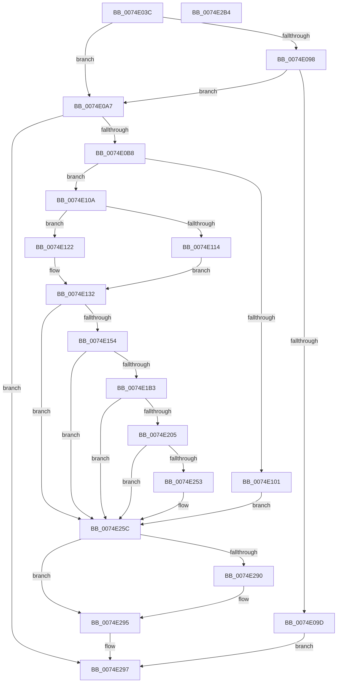

# ObpCreateDosDevicesDirectory

- RVA: `0x0074E03C`–`0x0074E2B5` (길이 `633` bytes)
- VA: `0x000000014074E03C`
- 실행 섹션: `PAGE`
- PDB 이름 있음: `예`; PDB Function 태그: `아니요`
- unwind 정보 RVA: `0x000CB798`
- 디코드: `158`개 명령, `633/633` bytes 표시
- 미해석 바이트: `0` (있으면 어셈블리에 `.byte`로 보존)

> 이 문서는 커널 이미지의 기계어와 PDB 기호를 분석해 생성했습니다. 4번과 5번은 함수 원형과 자료형을 바이너리 사용 방식에서 추정한 C 해석이며 원본 소스 복구 결과는 아닙니다.

## 1. Dependencies

- 직접 호출 지점: **16**; 고유 호출 대상: **11**
- 직접 호출자로 확인된 함수: **1**
- RIP 상대 이미지 참조: **8**

### Outgoing calls
- `0x0074E08F` → [PsIsHostSilo](../../text/44/PsIsHostSilo_function_00443B30.md) (function, `0x00443B30`)
- `0x0074E0AB` → [ObpGetDosDevicesProtection](ObpGetDosDevicesProtection_function_0074E2BC.md) (function, `0x0074E2BC`)
- `0x0074E0F6` → [ZwCreateDirectoryObjectEx](../../text/6A/ZwCreateDirectoryObjectEx_function_006AE670.md) (function, `0x006AE670`)
- `0x0074E10A` → [HalAdjustResourceList](../../text/48/HalAdjustResourceList_function_0048FDC0.md) (function, `0x0048FDC0`)
- `0x0074E12A` → [PsGetEffectiveServerSilo](../../text/22/PsGetEffectiveServerSilo_function_002257F0.md) (function, `0x002257F0`)
- `0x0074E145` → [ObpSetDeviceMap](../A9/ObpSetDeviceMap_function_00A925D0.md) (function, `0x00A925D0`)
- `0x0074E15F` → [RtlInitUnicodeString](../../text/42/RtlInitUnicodeString_function_0042A780.md) (function, `0x0042A780`)
- `0x0074E1A4` → [ZwCreateSymbolicLinkObject](../../text/6A/ZwCreateSymbolicLinkObject_function_006AE9D0.md) (function, `0x006AE9D0`)
- `0x0074E1B7` → [ZwClose](../../text/6A/ZwClose_function_006AD2B0.md) (function, `0x006AD2B0`)
- `0x0074E1FA` → [ZwCreateSymbolicLinkObject](../../text/6A/ZwCreateSymbolicLinkObject_function_006AE9D0.md) (function, `0x006AE9D0`)
- `0x0074E209` → [ZwClose](../../text/6A/ZwClose_function_006AD2B0.md) (function, `0x006AD2B0`)
- `0x0074E248` → [ZwCreateSymbolicLinkObject](../../text/6A/ZwCreateSymbolicLinkObject_function_006AE9D0.md) (function, `0x006AE9D0`)
- `0x0074E257` → [ZwClose](../../text/6A/ZwClose_function_006AD2B0.md) (function, `0x006AD2B0`)
- `0x0074E274` → [RtlGetDaclSecurityDescriptor](../../text/45/RtlGetDaclSecurityDescriptor_function_00459570.md) (function, `0x00459570`)
- `0x0074E282` → [ExFreePoolWithTag](../../poolcode/B8/ExFreePoolWithTag_function_00B82870.md) (function, `0x00B82870`)
- `0x0074E290` → [ZwClose](../../text/6A/ZwClose_function_006AD2B0.md) (function, `0x006AD2B0`)

### Direct callers
- [ObpInitializeRootNamespace](ObpInitializeRootNamespace_function_0074E588.md) at `0x0074E766`

### Static image references
- `0x0074E0B8` → RVA `0x00B4B5E0` (`ObpGlobalDirectoryName`; read)
- `0x0074E114` → RVA `0x00FC6AB0` (`ALMOSTRO`; read)
- `0x0074E154` → RVA `0x00AFCAD0` (` ?? ::NNGAKEGL::`string'`; read)
- `0x0074E174` → RVA `0x00B4BF08` (`ObpGlobalRootNameString`; read)
- `0x0074E1C0` → RVA `0x00B4B5F0` (`ObpGlobalDosDevicesShortName`; read)
- `0x0074E1CF` → RVA `0x00B4BF38` (`ObpGlobalNameString`; read)
- `0x0074E20E` → RVA `0x00B4BEF8` (`ObpDosDevicesNameString`; read)
- `0x0074E220` → RVA `0x00B4BF58` (`ObpDosDevicesShortNameRootString`; read)

## 2. Other-region calls and transfers

- 다른 실행 섹션으로 향하는 call: **14**
  - `0x0074E08F` → [PsIsHostSilo](../../text/44/PsIsHostSilo_function_00443B30.md) (`PAGE` → `.text`)
  - `0x0074E0F6` → [ZwCreateDirectoryObjectEx](../../text/6A/ZwCreateDirectoryObjectEx_function_006AE670.md) (`PAGE` → `.text`)
  - `0x0074E10A` → [HalAdjustResourceList](../../text/48/HalAdjustResourceList_function_0048FDC0.md) (`PAGE` → `.text`)
  - `0x0074E12A` → [PsGetEffectiveServerSilo](../../text/22/PsGetEffectiveServerSilo_function_002257F0.md) (`PAGE` → `.text`)
  - `0x0074E15F` → [RtlInitUnicodeString](../../text/42/RtlInitUnicodeString_function_0042A780.md) (`PAGE` → `.text`)
  - `0x0074E1A4` → [ZwCreateSymbolicLinkObject](../../text/6A/ZwCreateSymbolicLinkObject_function_006AE9D0.md) (`PAGE` → `.text`)
  - `0x0074E1B7` → [ZwClose](../../text/6A/ZwClose_function_006AD2B0.md) (`PAGE` → `.text`)
  - `0x0074E1FA` → [ZwCreateSymbolicLinkObject](../../text/6A/ZwCreateSymbolicLinkObject_function_006AE9D0.md) (`PAGE` → `.text`)
  - `0x0074E209` → [ZwClose](../../text/6A/ZwClose_function_006AD2B0.md) (`PAGE` → `.text`)
  - `0x0074E248` → [ZwCreateSymbolicLinkObject](../../text/6A/ZwCreateSymbolicLinkObject_function_006AE9D0.md) (`PAGE` → `.text`)
  - `0x0074E257` → [ZwClose](../../text/6A/ZwClose_function_006AD2B0.md) (`PAGE` → `.text`)
  - `0x0074E274` → [RtlGetDaclSecurityDescriptor](../../text/45/RtlGetDaclSecurityDescriptor_function_00459570.md) (`PAGE` → `.text`)
  - `0x0074E282` → [ExFreePoolWithTag](../../poolcode/B8/ExFreePoolWithTag_function_00B82870.md) (`PAGE` → `POOLCODE`)
  - `0x0074E290` → [ZwClose](../../text/6A/ZwClose_function_006AD2B0.md) (`PAGE` → `.text`)
- 별도 외부 분기/꼬리 이동을 확인하지 못했습니다.

## 3. Assembly (complete function range)

```asm
0074E03C  48 8B C4                        mov rax, rsp
0074E03F  48 89 58 08                     mov qword ptr [rax + 8], rbx
0074E043  48 89 70 10                     mov qword ptr [rax + 0x10], rsi
0074E047  48 89 78 18                     mov qword ptr [rax + 0x18], rdi
0074E04B  55                              push rbp
0074E04C  41 56                           push r14
0074E04E  41 57                           push r15
0074E050  48 8D 68 A1                     lea rbp, [rax - 0x5f]
0074E054  48 81 EC C0 00 00 00            sub rsp, 0xc0
0074E05B  45 33 FF                        xor r15d, r15d
0074E05E  0F 57 C0                        xorps xmm0, xmm0
0074E061  33 C0                           xor eax, eax
0074E063  4C 89 7D C7                     mov qword ptr [rbp - 0x39], r15
0074E067  0F 11 45 07                     movups xmmword ptr [rbp + 7], xmm0
0074E06B  48 89 45 27                     mov qword ptr [rbp + 0x27], rax
0074E06F  4D 8B F1                        mov r14, r9
0074E072  0F 11 45 17                     movups xmmword ptr [rbp + 0x17], xmm0
0074E076  44 89 7D D3                     mov dword ptr [rbp - 0x2d], r15d
0074E07A  49 8B D8                        mov rbx, r8
0074E07D  44 89 7D EB                     mov dword ptr [rbp - 0x15], r15d
0074E081  48 8B F2                        mov rsi, rdx
0074E084  4C 89 7D BF                     mov qword ptr [rbp - 0x41], r15
0074E088  48 8B F9                        mov rdi, rcx
0074E08B  0F 11 45 2F                     movups xmmword ptr [rbp + 0x2f], xmm0
0074E08F  E8 9C 5A CF FF                  call 0x140443b30
0074E094  84 C0                           test al, al
0074E096  74 0F                           je 0x14074e0a7
0074E098  48 85 DB                        test rbx, rbx
0074E09B  74 0A                           je 0x14074e0a7
0074E09D  B8 0D 00 00 C0                  mov eax, 0xc000000d
0074E0A2  E9 F0 01 00 00                  jmp 0x14074e297
0074E0A7  48 8D 4D 07                     lea rcx, [rbp + 7]
0074E0AB  E8 0C 02 00 00                  call 0x14074e2bc
0074E0B0  85 C0                           test eax, eax
0074E0B2  0F 88 DF 01 00 00               js 0x14074e297
0074E0B8  48 8D 05 21 D5 3F 00            lea rax, [rip + 0x3fd521]
0074E0BF  C7 45 CF 30 00 00 00            mov dword ptr [rbp - 0x31], 0x30
0074E0C6  48 89 45 DF                     mov qword ptr [rbp - 0x21], rax
0074E0CA  4C 8D 45 CF                     lea r8, [rbp - 0x31]
0074E0CE  48 8D 45 07                     lea rax, [rbp + 7]
0074E0D2  48 89 75 D7                     mov qword ptr [rbp - 0x29], rsi
0074E0D6  4C 8B CB                        mov r9, rbx
0074E0D9  48 89 45 EF                     mov qword ptr [rbp - 0x11], rax
0074E0DD  BA 0F 00 0F 00                  mov edx, 0xf000f
0074E0E2  C7 45 E7 10 02 00 00            mov dword ptr [rbp - 0x19], 0x210
0074E0E9  48 8D 4D C7                     lea rcx, [rbp - 0x39]
0074E0ED  4C 89 7D F7                     mov qword ptr [rbp - 9], r15
0074E0F1  44 89 7C 24 20                  mov dword ptr [rsp + 0x20], r15d
0074E0F6  E8 75 05 F6 FF                  call 0x1406ae670
0074E0FB  8B D8                           mov ebx, eax
0074E0FD  85 C0                           test eax, eax
0074E0FF  79 09                           jns 0x14074e10a
0074E101  4C 89 7D C7                     mov qword ptr [rbp - 0x39], r15
0074E105  E9 52 01 00 00                  jmp 0x14074e25c
0074E10A  E8 B1 1C D4 FF                  call 0x14048fdc0
0074E10F  48 3B F8                        cmp rdi, rax
0074E112  75 0E                           jne 0x14074e122
0074E114  48 8B 15 95 89 87 00            mov rdx, qword ptr [rip + 0x878995]
0074E11B  BB 03 00 00 00                  mov ebx, 3
0074E120  EB 10                           jmp 0x14074e132
0074E122  48 8B CF                        mov rcx, rdi
0074E125  BB 04 00 00 00                  mov ebx, 4
0074E12A  E8 C1 76 AD FF                  call 0x1402257f0
0074E12F  49 8B D7                        mov rdx, r15
0074E132  4C 8B 45 C7                     mov r8, qword ptr [rbp - 0x39]
0074E136  45 33 C9                        xor r9d, r9d
0074E139  4C 89 74 24 28                  mov qword ptr [rsp + 0x28], r14
0074E13E  48 8B C8                        mov rcx, rax
0074E141  89 5C 24 20                     mov dword ptr [rsp + 0x20], ebx
0074E145  E8 86 44 34 00                  call 0x140a925d0
0074E14A  8B D8                           mov ebx, eax
0074E14C  85 C0                           test eax, eax
0074E14E  0F 88 08 01 00 00               js 0x14074e25c
0074E154  48 8D 15 75 E9 3A 00            lea rdx, [rip + 0x3ae975]
0074E15B  48 8D 4D 2F                     lea rcx, [rbp + 0x2f]
0074E15F  E8 1C C6 CD FF                  call 0x14042a780
0074E164  48 8B 45 C7                     mov rax, qword ptr [rbp - 0x39]
0074E168  4C 8D 4D 2F                     lea r9, [rbp + 0x2f]
0074E16C  48 89 45 D7                     mov qword ptr [rbp - 0x29], rax
0074E170  4C 8D 45 CF                     lea r8, [rbp - 0x31]
0074E174  48 8D 05 8D DD 3F 00            lea rax, [rip + 0x3fdd8d]
0074E17B  C7 45 CF 30 00 00 00            mov dword ptr [rbp - 0x31], 0x30
0074E182  48 89 45 DF                     mov qword ptr [rbp - 0x21], rax
0074E186  48 8D 4D BF                     lea rcx, [rbp - 0x41]
0074E18A  48 8D 45 07                     lea rax, [rbp + 7]
0074E18E  C7 45 E7 10 02 00 00            mov dword ptr [rbp - 0x19], 0x210
0074E195  BF 01 00 0F 00                  mov edi, 0xf0001
0074E19A  48 89 45 EF                     mov qword ptr [rbp - 0x11], rax
0074E19E  8B D7                           mov edx, edi
0074E1A0  4C 89 7D F7                     mov qword ptr [rbp - 9], r15
0074E1A4  E8 27 08 F6 FF                  call 0x1406ae9d0
0074E1A9  8B D8                           mov ebx, eax
0074E1AB  85 C0                           test eax, eax
0074E1AD  0F 88 A9 00 00 00               js 0x14074e25c
0074E1B3  48 8B 4D BF                     mov rcx, qword ptr [rbp - 0x41]
0074E1B7  E8 F4 F0 F5 FF                  call 0x1406ad2b0
0074E1BC  48 8B 45 C7                     mov rax, qword ptr [rbp - 0x39]
0074E1C0  4C 8D 0D 29 D4 3F 00            lea r9, [rip + 0x3fd429]
0074E1C7  48 89 45 D7                     mov qword ptr [rbp - 0x29], rax
0074E1CB  4C 8D 45 CF                     lea r8, [rbp - 0x31]
0074E1CF  48 8D 05 62 DD 3F 00            lea rax, [rip + 0x3fdd62]
0074E1D6  C7 45 CF 30 00 00 00            mov dword ptr [rbp - 0x31], 0x30
0074E1DD  48 89 45 DF                     mov qword ptr [rbp - 0x21], rax
0074E1E1  48 8D 4D BF                     lea rcx, [rbp - 0x41]
0074E1E5  48 8D 45 07                     lea rax, [rbp + 7]
0074E1E9  C7 45 E7 10 02 00 00            mov dword ptr [rbp - 0x19], 0x210
0074E1F0  8B D7                           mov edx, edi
0074E1F2  48 89 45 EF                     mov qword ptr [rbp - 0x11], rax
0074E1F6  4C 89 7D F7                     mov qword ptr [rbp - 9], r15
0074E1FA  E8 D1 07 F6 FF                  call 0x1406ae9d0
0074E1FF  8B D8                           mov ebx, eax
0074E201  85 C0                           test eax, eax
0074E203  78 57                           js 0x14074e25c
0074E205  48 8B 4D BF                     mov rcx, qword ptr [rbp - 0x41]
0074E209  E8 A2 F0 F5 FF                  call 0x1406ad2b0
0074E20E  48 8D 05 E3 DC 3F 00            lea rax, [rip + 0x3fdce3]
0074E215  C7 45 CF 30 00 00 00            mov dword ptr [rbp - 0x31], 0x30
0074E21C  48 89 45 DF                     mov qword ptr [rbp - 0x21], rax
0074E220  4C 8D 0D 31 DD 3F 00            lea r9, [rip + 0x3fdd31]
0074E227  48 8D 45 07                     lea rax, [rbp + 7]
0074E22B  48 89 75 D7                     mov qword ptr [rbp - 0x29], rsi
0074E22F  4C 8D 45 CF                     lea r8, [rbp - 0x31]
0074E233  48 89 45 EF                     mov qword ptr [rbp - 0x11], rax
0074E237  8B D7                           mov edx, edi
0074E239  C7 45 E7 10 02 00 00            mov dword ptr [rbp - 0x19], 0x210
0074E240  48 8D 4D BF                     lea rcx, [rbp - 0x41]
0074E244  4C 89 7D F7                     mov qword ptr [rbp - 9], r15
0074E248  E8 83 07 F6 FF                  call 0x1406ae9d0
0074E24D  8B D8                           mov ebx, eax
0074E24F  85 C0                           test eax, eax
0074E251  78 09                           js 0x14074e25c
0074E253  48 8B 4D BF                     mov rcx, qword ptr [rbp - 0x41]
0074E257  E8 54 F0 F5 FF                  call 0x1406ad2b0
0074E25C  4C 8D 4D B8                     lea r9, [rbp - 0x48]
0074E260  44 88 7D B7                     mov byte ptr [rbp - 0x49], r15b
0074E264  4C 8D 45 FF                     lea r8, [rbp - 1]
0074E268  4C 89 7D FF                     mov qword ptr [rbp - 1], r15
0074E26C  48 8D 55 B7                     lea rdx, [rbp - 0x49]
0074E270  48 8D 4D 07                     lea rcx, [rbp + 7]
0074E274  E8 F7 B2 D0 FF                  call 0x140459570
0074E279  48 8B 4D FF                     mov rcx, qword ptr [rbp - 1]
0074E27D  BA 44 61 63 6C                  mov edx, 0x6c636144
0074E282  E8 E9 45 43 00                  call 0x140b82870
0074E287  48 8B 4D C7                     mov rcx, qword ptr [rbp - 0x39]
0074E28B  48 85 C9                        test rcx, rcx
0074E28E  74 05                           je 0x14074e295
0074E290  E8 1B F0 F5 FF                  call 0x1406ad2b0
0074E295  8B C3                           mov eax, ebx
0074E297  4C 8D 9C 24 C0 00 00 00         lea r11, [rsp + 0xc0]
0074E29F  49 8B 5B 20                     mov rbx, qword ptr [r11 + 0x20]
0074E2A3  49 8B 73 28                     mov rsi, qword ptr [r11 + 0x28]
0074E2A7  49 8B 7B 30                     mov rdi, qword ptr [r11 + 0x30]
0074E2AB  49 8B E3                        mov rsp, r11
0074E2AE  41 5F                           pop r15
0074E2B0  41 5E                           pop r14
0074E2B2  5D                              pop rbp
0074E2B3  C3                              ret
0074E2B4  CC                              int3
```

## 4. C-style interpretation (structured pseudocode)

```c
__int64 __fastcall ObpCreateDosDevicesDirectory(__int64 a1, __int64 a2, __int64 a3, __int64 a4)
{
    __int64 result;
    __int64 v_r15;
    __int64 v_rsp;
    unsigned __int64 v_stack_m18;
    unsigned __int64 v_stack_mB0;
    unsigned int v_stack_mB8;

    *(unsigned __int64 *)(v_rsp + 8) = v_rbx;
    *(unsigned __int64 *)(v_rsp + 16) = v_rsi;
    *(unsigned __int64 *)(v_rsp + 24) = v_rdi;
    v_rsp = (v_rsp) - (192);
    v_r15 = 0;
    result = 0;
    *(unsigned __int64 *)(v_rsp - 95 - 57) = 0;
    *(unsigned __int64 *)(v_rsp - 95 + 7) = v_xmm0;
    *(unsigned __int64 *)(v_rsp - 95 + 39) = 0;
    *(unsigned __int64 *)(v_rsp - 95 + 23) = v_xmm0;
    *(unsigned int *)(v_rsp - 95 - 45) = 0;
    *(unsigned int *)(v_rsp - 95 - 21) = 0;
    *(unsigned __int64 *)(v_rsp - 95 - 65) = 0;
    *(unsigned __int64 *)(v_rsp - 95 + 47) = v_xmm0;
    result = PsIsHostSilo(a1, a2, a3, a4);
    if ((unsigned __int8)(result) == 0) goto loc_0074E0A7;
    if (a3 == 0) goto loc_0074E0A7;
    goto loc_0074E297;
loc_0074E0A7:
    result = ObpGetDosDevicesProtection(v_rsp - 95 + 7, a2, a3, a4);
    if (sign_flag) goto loc_0074E297;
    *(unsigned int *)(v_rsp - 95 - 49) = 48;
    *(unsigned __int64 *)(v_rsp - 95 - 33) = v_rip + 4183329;
    *(unsigned __int64 *)(v_rsp - 95 - 41) = a2;
    *(unsigned __int64 *)(v_rsp - 95 - 17) = v_rsp - 95 + 7;
    *(unsigned int *)(v_rsp - 95 - 25) = 528;
    *(unsigned __int64 *)(v_rsp - 95 - 9) = 0;
    v_stack_mB8 = 0;
    result = ZwCreateDirectoryObjectEx(v_rsp - 95 - 57, (unsigned int)(0xF000FULL), v_rsp - 95 - 49, a3);
    if (!sign_flag) goto loc_0074E10A;
    *(unsigned __int64 *)(v_rsp - 95 - 57) = 0;
    goto loc_0074E25C;
loc_0074E10A:
    result = HalAdjustResourceList(v_rsp - 95 - 57, (unsigned int)(0xF000FULL), v_rsp - 95 - 49, a3);
    if (a1 != result) goto loc_0074E122;
    goto loc_0074E132;
loc_0074E122:
    result = PsGetEffectiveServerSilo(a1, *(unsigned __int64 *)(v_rip + 8882581), v_rsp - 95 - 49, a3);
loc_0074E132:
    a4 = 0;
    v_stack_mB0 = 0;
    v_stack_mB8 = 4;
    result = ObpSetDeviceMap(result, 0, *(unsigned __int64 *)(v_rsp - 95 - 57), a4);
    if (sign_flag) goto loc_0074E25C;
    result = RtlInitUnicodeString(v_rsp - 95 + 47, v_rip + 3860853, *(unsigned __int64 *)(v_rsp - 95 - 57), a4);
    *(unsigned __int64 *)(v_rsp - 95 - 41) = *(unsigned __int64 *)(v_rsp - 95 - 57);
    *(unsigned int *)(v_rsp - 95 - 49) = 48;
    *(unsigned __int64 *)(v_rsp - 95 - 33) = v_rip + 4185485;
    *(unsigned int *)(v_rsp - 95 - 25) = 528;
    *(unsigned __int64 *)(v_rsp - 95 - 17) = v_rsp - 95 + 7;
    *(unsigned __int64 *)(v_rsp - 95 - 9) = 0;
    result = ZwCreateSymbolicLinkObject(v_rsp - 95 - 65, (unsigned int)((unsigned int)((unsigned int)(0xF0001ULL))), v_rsp - 95 - 49, v_rsp - 95 + 47);
    if (sign_flag) goto loc_0074E25C;
    result = ZwClose(*(unsigned __int64 *)(v_rsp - 95 - 65), (unsigned int)((unsigned int)((unsigned int)(0xF0001ULL))), v_rsp - 95 - 49, v_rsp - 95 + 47);
    *(unsigned __int64 *)(v_rsp - 95 - 41) = *(unsigned __int64 *)(v_rsp - 95 - 57);
    *(unsigned int *)(v_rsp - 95 - 49) = 48;
    *(unsigned __int64 *)(v_rsp - 95 - 33) = v_rip + 4185442;
    *(unsigned int *)(v_rsp - 95 - 25) = 528;
    *(unsigned __int64 *)(v_rsp - 95 - 17) = v_rsp - 95 + 7;
    *(unsigned __int64 *)(v_rsp - 95 - 9) = 0;
    result = ZwCreateSymbolicLinkObject(v_rsp - 95 - 65, (unsigned int)((unsigned int)((unsigned int)(0xF0001ULL))), v_rsp - 95 - 49, v_rip + 4183081);
    if (sign_flag) goto loc_0074E25C;
    result = ZwClose(*(unsigned __int64 *)(v_rsp - 95 - 65), (unsigned int)((unsigned int)((unsigned int)(0xF0001ULL))), v_rsp - 95 - 49, v_rip + 4183081);
    *(unsigned int *)(v_rsp - 95 - 49) = 48;
    *(unsigned __int64 *)(v_rsp - 95 - 33) = v_rip + 4185315;
    *(unsigned __int64 *)(v_rsp - 95 - 41) = a2;
    *(unsigned __int64 *)(v_rsp - 95 - 17) = v_rsp - 95 + 7;
    *(unsigned int *)(v_rsp - 95 - 25) = 528;
    *(unsigned __int64 *)(v_rsp - 95 - 9) = 0;
    result = ZwCreateSymbolicLinkObject(v_rsp - 95 - 65, (unsigned int)((unsigned int)((unsigned int)(0xF0001ULL))), v_rsp - 95 - 49, v_rip + 4185393);
    if (!(sign_flag)) {
        a1 = *(unsigned __int64 *)(v_rsp - 95 - 65);
        result = ZwClose(a1, (unsigned int)((unsigned int)((unsigned int)(0xF0001ULL))), v_rsp - 95 - 49, v_rip + 4185393);
    }
    *(unsigned __int8 *)(v_rsp - 95 - 73) = 0;
    *(unsigned __int64 *)(v_rsp - 95 - 1) = 0;
    result = RtlGetDaclSecurityDescriptor(v_rsp - 95 + 7, v_rsp - 95 - 73, v_rsp - 95 - 1, v_rsp - 95 - 72);
    result = ExFreePoolWithTag(*(unsigned __int64 *)(v_rsp - 95 - 1), (unsigned int)(0x6C636144ULL), v_rsp - 95 - 1, v_rsp - 95 - 72);
    if (*(unsigned __int64 *)(v_rsp - 95 - 57) != 0) {
        result = ZwClose(*(unsigned __int64 *)(v_rsp - 95 - 57), (unsigned int)(0x6C636144ULL), v_rsp - 95 - 1, v_rsp - 95 - 72);
    }
loc_0074E297:
    return (unsigned int)((unsigned int)((unsigned int)((unsigned int)(result))));
}
```

## 5. (Beta) C Style

```c
int64_t ObpCreateDosDevicesDirectory(int64_t Arg1, int64_t Arg2, int64_t Arg3, int64_t Arg4)
{
    int64_t result;
    int64_t local_r15;
    int64_t local_rsp;
    uint64_t v_stack_m18;
    uint64_t v_stack_mB0;
    uint32_t v_stack_mB8;

    *(uint64_t *)(local_rsp + 0x8) = local_rbx;
    *(uint64_t *)(local_rsp + 0x10) = local_rsi;
    *(uint64_t *)(local_rsp + 0x18) = local_rdi;
    local_rsp = (local_rsp) - (192);
    local_r15 = 0;
    result = 0;
    *(uint64_t *)(local_rsp - 0x5F - 0x39) = 0;
    *(uint64_t *)(local_rsp - 0x5F + 0x7) = v_xmm0;
    *(uint64_t *)(local_rsp - 0x5F + 0x27) = 0;
    *(uint64_t *)(local_rsp - 0x5F + 0x17) = v_xmm0;
    *(uint32_t *)(local_rsp - 0x5F - 0x2D) = 0;
    *(uint32_t *)(local_rsp - 0x5F - 0x15) = 0;
    *(uint64_t *)(local_rsp - 0x5F - 0x41) = 0;
    *(uint64_t *)(local_rsp - 0x5F + 0x2F) = v_xmm0;
    result = PsIsHostSilo(Arg1, Arg2, Arg3, Arg4);
    if ((uint8_t)(result) == 0) goto loc_0074E0A7;
    if (Arg3 == 0) goto loc_0074E0A7;
    goto loc_0074E297;
loc_0074E0A7:
    result = ObpGetDosDevicesProtection(local_rsp - 95 + 7, Arg2, Arg3, Arg4);
    if (sign_flag) goto loc_0074E297;
    *(uint32_t *)(local_rsp - 0x5F - 0x31) = 48;
    *(uint64_t *)(local_rsp - 0x5F - 0x21) = v_rip + 4183329;
    *(uint64_t *)(local_rsp - 0x5F - 0x29) = Arg2;
    *(uint64_t *)(local_rsp - 0x5F - 0x11) = local_rsp - 95 + 7;
    *(uint32_t *)(local_rsp - 0x5F - 0x19) = 528;
    *(uint64_t *)(local_rsp - 0x5F - 0x9) = 0;
    v_stack_mB8 = 0;
    result = ZwCreateDirectoryObjectEx(local_rsp - 95 - 57, (uint32_t)(0xF000FULL), local_rsp - 95 - 49, Arg3);
    if (!sign_flag) goto loc_0074E10A;
    *(uint64_t *)(local_rsp - 0x5F - 0x39) = 0;
    goto loc_0074E25C;
loc_0074E10A:
    result = HalAdjustResourceList(local_rsp - 95 - 57, (uint32_t)(0xF000FULL), local_rsp - 95 - 49, Arg3);
    if (Arg1 != result) goto loc_0074E122;
    goto loc_0074E132;
loc_0074E122:
    result = PsGetEffectiveServerSilo(Arg1, *(uint64_t *)(v_rip + 0x878995), local_rsp - 95 - 49, Arg3);
loc_0074E132:
    Arg4 = 0;
    v_stack_mB0 = 0;
    v_stack_mB8 = 4;
    result = ObpSetDeviceMap(result, 0, *(uint64_t *)(local_rsp - 0x5F - 0x39), Arg4);
    if (sign_flag) goto loc_0074E25C;
    result = RtlInitUnicodeString(local_rsp - 95 + 47, v_rip + 3860853, *(uint64_t *)(local_rsp - 0x5F - 0x39), Arg4);
    *(uint64_t *)(local_rsp - 0x5F - 0x29) = *(uint64_t *)(local_rsp - 0x5F - 0x39);
    *(uint32_t *)(local_rsp - 0x5F - 0x31) = 48;
    *(uint64_t *)(local_rsp - 0x5F - 0x21) = v_rip + 4185485;
    *(uint32_t *)(local_rsp - 0x5F - 0x19) = 528;
    *(uint64_t *)(local_rsp - 0x5F - 0x11) = local_rsp - 95 + 7;
    *(uint64_t *)(local_rsp - 0x5F - 0x9) = 0;
    result = ZwCreateSymbolicLinkObject(local_rsp - 95 - 65, (uint32_t)((uint32_t)((uint32_t)(0xF0001ULL))), local_rsp - 95 - 49, local_rsp - 95 + 47);
    if (sign_flag) goto loc_0074E25C;
    result = ZwClose(*(uint64_t *)(local_rsp - 0x5F - 0x41), (uint32_t)((uint32_t)((uint32_t)(0xF0001ULL))), local_rsp - 95 - 49, local_rsp - 95 + 47);
    *(uint64_t *)(local_rsp - 0x5F - 0x29) = *(uint64_t *)(local_rsp - 0x5F - 0x39);
    *(uint32_t *)(local_rsp - 0x5F - 0x31) = 48;
    *(uint64_t *)(local_rsp - 0x5F - 0x21) = v_rip + 4185442;
    *(uint32_t *)(local_rsp - 0x5F - 0x19) = 528;
    *(uint64_t *)(local_rsp - 0x5F - 0x11) = local_rsp - 95 + 7;
    *(uint64_t *)(local_rsp - 0x5F - 0x9) = 0;
    result = ZwCreateSymbolicLinkObject(local_rsp - 95 - 65, (uint32_t)((uint32_t)((uint32_t)(0xF0001ULL))), local_rsp - 95 - 49, v_rip + 4183081);
    if (sign_flag) goto loc_0074E25C;
    result = ZwClose(*(uint64_t *)(local_rsp - 0x5F - 0x41), (uint32_t)((uint32_t)((uint32_t)(0xF0001ULL))), local_rsp - 95 - 49, v_rip + 4183081);
    *(uint32_t *)(local_rsp - 0x5F - 0x31) = 48;
    *(uint64_t *)(local_rsp - 0x5F - 0x21) = v_rip + 4185315;
    *(uint64_t *)(local_rsp - 0x5F - 0x29) = Arg2;
    *(uint64_t *)(local_rsp - 0x5F - 0x11) = local_rsp - 95 + 7;
    *(uint32_t *)(local_rsp - 0x5F - 0x19) = 528;
    *(uint64_t *)(local_rsp - 0x5F - 0x9) = 0;
    result = ZwCreateSymbolicLinkObject(local_rsp - 95 - 65, (uint32_t)((uint32_t)((uint32_t)(0xF0001ULL))), local_rsp - 95 - 49, v_rip + 4185393);
    if (!(sign_flag)) {
        Arg1 = *(uint64_t *)(local_rsp - 0x5F - 0x41);
        result = ZwClose(Arg1, (uint32_t)((uint32_t)((uint32_t)(0xF0001ULL))), local_rsp - 95 - 49, v_rip + 4185393);
    }
    *(uint8_t *)(local_rsp - 0x5F - 0x49) = 0;
    *(uint64_t *)(local_rsp - 0x5F - 0x1) = 0;
    result = RtlGetDaclSecurityDescriptor(local_rsp - 95 + 7, local_rsp - 95 - 73, local_rsp - 95 - 1, local_rsp - 95 - 72);
    result = ExFreePoolWithTag(*(uint64_t *)(local_rsp - 0x5F - 0x1), (uint32_t)(0x6C636144ULL), local_rsp - 95 - 1, local_rsp - 95 - 72);
    if (*(uint64_t *)(local_rsp - 0x5F - 0x39) != 0) {
        result = ZwClose(*(uint64_t *)(local_rsp - 0x5F - 0x39), (uint32_t)(0x6C636144ULL), local_rsp - 95 - 1, local_rsp - 95 - 72);
    }
loc_0074E297:
    return (uint32_t)((uint32_t)((uint32_t)((uint32_t)(result))));
}
```

## 6. Execution-region graph

[열기: 2D/3D 그래프와 함수 탐색 컨트롤 패널](../../../control-panel.html?section=page&rva=0x0074E03C&view=graph)

- 2D 그래프는 위에서 아래로 흐르고, 3D 그래프는 빈 공간을 드래그해 회전합니다. Shift+드래그는 이동, 휠은 확대·축소, 함수 노드 선택은 대상 보고서 이동입니다.

### Static fallback


