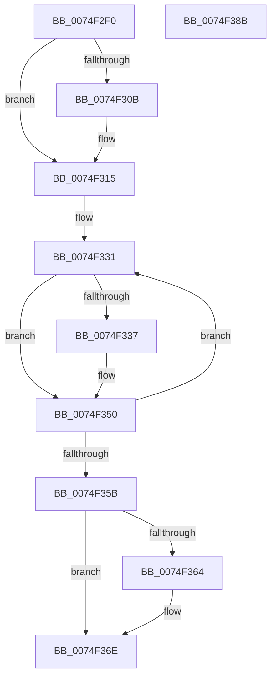

# ObpDeleteDeviceMap

- RVA: `0x0074F2F0`–`0x0074F38C` (길이 `156` bytes)
- VA: `0x000000014074F2F0`
- 실행 섹션: `PAGE`
- PDB 이름 있음: `예`; PDB Function 태그: `아니요`
- unwind 정보 RVA: `0x00060BC4`
- 디코드: `44`개 명령, `156/156` bytes 표시
- 미해석 바이트: `0` (있으면 어셈블리에 `.byte`로 보존)

> 이 문서는 커널 이미지의 기계어와 PDB 기호를 분석해 생성했습니다. 4번과 5번은 함수 원형과 자료형을 바이너리 사용 방식에서 추정한 C 해석이며 원본 소스 복구 결과는 아닙니다.

## 1. Dependencies

- 직접 호출 지점: **7**; 고유 호출 대상: **6**
- 직접 호출자로 확인된 함수: **2**
- RIP 상대 이미지 참조: **0**

### Outgoing calls
- `0x0074F310` → [ObfDereferenceObjectWithTag](../../text/2F/ObfDereferenceObjectWithTag_function_002F78E0.md) (function, `0x002F78E0`)
- `0x0074F31E` → [ObCloseHandle](../8A/ObCloseHandle_function_008A1870.md) (function, `0x008A1870`)
- `0x0074F326` → [ObfDereferenceObject](../../text/2F/ObfDereferenceObject_function_002F9350.md) (function, `0x002F9350`)
- `0x0074F343` → [ObFastReplaceObject](../../text/45/ObFastReplaceObject_function_0045819C.md) (function, `0x0045819C`)
- `0x0074F34B` → [ObfDereferenceObject](../../text/2F/ObfDereferenceObject_function_002F9350.md) (function, `0x002F9350`)
- `0x0074F369` → [ObDereferenceDeviceMap](../96/ObDereferenceDeviceMap_function_0096D0E8.md) (function, `0x0096D0E8`)
- `0x0074F376` → [ExFreePoolWithTag](../../poolcode/B8/ExFreePoolWithTag_function_00B82870.md) (function, `0x00B82870`)

### Direct callers
- [sub_00B28A26](../B2/Unknown_function_00B28A26.md) at `0x00B28A8C`
- [sub_00B47284](../B4/Unknown_function_00B47284.md) at `0x00B473E7`

### Static image references
- 디코드된 RIP-relative 메모리 참조가 없습니다.

## 2. Other-region calls and transfers

- 다른 실행 섹션으로 향하는 call: **5**
  - `0x0074F310` → [ObfDereferenceObjectWithTag](../../text/2F/ObfDereferenceObjectWithTag_function_002F78E0.md) (`PAGE` → `.text`)
  - `0x0074F326` → [ObfDereferenceObject](../../text/2F/ObfDereferenceObject_function_002F9350.md) (`PAGE` → `.text`)
  - `0x0074F343` → [ObFastReplaceObject](../../text/45/ObFastReplaceObject_function_0045819C.md) (`PAGE` → `.text`)
  - `0x0074F34B` → [ObfDereferenceObject](../../text/2F/ObfDereferenceObject_function_002F9350.md) (`PAGE` → `.text`)
  - `0x0074F376` → [ExFreePoolWithTag](../../poolcode/B8/ExFreePoolWithTag_function_00B82870.md) (`PAGE` → `POOLCODE`)
- 별도 외부 분기/꼬리 이동을 확인하지 못했습니다.

## 3. Assembly (complete function range)

```asm
0074F2F0  48 89 5C 24 08                  mov qword ptr [rsp + 8], rbx
0074F2F5  48 89 74 24 10                  mov qword ptr [rsp + 0x10], rsi
0074F2FA  57                              push rdi
0074F2FB  48 83 EC 20                     sub rsp, 0x20
0074F2FF  48 8B D9                        mov rbx, rcx
0074F302  48 8B 49 10                     mov rcx, qword ptr [rcx + 0x10]
0074F306  48 85 C9                        test rcx, rcx
0074F309  74 0A                           je 0x14074f315
0074F30B  BA 4F 62 44 6D                  mov edx, 0x6d44624f
0074F310  E8 CB 85 BA FF                  call 0x1402f78e0
0074F315  48 8B 8B F8 00 00 00            mov rcx, qword ptr [rbx + 0xf8]
0074F31C  33 D2                           xor edx, edx
0074F31E  E8 4D 25 15 00                  call 0x1408a1870
0074F323  48 8B 0B                        mov rcx, qword ptr [rbx]
0074F326  E8 25 A0 BA FF                  call 0x1402f9350
0074F32B  33 FF                           xor edi, edi
0074F32D  48 8D 73 20                     lea rsi, [rbx + 0x20]
0074F331  48 83 3E 00                     cmp qword ptr [rsi], 0
0074F335  74 19                           je 0x14074f350
0074F337  8B C7                           mov eax, edi
0074F339  33 D2                           xor edx, edx
0074F33B  48 83 C0 04                     add rax, 4
0074F33F  48 8D 0C C3                     lea rcx, [rbx + rax*8]
0074F343  E8 54 8E D0 FF                  call 0x14045819c
0074F348  48 8B C8                        mov rcx, rax
0074F34B  E8 00 A0 BA FF                  call 0x1402f9350
0074F350  FF C7                           inc edi
0074F352  48 83 C6 08                     add rsi, 8
0074F356  83 FF 1A                        cmp edi, 0x1a
0074F359  72 D6                           jb 0x14074f331
0074F35B  48 8B 4B 18                     mov rcx, qword ptr [rbx + 0x18]
0074F35F  48 85 C9                        test rcx, rcx
0074F362  74 0A                           je 0x14074f36e
0074F364  BA 01 00 00 00                  mov edx, 1
0074F369  E8 7A DD 21 00                  call 0x14096d0e8
0074F36E  BA 4F 62 44 6D                  mov edx, 0x6d44624f
0074F373  48 8B CB                        mov rcx, rbx
0074F376  E8 F5 34 43 00                  call 0x140b82870
0074F37B  48 8B 5C 24 30                  mov rbx, qword ptr [rsp + 0x30]
0074F380  48 8B 74 24 38                  mov rsi, qword ptr [rsp + 0x38]
0074F385  48 83 C4 20                     add rsp, 0x20
0074F389  5F                              pop rdi
0074F38A  C3                              ret
0074F38B  CC                              int3
```

## 4. C-style interpretation (structured pseudocode)

```c
__int64 __fastcall ObpDeleteDeviceMap(__int64 a1)
{
    __int64 result;
    __int64 v_rdi;
    __int64 v_rsi;
    __int64 v_rsp;
    unsigned __int64 v_stack_p10;
    unsigned __int64 v_stack_p8;

    v_stack_p8 = v_rbx;
    v_stack_p10 = v_rsi;
    v_rsp = (v_rsp) - (32);
    if (*(unsigned __int64 *)(a1 + 16) != 0) {
        a2 = 0x6D44624FULL;
        result = ObfDereferenceObjectWithTag(*(unsigned __int64 *)(a1 + 16), a2, a3, a4);
    }
    a2 = 0;
    result = ObCloseHandle(*(unsigned __int64 *)(a1 + 248), a2, a3, a4);
    result = ObfDereferenceObject(*(unsigned __int64 *)(a1), a2, a3, a4);
    v_rdi = 0;
loc_0074F331:
    if ((*(unsigned __int64 *)(a1 + 32)) != 0) {
        result = 0;
        a2 = 0;
        result = (result) + (4);
        a1 = a1 + result * 8;
        result = ObFastReplaceObject(a1, a2, a3, a4);
        a1 = result;
        result = ObfDereferenceObject(a1, a2, a3, a4);
    }
    v_rdi = (unsigned int)((v_rdi) + 1);
    v_rsi = (a1 + 32) + (8);
    if (((unsigned int)(v_rdi)) < 26) goto loc_0074F331;
    if (*(unsigned __int64 *)(a1 + 24) != 0) {
        a2 = 1;
        result = ObDereferenceDeviceMap(*(unsigned __int64 *)(a1 + 24), a2, a3, a4);
    }
    result = ExFreePoolWithTag(a1, (unsigned int)(0x6D44624FULL), a3, a4);
    v_rsp = (v_rsp) + (32);
    return result;
}
```

## 5. (Beta) C Style

```c
int64_t ObpDeleteDeviceMap(void *Arg1)
{
    uint8_t *arg1 = (uint8_t *)Arg1;

    int64_t result;
    int64_t local_rdi;
    int64_t local_rsi;
    int64_t local_rsp;
    uint64_t v_stack_p10;
    uint64_t v_stack_p8;

    v_stack_p8 = local_rbx;
    v_stack_p10 = local_rsi;
    local_rsp = (local_rsp) - (32);
    if (*(uint64_t *)(arg1 + 0x10) != 0) {
        a2 = 0x6D44624FULL;
        result = ObfDereferenceObjectWithTag(*(uint64_t *)(arg1 + 0x10), a2, a3, a4);
    }
    a2 = 0;
    result = ObCloseHandle(*(uint64_t *)(arg1 + 0xF8), a2, a3, a4);
    result = ObfDereferenceObject(*(uint64_t *)(arg1), a2, a3, a4);
    local_rdi = 0;
loc_0074F331:
    if ((*(uint64_t *)(arg1 + 0x20)) != 0) {
        result = 0;
        a2 = 0;
        result = (result) + (4);
        Arg1 = Arg1 + result * 8;
        result = ObFastReplaceObject(Arg1, a2, a3, a4);
        Arg1 = result;
        result = ObfDereferenceObject(Arg1, a2, a3, a4);
    }
    local_rdi = (uint32_t)((local_rdi) + 1);
    local_rsi = (Arg1 + 32) + (8);
    if (((uint32_t)(local_rdi)) < 26) goto loc_0074F331;
    if (*(uint64_t *)(arg1 + 0x18) != 0) {
        a2 = 1;
        result = ObDereferenceDeviceMap(*(uint64_t *)(arg1 + 0x18), a2, a3, a4);
    }
    result = ExFreePoolWithTag(Arg1, (uint32_t)(0x6D44624FULL), a3, a4);
    local_rsp = (local_rsp) + (32);
    return result;
}
```

### 관측된 메모리 오프셋

구조체 형식이 확인되지 않은 접근은 인자 기준의 오프셋으로만 기록했습니다.

| 기준 인자 | 오프셋 표현 | 폭 (bit) | 접근 |
|---|---:|---:|---|
| `Arg1` | `+ 0x0` | `64` | `R` |
| `Arg1` | `+ 0x0 + rax*8` | `64` | `R` |
| `Arg1` | `+ 0x10` | `64` | `R` |
| `Arg1` | `+ 0x18` | `64` | `R` |
| `Arg1` | `+ 0x20` | `64` | `R` |
| `Arg1` | `+ 0xF8` | `64` | `R` |

## 6. Execution-region graph

[열기: 2D/3D 그래프와 함수 탐색 컨트롤 패널](../../../control-panel.html?section=page&rva=0x0074F2F0&view=graph)

- 2D 그래프는 위에서 아래로 흐르고, 3D 그래프는 빈 공간을 드래그해 회전합니다. Shift+드래그는 이동, 휠은 확대·축소, 함수 노드 선택은 대상 보고서 이동입니다.

### Static fallback


