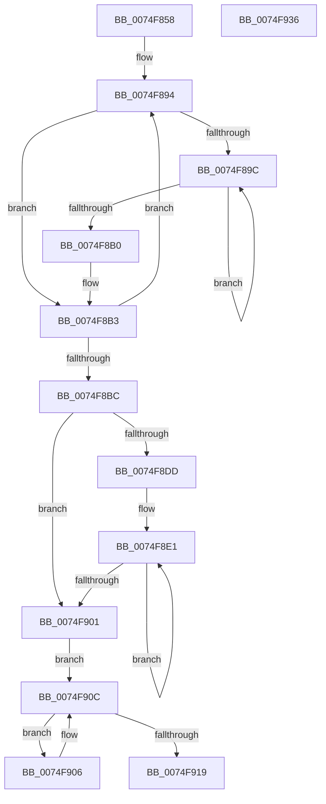

# ObpDestroyStackAndObjectTables

- RVA: `0x0074F858`–`0x0074F937` (길이 `223` bytes)
- VA: `0x000000014074F858`
- 실행 섹션: `PAGE`
- PDB 이름 있음: `예`; PDB Function 태그: `아니요`
- unwind 정보 RVA: `0x00075C18`
- 디코드: `68`개 명령, `223/223` bytes 표시
- 미해석 바이트: `0` (있으면 어셈블리에 `.byte`로 보존)

> 이 문서는 커널 이미지의 기계어와 PDB 기호를 분석해 생성했습니다. 4번과 5번은 함수 원형과 자료형을 바이너리 사용 방식에서 추정한 C 해석이며 원본 소스 복구 결과는 아닙니다.

## 1. Dependencies

- 직접 호출 지점: **4**; 고유 호출 대상: **1**
- 직접 호출자로 확인된 함수: **1**
- RIP 상대 이미지 참조: **0**

### Outgoing calls
- `0x0074F8A3` → [ExFreePoolWithTag](../../poolcode/B8/ExFreePoolWithTag_function_00B82870.md) (function, `0x00B82870`)
- `0x0074F8C2` → [ExFreePoolWithTag](../../poolcode/B8/ExFreePoolWithTag_function_00B82870.md) (function, `0x00B82870`)
- `0x0074F8EC` → [ExFreePoolWithTag](../../poolcode/B8/ExFreePoolWithTag_function_00B82870.md) (function, `0x00B82870`)
- `0x0074F90F` → [ExFreePoolWithTag](../../poolcode/B8/ExFreePoolWithTag_function_00B82870.md) (function, `0x00B82870`)

### Direct callers
- [ObpStopRuntimeStackTrace](../75/ObpStopRuntimeStackTrace_function_00750574.md) at `0x00750748`

### Static image references
- 디코드된 RIP-relative 메모리 참조가 없습니다.

## 2. Other-region calls and transfers

- 다른 실행 섹션으로 향하는 call: **4**
  - `0x0074F8A3` → [ExFreePoolWithTag](../../poolcode/B8/ExFreePoolWithTag_function_00B82870.md) (`PAGE` → `POOLCODE`)
  - `0x0074F8C2` → [ExFreePoolWithTag](../../poolcode/B8/ExFreePoolWithTag_function_00B82870.md) (`PAGE` → `POOLCODE`)
  - `0x0074F8EC` → [ExFreePoolWithTag](../../poolcode/B8/ExFreePoolWithTag_function_00B82870.md) (`PAGE` → `POOLCODE`)
  - `0x0074F90F` → [ExFreePoolWithTag](../../poolcode/B8/ExFreePoolWithTag_function_00B82870.md) (`PAGE` → `POOLCODE`)
- 별도 외부 분기/꼬리 이동을 확인하지 못했습니다.

## 3. Assembly (complete function range)

```asm
0074F858  48 89 5C 24 08                  mov qword ptr [rsp + 8], rbx
0074F85D  48 89 6C 24 10                  mov qword ptr [rsp + 0x10], rbp
0074F862  48 89 74 24 18                  mov qword ptr [rsp + 0x18], rsi
0074F867  57                              push rdi
0074F868  41 54                           push r12
0074F86A  41 55                           push r13
0074F86C  41 56                           push r14
0074F86E  41 57                           push r15
0074F870  48 83 EC 20                     sub rsp, 0x20
0074F874  45 33 E4                        xor r12d, r12d
0074F877  49 8B F8                        mov rdi, r8
0074F87A  4C 8B FA                        mov r15, rdx
0074F87D  48 8B E9                        mov rbp, rcx
0074F880  48 8B F2                        mov rsi, rdx
0074F883  41 BE 91 01 00 00               mov r14d, 0x191
0074F889  41 BD 4F 62 52 74               mov r13d, 0x7452624f
0074F88F  41 8D 44 24 01                  lea eax, [r12 + 1]
0074F894  48 8B 0E                        mov rcx, qword ptr [rsi]
0074F897  48 85 C9                        test rcx, rcx
0074F89A  74 17                           je 0x14074f8b3
0074F89C  48 8B 59 08                     mov rbx, qword ptr [rcx + 8]
0074F8A0  41 8B D5                        mov edx, r13d
0074F8A3  E8 C8 2F 43 00                  call 0x140b82870
0074F8A8  48 8B CB                        mov rcx, rbx
0074F8AB  48 85 DB                        test rbx, rbx
0074F8AE  75 EC                           jne 0x14074f89c
0074F8B0  8D 43 01                        lea eax, [rbx + 1]
0074F8B3  48 83 C6 08                     add rsi, 8
0074F8B7  4C 2B F0                        sub r14, rax
0074F8BA  75 D8                           jne 0x14074f894
0074F8BC  41 8B D5                        mov edx, r13d
0074F8BF  49 8B CF                        mov rcx, r15
0074F8C2  E8 A9 2F 43 00                  call 0x140b82870
0074F8C7  0F B7 45 02                     movzx eax, word ptr [rbp + 2]
0074F8CB  B9 00 FC 00 00                  mov ecx, 0xfc00
0074F8D0  66 23 C1                        and ax, cx
0074F8D3  41 0F B7 DC                     movzx ebx, r12w
0074F8D7  66 44 3B E0                     cmp r12w, ax
0074F8DB  73 24                           jae 0x14074f901
0074F8DD  41 8D 76 01                     lea esi, [r14 + 1]
0074F8E1  0F B7 CB                        movzx ecx, bx
0074F8E4  41 8B D5                        mov edx, r13d
0074F8E7  48 8B 4C CD 08                  mov rcx, qword ptr [rbp + rcx*8 + 8]
0074F8EC  E8 7F 2F 43 00                  call 0x140b82870
0074F8F1  0F B7 45 02                     movzx eax, word ptr [rbp + 2]
0074F8F5  66 03 DE                        add bx, si
0074F8F8  66 C1 E8 0A                     shr ax, 0xa
0074F8FC  66 3B D8                        cmp bx, ax
0074F8FF  72 E0                           jb 0x14074f8e1
0074F901  48 8B CD                        mov rcx, rbp
0074F904  EB 06                           jmp 0x14074f90c
0074F906  48 8B CF                        mov rcx, rdi
0074F909  48 8B 3F                        mov rdi, qword ptr [rdi]
0074F90C  41 8B D5                        mov edx, r13d
0074F90F  E8 5C 2F 43 00                  call 0x140b82870
0074F914  48 85 FF                        test rdi, rdi
0074F917  75 ED                           jne 0x14074f906
0074F919  48 8B 5C 24 50                  mov rbx, qword ptr [rsp + 0x50]
0074F91E  48 8B 6C 24 58                  mov rbp, qword ptr [rsp + 0x58]
0074F923  48 8B 74 24 60                  mov rsi, qword ptr [rsp + 0x60]
0074F928  48 83 C4 20                     add rsp, 0x20
0074F92C  41 5F                           pop r15
0074F92E  41 5E                           pop r14
0074F930  41 5D                           pop r13
0074F932  41 5C                           pop r12
0074F934  5F                              pop rdi
0074F935  C3                              ret
0074F936  CC                              int3
```

## 4. C-style interpretation (structured pseudocode)

```c
__int64 __fastcall ObpDestroyStackAndObjectTables(__int64 a1, __int64 a2, __int64 a3)
{
    __int64 result;
    __int64 v_r12;
    __int64 v_r14;
    __int64 v_rbx;
    __int64 v_rsi;
    __int64 v_rsp;
    unsigned __int64 v_stack_p10;
    unsigned __int64 v_stack_p18;
    unsigned __int64 v_stack_p8;

    v_stack_p8 = v_rbx;
    v_stack_p10 = v_rbp;
    v_stack_p18 = v_rsi;
    v_rsp = (v_rsp) - (32);
    v_r12 = 0;
loc_0074F894:
    if (*(unsigned __int64 *)(a2) == 0) goto loc_0074F8B3;
loc_0074F89C:
    result = ExFreePoolWithTag(*(unsigned __int64 *)(a2), (unsigned int)((unsigned int)((unsigned int)(0x7452624FULL))), a3, a4);
    if (*(unsigned __int64 *)(*(unsigned __int64 *)(a2) + 8) != 0) goto loc_0074F89C;
loc_0074F8B3:
    v_rsi = (a2) + (8);
    v_r14 = (401) - (*(unsigned __int64 *)(*(unsigned __int64 *)(a2) + 8) + 1);
    if (condition_is_not_equal) goto loc_0074F894;
    result = ExFreePoolWithTag(a2, (unsigned int)((unsigned int)((unsigned int)(0x7452624FULL))), a3, a4);
    result = (unsigned __int16)((*(unsigned __int16 *)(a1 + 2)) & ((unsigned __int16)((unsigned int)(0xFC00ULL))));
    if (0 >= ((unsigned __int16)(result))) goto loc_0074F901;
loc_0074F8E1:
    result = ExFreePoolWithTag(*(unsigned __int64 *)(a1 + 0 * 8 + 8), (unsigned int)((unsigned int)((unsigned int)(0x7452624FULL))), a3, a4);
    v_rbx = (unsigned __int16)((0) + ((unsigned __int16)(v_r14 + 1)));
    result = (unsigned __int16)((*(unsigned __int16 *)(a1 + 2)) >> (10));
    if (((unsigned __int16)(v_rbx)) < ((unsigned __int16)(result))) goto loc_0074F8E1;
loc_0074F901:
    goto loc_0074F90C;
loc_0074F906:
loc_0074F90C:
    result = ExFreePoolWithTag(a3, (unsigned int)((unsigned int)((unsigned int)(0x7452624FULL))), a3, a4);
    if (*(unsigned __int64 *)(a3) != 0) goto loc_0074F906;
    v_rsp = (v_rsp) + (32);
    return result;
}
```

## 5. (Beta) C Style

```c
int64_t ObpDestroyStackAndObjectTables(void *Arg1, void *Arg2, int64_t Arg3)
{
    uint8_t *arg1 = (uint8_t *)Arg1;
    uint8_t *arg2 = (uint8_t *)Arg2;

    int64_t result;
    int64_t local_r12;
    int64_t local_r14;
    int64_t local_rbx;
    int64_t local_rsi;
    int64_t local_rsp;
    uint64_t v_stack_p10;
    uint64_t v_stack_p18;
    uint64_t v_stack_p8;

    v_stack_p8 = local_rbx;
    v_stack_p10 = local_rbp;
    v_stack_p18 = local_rsi;
    local_rsp = (local_rsp) - (32);
    local_r12 = 0;
loc_0074F894:
    if (*(uint64_t *)(arg2) == 0) goto loc_0074F8B3;
loc_0074F89C:
    result = ExFreePoolWithTag(*(uint64_t *)(arg2), (uint32_t)((uint32_t)((uint32_t)(0x7452624FULL))), Arg3, a4);
    if (*(uint64_t *)(*(uint64_t *)(arg2) + 0x8) != 0) goto loc_0074F89C;
loc_0074F8B3:
    local_rsi = (Arg2) + (8);
    local_r14 = (401) - (*(uint64_t *)(*(uint64_t *)(arg2) + 0x8) + 1);
    if (condition_is_not_equal) goto loc_0074F894;
    result = ExFreePoolWithTag(Arg2, (uint32_t)((uint32_t)((uint32_t)(0x7452624FULL))), Arg3, a4);
    result = (uint16_t)((*(uint16_t *)(arg1 + 0x2)) & ((uint16_t)((uint32_t)(0xFC00ULL))));
    if (0 >= ((uint16_t)(result))) goto loc_0074F901;
loc_0074F8E1:
    result = ExFreePoolWithTag(*(uint64_t *)(arg1 + 0x0 * 8 + 0x8), (uint32_t)((uint32_t)((uint32_t)(0x7452624FULL))), Arg3, a4);
    local_rbx = (uint16_t)((0) + ((uint16_t)(local_r14 + 1)));
    result = (uint16_t)((*(uint16_t *)(arg1 + 0x2)) >> (10));
    if (((uint16_t)(local_rbx)) < ((uint16_t)(result))) goto loc_0074F8E1;
loc_0074F901:
    goto loc_0074F90C;
loc_0074F906:
loc_0074F90C:
    result = ExFreePoolWithTag(Arg3, (uint32_t)((uint32_t)((uint32_t)(0x7452624FULL))), Arg3, a4);
    if (*(uint64_t *)(Arg3) != 0) goto loc_0074F906;
    local_rsp = (local_rsp) + (32);
    return result;
}
```

### 관측된 메모리 오프셋

구조체 형식이 확인되지 않은 접근은 인자 기준의 오프셋으로만 기록했습니다.

| 기준 인자 | 오프셋 표현 | 폭 (bit) | 접근 |
|---|---:|---:|---|
| `Arg1` | `+ 0x2` | `16` | `R` |
| `Arg1` | `+ 0x8 + rcx*8` | `64` | `R` |
| `Arg2` | `+ 0x0` | `64` | `R` |

## 6. Execution-region graph

[열기: 2D/3D 그래프와 함수 탐색 컨트롤 패널](../../../control-panel.html?section=page&rva=0x0074F858&view=graph)

- 2D 그래프는 위에서 아래로 흐르고, 3D 그래프는 빈 공간을 드래그해 회전합니다. Shift+드래그는 이동, 휠은 확대·축소, 함수 노드 선택은 대상 보고서 이동입니다.

### Static fallback


