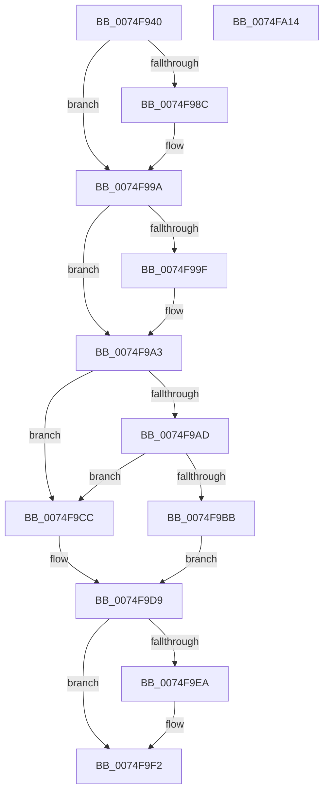

# ObpFreeWorkItemBlock

- RVA: `0x0074F940`–`0x0074FA15` (길이 `213` bytes)
- VA: `0x000000014074F940`
- 실행 섹션: `PAGE`
- PDB 이름 있음: `예`; PDB Function 태그: `아니요`
- unwind 정보 RVA: `0x0005C954`
- 디코드: `54`개 명령, `213/213` bytes 표시
- 미해석 바이트: `0` (있으면 어셈블리에 `.byte`로 보존)

> 이 문서는 커널 이미지의 기계어와 PDB 기호를 분석해 생성했습니다. 4번과 5번은 함수 원형과 자료형을 바이너리 사용 방식에서 추정한 C 해석이며 원본 소스 복구 결과는 아닙니다.

## 1. Dependencies

- 직접 호출 지점: **7**; 고유 호출 대상: **7**
- 직접 호출자로 확인된 함수: **1**
- RIP 상대 이미지 참조: **4**

### Outgoing calls
- `0x0074F97B` → [KeAbPreAcquire](../../text/21/KeAbPreAcquire_function_00210230.md) (function, `0x00210230`)
- `0x0074F995` → [ExfAcquirePushLockExclusiveEx](../../text/20/ExfAcquirePushLockExclusiveEx_function_0020FC90.md) (function, `0x0020FC90`)
- `0x0074F9C5` → [ExpInterlockedPushEntrySList](../../text/6B/ExpInterlockedPushEntrySList_function_006BA5B0.md) (function, `0x006BA5B0`)
- `0x0074F9D4` → [ExFreePoolWithTag](../../poolcode/B8/ExFreePoolWithTag_function_00B82870.md) (function, `0x00B82870`)
- `0x0074F9ED` → [ExfTryToWakePushLock](../../text/26/ExfTryToWakePushLock_function_00265DD0.md) (function, `0x00265DD0`)
- `0x0074F9F5` → [KeAbPostRelease](../../text/2E/KeAbPostRelease_function_002E1600.md) (function, `0x002E1600`)
- `0x0074F9FA` → [KeLeaveGuardedRegion](../../text/2E/KeLeaveGuardedRegion_function_002E2C40.md) (function, `0x002E2C40`)

### Direct callers
- [ObpPushStackInfoQueue](../75/ObpPushStackInfoQueue_function_007500B0.md) at `0x007500F7`

### Static image references
- `0x0074F95D` → RVA `0x00F0F580` (`.data`; read)
- `0x0074F9A3` → RVA `0x00FC5010` (`ALMOSTRO`; read)
- `0x0074F9B2` → RVA `0x00E27600` (`.data`; read)
- `0x0074F9D9` → RVA `0x00F0F580` (`.data`; read/write)

## 2. Other-region calls and transfers

- 다른 실행 섹션으로 향하는 call: **7**
  - `0x0074F97B` → [KeAbPreAcquire](../../text/21/KeAbPreAcquire_function_00210230.md) (`PAGE` → `.text`)
  - `0x0074F995` → [ExfAcquirePushLockExclusiveEx](../../text/20/ExfAcquirePushLockExclusiveEx_function_0020FC90.md) (`PAGE` → `.text`)
  - `0x0074F9C5` → [ExpInterlockedPushEntrySList](../../text/6B/ExpInterlockedPushEntrySList_function_006BA5B0.md) (`PAGE` → `.text`)
  - `0x0074F9D4` → [ExFreePoolWithTag](../../poolcode/B8/ExFreePoolWithTag_function_00B82870.md) (`PAGE` → `POOLCODE`)
  - `0x0074F9ED` → [ExfTryToWakePushLock](../../text/26/ExfTryToWakePushLock_function_00265DD0.md) (`PAGE` → `.text`)
  - `0x0074F9F5` → [KeAbPostRelease](../../text/2E/KeAbPostRelease_function_002E1600.md) (`PAGE` → `.text`)
  - `0x0074F9FA` → [KeLeaveGuardedRegion](../../text/2E/KeLeaveGuardedRegion_function_002E2C40.md) (`PAGE` → `.text`)
- 별도 외부 분기/꼬리 이동을 확인하지 못했습니다.

## 3. Assembly (complete function range)

```asm
0074F940  48 89 5C 24 08                  mov qword ptr [rsp + 8], rbx
0074F945  48 89 6C 24 10                  mov qword ptr [rsp + 0x10], rbp
0074F94A  48 89 74 24 18                  mov qword ptr [rsp + 0x18], rsi
0074F94F  57                              push rdi
0074F950  48 83 EC 20                     sub rsp, 0x20
0074F954  65 48 8B 04 25 88 01 00 00      mov rax, qword ptr gs:[0x188]
0074F95D  48 8D 2D 1C FC 7B 00            lea rbp, [rip + 0x7bfc1c]
0074F964  48 8B F1                        mov rsi, rcx
0074F967  48 83 CB FF                     or rbx, 0xffffffffffffffff
0074F96B  45 33 C0                        xor r8d, r8d
0074F96E  33 D2                           xor edx, edx
0074F970  48 8B CD                        mov rcx, rbp
0074F973  66 01 98 E6 01 00 00            add word ptr [rax + 0x1e6], bx
0074F97A  90                              nop
0074F97B  E8 B0 08 AC FF                  call 0x140210230
0074F980  F0 48 0F BA 6D 00 00            lock bts qword ptr [rbp], 0
0074F987  48 8B F8                        mov rdi, rax
0074F98A  73 0E                           jae 0x14074f99a
0074F98C  4C 8B C5                        mov r8, rbp
0074F98F  48 8B D0                        mov rdx, rax
0074F992  48 8B CD                        mov rcx, rbp
0074F995  E8 F6 02 AC FF                  call 0x14020fc90
0074F99A  48 85 FF                        test rdi, rdi
0074F99D  74 04                           je 0x14074f9a3
0074F99F  C6 47 0A 01                     mov byte ptr [rdi + 0xa], 1
0074F9A3  8B 05 67 56 87 00               mov eax, dword ptr [rip + 0x875667]
0074F9A9  A8 73                           test al, 0x73
0074F9AB  74 1F                           je 0x14074f9cc
0074F9AD  B8 F4 01 00 00                  mov eax, 0x1f4
0074F9B2  66 39 05 47 7C 6D 00            cmp word ptr [rip + 0x6d7c47], ax
0074F9B9  73 11                           jae 0x14074f9cc
0074F9BB  48 8B D6                        mov rdx, rsi
0074F9BE  48 8D 0D 3B 7C 6D 00            lea rcx, [rip + 0x6d7c3b]
0074F9C5  E8 E6 AB F6 FF                  call 0x1406ba5b0
0074F9CA  EB 0D                           jmp 0x14074f9d9
0074F9CC  BA 4F 62 52 74                  mov edx, 0x7452624f
0074F9D1  48 8B CE                        mov rcx, rsi
0074F9D4  E8 97 2E 43 00                  call 0x140b82870
0074F9D9  F0 48 0F C1 1D 9E FB 7B 00      lock xadd qword ptr [rip + 0x7bfb9e], rbx
0074F9E2  80 E3 06                        and bl, 6
0074F9E5  80 FB 02                        cmp bl, 2
0074F9E8  75 08                           jne 0x14074f9f2
0074F9EA  48 8B CD                        mov rcx, rbp
0074F9ED  E8 DE 63 B1 FF                  call 0x140265dd0
0074F9F2  48 8B CD                        mov rcx, rbp
0074F9F5  E8 06 1C B9 FF                  call 0x1402e1600
0074F9FA  E8 41 32 B9 FF                  call 0x1402e2c40
0074F9FF  48 8B 5C 24 30                  mov rbx, qword ptr [rsp + 0x30]
0074FA04  48 8B 6C 24 38                  mov rbp, qword ptr [rsp + 0x38]
0074FA09  48 8B 74 24 40                  mov rsi, qword ptr [rsp + 0x40]
0074FA0E  48 83 C4 20                     add rsp, 0x20
0074FA12  5F                              pop rdi
0074FA13  C3                              ret
0074FA14  CC                              int3
```

## 4. C-style interpretation (structured pseudocode)

```c
__int64 __fastcall ObpFreeWorkItemBlock(__int64 a1, int a2, int a3)
{
    __int64 result;
    __int64 v_rbx;
    __int64 v_rsp;
    unsigned __int64 v_stack_p10;
    unsigned __int64 v_stack_p18;
    unsigned __int64 v_stack_p8;

    v_stack_p8 = v_rbx;
    v_stack_p10 = v_rbp;
    v_stack_p18 = v_rsi;
    v_rsp = (v_rsp) - (32);
    v_rbx = (v_rbx) | (-1);
    a3 = 0;
    a2 = 0;
    result = KeAbPreAcquire(v_rip + 8125468, a2, a3, a4);
    if (!(condition_is_above_or_equal)) {
        a3 = v_rip + 8125468;
        a2 = result;
        a1 = v_rip + 8125468;
        result = ExfAcquirePushLockExclusiveEx(a1, a2, a3, a4);
    }
    if (result != 0) {
        *(unsigned __int8 *)(result + 10) = 1;
    }
    if ((((unsigned __int8)((unsigned int)(*(unsigned int *)(v_rip + 8869479)))) & (115)) == 0) goto loc_0074F9CC;
    if ((*(unsigned __int16 *)(v_rip + 7175239)) >= 500) goto loc_0074F9CC;
    result = ExpInterlockedPushEntrySList(v_rip + 7175227, a1, a3, a4);
    goto loc_0074F9D9;
loc_0074F9CC:
    result = ExFreePoolWithTag(a1, (unsigned int)(0x7452624FULL), a3, a4);
loc_0074F9D9:
    v_rbx = (unsigned __int8)((v_rbx) & (6));
    if (((unsigned __int8)(v_rbx)) == 2) {
        a1 = v_rip + 8125468;
        result = ExfTryToWakePushLock(a1, (unsigned int)(0x7452624FULL), a3, a4);
    }
    result = KeAbPostRelease(v_rip + 8125468, (unsigned int)(0x7452624FULL), a3, a4);
    result = KeLeaveGuardedRegion(v_rip + 8125468, (unsigned int)(0x7452624FULL), a3, a4);
    v_rsp = (v_rsp) + (32);
    return result;
}
```

## 5. (Beta) C Style

```c
int64_t ObpFreeWorkItemBlock(int64_t Arg1, int32_t Arg2, int32_t Arg3)
{
    int64_t result;
    int64_t local_rbx;
    int64_t local_rsp;
    uint64_t v_stack_p10;
    uint64_t v_stack_p18;
    uint64_t v_stack_p8;

    v_stack_p8 = local_rbx;
    v_stack_p10 = local_rbp;
    v_stack_p18 = local_rsi;
    local_rsp = (local_rsp) - (32);
    local_rbx = (local_rbx) | (-1);
    Arg3 = 0;
    Arg2 = 0;
    result = KeAbPreAcquire(v_rip + 8125468, Arg2, Arg3, a4);
    if (!(condition_is_above_or_equal)) {
        Arg3 = v_rip + 8125468;
        Arg2 = result;
        Arg1 = v_rip + 8125468;
        result = ExfAcquirePushLockExclusiveEx(Arg1, Arg2, Arg3, a4);
    }
    if (result != 0) {
        *(uint8_t *)(result + 0xA) = 1;
    }
    if ((((uint8_t)((uint32_t)(*(uint32_t *)(v_rip + 0x875667)))) & (115)) == 0) goto loc_0074F9CC;
    if ((*(uint16_t *)(v_rip + 0x6D7C47)) >= 500) goto loc_0074F9CC;
    result = ExpInterlockedPushEntrySList(v_rip + 7175227, Arg1, Arg3, a4);
    goto loc_0074F9D9;
loc_0074F9CC:
    result = ExFreePoolWithTag(Arg1, (uint32_t)(0x7452624FULL), Arg3, a4);
loc_0074F9D9:
    local_rbx = (uint8_t)((local_rbx) & (6));
    if (((uint8_t)(local_rbx)) == 2) {
        Arg1 = v_rip + 8125468;
        result = ExfTryToWakePushLock(Arg1, (uint32_t)(0x7452624FULL), Arg3, a4);
    }
    result = KeAbPostRelease(v_rip + 8125468, (uint32_t)(0x7452624FULL), Arg3, a4);
    result = KeLeaveGuardedRegion(v_rip + 8125468, (uint32_t)(0x7452624FULL), Arg3, a4);
    local_rsp = (local_rsp) + (32);
    return result;
}
```

## 6. Execution-region graph

[열기: 2D/3D 그래프와 함수 탐색 컨트롤 패널](../../../control-panel.html?section=page&rva=0x0074F940&view=graph)

- 2D 그래프는 위에서 아래로 흐르고, 3D 그래프는 빈 공간을 드래그해 회전합니다. Shift+드래그는 이동, 휠은 확대·축소, 함수 노드 선택은 대상 보고서 이동입니다.

### Static fallback


