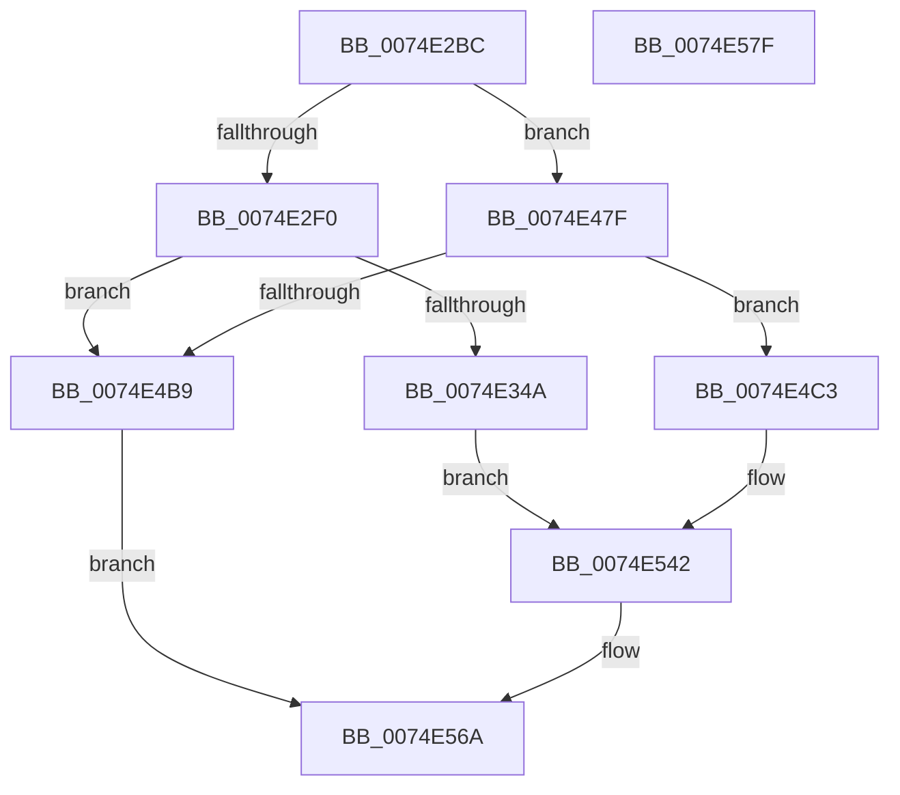

# ObpGetDosDevicesProtection

- RVA: `0x0074E2BC`–`0x0074E580` (길이 `708` bytes)
- VA: `0x000000014074E2BC`
- 실행 섹션: `PAGE`
- PDB 이름 있음: `예`; PDB Function 태그: `아니요`
- unwind 정보 RVA: `0x000A7960`
- 디코드: `172`개 명령, `708/708` bytes 표시
- 미해석 바이트: `0` (있으면 어셈블리에 `.byte`로 보존)

> 이 문서는 커널 이미지의 기계어와 PDB 기호를 분석해 생성했습니다. 4번과 5번은 함수 원형과 자료형을 바이너리 사용 방식에서 추정한 C 해석이며 원본 소스 복구 결과는 아닙니다.

## 1. Dependencies

- 직접 호출 지점: **25**; 고유 호출 대상: **7**
- 직접 호출자로 확인된 함수: **1**
- RIP 상대 이미지 참조: **5**

### Outgoing calls
- `0x0074E2DD` → [RtlCreateSecurityDescriptor](../9F/RtlCreateSecurityDescriptor_function_009F1DF0.md) (function, `0x009F1DF0`)
- `0x0074E2F7` → [RtlLengthSid](../../text/45/RtlLengthSid_function_0045D270.md) (function, `0x0045D270`)
- `0x0074E305` → [RtlLengthSid](../../text/45/RtlLengthSid_function_0045D270.md) (function, `0x0045D270`)
- `0x0074E313` → [RtlLengthSid](../../text/45/RtlLengthSid_function_0045D270.md) (function, `0x0045D270`)
- `0x0074E325` → [RtlLengthSid](../../text/45/RtlLengthSid_function_0045D270.md) (function, `0x0045D270`)
- `0x0074E339` → [ExAllocatePool2](../../poolcode/B8/ExAllocatePool2_function_00B820F0.md) (function, `0x00B820F0`)
- `0x0074E357` → [RtlCreateAcl](../91/RtlCreateAcl_function_00916F00.md) (function, `0x00916F00`)
- `0x0074E37B` → [RtlpAddKnownAce](../92/RtlpAddKnownAce_function_00929A20.md) (function, `0x00929A20`)
- `0x0074E3A1` → [RtlpAddKnownAce](../92/RtlpAddKnownAce_function_00929A20.md) (function, `0x00929A20`)
- `0x0074E3C5` → [RtlpAddKnownAce](../92/RtlpAddKnownAce_function_00929A20.md) (function, `0x00929A20`)
- `0x0074E3D4` → [RtlGetAce](../../text/40/RtlGetAce_function_0040FAF0.md) (function, `0x0040FAF0`)
- `0x0074E3FE` → [RtlpAddKnownAce](../92/RtlpAddKnownAce_function_00929A20.md) (function, `0x00929A20`)
- `0x0074E40E` → [RtlGetAce](../../text/40/RtlGetAce_function_0040FAF0.md) (function, `0x0040FAF0`)
- `0x0074E438` → [RtlpAddKnownAce](../92/RtlpAddKnownAce_function_00929A20.md) (function, `0x00929A20`)
- `0x0074E448` → [RtlGetAce](../../text/40/RtlGetAce_function_0040FAF0.md) (function, `0x0040FAF0`)
- `0x0074E472` → [RtlpAddKnownAce](../92/RtlpAddKnownAce_function_00929A20.md) (function, `0x00929A20`)
- `0x0074E486` → [RtlLengthSid](../../text/45/RtlLengthSid_function_0045D270.md) (function, `0x0045D270`)
- `0x0074E494` → [RtlLengthSid](../../text/45/RtlLengthSid_function_0045D270.md) (function, `0x0045D270`)
- `0x0074E4AC` → [ExAllocatePool2](../../poolcode/B8/ExAllocatePool2_function_00B820F0.md) (function, `0x00B820F0`)
- `0x0074E4D0` → [RtlCreateAcl](../91/RtlCreateAcl_function_00916F00.md) (function, `0x00916F00`)
- `0x0074E4F4` → [RtlpAddKnownAce](../92/RtlpAddKnownAce_function_00929A20.md) (function, `0x00929A20`)
- `0x0074E51A` → [RtlpAddKnownAce](../92/RtlpAddKnownAce_function_00929A20.md) (function, `0x00929A20`)
- `0x0074E53B` → [RtlpAddKnownAce](../92/RtlpAddKnownAce_function_00929A20.md) (function, `0x00929A20`)
- `0x0074E54A` → [RtlGetAce](../../text/40/RtlGetAce_function_0040FAF0.md) (function, `0x0040FAF0`)
- `0x0074E563` → [RtlSetDaclSecurityDescriptor](../9E/RtlSetDaclSecurityDescriptor_function_009EC210.md) (function, `0x009EC210`)

### Direct callers
- [ObpCreateDosDevicesDirectory](ObpCreateDosDevicesDirectory_function_0074E03C.md) at `0x0074E0AB`

### Static image references
- `0x0074E2E2` → RVA `0x00F0FF70` (`.data`; read)
- `0x0074E2F0` → RVA `0x00E67D58` (`.data`; read)
- `0x0074E2FC` → RVA `0x00E67D48` (`.data`; read)
- `0x0074E30A` → RVA `0x00E67D40` (`.data`; read)
- `0x0074E318` → RVA `0x00FD9A68` (`PAGEDATA`; read)

## 2. Other-region calls and transfers

- 다른 실행 섹션으로 향하는 call: **12**
  - `0x0074E2F7` → [RtlLengthSid](../../text/45/RtlLengthSid_function_0045D270.md) (`PAGE` → `.text`)
  - `0x0074E305` → [RtlLengthSid](../../text/45/RtlLengthSid_function_0045D270.md) (`PAGE` → `.text`)
  - `0x0074E313` → [RtlLengthSid](../../text/45/RtlLengthSid_function_0045D270.md) (`PAGE` → `.text`)
  - `0x0074E325` → [RtlLengthSid](../../text/45/RtlLengthSid_function_0045D270.md) (`PAGE` → `.text`)
  - `0x0074E339` → [ExAllocatePool2](../../poolcode/B8/ExAllocatePool2_function_00B820F0.md) (`PAGE` → `POOLCODE`)
  - `0x0074E3D4` → [RtlGetAce](../../text/40/RtlGetAce_function_0040FAF0.md) (`PAGE` → `.text`)
  - `0x0074E40E` → [RtlGetAce](../../text/40/RtlGetAce_function_0040FAF0.md) (`PAGE` → `.text`)
  - `0x0074E448` → [RtlGetAce](../../text/40/RtlGetAce_function_0040FAF0.md) (`PAGE` → `.text`)
  - `0x0074E486` → [RtlLengthSid](../../text/45/RtlLengthSid_function_0045D270.md) (`PAGE` → `.text`)
  - `0x0074E494` → [RtlLengthSid](../../text/45/RtlLengthSid_function_0045D270.md) (`PAGE` → `.text`)
  - `0x0074E4AC` → [ExAllocatePool2](../../poolcode/B8/ExAllocatePool2_function_00B820F0.md) (`PAGE` → `POOLCODE`)
  - `0x0074E54A` → [RtlGetAce](../../text/40/RtlGetAce_function_0040FAF0.md) (`PAGE` → `.text`)
- 별도 외부 분기/꼬리 이동을 확인하지 못했습니다.

## 3. Assembly (complete function range)

```asm
0074E2BC  48 8B C4                        mov rax, rsp
0074E2BF  48 89 58 08                     mov qword ptr [rax + 8], rbx
0074E2C3  48 89 68 18                     mov qword ptr [rax + 0x18], rbp
0074E2C7  48 89 70 20                     mov qword ptr [rax + 0x20], rsi
0074E2CB  57                              push rdi
0074E2CC  48 83 EC 30                     sub rsp, 0x30
0074E2D0  48 83 60 10 00                  and qword ptr [rax + 0x10], 0
0074E2D5  BA 01 00 00 00                  mov edx, 1
0074E2DA  48 8B E9                        mov rbp, rcx
0074E2DD  E8 0E 3B 2A 00                  call 0x1409f1df0
0074E2E2  8B 05 88 1C 7C 00               mov eax, dword ptr [rip + 0x7c1c88]
0074E2E8  A8 01                           test al, 1
0074E2EA  0F 84 8F 01 00 00               je 0x14074e47f
0074E2F0  48 8B 0D 61 9A 71 00            mov rcx, qword ptr [rip + 0x719a61]
0074E2F7  E8 74 EF D0 FF                  call 0x14045d270
0074E2FC  48 8B 0D 45 9A 71 00            mov rcx, qword ptr [rip + 0x719a45]
0074E303  8B D8                           mov ebx, eax
0074E305  E8 66 EF D0 FF                  call 0x14045d270
0074E30A  48 8B 0D 2F 9A 71 00            mov rcx, qword ptr [rip + 0x719a2f]
0074E311  03 D8                           add ebx, eax
0074E313  E8 58 EF D0 FF                  call 0x14045d270
0074E318  48 8B 0D 49 B7 88 00            mov rcx, qword ptr [rip + 0x88b749]
0074E31F  83 C0 50                        add eax, 0x50
0074E322  8D 34 58                        lea esi, [rax + rbx*2]
0074E325  E8 46 EF D0 FF                  call 0x14045d270
0074E32A  03 F0                           add esi, eax
0074E32C  B9 00 01 00 00                  mov ecx, 0x100
0074E331  8B D6                           mov edx, esi
0074E333  41 B8 44 61 63 6C               mov r8d, 0x6c636144
0074E339  E8 B2 3D 43 00                  call 0x140b820f0
0074E33E  48 8B D8                        mov rbx, rax
0074E341  48 85 C0                        test rax, rax
0074E344  0F 84 6F 01 00 00               je 0x14074e4b9
0074E34A  BF 02 00 00 00                  mov edi, 2
0074E34F  8B D6                           mov edx, esi
0074E351  44 8B C7                        mov r8d, edi
0074E354  48 8B C8                        mov rcx, rax
0074E357  E8 A4 8B 1C 00                  call 0x140916f00
0074E35C  48 8B 0D E5 99 71 00            mov rcx, qword ptr [rip + 0x7199e5]
0074E363  41 B9 00 00 00 A0               mov r9d, 0xa0000000
0074E369  C6 44 24 28 00                  mov byte ptr [rsp + 0x28], 0
0074E36E  45 33 C0                        xor r8d, r8d
0074E371  48 89 4C 24 20                  mov qword ptr [rsp + 0x20], rcx
0074E376  8B D7                           mov edx, edi
0074E378  48 8B CB                        mov rcx, rbx
0074E37B  E8 A0 B6 1D 00                  call 0x140929a20
0074E380  48 8B 05 D1 99 71 00            mov rax, qword ptr [rip + 0x7199d1]
0074E387  BE 00 00 00 10                  mov esi, 0x10000000
0074E38C  44 8B CE                        mov r9d, esi
0074E38F  C6 44 24 28 00                  mov byte ptr [rsp + 0x28], 0
0074E394  45 33 C0                        xor r8d, r8d
0074E397  48 89 44 24 20                  mov qword ptr [rsp + 0x20], rax
0074E39C  8B D7                           mov edx, edi
0074E39E  48 8B CB                        mov rcx, rbx
0074E3A1  E8 7A B6 1D 00                  call 0x140929a20
0074E3A6  48 8B 05 9B 99 71 00            mov rax, qword ptr [rip + 0x71999b]
0074E3AD  41 B9 00 00 00 20               mov r9d, 0x20000000
0074E3B3  C6 44 24 28 00                  mov byte ptr [rsp + 0x28], 0
0074E3B8  45 33 C0                        xor r8d, r8d
0074E3BB  8B D7                           mov edx, edi
0074E3BD  48 89 44 24 20                  mov qword ptr [rsp + 0x20], rax
0074E3C2  48 8B CB                        mov rcx, rbx
0074E3C5  E8 56 B6 1D 00                  call 0x140929a20
0074E3CA  4C 8D 44 24 48                  lea r8, [rsp + 0x48]
0074E3CF  8B D7                           mov edx, edi
0074E3D1  48 8B CB                        mov rcx, rbx
0074E3D4  E8 17 17 CC FF                  call 0x14040faf0
0074E3D9  48 8B 44 24 48                  mov rax, qword ptr [rsp + 0x48]
0074E3DE  44 8B CE                        mov r9d, esi
0074E3E1  C6 44 24 28 00                  mov byte ptr [rsp + 0x28], 0
0074E3E6  45 33 C0                        xor r8d, r8d
0074E3E9  8B D7                           mov edx, edi
0074E3EB  48 8B CB                        mov rcx, rbx
0074E3EE  80 48 01 0B                     or byte ptr [rax + 1], 0xb
0074E3F2  48 8B 05 6F B6 88 00            mov rax, qword ptr [rip + 0x88b66f]
0074E3F9  48 89 44 24 20                  mov qword ptr [rsp + 0x20], rax
0074E3FE  E8 1D B6 1D 00                  call 0x140929a20
0074E403  4C 8D 44 24 48                  lea r8, [rsp + 0x48]
0074E408  48 8B CB                        mov rcx, rbx
0074E40B  8D 57 01                        lea edx, [rdi + 1]
0074E40E  E8 DD 16 CC FF                  call 0x14040faf0
0074E413  48 8B 44 24 48                  mov rax, qword ptr [rsp + 0x48]
0074E418  44 8B CE                        mov r9d, esi
0074E41B  C6 44 24 28 00                  mov byte ptr [rsp + 0x28], 0
0074E420  45 33 C0                        xor r8d, r8d
0074E423  8B D7                           mov edx, edi
0074E425  48 8B CB                        mov rcx, rbx
0074E428  80 48 01 0B                     or byte ptr [rax + 1], 0xb
0074E42C  48 8B 05 25 99 71 00            mov rax, qword ptr [rip + 0x719925]
0074E433  48 89 44 24 20                  mov qword ptr [rsp + 0x20], rax
0074E438  E8 E3 B5 1D 00                  call 0x140929a20
0074E43D  4C 8D 44 24 48                  lea r8, [rsp + 0x48]
0074E442  48 8B CB                        mov rcx, rbx
0074E445  8D 57 02                        lea edx, [rdi + 2]
0074E448  E8 A3 16 CC FF                  call 0x14040faf0
0074E44D  48 8B 44 24 48                  mov rax, qword ptr [rsp + 0x48]
0074E452  44 8B CE                        mov r9d, esi
0074E455  C6 44 24 28 00                  mov byte ptr [rsp + 0x28], 0
0074E45A  45 33 C0                        xor r8d, r8d
0074E45D  8B D7                           mov edx, edi
0074E45F  48 8B CB                        mov rcx, rbx
0074E462  80 48 01 0B                     or byte ptr [rax + 1], 0xb
0074E466  48 8B 05 D3 98 71 00            mov rax, qword ptr [rip + 0x7198d3]
0074E46D  48 89 44 24 20                  mov qword ptr [rsp + 0x20], rax
0074E472  E8 A9 B5 1D 00                  call 0x140929a20
0074E477  8D 57 03                        lea edx, [rdi + 3]
0074E47A  E9 C3 00 00 00                  jmp 0x14074e542
0074E47F  48 8B 0D C2 98 71 00            mov rcx, qword ptr [rip + 0x7198c2]
0074E486  E8 E5 ED D0 FF                  call 0x14045d270
0074E48B  48 8B 0D C6 98 71 00            mov rcx, qword ptr [rip + 0x7198c6]
0074E492  8B D8                           mov ebx, eax
0074E494  E8 D7 ED D0 FF                  call 0x14045d270
0074E499  83 C0 2C                        add eax, 0x2c
0074E49C  B9 00 01 00 00                  mov ecx, 0x100
0074E4A1  41 B8 44 61 63 6C               mov r8d, 0x6c636144
0074E4A7  8D 34 58                        lea esi, [rax + rbx*2]
0074E4AA  8B D6                           mov edx, esi
0074E4AC  E8 3F 3C 43 00                  call 0x140b820f0
0074E4B1  48 8B D8                        mov rbx, rax
0074E4B4  48 85 C0                        test rax, rax
0074E4B7  75 0A                           jne 0x14074e4c3
0074E4B9  B8 17 00 00 C0                  mov eax, 0xc0000017
0074E4BE  E9 A7 00 00 00                  jmp 0x14074e56a
0074E4C3  BF 02 00 00 00                  mov edi, 2
0074E4C8  8B D6                           mov edx, esi
0074E4CA  44 8B C7                        mov r8d, edi
0074E4CD  48 8B CB                        mov rcx, rbx
0074E4D0  E8 2B 8A 1C 00                  call 0x140916f00
0074E4D5  48 8B 05 6C 98 71 00            mov rax, qword ptr [rip + 0x71986c]
0074E4DC  41 B9 00 00 00 E0               mov r9d, 0xe0000000
0074E4E2  C6 44 24 28 00                  mov byte ptr [rsp + 0x28], 0
0074E4E7  45 33 C0                        xor r8d, r8d
0074E4EA  8B D7                           mov edx, edi
0074E4EC  48 89 44 24 20                  mov qword ptr [rsp + 0x20], rax
0074E4F1  48 8B CB                        mov rcx, rbx
0074E4F4  E8 27 B5 1D 00                  call 0x140929a20
0074E4F9  48 8B 05 58 98 71 00            mov rax, qword ptr [rip + 0x719858]
0074E500  BE 00 00 00 10                  mov esi, 0x10000000
0074E505  44 8B CE                        mov r9d, esi
0074E508  C6 44 24 28 00                  mov byte ptr [rsp + 0x28], 0
0074E50D  45 33 C0                        xor r8d, r8d
0074E510  48 89 44 24 20                  mov qword ptr [rsp + 0x20], rax
0074E515  8B D7                           mov edx, edi
0074E517  48 8B CB                        mov rcx, rbx
0074E51A  E8 01 B5 1D 00                  call 0x140929a20
0074E51F  48 8B 05 22 98 71 00            mov rax, qword ptr [rip + 0x719822]
0074E526  44 8B CE                        mov r9d, esi
0074E529  C6 44 24 28 00                  mov byte ptr [rsp + 0x28], 0
0074E52E  45 33 C0                        xor r8d, r8d
0074E531  8B D7                           mov edx, edi
0074E533  48 89 44 24 20                  mov qword ptr [rsp + 0x20], rax
0074E538  48 8B CB                        mov rcx, rbx
0074E53B  E8 E0 B4 1D 00                  call 0x140929a20
0074E540  8B D7                           mov edx, edi
0074E542  4C 8D 44 24 48                  lea r8, [rsp + 0x48]
0074E547  48 8B CB                        mov rcx, rbx
0074E54A  E8 A1 15 CC FF                  call 0x14040faf0
0074E54F  48 8B 44 24 48                  mov rax, qword ptr [rsp + 0x48]
0074E554  45 33 C9                        xor r9d, r9d
0074E557  4C 8B C3                        mov r8, rbx
0074E55A  B2 01                           mov dl, 1
0074E55C  48 8B CD                        mov rcx, rbp
0074E55F  80 48 01 0B                     or byte ptr [rax + 1], 0xb
0074E563  E8 A8 DC 29 00                  call 0x1409ec210
0074E568  33 C0                           xor eax, eax
0074E56A  48 8B 5C 24 40                  mov rbx, qword ptr [rsp + 0x40]
0074E56F  48 8B 6C 24 50                  mov rbp, qword ptr [rsp + 0x50]
0074E574  48 8B 74 24 58                  mov rsi, qword ptr [rsp + 0x58]
0074E579  48 83 C4 30                     add rsp, 0x30
0074E57D  5F                              pop rdi
0074E57E  C3                              ret
0074E57F  CC                              int3
```

## 4. C-style interpretation (structured pseudocode)

```c
__int64 __fastcall ObpGetDosDevicesProtection(__int64 a1)
{
    __int64 result;
    __int64 v_rbx;
    __int64 v_rsi;
    __int64 v_rsp;
    unsigned __int8 v_stack_m10;
    unsigned __int64 v_stack_m18;
    unsigned __int64 v_stack_p10;
    unsigned __int64 v_stack_p18;
    unsigned __int64 v_stack_p20;
    unsigned __int64 v_stack_p8;

    *(unsigned __int64 *)(v_rsp + 8) = v_rbx;
    *(unsigned __int64 *)(v_rsp + 24) = v_rbp;
    *(unsigned __int64 *)(v_rsp + 32) = v_rsi;
    v_rsp = (v_rsp) - (48);
    result = RtlCreateSecurityDescriptor(a1, 1, a3, a4);
    if ((((unsigned __int8)((unsigned int)(*(unsigned int *)(v_rip + 8133768)))) & (1)) == 0) goto loc_0074E47F;
    result = RtlLengthSid(*(unsigned __int64 *)(v_rip + 7445089), 1, a3, a4);
    result = RtlLengthSid(*(unsigned __int64 *)(v_rip + 7445061), 1, a3, a4);
    v_rbx = (unsigned int)(((unsigned int)((unsigned int)(result))) + ((unsigned int)(result)));
    result = RtlLengthSid(*(unsigned __int64 *)(v_rip + 7445039), 1, a3, a4);
    result = (unsigned int)((result) + (80));
    result = RtlLengthSid(*(unsigned __int64 *)(v_rip + 8959817), 1, a3, a4);
    v_rsi = (unsigned int)((result + v_rbx * 2) + ((unsigned int)(result)));
    result = ExAllocatePool2(256, (unsigned int)((unsigned int)(v_rsi)), (unsigned int)(0x6C636144ULL), a4);
    if (result == 0) goto loc_0074E4B9;
    result = RtlCreateAcl(result, (unsigned int)((unsigned int)(v_rsi)), 2, a4);
    v_stack_m10 = 0;
    a3 = 0;
    v_stack_m18 = *(unsigned __int64 *)(v_rip + 7444965);
    result = RtlpAddKnownAce(result, 2, a3, (unsigned int)(0xA0000000ULL));
    v_stack_m10 = 0;
    a3 = 0;
    v_stack_m18 = *(unsigned __int64 *)(v_rip + 7444945);
    result = RtlpAddKnownAce(result, 2, a3, (unsigned int)((unsigned int)((unsigned int)(0x10000000ULL))));
    v_stack_m10 = 0;
    a3 = 0;
    v_stack_m18 = *(unsigned __int64 *)(v_rip + 7444891);
    result = RtlpAddKnownAce(result, 2, a3, (unsigned int)(0x20000000ULL));
    result = RtlGetAce(result, 2, v_stack_p10, (unsigned int)(0x20000000ULL));
    v_stack_m10 = 0;
    a3 = 0;
    v_stack_m18 = *(unsigned __int64 *)(v_rip + 8959599);
    result = RtlpAddKnownAce(result, 2, a3, (unsigned int)((unsigned int)((unsigned int)(0x10000000ULL))));
    result = RtlGetAce(result, 2 + 1, v_stack_p10, (unsigned int)((unsigned int)((unsigned int)(0x10000000ULL))));
    v_stack_m10 = 0;
    a3 = 0;
    v_stack_m18 = *(unsigned __int64 *)(v_rip + 7444773);
    result = RtlpAddKnownAce(result, 2, a3, (unsigned int)((unsigned int)((unsigned int)(0x10000000ULL))));
    result = RtlGetAce(result, 2 + 2, v_stack_p10, (unsigned int)((unsigned int)((unsigned int)(0x10000000ULL))));
    v_stack_m10 = 0;
    a3 = 0;
    v_stack_m18 = *(unsigned __int64 *)(v_rip + 7444691);
    result = RtlpAddKnownAce(result, 2, a3, (unsigned int)((unsigned int)((unsigned int)(0x10000000ULL))));
    goto loc_0074E542;
loc_0074E47F:
    result = RtlLengthSid(*(unsigned __int64 *)(v_rip + 7444674), 2 + 3, a3, (unsigned int)((unsigned int)((unsigned int)(0x10000000ULL))));
    result = RtlLengthSid(*(unsigned __int64 *)(v_rip + 7444678), 2 + 3, a3, (unsigned int)((unsigned int)((unsigned int)(0x10000000ULL))));
    result = (unsigned int)((result) + (44));
    result = ExAllocatePool2(256, (unsigned int)((unsigned int)(result + (unsigned int)((unsigned int)(result)) * 2)), (unsigned int)(0x6C636144ULL), (unsigned int)((unsigned int)((unsigned int)(0x10000000ULL))));
    if (result != 0) goto loc_0074E4C3;
loc_0074E4B9:
    goto loc_0074E56A;
loc_0074E4C3:
    result = RtlCreateAcl(result, (unsigned int)((unsigned int)(result + (unsigned int)((unsigned int)(result)) * 2)), 2, (unsigned int)((unsigned int)((unsigned int)(0x10000000ULL))));
    v_stack_m10 = 0;
    a3 = 0;
    v_stack_m18 = *(unsigned __int64 *)(v_rip + 7444588);
    result = RtlpAddKnownAce(result, 2, a3, (unsigned int)(0xE0000000ULL));
    v_stack_m10 = 0;
    a3 = 0;
    v_stack_m18 = *(unsigned __int64 *)(v_rip + 7444568);
    result = RtlpAddKnownAce(result, 2, a3, (unsigned int)((unsigned int)((unsigned int)(0x10000000ULL))));
    v_stack_m10 = 0;
    a3 = 0;
    v_stack_m18 = *(unsigned __int64 *)(v_rip + 7444514);
    result = RtlpAddKnownAce(result, 2, a3, (unsigned int)((unsigned int)((unsigned int)(0x10000000ULL))));
loc_0074E542:
    result = RtlGetAce(result, 2, v_stack_p10, (unsigned int)((unsigned int)((unsigned int)(0x10000000ULL))));
    a4 = 0;
    result = RtlSetDaclSecurityDescriptor(a1, 1, result, a4);
    result = 0;
loc_0074E56A:
    v_rsp = (v_rsp) + (48);
    return result;
}
```

## 5. (Beta) C Style

```c
int64_t ObpGetDosDevicesProtection(int64_t Arg1)
{
    int64_t result;
    int64_t local_rbx;
    int64_t local_rsi;
    int64_t local_rsp;
    uint8_t v_stack_m10;
    uint64_t v_stack_m18;
    uint64_t v_stack_p10;
    uint64_t v_stack_p18;
    uint64_t v_stack_p20;
    uint64_t v_stack_p8;

    *(uint64_t *)(local_rsp + 0x8) = local_rbx;
    *(uint64_t *)(local_rsp + 0x18) = local_rbp;
    *(uint64_t *)(local_rsp + 0x20) = local_rsi;
    local_rsp = (local_rsp) - (48);
    result = RtlCreateSecurityDescriptor(Arg1, 1, a3, a4);
    if ((((uint8_t)((uint32_t)(*(uint32_t *)(v_rip + 0x7C1C88)))) & (1)) == 0) goto loc_0074E47F;
    result = RtlLengthSid(*(uint64_t *)(v_rip + 0x719A61), 1, a3, a4);
    result = RtlLengthSid(*(uint64_t *)(v_rip + 0x719A45), 1, a3, a4);
    local_rbx = (uint32_t)(((uint32_t)((uint32_t)(result))) + ((uint32_t)(result)));
    result = RtlLengthSid(*(uint64_t *)(v_rip + 0x719A2F), 1, a3, a4);
    result = (uint32_t)((result) + (80));
    result = RtlLengthSid(*(uint64_t *)(v_rip + 0x88B749), 1, a3, a4);
    local_rsi = (uint32_t)((result + local_rbx * 2) + ((uint32_t)(result)));
    result = ExAllocatePool2(256, (uint32_t)((uint32_t)(local_rsi)), (uint32_t)(0x6C636144ULL), a4);
    if (result == 0) goto loc_0074E4B9;
    result = RtlCreateAcl(result, (uint32_t)((uint32_t)(local_rsi)), 2, a4);
    v_stack_m10 = 0;
    a3 = 0;
    v_stack_m18 = *(uint64_t *)(v_rip + 0x7199E5);
    result = RtlpAddKnownAce(result, 2, a3, (uint32_t)(0xA0000000ULL));
    v_stack_m10 = 0;
    a3 = 0;
    v_stack_m18 = *(uint64_t *)(v_rip + 0x7199D1);
    result = RtlpAddKnownAce(result, 2, a3, (uint32_t)((uint32_t)((uint32_t)(0x10000000ULL))));
    v_stack_m10 = 0;
    a3 = 0;
    v_stack_m18 = *(uint64_t *)(v_rip + 0x71999B);
    result = RtlpAddKnownAce(result, 2, a3, (uint32_t)(0x20000000ULL));
    result = RtlGetAce(result, 2, v_stack_p10, (uint32_t)(0x20000000ULL));
    v_stack_m10 = 0;
    a3 = 0;
    v_stack_m18 = *(uint64_t *)(v_rip + 0x88B66F);
    result = RtlpAddKnownAce(result, 2, a3, (uint32_t)((uint32_t)((uint32_t)(0x10000000ULL))));
    result = RtlGetAce(result, 2 + 1, v_stack_p10, (uint32_t)((uint32_t)((uint32_t)(0x10000000ULL))));
    v_stack_m10 = 0;
    a3 = 0;
    v_stack_m18 = *(uint64_t *)(v_rip + 0x719925);
    result = RtlpAddKnownAce(result, 2, a3, (uint32_t)((uint32_t)((uint32_t)(0x10000000ULL))));
    result = RtlGetAce(result, 2 + 2, v_stack_p10, (uint32_t)((uint32_t)((uint32_t)(0x10000000ULL))));
    v_stack_m10 = 0;
    a3 = 0;
    v_stack_m18 = *(uint64_t *)(v_rip + 0x7198D3);
    result = RtlpAddKnownAce(result, 2, a3, (uint32_t)((uint32_t)((uint32_t)(0x10000000ULL))));
    goto loc_0074E542;
loc_0074E47F:
    result = RtlLengthSid(*(uint64_t *)(v_rip + 0x7198C2), 2 + 3, a3, (uint32_t)((uint32_t)((uint32_t)(0x10000000ULL))));
    result = RtlLengthSid(*(uint64_t *)(v_rip + 0x7198C6), 2 + 3, a3, (uint32_t)((uint32_t)((uint32_t)(0x10000000ULL))));
    result = (uint32_t)((result) + (44));
    result = ExAllocatePool2(256, (uint32_t)((uint32_t)(result + (uint32_t)((uint32_t)(result)) * 2)), (uint32_t)(0x6C636144ULL), (uint32_t)((uint32_t)((uint32_t)(0x10000000ULL))));
    if (result != 0) goto loc_0074E4C3;
loc_0074E4B9:
    goto loc_0074E56A;
loc_0074E4C3:
    result = RtlCreateAcl(result, (uint32_t)((uint32_t)(result + (uint32_t)((uint32_t)(result)) * 2)), 2, (uint32_t)((uint32_t)((uint32_t)(0x10000000ULL))));
    v_stack_m10 = 0;
    a3 = 0;
    v_stack_m18 = *(uint64_t *)(v_rip + 0x71986C);
    result = RtlpAddKnownAce(result, 2, a3, (uint32_t)(0xE0000000ULL));
    v_stack_m10 = 0;
    a3 = 0;
    v_stack_m18 = *(uint64_t *)(v_rip + 0x719858);
    result = RtlpAddKnownAce(result, 2, a3, (uint32_t)((uint32_t)((uint32_t)(0x10000000ULL))));
    v_stack_m10 = 0;
    a3 = 0;
    v_stack_m18 = *(uint64_t *)(v_rip + 0x719822);
    result = RtlpAddKnownAce(result, 2, a3, (uint32_t)((uint32_t)((uint32_t)(0x10000000ULL))));
loc_0074E542:
    result = RtlGetAce(result, 2, v_stack_p10, (uint32_t)((uint32_t)((uint32_t)(0x10000000ULL))));
    a4 = 0;
    result = RtlSetDaclSecurityDescriptor(Arg1, 1, result, a4);
    result = 0;
loc_0074E56A:
    local_rsp = (local_rsp) + (48);
    return result;
}
```

## 6. Execution-region graph

[열기: 2D/3D 그래프와 함수 탐색 컨트롤 패널](../../../control-panel.html?section=page&rva=0x0074E2BC&view=graph)

- 2D 그래프는 위에서 아래로 흐르고, 3D 그래프는 빈 공간을 드래그해 회전합니다. Shift+드래그는 이동, 휠은 확대·축소, 함수 노드 선택은 대상 보고서 이동입니다.

### Static fallback


