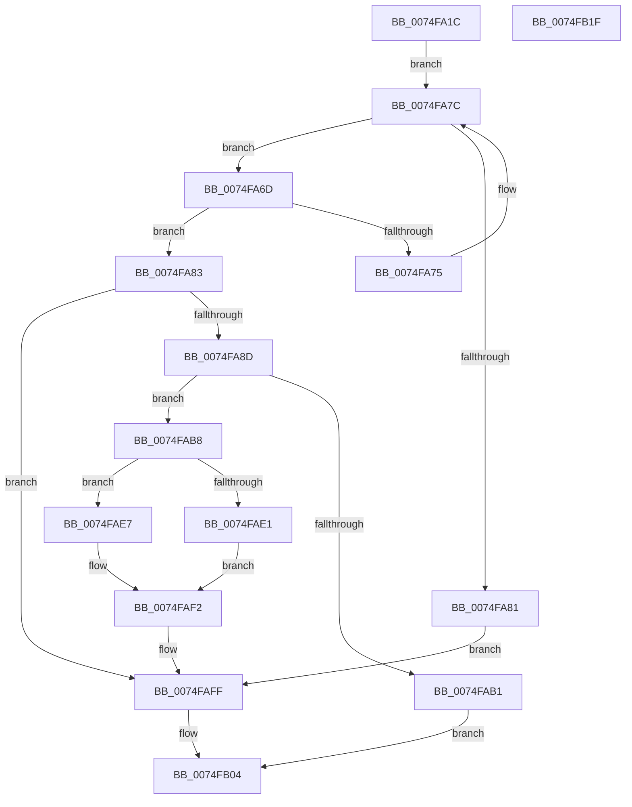

# ObpGetObjectRefInfo

- RVA: `0x0074FA1C`–`0x0074FB20` (길이 `260` bytes)
- VA: `0x000000014074FA1C`
- 실행 섹션: `PAGE`
- PDB 이름 있음: `예`; PDB Function 태그: `아니요`
- unwind 정보 RVA: `0x0005E6B4`
- 디코드: `69`개 명령, `260/260` bytes 표시
- 미해석 바이트: `0` (있으면 어셈블리에 `.byte`로 보존)

> 이 문서는 커널 이미지의 기계어와 PDB 기호를 분석해 생성했습니다. 4번과 5번은 함수 원형과 자료형을 바이너리 사용 방식에서 추정한 C 해석이며 원본 소스 복구 결과는 아닙니다.

## 1. Dependencies

- 직접 호출 지점: **3**; 고유 호출 대상: **3**
- 직접 호출자로 확인된 함수: **2**
- RIP 상대 이미지 참조: **1**

### Outgoing calls
- `0x0074FAA4` → [ExAllocatePool2](../../poolcode/B8/ExAllocatePool2_function_00B820F0.md) (function, `0x00B820F0`)
- `0x0074FACE` → [memcpy](../../text/6C/memcpy_function_006C6840.md) (function, `0x006C6840`)
- `0x0074FAFA` → [ExFreePoolWithTag](../../poolcode/B8/ExFreePoolWithTag_function_00B82870.md) (function, `0x00B82870`)

### Direct callers
- [ObpPushRefDerefInfo](ObpPushRefDerefInfo_function_0074FEC4.md) at `0x0074FF55`
- [ObpRegisterObject](../AC/ObpRegisterObject_function_00ACF3EC.md) at `0x00ACF4C4`

### Static image references
- `0x0074FA5B` → RVA `0x00F0F548` (`.data`; read)

## 2. Other-region calls and transfers

- 다른 실행 섹션으로 향하는 call: **3**
  - `0x0074FAA4` → [ExAllocatePool2](../../poolcode/B8/ExAllocatePool2_function_00B820F0.md) (`PAGE` → `POOLCODE`)
  - `0x0074FACE` → [memcpy](../../text/6C/memcpy_function_006C6840.md) (`PAGE` → `.text`)
  - `0x0074FAFA` → [ExFreePoolWithTag](../../poolcode/B8/ExFreePoolWithTag_function_00B82870.md) (`PAGE` → `POOLCODE`)
- 별도 외부 분기/꼬리 이동을 확인하지 못했습니다.

## 3. Assembly (complete function range)

```asm
0074FA1C  48 8B C4                        mov rax, rsp
0074FA1F  48 89 58 08                     mov qword ptr [rax + 8], rbx
0074FA23  48 89 68 10                     mov qword ptr [rax + 0x10], rbp
0074FA27  48 89 70 18                     mov qword ptr [rax + 0x18], rsi
0074FA2B  48 89 78 20                     mov qword ptr [rax + 0x20], rdi
0074FA2F  41 56                           push r14
0074FA31  48 83 EC 20                     sub rsp, 0x20
0074FA35  44 8D 41 30                     lea r8d, [rcx + 0x30]
0074FA39  B8 A3 71 6E A3                  mov eax, 0xa36e71a3
0074FA3E  41 C1 E8 04                     shr r8d, 4
0074FA42  4C 8B F2                        mov r14, rdx
0074FA45  41 81 E0 FF FF 0F 00            and r8d, 0xfffff
0074FA4C  41 F7 E0                        mul r8d
0074FA4F  C1 EA 08                        shr edx, 8
0074FA52  69 C2 91 01 00 00               imul eax, edx, 0x191
0074FA58  44 2B C0                        sub r8d, eax
0074FA5B  48 8B 05 E6 FA 7B 00            mov rax, qword ptr [rip + 0x7bfae6]
0074FA62  41 8B E8                        mov ebp, r8d
0074FA65  33 F6                           xor esi, esi
0074FA67  4A 8B 1C C0                     mov rbx, qword ptr [rax + r8*8]
0074FA6B  EB 0F                           jmp 0x14074fa7c
0074FA6D  48 8B FB                        mov rdi, rbx
0074FA70  48 39 0B                        cmp qword ptr [rbx], rcx
0074FA73  74 0E                           je 0x14074fa83
0074FA75  48 8B F3                        mov rsi, rbx
0074FA78  48 8B 5B 08                     mov rbx, qword ptr [rbx + 8]
0074FA7C  48 85 DB                        test rbx, rbx
0074FA7F  75 EC                           jne 0x14074fa6d
0074FA81  EB 7C                           jmp 0x14074faff
0074FA83  0F B7 43 22                     movzx eax, word ptr [rbx + 0x22]
0074FA87  66 39 43 20                     cmp word ptr [rbx + 0x20], ax
0074FA8B  75 72                           jne 0x14074faff
0074FA8D  48 8D 14 40                     lea rdx, [rax + rax*2]
0074FA91  B9 40 00 00 00                  mov ecx, 0x40
0074FA96  48 8D 14 95 28 18 00 00         lea rdx, [rdx*4 + 0x1828]
0074FA9E  41 B8 4F 62 52 74               mov r8d, 0x7452624f
0074FAA4  E8 47 26 43 00                  call 0x140b820f0
0074FAA9  48 8B D8                        mov rbx, rax
0074FAAC  48 85 C0                        test rax, rax
0074FAAF  75 07                           jne 0x14074fab8
0074FAB1  B8 17 00 00 C0                  mov eax, 0xc0000017
0074FAB6  EB 4C                           jmp 0x14074fb04
0074FAB8  0F B7 47 20                     movzx eax, word ptr [rdi + 0x20]
0074FABC  48 8B D7                        mov rdx, rdi
0074FABF  48 8B CB                        mov rcx, rbx
0074FAC2  4C 8D 04 40                     lea r8, [rax + rax*2]
0074FAC6  4E 8D 04 85 28 00 00 00         lea r8, [r8*4 + 0x28]
0074FACE  E8 6D 6D F7 FF                  call 0x1406c6840
0074FAD3  B8 00 02 00 00                  mov eax, 0x200
0074FAD8  66 01 43 22                     add word ptr [rbx + 0x22], ax
0074FADC  48 85 F6                        test rsi, rsi
0074FADF  74 06                           je 0x14074fae7
0074FAE1  48 89 5E 08                     mov qword ptr [rsi + 8], rbx
0074FAE5  EB 0B                           jmp 0x14074faf2
0074FAE7  48 8B 05 5A FA 7B 00            mov rax, qword ptr [rip + 0x7bfa5a]
0074FAEE  48 89 1C E8                     mov qword ptr [rax + rbp*8], rbx
0074FAF2  BA 4F 62 52 74                  mov edx, 0x7452624f
0074FAF7  48 8B CF                        mov rcx, rdi
0074FAFA  E8 71 2D 43 00                  call 0x140b82870
0074FAFF  49 89 1E                        mov qword ptr [r14], rbx
0074FB02  33 C0                           xor eax, eax
0074FB04  48 8B 5C 24 30                  mov rbx, qword ptr [rsp + 0x30]
0074FB09  48 8B 6C 24 38                  mov rbp, qword ptr [rsp + 0x38]
0074FB0E  48 8B 74 24 40                  mov rsi, qword ptr [rsp + 0x40]
0074FB13  48 8B 7C 24 48                  mov rdi, qword ptr [rsp + 0x48]
0074FB18  48 83 C4 20                     add rsp, 0x20
0074FB1C  41 5E                           pop r14
0074FB1E  C3                              ret
0074FB1F  CC                              int3
```

## 4. C-style interpretation (structured pseudocode)

```c
__int64 __fastcall ObpGetObjectRefInfo(__int64 a1, __int64 a2)
{
    __int64 result;
    __int64 v_rsi;
    __int64 v_rsp;
    unsigned __int64 v_stack_p10;
    unsigned __int64 v_stack_p18;
    unsigned __int64 v_stack_p20;
    unsigned __int64 v_stack_p8;

    *(unsigned __int64 *)(v_rsp + 8) = v_rbx;
    *(unsigned __int64 *)(v_rsp + 16) = v_rbp;
    *(unsigned __int64 *)(v_rsp + 24) = v_rsi;
    *(unsigned __int64 *)(v_rsp + 32) = v_rdi;
    v_rsp = (v_rsp) - (32);
    a3 = (unsigned int)((a1 + 48) >> (4));
    a3 = (unsigned int)((a3) & (0xFFFFFULL));
    a2 = (unsigned int)((a2) >> (8));
    result = (unsigned int)(((unsigned int)(0xA36E71A3ULL)) * ((unsigned int)(a2)));
    a3 = (unsigned int)((a3) - ((unsigned int)(result)));
    v_rsi = 0;
    goto loc_0074FA7C;
loc_0074FA6D:
    if ((*(unsigned __int64 *)(*(unsigned __int64 *)(*(unsigned __int64 *)(v_rip + 8125158) + a3 * 8))) == a1) goto loc_0074FA83;
loc_0074FA7C:
    if (*(unsigned __int64 *)(*(unsigned __int64 *)(*(unsigned __int64 *)(v_rip + 8125158) + a3 * 8) + 8) != 0) goto loc_0074FA6D;
    goto loc_0074FAFF;
loc_0074FA83:
    if ((*(unsigned __int16 *)(*(unsigned __int64 *)(*(unsigned __int64 *)(*(unsigned __int64 *)(v_rip + 8125158) + a3 * 8) + 8) + 32)) != ((unsigned __int16)(*(unsigned __int16 *)(*(unsigned __int64 *)(*(unsigned __int64 *)(*(unsigned __int64 *)(v_rip + 8125158) + a3 * 8) + 8) + 34)))) goto loc_0074FAFF;
    result = ExAllocatePool2(64, *(unsigned __int16 *)(*(unsigned __int64 *)(*(unsigned __int64 *)(*(unsigned __int64 *)(v_rip + 8125158) + a3 * 8) + 8) + 34) + *(unsigned __int16 *)(*(unsigned __int64 *)(*(unsigned __int64 *)(*(unsigned __int64 *)(v_rip + 8125158) + a3 * 8) + 8) + 34) * 2 * 4 + 6184, (unsigned int)(0x7452624FULL), a4);
    if (result != 0) goto loc_0074FAB8;
    goto loc_0074FB04;
loc_0074FAB8:
    result = memcpy(result, *(unsigned __int64 *)(*(unsigned __int64 *)(v_rip + 8125158) + a3 * 8), *(unsigned __int16 *)(*(unsigned __int64 *)(*(unsigned __int64 *)(v_rip + 8125158) + a3 * 8) + 32) + *(unsigned __int16 *)(*(unsigned __int64 *)(*(unsigned __int64 *)(v_rip + 8125158) + a3 * 8) + 32) * 2 * 4 + 40, a4);
    if (*(unsigned __int64 *)(*(unsigned __int64 *)(v_rip + 8125158) + a3 * 8) == 0) goto loc_0074FAE7;
    *(unsigned __int64 *)(*(unsigned __int64 *)(*(unsigned __int64 *)(v_rip + 8125158) + a3 * 8) + 8) = result;
    goto loc_0074FAF2;
loc_0074FAE7:
    *(unsigned __int64 *)(*(unsigned __int64 *)(v_rip + 8125018) + (unsigned int)((unsigned int)(a3)) * 8) = result;
loc_0074FAF2:
    result = ExFreePoolWithTag(*(unsigned __int64 *)(*(unsigned __int64 *)(v_rip + 8125158) + a3 * 8), (unsigned int)(0x7452624FULL), *(unsigned __int16 *)(*(unsigned __int64 *)(*(unsigned __int64 *)(v_rip + 8125158) + a3 * 8) + 32) + *(unsigned __int16 *)(*(unsigned __int64 *)(*(unsigned __int64 *)(v_rip + 8125158) + a3 * 8) + 32) * 2 * 4 + 40, a4);
loc_0074FAFF:
    *(unsigned __int64 *)(a2) = result;
    result = 0;
loc_0074FB04:
    v_rsp = (v_rsp) + (32);
    return result;
}
```

## 5. (Beta) C Style

```c
int64_t ObpGetObjectRefInfo(void *Arg1, void *Arg2)
{
    uint8_t *arg1 = (uint8_t *)Arg1;
    uint8_t *arg2 = (uint8_t *)Arg2;

    int64_t result;
    int64_t local_rsi;
    int64_t local_rsp;
    uint64_t v_stack_p10;
    uint64_t v_stack_p18;
    uint64_t v_stack_p20;
    uint64_t v_stack_p8;

    *(uint64_t *)(local_rsp + 0x8) = local_rbx;
    *(uint64_t *)(local_rsp + 0x10) = local_rbp;
    *(uint64_t *)(local_rsp + 0x18) = local_rsi;
    *(uint64_t *)(local_rsp + 0x20) = local_rdi;
    local_rsp = (local_rsp) - (32);
    a3 = (uint32_t)((Arg1 + 48) >> (4));
    a3 = (uint32_t)((a3) & (0xFFFFFULL));
    Arg2 = (uint32_t)((Arg2) >> (8));
    result = (uint32_t)(((uint32_t)(0xA36E71A3ULL)) * ((uint32_t)(Arg2)));
    a3 = (uint32_t)((a3) - ((uint32_t)(result)));
    local_rsi = 0;
    goto loc_0074FA7C;
loc_0074FA6D:
    if ((*(uint64_t *)(*(uint64_t *)(*(uint64_t *)(v_rip + 0x7BFAE6) + a3 * 8))) == Arg1) goto loc_0074FA83;
loc_0074FA7C:
    if (*(uint64_t *)(*(uint64_t *)(*(uint64_t *)(v_rip + 0x7BFAE6) + a3 * 8) + 0x8) != 0) goto loc_0074FA6D;
    goto loc_0074FAFF;
loc_0074FA83:
    if ((*(uint16_t *)(*(uint64_t *)(*(uint64_t *)(*(uint64_t *)(v_rip + 0x7BFAE6) + a3 * 8) + 0x8) + 0x20)) != ((uint16_t)(*(uint16_t *)(*(uint64_t *)(*(uint64_t *)(*(uint64_t *)(v_rip + 0x7BFAE6) + a3 * 8) + 0x8) + 0x22)))) goto loc_0074FAFF;
    result = ExAllocatePool2(64, *(uint16_t *)(*(uint64_t *)(*(uint64_t *)(*(uint64_t *)(v_rip + 0x7BFAE6) + a3 * 8) + 0x8) + 0x22) + *(uint16_t *)(*(uint64_t *)(*(uint64_t *)(*(uint64_t *)(v_rip + 0x7BFAE6) + a3 * 8) + 0x8) + 0x22) * 2 * 4 + 6184, (uint32_t)(0x7452624FULL), a4);
    if (result != 0) goto loc_0074FAB8;
    goto loc_0074FB04;
loc_0074FAB8:
    result = memcpy(result, *(uint64_t *)(*(uint64_t *)(v_rip + 0x7BFAE6) + a3 * 8), *(uint16_t *)(*(uint64_t *)(*(uint64_t *)(v_rip + 0x7BFAE6) + a3 * 8) + 0x20) + *(uint16_t *)(*(uint64_t *)(*(uint64_t *)(v_rip + 0x7BFAE6) + a3 * 8) + 0x20) * 2 * 4 + 40, a4);
    if (*(uint64_t *)(*(uint64_t *)(v_rip + 0x7BFAE6) + a3 * 8) == 0) goto loc_0074FAE7;
    *(uint64_t *)(*(uint64_t *)(*(uint64_t *)(v_rip + 0x7BFAE6) + a3 * 8) + 0x8) = result;
    goto loc_0074FAF2;
loc_0074FAE7:
    *(uint64_t *)(*(uint64_t *)(v_rip + 0x7BFA5A) + (uint32_t)((uint32_t)(a3)) * 8) = result;
loc_0074FAF2:
    result = ExFreePoolWithTag(*(uint64_t *)(*(uint64_t *)(v_rip + 0x7BFAE6) + a3 * 8), (uint32_t)(0x7452624FULL), *(uint16_t *)(*(uint64_t *)(*(uint64_t *)(v_rip + 0x7BFAE6) + a3 * 8) + 0x20) + *(uint16_t *)(*(uint64_t *)(*(uint64_t *)(v_rip + 0x7BFAE6) + a3 * 8) + 0x20) * 2 * 4 + 40, a4);
loc_0074FAFF:
    *(uint64_t *)(arg2) = result;
    result = 0;
loc_0074FB04:
    local_rsp = (local_rsp) + (32);
    return result;
}
```

### 관측된 메모리 오프셋

구조체 형식이 확인되지 않은 접근은 인자 기준의 오프셋으로만 기록했습니다.

| 기준 인자 | 오프셋 표현 | 폭 (bit) | 접근 |
|---|---:|---:|---|
| `Arg1` | `+ 0x30` | `32` | `R` |
| `Arg2` | `+ 0x0` | `64` | `W` |

## 6. Execution-region graph

[열기: 2D/3D 그래프와 함수 탐색 컨트롤 패널](../../../control-panel.html?section=page&rva=0x0074FA1C&view=graph)

- 2D 그래프는 위에서 아래로 흐르고, 3D 그래프는 빈 공간을 드래그해 회전합니다. Shift+드래그는 이동, 휠은 확대·축소, 함수 노드 선택은 대상 보고서 이동입니다.

### Static fallback


