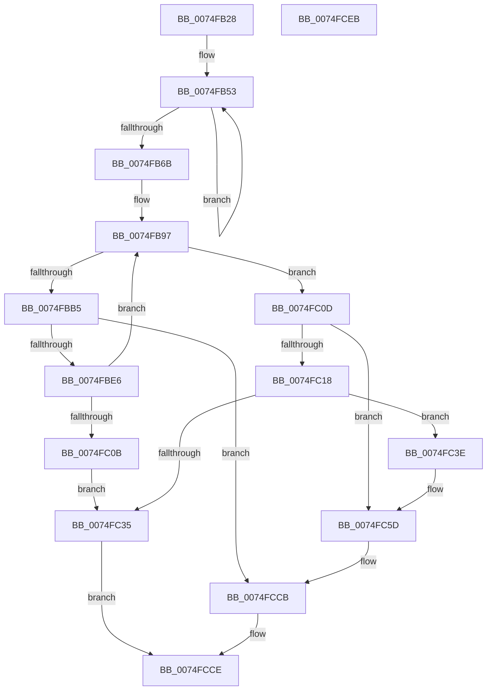

# ObpGetTraceIndex

- RVA: `0x0074FB28`–`0x0074FCEC` (길이 `452` bytes)
- VA: `0x000000014074FB28`
- 실행 섹션: `PAGE`
- PDB 이름 있음: `예`; PDB Function 태그: `아니요`
- unwind 정보 RVA: `0x00075C18`
- 디코드: `120`개 명령, `452/452` bytes 표시
- 미해석 바이트: `0` (있으면 어셈블리에 `.byte`로 보존)

> 이 문서는 커널 이미지의 기계어와 PDB 기호를 분석해 생성했습니다. 4번과 5번은 함수 원형과 자료형을 바이너리 사용 방식에서 추정한 C 해석이며 원본 소스 복구 결과는 아닙니다.

## 1. Dependencies

- 직접 호출 지점: **2**; 고유 호출 대상: **2**
- 직접 호출자로 확인된 함수: **1**
- RIP 상대 이미지 참조: **1**

### Outgoing calls
- `0x0074FBD5` → [RtlCompareMemory](../../text/6B/RtlCompareMemory_function_006BA670.md) (function, `0x006BA670`)
- `0x0074FC28` → [ExAllocatePool2](../../poolcode/B8/ExAllocatePool2_function_00B820F0.md) (function, `0x00B820F0`)

### Direct callers
- [ObpPushRefDerefInfo](ObpPushRefDerefInfo_function_0074FEC4.md) at `0x0074FF78`

### Static image references
- `0x0074FB6B` → RVA `0x00F0F588` (`.data`; read)

## 2. Other-region calls and transfers

- 다른 실행 섹션으로 향하는 call: **2**
  - `0x0074FBD5` → [RtlCompareMemory](../../text/6B/RtlCompareMemory_function_006BA670.md) (`PAGE` → `.text`)
  - `0x0074FC28` → [ExAllocatePool2](../../poolcode/B8/ExAllocatePool2_function_00B820F0.md) (`PAGE` → `POOLCODE`)
- 별도 외부 분기/꼬리 이동을 확인하지 못했습니다.

## 3. Assembly (complete function range)

```asm
0074FB28  48 89 5C 24 08                  mov qword ptr [rsp + 8], rbx
0074FB2D  48 89 6C 24 10                  mov qword ptr [rsp + 0x10], rbp
0074FB32  48 89 74 24 18                  mov qword ptr [rsp + 0x18], rsi
0074FB37  57                              push rdi
0074FB38  41 54                           push r12
0074FB3A  41 55                           push r13
0074FB3C  41 56                           push r14
0074FB3E  41 57                           push r15
0074FB40  48 83 EC 20                     sub rsp, 0x20
0074FB44  33 F6                           xor esi, esi
0074FB46  48 8B D9                        mov rbx, rcx
0074FB49  4C 8B C1                        mov r8, rcx
0074FB4C  8D 4E 20                        lea ecx, [rsi + 0x20]
0074FB4F  44 8D 66 01                     lea r12d, [rsi + 1]
0074FB53  41 0F B7 50 02                  movzx edx, word ptr [r8 + 2]
0074FB58  41 0F B7 00                     movzx eax, word ptr [r8]
0074FB5C  4D 8D 40 04                     lea r8, [r8 + 4]
0074FB60  48 33 D0                        xor rdx, rax
0074FB63  48 03 F2                        add rsi, rdx
0074FB66  49 2B CC                        sub rcx, r12
0074FB69  75 E8                           jne 0x14074fb53
0074FB6B  4C 8B 3D 16 FA 7B 00            mov r15, qword ptr [rip + 0x7bfa16]
0074FB72  8B CE                           mov ecx, esi
0074FB74  B8 91 00 0C 00                  mov eax, 0xc0091
0074FB79  41 BD FD 3F 00 00               mov r13d, 0x3ffd
0074FB7F  F7 E6                           mul esi
0074FB81  2B CA                           sub ecx, edx
0074FB83  D1 E9                           shr ecx, 1
0074FB85  03 CA                           add ecx, edx
0074FB87  C1 E9 0D                        shr ecx, 0xd
0074FB8A  0F B7 C9                        movzx ecx, cx
0074FB8D  41 0F AF CD                     imul ecx, r13d
0074FB91  66 2B F1                        sub si, cx
0074FB94  0F B7 EE                        movzx ebp, si
0074FB97  4C 8B 05 EA F9 7B 00            mov r8, qword ptr [rip + 0x7bf9ea]
0074FB9E  B8 FF FF 00 00                  mov eax, 0xffff
0074FBA3  44 0F B7 F5                     movzx r14d, bp
0074FBA7  43 0F B7 BC 70 88 00 00 00      movzx edi, word ptr [r8 + r14*2 + 0x88]
0074FBB0  66 3B F8                        cmp di, ax
0074FBB3  74 58                           je 0x14074fc0d
0074FBB5  8B CF                           mov ecx, edi
0074FBB7  8B C7                           mov eax, edi
0074FBB9  81 E1 FF 03 00 00               and ecx, 0x3ff
0074FBBF  48 C1 E8 0A                     shr rax, 0xa
0074FBC3  48 C1 E1 07                     shl rcx, 7
0074FBC7  41 B8 80 00 00 00               mov r8d, 0x80
0074FBCD  48 8B D3                        mov rdx, rbx
0074FBD0  49 03 4C C7 08                  add rcx, qword ptr [r15 + rax*8 + 8]
0074FBD5  E8 96 AA F6 FF                  call 0x1406ba670
0074FBDA  48 3D 80 00 00 00               cmp rax, 0x80
0074FBE0  0F 84 E5 00 00 00               je 0x14074fccb
0074FBE6  0F B7 ED                        movzx ebp, bp
0074FBE9  B8 91 00 0C 00                  mov eax, 0xc0091
0074FBEE  41 03 EC                        add ebp, r12d
0074FBF1  F7 E5                           mul ebp
0074FBF3  8B C5                           mov eax, ebp
0074FBF5  2B C2                           sub eax, edx
0074FBF7  D1 E8                           shr eax, 1
0074FBF9  03 C2                           add eax, edx
0074FBFB  C1 E8 0D                        shr eax, 0xd
0074FBFE  69 C0 FD 3F 00 00               imul eax, eax, 0x3ffd
0074FC04  2B E8                           sub ebp, eax
0074FC06  66 3B EE                        cmp bp, si
0074FC09  75 8C                           jne 0x14074fb97
0074FC0B  EB 28                           jmp 0x14074fc35
0074FC0D  41 0F B7 40 02                  movzx eax, word ptr [r8 + 2]
0074FC12  66 41 39 00                     cmp word ptr [r8], ax
0074FC16  75 45                           jne 0x14074fc5d
0074FC18  BA 00 00 02 00                  mov edx, 0x20000
0074FC1D  B9 40 00 00 00                  mov ecx, 0x40
0074FC22  41 B8 4F 62 52 74               mov r8d, 0x7452624f
0074FC28  E8 C3 24 43 00                  call 0x140b820f0
0074FC2D  48 8B C8                        mov rcx, rax
0074FC30  48 85 C0                        test rax, rax
0074FC33  75 09                           jne 0x14074fc3e
0074FC35  41 0F B7 C5                     movzx eax, r13w
0074FC39  E9 90 00 00 00                  jmp 0x14074fcce
0074FC3E  4C 8B 05 43 F9 7B 00            mov r8, qword ptr [rip + 0x7bf943]
0074FC45  41 0F B7 40 02                  movzx eax, word ptr [r8 + 2]
0074FC4A  48 C1 E8 0A                     shr rax, 0xa
0074FC4E  49 89 4C C0 08                  mov qword ptr [r8 + rax*8 + 8], rcx
0074FC53  B8 00 04 00 00                  mov eax, 0x400
0074FC58  66 41 01 40 02                  add word ptr [r8 + 2], ax
0074FC5D  41 0F B7 38                     movzx edi, word ptr [r8]
0074FC61  66 43 89 BC 70 88 00 00 00      mov word ptr [r8 + r14*2 + 0x88], di
0074FC6A  8B D7                           mov edx, edi
0074FC6C  0F 10 03                        movups xmm0, xmmword ptr [rbx]
0074FC6F  81 E2 FF 03 00 00               and edx, 0x3ff
0074FC75  8B C7                           mov eax, edi
0074FC77  48 C1 E2 07                     shl rdx, 7
0074FC7B  48 C1 E8 0A                     shr rax, 0xa
0074FC7F  49 8B 4C C0 08                  mov rcx, qword ptr [r8 + rax*8 + 8]
0074FC84  0F 11 04 11                     movups xmmword ptr [rcx + rdx], xmm0
0074FC88  0F 10 4B 10                     movups xmm1, xmmword ptr [rbx + 0x10]
0074FC8C  0F 11 4C 11 10                  movups xmmword ptr [rcx + rdx + 0x10], xmm1
0074FC91  0F 10 43 20                     movups xmm0, xmmword ptr [rbx + 0x20]
0074FC95  0F 11 44 11 20                  movups xmmword ptr [rcx + rdx + 0x20], xmm0
0074FC9A  0F 10 4B 30                     movups xmm1, xmmword ptr [rbx + 0x30]
0074FC9E  0F 11 4C 11 30                  movups xmmword ptr [rcx + rdx + 0x30], xmm1
0074FCA3  0F 10 43 40                     movups xmm0, xmmword ptr [rbx + 0x40]
0074FCA7  0F 11 44 11 40                  movups xmmword ptr [rcx + rdx + 0x40], xmm0
0074FCAC  0F 10 4B 50                     movups xmm1, xmmword ptr [rbx + 0x50]
0074FCB0  0F 11 4C 11 50                  movups xmmword ptr [rcx + rdx + 0x50], xmm1
0074FCB5  0F 10 43 60                     movups xmm0, xmmword ptr [rbx + 0x60]
0074FCB9  0F 11 44 11 60                  movups xmmword ptr [rcx + rdx + 0x60], xmm0
0074FCBE  0F 10 4B 70                     movups xmm1, xmmword ptr [rbx + 0x70]
0074FCC2  0F 11 4C 11 70                  movups xmmword ptr [rcx + rdx + 0x70], xmm1
0074FCC7  66 45 01 20                     add word ptr [r8], r12w
0074FCCB  0F B7 C7                        movzx eax, di
0074FCCE  48 8B 5C 24 50                  mov rbx, qword ptr [rsp + 0x50]
0074FCD3  48 8B 6C 24 58                  mov rbp, qword ptr [rsp + 0x58]
0074FCD8  48 8B 74 24 60                  mov rsi, qword ptr [rsp + 0x60]
0074FCDD  48 83 C4 20                     add rsp, 0x20
0074FCE1  41 5F                           pop r15
0074FCE3  41 5E                           pop r14
0074FCE5  41 5D                           pop r13
0074FCE7  41 5C                           pop r12
0074FCE9  5F                              pop rdi
0074FCEA  C3                              ret
0074FCEB  CC                              int3
```

## 4. C-style interpretation (structured pseudocode)

```c
__int64 __fastcall ObpGetTraceIndex(__int64 a1)
{
    __int64 result;
    __int64 v_rbp;
    __int64 v_rsi;
    __int64 v_rsp;
    unsigned __int64 v_stack_p10;
    unsigned __int64 v_stack_p18;
    unsigned __int64 v_stack_p8;

    v_stack_p8 = v_rbx;
    v_stack_p10 = v_rbp;
    v_stack_p18 = v_rsi;
    v_rsp = (v_rsp) - (32);
    v_rsi = 0;
loc_0074FB53:
    a2 = (*(unsigned __int16 *)(a1 + 2)) ^ (*(unsigned __int16 *)(a1));
    v_rsi = (v_rsi) + (a2);
    a1 = (v_rsi + 32) - (v_rsi + 1);
    if (condition_is_not_equal) goto loc_0074FB53;
    a1 = (unsigned int)(((unsigned int)((unsigned int)(v_rsi))) - ((unsigned int)(a2)));
    a1 = (unsigned int)((a1) >> (1));
    a1 = (unsigned int)((a1) + ((unsigned int)(a2)));
    a1 = (unsigned int)((a1) >> (13));
    a1 = (unsigned int)(((unsigned __int16)(a1)) * ((unsigned int)((unsigned int)(0x3FFDULL))));
    v_rsi = (unsigned __int16)((v_rsi) - ((unsigned __int16)(a1)));
loc_0074FB97:
    if (((unsigned __int16)(*(unsigned __int16 *)(*(unsigned __int64 *)(v_rip + 8124906) + (unsigned __int16)((unsigned __int16)(v_rsi)) * 2 + 136))) == ((unsigned __int16)((unsigned int)(0xFFFFULL)))) goto loc_0074FC0D;
    a1 = (unsigned int)(((unsigned int)((unsigned int)(*(unsigned __int16 *)(*(unsigned __int64 *)(v_rip + 8124906) + (unsigned __int16)((unsigned __int16)(v_rsi)) * 2 + 136)))) & (0x3FFULL));
    result = ((unsigned int)((unsigned int)(*(unsigned __int16 *)(*(unsigned __int64 *)(v_rip + 8124906) + (unsigned __int16)((unsigned __int16)(v_rsi)) * 2 + 136)))) >> (10);
    a1 = (a1) << (7);
    a1 = (a1) + (*(unsigned __int64 *)(*(unsigned __int64 *)(v_rip + 8124950) + result * 8 + 8));
    result = RtlCompareMemory(a1, a1, 128, a4);
    if (result == 128) goto loc_0074FCCB;
    v_rbp = (unsigned int)(((unsigned __int16)((unsigned __int16)(v_rsi))) + ((unsigned int)(v_rsi + 1)));
    result = (unsigned int)(((unsigned int)((unsigned int)(v_rbp))) - ((unsigned int)(a1)));
    result = (unsigned int)((result) >> (1));
    result = (unsigned int)((result) + ((unsigned int)(a1)));
    result = (unsigned int)((result) >> (13));
    result = (unsigned int)((result) * ((unsigned int)(result)));
    v_rbp = (unsigned int)((v_rbp) - ((unsigned int)(result)));
    if (((unsigned __int16)(v_rbp)) != ((unsigned __int16)(v_rsi))) goto loc_0074FB97;
    goto loc_0074FC35;
loc_0074FC0D:
    if ((*(unsigned __int16 *)(128)) != ((unsigned __int16)(*(unsigned __int16 *)(128 + 2)))) goto loc_0074FC5D;
    result = ExAllocatePool2(64, (unsigned int)(0x20000ULL), (unsigned int)(0x7452624FULL), a4);
    if (result != 0) goto loc_0074FC3E;
loc_0074FC35:
    goto loc_0074FCCE;
loc_0074FC3E:
    result = (*(unsigned __int16 *)(*(unsigned __int64 *)(v_rip + 8124739) + 2)) >> (10);
    *(unsigned __int64 *)(*(unsigned __int64 *)(v_rip + 8124739) + result * 8 + 8) = result;
loc_0074FC5D:
    *(unsigned __int16 *)(*(unsigned __int64 *)(v_rip + 8124739) + (unsigned __int16)((unsigned __int16)(v_rsi)) * 2 + 136) = (unsigned __int16)(*(unsigned __int16 *)(*(unsigned __int64 *)(v_rip + 8124739)));
    a2 = (unsigned int)(((unsigned int)((unsigned int)(*(unsigned __int16 *)(*(unsigned __int64 *)(v_rip + 8124739))))) & (0x3FFULL));
    a2 = (a2) << (7);
    result = ((unsigned int)((unsigned int)(*(unsigned __int16 *)(*(unsigned __int64 *)(v_rip + 8124739))))) >> (10);
    *(unsigned __int64 *)(*(unsigned __int64 *)(*(unsigned __int64 *)(v_rip + 8124739) + result * 8 + 8) + a2 * 1) = v_xmm0;
    *(unsigned __int64 *)(*(unsigned __int64 *)(*(unsigned __int64 *)(v_rip + 8124739) + result * 8 + 8) + a2 * 1 + 16) = v_xmm1;
    *(unsigned __int64 *)(*(unsigned __int64 *)(*(unsigned __int64 *)(v_rip + 8124739) + result * 8 + 8) + a2 * 1 + 32) = v_xmm0;
    *(unsigned __int64 *)(*(unsigned __int64 *)(*(unsigned __int64 *)(v_rip + 8124739) + result * 8 + 8) + a2 * 1 + 48) = v_xmm1;
    *(unsigned __int64 *)(*(unsigned __int64 *)(*(unsigned __int64 *)(v_rip + 8124739) + result * 8 + 8) + a2 * 1 + 64) = v_xmm0;
    *(unsigned __int64 *)(*(unsigned __int64 *)(*(unsigned __int64 *)(v_rip + 8124739) + result * 8 + 8) + a2 * 1 + 80) = v_xmm1;
    *(unsigned __int64 *)(*(unsigned __int64 *)(*(unsigned __int64 *)(v_rip + 8124739) + result * 8 + 8) + a2 * 1 + 96) = v_xmm0;
    *(unsigned __int64 *)(*(unsigned __int64 *)(*(unsigned __int64 *)(v_rip + 8124739) + result * 8 + 8) + a2 * 1 + 112) = v_xmm1;
loc_0074FCCB:
loc_0074FCCE:
    v_rsp = (v_rsp) + (32);
    return (unsigned __int16)(*(unsigned __int16 *)(*(unsigned __int64 *)(v_rip + 8124739)));
}
```

## 5. (Beta) C Style

```c
int64_t ObpGetTraceIndex(void *Arg1)
{
    uint8_t *arg1 = (uint8_t *)Arg1;

    int64_t result;
    int64_t local_rbp;
    int64_t local_rsi;
    int64_t local_rsp;
    uint64_t v_stack_p10;
    uint64_t v_stack_p18;
    uint64_t v_stack_p8;

    v_stack_p8 = local_rbx;
    v_stack_p10 = local_rbp;
    v_stack_p18 = local_rsi;
    local_rsp = (local_rsp) - (32);
    local_rsi = 0;
loc_0074FB53:
    a2 = (*(uint16_t *)(arg1 + 0x2)) ^ (*(uint16_t *)(arg1));
    local_rsi = (local_rsi) + (a2);
    Arg1 = (local_rsi + 32) - (local_rsi + 1);
    if (condition_is_not_equal) goto loc_0074FB53;
    Arg1 = (uint32_t)(((uint32_t)((uint32_t)(local_rsi))) - ((uint32_t)(a2)));
    Arg1 = (uint32_t)((Arg1) >> (1));
    Arg1 = (uint32_t)((Arg1) + ((uint32_t)(a2)));
    Arg1 = (uint32_t)((Arg1) >> (13));
    Arg1 = (uint32_t)(((uint16_t)(Arg1)) * ((uint32_t)((uint32_t)(0x3FFDULL))));
    local_rsi = (uint16_t)((local_rsi) - ((uint16_t)(Arg1)));
loc_0074FB97:
    if (((uint16_t)(*(uint16_t *)(*(uint64_t *)(v_rip + 0x7BF9EA) + (uint16_t)((uint16_t)(local_rsi)) * 2 + 0x88))) == ((uint16_t)((uint32_t)(0xFFFFULL)))) goto loc_0074FC0D;
    Arg1 = (uint32_t)(((uint32_t)((uint32_t)(*(uint16_t *)(*(uint64_t *)(v_rip + 0x7BF9EA) + (uint16_t)((uint16_t)(local_rsi)) * 2 + 0x88)))) & (0x3FFULL));
    result = ((uint32_t)((uint32_t)(*(uint16_t *)(*(uint64_t *)(v_rip + 0x7BF9EA) + (uint16_t)((uint16_t)(local_rsi)) * 2 + 0x88)))) >> (10);
    Arg1 = (Arg1) << (7);
    Arg1 = (Arg1) + (*(uint64_t *)(*(uint64_t *)(v_rip + 0x7BFA16) + result * 8 + 0x8));
    result = RtlCompareMemory(Arg1, Arg1, 128, a4);
    if (result == 128) goto loc_0074FCCB;
    local_rbp = (uint32_t)(((uint16_t)((uint16_t)(local_rsi))) + ((uint32_t)(local_rsi + 1)));
    result = (uint32_t)(((uint32_t)((uint32_t)(local_rbp))) - ((uint32_t)(Arg1)));
    result = (uint32_t)((result) >> (1));
    result = (uint32_t)((result) + ((uint32_t)(Arg1)));
    result = (uint32_t)((result) >> (13));
    result = (uint32_t)((result) * ((uint32_t)(result)));
    local_rbp = (uint32_t)((local_rbp) - ((uint32_t)(result)));
    if (((uint16_t)(local_rbp)) != ((uint16_t)(local_rsi))) goto loc_0074FB97;
    goto loc_0074FC35;
loc_0074FC0D:
    if ((*(uint16_t *)(128)) != ((uint16_t)(*(uint16_t *)(128 + 0x2)))) goto loc_0074FC5D;
    result = ExAllocatePool2(64, (uint32_t)(0x20000ULL), (uint32_t)(0x7452624FULL), a4);
    if (result != 0) goto loc_0074FC3E;
loc_0074FC35:
    goto loc_0074FCCE;
loc_0074FC3E:
    result = (*(uint16_t *)(*(uint64_t *)(v_rip + 0x7BF943) + 0x2)) >> (10);
    *(uint64_t *)(*(uint64_t *)(v_rip + 0x7BF943) + result * 8 + 0x8) = result;
loc_0074FC5D:
    *(uint16_t *)(*(uint64_t *)(v_rip + 0x7BF943) + (uint16_t)((uint16_t)(local_rsi)) * 2 + 0x88) = (uint16_t)(*(uint16_t *)(*(uint64_t *)(v_rip + 0x7BF943)));
    a2 = (uint32_t)(((uint32_t)((uint32_t)(*(uint16_t *)(*(uint64_t *)(v_rip + 0x7BF943))))) & (0x3FFULL));
    a2 = (a2) << (7);
    result = ((uint32_t)((uint32_t)(*(uint16_t *)(*(uint64_t *)(v_rip + 0x7BF943))))) >> (10);
    *(uint64_t *)(*(uint64_t *)(*(uint64_t *)(v_rip + 0x7BF943) + result * 8 + 0x8) + a2 * 1) = v_xmm0;
    *(uint64_t *)(*(uint64_t *)(*(uint64_t *)(v_rip + 0x7BF943) + result * 8 + 0x8) + a2 * 1 + 0x10) = v_xmm1;
    *(uint64_t *)(*(uint64_t *)(*(uint64_t *)(v_rip + 0x7BF943) + result * 8 + 0x8) + a2 * 1 + 0x20) = v_xmm0;
    *(uint64_t *)(*(uint64_t *)(*(uint64_t *)(v_rip + 0x7BF943) + result * 8 + 0x8) + a2 * 1 + 0x30) = v_xmm1;
    *(uint64_t *)(*(uint64_t *)(*(uint64_t *)(v_rip + 0x7BF943) + result * 8 + 0x8) + a2 * 1 + 0x40) = v_xmm0;
    *(uint64_t *)(*(uint64_t *)(*(uint64_t *)(v_rip + 0x7BF943) + result * 8 + 0x8) + a2 * 1 + 0x50) = v_xmm1;
    *(uint64_t *)(*(uint64_t *)(*(uint64_t *)(v_rip + 0x7BF943) + result * 8 + 0x8) + a2 * 1 + 0x60) = v_xmm0;
    *(uint64_t *)(*(uint64_t *)(*(uint64_t *)(v_rip + 0x7BF943) + result * 8 + 0x8) + a2 * 1 + 0x70) = v_xmm1;
loc_0074FCCB:
loc_0074FCCE:
    local_rsp = (local_rsp) + (32);
    return (uint16_t)(*(uint16_t *)(*(uint64_t *)(v_rip + 0x7BF943)));
}
```

### 관측된 메모리 오프셋

구조체 형식이 확인되지 않은 접근은 인자 기준의 오프셋으로만 기록했습니다.

| 기준 인자 | 오프셋 표현 | 폭 (bit) | 접근 |
|---|---:|---:|---|
| `Arg1` | `+ 0x0` | `16` | `R` |
| `Arg1` | `+ 0x0` | `128` | `R` |
| `Arg1` | `+ 0x2` | `16` | `R` |
| `Arg1` | `+ 0x4` | `64` | `R` |
| `Arg1` | `+ 0x10` | `128` | `R` |
| `Arg1` | `+ 0x20` | `128` | `R` |
| `Arg1` | `+ 0x30` | `128` | `R` |
| `Arg1` | `+ 0x40` | `128` | `R` |
| `Arg1` | `+ 0x50` | `128` | `R` |
| `Arg1` | `+ 0x60` | `128` | `R` |
| `Arg1` | `+ 0x70` | `128` | `R` |

## 6. Execution-region graph

[열기: 2D/3D 그래프와 함수 탐색 컨트롤 패널](../../../control-panel.html?section=page&rva=0x0074FB28&view=graph)

- 2D 그래프는 위에서 아래로 흐르고, 3D 그래프는 빈 공간을 드래그해 회전합니다. Shift+드래그는 이동, 휠은 확대·축소, 함수 노드 선택은 대상 보고서 이동입니다.

### Static fallback


