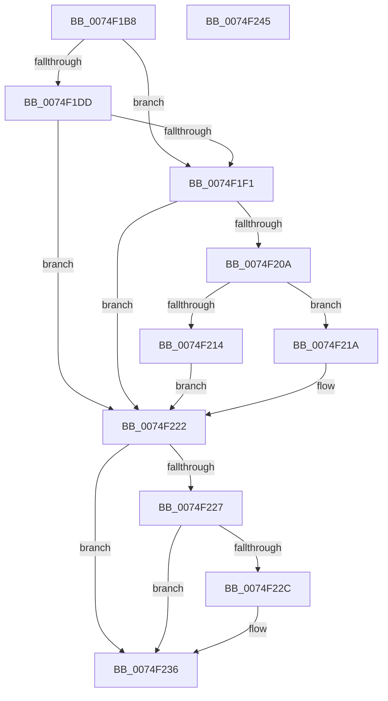

# ObpInitObjectTypeSD

- RVA: `0x0074F1B8`–`0x0074F246` (길이 `142` bytes)
- VA: `0x000000014074F1B8`
- 실행 섹션: `PAGE`
- PDB 이름 있음: `예`; PDB Function 태그: `아니요`
- unwind 정보 RVA: `0x000CB7FC`
- 디코드: `48`개 명령, `142/142` bytes 표시
- 미해석 바이트: `0` (있으면 어셈블리에 `.byte`로 보존)

> 이 문서는 커널 이미지의 기계어와 PDB 기호를 분석해 생성했습니다. 4번과 5번은 함수 원형과 자료형을 바이너리 사용 방식에서 추정한 C 해석이며 원본 소스 복구 결과는 아닙니다.

## 1. Dependencies

- 직접 호출 지점: **3**; 고유 호출 대상: **3**
- 직접 호출자로 확인된 함수: **2**
- RIP 상대 이미지 참조: **0**

### Outgoing calls
- `0x0074F1E1` → [ObpCreateDefaultObjectTypeSD](ObpCreateDefaultObjectTypeSD_function_0074F04C.md) (function, `0x0074F04C`)
- `0x0074F1FF` → [ObLogSecurityDescriptor](../8C/ObLogSecurityDescriptor_function_008C0020.md) (function, `0x008C0020`)
- `0x0074F231` → [ExFreePoolWithTag](../../poolcode/B8/ExFreePoolWithTag_function_00B82870.md) (function, `0x00B82870`)

### Direct callers
- [ObCreateObjectTypeEx](../AB/ObCreateObjectTypeEx_function_00AB46D0.md) at `0x00AB499F`
- [ObInitSystem](../../init/C7/ObInitSystem_function_00C71C7C.md) at `0x00C722BC`

### Static image references
- 디코드된 RIP-relative 메모리 참조가 없습니다.

## 2. Other-region calls and transfers

- 다른 실행 섹션으로 향하는 call: **1**
  - `0x0074F231` → [ExFreePoolWithTag](../../poolcode/B8/ExFreePoolWithTag_function_00B82870.md) (`PAGE` → `POOLCODE`)
- 별도 외부 분기/꼬리 이동을 확인하지 못했습니다.

## 3. Assembly (complete function range)

```asm
0074F1B8  48 8B C4                        mov rax, rsp
0074F1BB  48 89 58 08                     mov qword ptr [rax + 8], rbx
0074F1BF  55                              push rbp
0074F1C0  56                              push rsi
0074F1C1  57                              push rdi
0074F1C2  48 83 EC 20                     sub rsp, 0x20
0074F1C6  48 83 60 18 00                  and qword ptr [rax + 0x18], 0
0074F1CB  48 8B F2                        mov rsi, rdx
0074F1CE  48 89 50 10                     mov qword ptr [rax + 0x10], rdx
0074F1D2  48 8B E9                        mov rbp, rcx
0074F1D5  48 8B DA                        mov rbx, rdx
0074F1D8  48 85 D2                        test rdx, rdx
0074F1DB  75 14                           jne 0x14074f1f1
0074F1DD  48 8D 48 10                     lea rcx, [rax + 0x10]
0074F1E1  E8 66 FE FF FF                  call 0x14074f04c
0074F1E6  48 8B 5C 24 48                  mov rbx, qword ptr [rsp + 0x48]
0074F1EB  8B F8                           mov edi, eax
0074F1ED  85 C0                           test eax, eax
0074F1EF  78 31                           js 0x14074f222
0074F1F1  41 B8 10 00 00 00               mov r8d, 0x10
0074F1F7  48 8D 54 24 50                  lea rdx, [rsp + 0x50]
0074F1FC  48 8B CB                        mov rcx, rbx
0074F1FF  E8 1C 0E 17 00                  call 0x1408c0020
0074F204  8B F8                           mov edi, eax
0074F206  85 C0                           test eax, eax
0074F208  78 18                           js 0x14074f222
0074F20A  48 8B 44 24 50                  mov rax, qword ptr [rsp + 0x50]
0074F20F  48 85 C0                        test rax, rax
0074F212  75 06                           jne 0x14074f21a
0074F214  48 21 45 F8                     and qword ptr [rbp - 8], rax
0074F218  EB 08                           jmp 0x14074f222
0074F21A  48 83 C0 0F                     add rax, 0xf
0074F21E  48 89 45 F8                     mov qword ptr [rbp - 8], rax
0074F222  48 85 DB                        test rbx, rbx
0074F225  74 0F                           je 0x14074f236
0074F227  48 85 F6                        test rsi, rsi
0074F22A  75 0A                           jne 0x14074f236
0074F22C  33 D2                           xor edx, edx
0074F22E  48 8B CB                        mov rcx, rbx
0074F231  E8 3A 36 43 00                  call 0x140b82870
0074F236  48 8B 5C 24 40                  mov rbx, qword ptr [rsp + 0x40]
0074F23B  8B C7                           mov eax, edi
0074F23D  48 83 C4 20                     add rsp, 0x20
0074F241  5F                              pop rdi
0074F242  5E                              pop rsi
0074F243  5D                              pop rbp
0074F244  C3                              ret
0074F245  CC                              int3
```

## 4. C-style interpretation (structured pseudocode)

```c
__int64 __fastcall ObpInitObjectTypeSD(__int64 a1, __int64 a2)
{
    __int64 result;
    __int64 v_rsp;
    unsigned __int64 v_stack_p10;
    unsigned __int64 v_stack_p18;
    unsigned __int64 v_stack_p8;

    *(unsigned __int64 *)(v_rsp + 8) = v_rbx;
    v_rsp = (v_rsp) - (32);
    *(unsigned __int64 *)(v_rsp + 16) = a2;
    if (a2 != 0) goto loc_0074F1F1;
    result = ObpCreateDefaultObjectTypeSD(v_rsp + 16, a2, a3, a4);
    if (sign_flag) goto loc_0074F222;
loc_0074F1F1:
    result = ObLogSecurityDescriptor(v_stack_p10, v_stack_p18, 16, a4);
    if (sign_flag) goto loc_0074F222;
    if (v_stack_p18 != 0) goto loc_0074F21A;
    goto loc_0074F222;
loc_0074F21A:
    result = (v_stack_p18) + (15);
    *(unsigned __int64 *)(a1 - 8) = result;
loc_0074F222:
    if (v_stack_p10 == 0) goto loc_0074F236;
    if (a2 == 0) {
        a2 = 0;
        a1 = v_stack_p10;
        result = ExFreePoolWithTag(a1, a2, 16, a4);
    }
    v_rsp = (v_rsp) + (32);
    return (unsigned int)((unsigned int)((unsigned int)((unsigned int)(result))));
}
```

## 5. (Beta) C Style

```c
int64_t ObpInitObjectTypeSD(void *Arg1, int64_t Arg2)
{
    uint8_t *arg1 = (uint8_t *)Arg1;

    int64_t result;
    int64_t local_rsp;
    uint64_t v_stack_p10;
    uint64_t v_stack_p18;
    uint64_t v_stack_p8;

    *(uint64_t *)(local_rsp + 0x8) = local_rbx;
    local_rsp = (local_rsp) - (32);
    *(uint64_t *)(local_rsp + 0x10) = Arg2;
    if (Arg2 != 0) goto loc_0074F1F1;
    result = ObpCreateDefaultObjectTypeSD(local_rsp + 16, Arg2, a3, a4);
    if (sign_flag) goto loc_0074F222;
loc_0074F1F1:
    result = ObLogSecurityDescriptor(v_stack_p10, v_stack_p18, 16, a4);
    if (sign_flag) goto loc_0074F222;
    if (v_stack_p18 != 0) goto loc_0074F21A;
    goto loc_0074F222;
loc_0074F21A:
    result = (v_stack_p18) + (15);
    *(uint64_t *)(arg1 - 0x8) = result;
loc_0074F222:
    if (v_stack_p10 == 0) goto loc_0074F236;
    if (Arg2 == 0) {
        Arg2 = 0;
        Arg1 = v_stack_p10;
        result = ExFreePoolWithTag(Arg1, Arg2, 16, a4);
    }
    local_rsp = (local_rsp) + (32);
    return (uint32_t)((uint32_t)((uint32_t)((uint32_t)(result))));
}
```

### 관측된 메모리 오프셋

구조체 형식이 확인되지 않은 접근은 인자 기준의 오프셋으로만 기록했습니다.

| 기준 인자 | 오프셋 표현 | 폭 (bit) | 접근 |
|---|---:|---:|---|
| `Arg1` | `- 0x8` | `64` | `R/W` |
| `Arg1` | `- 0x8` | `64` | `W` |

## 6. Execution-region graph

[열기: 2D/3D 그래프와 함수 탐색 컨트롤 패널](../../../control-panel.html?section=page&rva=0x0074F1B8&view=graph)

- 2D 그래프는 위에서 아래로 흐르고, 3D 그래프는 빈 공간을 드래그해 회전합니다. Shift+드래그는 이동, 휠은 확대·축소, 함수 노드 선택은 대상 보고서 이동입니다.

### Static fallback


