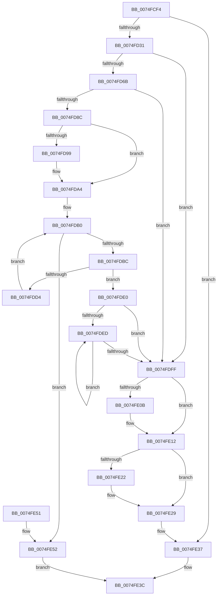

# ObpInitStackAndObjectTables

- RVA: `0x0074FCF4`–`0x0074FE56` (길이 `354` bytes)
- VA: `0x000000014074FCF4`
- 실행 섹션: `PAGE`
- PDB 이름 있음: `예`; PDB Function 태그: `아니요`
- unwind 정보 RVA: `0x0005F9EC`
- 디코드: `90`개 명령, `354/354` bytes 표시
- 미해석 바이트: `0` (있으면 어셈블리에 `.byte`로 보존)

> 이 문서는 커널 이미지의 기계어와 PDB 기호를 분석해 생성했습니다. 4번과 5번은 함수 원형과 자료형을 바이너리 사용 방식에서 추정한 C 해석이며 원본 소스 복구 결과는 아닙니다.

## 1. Dependencies

- 직접 호출 지점: **12**; 고유 호출 대상: **6**
- 직접 호출자로 확인된 함수: **2**
- RIP 상대 이미지 참조: **6**

### Outgoing calls
- `0x0074FD1C` → [ExAllocatePool2](../../poolcode/B8/ExAllocatePool2_function_00B820F0.md) (function, `0x00B820F0`)
- `0x0074FD43` → [memset](../../text/6C/memset_function_006C6C40.md) (function, `0x006C6C40`)
- `0x0074FD52` → [ExAllocatePool2](../../poolcode/B8/ExAllocatePool2_function_00B820F0.md) (function, `0x00B820F0`)
- `0x0074FD7B` → [ExAllocatePool2](../../poolcode/B8/ExAllocatePool2_function_00B820F0.md) (function, `0x00B820F0`)
- `0x0074FD9E` → [RtlRaiseStatus](../../text/2F/RtlRaiseStatus_function_002F6A50.md) (function, `0x002F6A50`)
- `0x0074FDC7` → [ExAllocatePool2](../../poolcode/B8/ExAllocatePool2_function_00B820F0.md) (function, `0x00B820F0`)
- `0x0074FDD7` → [ExpInterlockedPushEntrySList](../../text/6B/ExpInterlockedPushEntrySList_function_006BA5B0.md) (function, `0x006BA5B0`)
- `0x0074FDE0` → [ExpInterlockedFlushSList](../../text/6B/ExpInterlockedFlushSList_function_006BA5F0.md) (function, `0x006BA5F0`)
- `0x0074FDF5` → [ExFreePoolWithTag](../../poolcode/B8/ExFreePoolWithTag_function_00B82870.md) (function, `0x00B82870`)
- `0x0074FE0D` → [ExFreePoolWithTag](../../poolcode/B8/ExFreePoolWithTag_function_00B82870.md) (function, `0x00B82870`)
- `0x0074FE24` → [ExFreePoolWithTag](../../poolcode/B8/ExFreePoolWithTag_function_00B82870.md) (function, `0x00B82870`)
- `0x0074FE32` → [ExFreePoolWithTag](../../poolcode/B8/ExFreePoolWithTag_function_00B82870.md) (function, `0x00B82870`)

### Direct callers
- [ObpStartRuntimeStackTrace](../75/ObpStartRuntimeStackTrace_function_00750134.md) at `0x00750412`
- [ObpInitStackTrace](../../init/C3/ObpInitStackTrace_function_00C3C86C.md) at `0x00C3CA34`

### Static image references
- `0x0074FD21` → RVA `0x00F0F588` (`.data`; write)
- `0x0074FD57` → RVA `0x00F0F588` (`.data`; read)
- `0x0074FD80` → RVA `0x00F0F548` (`.data`; write)
- `0x0074FD8C` → RVA `0x00E27600` (`.data`; read)
- `0x0074FDA9` → RVA `0x00E27600` (`.data`; write)
- `0x0074FDFF` → RVA `0x00F0F548` (`.data`; read)

## 2. Other-region calls and transfers

- 다른 실행 섹션으로 향하는 call: **12**
  - `0x0074FD1C` → [ExAllocatePool2](../../poolcode/B8/ExAllocatePool2_function_00B820F0.md) (`PAGE` → `POOLCODE`)
  - `0x0074FD43` → [memset](../../text/6C/memset_function_006C6C40.md) (`PAGE` → `.text`)
  - `0x0074FD52` → [ExAllocatePool2](../../poolcode/B8/ExAllocatePool2_function_00B820F0.md) (`PAGE` → `POOLCODE`)
  - `0x0074FD7B` → [ExAllocatePool2](../../poolcode/B8/ExAllocatePool2_function_00B820F0.md) (`PAGE` → `POOLCODE`)
  - `0x0074FD9E` → [RtlRaiseStatus](../../text/2F/RtlRaiseStatus_function_002F6A50.md) (`PAGE` → `.text`)
  - `0x0074FDC7` → [ExAllocatePool2](../../poolcode/B8/ExAllocatePool2_function_00B820F0.md) (`PAGE` → `POOLCODE`)
  - `0x0074FDD7` → [ExpInterlockedPushEntrySList](../../text/6B/ExpInterlockedPushEntrySList_function_006BA5B0.md) (`PAGE` → `.text`)
  - `0x0074FDE0` → [ExpInterlockedFlushSList](../../text/6B/ExpInterlockedFlushSList_function_006BA5F0.md) (`PAGE` → `.text`)
  - `0x0074FDF5` → [ExFreePoolWithTag](../../poolcode/B8/ExFreePoolWithTag_function_00B82870.md) (`PAGE` → `POOLCODE`)
  - `0x0074FE0D` → [ExFreePoolWithTag](../../poolcode/B8/ExFreePoolWithTag_function_00B82870.md) (`PAGE` → `POOLCODE`)
  - `0x0074FE24` → [ExFreePoolWithTag](../../poolcode/B8/ExFreePoolWithTag_function_00B82870.md) (`PAGE` → `POOLCODE`)
  - `0x0074FE32` → [ExFreePoolWithTag](../../poolcode/B8/ExFreePoolWithTag_function_00B82870.md) (`PAGE` → `POOLCODE`)
- 별도 외부 분기/꼬리 이동을 확인하지 못했습니다.

## 3. Assembly (complete function range)

```asm
0074FCF4  48 89 5C 24 08                  mov qword ptr [rsp + 8], rbx
0074FCF9  48 89 6C 24 10                  mov qword ptr [rsp + 0x10], rbp
0074FCFE  48 89 74 24 18                  mov qword ptr [rsp + 0x18], rsi
0074FD03  57                              push rdi
0074FD04  48 83 EC 20                     sub rsp, 0x20
0074FD08  BF 4F 62 52 74                  mov edi, 0x7452624f
0074FD0D  BD 40 00 00 00                  mov ebp, 0x40
0074FD12  44 8B C7                        mov r8d, edi
0074FD15  8B CD                           mov ecx, ebp
0074FD17  BA 88 80 00 00                  mov edx, 0x8088
0074FD1C  E8 CF 23 43 00                  call 0x140b820f0
0074FD21  48 89 05 60 F8 7B 00            mov qword ptr [rip + 0x7bf860], rax
0074FD28  48 85 C0                        test rax, rax
0074FD2B  0F 84 06 01 00 00               je 0x14074fe37
0074FD31  48 8D 88 88 00 00 00            lea rcx, [rax + 0x88]
0074FD38  BA FF 00 00 00                  mov edx, 0xff
0074FD3D  41 B8 FA 7F 00 00               mov r8d, 0x7ffa
0074FD43  E8 F8 6E F7 FF                  call 0x1406c6c40
0074FD48  44 8B C7                        mov r8d, edi
0074FD4B  BA 00 00 02 00                  mov edx, 0x20000
0074FD50  8B CD                           mov ecx, ebp
0074FD52  E8 99 23 43 00                  call 0x140b820f0
0074FD57  48 8B 0D 2A F8 7B 00            mov rcx, qword ptr [rip + 0x7bf82a]
0074FD5E  48 89 41 08                     mov qword ptr [rcx + 8], rax
0074FD62  48 85 C0                        test rax, rax
0074FD65  0F 84 94 00 00 00               je 0x14074fdff
0074FD6B  66 C7 41 02 00 04               mov word ptr [rcx + 2], 0x400
0074FD71  44 8B C7                        mov r8d, edi
0074FD74  8B CD                           mov ecx, ebp
0074FD76  BA 88 0C 00 00                  mov edx, 0xc88
0074FD7B  E8 70 23 43 00                  call 0x140b820f0
0074FD80  48 89 05 C1 F7 7B 00            mov qword ptr [rip + 0x7bf7c1], rax
0074FD87  48 85 C0                        test rax, rax
0074FD8A  74 73                           je 0x14074fdff
0074FD8C  48 8D 35 6D 78 6D 00            lea rsi, [rip + 0x6d786d]
0074FD93  40 F6 C6 0F                     test sil, 0xf
0074FD97  74 0B                           je 0x14074fda4
0074FD99  B9 02 00 00 80                  mov ecx, 0x80000002
0074FD9E  E8 AD 6C BA FF                  call 0x1402f6a50
0074FDA3  CC                              int3
0074FDA4  0F 57 C0                        xorps xmm0, xmm0
0074FDA7  33 DB                           xor ebx, ebx
0074FDA9  0F 29 05 50 78 6D 00            movaps xmmword ptr [rip + 0x6d7850], xmm0
0074FDB0  81 FB F4 01 00 00               cmp ebx, 0x1f4
0074FDB6  0F 83 96 00 00 00               jae 0x14074fe52
0074FDBC  44 8B C7                        mov r8d, edi
0074FDBF  BA B0 00 00 00                  mov edx, 0xb0
0074FDC4  48 8B CD                        mov rcx, rbp
0074FDC7  E8 24 23 43 00                  call 0x140b820f0
0074FDCC  48 8B CE                        mov rcx, rsi
0074FDCF  48 85 C0                        test rax, rax
0074FDD2  74 0C                           je 0x14074fde0
0074FDD4  48 8B D0                        mov rdx, rax
0074FDD7  E8 D4 A7 F6 FF                  call 0x1406ba5b0
0074FDDC  FF C3                           inc ebx
0074FDDE  EB D0                           jmp 0x14074fdb0
0074FDE0  E8 0B A8 F6 FF                  call 0x1406ba5f0
0074FDE5  48 8B D8                        mov rbx, rax
0074FDE8  48 85 C0                        test rax, rax
0074FDEB  74 12                           je 0x14074fdff
0074FDED  48 8B CB                        mov rcx, rbx
0074FDF0  8B D7                           mov edx, edi
0074FDF2  48 8B 1B                        mov rbx, qword ptr [rbx]
0074FDF5  E8 76 2A 43 00                  call 0x140b82870
0074FDFA  48 85 DB                        test rbx, rbx
0074FDFD  75 EE                           jne 0x14074fded
0074FDFF  48 8B 0D 42 F7 7B 00            mov rcx, qword ptr [rip + 0x7bf742]
0074FE06  48 85 C9                        test rcx, rcx
0074FE09  74 07                           je 0x14074fe12
0074FE0B  8B D7                           mov edx, edi
0074FE0D  E8 5E 2A 43 00                  call 0x140b82870
0074FE12  48 8B 05 6F F7 7B 00            mov rax, qword ptr [rip + 0x7bf76f]
0074FE19  48 8B 48 08                     mov rcx, qword ptr [rax + 8]
0074FE1D  48 85 C9                        test rcx, rcx
0074FE20  74 07                           je 0x14074fe29
0074FE22  8B D7                           mov edx, edi
0074FE24  E8 47 2A 43 00                  call 0x140b82870
0074FE29  48 8B 0D 58 F7 7B 00            mov rcx, qword ptr [rip + 0x7bf758]
0074FE30  8B D7                           mov edx, edi
0074FE32  E8 39 2A 43 00                  call 0x140b82870
0074FE37  B8 17 00 00 C0                  mov eax, 0xc0000017
0074FE3C  48 8B 5C 24 30                  mov rbx, qword ptr [rsp + 0x30]
0074FE41  48 8B 6C 24 38                  mov rbp, qword ptr [rsp + 0x38]
0074FE46  48 8B 74 24 40                  mov rsi, qword ptr [rsp + 0x40]
0074FE4B  48 83 C4 20                     add rsp, 0x20
0074FE4F  5F                              pop rdi
0074FE50  C3                              ret
0074FE51  CC                              int3
0074FE52  33 C0                           xor eax, eax
0074FE54  EB E6                           jmp 0x14074fe3c
```

## 4. C-style interpretation (structured pseudocode)

```c
__int64 __fastcall ObpInitStackAndObjectTables(void)
{
    __int64 result;
    __int64 v_rbx;
    __int64 v_rsp;
    unsigned __int64 v_stack_p10;
    unsigned __int64 v_stack_p18;
    unsigned __int64 v_stack_p8;

    v_stack_p8 = v_rbx;
    v_stack_p10 = v_rbp;
    v_stack_p18 = v_rsi;
    v_rsp = (v_rsp) - (32);
    result = ExAllocatePool2(64, (unsigned int)(0x8088ULL), (unsigned int)((unsigned int)((unsigned int)(0x7452624FULL))), a4);
    *(unsigned __int64 *)(v_rip + 8124512) = result;
    if (result == 0) goto loc_0074FE37;
    result = memset(result + 136, 255, (unsigned int)(0x7FFAULL), a4);
    result = ExAllocatePool2(64, (unsigned int)(0x20000ULL), (unsigned int)((unsigned int)((unsigned int)(0x7452624FULL))), a4);
    *(unsigned __int64 *)(*(unsigned __int64 *)(v_rip + 8124458) + 8) = result;
    if (result == 0) goto loc_0074FDFF;
    *(unsigned __int16 *)(*(unsigned __int64 *)(v_rip + 8124458) + 2) = 0x400ULL;
    result = ExAllocatePool2(64, (unsigned int)(0xC88ULL), (unsigned int)((unsigned int)((unsigned int)(0x7452624FULL))), a4);
    *(unsigned __int64 *)(v_rip + 8124353) = result;
    if (result == 0) goto loc_0074FDFF;
    if ((((unsigned __int8)(v_rip + 7174253)) & (15)) != 0) {
        a1 = 0x80000002ULL;
        result = RtlRaiseStatus(a1, (unsigned int)(0xC88ULL), (unsigned int)((unsigned int)((unsigned int)(0x7452624FULL))), a4);
    }
    v_rbx = 0;
    *(unsigned __int64 *)(v_rip + 7174224) = v_xmm0;
loc_0074FDB0:
    if (0 >= 500) goto loc_0074FE52;
    result = ExAllocatePool2(64, 176, (unsigned int)((unsigned int)((unsigned int)(0x7452624FULL))), a4);
    if (result == 0) goto loc_0074FDE0;
    result = ExpInterlockedPushEntrySList(v_rip + 7174253, result, (unsigned int)((unsigned int)((unsigned int)(0x7452624FULL))), a4);
    v_rbx = (unsigned int)((v_rbx) + 1);
    goto loc_0074FDB0;
loc_0074FDE0:
    result = ExpInterlockedFlushSList(v_rip + 7174253, result, (unsigned int)((unsigned int)((unsigned int)(0x7452624FULL))), a4);
    if (result == 0) goto loc_0074FDFF;
loc_0074FDED:
    result = ExFreePoolWithTag(result, (unsigned int)((unsigned int)((unsigned int)(0x7452624FULL))), (unsigned int)((unsigned int)((unsigned int)(0x7452624FULL))), a4);
    if (*(unsigned __int64 *)(result) != 0) goto loc_0074FDED;
loc_0074FDFF:
    if (*(unsigned __int64 *)(v_rip + 8124226) != 0) {
        a2 = (unsigned int)((unsigned int)(0x7452624FULL));
        result = ExFreePoolWithTag(*(unsigned __int64 *)(v_rip + 8124226), a2, (unsigned int)((unsigned int)((unsigned int)(0x7452624FULL))), a4);
    }
    result = *(unsigned __int64 *)(v_rip + 8124271);
    if (*(unsigned __int64 *)(*(unsigned __int64 *)(v_rip + 8124271) + 8) != 0) {
        a2 = (unsigned int)((unsigned int)(0x7452624FULL));
        result = ExFreePoolWithTag(*(unsigned __int64 *)(*(unsigned __int64 *)(v_rip + 8124271) + 8), a2, (unsigned int)((unsigned int)((unsigned int)(0x7452624FULL))), a4);
    }
    result = ExFreePoolWithTag(*(unsigned __int64 *)(v_rip + 8124248), (unsigned int)((unsigned int)((unsigned int)(0x7452624FULL))), (unsigned int)((unsigned int)((unsigned int)(0x7452624FULL))), a4);
loc_0074FE37:
loc_0074FE3C:
    v_rsp = (v_rsp) + (32);
    return (unsigned int)(0xC0000017ULL);
loc_0074FE52:
    result = 0;
    goto loc_0074FE3C;
}
```

## 5. (Beta) C Style

```c
void ObpInitStackAndObjectTables(void)
{
    int64_t result;
    int64_t local_rbx;
    int64_t local_rsp;
    uint64_t v_stack_p10;
    uint64_t v_stack_p18;
    uint64_t v_stack_p8;

    v_stack_p8 = local_rbx;
    v_stack_p10 = local_rbp;
    v_stack_p18 = local_rsi;
    local_rsp = (local_rsp) - (32);
    result = ExAllocatePool2(64, (uint32_t)(0x8088ULL), (uint32_t)((uint32_t)((uint32_t)(0x7452624FULL))), a4);
    *(uint64_t *)(v_rip + 0x7BF860) = result;
    if (result == 0) goto loc_0074FE37;
    result = memset(result + 136, 255, (uint32_t)(0x7FFAULL), a4);
    result = ExAllocatePool2(64, (uint32_t)(0x20000ULL), (uint32_t)((uint32_t)((uint32_t)(0x7452624FULL))), a4);
    *(uint64_t *)(*(uint64_t *)(v_rip + 0x7BF82A) + 0x8) = result;
    if (result == 0) goto loc_0074FDFF;
    *(uint16_t *)(*(uint64_t *)(v_rip + 0x7BF82A) + 0x2) = 0x400ULL;
    result = ExAllocatePool2(64, (uint32_t)(0xC88ULL), (uint32_t)((uint32_t)((uint32_t)(0x7452624FULL))), a4);
    *(uint64_t *)(v_rip + 0x7BF7C1) = result;
    if (result == 0) goto loc_0074FDFF;
    if ((((uint8_t)(v_rip + 7174253)) & (15)) != 0) {
        a1 = 0x80000002ULL;
        result = RtlRaiseStatus(a1, (uint32_t)(0xC88ULL), (uint32_t)((uint32_t)((uint32_t)(0x7452624FULL))), a4);
    }
    local_rbx = 0;
    *(uint64_t *)(v_rip + 0x6D7850) = v_xmm0;
loc_0074FDB0:
    if (0 >= 500) goto loc_0074FE52;
    result = ExAllocatePool2(64, 176, (uint32_t)((uint32_t)((uint32_t)(0x7452624FULL))), a4);
    if (result == 0) goto loc_0074FDE0;
    result = ExpInterlockedPushEntrySList(v_rip + 7174253, result, (uint32_t)((uint32_t)((uint32_t)(0x7452624FULL))), a4);
    local_rbx = (uint32_t)((local_rbx) + 1);
    goto loc_0074FDB0;
loc_0074FDE0:
    result = ExpInterlockedFlushSList(v_rip + 7174253, result, (uint32_t)((uint32_t)((uint32_t)(0x7452624FULL))), a4);
    if (result == 0) goto loc_0074FDFF;
loc_0074FDED:
    result = ExFreePoolWithTag(result, (uint32_t)((uint32_t)((uint32_t)(0x7452624FULL))), (uint32_t)((uint32_t)((uint32_t)(0x7452624FULL))), a4);
    if (*(uint64_t *)(result) != 0) goto loc_0074FDED;
loc_0074FDFF:
    if (*(uint64_t *)(v_rip + 0x7BF742) != 0) {
        a2 = (uint32_t)((uint32_t)(0x7452624FULL));
        result = ExFreePoolWithTag(*(uint64_t *)(v_rip + 0x7BF742), a2, (uint32_t)((uint32_t)((uint32_t)(0x7452624FULL))), a4);
    }
    result = *(uint64_t *)(v_rip + 0x7BF76F);
    if (*(uint64_t *)(*(uint64_t *)(v_rip + 0x7BF76F) + 0x8) != 0) {
        a2 = (uint32_t)((uint32_t)(0x7452624FULL));
        result = ExFreePoolWithTag(*(uint64_t *)(*(uint64_t *)(v_rip + 0x7BF76F) + 0x8), a2, (uint32_t)((uint32_t)((uint32_t)(0x7452624FULL))), a4);
    }
    result = ExFreePoolWithTag(*(uint64_t *)(v_rip + 0x7BF758), (uint32_t)((uint32_t)((uint32_t)(0x7452624FULL))), (uint32_t)((uint32_t)((uint32_t)(0x7452624FULL))), a4);
loc_0074FE37:
loc_0074FE3C:
    local_rsp = (local_rsp) + (32);
    return (uint32_t)(0xC0000017ULL);
loc_0074FE52:
    result = 0;
    goto loc_0074FE3C;
}
```

## 6. Execution-region graph

[열기: 2D/3D 그래프와 함수 탐색 컨트롤 패널](../../../control-panel.html?section=page&rva=0x0074FCF4&view=graph)

- 2D 그래프는 위에서 아래로 흐르고, 3D 그래프는 빈 공간을 드래그해 회전합니다. Shift+드래그는 이동, 휠은 확대·축소, 함수 노드 선택은 대상 보고서 이동입니다.

### Static fallback


