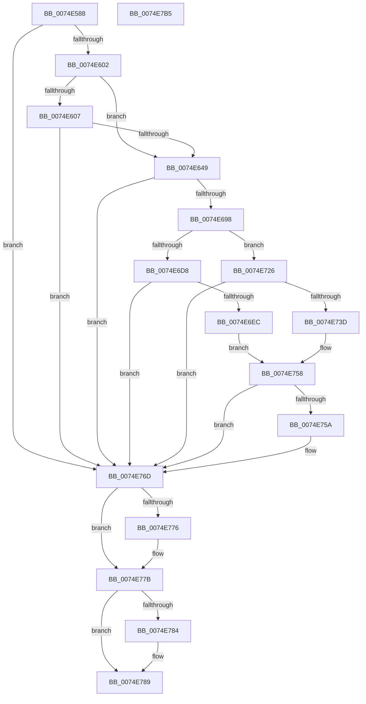

# ObpInitializeRootNamespace

- RVA: `0x0074E588`–`0x0074E7B6` (길이 `558` bytes)
- VA: `0x000000014074E588`
- 실행 섹션: `PAGE`
- PDB 이름 있음: `예`; PDB Function 태그: `아니요`
- unwind 정보 RVA: `0x000CB75C`
- 디코드: `143`개 명령, `558/558` bytes 표시
- 미해석 바이트: `0` (있으면 어셈블리에 `.byte`로 보존)

> 이 문서는 커널 이미지의 기계어와 PDB 기호를 분석해 생성했습니다. 4번과 5번은 함수 원형과 자료형을 바이너리 사용 방식에서 추정한 C 해석이며 원본 소스 복구 결과는 아닙니다.

## 1. Dependencies

- 직접 호출 지점: **13**; 고유 호출 대상: **11**
- 직접 호출자로 확인된 함수: **2**
- RIP 상대 이미지 참조: **6**

### Outgoing calls
- `0x0074E5D6` → [PsIsHostSilo](../../text/44/PsIsHostSilo_function_00443B30.md) (function, `0x00443B30`)
- `0x0074E5F3` → [ObCreateKernelObjectsSD](ObCreateKernelObjectsSD_function_0074D7A8.md) (function, `0x0074D7A8`)
- `0x0074E63A` → [ZwOpenDirectoryObject](../../text/6A/ZwOpenDirectoryObject_function_006ADBD0.md) (function, `0x006ADBD0`)
- `0x0074E689` → [ZwCreateDirectoryObjectEx](../../text/6A/ZwCreateDirectoryObjectEx_function_006AE670.md) (function, `0x006AE670`)
- `0x0074E69C` → [ZwClose](../../text/6A/ZwClose_function_006AD2B0.md) (function, `0x006AD2B0`)
- `0x0074E6DD` → [ZwCreateDirectoryObject](../../text/6A/ZwCreateDirectoryObject_function_006AE650.md) (function, `0x006AE650`)
- `0x0074E710` → [ObReferenceObjectByHandle](../86/ObReferenceObjectByHandle_function_00868DB0.md) (function, `0x00868DB0`)
- `0x0074E732` → [ZwCreateSymbolicLinkObject](../../text/6A/ZwCreateSymbolicLinkObject_function_006AE9D0.md) (function, `0x006AE9D0`)
- `0x0074E74F` → [ZwSetInformationSymbolicLink](../../text/6B/ZwSetInformationSymbolicLink_function_006B0670.md) (function, `0x006B0670`)
- `0x0074E766` → [ObpCreateDosDevicesDirectory](ObpCreateDosDevicesDirectory_function_0074E03C.md) (function, `0x0074E03C`)
- `0x0074E776` → [ZwClose](../../text/6A/ZwClose_function_006AD2B0.md) (function, `0x006AD2B0`)
- `0x0074E784` → [ZwClose](../../text/6A/ZwClose_function_006AD2B0.md) (function, `0x006AD2B0`)
- `0x0074E78D` → [ObCleanupSecurityDescriptor](ObCleanupSecurityDescriptor_function_0074D734.md) (function, `0x0074D734`)

### Direct callers
- [ObCreateSiloRootDirectory](../83/ObCreateSiloRootDirectory_function_0083CA34.md) at `0x0083CCD4`
- [ObInitSystem](../../init/C7/ObInitSystem_function_00C71C7C.md) at `0x00C7222C`

### Static image references
- `0x0074E60C` → RVA `0x00B4BF18` (`ObpKernelObjectsPathString`; read)
- `0x0074E64D` → RVA `0x00B4BF48` (`ObpKernelObjectsNameString`; read)
- `0x0074E6A6` → RVA `0x00B4BF28` (`ObpObjectTypesNameString`; read)
- `0x0074E6EC` → RVA `0x00F0F650` (`.data`; read)
- `0x0074E71B` → RVA `0x00F0F648` (`.data`; write)
- `0x0074E726` → RVA `0x00B4BF68` (`ObpObjectTypesPathString`; read)

## 2. Other-region calls and transfers

- 다른 실행 섹션으로 향하는 call: **9**
  - `0x0074E5D6` → [PsIsHostSilo](../../text/44/PsIsHostSilo_function_00443B30.md) (`PAGE` → `.text`)
  - `0x0074E63A` → [ZwOpenDirectoryObject](../../text/6A/ZwOpenDirectoryObject_function_006ADBD0.md) (`PAGE` → `.text`)
  - `0x0074E689` → [ZwCreateDirectoryObjectEx](../../text/6A/ZwCreateDirectoryObjectEx_function_006AE670.md) (`PAGE` → `.text`)
  - `0x0074E69C` → [ZwClose](../../text/6A/ZwClose_function_006AD2B0.md) (`PAGE` → `.text`)
  - `0x0074E6DD` → [ZwCreateDirectoryObject](../../text/6A/ZwCreateDirectoryObject_function_006AE650.md) (`PAGE` → `.text`)
  - `0x0074E732` → [ZwCreateSymbolicLinkObject](../../text/6A/ZwCreateSymbolicLinkObject_function_006AE9D0.md) (`PAGE` → `.text`)
  - `0x0074E74F` → [ZwSetInformationSymbolicLink](../../text/6B/ZwSetInformationSymbolicLink_function_006B0670.md) (`PAGE` → `.text`)
  - `0x0074E776` → [ZwClose](../../text/6A/ZwClose_function_006AD2B0.md) (`PAGE` → `.text`)
  - `0x0074E784` → [ZwClose](../../text/6A/ZwClose_function_006AD2B0.md) (`PAGE` → `.text`)
- 별도 외부 분기/꼬리 이동을 확인하지 못했습니다.

## 3. Assembly (complete function range)

```asm
0074E588  48 8B C4                        mov rax, rsp
0074E58B  48 89 58 08                     mov qword ptr [rax + 8], rbx
0074E58F  48 89 70 10                     mov qword ptr [rax + 0x10], rsi
0074E593  48 89 78 18                     mov qword ptr [rax + 0x18], rdi
0074E597  4C 89 60 20                     mov qword ptr [rax + 0x20], r12
0074E59B  55                              push rbp
0074E59C  41 56                           push r14
0074E59E  41 57                           push r15
0074E5A0  48 8D 68 A1                     lea rbp, [rax - 0x5f]
0074E5A4  48 81 EC B0 00 00 00            sub rsp, 0xb0
0074E5AB  33 C0                           xor eax, eax
0074E5AD  0F 57 C0                        xorps xmm0, xmm0
0074E5B0  21 45 FF                        and dword ptr [rbp - 1], eax
0074E5B3  4D 8B F9                        mov r15, r9
0074E5B6  48 21 45 C7                     and qword ptr [rbp - 0x39], rax
0074E5BA  4D 8B E0                        mov r12, r8
0074E5BD  48 21 45 07                     and qword ptr [rbp + 7], rax
0074E5C1  48 8B F2                        mov rsi, rdx
0074E5C4  0F 11 45 CF                     movups xmmword ptr [rbp - 0x31], xmm0
0074E5C8  48 89 45 EF                     mov qword ptr [rbp - 0x11], rax
0074E5CC  4C 8B F1                        mov r14, rcx
0074E5CF  0F 11 45 DF                     movups xmmword ptr [rbp - 0x21], xmm0
0074E5D3  89 45 F7                        mov dword ptr [rbp - 9], eax
0074E5D6  E8 55 55 CF FF                  call 0x140443b30
0074E5DB  0F 57 C0                        xorps xmm0, xmm0
0074E5DE  48 8D 4D 17                     lea rcx, [rbp + 0x17]
0074E5E2  40 8A F8                        mov dil, al
0074E5E5  33 C0                           xor eax, eax
0074E5E7  48 89 45 37                     mov qword ptr [rbp + 0x37], rax
0074E5EB  0F 11 45 17                     movups xmmword ptr [rbp + 0x17], xmm0
0074E5EF  0F 11 45 27                     movups xmmword ptr [rbp + 0x27], xmm0
0074E5F3  E8 B0 F1 FF FF                  call 0x14074d7a8
0074E5F8  8B D8                           mov ebx, eax
0074E5FA  85 C0                           test eax, eax
0074E5FC  0F 88 6B 01 00 00               js 0x14074e76d
0074E602  40 84 FF                        test dil, dil
0074E605  75 42                           jne 0x14074e649
0074E607  48 83 65 D7 00                  and qword ptr [rbp - 0x29], 0
0074E60C  48 8D 05 05 D9 3F 00            lea rax, [rip + 0x3fd905]
0074E613  0F 57 C0                        xorps xmm0, xmm0
0074E616  48 89 45 DF                     mov qword ptr [rbp - 0x21], rax
0074E61A  4C 8D 45 CF                     lea r8, [rbp - 0x31]
0074E61E  C7 45 CF 30 00 00 00            mov dword ptr [rbp - 0x31], 0x30
0074E625  BA 0F 00 0F 00                  mov edx, 0xf000f
0074E62A  C7 45 E7 50 02 00 00            mov dword ptr [rbp - 0x19], 0x250
0074E631  48 8D 4D 07                     lea rcx, [rbp + 7]
0074E635  F3 0F 7F 45 EF                  movdqu xmmword ptr [rbp - 0x11], xmm0
0074E63A  E8 91 F5 F5 FF                  call 0x1406adbd0
0074E63F  8B D8                           mov ebx, eax
0074E641  85 C0                           test eax, eax
0074E643  0F 88 24 01 00 00               js 0x14074e76d
0074E649  4C 8B 4D 07                     mov r9, qword ptr [rbp + 7]
0074E64D  48 8D 05 F4 D8 3F 00            lea rax, [rip + 0x3fd8f4]
0074E654  48 83 65 F7 00                  and qword ptr [rbp - 9], 0
0074E659  4C 8D 45 CF                     lea r8, [rbp - 0x31]
0074E65D  83 64 24 20 00                  and dword ptr [rsp + 0x20], 0
0074E662  48 8D 4D C7                     lea rcx, [rbp - 0x39]
0074E666  48 89 45 DF                     mov qword ptr [rbp - 0x21], rax
0074E66A  BA 0F 00 0F 00                  mov edx, 0xf000f
0074E66F  48 8D 45 17                     lea rax, [rbp + 0x17]
0074E673  C7 45 CF 30 00 00 00            mov dword ptr [rbp - 0x31], 0x30
0074E67A  48 89 45 EF                     mov qword ptr [rbp - 0x11], rax
0074E67E  48 89 75 D7                     mov qword ptr [rbp - 0x29], rsi
0074E682  C7 45 E7 50 02 00 00            mov dword ptr [rbp - 0x19], 0x250
0074E689  E8 E2 FF F5 FF                  call 0x1406ae670
0074E68E  8B D8                           mov ebx, eax
0074E690  85 C0                           test eax, eax
0074E692  0F 88 D5 00 00 00               js 0x14074e76d
0074E698  48 8B 4D C7                     mov rcx, qword ptr [rbp - 0x39]
0074E69C  E8 0F EC F5 FF                  call 0x1406ad2b0
0074E6A1  48 83 65 C7 00                  and qword ptr [rbp - 0x39], 0
0074E6A6  48 8D 05 7B D8 3F 00            lea rax, [rip + 0x3fd87b]
0074E6AD  48 89 45 DF                     mov qword ptr [rbp - 0x21], rax
0074E6B1  0F 57 C0                        xorps xmm0, xmm0
0074E6B4  C7 45 CF 30 00 00 00            mov dword ptr [rbp - 0x31], 0x30
0074E6BB  4C 8D 45 CF                     lea r8, [rbp - 0x31]
0074E6BF  48 89 75 D7                     mov qword ptr [rbp - 0x29], rsi
0074E6C3  48 8D 4D C7                     lea rcx, [rbp - 0x39]
0074E6C7  C7 45 E7 50 02 00 00            mov dword ptr [rbp - 0x19], 0x250
0074E6CE  F3 0F 7F 45 EF                  movdqu xmmword ptr [rbp - 0x11], xmm0
0074E6D3  40 84 FF                        test dil, dil
0074E6D6  74 4E                           je 0x14074e726
0074E6D8  BA 0F 00 0F 00                  mov edx, 0xf000f
0074E6DD  E8 6E FF F5 FF                  call 0x1406ae650
0074E6E2  8B D8                           mov ebx, eax
0074E6E4  85 C0                           test eax, eax
0074E6E6  0F 88 81 00 00 00               js 0x14074e76d
0074E6EC  4C 8B 05 5D 0F 7C 00            mov r8, qword ptr [rip + 0x7c0f5d]
0074E6F3  48 8D 45 0F                     lea rax, [rbp + 0xf]
0074E6F7  48 83 64 24 28 00               and qword ptr [rsp + 0x28], 0
0074E6FD  45 33 C9                        xor r9d, r9d
0074E700  48 8B 4D C7                     mov rcx, qword ptr [rbp - 0x39]
0074E704  33 D2                           xor edx, edx
0074E706  48 83 65 0F 00                  and qword ptr [rbp + 0xf], 0
0074E70B  48 89 44 24 20                  mov qword ptr [rsp + 0x20], rax
0074E710  E8 9B A6 11 00                  call 0x140868db0
0074E715  8B D8                           mov ebx, eax
0074E717  48 8B 45 0F                     mov rax, qword ptr [rbp + 0xf]
0074E71B  48 89 05 26 0F 7C 00            mov qword ptr [rip + 0x7c0f26], rax
0074E722  85 DB                           test ebx, ebx
0074E724  EB 32                           jmp 0x14074e758
0074E726  4C 8D 0D 3B D8 3F 00            lea r9, [rip + 0x3fd83b]
0074E72D  BA 01 00 0F 00                  mov edx, 0xf0001
0074E732  E8 99 02 F6 FF                  call 0x1406ae9d0
0074E737  8B D8                           mov ebx, eax
0074E739  85 C0                           test eax, eax
0074E73B  78 30                           js 0x14074e76d
0074E73D  48 8B 4D C7                     mov rcx, qword ptr [rbp - 0x39]
0074E741  4C 8D 45 FF                     lea r8, [rbp - 1]
0074E745  41 B9 04 00 00 00               mov r9d, 4
0074E74B  41 8D 51 FD                     lea edx, [r9 - 3]
0074E74F  E8 1C 1F F6 FF                  call 0x1406b0670
0074E754  8B D8                           mov ebx, eax
0074E756  85 C0                           test eax, eax
0074E758  78 13                           js 0x14074e76d
0074E75A  4D 8B CF                        mov r9, r15
0074E75D  4D 8B C4                        mov r8, r12
0074E760  48 8B D6                        mov rdx, rsi
0074E763  49 8B CE                        mov rcx, r14
0074E766  E8 D1 F8 FF FF                  call 0x14074e03c
0074E76B  8B D8                           mov ebx, eax
0074E76D  48 8B 4D C7                     mov rcx, qword ptr [rbp - 0x39]
0074E771  48 85 C9                        test rcx, rcx
0074E774  74 05                           je 0x14074e77b
0074E776  E8 35 EB F5 FF                  call 0x1406ad2b0
0074E77B  48 8B 4D 07                     mov rcx, qword ptr [rbp + 7]
0074E77F  48 85 C9                        test rcx, rcx
0074E782  74 05                           je 0x14074e789
0074E784  E8 27 EB F5 FF                  call 0x1406ad2b0
0074E789  48 8D 4D 17                     lea rcx, [rbp + 0x17]
0074E78D  E8 A2 EF FF FF                  call 0x14074d734
0074E792  4C 8D 9C 24 B0 00 00 00         lea r11, [rsp + 0xb0]
0074E79A  8B C3                           mov eax, ebx
0074E79C  49 8B 5B 20                     mov rbx, qword ptr [r11 + 0x20]
0074E7A0  49 8B 73 28                     mov rsi, qword ptr [r11 + 0x28]
0074E7A4  49 8B 7B 30                     mov rdi, qword ptr [r11 + 0x30]
0074E7A8  4D 8B 63 38                     mov r12, qword ptr [r11 + 0x38]
0074E7AC  49 8B E3                        mov rsp, r11
0074E7AF  41 5F                           pop r15
0074E7B1  41 5E                           pop r14
0074E7B3  5D                              pop rbp
0074E7B4  C3                              ret
0074E7B5  CC                              int3
```

## 4. C-style interpretation (structured pseudocode)

```c
__int64 __fastcall ObpInitializeRootNamespace(__int64 a1, __int64 a2, __int64 a3, __int64 a4)
{
    __int64 result;
    __int64 v_rbx;
    __int64 v_rsp;
    unsigned __int64 v_stack_m18;
    unsigned __int64 v_stack_mA0;
    unsigned int v_stack_mA8;

    *(unsigned __int64 *)(v_rsp + 8) = v_rbx;
    *(unsigned __int64 *)(v_rsp + 16) = v_rsi;
    *(unsigned __int64 *)(v_rsp + 24) = v_rdi;
    *(unsigned __int64 *)(v_rsp + 32) = v_r12;
    v_rsp = (v_rsp) - (176);
    result = 0;
    *(unsigned __int64 *)(v_rsp - 95 - 49) = v_xmm0;
    *(unsigned __int64 *)(v_rsp - 95 - 17) = 0;
    *(unsigned __int64 *)(v_rsp - 95 - 33) = v_xmm0;
    *(unsigned int *)(v_rsp - 95 - 9) = 0;
    result = PsIsHostSilo(a1, a2, a3, a4);
    result = 0;
    *(unsigned __int64 *)(v_rsp - 95 + 55) = 0;
    *(unsigned __int64 *)(v_rsp - 95 + 23) = v_xmm0;
    *(unsigned __int64 *)(v_rsp - 95 + 39) = v_xmm0;
    result = ObCreateKernelObjectsSD(v_rsp - 95 + 23, a2, a3, a4);
    if (sign_flag) goto loc_0074E76D;
    if ((unsigned __int8)((unsigned __int8)(result)) != 0) goto loc_0074E649;
    *(unsigned __int64 *)(v_rsp - 95 - 33) = v_rip + 4184325;
    *(unsigned int *)(v_rsp - 95 - 49) = 48;
    *(unsigned int *)(v_rsp - 95 - 25) = 592;
    *(unsigned __int64 *)(v_rsp - 95 - 17) = v_xmm0;
    result = ZwOpenDirectoryObject(v_rsp - 95 + 7, (unsigned int)(0xF000FULL), v_rsp - 95 - 49, a4);
    if (sign_flag) goto loc_0074E76D;
loc_0074E649:
    *(unsigned __int64 *)(v_rsp - 95 - 33) = v_rip + 4184308;
    *(unsigned int *)(v_rsp - 95 - 49) = 48;
    *(unsigned __int64 *)(v_rsp - 95 - 17) = v_rsp - 95 + 23;
    *(unsigned __int64 *)(v_rsp - 95 - 41) = a2;
    *(unsigned int *)(v_rsp - 95 - 25) = 592;
    result = ZwCreateDirectoryObjectEx(v_rsp - 95 - 57, (unsigned int)(0xF000FULL), v_rsp - 95 - 49, *(unsigned __int64 *)(v_rsp - 95 + 7));
    if (sign_flag) goto loc_0074E76D;
    result = ZwClose(*(unsigned __int64 *)(v_rsp - 95 - 57), (unsigned int)(0xF000FULL), v_rsp - 95 - 49, *(unsigned __int64 *)(v_rsp - 95 + 7));
    *(unsigned __int64 *)(v_rsp - 95 - 33) = v_rip + 4184187;
    *(unsigned int *)(v_rsp - 95 - 49) = 48;
    *(unsigned __int64 *)(v_rsp - 95 - 41) = a2;
    *(unsigned int *)(v_rsp - 95 - 25) = 592;
    *(unsigned __int64 *)(v_rsp - 95 - 17) = v_xmm0;
    if ((unsigned __int8)((unsigned __int8)(result)) == 0) goto loc_0074E726;
    result = ZwCreateDirectoryObject(v_rsp - 95 - 57, (unsigned int)(0xF000FULL), v_rsp - 95 - 49, *(unsigned __int64 *)(v_rsp - 95 + 7));
    if (sign_flag) goto loc_0074E76D;
    a4 = 0;
    a2 = 0;
    v_stack_mA8 = v_rsp - 95 + 15;
    result = ObReferenceObjectByHandle(*(unsigned __int64 *)(v_rsp - 95 - 57), a2, *(unsigned __int64 *)(v_rip + 8130397), a4);
    *(unsigned __int64 *)(v_rip + 8130342) = *(unsigned __int64 *)(v_rsp - 95 + 15);
    goto loc_0074E758;
loc_0074E726:
    result = ZwCreateSymbolicLinkObject(*(unsigned __int64 *)(v_rsp - 95 - 57), (unsigned int)(0xF0001ULL), *(unsigned __int64 *)(v_rip + 8130397), v_rip + 4184123);
    if (sign_flag) goto loc_0074E76D;
    result = ZwSetInformationSymbolicLink(*(unsigned __int64 *)(v_rsp - 95 - 57), 4 - 3, v_rsp - 95 - 1, 4);
loc_0074E758:
    v_rbx = (unsigned int)((unsigned int)(result));
    if (!(sign_flag)) {
        a4 = 0;
        a3 = a3;
        a2 = 0;
        a1 = a1;
        result = ObpCreateDosDevicesDirectory(a1, a2, a3, a4);
        v_rbx = (unsigned int)(result);
    }
    if (*(unsigned __int64 *)(v_rsp - 95 - 57) != 0) {
        result = ZwClose(*(unsigned __int64 *)(v_rsp - 95 - 57), a2, a3, a4);
    }
    if (*(unsigned __int64 *)(v_rsp - 95 + 7) != 0) {
        result = ZwClose(*(unsigned __int64 *)(v_rsp - 95 + 7), a2, a3, a4);
    }
    result = ObCleanupSecurityDescriptor(v_rsp - 95 + 23, a2, a3, a4);
    return (unsigned int)((unsigned int)(v_rbx));
}
```

## 5. (Beta) C Style

```c
int64_t ObpInitializeRootNamespace(int64_t Arg1, int64_t Arg2, int64_t Arg3, int64_t Arg4)
{
    int64_t result;
    int64_t local_rbx;
    int64_t local_rsp;
    uint64_t v_stack_m18;
    uint64_t v_stack_mA0;
    uint32_t v_stack_mA8;

    *(uint64_t *)(local_rsp + 0x8) = local_rbx;
    *(uint64_t *)(local_rsp + 0x10) = local_rsi;
    *(uint64_t *)(local_rsp + 0x18) = local_rdi;
    *(uint64_t *)(local_rsp + 0x20) = local_r12;
    local_rsp = (local_rsp) - (176);
    result = 0;
    *(uint64_t *)(local_rsp - 0x5F - 0x31) = v_xmm0;
    *(uint64_t *)(local_rsp - 0x5F - 0x11) = 0;
    *(uint64_t *)(local_rsp - 0x5F - 0x21) = v_xmm0;
    *(uint32_t *)(local_rsp - 0x5F - 0x9) = 0;
    result = PsIsHostSilo(Arg1, Arg2, Arg3, Arg4);
    result = 0;
    *(uint64_t *)(local_rsp - 0x5F + 0x37) = 0;
    *(uint64_t *)(local_rsp - 0x5F + 0x17) = v_xmm0;
    *(uint64_t *)(local_rsp - 0x5F + 0x27) = v_xmm0;
    result = ObCreateKernelObjectsSD(local_rsp - 95 + 23, Arg2, Arg3, Arg4);
    if (sign_flag) goto loc_0074E76D;
    if ((uint8_t)((uint8_t)(result)) != 0) goto loc_0074E649;
    *(uint64_t *)(local_rsp - 0x5F - 0x21) = v_rip + 4184325;
    *(uint32_t *)(local_rsp - 0x5F - 0x31) = 48;
    *(uint32_t *)(local_rsp - 0x5F - 0x19) = 592;
    *(uint64_t *)(local_rsp - 0x5F - 0x11) = v_xmm0;
    result = ZwOpenDirectoryObject(local_rsp - 95 + 7, (uint32_t)(0xF000FULL), local_rsp - 95 - 49, Arg4);
    if (sign_flag) goto loc_0074E76D;
loc_0074E649:
    *(uint64_t *)(local_rsp - 0x5F - 0x21) = v_rip + 4184308;
    *(uint32_t *)(local_rsp - 0x5F - 0x31) = 48;
    *(uint64_t *)(local_rsp - 0x5F - 0x11) = local_rsp - 95 + 23;
    *(uint64_t *)(local_rsp - 0x5F - 0x29) = Arg2;
    *(uint32_t *)(local_rsp - 0x5F - 0x19) = 592;
    result = ZwCreateDirectoryObjectEx(local_rsp - 95 - 57, (uint32_t)(0xF000FULL), local_rsp - 95 - 49, *(uint64_t *)(local_rsp - 0x5F + 0x7));
    if (sign_flag) goto loc_0074E76D;
    result = ZwClose(*(uint64_t *)(local_rsp - 0x5F - 0x39), (uint32_t)(0xF000FULL), local_rsp - 95 - 49, *(uint64_t *)(local_rsp - 0x5F + 0x7));
    *(uint64_t *)(local_rsp - 0x5F - 0x21) = v_rip + 4184187;
    *(uint32_t *)(local_rsp - 0x5F - 0x31) = 48;
    *(uint64_t *)(local_rsp - 0x5F - 0x29) = Arg2;
    *(uint32_t *)(local_rsp - 0x5F - 0x19) = 592;
    *(uint64_t *)(local_rsp - 0x5F - 0x11) = v_xmm0;
    if ((uint8_t)((uint8_t)(result)) == 0) goto loc_0074E726;
    result = ZwCreateDirectoryObject(local_rsp - 95 - 57, (uint32_t)(0xF000FULL), local_rsp - 95 - 49, *(uint64_t *)(local_rsp - 0x5F + 0x7));
    if (sign_flag) goto loc_0074E76D;
    Arg4 = 0;
    Arg2 = 0;
    v_stack_mA8 = local_rsp - 95 + 15;
    result = ObReferenceObjectByHandle(*(uint64_t *)(local_rsp - 0x5F - 0x39), Arg2, *(uint64_t *)(v_rip + 0x7C0F5D), Arg4);
    *(uint64_t *)(v_rip + 0x7C0F26) = *(uint64_t *)(local_rsp - 0x5F + 0xF);
    goto loc_0074E758;
loc_0074E726:
    result = ZwCreateSymbolicLinkObject(*(uint64_t *)(local_rsp - 0x5F - 0x39), (uint32_t)(0xF0001ULL), *(uint64_t *)(v_rip + 0x7C0F5D), v_rip + 4184123);
    if (sign_flag) goto loc_0074E76D;
    result = ZwSetInformationSymbolicLink(*(uint64_t *)(local_rsp - 0x5F - 0x39), 4 - 3, local_rsp - 95 - 1, 4);
loc_0074E758:
    local_rbx = (uint32_t)((uint32_t)(result));
    if (!(sign_flag)) {
        Arg4 = 0;
        Arg3 = Arg3;
        Arg2 = 0;
        Arg1 = Arg1;
        result = ObpCreateDosDevicesDirectory(Arg1, Arg2, Arg3, Arg4);
        local_rbx = (uint32_t)(result);
    }
    if (*(uint64_t *)(local_rsp - 0x5F - 0x39) != 0) {
        result = ZwClose(*(uint64_t *)(local_rsp - 0x5F - 0x39), Arg2, Arg3, Arg4);
    }
    if (*(uint64_t *)(local_rsp - 0x5F + 0x7) != 0) {
        result = ZwClose(*(uint64_t *)(local_rsp - 0x5F + 0x7), Arg2, Arg3, Arg4);
    }
    result = ObCleanupSecurityDescriptor(local_rsp - 95 + 23, Arg2, Arg3, Arg4);
    return (uint32_t)((uint32_t)(local_rbx));
}
```

## 6. Execution-region graph

[열기: 2D/3D 그래프와 함수 탐색 컨트롤 패널](../../../control-panel.html?section=page&rva=0x0074E588&view=graph)

- 2D 그래프는 위에서 아래로 흐르고, 3D 그래프는 빈 공간을 드래그해 회전합니다. Shift+드래그는 이동, 휠은 확대·축소, 함수 노드 선택은 대상 보고서 이동입니다.

### Static fallback


