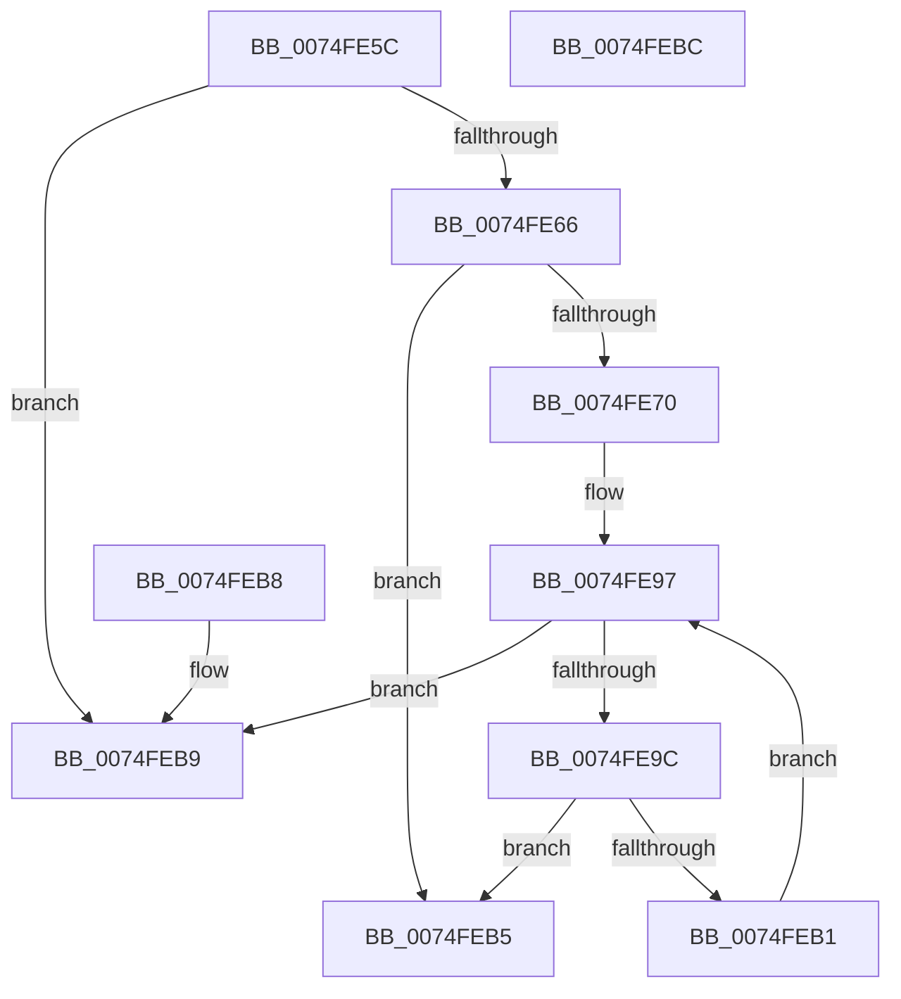

# ObpIsObjectPoolTagTraced

- RVA: `0x0074FE5C`–`0x0074FEBD` (길이 `97` bytes)
- VA: `0x000000014074FE5C`
- 실행 섹션: `PAGE`
- PDB 이름 있음: `예`; PDB Function 태그: `아니요`
- unwind 정보 RVA: `0x000DB714`
- 디코드: `31`개 명령, `97/97` bytes 표시
- 미해석 바이트: `0` (있으면 어셈블리에 `.byte`로 보존)

> 이 문서는 커널 이미지의 기계어와 PDB 기호를 분석해 생성했습니다. 4번과 5번은 함수 원형과 자료형을 바이너리 사용 방식에서 추정한 C 해석이며 원본 소스 복구 결과는 아닙니다.

## 1. Dependencies

- 직접 호출 지점: **0**; 고유 호출 대상: **0**
- 직접 호출자로 확인된 함수: **1**
- RIP 상대 이미지 참조: **4**

### Outgoing calls
- 직접 디코드된 call 명령이 없습니다.

### Direct callers
- [ObpRegisterObject](../AC/ObpRegisterObject_function_00ACF3EC.md) at `0x00ACF4AF`

### Static image references
- `0x0074FE66` → RVA `0x00FC5010` (`ALMOSTRO`; read)
- `0x0074FE7F` → RVA `0x00FC7800` (`ALMOSTRO`; read)
- `0x0074FE89` → RVA `0x00FC6E4C` (`ALMOSTRO`; read)
- `0x0074FE9C` → RVA `0x00F0F260` (`.data`; read)

## 2. Other-region calls and transfers

- 다른 실행 섹션으로 향하는 call: **0**
- 별도 외부 분기/꼬리 이동을 확인하지 못했습니다.

## 3. Assembly (complete function range)

```asm
0074FE5C  33 D2                           xor edx, edx
0074FE5E  4C 8B C1                        mov r8, rcx
0074FE61  48 85 C9                        test rcx, rcx
0074FE64  74 53                           je 0x14074feb9
0074FE66  8B 05 A4 51 87 00               mov eax, dword ptr [rip + 0x8751a4]
0074FE6C  A8 10                           test al, 0x10
0074FE6E  74 45                           je 0x14074feb5
0074FE70  48 8B C1                        mov rax, rcx
0074FE73  48 C1 E8 08                     shr rax, 8
0074FE77  0F B6 C8                        movzx ecx, al
0074FE7A  41 0F B6 40 18                  movzx eax, byte ptr [r8 + 0x18]
0074FE7F  4C 8D 05 7A 79 87 00            lea r8, [rip + 0x87797a]
0074FE86  48 33 C8                        xor rcx, rax
0074FE89  0F B6 05 BC 6F 87 00            movzx eax, byte ptr [rip + 0x876fbc]
0074FE90  48 33 C8                        xor rcx, rax
0074FE93  4D 8B 04 C8                     mov r8, qword ptr [r8 + rcx*8]
0074FE97  83 FA 10                        cmp edx, 0x10
0074FE9A  73 1D                           jae 0x14074feb9
0074FE9C  48 8B 05 BD F3 7B 00            mov rax, qword ptr [rip + 0x7bf3bd]
0074FEA3  8B CA                           mov ecx, edx
0074FEA5  8B 0C 88                        mov ecx, dword ptr [rax + rcx*4]
0074FEA8  41 39 88 C0 00 00 00            cmp dword ptr [r8 + 0xc0], ecx
0074FEAF  74 04                           je 0x14074feb5
0074FEB1  FF C2                           inc edx
0074FEB3  EB E2                           jmp 0x14074fe97
0074FEB5  B0 01                           mov al, 1
0074FEB7  C3                              ret
0074FEB8  CC                              int3
0074FEB9  32 C0                           xor al, al
0074FEBB  C3                              ret
0074FEBC  CC                              int3
```

## 4. C-style interpretation (structured pseudocode)

```c
__int64 __fastcall ObpIsObjectPoolTagTraced(__int64 a1, int a2)
{
    __int64 result;

    a2 = 0;
    if (a1 == 0) goto loc_0074FEB9;
    if ((((unsigned __int8)((unsigned int)(*(unsigned int *)(v_rip + 8868260)))) & (16)) == 0) goto loc_0074FEB5;
    result = (a1) >> (8);
    a1 = ((unsigned __int8)(result)) ^ (*(unsigned __int8 *)(a1 + 24));
    a1 = (a1) ^ (*(unsigned __int8 *)(v_rip + 8875964));
loc_0074FE97:
    if (0 >= 16) goto loc_0074FEB9;
    if ((*(unsigned int *)(*(unsigned __int64 *)(v_rip + 8878458 + a1 * 8) + 192)) == ((unsigned int)((unsigned int)(*(unsigned int *)(*(unsigned __int64 *)(v_rip + 8123325) + 0 * 4))))) goto loc_0074FEB5;
    a2 = (unsigned int)((a2) + 1);
    goto loc_0074FE97;
loc_0074FEB5:
    return 1;
loc_0074FEB9:
    result = 0;
    return result;
}
```

## 5. (Beta) C Style

```c
int64_t ObpIsObjectPoolTagTraced(void *Arg1, int32_t Arg2)
{
    uint8_t *arg1 = (uint8_t *)Arg1;

    int64_t result;

    Arg2 = 0;
    if (Arg1 == NULL) goto loc_0074FEB9;
    if ((((uint8_t)((uint32_t)(*(uint32_t *)(v_rip + 0x8751A4)))) & (16)) == 0) goto loc_0074FEB5;
    result = (Arg1) >> (8);
    Arg1 = ((uint8_t)(result)) ^ (*(uint8_t *)(arg1 + 0x18));
    Arg1 = (Arg1) ^ (*(uint8_t *)(v_rip + 0x876FBC));
loc_0074FE97:
    if (0 >= 16) goto loc_0074FEB9;
    if ((*(uint32_t *)(*(uint64_t *)(v_rip + 0x87797A + arg1 * 8) + 0xC0)) == ((uint32_t)((uint32_t)(*(uint32_t *)(*(uint64_t *)(v_rip + 0x7BF3BD) + 0x0 * 4))))) goto loc_0074FEB5;
    Arg2 = (uint32_t)((Arg2) + 1);
    goto loc_0074FE97;
loc_0074FEB5:
    return 1;
loc_0074FEB9:
    result = 0;
    return result;
}
```

### 관측된 메모리 오프셋

구조체 형식이 확인되지 않은 접근은 인자 기준의 오프셋으로만 기록했습니다.

| 기준 인자 | 오프셋 표현 | 폭 (bit) | 접근 |
|---|---:|---:|---|
| `Arg1` | `+ 0x18` | `8` | `R` |

## 6. Execution-region graph

[열기: 2D/3D 그래프와 함수 탐색 컨트롤 패널](../../../control-panel.html?section=page&rva=0x0074FE5C&view=graph)

- 2D 그래프는 위에서 아래로 흐르고, 3D 그래프는 빈 공간을 드래그해 회전합니다. Shift+드래그는 이동, 휠은 확대·축소, 함수 노드 선택은 대상 보고서 이동입니다.

### Static fallback


