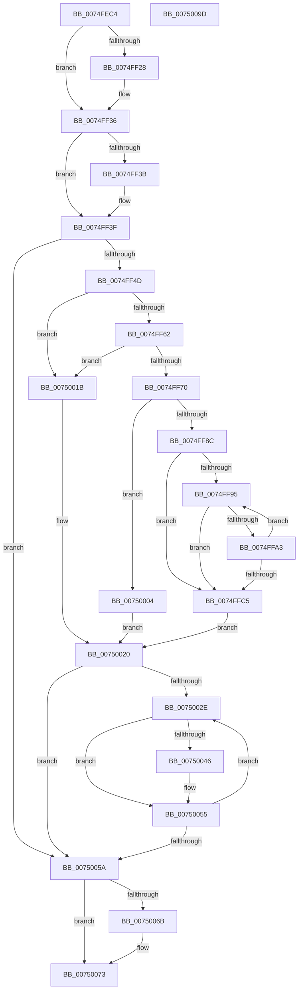

# ObpPushRefDerefInfo

- RVA: `0x0074FEC4`–`0x0075009E` (길이 `474` bytes)
- VA: `0x000000014074FEC4`
- 실행 섹션: `PAGE`
- PDB 이름 있음: `예`; PDB Function 태그: `아니요`
- unwind 정보 RVA: `0x0008C20C`
- 디코드: `123`개 명령, `474/474` bytes 표시
- 미해석 바이트: `0` (있으면 어셈블리에 `.byte`로 보존)

> 이 문서는 커널 이미지의 기계어와 PDB 기호를 분석해 생성했습니다. 4번과 5번은 함수 원형과 자료형을 바이너리 사용 방식에서 추정한 C 해석이며 원본 소스 복구 결과는 아닙니다.

## 1. Dependencies

- 직접 호출 지점: **10**; 고유 호출 대상: **10**
- 직접 호출자로 확인된 함수: **2**
- RIP 상대 이미지 참조: **5**

### Outgoing calls
- `0x0074FF18` → [KeAbPreAcquire](../../text/21/KeAbPreAcquire_function_00210230.md) (function, `0x00210230`)
- `0x0074FF31` → [ExfAcquirePushLockExclusiveEx](../../text/20/ExfAcquirePushLockExclusiveEx_function_0020FC90.md) (function, `0x0020FC90`)
- `0x0074FF55` → [ObpGetObjectRefInfo](ObpGetObjectRefInfo_function_0074FA1C.md) (function, `0x0074FA1C`)
- `0x0074FF78` → [ObpGetTraceIndex](ObpGetTraceIndex_function_0074FB28.md) (function, `0x0074FB28`)
- `0x00750014` → [DbgPrintEx](../../text/35/DbgPrintEx_function_00359290.md) (function, `0x00359290`)
- `0x0075003C` → [ExAllocatePool2](../../poolcode/B8/ExAllocatePool2_function_00B820F0.md) (function, `0x00B820F0`)
- `0x00750050` → [ExpInterlockedPushEntrySList](../../text/6B/ExpInterlockedPushEntrySList_function_006BA5B0.md) (function, `0x006BA5B0`)
- `0x0075006E` → [ExfTryToWakePushLock](../../text/26/ExfTryToWakePushLock_function_00265DD0.md) (function, `0x00265DD0`)
- `0x00750076` → [KeAbPostRelease](../../text/2E/KeAbPostRelease_function_002E1600.md) (function, `0x002E1600`)
- `0x0075007B` → [KeLeaveGuardedRegion](../../text/2E/KeLeaveGuardedRegion_function_002E2C40.md) (function, `0x002E2C40`)

### Direct callers
- [ObpPushStackInfo](../../text/21/ObpPushStackInfo_function_002109E4.md) at `0x00210AD1`
- [ObpPushStackInfoQueue](../75/ObpPushStackInfoQueue_function_007500B0.md) at `0x007500E8`

### Static image references
- `0x0074FEE4` → RVA `0x00F0F580` (`.data`; read)
- `0x0074FF3F` → RVA `0x00FC5010` (`ALMOSTRO`; read)
- `0x00750009` → RVA `0x00B01460` (` ?? ::NNGAKEGL::`string'`; read)
- `0x00750025` → RVA `0x00E27600` (`.data`; read)
- `0x0075005A` → RVA `0x00F0F580` (`.data`; read/write)

## 2. Other-region calls and transfers

- 다른 실행 섹션으로 향하는 call: **8**
  - `0x0074FF18` → [KeAbPreAcquire](../../text/21/KeAbPreAcquire_function_00210230.md) (`PAGE` → `.text`)
  - `0x0074FF31` → [ExfAcquirePushLockExclusiveEx](../../text/20/ExfAcquirePushLockExclusiveEx_function_0020FC90.md) (`PAGE` → `.text`)
  - `0x00750014` → [DbgPrintEx](../../text/35/DbgPrintEx_function_00359290.md) (`PAGE` → `.text`)
  - `0x0075003C` → [ExAllocatePool2](../../poolcode/B8/ExAllocatePool2_function_00B820F0.md) (`PAGE` → `POOLCODE`)
  - `0x00750050` → [ExpInterlockedPushEntrySList](../../text/6B/ExpInterlockedPushEntrySList_function_006BA5B0.md) (`PAGE` → `.text`)
  - `0x0075006E` → [ExfTryToWakePushLock](../../text/26/ExfTryToWakePushLock_function_00265DD0.md) (`PAGE` → `.text`)
  - `0x00750076` → [KeAbPostRelease](../../text/2E/KeAbPostRelease_function_002E1600.md) (`PAGE` → `.text`)
  - `0x0075007B` → [KeLeaveGuardedRegion](../../text/2E/KeLeaveGuardedRegion_function_002E2C40.md) (`PAGE` → `.text`)
- 별도 외부 분기/꼬리 이동을 확인하지 못했습니다.

## 3. Assembly (complete function range)

```asm
0074FEC4  48 8B C4                        mov rax, rsp
0074FEC7  48 89 58 08                     mov qword ptr [rax + 8], rbx
0074FECB  48 89 68 10                     mov qword ptr [rax + 0x10], rbp
0074FECF  48 89 70 18                     mov qword ptr [rax + 0x18], rsi
0074FED3  57                              push rdi
0074FED4  41 54                           push r12
0074FED6  41 55                           push r13
0074FED8  41 56                           push r14
0074FEDA  41 57                           push r15
0074FEDC  48 83 EC 30                     sub rsp, 0x30
0074FEE0  45 0F B7 E0                     movzx r12d, r8w
0074FEE4  48 8D 3D 95 F6 7B 00            lea rdi, [rip + 0x7bf695]
0074FEEB  44 8A FA                        mov r15b, dl
0074FEEE  48 8B E9                        mov rbp, rcx
0074FEF1  45 33 ED                        xor r13d, r13d
0074FEF4  48 83 CB FF                     or rbx, 0xffffffffffffffff
0074FEF8  4C 89 68 C8                     mov qword ptr [rax - 0x38], r13
0074FEFC  45 33 C0                        xor r8d, r8d
0074FEFF  65 48 8B 04 25 88 01 00 00      mov rax, qword ptr gs:[0x188]
0074FF08  33 D2                           xor edx, edx
0074FF0A  48 8B CF                        mov rcx, rdi
0074FF0D  45 8B F1                        mov r14d, r9d
0074FF10  66 01 98 E6 01 00 00            add word ptr [rax + 0x1e6], bx
0074FF17  90                              nop
0074FF18  E8 13 03 AC FF                  call 0x140210230
0074FF1D  F0 48 0F BA 2F 00               lock bts qword ptr [rdi], 0
0074FF23  48 8B F0                        mov rsi, rax
0074FF26  73 0E                           jae 0x14074ff36
0074FF28  4C 8B C7                        mov r8, rdi
0074FF2B  48 8B D0                        mov rdx, rax
0074FF2E  48 8B CF                        mov rcx, rdi
0074FF31  E8 5A FD AB FF                  call 0x14020fc90
0074FF36  48 85 F6                        test rsi, rsi
0074FF39  74 04                           je 0x14074ff3f
0074FF3B  C6 46 0A 01                     mov byte ptr [rsi + 0xa], 1
0074FF3F  8B 05 CB 50 87 00               mov eax, dword ptr [rip + 0x8750cb]
0074FF45  A8 73                           test al, 0x73
0074FF47  0F 84 0D 01 00 00               je 0x14075005a
0074FF4D  48 8D 54 24 20                  lea rdx, [rsp + 0x20]
0074FF52  48 8B CD                        mov rcx, rbp
0074FF55  E8 C2 FA FF FF                  call 0x14074fa1c
0074FF5A  85 C0                           test eax, eax
0074FF5C  0F 88 B9 00 00 00               js 0x14075001b
0074FF62  48 8B 74 24 20                  mov rsi, qword ptr [rsp + 0x20]
0074FF67  48 85 F6                        test rsi, rsi
0074FF6A  0F 84 AB 00 00 00               je 0x14075001b
0074FF70  48 8B 8C 24 80 00 00 00         mov rcx, qword ptr [rsp + 0x80]
0074FF78  E8 AB FB FF FF                  call 0x14074fb28
0074FF7D  44 0F B7 C0                     movzx r8d, ax
0074FF81  B8 FD 3F 00 00                  mov eax, 0x3ffd
0074FF86  66 44 3B C0                     cmp r8w, ax
0074FF8A  73 78                           jae 0x140750004
0074FF8C  0F B7 56 20                     movzx edx, word ptr [rsi + 0x20]
0074FF90  66 85 D2                        test dx, dx
0074FF93  74 30                           je 0x14074ffc5
0074FF95  0F B7 CA                        movzx ecx, dx
0074FF98  48 8D 04 49                     lea rax, [rcx + rcx*2]
0074FF9C  44 3B 74 86 18                  cmp r14d, dword ptr [rsi + rax*4 + 0x18]
0074FFA1  73 22                           jae 0x14074ffc5
0074FFA3  F2 0F 10 44 86 18               movsd xmm0, qword ptr [rsi + rax*4 + 0x18]
0074FFA9  48 8D 0C 49                     lea rcx, [rcx + rcx*2]
0074FFAD  F2 0F 11 44 8E 24               movsd qword ptr [rsi + rcx*4 + 0x24], xmm0
0074FFB3  8B 44 86 20                     mov eax, dword ptr [rsi + rax*4 + 0x20]
0074FFB7  89 44 8E 2C                     mov dword ptr [rsi + rcx*4 + 0x2c], eax
0074FFBB  B8 FF FF 00 00                  mov eax, 0xffff
0074FFC0  66 03 D0                        add dx, ax
0074FFC3  75 D0                           jne 0x14074ff95
0074FFC5  41 F6 DF                        neg r15b
0074FFC8  0F B7 CA                        movzx ecx, dx
0074FFCB  BD 01 00 00 00                  mov ebp, 1
0074FFD0  66 1B C0                        sbb ax, ax
0074FFD3  66 25 00 80                     and ax, 0x8000
0074FFD7  66 41 0B C0                     or ax, r8w
0074FFDB  48 8D 14 49                     lea rdx, [rcx + rcx*2]
0074FFDF  66 89 44 96 28                  mov word ptr [rsi + rdx*4 + 0x28], ax
0074FFE4  48 8D 04 49                     lea rax, [rcx + rcx*2]
0074FFE8  66 44 89 64 96 2A               mov word ptr [rsi + rdx*4 + 0x2a], r12w
0074FFEE  44 89 74 86 24                  mov dword ptr [rsi + rax*4 + 0x24], r14d
0074FFF3  8B 84 24 88 00 00 00            mov eax, dword ptr [rsp + 0x88]
0074FFFA  89 44 96 2C                     mov dword ptr [rsi + rdx*4 + 0x2c], eax
0074FFFE  66 01 6E 20                     add word ptr [rsi + 0x20], bp
00750002  EB 1C                           jmp 0x140750020
00750004  BD 01 00 00 00                  mov ebp, 1
00750009  4C 8D 05 50 14 3B 00            lea r8, [rip + 0x3b1450]
00750010  8B D5                           mov edx, ebp
00750012  33 C9                           xor ecx, ecx
00750014  E8 77 92 C0 FF                  call 0x140359290
00750019  EB 05                           jmp 0x140750020
0075001B  BD 01 00 00 00                  mov ebp, 1
00750020  BE 64 00 00 00                  mov esi, 0x64
00750025  66 39 35 D4 75 6D 00            cmp word ptr [rip + 0x6d75d4], si
0075002C  73 2C                           jae 0x14075005a
0075002E  BA B0 00 00 00                  mov edx, 0xb0
00750033  41 B8 4F 62 52 74               mov r8d, 0x7452624f
00750039  8D 4A 90                        lea ecx, [rdx - 0x70]
0075003C  E8 AF 20 43 00                  call 0x140b820f0
00750041  48 85 C0                        test rax, rax
00750044  74 0F                           je 0x140750055
00750046  48 8B D0                        mov rdx, rax
00750049  48 8D 0D B0 75 6D 00            lea rcx, [rip + 0x6d75b0]
00750050  E8 5B A5 F6 FF                  call 0x1406ba5b0
00750055  48 2B F5                        sub rsi, rbp
00750058  75 D4                           jne 0x14075002e
0075005A  F0 48 0F C1 1D 1D F5 7B 00      lock xadd qword ptr [rip + 0x7bf51d], rbx
00750063  80 E3 06                        and bl, 6
00750066  80 FB 02                        cmp bl, 2
00750069  75 08                           jne 0x140750073
0075006B  48 8B CF                        mov rcx, rdi
0075006E  E8 5D 5D B1 FF                  call 0x140265dd0
00750073  48 8B CF                        mov rcx, rdi
00750076  E8 85 15 B9 FF                  call 0x1402e1600
0075007B  E8 C0 2B B9 FF                  call 0x1402e2c40
00750080  48 8B 5C 24 60                  mov rbx, qword ptr [rsp + 0x60]
00750085  48 8B 6C 24 68                  mov rbp, qword ptr [rsp + 0x68]
0075008A  48 8B 74 24 70                  mov rsi, qword ptr [rsp + 0x70]
0075008F  48 83 C4 30                     add rsp, 0x30
00750093  41 5F                           pop r15
00750095  41 5E                           pop r14
00750097  41 5D                           pop r13
00750099  41 5C                           pop r12
0075009B  5F                              pop rdi
0075009C  C3                              ret
0075009D  CC                              int3
```

## 4. C-style interpretation (structured pseudocode)

```c
__int64 __fastcall ObpPushRefDerefInfo(__int64 a1, int a2, int a3, int a4, __int64 a5, unsigned int a6)
{
    __int64 result;
    __int64 v_r13;
    __int64 v_r15;
    __int64 v_rbx;
    __int64 v_rsi;
    __int64 v_rsp;
    unsigned __int64 v_stack_m38;
    unsigned __int64 v_stack_p10;
    unsigned __int64 v_stack_p18;
    unsigned __int64 v_stack_p8;

    *(unsigned __int64 *)(v_rsp + 8) = v_rbx;
    *(unsigned __int64 *)(v_rsp + 16) = v_rbp;
    *(unsigned __int64 *)(v_rsp + 24) = v_rsi;
    v_rsp = (v_rsp) - (48);
    v_r13 = 0;
    v_rbx = (v_rbx) | (-1);
    *(unsigned __int64 *)(v_rsp - 56) = 0;
    a3 = 0;
    a2 = 0;
    result = KeAbPreAcquire(v_rip + 8124053, a2, a3, a4);
    if (!(condition_is_above_or_equal)) {
        a3 = v_rip + 8124053;
        a2 = result;
        a1 = v_rip + 8124053;
        result = ExfAcquirePushLockExclusiveEx(a1, a2, a3, a4);
    }
    if (result != 0) {
        *(unsigned __int8 *)(result + 10) = 1;
    }
    if ((((unsigned __int8)((unsigned int)(*(unsigned int *)(v_rip + 8868043)))) & (115)) == 0) goto loc_0075005A;
    result = ObpGetObjectRefInfo(a1, v_stack_m38, a3, a4);
    if (sign_flag) goto loc_0075001B;
    if (v_stack_m38 == 0) goto loc_0075001B;
    result = ObpGetTraceIndex(a5, v_stack_m38, a3, a4);
    if (((unsigned __int16)((unsigned __int16)(result))) >= ((unsigned __int16)((unsigned int)(0x3FFDULL)))) goto loc_00750004;
    if ((unsigned __int16)(*(unsigned __int16 *)(v_stack_m38 + 32)) == 0) goto loc_0074FFC5;
loc_0074FF95:
    if (((unsigned int)((unsigned int)(a4))) >= (*(unsigned int *)(v_stack_m38 + (unsigned __int16)(*(unsigned __int16 *)(v_stack_m38 + 32)) + (unsigned __int16)(*(unsigned __int16 *)(v_stack_m38 + 32)) * 2 * 4 + 24))) goto loc_0074FFC5;
    *(unsigned __int64 *)(v_stack_m38 + (unsigned __int16)(*(unsigned __int16 *)(v_stack_m38 + 32)) + (unsigned __int16)(*(unsigned __int16 *)(v_stack_m38 + 32)) * 2 * 4 + 36) = v_xmm0;
    *(unsigned int *)(v_stack_m38 + (unsigned __int16)(*(unsigned __int16 *)(v_stack_m38 + 32)) + (unsigned __int16)(*(unsigned __int16 *)(v_stack_m38 + 32)) * 2 * 4 + 44) = (unsigned int)((unsigned int)(*(unsigned int *)(v_stack_m38 + (unsigned __int16)(*(unsigned __int16 *)(v_stack_m38 + 32)) + (unsigned __int16)(*(unsigned __int16 *)(v_stack_m38 + 32)) * 2 * 4 + 32)));
    a2 = (unsigned __int16)((*(unsigned __int16 *)(v_stack_m38 + 32)) + ((unsigned __int16)((unsigned int)(0xFFFFULL))));
    if (condition_is_not_equal) goto loc_0074FF95;
loc_0074FFC5:
    v_r15 = (unsigned __int8)(-((unsigned __int8)(a2)));
    result = (unsigned __int16)(((unsigned int)(0xFFFFULL)) & (0x8000ULL));
    result = (unsigned __int16)((result) | ((unsigned __int16)((unsigned __int16)(result))));
    *(unsigned __int16 *)(v_stack_m38 + (unsigned __int16)(a2) + (unsigned __int16)(a2) * 2 * 4 + 40) = (unsigned __int16)(result);
    *(unsigned __int16 *)(v_stack_m38 + (unsigned __int16)(a2) + (unsigned __int16)(a2) * 2 * 4 + 42) = (unsigned __int16)((unsigned __int16)(a3));
    *(unsigned int *)(v_stack_m38 + (unsigned __int16)(a2) + (unsigned __int16)(a2) * 2 * 4 + 36) = (unsigned int)((unsigned int)(a4));
    *(unsigned int *)(v_stack_m38 + (unsigned __int16)(a2) + (unsigned __int16)(a2) * 2 * 4 + 44) = (unsigned int)((unsigned int)(a6));
    goto loc_00750020;
loc_00750004:
    a1 = 0;
    result = DbgPrintEx(a1, 1, v_rip + 3871824, a4);
    goto loc_00750020;
loc_0075001B:
loc_00750020:
    if ((*(unsigned __int16 *)(v_rip + 7173588)) >= 100) goto loc_0075005A;
loc_0075002E:
    result = ExAllocatePool2(176 - 112, 176, (unsigned int)(0x7452624FULL), a4);
    if (result != 0) {
        a2 = result;
        a1 = v_rip + 7173552;
        result = ExpInterlockedPushEntrySList(a1, a2, (unsigned int)(0x7452624FULL), a4);
    }
    v_rsi = (100) - (1);
    if (condition_is_not_equal) goto loc_0075002E;
loc_0075005A:
    v_rbx = (unsigned __int8)((v_rbx) & (6));
    if (((unsigned __int8)(v_rbx)) == 2) {
        a1 = v_rip + 8124053;
        result = ExfTryToWakePushLock(a1, a2, (unsigned int)(0x7452624FULL), a4);
    }
    result = KeAbPostRelease(v_rip + 8124053, a2, (unsigned int)(0x7452624FULL), a4);
    result = KeLeaveGuardedRegion(v_rip + 8124053, a2, (unsigned int)(0x7452624FULL), a4);
    v_rsp = (v_rsp) + (48);
    return result;
}
```

## 5. (Beta) C Style

```c
int64_t ObpPushRefDerefInfo(int64_t Arg1, int32_t Arg2, int32_t Arg3, int32_t Arg4, int64_t Arg5, uint32_t Arg6)
{
    int64_t result;
    int64_t local_r13;
    int64_t local_r15;
    int64_t local_rbx;
    int64_t local_rsi;
    int64_t local_rsp;
    uint64_t v_stack_m38;
    uint64_t v_stack_p10;
    uint64_t v_stack_p18;
    uint64_t v_stack_p8;

    *(uint64_t *)(local_rsp + 0x8) = local_rbx;
    *(uint64_t *)(local_rsp + 0x10) = local_rbp;
    *(uint64_t *)(local_rsp + 0x18) = local_rsi;
    local_rsp = (local_rsp) - (48);
    local_r13 = 0;
    local_rbx = (local_rbx) | (-1);
    *(uint64_t *)(local_rsp - 0x38) = 0;
    Arg3 = 0;
    Arg2 = 0;
    result = KeAbPreAcquire(v_rip + 8124053, Arg2, Arg3, Arg4);
    if (!(condition_is_above_or_equal)) {
        Arg3 = v_rip + 8124053;
        Arg2 = result;
        Arg1 = v_rip + 8124053;
        result = ExfAcquirePushLockExclusiveEx(Arg1, Arg2, Arg3, Arg4);
    }
    if (result != 0) {
        *(uint8_t *)(result + 0xA) = 1;
    }
    if ((((uint8_t)((uint32_t)(*(uint32_t *)(v_rip + 0x8750CB)))) & (115)) == 0) goto loc_0075005A;
    result = ObpGetObjectRefInfo(Arg1, v_stack_m38, Arg3, Arg4);
    if (sign_flag) goto loc_0075001B;
    if (v_stack_m38 == 0) goto loc_0075001B;
    result = ObpGetTraceIndex(Arg5, v_stack_m38, Arg3, Arg4);
    if (((uint16_t)((uint16_t)(result))) >= ((uint16_t)((uint32_t)(0x3FFDULL)))) goto loc_00750004;
    if ((uint16_t)(*(uint16_t *)(v_stack_m38 + 0x20)) == 0) goto loc_0074FFC5;
loc_0074FF95:
    if (((uint32_t)((uint32_t)(Arg4))) >= (*(uint32_t *)(v_stack_m38 + (uint16_t)(*(uint16_t *)(v_stack_m38 + 0x20)) + (uint16_t)(*(uint16_t *)(v_stack_m38 + 0x20)) * 2 * 4 + 0x18))) goto loc_0074FFC5;
    *(uint64_t *)(v_stack_m38 + (uint16_t)(*(uint16_t *)(v_stack_m38 + 0x20)) + (uint16_t)(*(uint16_t *)(v_stack_m38 + 0x20)) * 2 * 4 + 0x24) = v_xmm0;
    *(uint32_t *)(v_stack_m38 + (uint16_t)(*(uint16_t *)(v_stack_m38 + 0x20)) + (uint16_t)(*(uint16_t *)(v_stack_m38 + 0x20)) * 2 * 4 + 0x2C) = (uint32_t)((uint32_t)(*(uint32_t *)(v_stack_m38 + (uint16_t)(*(uint16_t *)(v_stack_m38 + 0x20)) + (uint16_t)(*(uint16_t *)(v_stack_m38 + 0x20)) * 2 * 4 + 0x20)));
    Arg2 = (uint16_t)((*(uint16_t *)(v_stack_m38 + 0x20)) + ((uint16_t)((uint32_t)(0xFFFFULL))));
    if (condition_is_not_equal) goto loc_0074FF95;
loc_0074FFC5:
    local_r15 = (uint8_t)(-((uint8_t)(Arg2)));
    result = (uint16_t)(((uint32_t)(0xFFFFULL)) & (0x8000ULL));
    result = (uint16_t)((result) | ((uint16_t)((uint16_t)(result))));
    *(uint16_t *)(v_stack_m38 + (uint16_t)(Arg2) + (uint16_t)(Arg2) * 2 * 4 + 0x28) = (uint16_t)(result);
    *(uint16_t *)(v_stack_m38 + (uint16_t)(Arg2) + (uint16_t)(Arg2) * 2 * 4 + 0x2A) = (uint16_t)((uint16_t)(Arg3));
    *(uint32_t *)(v_stack_m38 + (uint16_t)(Arg2) + (uint16_t)(Arg2) * 2 * 4 + 0x24) = (uint32_t)((uint32_t)(Arg4));
    *(uint32_t *)(v_stack_m38 + (uint16_t)(Arg2) + (uint16_t)(Arg2) * 2 * 4 + 0x2C) = (uint32_t)((uint32_t)(Arg6));
    goto loc_00750020;
loc_00750004:
    Arg1 = 0;
    result = DbgPrintEx(Arg1, 1, v_rip + 3871824, Arg4);
    goto loc_00750020;
loc_0075001B:
loc_00750020:
    if ((*(uint16_t *)(v_rip + 0x6D75D4)) >= 100) goto loc_0075005A;
loc_0075002E:
    result = ExAllocatePool2(176 - 112, 176, (uint32_t)(0x7452624FULL), Arg4);
    if (result != 0) {
        Arg2 = result;
        Arg1 = v_rip + 7173552;
        result = ExpInterlockedPushEntrySList(Arg1, Arg2, (uint32_t)(0x7452624FULL), Arg4);
    }
    local_rsi = (100) - (1);
    if (condition_is_not_equal) goto loc_0075002E;
loc_0075005A:
    local_rbx = (uint8_t)((local_rbx) & (6));
    if (((uint8_t)(local_rbx)) == 2) {
        Arg1 = v_rip + 8124053;
        result = ExfTryToWakePushLock(Arg1, Arg2, (uint32_t)(0x7452624FULL), Arg4);
    }
    result = KeAbPostRelease(v_rip + 8124053, Arg2, (uint32_t)(0x7452624FULL), Arg4);
    result = KeLeaveGuardedRegion(v_rip + 8124053, Arg2, (uint32_t)(0x7452624FULL), Arg4);
    local_rsp = (local_rsp) + (48);
    return result;
}
```

## 6. Execution-region graph

[열기: 2D/3D 그래프와 함수 탐색 컨트롤 패널](../../../control-panel.html?section=page&rva=0x0074FEC4&view=graph)

- 2D 그래프는 위에서 아래로 흐르고, 3D 그래프는 빈 공간을 드래그해 회전합니다. Shift+드래그는 이동, 휠은 확대·축소, 함수 노드 선택은 대상 보고서 이동입니다.

### Static fallback


