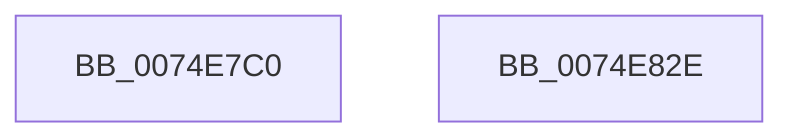

# ObpShutdownCloseHandleProcedure

- RVA: `0x0074E7C0`–`0x0074E82F` (길이 `111` bytes)
- VA: `0x000000014074E7C0`
- 실행 섹션: `PAGE`
- PDB 이름 있음: `예`; PDB Function 태그: `아니요`
- unwind 정보 RVA: `0x0005E6B4`
- 디코드: `31`개 명령, `111/111` bytes 표시
- 미해석 바이트: `0` (있으면 어셈블리에 `.byte`로 보존)

> 이 문서는 커널 이미지의 기계어와 PDB 기호를 분석해 생성했습니다. 4번과 5번은 함수 원형과 자료형을 바이너리 사용 방식에서 추정한 C 해석이며 원본 소스 복구 결과는 아닙니다.

## 1. Dependencies

- 직접 호출 지점: **3**; 고유 호출 대상: **3**
- 직접 호출자로 확인된 함수: **0**
- RIP 상대 이미지 참조: **1**

### Outgoing calls
- `0x0074E7E8` → [ExGetHandlePointer](../../text/43/ExGetHandlePointer_function_00430C90.md) (function, `0x00430C90`)
- `0x0074E7F6` → [ExUnlockHandleTableEntry](../94/ExUnlockHandleTableEntry_function_0094D2D0.md) (function, `0x0094D2D0`)
- `0x0074E809` → [DbgPrint](../../text/35/DbgPrint_function_00358CB0.md) (function, `0x00358CB0`)

### Direct callers
- 이 함수 시작 RVA로 연결되는 직접 call은 확인되지 않았습니다. 간접 호출은 완전히 역산할 수 없습니다.

### Static image references
- `0x0074E802` → RVA `0x00B013B0` (` ?? ::NNGAKEGL::`string'`; read)

## 2. Other-region calls and transfers

- 다른 실행 섹션으로 향하는 call: **2**
  - `0x0074E7E8` → [ExGetHandlePointer](../../text/43/ExGetHandlePointer_function_00430C90.md) (`PAGE` → `.text`)
  - `0x0074E809` → [DbgPrint](../../text/35/DbgPrint_function_00358CB0.md) (`PAGE` → `.text`)
- 별도 외부 분기/꼬리 이동을 확인하지 못했습니다.

## 3. Assembly (complete function range)

```asm
0074E7C0  48 8B C4                        mov rax, rsp
0074E7C3  48 89 58 08                     mov qword ptr [rax + 8], rbx
0074E7C7  48 89 68 10                     mov qword ptr [rax + 0x10], rbp
0074E7CB  48 89 70 18                     mov qword ptr [rax + 0x18], rsi
0074E7CF  48 89 78 20                     mov qword ptr [rax + 0x20], rdi
0074E7D3  41 56                           push r14
0074E7D5  48 83 EC 20                     sub rsp, 0x20
0074E7D9  48 8B F1                        mov rsi, rcx
0074E7DC  4D 8B F1                        mov r14, r9
0074E7DF  48 8B CA                        mov rcx, rdx
0074E7E2  49 8B E8                        mov rbp, r8
0074E7E5  48 8B FA                        mov rdi, rdx
0074E7E8  E8 A3 24 CE FF                  call 0x140430c90
0074E7ED  48 8B D7                        mov rdx, rdi
0074E7F0  48 8B CE                        mov rcx, rsi
0074E7F3  48 8B D8                        mov rbx, rax
0074E7F6  E8 D5 EA 1F 00                  call 0x14094d2d0
0074E7FB  48 8D 53 30                     lea rdx, [rbx + 0x30]
0074E7FF  44 8B C5                        mov r8d, ebp
0074E802  48 8D 0D A7 2B 3B 00            lea rcx, [rip + 0x3b2ba7]
0074E809  E8 A2 A4 C0 FF                  call 0x140358cb0
0074E80E  41 FF 06                        inc dword ptr [r14]
0074E811  48 8B 5C 24 30                  mov rbx, qword ptr [rsp + 0x30]
0074E816  32 C0                           xor al, al
0074E818  48 8B 6C 24 38                  mov rbp, qword ptr [rsp + 0x38]
0074E81D  48 8B 74 24 40                  mov rsi, qword ptr [rsp + 0x40]
0074E822  48 8B 7C 24 48                  mov rdi, qword ptr [rsp + 0x48]
0074E827  48 83 C4 20                     add rsp, 0x20
0074E82B  41 5E                           pop r14
0074E82D  C3                              ret
0074E82E  CC                              int3
```

## 4. C-style interpretation (structured pseudocode)

```c
__int64 __fastcall ObpShutdownCloseHandleProcedure(__int64 a1, __int64 a2, __int64 a3, __int64 a4)
{
    __int64 result;
    __int64 v_rsp;
    unsigned __int64 v_stack_p10;
    unsigned __int64 v_stack_p18;
    unsigned __int64 v_stack_p20;
    unsigned __int64 v_stack_p8;

    *(unsigned __int64 *)(v_rsp + 8) = v_rbx;
    *(unsigned __int64 *)(v_rsp + 16) = v_rbp;
    *(unsigned __int64 *)(v_rsp + 24) = v_rsi;
    *(unsigned __int64 *)(v_rsp + 32) = v_rdi;
    v_rsp = (v_rsp) - (32);
    result = ExGetHandlePointer(a2, a2, a3, a4);
    result = ExUnlockHandleTableEntry(a1, a2, a3, a4);
    result = DbgPrint(v_rip + 3877799, result + 48, (unsigned int)((unsigned int)(a3)), a4);
    result = 0;
    v_rsp = (v_rsp) + (32);
    return result;
}
```

## 5. (Beta) C Style

```c
int64_t ObpShutdownCloseHandleProcedure(int64_t Arg1, int64_t Arg2, int64_t Arg3, void *Arg4)
{
    uint8_t *arg4 = (uint8_t *)Arg4;

    int64_t result;
    int64_t local_rsp;
    uint64_t v_stack_p10;
    uint64_t v_stack_p18;
    uint64_t v_stack_p20;
    uint64_t v_stack_p8;

    *(uint64_t *)(local_rsp + 0x8) = local_rbx;
    *(uint64_t *)(local_rsp + 0x10) = local_rbp;
    *(uint64_t *)(local_rsp + 0x18) = local_rsi;
    *(uint64_t *)(local_rsp + 0x20) = local_rdi;
    local_rsp = (local_rsp) - (32);
    result = ExGetHandlePointer(Arg2, Arg2, Arg3, Arg4);
    result = ExUnlockHandleTableEntry(Arg1, Arg2, Arg3, Arg4);
    result = DbgPrint(v_rip + 3877799, result + 48, (uint32_t)((uint32_t)(Arg3)), Arg4);
    result = 0;
    local_rsp = (local_rsp) + (32);
    return result;
}
```

### 관측된 메모리 오프셋

구조체 형식이 확인되지 않은 접근은 인자 기준의 오프셋으로만 기록했습니다.

| 기준 인자 | 오프셋 표현 | 폭 (bit) | 접근 |
|---|---:|---:|---|
| `Arg4` | `+ 0x0` | `32` | `R/W` |

## 6. Execution-region graph

[열기: 2D/3D 그래프와 함수 탐색 컨트롤 패널](../../../control-panel.html?section=page&rva=0x0074E7C0&view=graph)

- 2D 그래프는 위에서 아래로 흐르고, 3D 그래프는 빈 공간을 드래그해 회전합니다. Shift+드래그는 이동, 휠은 확대·축소, 함수 노드 선택은 대상 보고서 이동입니다.

### Static fallback


