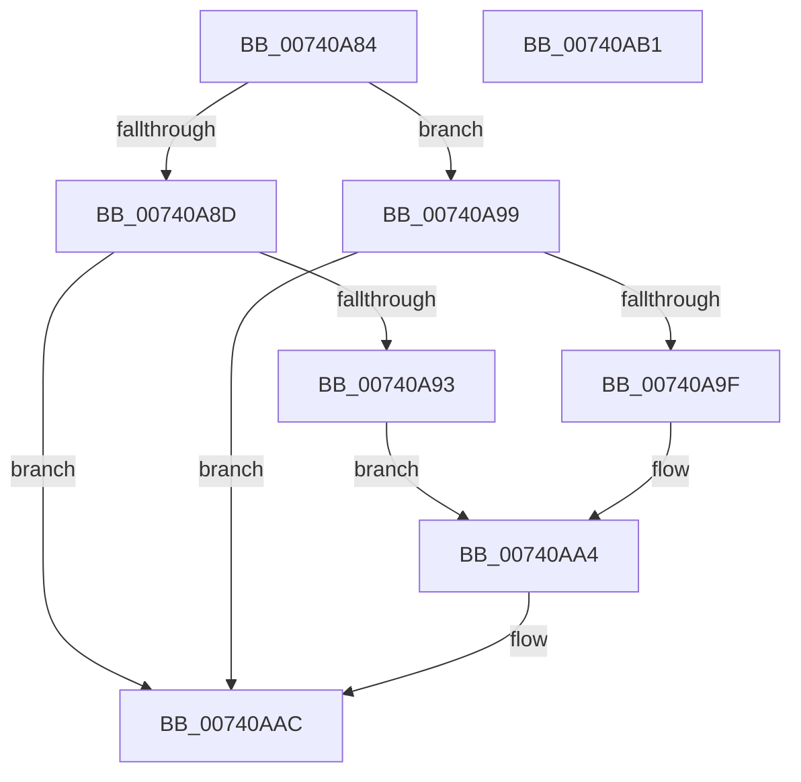

# PiAuditDeviceEnableDisableAction

- RVA: `0x00740A84`–`0x00740AB2` (길이 `46` bytes)
- VA: `0x0000000140740A84`
- 실행 섹션: `PAGE`
- PDB 이름 있음: `예`; PDB Function 태그: `아니요`
- unwind 정보 RVA: `0x0005C788`
- 디코드: `15`개 명령, `46/46` bytes 표시
- 미해석 바이트: `0` (있으면 어셈블리에 `.byte`로 보존)

> 이 문서는 커널 이미지의 기계어와 PDB 기호를 분석해 생성했습니다. 4번과 5번은 함수 원형과 자료형을 바이너리 사용 방식에서 추정한 C 해석이며 원본 소스 복구 결과는 아닙니다.

## 1. Dependencies

- 직접 호출 지점: **1**; 고유 호출 대상: **1**
- 직접 호출자로 확인된 함수: **2**
- RIP 상대 이미지 참조: **0**

### Outgoing calls
- `0x00740AA7` → [PiAuditDeviceOperation](../A8/PiAuditDeviceOperation_function_00A864DC.md) (function, `0x00A864DC`)

### Direct callers
- [PipSetDevNodeProblem](../8F/PipSetDevNodeProblem_function_008FDE0C.md) at `0x008FE034`
- [PipClearDevNodeProblem](../A2/PipClearDevNodeProblem_function_00A27C8C.md) at `0x00A27E16`

### Static image references
- 디코드된 RIP-relative 메모리 참조가 없습니다.

## 2. Other-region calls and transfers

- 다른 실행 섹션으로 향하는 call: **0**
- 별도 외부 분기/꼬리 이동을 확인하지 못했습니다.

## 3. Assembly (complete function range)

```asm
00740A84  48 83 EC 28                     sub rsp, 0x28
00740A88  83 FA 16                        cmp edx, 0x16
00740A8B  74 0C                           je 0x140740a99
00740A8D  41 83 F8 16                     cmp r8d, 0x16
00740A91  75 19                           jne 0x140740aac
00740A93  41 8D 50 EC                     lea edx, [r8 - 0x14]
00740A97  EB 0B                           jmp 0x140740aa4
00740A99  41 83 F8 16                     cmp r8d, 0x16
00740A9D  74 0D                           je 0x140740aac
00740A9F  BA 04 00 00 00                  mov edx, 4
00740AA4  41 B0 01                        mov r8b, 1
00740AA7  E8 30 5A 34 00                  call 0x140a864dc
00740AAC  48 83 C4 28                     add rsp, 0x28
00740AB0  C3                              ret
00740AB1  CC                              int3
```

## 4. C-style interpretation (structured pseudocode)

```c
__int64 __fastcall PiAuditDeviceEnableDisableAction(__int64 a1, int a2, __int64 a3)
{
    __int64 result;
    __int64 v_rsp;

    v_rsp = (v_rsp) - (40);
    if (a2 == 22) goto loc_00740A99;
    if (((unsigned int)(a3)) != 22) goto loc_00740AAC;
    goto loc_00740AA4;
loc_00740A99:
    if (((unsigned int)(a3)) == 22) goto loc_00740AAC;
loc_00740AA4:
    result = PiAuditDeviceOperation(a1, 4, 1, a4);
loc_00740AAC:
    v_rsp = (v_rsp) + (40);
    return result;
}
```

## 5. (Beta) C Style

```c
int64_t PiAuditDeviceEnableDisableAction(int64_t Arg1, int32_t Arg2, int64_t Arg3)
{
    int64_t result;
    int64_t local_rsp;

    local_rsp = (local_rsp) - (40);
    if (Arg2 == 22) goto loc_00740A99;
    if (((uint32_t)(Arg3)) != 22) goto loc_00740AAC;
    goto loc_00740AA4;
loc_00740A99:
    if (((uint32_t)(Arg3)) == 22) goto loc_00740AAC;
loc_00740AA4:
    result = PiAuditDeviceOperation(Arg1, 4, 1, a4);
loc_00740AAC:
    local_rsp = (local_rsp) + (40);
    return result;
}
```

## 6. Execution-region graph

[열기: 2D/3D 그래프와 함수 탐색 컨트롤 패널](../../../control-panel.html?section=page&rva=0x00740A84&view=graph)

- 2D 그래프는 위에서 아래로 흐르고, 3D 그래프는 빈 공간을 드래그해 회전합니다. Shift+드래그는 이동, 휠은 확대·축소, 함수 노드 선택은 대상 보고서 이동입니다.

### Static fallback


