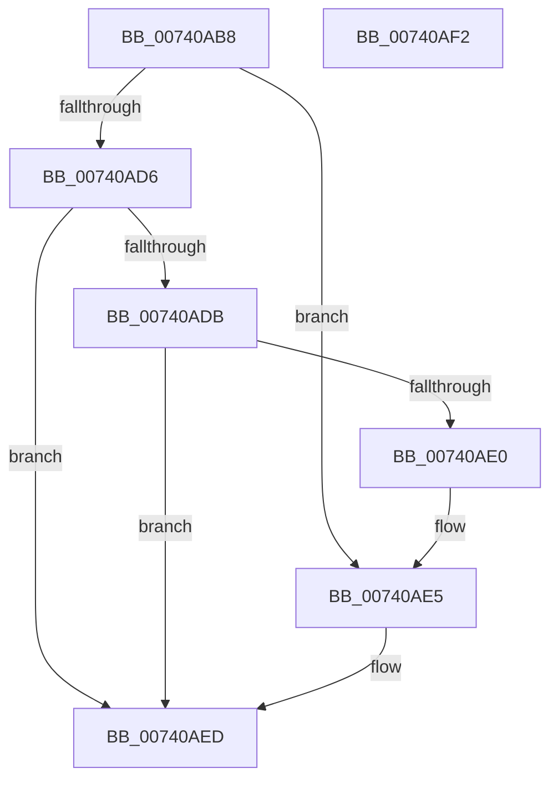

# PiAuditDeviceEnableDisableRequest

- RVA: `0x00740AB8`–`0x00740AF3` (길이 `59` bytes)
- VA: `0x0000000140740AB8`
- 실행 섹션: `PAGE`
- PDB 이름 있음: `예`; PDB Function 태그: `아니요`
- unwind 정보 RVA: `0x0005C788`
- 디코드: `19`개 명령, `59/59` bytes 표시
- 미해석 바이트: `0` (있으면 어셈블리에 `.byte`로 보존)

> 이 문서는 커널 이미지의 기계어와 PDB 기호를 분석해 생성했습니다. 4번과 5번은 함수 원형과 자료형을 바이너리 사용 방식에서 추정한 C 해석이며 원본 소스 복구 결과는 아닙니다.

## 1. Dependencies

- 직접 호출 지점: **1**; 고유 호출 대상: **1**
- 직접 호출자로 확인된 함수: **3**
- RIP 상대 이미지 참조: **0**

### Outgoing calls
- `0x00740AE8` → [PiAuditDeviceOperation](../A8/PiAuditDeviceOperation_function_00A864DC.md) (function, `0x00A864DC`)

### Direct callers
- [PiPnpRtlSetDeviceRegProperty](../96/PiPnpRtlSetDeviceRegProperty_function_0096360C.md) at `0x00963761`
- [sub_00B1EBE0](../B1/Unknown_function_00B1EBE0.md) at `0x00B1EE8B`
- [sub_00B29934](../B2/Unknown_function_00B29934.md) at `0x00B29CCF`

### Static image references
- 디코드된 RIP-relative 메모리 참조가 없습니다.

## 2. Other-region calls and transfers

- 다른 실행 섹션으로 향하는 call: **0**
- 별도 외부 분기/꼬리 이동을 확인하지 못했습니다.

## 3. Assembly (complete function range)

```asm
00740AB8  48 83 EC 28                     sub rsp, 0x28
00740ABC  44 8B DA                        mov r11d, edx
00740ABF  BA 01 00 00 00                  mov edx, 1
00740AC4  44 84 DA                        test dl, r11b
00740AC7  41 0F 94 C2                     sete r10b
00740ACB  44 84 C2                        test dl, r8b
00740ACE  0F 95 C0                        setne al
00740AD1  44 84 D0                        test al, r10b
00740AD4  75 0F                           jne 0x140740ae5
00740AD6  44 84 DA                        test dl, r11b
00740AD9  74 12                           je 0x140740aed
00740ADB  44 84 C2                        test dl, r8b
00740ADE  75 0D                           jne 0x140740aed
00740AE0  BA 03 00 00 00                  mov edx, 3
00740AE5  45 8A C1                        mov r8b, r9b
00740AE8  E8 EF 59 34 00                  call 0x140a864dc
00740AED  48 83 C4 28                     add rsp, 0x28
00740AF1  C3                              ret
00740AF2  CC                              int3
```

## 4. C-style interpretation (structured pseudocode)

```c
__int64 __fastcall PiAuditDeviceEnableDisableRequest(__int64 a1, int a2, unsigned __int8 a3, unsigned __int8 a4)
{
    __int64 result;
    __int64 v_r10;
    __int64 v_rsp;

    v_rsp = (v_rsp) - (40);
    v_r10 = (((1) & ((unsigned __int8)((unsigned int)(a2)))) == 0) ? 1 : 0;
    result = (((1) & (a3)) != 0) ? 1 : 0;
    if ((((unsigned __int8)(result)) & ((unsigned __int8)(v_r10))) != 0) goto loc_00740AE5;
    if (((1) & ((unsigned __int8)((unsigned int)(a2)))) == 0) goto loc_00740AED;
    if (((1) & (a3)) != 0) goto loc_00740AED;
loc_00740AE5:
    result = PiAuditDeviceOperation(a1, 3, a4, a4);
loc_00740AED:
    v_rsp = (v_rsp) + (40);
    return result;
}
```

## 5. (Beta) C Style

```c
int64_t PiAuditDeviceEnableDisableRequest(int64_t Arg1, int32_t Arg2, uint8_t Arg3, uint8_t Arg4)
{
    int64_t result;
    int64_t local_r10;
    int64_t local_rsp;

    local_rsp = (local_rsp) - (40);
    local_r10 = (((1) & ((uint8_t)((uint32_t)(Arg2)))) == 0) ? 1 : 0;
    result = (((1) & (Arg3)) != 0) ? 1 : 0;
    if ((((uint8_t)(result)) & ((uint8_t)(local_r10))) != 0) goto loc_00740AE5;
    if (((1) & ((uint8_t)((uint32_t)(Arg2)))) == 0) goto loc_00740AED;
    if (((1) & (Arg3)) != 0) goto loc_00740AED;
loc_00740AE5:
    result = PiAuditDeviceOperation(Arg1, 3, Arg4, Arg4);
loc_00740AED:
    local_rsp = (local_rsp) + (40);
    return result;
}
```

## 6. Execution-region graph

[열기: 2D/3D 그래프와 함수 탐색 컨트롤 패널](../../../control-panel.html?section=page&rva=0x00740AB8&view=graph)

- 2D 그래프는 위에서 아래로 흐르고, 3D 그래프는 빈 공간을 드래그해 회전합니다. Shift+드래그는 이동, 휠은 확대·축소, 함수 노드 선택은 대상 보고서 이동입니다.

### Static fallback


