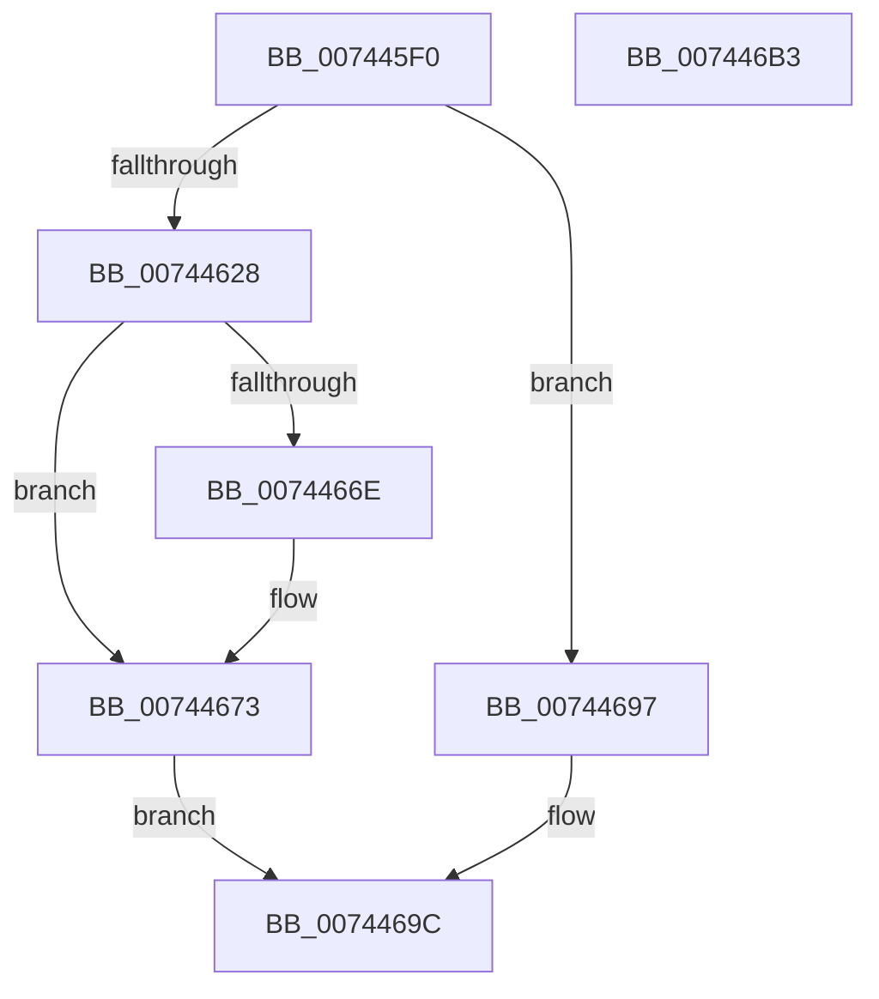

# PiDmaGuardQueueInsertEntry

- RVA: `0x007445F0`–`0x007446B4` (길이 `196` bytes)
- VA: `0x00000001407445F0`
- 실행 섹션: `PAGE`
- PDB 이름 있음: `예`; PDB Function 태그: `아니요`
- unwind 정보 RVA: `0x0005C954`
- 디코드: `49`개 명령, `196/196` bytes 표시
- 미해석 바이트: `0` (있으면 어셈블리에 `.byte`로 보존)

> 이 문서는 커널 이미지의 기계어와 PDB 기호를 분석해 생성했습니다. 4번과 5번은 함수 원형과 자료형을 바이너리 사용 방식에서 추정한 C 해석이며 원본 소스 복구 결과는 아닙니다.

## 1. Dependencies

- 직접 호출 지점: **5**; 고유 호출 대상: **5**
- 직접 호출자로 확인된 함수: **2**
- RIP 상대 이미지 참조: **4**

### Outgoing calls
- `0x00744619` → [ExAllocatePool2](../../poolcode/B8/ExAllocatePool2_function_00B820F0.md) (function, `0x00B820F0`)
- `0x00744630` → [ObfReferenceObjectWithTag](../../text/21/ObfReferenceObjectWithTag_function_00210710.md) (function, `0x00210710`)
- `0x00744656` → [ExAcquireResourceExclusiveLite](../../text/21/ExAcquireResourceExclusiveLite_function_00214E20.md) (function, `0x00214E20`)
- `0x0074468B` → [ExReleaseResourceLite](../../text/25/ExReleaseResourceLite_function_0025FA10.md) (function, `0x0025FA10`)
- `0x00744690` → [KeLeaveCriticalRegion](../../text/25/KeLeaveCriticalRegion_function_0025D8B0.md) (function, `0x0025D8B0`)

### Direct callers
- [PipDmgEnforceEnumerationPolicy](../73/PipDmgEnforceEnumerationPolicy_function_0073BEB4.md) at `0x0073BF6E`
- [PiDmaGuardProcessPostRemove](../AA/PiDmaGuardProcessPostRemove_function_00AA3D40.md) at `0x00AA3DAB`

### Static image references
- `0x0074464E` → RVA `0x00F8A800` (`.data`; read)
- `0x0074465B` → RVA `0x00F8A7F8` (`.data`; read)
- `0x00744662` → RVA `0x00F8A7F0` (`.data`; read)
- `0x00744684` → RVA `0x00F8A7F8` (`.data`; write)

## 2. Other-region calls and transfers

- 다른 실행 섹션으로 향하는 call: **5**
  - `0x00744619` → [ExAllocatePool2](../../poolcode/B8/ExAllocatePool2_function_00B820F0.md) (`PAGE` → `POOLCODE`)
  - `0x00744630` → [ObfReferenceObjectWithTag](../../text/21/ObfReferenceObjectWithTag_function_00210710.md) (`PAGE` → `.text`)
  - `0x00744656` → [ExAcquireResourceExclusiveLite](../../text/21/ExAcquireResourceExclusiveLite_function_00214E20.md) (`PAGE` → `.text`)
  - `0x0074468B` → [ExReleaseResourceLite](../../text/25/ExReleaseResourceLite_function_0025FA10.md) (`PAGE` → `.text`)
  - `0x00744690` → [KeLeaveCriticalRegion](../../text/25/KeLeaveCriticalRegion_function_0025D8B0.md) (`PAGE` → `.text`)
- 별도 외부 분기/꼬리 이동을 확인하지 못했습니다.

## 3. Assembly (complete function range)

```asm
007445F0  48 89 5C 24 08                  mov qword ptr [rsp + 8], rbx
007445F5  48 89 6C 24 10                  mov qword ptr [rsp + 0x10], rbp
007445FA  48 89 74 24 18                  mov qword ptr [rsp + 0x18], rsi
007445FF  57                              push rdi
00744600  48 83 EC 20                     sub rsp, 0x20
00744604  8B EA                           mov ebp, edx
00744606  48 8B F1                        mov rsi, rcx
00744609  BA 20 00 00 00                  mov edx, 0x20
0074460E  B9 00 01 00 00                  mov ecx, 0x100
00744613  41 B8 50 6E 70 64               mov r8d, 0x64706e50
00744619  E8 D2 DA 43 00                  call 0x140b820f0
0074461E  33 FF                           xor edi, edi
00744620  48 8B D8                        mov rbx, rax
00744623  48 85 C0                        test rax, rax
00744626  74 6F                           je 0x140744697
00744628  BA 50 6E 70 64                  mov edx, 0x64706e50
0074462D  48 8B CE                        mov rcx, rsi
00744630  E8 DB C0 AC FF                  call 0x140210710
00744635  48 89 73 10                     mov qword ptr [rbx + 0x10], rsi
00744639  B2 01                           mov dl, 1
0074463B  89 6B 18                        mov dword ptr [rbx + 0x18], ebp
0074463E  65 48 8B 0C 25 88 01 00 00      mov rcx, qword ptr gs:[0x188]
00744647  66 FF 89 E4 01 00 00            dec word ptr [rcx + 0x1e4]
0074464E  48 8D 0D AB 61 84 00            lea rcx, [rip + 0x8461ab]
00744655  90                              nop
00744656  E8 C5 07 AD FF                  call 0x140214e20
0074465B  48 8B 05 96 61 84 00            mov rax, qword ptr [rip + 0x846196]
00744662  48 8D 0D 87 61 84 00            lea rcx, [rip + 0x846187]
00744669  48 39 08                        cmp qword ptr [rax], rcx
0074466C  74 05                           je 0x140744673
0074466E  8D 4F 03                        lea ecx, [rdi + 3]
00744671  CD 29                           int 0x29
00744673  48 89 0B                        mov qword ptr [rbx], rcx
00744676  48 8D 0D 83 61 84 00            lea rcx, [rip + 0x846183]
0074467D  48 89 43 08                     mov qword ptr [rbx + 8], rax
00744681  48 89 18                        mov qword ptr [rax], rbx
00744684  48 89 1D 6D 61 84 00            mov qword ptr [rip + 0x84616d], rbx
0074468B  E8 80 B3 B1 FF                  call 0x14025fa10
00744690  E8 1B 92 B1 FF                  call 0x14025d8b0
00744695  EB 05                           jmp 0x14074469c
00744697  BF 9A 00 00 C0                  mov edi, 0xc000009a
0074469C  48 8B 5C 24 30                  mov rbx, qword ptr [rsp + 0x30]
007446A1  8B C7                           mov eax, edi
007446A3  48 8B 6C 24 38                  mov rbp, qword ptr [rsp + 0x38]
007446A8  48 8B 74 24 40                  mov rsi, qword ptr [rsp + 0x40]
007446AD  48 83 C4 20                     add rsp, 0x20
007446B1  5F                              pop rdi
007446B2  C3                              ret
007446B3  CC                              int3
```

## 4. C-style interpretation (structured pseudocode)

```c
__int64 __fastcall PiDmaGuardQueueInsertEntry(__int64 a1, int a2)
{
    __int64 result;
    __int64 v_rdi;
    __int64 v_rsp;
    unsigned __int64 v_stack_p10;
    unsigned __int64 v_stack_p18;
    unsigned __int64 v_stack_p8;

    v_stack_p8 = v_rbx;
    v_stack_p10 = v_rbp;
    v_stack_p18 = v_rsi;
    v_rsp = (v_rsp) - (32);
    result = ExAllocatePool2(256, 32, (unsigned int)(0x64706E50ULL), a4);
    v_rdi = 0;
    if (result == 0) goto loc_00744697;
    result = ObfReferenceObjectWithTag(a1, (unsigned int)(0x64706E50ULL), (unsigned int)(0x64706E50ULL), a4);
    *(unsigned __int64 *)(result + 16) = a1;
    *(unsigned int *)(result + 24) = (unsigned int)((unsigned int)(a2));
    result = ExAcquireResourceExclusiveLite(v_rip + 8675755, 1, (unsigned int)(0x64706E50ULL), a4);
    if ((*(unsigned __int64 *)(*(unsigned __int64 *)(v_rip + 8675734))) != (v_rip + 8675719)) {
        a1 = v_rdi + 3;
    }
    *(unsigned __int64 *)(result) = a1;
    *(unsigned __int64 *)(result + 8) = *(unsigned __int64 *)(v_rip + 8675734);
    *(unsigned __int64 *)(*(unsigned __int64 *)(v_rip + 8675734)) = result;
    *(unsigned __int64 *)(v_rip + 8675693) = result;
    result = ExReleaseResourceLite(v_rip + 8675715, 1, (unsigned int)(0x64706E50ULL), a4);
    result = KeLeaveCriticalRegion(v_rip + 8675715, 1, (unsigned int)(0x64706E50ULL), a4);
    goto loc_0074469C;
loc_00744697:
loc_0074469C:
    v_rsp = (v_rsp) + (32);
    return (unsigned int)((unsigned int)((unsigned int)(0xC000009AULL)));
}
```

## 5. (Beta) C Style

```c
int64_t PiDmaGuardQueueInsertEntry(int64_t Arg1, int32_t Arg2)
{
    int64_t result;
    int64_t local_rdi;
    int64_t local_rsp;
    uint64_t v_stack_p10;
    uint64_t v_stack_p18;
    uint64_t v_stack_p8;

    v_stack_p8 = local_rbx;
    v_stack_p10 = local_rbp;
    v_stack_p18 = local_rsi;
    local_rsp = (local_rsp) - (32);
    result = ExAllocatePool2(256, 32, (uint32_t)(0x64706E50ULL), a4);
    local_rdi = 0;
    if (result == 0) goto loc_00744697;
    result = ObfReferenceObjectWithTag(Arg1, (uint32_t)(0x64706E50ULL), (uint32_t)(0x64706E50ULL), a4);
    *(uint64_t *)(result + 0x10) = Arg1;
    *(uint32_t *)(result + 0x18) = (uint32_t)((uint32_t)(Arg2));
    result = ExAcquireResourceExclusiveLite(v_rip + 8675755, 1, (uint32_t)(0x64706E50ULL), a4);
    if ((*(uint64_t *)(*(uint64_t *)(v_rip + 0x846196))) != (v_rip + 8675719)) {
        Arg1 = local_rdi + 3;
    }
    *(uint64_t *)(result) = Arg1;
    *(uint64_t *)(result + 0x8) = *(uint64_t *)(v_rip + 0x846196);
    *(uint64_t *)(*(uint64_t *)(v_rip + 0x846196)) = result;
    *(uint64_t *)(v_rip + 0x84616D) = result;
    result = ExReleaseResourceLite(v_rip + 8675715, 1, (uint32_t)(0x64706E50ULL), a4);
    result = KeLeaveCriticalRegion(v_rip + 8675715, 1, (uint32_t)(0x64706E50ULL), a4);
    goto loc_0074469C;
loc_00744697:
loc_0074469C:
    local_rsp = (local_rsp) + (32);
    return (uint32_t)((uint32_t)((uint32_t)(0xC000009AULL)));
}
```

## 6. Execution-region graph

[열기: 2D/3D 그래프와 함수 탐색 컨트롤 패널](../../../control-panel.html?section=page&rva=0x007445F0&view=graph)

- 2D 그래프는 위에서 아래로 흐르고, 3D 그래프는 빈 공간을 드래그해 회전합니다. Shift+드래그는 이동, 휠은 확대·축소, 함수 노드 선택은 대상 보고서 이동입니다.

### Static fallback


