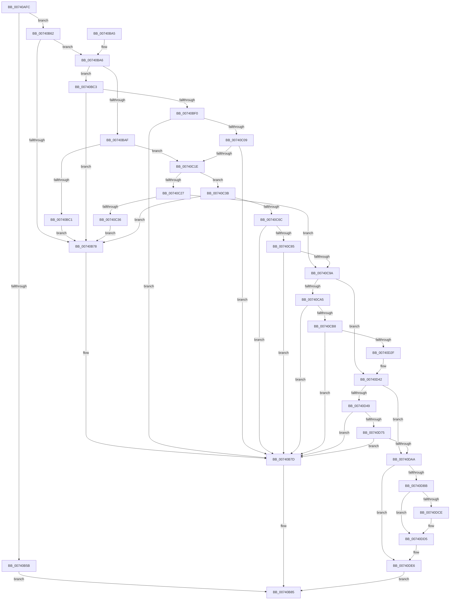

# PiDrvDbCreateNode

- RVA: `0x00740AFC`–`0x00740DF2` (길이 `758` bytes)
- VA: `0x0000000140740AFC`
- 실행 섹션: `PAGE`
- PDB 이름 있음: `예`; PDB Function 태그: `아니요`
- unwind 정보 RVA: `0x000C93C8`
- 디코드: `199`개 명령, `758/758` bytes 표시
- 미해석 바이트: `0` (있으면 어셈블리에 `.byte`로 보존)

> 이 문서는 커널 이미지의 기계어와 PDB 기호를 분석해 생성했습니다. 4번과 5번은 함수 원형과 자료형을 바이너리 사용 방식에서 추정한 C 해석이며 원본 소스 복구 결과는 아닙니다.

## 1. Dependencies

- 직접 호출 지점: **18**; 고유 호출 대상: **10**
- 직접 호출자로 확인된 함수: **1**
- RIP 상대 이미지 참조: **7**

### Outgoing calls
- `0x00740B4E` → [ExAllocatePool2](../../poolcode/B8/ExAllocatePool2_function_00B820F0.md) (function, `0x00B820F0`)
- `0x00740B6F` → [RtlCreateUnicodeString](../9B/RtlCreateUnicodeString_function_009BD860.md) (function, `0x009BD860`)
- `0x00740B80` → [PiDrvDbDestroyNode](PiDrvDbDestroyNode_function_00740DF8.md) (function, `0x00740DF8`)
- `0x00740BB5` → [RtlCreateUnicodeString](../9B/RtlCreateUnicodeString_function_009BD860.md) (function, `0x009BD860`)
- `0x00740BE2` → [ExAllocatePool2](../../poolcode/B8/ExAllocatePool2_function_00B820F0.md) (function, `0x00B820F0`)
- `0x00740BFA` → [RtlAppendUnicodeToString](../../text/40/RtlAppendUnicodeToString_function_0040F990.md) (function, `0x0040F990`)
- `0x00740C0F` → [RtlAppendUnicodeToString](../../text/40/RtlAppendUnicodeToString_function_0040F990.md) (function, `0x0040F990`)
- `0x00740C2D` → [RtlCreateUnicodeString](../9B/RtlCreateUnicodeString_function_009BD860.md) (function, `0x009BD860`)
- `0x00740C5A` → [ExAllocatePool2](../../poolcode/B8/ExAllocatePool2_function_00B820F0.md) (function, `0x00B820F0`)
- `0x00740C76` → [RtlAppendUnicodeToString](../../text/40/RtlAppendUnicodeToString_function_0040F990.md) (function, `0x0040F990`)
- `0x00740C8B` → [RtlAppendUnicodeToString](../../text/40/RtlAppendUnicodeToString_function_0040F990.md) (function, `0x0040F990`)
- `0x00740CA9` → [ExInitializeResourceLite](../../text/41/ExInitializeResourceLite_function_0041F9A0.md) (function, `0x0041F9A0`)
- `0x00740CC8` → [KeInitializeTimerEx](../../text/45/KeInitializeTimerEx_function_004563F0.md) (function, `0x004563F0`)
- `0x00740CDE` → [KeInitializeDpc](../../text/45/KeInitializeDpc_function_0045BBD0.md) (function, `0x0045BBD0`)
- `0x00740D20` → [ZwCreateEvent](../../text/6A/ZwCreateEvent_function_006AD9D0.md) (function, `0x006AD9D0`)
- `0x00740D66` → [PnpCtxRegOpenKey](../8E/PnpCtxRegOpenKey_function_008EF7B8.md) (function, `0x008EF7B8`)
- `0x00740D92` → [PnpCtxRegOpenKey](../8E/PnpCtxRegOpenKey_function_008EF7B8.md) (function, `0x008EF7B8`)
- `0x00740D9D` → [ZwClose](../../text/6A/ZwClose_function_006AD2B0.md) (function, `0x006AD2B0`)

### Direct callers
- [PiDrvDbRegisterNode](PiDrvDbRegisterNode_function_00742658.md) at `0x007426ED`

### Static image references
- `0x00740BF0` → RVA `0x00B003E0` (` ?? ::NNGAKEGL::`string'`; read)
- `0x00740C6C` → RVA `0x00B00410` (` ?? ::NNGAKEGL::`string'`; read)
- `0x00740CD7` → RVA `0x004CFF40` (`PiDrvDbUnloadNodeDpcRoutine`; read)
- `0x00740D82` → RVA `0x00B00330` (` ?? ::NNGAKEGL::`string'`; read)
- `0x00740DBB` → RVA `0x00F8A878` (`.data`; read)
- `0x00740DC2` → RVA `0x00F8A870` (`.data`; read)
- `0x00740DDF` → RVA `0x00F8A878` (`.data`; write)

## 2. Other-region calls and transfers

- 다른 실행 섹션으로 향하는 call: **12**
  - `0x00740B4E` → [ExAllocatePool2](../../poolcode/B8/ExAllocatePool2_function_00B820F0.md) (`PAGE` → `POOLCODE`)
  - `0x00740BE2` → [ExAllocatePool2](../../poolcode/B8/ExAllocatePool2_function_00B820F0.md) (`PAGE` → `POOLCODE`)
  - `0x00740BFA` → [RtlAppendUnicodeToString](../../text/40/RtlAppendUnicodeToString_function_0040F990.md) (`PAGE` → `.text`)
  - `0x00740C0F` → [RtlAppendUnicodeToString](../../text/40/RtlAppendUnicodeToString_function_0040F990.md) (`PAGE` → `.text`)
  - `0x00740C5A` → [ExAllocatePool2](../../poolcode/B8/ExAllocatePool2_function_00B820F0.md) (`PAGE` → `POOLCODE`)
  - `0x00740C76` → [RtlAppendUnicodeToString](../../text/40/RtlAppendUnicodeToString_function_0040F990.md) (`PAGE` → `.text`)
  - `0x00740C8B` → [RtlAppendUnicodeToString](../../text/40/RtlAppendUnicodeToString_function_0040F990.md) (`PAGE` → `.text`)
  - `0x00740CA9` → [ExInitializeResourceLite](../../text/41/ExInitializeResourceLite_function_0041F9A0.md) (`PAGE` → `.text`)
  - `0x00740CC8` → [KeInitializeTimerEx](../../text/45/KeInitializeTimerEx_function_004563F0.md) (`PAGE` → `.text`)
  - `0x00740CDE` → [KeInitializeDpc](../../text/45/KeInitializeDpc_function_0045BBD0.md) (`PAGE` → `.text`)
  - `0x00740D20` → [ZwCreateEvent](../../text/6A/ZwCreateEvent_function_006AD9D0.md) (`PAGE` → `.text`)
  - `0x00740D9D` → [ZwClose](../../text/6A/ZwClose_function_006AD2B0.md) (`PAGE` → `.text`)
- 별도 외부 분기/꼬리 이동을 확인하지 못했습니다.

## 3. Assembly (complete function range)

```asm
00740AFC  48 89 5C 24 08                  mov qword ptr [rsp + 8], rbx
00740B01  48 89 74 24 10                  mov qword ptr [rsp + 0x10], rsi
00740B06  48 89 7C 24 18                  mov qword ptr [rsp + 0x18], rdi
00740B0B  55                              push rbp
00740B0C  41 54                           push r12
00740B0E  41 55                           push r13
00740B10  41 56                           push r14
00740B12  41 57                           push r15
00740B14  48 8B EC                        mov rbp, rsp
00740B17  48 83 EC 70                     sub rsp, 0x70
00740B1B  33 C0                           xor eax, eax
00740B1D  0F 57 C0                        xorps xmm0, xmm0
00740B20  48 21 45 C0                     and qword ptr [rbp - 0x40], rax
00740B24  4D 8B F8                        mov r15, r8
00740B27  8B F2                           mov esi, edx
00740B29  48 89 45 E8                     mov qword ptr [rbp - 0x18], rax
00740B2D  4C 8B F1                        mov r14, rcx
00740B30  89 45 F0                        mov dword ptr [rbp - 0x10], eax
00740B33  33 DB                           xor ebx, ebx
00740B35  BA 08 02 00 00                  mov edx, 0x208
00740B3A  41 B8 50 70 64 62               mov r8d, 0x62647050
00740B40  4D 8B E1                        mov r12, r9
00740B43  0F 11 45 C8                     movups xmmword ptr [rbp - 0x38], xmm0
00740B47  8D 4B 40                        lea ecx, [rbx + 0x40]
00740B4A  0F 11 45 D8                     movups xmmword ptr [rbp - 0x28], xmm0
00740B4E  E8 9D 15 44 00                  call 0x140b820f0
00740B53  48 8B F8                        mov rdi, rax
00740B56  48 85 C0                        test rax, rax
00740B59  75 07                           jne 0x140740b62
00740B5B  BB 9A 00 00 C0                  mov ebx, 0xc000009a
00740B60  EB 23                           jmp 0x140740b85
00740B62  4C 8D 68 10                     lea r13, [rax + 0x10]
00740B66  89 70 40                        mov dword ptr [rax + 0x40], esi
00740B69  49 8B CD                        mov rcx, r13
00740B6C  49 8B D6                        mov rdx, r14
00740B6F  E8 EC CC 27 00                  call 0x1409bd860
00740B74  84 C0                           test al, al
00740B76  75 2E                           jne 0x140740ba6
00740B78  BB 9A 00 00 C0                  mov ebx, 0xc000009a
00740B7D  48 8B CF                        mov rcx, rdi
00740B80  E8 73 02 00 00                  call 0x140740df8
00740B85  4C 8D 5C 24 70                  lea r11, [rsp + 0x70]
00740B8A  8B C3                           mov eax, ebx
00740B8C  49 8B 5B 30                     mov rbx, qword ptr [r11 + 0x30]
00740B90  49 8B 73 38                     mov rsi, qword ptr [r11 + 0x38]
00740B94  49 8B 7B 40                     mov rdi, qword ptr [r11 + 0x40]
00740B98  49 8B E3                        mov rsp, r11
00740B9B  41 5F                           pop r15
00740B9D  41 5E                           pop r14
00740B9F  41 5D                           pop r13
00740BA1  41 5C                           pop r12
00740BA3  5D                              pop rbp
00740BA4  C3                              ret
00740BA5  CC                              int3
00740BA6  48 8D 77 20                     lea rsi, [rdi + 0x20]
00740BAA  4D 85 FF                        test r15, r15
00740BAD  74 14                           je 0x140740bc3
00740BAF  49 8B D7                        mov rdx, r15
00740BB2  48 8B CE                        mov rcx, rsi
00740BB5  E8 A6 CC 27 00                  call 0x1409bd860
00740BBA  45 33 FF                        xor r15d, r15d
00740BBD  84 C0                           test al, al
00740BBF  75 5D                           jne 0x140740c1e
00740BC1  EB B5                           jmp 0x140740b78
00740BC3  41 0F B7 45 00                  movzx eax, word ptr [r13]
00740BC8  B9 00 01 00 00                  mov ecx, 0x100
00740BCD  66 83 C0 26                     add ax, 0x26
00740BD1  66 44 89 3E                     mov word ptr [rsi], r15w
00740BD5  0F B7 D0                        movzx edx, ax
00740BD8  41 B8 53 74 72 67               mov r8d, 0x67727453
00740BDE  66 89 57 22                     mov word ptr [rdi + 0x22], dx
00740BE2  E8 09 15 44 00                  call 0x140b820f0
00740BE7  48 89 47 28                     mov qword ptr [rdi + 0x28], rax
00740BEB  48 85 C0                        test rax, rax
00740BEE  74 88                           je 0x140740b78
00740BF0  48 8D 15 E9 F7 3B 00            lea rdx, [rip + 0x3bf7e9]
00740BF7  48 8B CE                        mov rcx, rsi
00740BFA  E8 91 ED CC FF                  call 0x14040f990
00740BFF  8B D8                           mov ebx, eax
00740C01  85 C0                           test eax, eax
00740C03  0F 88 74 FF FF FF               js 0x140740b7d
00740C09  49 8B D6                        mov rdx, r14
00740C0C  48 8B CE                        mov rcx, rsi
00740C0F  E8 7C ED CC FF                  call 0x14040f990
00740C14  8B D8                           mov ebx, eax
00740C16  85 C0                           test eax, eax
00740C18  0F 88 5F FF FF FF               js 0x140740b7d
00740C1E  48 8D 77 30                     lea rsi, [rdi + 0x30]
00740C22  4D 85 E4                        test r12, r12
00740C25  74 14                           je 0x140740c3b
00740C27  49 8B D4                        mov rdx, r12
00740C2A  48 8B CE                        mov rcx, rsi
00740C2D  E8 2E CC 27 00                  call 0x1409bd860
00740C32  84 C0                           test al, al
00740C34  75 64                           jne 0x140740c9a
00740C36  E9 3D FF FF FF                  jmp 0x140740b78
00740C3B  41 0F B7 45 00                  movzx eax, word ptr [r13]
00740C40  B9 00 01 00 00                  mov ecx, 0x100
00740C45  66 83 C0 3A                     add ax, 0x3a
00740C49  66 44 89 3E                     mov word ptr [rsi], r15w
00740C4D  0F B7 D0                        movzx edx, ax
00740C50  41 B8 53 74 72 67               mov r8d, 0x67727453
00740C56  66 89 57 32                     mov word ptr [rdi + 0x32], dx
00740C5A  E8 91 14 44 00                  call 0x140b820f0
00740C5F  48 89 47 38                     mov qword ptr [rdi + 0x38], rax
00740C63  48 85 C0                        test rax, rax
00740C66  0F 84 0C FF FF FF               je 0x140740b78
00740C6C  48 8D 15 9D F7 3B 00            lea rdx, [rip + 0x3bf79d]
00740C73  48 8B CE                        mov rcx, rsi
00740C76  E8 15 ED CC FF                  call 0x14040f990
00740C7B  8B D8                           mov ebx, eax
00740C7D  85 C0                           test eax, eax
00740C7F  0F 88 F8 FE FF FF               js 0x140740b7d
00740C85  49 8B D6                        mov rdx, r14
00740C88  48 8B CE                        mov rcx, rsi
00740C8B  E8 00 ED CC FF                  call 0x14040f990
00740C90  8B D8                           mov ebx, eax
00740C92  85 C0                           test eax, eax
00740C94  0F 88 E3 FE FF FF               js 0x140740b7d
00740C9A  8B 47 40                        mov eax, dword ptr [rdi + 0x40]
00740C9D  A8 04                           test al, 4
00740C9F  0F 84 9D 00 00 00               je 0x140740d42
00740CA5  48 8D 4F 58                     lea rcx, [rdi + 0x58]
00740CA9  E8 F2 EC CD FF                  call 0x14041f9a0
00740CAE  8B D8                           mov ebx, eax
00740CB0  85 C0                           test eax, eax
00740CB2  0F 88 C5 FE FF FF               js 0x140740b7d
00740CB8  48 8D 8F 08 01 00 00            lea rcx, [rdi + 0x108]
00740CBF  C6 87 C0 00 00 00 01            mov byte ptr [rdi + 0xc0], 1
00740CC6  33 D2                           xor edx, edx
00740CC8  E8 23 57 D1 FF                  call 0x1404563f0
00740CCD  48 8D 8F 48 01 00 00            lea rcx, [rdi + 0x148]
00740CD4  4C 8B C7                        mov r8, rdi
00740CD7  48 8D 15 62 F2 D8 FF            lea rdx, [rip - 0x270d9e]
00740CDE  E8 ED AE D1 FF                  call 0x14045bbd0
00740CE3  4C 89 BF A8 01 00 00            mov qword ptr [rdi + 0x1a8], r15
00740CEA  48 8D 8F D8 01 00 00            lea rcx, [rdi + 0x1d8]
00740CF1  0F 57 C0                        xorps xmm0, xmm0
00740CF4  C7 45 C8 30 00 00 00            mov dword ptr [rbp - 0x38], 0x30
00740CFB  45 33 C9                        xor r9d, r9d
00740CFE  4C 89 7D D0                     mov qword ptr [rbp - 0x30], r15
00740D02  4C 8D 45 C8                     lea r8, [rbp - 0x38]
00740D06  C7 45 E0 00 02 00 00            mov dword ptr [rbp - 0x20], 0x200
00740D0D  BA 03 00 1F 00                  mov edx, 0x1f0003
00740D12  4C 89 7D D8                     mov qword ptr [rbp - 0x28], r15
00740D16  F3 0F 7F 45 E8                  movdqu xmmword ptr [rbp - 0x18], xmm0
00740D1B  C6 44 24 20 01                  mov byte ptr [rsp + 0x20], 1
00740D20  E8 AB CC F6 FF                  call 0x1406ad9d0
00740D25  8B D8                           mov ebx, eax
00740D27  85 C0                           test eax, eax
00740D29  0F 88 4E FE FF FF               js 0x140740b7d
00740D2F  B8 FF FF FF FF                  mov eax, 0xffffffff
00740D34  C6 87 E9 01 00 00 01            mov byte ptr [rdi + 0x1e9], 1
00740D3B  48 89 87 E0 01 00 00            mov qword ptr [rdi + 0x1e0], rax
00740D42  8B 47 40                        mov eax, dword ptr [rdi + 0x40]
00740D45  A8 10                           test al, 0x10
00740D47  74 61                           je 0x140740daa
00740D49  4C 8B 47 28                     mov r8, qword ptr [rdi + 0x28]
00740D4D  48 8D 45 C0                     lea rax, [rbp - 0x40]
00740D51  48 89 44 24 28                  mov qword ptr [rsp + 0x28], rax
00740D56  BE 00 00 00 02                  mov esi, 0x2000000
00740D5B  45 33 C9                        xor r9d, r9d
00740D5E  89 74 24 20                     mov dword ptr [rsp + 0x20], esi
00740D62  33 D2                           xor edx, edx
00740D64  33 C9                           xor ecx, ecx
00740D66  E8 4D EA 1A 00                  call 0x1408ef7b8
00740D6B  8B D8                           mov ebx, eax
00740D6D  85 C0                           test eax, eax
00740D6F  0F 88 08 FE FF FF               js 0x140740b7d
00740D75  48 8B 55 C0                     mov rdx, qword ptr [rbp - 0x40]
00740D79  48 8D 47 48                     lea rax, [rdi + 0x48]
00740D7D  48 89 44 24 28                  mov qword ptr [rsp + 0x28], rax
00740D82  4C 8D 05 A7 F5 3B 00            lea r8, [rip + 0x3bf5a7]
00740D89  45 33 C9                        xor r9d, r9d
00740D8C  89 74 24 20                     mov dword ptr [rsp + 0x20], esi
00740D90  33 C9                           xor ecx, ecx
00740D92  E8 21 EA 1A 00                  call 0x1408ef7b8
00740D97  48 8B 4D C0                     mov rcx, qword ptr [rbp - 0x40]
00740D9B  8B D8                           mov ebx, eax
00740D9D  E8 0E C5 F6 FF                  call 0x1406ad2b0
00740DA2  85 DB                           test ebx, ebx
00740DA4  0F 88 D3 FD FF FF               js 0x140740b7d
00740DAA  8B 47 40                        mov eax, dword ptr [rdi + 0x40]
00740DAD  C7 87 F0 01 00 00 03 01 00 00   mov dword ptr [rdi + 0x1f0], 0x103
00740DB7  A8 40                           test al, 0x40
00740DB9  75 2B                           jne 0x140740de6
00740DBB  48 8B 05 B6 9A 84 00            mov rax, qword ptr [rip + 0x849ab6]
00740DC2  48 8D 0D A7 9A 84 00            lea rcx, [rip + 0x849aa7]
00740DC9  48 39 08                        cmp qword ptr [rax], rcx
00740DCC  74 07                           je 0x140740dd5
00740DCE  B9 03 00 00 00                  mov ecx, 3
00740DD3  CD 29                           int 0x29
00740DD5  48 89 0F                        mov qword ptr [rdi], rcx
00740DD8  48 89 47 08                     mov qword ptr [rdi + 8], rax
00740DDC  48 89 38                        mov qword ptr [rax], rdi
00740DDF  48 89 3D 92 9A 84 00            mov qword ptr [rip + 0x849a92], rdi
00740DE6  48 8B 45 50                     mov rax, qword ptr [rbp + 0x50]
00740DEA  48 89 38                        mov qword ptr [rax], rdi
00740DED  E9 93 FD FF FF                  jmp 0x140740b85
```

## 4. C-style interpretation (structured pseudocode)

```c
__int64 __fastcall PiDrvDbCreateNode(__int64 a1, int a2, __int64 a3, __int64 a4, __int64 a5)
{
    __int64 result;
    __int64 v_r15;
    __int64 v_rbx;
    __int64 v_rsp;
    unsigned __int64 v_stack_m28;
    unsigned int v_stack_m38;
    unsigned __int64 v_stack_m40;
    unsigned int v_stack_m48;
    unsigned __int64 v_stack_m50;
    unsigned __int64 v_stack_m58;
    unsigned __int64 v_stack_m60;
    unsigned __int64 v_stack_m68;
    unsigned __int64 v_stack_p10;
    unsigned __int64 v_stack_p18;
    unsigned __int64 v_stack_p8;

    v_stack_p8 = v_rbx;
    v_stack_p10 = v_rsi;
    v_stack_p18 = v_rdi;
    v_rsp = (v_rsp) - (112);
    result = 0;
    v_stack_m40 = 0;
    v_stack_m38 = 0;
    v_rbx = 0;
    v_stack_m60 = v_xmm0;
    v_stack_m50 = v_xmm0;
    result = ExAllocatePool2(v_rbx + 64, 520, (unsigned int)(0x62647050ULL), a4);
    if (result != 0) goto loc_00740B62;
    goto loc_00740B85;
loc_00740B62:
    *(unsigned int *)(result + 64) = (unsigned int)((unsigned int)(a2));
    result = RtlCreateUnicodeString(result + 16, a1, (unsigned int)(0x62647050ULL), a4);
    if ((unsigned __int8)(result) != 0) goto loc_00740BA6;
loc_00740B78:
loc_00740B7D:
    result = PiDrvDbDestroyNode(result, a1, (unsigned int)(0x62647050ULL), a4);
loc_00740B85:
    return (unsigned int)((unsigned int)((unsigned int)(0xC000009AULL)));
loc_00740BA6:
    if (a3 == 0) goto loc_00740BC3;
    result = RtlCreateUnicodeString(*(unsigned __int64 *)(v_stack_m28 + 64) + 32, a3, (unsigned int)(0x62647050ULL), a4);
    v_r15 = 0;
    if ((unsigned __int8)(result) != 0) goto loc_00740C1E;
    goto loc_00740B78;
loc_00740BC3:
    result = (unsigned __int16)((*(unsigned __int16 *)(result + 16)) + (38));
    *(unsigned __int16 *)(*(unsigned __int64 *)(v_stack_m28 + 64) + 32) = 0;
    *(unsigned __int16 *)(*(unsigned __int64 *)(v_stack_m28 + 64) + 34) = (unsigned __int16)((unsigned __int16)(result));
    result = ExAllocatePool2(256, (unsigned __int16)(result), (unsigned int)(0x67727453ULL), a4);
    *(unsigned __int64 *)(*(unsigned __int64 *)(v_stack_m28 + 64) + 40) = result;
    if (result == 0) goto loc_00740B78;
    result = RtlAppendUnicodeToString(*(unsigned __int64 *)(v_stack_m28 + 64) + 32, v_rip + 3930089, (unsigned int)(0x67727453ULL), a4);
    if (sign_flag) goto loc_00740B7D;
    result = RtlAppendUnicodeToString(*(unsigned __int64 *)(v_stack_m28 + 64) + 32, a1, (unsigned int)(0x67727453ULL), a4);
    if (sign_flag) goto loc_00740B7D;
loc_00740C1E:
    if (a4 == 0) goto loc_00740C3B;
    result = RtlCreateUnicodeString(*(unsigned __int64 *)(v_stack_m28 + 64) + 48, a4, (unsigned int)(0x67727453ULL), a4);
    if ((unsigned __int8)(result) != 0) goto loc_00740C9A;
    goto loc_00740B78;
loc_00740C3B:
    result = (unsigned __int16)((*(unsigned __int16 *)(result + 16)) + (58));
    *(unsigned __int16 *)(*(unsigned __int64 *)(v_stack_m28 + 64) + 48) = 0;
    *(unsigned __int16 *)(*(unsigned __int64 *)(v_stack_m28 + 64) + 50) = (unsigned __int16)((unsigned __int16)(result));
    result = ExAllocatePool2(256, (unsigned __int16)(result), (unsigned int)(0x67727453ULL), a4);
    *(unsigned __int64 *)(*(unsigned __int64 *)(v_stack_m28 + 64) + 56) = result;
    if (result == 0) goto loc_00740B78;
    result = RtlAppendUnicodeToString(*(unsigned __int64 *)(v_stack_m28 + 64) + 48, v_rip + 3930013, (unsigned int)(0x67727453ULL), a4);
    if (sign_flag) goto loc_00740B7D;
    result = RtlAppendUnicodeToString(*(unsigned __int64 *)(v_stack_m28 + 64) + 48, a1, (unsigned int)(0x67727453ULL), a4);
    if (sign_flag) goto loc_00740B7D;
loc_00740C9A:
    if ((((unsigned __int8)((unsigned int)(*(unsigned int *)(*(unsigned __int64 *)(v_stack_m28 + 64) + 64)))) & (4)) == 0) goto loc_00740D42;
    result = ExInitializeResourceLite(*(unsigned __int64 *)(v_stack_m28 + 64) + 88, a1, (unsigned int)(0x67727453ULL), a4);
    if (sign_flag) goto loc_00740B7D;
    *(unsigned __int8 *)(*(unsigned __int64 *)(v_stack_m28 + 64) + 192) = 1;
    a2 = 0;
    result = KeInitializeTimerEx(*(unsigned __int64 *)(v_stack_m28 + 64) + 264, a2, (unsigned int)(0x67727453ULL), a4);
    result = KeInitializeDpc(*(unsigned __int64 *)(v_stack_m28 + 64) + 328, v_rip - 2559390, *(unsigned __int64 *)(v_stack_m28 + 64), a4);
    *(unsigned __int64 *)(*(unsigned __int64 *)(v_stack_m28 + 64) + 424) = 0;
    v_stack_m60 = 48;
    a4 = 0;
    v_stack_m58 = 0;
    v_stack_m48 = 512;
    v_stack_m50 = 0;
    v_stack_m40 = v_xmm0;
    v_stack_m50 = 1;
    result = ZwCreateEvent(*(unsigned __int64 *)(v_stack_m28 + 64) + 472, (unsigned int)(0x1F0003ULL), v_stack_m60, a4);
    if (sign_flag) goto loc_00740B7D;
    *(unsigned __int8 *)(*(unsigned __int64 *)(v_stack_m28 + 64) + 489) = 1;
    *(unsigned __int64 *)(*(unsigned __int64 *)(v_stack_m28 + 64) + 480) = (unsigned int)(0xFFFFFFFFULL);
loc_00740D42:
    if ((((unsigned __int8)((unsigned int)(*(unsigned int *)(*(unsigned __int64 *)(v_stack_m28 + 64) + 64)))) & (16)) == 0) goto loc_00740DAA;
    v_stack_m48 = v_stack_m68;
    a4 = 0;
    v_stack_m50 = (unsigned int)((unsigned int)(0x2000000ULL));
    a2 = 0;
    a1 = 0;
    result = PnpCtxRegOpenKey(a1, a2, *(unsigned __int64 *)(*(unsigned __int64 *)(v_stack_m28 + 64) + 40), a4);
    if (sign_flag) goto loc_00740B7D;
    v_stack_m48 = *(unsigned __int64 *)(v_stack_m28 + 64) + 72;
    a4 = 0;
    v_stack_m50 = (unsigned int)((unsigned int)(0x2000000ULL));
    a1 = 0;
    result = PnpCtxRegOpenKey(a1, v_stack_m68, v_rip + 3929511, a4);
    result = ZwClose(v_stack_m68, v_stack_m68, v_rip + 3929511, a4);
    if (sign_flag) goto loc_00740B7D;
loc_00740DAA:
    *(unsigned int *)(*(unsigned __int64 *)(v_stack_m28 + 64) + 496) = 259;
    if ((((unsigned __int8)((unsigned int)(*(unsigned int *)(*(unsigned __int64 *)(v_stack_m28 + 64) + 64)))) & (64)) != 0) goto loc_00740DE6;
    if ((*(unsigned __int64 *)(*(unsigned __int64 *)(v_rip + 8690358))) != (v_rip + 8690343)) {
        a1 = 3;
    }
    *(unsigned __int64 *)(*(unsigned __int64 *)(v_stack_m28 + 64)) = a1;
    *(unsigned __int64 *)(*(unsigned __int64 *)(v_stack_m28 + 64) + 8) = *(unsigned __int64 *)(v_rip + 8690358);
    *(unsigned __int64 *)(*(unsigned __int64 *)(v_rip + 8690358)) = *(unsigned __int64 *)(v_stack_m28 + 64);
    *(unsigned __int64 *)(v_rip + 8690322) = *(unsigned __int64 *)(v_stack_m28 + 64);
loc_00740DE6:
    *(unsigned __int64 *)(a5) = *(unsigned __int64 *)(v_stack_m28 + 64);
    goto loc_00740B85;
}
```

## 5. (Beta) C Style

```c
int64_t PiDrvDbCreateNode(int64_t Arg1, int32_t Arg2, int64_t Arg3, int64_t Arg4, void *Arg5)
{
    uint8_t *arg5 = (uint8_t *)Arg5;

    int64_t result;
    int64_t local_r15;
    int64_t local_rbx;
    int64_t local_rsp;
    uint64_t v_stack_m28;
    uint32_t v_stack_m38;
    uint64_t v_stack_m40;
    uint32_t v_stack_m48;
    uint64_t v_stack_m50;
    uint64_t v_stack_m58;
    uint64_t v_stack_m60;
    uint64_t v_stack_m68;
    uint64_t v_stack_p10;
    uint64_t v_stack_p18;
    uint64_t v_stack_p8;

    v_stack_p8 = local_rbx;
    v_stack_p10 = local_rsi;
    v_stack_p18 = local_rdi;
    local_rsp = (local_rsp) - (112);
    result = 0;
    v_stack_m40 = 0;
    v_stack_m38 = 0;
    local_rbx = 0;
    v_stack_m60 = v_xmm0;
    v_stack_m50 = v_xmm0;
    result = ExAllocatePool2(local_rbx + 64, 520, (uint32_t)(0x62647050ULL), Arg4);
    if (result != 0) goto loc_00740B62;
    goto loc_00740B85;
loc_00740B62:
    *(uint32_t *)(result + 0x40) = (uint32_t)((uint32_t)(Arg2));
    result = RtlCreateUnicodeString(result + 16, Arg1, (uint32_t)(0x62647050ULL), Arg4);
    if ((uint8_t)(result) != 0) goto loc_00740BA6;
loc_00740B78:
loc_00740B7D:
    result = PiDrvDbDestroyNode(result, Arg1, (uint32_t)(0x62647050ULL), Arg4);
loc_00740B85:
    return (uint32_t)((uint32_t)((uint32_t)(0xC000009AULL)));
loc_00740BA6:
    if (Arg3 == 0) goto loc_00740BC3;
    result = RtlCreateUnicodeString(*(uint64_t *)(v_stack_m28 + 0x40) + 32, Arg3, (uint32_t)(0x62647050ULL), Arg4);
    local_r15 = 0;
    if ((uint8_t)(result) != 0) goto loc_00740C1E;
    goto loc_00740B78;
loc_00740BC3:
    result = (uint16_t)((*(uint16_t *)(result + 0x10)) + (38));
    *(uint16_t *)(*(uint64_t *)(v_stack_m28 + 0x40) + 0x20) = 0;
    *(uint16_t *)(*(uint64_t *)(v_stack_m28 + 0x40) + 0x22) = (uint16_t)((uint16_t)(result));
    result = ExAllocatePool2(256, (uint16_t)(result), (uint32_t)(0x67727453ULL), Arg4);
    *(uint64_t *)(*(uint64_t *)(v_stack_m28 + 0x40) + 0x28) = result;
    if (result == 0) goto loc_00740B78;
    result = RtlAppendUnicodeToString(*(uint64_t *)(v_stack_m28 + 0x40) + 32, v_rip + 3930089, (uint32_t)(0x67727453ULL), Arg4);
    if (sign_flag) goto loc_00740B7D;
    result = RtlAppendUnicodeToString(*(uint64_t *)(v_stack_m28 + 0x40) + 32, Arg1, (uint32_t)(0x67727453ULL), Arg4);
    if (sign_flag) goto loc_00740B7D;
loc_00740C1E:
    if (Arg4 == 0) goto loc_00740C3B;
    result = RtlCreateUnicodeString(*(uint64_t *)(v_stack_m28 + 0x40) + 48, Arg4, (uint32_t)(0x67727453ULL), Arg4);
    if ((uint8_t)(result) != 0) goto loc_00740C9A;
    goto loc_00740B78;
loc_00740C3B:
    result = (uint16_t)((*(uint16_t *)(result + 0x10)) + (58));
    *(uint16_t *)(*(uint64_t *)(v_stack_m28 + 0x40) + 0x30) = 0;
    *(uint16_t *)(*(uint64_t *)(v_stack_m28 + 0x40) + 0x32) = (uint16_t)((uint16_t)(result));
    result = ExAllocatePool2(256, (uint16_t)(result), (uint32_t)(0x67727453ULL), Arg4);
    *(uint64_t *)(*(uint64_t *)(v_stack_m28 + 0x40) + 0x38) = result;
    if (result == 0) goto loc_00740B78;
    result = RtlAppendUnicodeToString(*(uint64_t *)(v_stack_m28 + 0x40) + 48, v_rip + 3930013, (uint32_t)(0x67727453ULL), Arg4);
    if (sign_flag) goto loc_00740B7D;
    result = RtlAppendUnicodeToString(*(uint64_t *)(v_stack_m28 + 0x40) + 48, Arg1, (uint32_t)(0x67727453ULL), Arg4);
    if (sign_flag) goto loc_00740B7D;
loc_00740C9A:
    if ((((uint8_t)((uint32_t)(*(uint32_t *)(*(uint64_t *)(v_stack_m28 + 0x40) + 0x40)))) & (4)) == 0) goto loc_00740D42;
    result = ExInitializeResourceLite(*(uint64_t *)(v_stack_m28 + 0x40) + 88, Arg1, (uint32_t)(0x67727453ULL), Arg4);
    if (sign_flag) goto loc_00740B7D;
    *(uint8_t *)(*(uint64_t *)(v_stack_m28 + 0x40) + 0xC0) = 1;
    Arg2 = 0;
    result = KeInitializeTimerEx(*(uint64_t *)(v_stack_m28 + 0x40) + 264, Arg2, (uint32_t)(0x67727453ULL), Arg4);
    result = KeInitializeDpc(*(uint64_t *)(v_stack_m28 + 0x40) + 328, v_rip - 2559390, *(uint64_t *)(v_stack_m28 + 0x40), Arg4);
    *(uint64_t *)(*(uint64_t *)(v_stack_m28 + 0x40) + 0x1A8) = 0;
    v_stack_m60 = 48;
    Arg4 = 0;
    v_stack_m58 = 0;
    v_stack_m48 = 512;
    v_stack_m50 = 0;
    v_stack_m40 = v_xmm0;
    v_stack_m50 = 1;
    result = ZwCreateEvent(*(uint64_t *)(v_stack_m28 + 0x40) + 472, (uint32_t)(0x1F0003ULL), v_stack_m60, Arg4);
    if (sign_flag) goto loc_00740B7D;
    *(uint8_t *)(*(uint64_t *)(v_stack_m28 + 0x40) + 0x1E9) = 1;
    *(uint64_t *)(*(uint64_t *)(v_stack_m28 + 0x40) + 0x1E0) = (uint32_t)(0xFFFFFFFFULL);
loc_00740D42:
    if ((((uint8_t)((uint32_t)(*(uint32_t *)(*(uint64_t *)(v_stack_m28 + 0x40) + 0x40)))) & (16)) == 0) goto loc_00740DAA;
    v_stack_m48 = v_stack_m68;
    Arg4 = 0;
    v_stack_m50 = (uint32_t)((uint32_t)(0x2000000ULL));
    Arg2 = 0;
    Arg1 = 0;
    result = PnpCtxRegOpenKey(Arg1, Arg2, *(uint64_t *)(*(uint64_t *)(v_stack_m28 + 0x40) + 0x28), Arg4);
    if (sign_flag) goto loc_00740B7D;
    v_stack_m48 = *(uint64_t *)(v_stack_m28 + 0x40) + 72;
    Arg4 = 0;
    v_stack_m50 = (uint32_t)((uint32_t)(0x2000000ULL));
    Arg1 = 0;
    result = PnpCtxRegOpenKey(Arg1, v_stack_m68, v_rip + 3929511, Arg4);
    result = ZwClose(v_stack_m68, v_stack_m68, v_rip + 3929511, Arg4);
    if (sign_flag) goto loc_00740B7D;
loc_00740DAA:
    *(uint32_t *)(*(uint64_t *)(v_stack_m28 + 0x40) + 0x1F0) = 259;
    if ((((uint8_t)((uint32_t)(*(uint32_t *)(*(uint64_t *)(v_stack_m28 + 0x40) + 0x40)))) & (64)) != 0) goto loc_00740DE6;
    if ((*(uint64_t *)(*(uint64_t *)(v_rip + 0x849AB6))) != (v_rip + 8690343)) {
        Arg1 = 3;
    }
    *(uint64_t *)(*(uint64_t *)(v_stack_m28 + 0x40)) = Arg1;
    *(uint64_t *)(*(uint64_t *)(v_stack_m28 + 0x40) + 0x8) = *(uint64_t *)(v_rip + 0x849AB6);
    *(uint64_t *)(*(uint64_t *)(v_rip + 0x849AB6)) = *(uint64_t *)(v_stack_m28 + 0x40);
    *(uint64_t *)(v_rip + 0x849A92) = *(uint64_t *)(v_stack_m28 + 0x40);
loc_00740DE6:
    *(uint64_t *)(arg5) = *(uint64_t *)(v_stack_m28 + 0x40);
    goto loc_00740B85;
}
```

### 관측된 메모리 오프셋

구조체 형식이 확인되지 않은 접근은 인자 기준의 오프셋으로만 기록했습니다.

| 기준 인자 | 오프셋 표현 | 폭 (bit) | 접근 |
|---|---:|---:|---|
| `Arg5` | `+ 0x0` | `64` | `W` |

## 6. Execution-region graph

[열기: 2D/3D 그래프와 함수 탐색 컨트롤 패널](../../../control-panel.html?section=page&rva=0x00740AFC&view=graph)

- 2D 그래프는 위에서 아래로 흐르고, 3D 그래프는 빈 공간을 드래그해 회전합니다. Shift+드래그는 이동, 휠은 확대·축소, 함수 노드 선택은 대상 보고서 이동입니다.

### Static fallback


