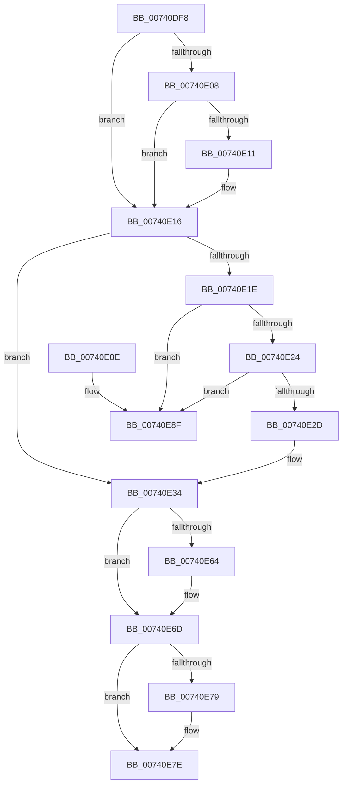

# PiDrvDbDestroyNode

- RVA: `0x00740DF8`–`0x00740E96` (길이 `158` bytes)
- VA: `0x0000000140740DF8`
- 실행 섹션: `PAGE`
- PDB 이름 있음: `예`; PDB Function 태그: `아니요`
- unwind 정보 RVA: `0x0005DAC8`
- 디코드: `45`개 명령, `158/158` bytes 표시
- 미해석 바이트: `0` (있으면 어셈블리에 `.byte`로 보존)

> 이 문서는 커널 이미지의 기계어와 PDB 기호를 분석해 생성했습니다. 4번과 5번은 함수 원형과 자료형을 바이너리 사용 방식에서 추정한 C 해석이며 원본 소스 복구 결과는 아닙니다.

## 1. Dependencies

- 직접 호출 지점: **8**; 고유 호출 대상: **4**
- 직접 호출자로 확인된 함수: **3**
- RIP 상대 이미지 참조: **0**

### Outgoing calls
- `0x00740E11` → [ZwClose](../../text/6A/ZwClose_function_006AD2B0.md) (function, `0x006AD2B0`)
- `0x00740E38` → [RtlFreeAnsiString](../9C/RtlFreeAnsiString_function_009C0800.md) (function, `0x009C0800`)
- `0x00740E41` → [RtlFreeAnsiString](../9C/RtlFreeAnsiString_function_009C0800.md) (function, `0x009C0800`)
- `0x00740E4A` → [RtlFreeAnsiString](../9C/RtlFreeAnsiString_function_009C0800.md) (function, `0x009C0800`)
- `0x00740E56` → [RtlFreeAnsiString](../9C/RtlFreeAnsiString_function_009C0800.md) (function, `0x009C0800`)
- `0x00740E68` → [ExDeleteResourceLite](../../text/38/ExDeleteResourceLite_function_0038BA60.md) (function, `0x0038BA60`)
- `0x00740E79` → [ZwClose](../../text/6A/ZwClose_function_006AD2B0.md) (function, `0x006AD2B0`)
- `0x00740E83` → [ExFreePoolWithTag](../../poolcode/B8/ExFreePoolWithTag_function_00B82870.md) (function, `0x00B82870`)

### Direct callers
- [PiDrvDbCreateNode](PiDrvDbCreateNode_function_00740AFC.md) at `0x00740B80`
- [PiDrvDbRegisterNode](PiDrvDbRegisterNode_function_00742658.md) at `0x00742ACF`
- [PiDrvDbUnregisterNode](PiDrvDbUnregisterNode_function_00743EF8.md) at `0x00743FFC`

### Static image references
- 디코드된 RIP-relative 메모리 참조가 없습니다.

## 2. Other-region calls and transfers

- 다른 실행 섹션으로 향하는 call: **4**
  - `0x00740E11` → [ZwClose](../../text/6A/ZwClose_function_006AD2B0.md) (`PAGE` → `.text`)
  - `0x00740E68` → [ExDeleteResourceLite](../../text/38/ExDeleteResourceLite_function_0038BA60.md) (`PAGE` → `.text`)
  - `0x00740E79` → [ZwClose](../../text/6A/ZwClose_function_006AD2B0.md) (`PAGE` → `.text`)
  - `0x00740E83` → [ExFreePoolWithTag](../../poolcode/B8/ExFreePoolWithTag_function_00B82870.md) (`PAGE` → `POOLCODE`)
- 별도 외부 분기/꼬리 이동을 확인하지 못했습니다.

## 3. Assembly (complete function range)

```asm
00740DF8  40 53                           push rbx
00740DFA  48 83 EC 20                     sub rsp, 0x20
00740DFE  8B 41 40                        mov eax, dword ptr [rcx + 0x40]
00740E01  48 8B D9                        mov rbx, rcx
00740E04  A8 10                           test al, 0x10
00740E06  74 0E                           je 0x140740e16
00740E08  48 8B 49 48                     mov rcx, qword ptr [rcx + 0x48]
00740E0C  48 85 C9                        test rcx, rcx
00740E0F  74 05                           je 0x140740e16
00740E11  E8 9A C4 F6 FF                  call 0x1406ad2b0
00740E16  48 8B 03                        mov rax, qword ptr [rbx]
00740E19  48 85 C0                        test rax, rax
00740E1C  74 16                           je 0x140740e34
00740E1E  48 39 58 08                     cmp qword ptr [rax + 8], rbx
00740E22  75 6B                           jne 0x140740e8f
00740E24  48 8B 4B 08                     mov rcx, qword ptr [rbx + 8]
00740E28  48 39 19                        cmp qword ptr [rcx], rbx
00740E2B  75 62                           jne 0x140740e8f
00740E2D  48 89 01                        mov qword ptr [rcx], rax
00740E30  48 89 48 08                     mov qword ptr [rax + 8], rcx
00740E34  48 8D 4B 10                     lea rcx, [rbx + 0x10]
00740E38  E8 C3 F9 27 00                  call 0x1409c0800
00740E3D  48 8D 4B 20                     lea rcx, [rbx + 0x20]
00740E41  E8 BA F9 27 00                  call 0x1409c0800
00740E46  48 8D 4B 30                     lea rcx, [rbx + 0x30]
00740E4A  E8 B1 F9 27 00                  call 0x1409c0800
00740E4F  48 8D 8B F8 01 00 00            lea rcx, [rbx + 0x1f8]
00740E56  E8 A5 F9 27 00                  call 0x1409c0800
00740E5B  80 BB C0 00 00 00 00            cmp byte ptr [rbx + 0xc0], 0
00740E62  74 09                           je 0x140740e6d
00740E64  48 8D 4B 58                     lea rcx, [rbx + 0x58]
00740E68  E8 F3 AB C4 FF                  call 0x14038ba60
00740E6D  48 8B 8B D8 01 00 00            mov rcx, qword ptr [rbx + 0x1d8]
00740E74  48 85 C9                        test rcx, rcx
00740E77  74 05                           je 0x140740e7e
00740E79  E8 32 C4 F6 FF                  call 0x1406ad2b0
00740E7E  33 D2                           xor edx, edx
00740E80  48 8B CB                        mov rcx, rbx
00740E83  E8 E8 19 44 00                  call 0x140b82870
00740E88  48 83 C4 20                     add rsp, 0x20
00740E8C  5B                              pop rbx
00740E8D  C3                              ret
00740E8E  CC                              int3
00740E8F  B9 03 00 00 00                  mov ecx, 3
00740E94  CD 29                           int 0x29
```

## 4. C-style interpretation (structured pseudocode)

```c
__int64 __fastcall PiDrvDbDestroyNode(__int64 a1, int a2)
{
    __int64 result;
    __int64 v_rsp;

    v_rsp = (v_rsp) - (32);
    if ((((unsigned __int8)((unsigned int)(*(unsigned int *)(a1 + 64)))) & (16)) == 0) goto loc_00740E16;
    result = (unsigned int)(*(unsigned int *)(a1 + 64));
    if (*(unsigned __int64 *)(a1 + 72) != 0) {
        result = ZwClose(*(unsigned __int64 *)(a1 + 72), a2, a3, a4);
    }
    if (*(unsigned __int64 *)(a1) == 0) goto loc_00740E34;
    if ((*(unsigned __int64 *)(*(unsigned __int64 *)(a1) + 8)) != a1) goto loc_00740E8F;
    if ((*(unsigned __int64 *)(*(unsigned __int64 *)(a1 + 8))) != a1) goto loc_00740E8F;
    *(unsigned __int64 *)(*(unsigned __int64 *)(a1 + 8)) = *(unsigned __int64 *)(a1);
    *(unsigned __int64 *)(*(unsigned __int64 *)(a1) + 8) = *(unsigned __int64 *)(a1 + 8);
loc_00740E34:
    result = RtlFreeAnsiString(a1 + 16, a2, a3, a4);
    result = RtlFreeAnsiString(a1 + 32, a2, a3, a4);
    result = RtlFreeAnsiString(a1 + 48, a2, a3, a4);
    result = RtlFreeAnsiString(a1 + 504, a2, a3, a4);
    if ((*(unsigned __int8 *)(a1 + 192)) != 0) {
        a1 = a1 + 88;
        result = ExDeleteResourceLite(a1, a2, a3, a4);
    }
    if (*(unsigned __int64 *)(a1 + 472) != 0) {
        result = ZwClose(*(unsigned __int64 *)(a1 + 472), a2, a3, a4);
    }
    a2 = 0;
    result = ExFreePoolWithTag(a1, a2, a3, a4);
    v_rsp = (v_rsp) + (32);
    return result;
loc_00740E8F:
    return result;
}
```

## 5. (Beta) C Style

```c
int64_t PiDrvDbDestroyNode(void *Arg1, int32_t Arg2)
{
    uint8_t *arg1 = (uint8_t *)Arg1;

    int64_t result;
    int64_t local_rsp;

    local_rsp = (local_rsp) - (32);
    if ((((uint8_t)((uint32_t)(*(uint32_t *)(arg1 + 0x40)))) & (16)) == 0) goto loc_00740E16;
    result = (uint32_t)(*(uint32_t *)(arg1 + 0x40));
    if (*(uint64_t *)(arg1 + 0x48) != 0) {
        result = ZwClose(*(uint64_t *)(arg1 + 0x48), Arg2, a3, a4);
    }
    if (*(uint64_t *)(arg1) == 0) goto loc_00740E34;
    if ((*(uint64_t *)(*(uint64_t *)(arg1) + 0x8)) != Arg1) goto loc_00740E8F;
    if ((*(uint64_t *)(*(uint64_t *)(arg1 + 0x8))) != Arg1) goto loc_00740E8F;
    *(uint64_t *)(*(uint64_t *)(arg1 + 0x8)) = *(uint64_t *)(arg1);
    *(uint64_t *)(*(uint64_t *)(arg1) + 0x8) = *(uint64_t *)(arg1 + 0x8);
loc_00740E34:
    result = RtlFreeAnsiString(Arg1 + 16, Arg2, a3, a4);
    result = RtlFreeAnsiString(Arg1 + 32, Arg2, a3, a4);
    result = RtlFreeAnsiString(Arg1 + 48, Arg2, a3, a4);
    result = RtlFreeAnsiString(Arg1 + 504, Arg2, a3, a4);
    if ((*(uint8_t *)(arg1 + 0xC0)) != 0) {
        Arg1 = Arg1 + 88;
        result = ExDeleteResourceLite(Arg1, Arg2, a3, a4);
    }
    if (*(uint64_t *)(arg1 + 0x1D8) != 0) {
        result = ZwClose(*(uint64_t *)(arg1 + 0x1D8), Arg2, a3, a4);
    }
    Arg2 = 0;
    result = ExFreePoolWithTag(Arg1, Arg2, a3, a4);
    local_rsp = (local_rsp) + (32);
    return result;
loc_00740E8F:
    return result;
}
```

### 관측된 메모리 오프셋

구조체 형식이 확인되지 않은 접근은 인자 기준의 오프셋으로만 기록했습니다.

| 기준 인자 | 오프셋 표현 | 폭 (bit) | 접근 |
|---|---:|---:|---|
| `Arg1` | `+ 0x0` | `64` | `R` |
| `Arg1` | `+ 0x8` | `64` | `R` |
| `Arg1` | `+ 0x10` | `64` | `R` |
| `Arg1` | `+ 0x20` | `64` | `R` |
| `Arg1` | `+ 0x30` | `64` | `R` |
| `Arg1` | `+ 0x40` | `32` | `R` |
| `Arg1` | `+ 0x48` | `64` | `R` |
| `Arg1` | `+ 0x58` | `64` | `R` |
| `Arg1` | `+ 0xC0` | `8` | `R` |
| `Arg1` | `+ 0x1D8` | `64` | `R` |
| `Arg1` | `+ 0x1F8` | `64` | `R` |

## 6. Execution-region graph

[열기: 2D/3D 그래프와 함수 탐색 컨트롤 패널](../../../control-panel.html?section=page&rva=0x00740DF8&view=graph)

- 2D 그래프는 위에서 아래로 흐르고, 3D 그래프는 빈 공간을 드래그해 회전합니다. Shift+드래그는 이동, 휠은 확대·축소, 함수 노드 선택은 대상 보고서 이동입니다.

### Static fallback


