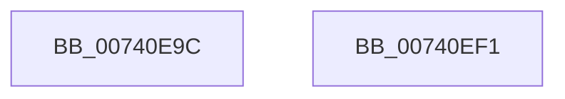

# PiDrvDbDriverStoreNodesUpdated

- RVA: `0x00740E9C`–`0x00740EF2` (길이 `86` bytes)
- VA: `0x0000000140740E9C`
- 실행 섹션: `PAGE`
- PDB 이름 있음: `예`; PDB Function 태그: `아니요`
- unwind 정보 RVA: `0x00063458`
- 디코드: `20`개 명령, `86/86` bytes 표시
- 미해석 바이트: `0` (있으면 어셈블리에 `.byte`로 보존)

> 이 문서는 커널 이미지의 기계어와 PDB 기호를 분석해 생성했습니다. 4번과 5번은 함수 원형과 자료형을 바이너리 사용 방식에서 추정한 C 해석이며 원본 소스 복구 결과는 아닙니다.

## 1. Dependencies

- 직접 호출 지점: **1**; 고유 호출 대상: **1**
- 직접 호출자로 확인된 함수: **2**
- RIP 상대 이미지 참조: **1**

### Outgoing calls
- `0x00740EE7` → [ZwUpdateWnfStateData](../../text/6B/ZwUpdateWnfStateData_function_006B0D10.md) (function, `0x006B0D10`)

### Direct callers
- [PiDrvDbRegisterNode](PiDrvDbRegisterNode_function_00742658.md) at `0x00742A6C`
- [PiDrvDbUnregisterNode](PiDrvDbUnregisterNode_function_00743EF8.md) at `0x00744001`

### Static image references
- `0x00740ED3` → RVA `0x00020990` (`.rdata`; read)

## 2. Other-region calls and transfers

- 다른 실행 섹션으로 향하는 call: **1**
  - `0x00740EE7` → [ZwUpdateWnfStateData](../../text/6B/ZwUpdateWnfStateData_function_006B0D10.md) (`PAGE` → `.text`)
- 별도 외부 분기/꼬리 이동을 확인하지 못했습니다.

## 3. Assembly (complete function range)

```asm
00740E9C  48 83 EC 48                     sub rsp, 0x48
00740EA0  48 B8 20 03 00 00 80 F7 FF FF   movabs rax, 0xfffff78000000320
00740EAA  48 8D 54 24 50                  lea rdx, [rsp + 0x50]
00740EAF  48 B9 04 00 00 00 80 F7 FF FF   movabs rcx, 0xfffff78000000004
00740EB9  45 33 C9                        xor r9d, r9d
00740EBC  48 8B 00                        mov rax, qword ptr [rax]
00740EBF  8B 09                           mov ecx, dword ptr [rcx]
00740EC1  48 0F AF C8                     imul rcx, rax
00740EC5  33 C0                           xor eax, eax
00740EC7  48 C1 E9 18                     shr rcx, 0x18
00740ECB  89 44 24 30                     mov dword ptr [rsp + 0x30], eax
00740ECF  89 4C 24 50                     mov dword ptr [rsp + 0x50], ecx
00740ED3  48 8D 0D B6 FA 8D FF            lea rcx, [rip - 0x72054a]
00740EDA  89 44 24 28                     mov dword ptr [rsp + 0x28], eax
00740EDE  44 8D 40 04                     lea r8d, [rax + 4]
00740EE2  48 89 44 24 20                  mov qword ptr [rsp + 0x20], rax
00740EE7  E8 24 FE F6 FF                  call 0x1406b0d10
00740EEC  48 83 C4 48                     add rsp, 0x48
00740EF0  C3                              ret
00740EF1  CC                              int3
```

## 4. C-style interpretation (structured pseudocode)

```c
__int64 __fastcall PiDrvDbDriverStoreNodesUpdated(__int64 a1, __int64 a2, __int64 a3, int a4)
{
    __int64 result;
    __int64 v_rsp;
    unsigned int v_stack_m18;
    unsigned int v_stack_m20;
    unsigned __int64 v_stack_m28;
    unsigned __int64 v_stack_p8;

    v_rsp = (v_rsp) - (72);
    a4 = 0;
    a1 = ((unsigned int)(*(unsigned int *)(a1))) * (*(unsigned __int64 *)(result));
    result = 0;
    a1 = (a1) >> (24);
    v_stack_m18 = 0;
    v_stack_p8 = (unsigned int)(a1);
    v_stack_m20 = 0;
    v_stack_m28 = 0;
    result = ZwUpdateWnfStateData(v_rip - 7472458, v_stack_p8, result + 4, a4);
    v_rsp = (v_rsp) + (72);
    return result;
}
```

## 5. (Beta) C Style

```c
int64_t PiDrvDbDriverStoreNodesUpdated(int64_t Arg1, int64_t Arg2, int64_t Arg3, int32_t Arg4)
{
    int64_t result;
    int64_t local_rsp;
    uint32_t v_stack_m18;
    uint32_t v_stack_m20;
    uint64_t v_stack_m28;
    uint64_t v_stack_p8;

    local_rsp = (local_rsp) - (72);
    Arg4 = 0;
    Arg1 = ((uint32_t)(*(uint32_t *)(Arg1))) * (*(uint64_t *)(result));
    result = 0;
    Arg1 = (Arg1) >> (24);
    v_stack_m18 = 0;
    v_stack_p8 = (uint32_t)(Arg1);
    v_stack_m20 = 0;
    v_stack_m28 = 0;
    result = ZwUpdateWnfStateData(v_rip - 7472458, v_stack_p8, result + 4, Arg4);
    local_rsp = (local_rsp) + (72);
    return result;
}
```

## 6. Execution-region graph

[열기: 2D/3D 그래프와 함수 탐색 컨트롤 패널](../../../control-panel.html?section=page&rva=0x00740E9C&view=graph)

- 2D 그래프는 위에서 아래로 흐르고, 3D 그래프는 빈 공간을 드래그해 회전합니다. Shift+드래그는 이동, 휠은 확대·축소, 함수 노드 선택은 대상 보고서 이동입니다.

### Static fallback


