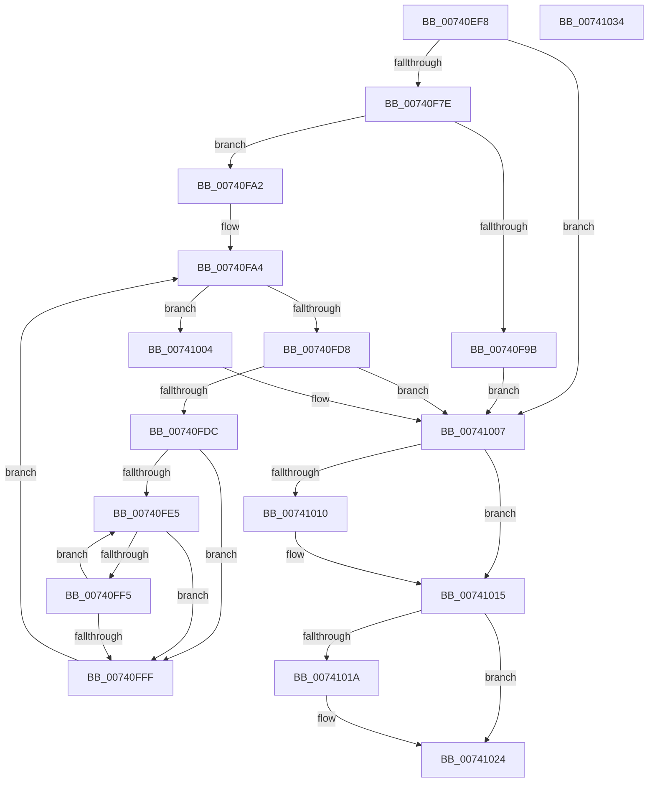

# PiDrvDbEnumDriverStoreNodes

- RVA: `0x00740EF8`–`0x00741035` (길이 `317` bytes)
- VA: `0x0000000140740EF8`
- 실행 섹션: `PAGE`
- PDB 이름 있음: `예`; PDB Function 태그: `아니요`
- unwind 정보 RVA: `0x000C92A8`
- 디코드: `92`개 명령, `317/317` bytes 표시
- 미해석 바이트: `0` (있으면 어셈블리에 `.byte`로 보존)

> 이 문서는 커널 이미지의 기계어와 PDB 기호를 분석해 생성했습니다. 4번과 5번은 함수 원형과 자료형을 바이너리 사용 방식에서 추정한 C 해석이며 원본 소스 복구 결과는 아닙니다.

## 1. Dependencies

- 직접 호출 지점: **7**; 고유 호출 대상: **7**
- 직접 호출자로 확인된 함수: **1**
- RIP 상대 이미지 참조: **1**

### Outgoing calls
- `0x00740F3C` → [RtlInitUnicodeString](../../text/42/RtlInitUnicodeString_function_0042A780.md) (function, `0x0042A780`)
- `0x00740F6F` → [ZwOpenDirectoryObject](../../text/6A/ZwOpenDirectoryObject_function_006ADBD0.md) (function, `0x006ADBD0`)
- `0x00740F8E` → [ExAllocatePool2](../../poolcode/B8/ExAllocatePool2_function_00B820F0.md) (function, `0x00B820F0`)
- `0x00740FCA` → [ZwQueryDirectoryObject](../../text/6A/ZwQueryDirectoryObject_function_006AFAB0.md) (function, `0x006AFAB0`)
- `0x00740FEC` → [PiDrvDbRegisterNodeCallback](PiDrvDbRegisterNodeCallback_function_00742B00.md) (function, `0x00742B00`)
- `0x00741010` → [ZwClose](../../text/6A/ZwClose_function_006AD2B0.md) (function, `0x006AD2B0`)
- `0x0074101F` → [ExFreePoolWithTag](../../poolcode/B8/ExFreePoolWithTag_function_00B82870.md) (function, `0x00B82870`)

### Direct callers
- [PiDrvDbInit](PiDrvDbInit_function_0074130C.md) at `0x007413A3`

### Static image references
- `0x00740F22` → RVA `0x00B002E0` (` ?? ::NNGAKEGL::`string'`; read)

## 2. Other-region calls and transfers

- 다른 실행 섹션으로 향하는 call: **6**
  - `0x00740F3C` → [RtlInitUnicodeString](../../text/42/RtlInitUnicodeString_function_0042A780.md) (`PAGE` → `.text`)
  - `0x00740F6F` → [ZwOpenDirectoryObject](../../text/6A/ZwOpenDirectoryObject_function_006ADBD0.md) (`PAGE` → `.text`)
  - `0x00740F8E` → [ExAllocatePool2](../../poolcode/B8/ExAllocatePool2_function_00B820F0.md) (`PAGE` → `POOLCODE`)
  - `0x00740FCA` → [ZwQueryDirectoryObject](../../text/6A/ZwQueryDirectoryObject_function_006AFAB0.md) (`PAGE` → `.text`)
  - `0x00741010` → [ZwClose](../../text/6A/ZwClose_function_006AD2B0.md) (`PAGE` → `.text`)
  - `0x0074101F` → [ExFreePoolWithTag](../../poolcode/B8/ExFreePoolWithTag_function_00B82870.md) (`PAGE` → `POOLCODE`)
- 별도 외부 분기/꼬리 이동을 확인하지 못했습니다.

## 3. Assembly (complete function range)

```asm
00740EF8  48 89 4C 24 08                  mov qword ptr [rsp + 8], rcx
00740EFD  55                              push rbp
00740EFE  53                              push rbx
00740EFF  56                              push rsi
00740F00  57                              push rdi
00740F01  41 56                           push r14
00740F03  48 8B EC                        mov rbp, rsp
00740F06  48 81 EC 80 00 00 00            sub rsp, 0x80
00740F0D  45 33 F6                        xor r14d, r14d
00740F10  48 8D 4D C0                     lea rcx, [rbp - 0x40]
00740F14  48 8B F2                        mov rsi, rdx
00740F17  44 89 75 D4                     mov dword ptr [rbp - 0x2c], r14d
00740F1B  0F 57 C0                        xorps xmm0, xmm0
00740F1E  44 89 75 EC                     mov dword ptr [rbp - 0x14], r14d
00740F22  48 8D 15 B7 F3 3B 00            lea rdx, [rip + 0x3bf3b7]
00740F29  4C 89 75 48                     mov qword ptr [rbp + 0x48], r14
00740F2D  0F 11 45 C0                     movups xmmword ptr [rbp - 0x40], xmm0
00740F31  41 8B DE                        mov ebx, r14d
00740F34  44 89 75 40                     mov dword ptr [rbp + 0x40], r14d
00740F38  44 89 75 30                     mov dword ptr [rbp + 0x30], r14d
00740F3C  E8 3F 98 CE FF                  call 0x14042a780
00740F41  48 8D 45 C0                     lea rax, [rbp - 0x40]
00740F45  C7 45 D0 30 00 00 00            mov dword ptr [rbp - 0x30], 0x30
00740F4C  0F 57 C0                        xorps xmm0, xmm0
00740F4F  48 89 45 E0                     mov qword ptr [rbp - 0x20], rax
00740F53  4C 8D 45 D0                     lea r8, [rbp - 0x30]
00740F57  4C 89 75 D8                     mov qword ptr [rbp - 0x28], r14
00740F5B  41 8D 56 01                     lea edx, [r14 + 1]
00740F5F  C7 45 E8 40 02 00 00            mov dword ptr [rbp - 0x18], 0x240
00740F66  48 8D 4D 48                     lea rcx, [rbp + 0x48]
00740F6A  F3 0F 7F 45 F0                  movdqu xmmword ptr [rbp - 0x10], xmm0
00740F6F  E8 5C CC F6 FF                  call 0x1406adbd0
00740F74  8B F8                           mov edi, eax
00740F76  85 C0                           test eax, eax
00740F78  0F 88 89 00 00 00               js 0x140741007
00740F7E  BA 00 04 00 00                  mov edx, 0x400
00740F83  B9 00 01 00 00                  mov ecx, 0x100
00740F88  41 B8 50 70 64 62               mov r8d, 0x62647050
00740F8E  E8 5D 11 44 00                  call 0x140b820f0
00740F93  48 8B D8                        mov rbx, rax
00740F96  48 85 C0                        test rax, rax
00740F99  75 07                           jne 0x140740fa2
00740F9B  BF 9A 00 00 C0                  mov edi, 0xc000009a
00740FA0  EB 65                           jmp 0x140741007
00740FA2  B0 01                           mov al, 1
00740FA4  48 8D 4D 30                     lea rcx, [rbp + 0x30]
00740FA8  41 B1 01                        mov r9b, 1
00740FAB  48 89 4C 24 30                  mov qword ptr [rsp + 0x30], rcx
00740FB0  41 B8 00 04 00 00               mov r8d, 0x400
00740FB6  48 8D 4D 40                     lea rcx, [rbp + 0x40]
00740FBA  48 8B D3                        mov rdx, rbx
00740FBD  48 89 4C 24 28                  mov qword ptr [rsp + 0x28], rcx
00740FC2  48 8B 4D 48                     mov rcx, qword ptr [rbp + 0x48]
00740FC6  88 44 24 20                     mov byte ptr [rsp + 0x20], al
00740FCA  E8 E1 EA F6 FF                  call 0x1406afab0
00740FCF  8B F8                           mov edi, eax
00740FD1  3D 1A 00 00 80                  cmp eax, 0x8000001a
00740FD6  74 2C                           je 0x140741004
00740FD8  85 C0                           test eax, eax
00740FDA  78 2B                           js 0x140741007
00740FDC  48 8B FB                        mov rdi, rbx
00740FDF  66 44 39 33                     cmp word ptr [rbx], r14w
00740FE3  74 1A                           je 0x140740fff
00740FE5  48 8B 4F 08                     mov rcx, qword ptr [rdi + 8]
00740FE9  48 8B D6                        mov rdx, rsi
00740FEC  E8 0F 1B 00 00                  call 0x140742b00
00740FF1  84 C0                           test al, al
00740FF3  74 0A                           je 0x140740fff
00740FF5  48 83 C7 20                     add rdi, 0x20
00740FF9  66 44 39 37                     cmp word ptr [rdi], r14w
00740FFD  75 E6                           jne 0x140740fe5
00740FFF  41 8A C6                        mov al, r14b
00741002  EB A0                           jmp 0x140740fa4
00741004  41 8B FE                        mov edi, r14d
00741007  48 8B 4D 48                     mov rcx, qword ptr [rbp + 0x48]
0074100B  48 85 C9                        test rcx, rcx
0074100E  74 05                           je 0x140741015
00741010  E8 9B C2 F6 FF                  call 0x1406ad2b0
00741015  48 85 DB                        test rbx, rbx
00741018  74 0A                           je 0x140741024
0074101A  33 D2                           xor edx, edx
0074101C  48 8B CB                        mov rcx, rbx
0074101F  E8 4C 18 44 00                  call 0x140b82870
00741024  8B C7                           mov eax, edi
00741026  48 81 C4 80 00 00 00            add rsp, 0x80
0074102D  41 5E                           pop r14
0074102F  5F                              pop rdi
00741030  5E                              pop rsi
00741031  5B                              pop rbx
00741032  5D                              pop rbp
00741033  C3                              ret
00741034  CC                              int3
```

## 4. C-style interpretation (structured pseudocode)

```c
__int64 __fastcall PiDrvDbEnumDriverStoreNodes(__int64 a1, __int64 a2)
{
    __int64 result;
    __int64 v_r14;
    __int64 v_rdi;
    __int64 v_rsp;
    unsigned __int64 v_stack_m38;
    unsigned int v_stack_m3C;
    unsigned int v_stack_m40;
    unsigned __int64 v_stack_m48;
    unsigned __int64 v_stack_m50;
    unsigned int v_stack_m54;
    unsigned int v_stack_m58;
    unsigned __int64 v_stack_m68;
    unsigned __int64 v_stack_m78;
    unsigned __int64 v_stack_m80;
    unsigned __int8 v_stack_m88;
    unsigned int v_stack_p18;
    unsigned __int64 v_stack_p20;
    unsigned __int64 v_stack_p8;

    v_stack_p8 = a1;
    v_rsp = (v_rsp) - (128);
    v_r14 = 0;
    v_stack_m54 = 0;
    v_stack_m3C = 0;
    v_stack_p20 = 0;
    v_stack_m68 = v_xmm0;
    v_stack_p18 = 0;
    v_stack_p8 = 0;
    result = RtlInitUnicodeString(v_stack_m68, v_rip + 3929015, a3, a4);
    v_stack_m58 = 48;
    v_stack_m48 = v_stack_m68;
    v_stack_m50 = 0;
    v_stack_m40 = 576;
    v_stack_m38 = v_xmm0;
    result = ZwOpenDirectoryObject(v_stack_p20, v_r14 + 1, v_stack_m58, a4);
    if (sign_flag) goto loc_00741007;
    result = ExAllocatePool2(256, (unsigned int)(0x400ULL), (unsigned int)(0x62647050ULL), a4);
    if (result != 0) goto loc_00740FA2;
    goto loc_00741007;
loc_00740FA2:
loc_00740FA4:
    v_stack_m78 = v_stack_p8;
    v_stack_m80 = v_stack_p18;
    v_stack_m88 = 1;
    result = ZwQueryDirectoryObject(v_stack_p20, result, (unsigned int)(0x400ULL), 1);
    if (((unsigned int)(result)) == 0x8000001AULL) goto loc_00741004;
    if (sign_flag) goto loc_00741007;
    if ((*(unsigned __int16 *)(result)) == 0) goto loc_00740FFF;
loc_00740FE5:
    result = PiDrvDbRegisterNodeCallback(*(unsigned __int64 *)(result + 8), a2, (unsigned int)(0x400ULL), 1);
    if ((unsigned __int8)(result) == 0) goto loc_00740FFF;
    v_rdi = (result) + (32);
    if ((*(unsigned __int16 *)(v_rdi)) != 0) goto loc_00740FE5;
loc_00740FFF:
    goto loc_00740FA4;
loc_00741004:
loc_00741007:
    result = 0;
    if (v_stack_p20 != 0) {
        result = ZwClose(v_stack_p20, a2, (unsigned int)(0x400ULL), 1);
    }
    if (result != 0) {
        a2 = 0;
        a1 = result;
        result = ExFreePoolWithTag(a1, a2, (unsigned int)(0x400ULL), 1);
    }
    v_rsp = (v_rsp) + (128);
    return 0;
}
```

## 5. (Beta) C Style

```c
int64_t PiDrvDbEnumDriverStoreNodes(int64_t Arg1, int64_t Arg2)
{
    int64_t result;
    int64_t local_r14;
    int64_t local_rdi;
    int64_t local_rsp;
    uint64_t v_stack_m38;
    uint32_t v_stack_m3C;
    uint32_t v_stack_m40;
    uint64_t v_stack_m48;
    uint64_t v_stack_m50;
    uint32_t v_stack_m54;
    uint32_t v_stack_m58;
    uint64_t v_stack_m68;
    uint64_t v_stack_m78;
    uint64_t v_stack_m80;
    uint8_t v_stack_m88;
    uint32_t v_stack_p18;
    uint64_t v_stack_p20;
    uint64_t v_stack_p8;

    v_stack_p8 = Arg1;
    local_rsp = (local_rsp) - (128);
    local_r14 = 0;
    v_stack_m54 = 0;
    v_stack_m3C = 0;
    v_stack_p20 = 0;
    v_stack_m68 = v_xmm0;
    v_stack_p18 = 0;
    v_stack_p8 = 0;
    result = RtlInitUnicodeString(v_stack_m68, v_rip + 3929015, a3, a4);
    v_stack_m58 = 48;
    v_stack_m48 = v_stack_m68;
    v_stack_m50 = 0;
    v_stack_m40 = 576;
    v_stack_m38 = v_xmm0;
    result = ZwOpenDirectoryObject(v_stack_p20, local_r14 + 1, v_stack_m58, a4);
    if (sign_flag) goto loc_00741007;
    result = ExAllocatePool2(256, (uint32_t)(0x400ULL), (uint32_t)(0x62647050ULL), a4);
    if (result != 0) goto loc_00740FA2;
    goto loc_00741007;
loc_00740FA2:
loc_00740FA4:
    v_stack_m78 = v_stack_p8;
    v_stack_m80 = v_stack_p18;
    v_stack_m88 = 1;
    result = ZwQueryDirectoryObject(v_stack_p20, result, (uint32_t)(0x400ULL), 1);
    if (((uint32_t)(result)) == 0x8000001AULL) goto loc_00741004;
    if (sign_flag) goto loc_00741007;
    if ((*(uint16_t *)(result)) == 0) goto loc_00740FFF;
loc_00740FE5:
    result = PiDrvDbRegisterNodeCallback(*(uint64_t *)(result + 0x8), Arg2, (uint32_t)(0x400ULL), 1);
    if ((uint8_t)(result) == 0) goto loc_00740FFF;
    local_rdi = (result) + (32);
    if ((*(uint16_t *)(local_rdi)) != 0) goto loc_00740FE5;
loc_00740FFF:
    goto loc_00740FA4;
loc_00741004:
loc_00741007:
    result = 0;
    if (v_stack_p20 != 0) {
        result = ZwClose(v_stack_p20, Arg2, (uint32_t)(0x400ULL), 1);
    }
    if (result != 0) {
        Arg2 = 0;
        Arg1 = result;
        result = ExFreePoolWithTag(Arg1, Arg2, (uint32_t)(0x400ULL), 1);
    }
    local_rsp = (local_rsp) + (128);
    return 0;
}
```

## 6. Execution-region graph

[열기: 2D/3D 그래프와 함수 탐색 컨트롤 패널](../../../control-panel.html?section=page&rva=0x00740EF8&view=graph)

- 2D 그래프는 위에서 아래로 흐르고, 3D 그래프는 빈 공간을 드래그해 회전합니다. Shift+드래그는 이동, 휠은 확대·축소, 함수 노드 선택은 대상 보고서 이동입니다.

### Static fallback


