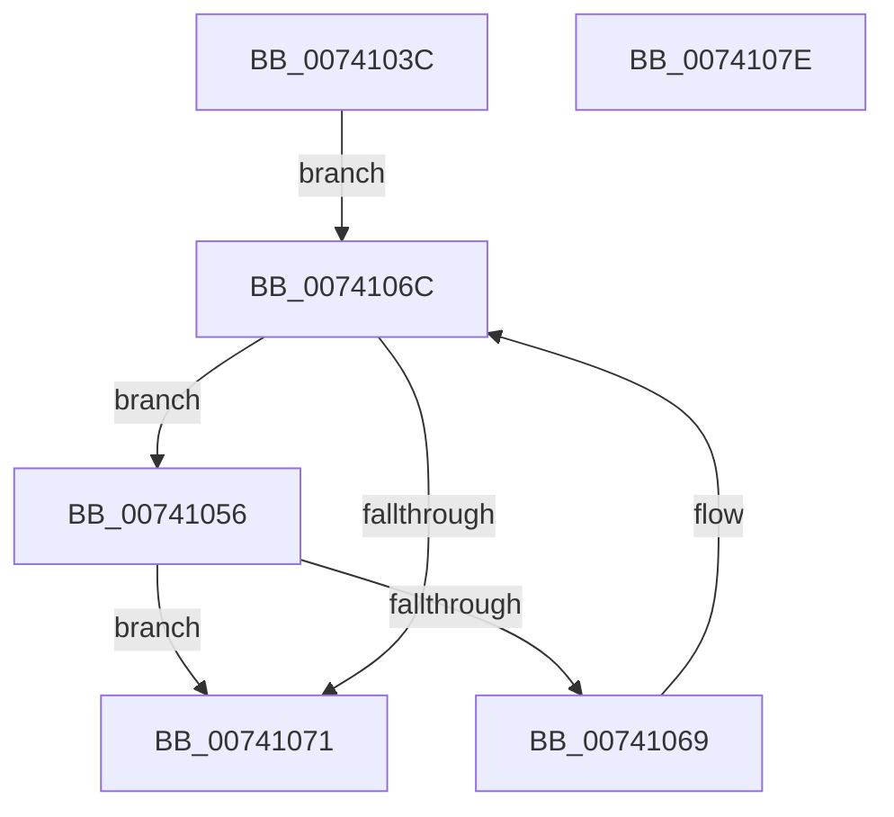

# PiDrvDbEnumNodes

- RVA: `0x0074103C`–`0x0074107F` (길이 `67` bytes)
- VA: `0x000000014074103C`
- 실행 섹션: `PAGE`
- PDB 이름 있음: `예`; PDB Function 태그: `아니요`
- unwind 정보 RVA: `0x0005CAAC`
- 디코드: `21`개 명령, `67/67` bytes 표시
- 미해석 바이트: `0` (있으면 어셈블리에 `.byte`로 보존)

> 이 문서는 커널 이미지의 기계어와 PDB 기호를 분석해 생성했습니다. 4번과 5번은 함수 원형과 자료형을 바이너리 사용 방식에서 추정한 C 해석이며 원본 소스 복구 결과는 아닙니다.

## 1. Dependencies

- 직접 호출 지점: **1**; 고유 호출 대상: **1**
- 직접 호출자로 확인된 함수: **1**
- RIP 상대 이미지 참조: **1**

### Outgoing calls
- `0x00741060` → [PiDevCfgInitDriverDatabaseCallback](../73/PiDevCfgInitDriverDatabaseCallback_function_00733958.md) (function, `0x00733958`)

### Direct callers
- [PpDevCfgInit](../../init/C3/PpDevCfgInit_function_00C351A4.md) at `0x00C35487`

### Static image references
- `0x00741046` → RVA `0x00F8A870` (`.data`; read)

## 2. Other-region calls and transfers

- 다른 실행 섹션으로 향하는 call: **0**
- 별도 외부 분기/꼬리 이동을 확인하지 못했습니다.

## 3. Assembly (complete function range)

```asm
0074103C  48 89 5C 24 08                  mov qword ptr [rsp + 8], rbx
00741041  57                              push rdi
00741042  48 83 EC 20                     sub rsp, 0x20
00741046  48 8B 1D 23 98 84 00            mov rbx, qword ptr [rip + 0x849823]
0074104D  48 8D 3D 1C 98 84 00            lea rdi, [rip + 0x84981c]
00741054  EB 16                           jmp 0x14074106c
00741056  8B 53 40                        mov edx, dword ptr [rbx + 0x40]
00741059  45 33 C0                        xor r8d, r8d
0074105C  48 8B 4B 18                     mov rcx, qword ptr [rbx + 0x18]
00741060  E8 F3 28 FF FF                  call 0x140733958
00741065  84 C0                           test al, al
00741067  74 08                           je 0x140741071
00741069  48 8B 1B                        mov rbx, qword ptr [rbx]
0074106C  48 3B DF                        cmp rbx, rdi
0074106F  75 E5                           jne 0x140741056
00741071  48 8B 5C 24 30                  mov rbx, qword ptr [rsp + 0x30]
00741076  33 C0                           xor eax, eax
00741078  48 83 C4 20                     add rsp, 0x20
0074107C  5F                              pop rdi
0074107D  C3                              ret
0074107E  CC                              int3
```

## 4. C-style interpretation (structured pseudocode)

```c
__int64 __fastcall PiDrvDbEnumNodes(__int64 a1, __int64 a2, int a3)
{
    __int64 result;
    __int64 v_rsp;
    unsigned __int64 v_stack_p8;

    v_stack_p8 = v_rbx;
    v_rsp = (v_rsp) - (32);
    goto loc_0074106C;
loc_00741056:
    a3 = 0;
    result = PiDevCfgInitDriverDatabaseCallback(*(unsigned __int64 *)(*(unsigned __int64 *)(v_rip + 8689699) + 24), (unsigned int)(*(unsigned int *)(*(unsigned __int64 *)(v_rip + 8689699) + 64)), a3, a4);
    if ((unsigned __int8)(result) == 0) goto loc_00741071;
loc_0074106C:
    if ((*(unsigned __int64 *)(*(unsigned __int64 *)(v_rip + 8689699))) != (v_rip + 8689692)) goto loc_00741056;
loc_00741071:
    result = 0;
    v_rsp = (v_rsp) + (32);
    return result;
}
```

## 5. (Beta) C Style

```c
int64_t PiDrvDbEnumNodes(int64_t Arg1, int64_t Arg2, int32_t Arg3)
{
    int64_t result;
    int64_t local_rsp;
    uint64_t v_stack_p8;

    v_stack_p8 = local_rbx;
    local_rsp = (local_rsp) - (32);
    goto loc_0074106C;
loc_00741056:
    Arg3 = 0;
    result = PiDevCfgInitDriverDatabaseCallback(*(uint64_t *)(*(uint64_t *)(v_rip + 0x849823) + 0x18), (uint32_t)(*(uint32_t *)(*(uint64_t *)(v_rip + 0x849823) + 0x40)), Arg3, a4);
    if ((uint8_t)(result) == 0) goto loc_00741071;
loc_0074106C:
    if ((*(uint64_t *)(*(uint64_t *)(v_rip + 0x849823))) != (v_rip + 8689692)) goto loc_00741056;
loc_00741071:
    result = 0;
    local_rsp = (local_rsp) + (32);
    return result;
}
```

## 6. Execution-region graph

[열기: 2D/3D 그래프와 함수 탐색 컨트롤 패널](../../../control-panel.html?section=page&rva=0x0074103C&view=graph)

- 2D 그래프는 위에서 아래로 흐르고, 3D 그래프는 빈 공간을 드래그해 회전합니다. Shift+드래그는 이동, 휠은 확대·축소, 함수 노드 선택은 대상 보고서 이동입니다.

### Static fallback


