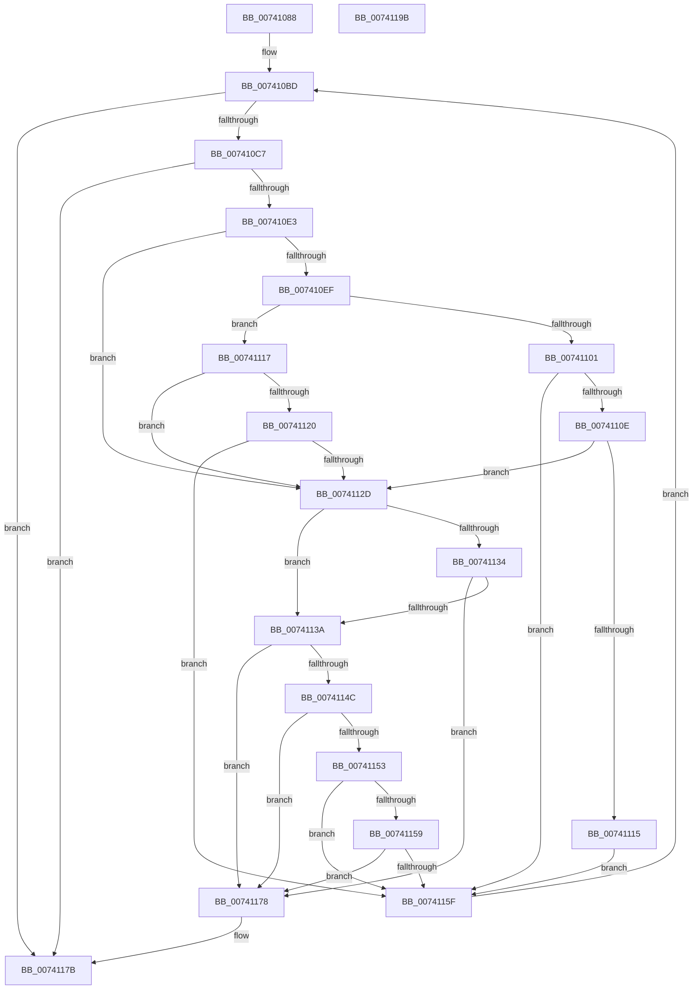

# PiDrvDbFindSystemFilePathToken

- RVA: `0x00741088`–`0x0074119C` (길이 `276` bytes)
- VA: `0x0000000140741088`
- 실행 섹션: `PAGE`
- PDB 이름 있음: `예`; PDB Function 태그: `아니요`
- unwind 정보 RVA: `0x0008C20C`
- 디코드: `82`개 명령, `276/276` bytes 표시
- 미해석 바이트: `0` (있으면 어셈블리에 `.byte`로 보존)

> 이 문서는 커널 이미지의 기계어와 PDB 기호를 분석해 생성했습니다. 4번과 5번은 함수 원형과 자료형을 바이너리 사용 방식에서 추정한 C 해석이며 원본 소스 복구 결과는 아닙니다.

## 1. Dependencies

- 직접 호출 지점: **4**; 고유 호출 대상: **3**
- 직접 호출자로 확인된 함수: **1**
- RIP 상대 이미지 참조: **0**

### Outgoing calls
- `0x007410D2` → [RtlFindUnicodeSubstring](../94/RtlFindUnicodeSubstring_function_00949FA0.md) (function, `0x00949FA0`)
- `0x00741105` → [iswalnum](../../text/50/iswalnum_function_005007A0.md) (function, `0x005007A0`)
- `0x00741117` → [iswalpha](../../text/50/iswalpha_function_005007BC.md) (function, `0x005007BC`)
- `0x00741124` → [iswalnum](../../text/50/iswalnum_function_005007A0.md) (function, `0x005007A0`)

### Direct callers
- [PiDrvDbResolveSystemFilePath](PiDrvDbResolveSystemFilePath_function_00743514.md) at `0x00743617`
- [PiDrvDbResolveSystemFilePath](PiDrvDbResolveSystemFilePath_function_00743514.md) at `0x0074365A`
- [PiDrvDbResolveSystemFilePath](PiDrvDbResolveSystemFilePath_function_00743514.md) at `0x007436AC`

### Static image references
- 디코드된 RIP-relative 메모리 참조가 없습니다.

## 2. Other-region calls and transfers

- 다른 실행 섹션으로 향하는 call: **3**
  - `0x00741105` → [iswalnum](../../text/50/iswalnum_function_005007A0.md) (`PAGE` → `.text`)
  - `0x00741117` → [iswalpha](../../text/50/iswalpha_function_005007BC.md) (`PAGE` → `.text`)
  - `0x00741124` → [iswalnum](../../text/50/iswalnum_function_005007A0.md) (`PAGE` → `.text`)
- 별도 외부 분기/꼬리 이동을 확인하지 못했습니다.

## 3. Assembly (complete function range)

```asm
00741088  48 8B C4                        mov rax, rsp
0074108B  48 89 58 08                     mov qword ptr [rax + 8], rbx
0074108F  48 89 68 10                     mov qword ptr [rax + 0x10], rbp
00741093  48 89 70 18                     mov qword ptr [rax + 0x18], rsi
00741097  57                              push rdi
00741098  41 54                           push r12
0074109A  41 55                           push r13
0074109C  41 56                           push r14
0074109E  41 57                           push r15
007410A0  48 83 EC 30                     sub rsp, 0x30
007410A4  0F 10 01                        movups xmm0, xmmword ptr [rcx]
007410A7  48 8B EA                        mov rbp, rdx
007410AA  4C 8B E9                        mov r13, rcx
007410AD  33 DB                           xor ebx, ebx
007410AF  F3 0F 7F 40 C8                  movdqu xmmword ptr [rax - 0x38], xmm0
007410B4  4C 8B 70 D0                     mov r14, qword ptr [rax - 0x30]
007410B8  44 0F B7 60 C8                  movzx r12d, word ptr [rax - 0x38]
007410BD  66 41 39 1E                     cmp word ptr [r14], bx
007410C1  0F 84 B4 00 00 00               je 0x14074117b
007410C7  41 B0 01                        mov r8b, 1
007410CA  48 8D 4C 24 20                  lea rcx, [rsp + 0x20]
007410CF  48 8B D5                        mov rdx, rbp
007410D2  E8 C9 8E 20 00                  call 0x140949fa0
007410D7  48 8B F8                        mov rdi, rax
007410DA  48 85 C0                        test rax, rax
007410DD  0F 84 98 00 00 00               je 0x14074117b
007410E3  0F B7 75 00                     movzx esi, word ptr [rbp]
007410E7  D1 EE                           shr esi, 1
007410E9  49 3B 45 08                     cmp rax, qword ptr [r13 + 8]
007410ED  76 3E                           jbe 0x14074112d
007410EF  44 0F B7 78 FE                  movzx r15d, word ptr [rax - 2]
007410F4  48 8B 45 08                     mov rax, qword ptr [rbp + 8]
007410F8  0F B7 08                        movzx ecx, word ptr [rax]
007410FB  66 83 F9 5C                     cmp cx, 0x5c
007410FF  75 16                           jne 0x140741117
00741101  41 0F B7 CF                     movzx ecx, r15w
00741105  E8 96 F6 DB FF                  call 0x1405007a0
0074110A  85 C0                           test eax, eax
0074110C  75 51                           jne 0x14074115f
0074110E  66 41 83 FF 5C                  cmp r15w, 0x5c
00741113  75 18                           jne 0x14074112d
00741115  EB 48                           jmp 0x14074115f
00741117  E8 A0 F6 DB FF                  call 0x1405007bc
0074111C  85 C0                           test eax, eax
0074111E  74 0D                           je 0x14074112d
00741120  41 0F B7 CF                     movzx ecx, r15w
00741124  E8 77 F6 DB FF                  call 0x1405007a0
00741129  85 C0                           test eax, eax
0074112B  75 32                           jne 0x14074115f
0074112D  66 44 3B 65 00                  cmp r12w, word ptr [rbp]
00741132  75 06                           jne 0x14074113a
00741134  66 39 1C 77                     cmp word ptr [rdi + rsi*2], bx
00741138  74 3E                           je 0x140741178
0074113A  4C 8B 45 08                     mov r8, qword ptr [rbp + 8]
0074113E  8D 46 FF                        lea eax, [rsi - 1]
00741141  41 0F B7 14 40                  movzx edx, word ptr [r8 + rax*2]
00741146  66 83 FA 5C                     cmp dx, 0x5c
0074114A  74 2C                           je 0x140741178
0074114C  66 83 3C 77 5C                  cmp word ptr [rdi + rsi*2], 0x5c
00741151  74 25                           je 0x140741178
00741153  66 83 FA 25                     cmp dx, 0x25
00741157  75 06                           jne 0x14074115f
00741159  66 41 39 10                     cmp word ptr [r8], dx
0074115D  74 19                           je 0x140741178
0074115F  66 44 2B 65 00                  sub r12w, word ptr [rbp]
00741164  4D 8D 34 76                     lea r14, [r14 + rsi*2]
00741168  4C 89 74 24 28                  mov qword ptr [rsp + 0x28], r14
0074116D  66 44 89 64 24 20               mov word ptr [rsp + 0x20], r12w
00741173  E9 45 FF FF FF                  jmp 0x1407410bd
00741178  48 8B DF                        mov rbx, rdi
0074117B  48 8B 6C 24 68                  mov rbp, qword ptr [rsp + 0x68]
00741180  48 8B C3                        mov rax, rbx
00741183  48 8B 5C 24 60                  mov rbx, qword ptr [rsp + 0x60]
00741188  48 8B 74 24 70                  mov rsi, qword ptr [rsp + 0x70]
0074118D  48 83 C4 30                     add rsp, 0x30
00741191  41 5F                           pop r15
00741193  41 5E                           pop r14
00741195  41 5D                           pop r13
00741197  41 5C                           pop r12
00741199  5F                              pop rdi
0074119A  C3                              ret
0074119B  CC                              int3
```

## 4. C-style interpretation (structured pseudocode)

```c
__int64 __fastcall PiDrvDbFindSystemFilePathToken(__int64 a1, __int64 a2)
{
    __int64 result;
    __int64 v_r12;
    __int64 v_rbx;
    __int64 v_rsi;
    __int64 v_rsp;
    unsigned __int64 v_stack_m30;
    unsigned __int64 v_stack_m38;
    unsigned __int64 v_stack_p10;
    unsigned __int64 v_stack_p18;
    unsigned __int64 v_stack_p8;

    *(unsigned __int64 *)(v_rsp + 8) = v_rbx;
    *(unsigned __int64 *)(v_rsp + 16) = v_rbp;
    *(unsigned __int64 *)(v_rsp + 24) = v_rsi;
    v_rsp = (v_rsp) - (48);
    v_rbx = 0;
    *(unsigned __int64 *)(v_rsp - 56) = v_xmm0;
loc_007410BD:
    if ((*(unsigned __int16 *)(*(unsigned __int64 *)(v_rsp - 48))) == 0) goto loc_0074117B;
    result = RtlFindUnicodeSubstring(v_stack_m38, a2, 1, a4);
    if (result == 0) goto loc_0074117B;
    v_rsi = (unsigned int)((*(unsigned __int16 *)(a2)) >> (1));
    if (result <= (*(unsigned __int64 *)(a1 + 8))) goto loc_0074112D;
    if (((unsigned __int16)(*(unsigned __int16 *)(*(unsigned __int64 *)(a2 + 8)))) != 92) goto loc_00741117;
    result = iswalnum((unsigned __int16)(*(unsigned __int16 *)(result - 2)), a2, 1, a4);
    if ((unsigned int)(result) != 0) goto loc_0074115F;
    if (((unsigned __int16)(*(unsigned __int16 *)(result - 2))) != 92) goto loc_0074112D;
    goto loc_0074115F;
loc_00741117:
    result = iswalpha((unsigned __int16)(*(unsigned __int16 *)(result - 2)), a2, 1, a4);
    if ((unsigned int)(result) == 0) goto loc_0074112D;
    result = iswalnum((unsigned __int16)(*(unsigned __int16 *)(result - 2)), a2, 1, a4);
    if ((unsigned int)(result) != 0) goto loc_0074115F;
loc_0074112D:
    if (((unsigned __int16)(*(unsigned __int16 *)(v_rsp - 56))) != (*(unsigned __int16 *)(a2))) goto loc_0074113A;
    if ((*(unsigned __int16 *)(result + v_rsi * 2)) == 0) goto loc_00741178;
loc_0074113A:
    if (((unsigned __int16)(*(unsigned __int16 *)(*(unsigned __int64 *)(a2 + 8) + v_rsi - 1 * 2))) == 92) goto loc_00741178;
    if ((*(unsigned __int16 *)(result + v_rsi * 2)) == 92) goto loc_00741178;
    if (((unsigned __int16)(*(unsigned __int16 *)(*(unsigned __int64 *)(a2 + 8) + v_rsi - 1 * 2))) != 37) goto loc_0074115F;
    if ((*(unsigned __int16 *)(*(unsigned __int64 *)(a2 + 8))) == ((unsigned __int16)(*(unsigned __int16 *)(*(unsigned __int64 *)(a2 + 8) + v_rsi - 1 * 2)))) goto loc_00741178;
loc_0074115F:
    v_r12 = (unsigned __int16)((*(unsigned __int16 *)(v_rsp - 56)) - (*(unsigned __int16 *)(a2)));
    v_stack_m30 = *(unsigned __int64 *)(v_rsp - 48) + v_rsi * 2;
    v_stack_m38 = (unsigned __int16)(v_r12);
    goto loc_007410BD;
loc_00741178:
loc_0074117B:
    v_rsp = (v_rsp) + (48);
    return result;
}
```

## 5. (Beta) C Style

```c
int64_t PiDrvDbFindSystemFilePathToken(void *Arg1, void *Arg2)
{
    uint8_t *arg1 = (uint8_t *)Arg1;
    uint8_t *arg2 = (uint8_t *)Arg2;

    int64_t result;
    int64_t local_r12;
    int64_t local_rbx;
    int64_t local_rsi;
    int64_t local_rsp;
    uint64_t v_stack_m30;
    uint64_t v_stack_m38;
    uint64_t v_stack_p10;
    uint64_t v_stack_p18;
    uint64_t v_stack_p8;

    *(uint64_t *)(local_rsp + 0x8) = local_rbx;
    *(uint64_t *)(local_rsp + 0x10) = local_rbp;
    *(uint64_t *)(local_rsp + 0x18) = local_rsi;
    local_rsp = (local_rsp) - (48);
    local_rbx = 0;
    *(uint64_t *)(local_rsp - 0x38) = v_xmm0;
loc_007410BD:
    if ((*(uint16_t *)(*(uint64_t *)(local_rsp - 0x30))) == 0) goto loc_0074117B;
    result = RtlFindUnicodeSubstring(v_stack_m38, Arg2, 1, a4);
    if (result == 0) goto loc_0074117B;
    local_rsi = (uint32_t)((*(uint16_t *)(arg2)) >> (1));
    if (result <= (*(uint64_t *)(arg1 + 0x8))) goto loc_0074112D;
    if (((uint16_t)(*(uint16_t *)(*(uint64_t *)(arg2 + 0x8)))) != 92) goto loc_00741117;
    result = iswalnum((uint16_t)(*(uint16_t *)(result - 0x2)), Arg2, 1, a4);
    if ((uint32_t)(result) != 0) goto loc_0074115F;
    if (((uint16_t)(*(uint16_t *)(result - 0x2))) != 92) goto loc_0074112D;
    goto loc_0074115F;
loc_00741117:
    result = iswalpha((uint16_t)(*(uint16_t *)(result - 0x2)), Arg2, 1, a4);
    if ((uint32_t)(result) == 0) goto loc_0074112D;
    result = iswalnum((uint16_t)(*(uint16_t *)(result - 0x2)), Arg2, 1, a4);
    if ((uint32_t)(result) != 0) goto loc_0074115F;
loc_0074112D:
    if (((uint16_t)(*(uint16_t *)(local_rsp - 0x38))) != (*(uint16_t *)(arg2))) goto loc_0074113A;
    if ((*(uint16_t *)(result + local_rsi * 2)) == 0) goto loc_00741178;
loc_0074113A:
    if (((uint16_t)(*(uint16_t *)(*(uint64_t *)(arg2 + 0x8) + local_rsi - 0x1 * 2))) == 92) goto loc_00741178;
    if ((*(uint16_t *)(result + local_rsi * 2)) == 92) goto loc_00741178;
    if (((uint16_t)(*(uint16_t *)(*(uint64_t *)(arg2 + 0x8) + local_rsi - 0x1 * 2))) != 37) goto loc_0074115F;
    if ((*(uint16_t *)(*(uint64_t *)(arg2 + 0x8))) == ((uint16_t)(*(uint16_t *)(*(uint64_t *)(arg2 + 0x8) + local_rsi - 0x1 * 2)))) goto loc_00741178;
loc_0074115F:
    local_r12 = (uint16_t)((*(uint16_t *)(local_rsp - 0x38)) - (*(uint16_t *)(arg2)));
    v_stack_m30 = *(uint64_t *)(local_rsp - 0x30) + local_rsi * 2;
    v_stack_m38 = (uint16_t)(local_r12);
    goto loc_007410BD;
loc_00741178:
loc_0074117B:
    local_rsp = (local_rsp) + (48);
    return result;
}
```

### 관측된 메모리 오프셋

구조체 형식이 확인되지 않은 접근은 인자 기준의 오프셋으로만 기록했습니다.

| 기준 인자 | 오프셋 표현 | 폭 (bit) | 접근 |
|---|---:|---:|---|
| `Arg1` | `+ 0x0` | `128` | `R` |
| `Arg1` | `+ 0x8` | `64` | `R` |
| `Arg2` | `+ 0x0` | `16` | `R` |
| `Arg2` | `+ 0x8` | `64` | `R` |

## 6. Execution-region graph

[열기: 2D/3D 그래프와 함수 탐색 컨트롤 패널](../../../control-panel.html?section=page&rva=0x00741088&view=graph)

- 2D 그래프는 위에서 아래로 흐르고, 3D 그래프는 빈 공간을 드래그해 회전합니다. Shift+드래그는 이동, 휠은 확대·축소, 함수 노드 선택은 대상 보고서 이동입니다.

### Static fallback


