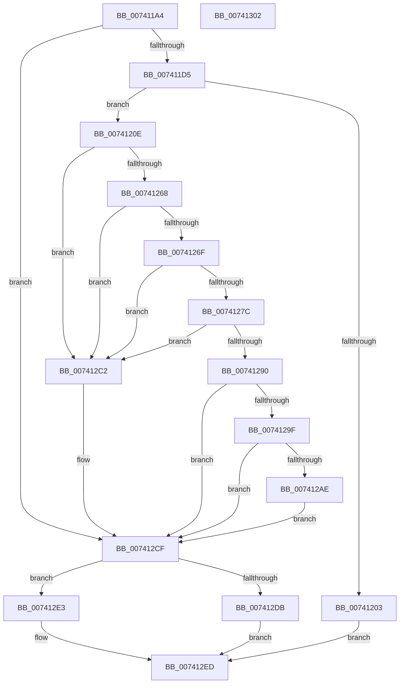

# PiDrvDbGetNodeSystemRoot

- RVA: `0x007411A4`–`0x00741303` (길이 `351` bytes)
- VA: `0x00000001407411A4`
- 실행 섹션: `PAGE`
- PDB 이름 있음: `예`; PDB Function 태그: `아니요`
- unwind 정보 RVA: `0x000C9314`
- 디코드: `85`개 명령, `351/351` bytes 표시
- 미해석 바이트: `0` (있으면 어셈블리에 `.byte`로 보존)

> 이 문서는 커널 이미지의 기계어와 PDB 기호를 분석해 생성했습니다. 4번과 5번은 함수 원형과 자료형을 바이너리 사용 방식에서 추정한 C 해석이며 원본 소스 복구 결과는 아닙니다.

## 1. Dependencies

- 직접 호출 지점: **2**; 고유 호출 대상: **2**
- 직접 호출자로 확인된 함수: **3**
- RIP 상대 이미지 참조: **2**

### Outgoing calls
- `0x007411EF` → [ExAllocatePool2](../../poolcode/B8/ExAllocatePool2_function_00B820F0.md) (function, `0x00B820F0`)
- `0x0074125C` → [PnpGetObjectProperty](../8E/PnpGetObjectProperty_function_008E2180.md) (function, `0x008E2180`)

### Direct callers
- [PiDrvDbQuerySystemPathWin32](PiDrvDbQuerySystemPathWin32_function_007421F4.md) at `0x00742567`
- [PiDrvDbResolveKeyFilePaths](PiDrvDbResolveKeyFilePaths_function_0074326C.md) at `0x0074335F`
- [PiDrvDbResolveNodeFilePaths](PiDrvDbResolveNodeFilePaths_function_007433A4.md) at `0x007434C2`

### Static image references
- `0x0074123F` → RVA `0x00E66398` (`.data`; read)
- `0x0074124B` → RVA `0x00022D88` (`.rdata`; read)

## 2. Other-region calls and transfers

- 다른 실행 섹션으로 향하는 call: **1**
  - `0x007411EF` → [ExAllocatePool2](../../poolcode/B8/ExAllocatePool2_function_00B820F0.md) (`PAGE` → `POOLCODE`)
- 별도 외부 분기/꼬리 이동을 확인하지 못했습니다.

## 3. Assembly (complete function range)

```asm
007411A4  48 8B C4                        mov rax, rsp
007411A7  48 89 58 18                     mov qword ptr [rax + 0x18], rbx
007411AB  48 89 70 20                     mov qword ptr [rax + 0x20], rsi
007411AF  57                              push rdi
007411B0  48 83 EC 60                     sub rsp, 0x60
007411B4  33 F6                           xor esi, esi
007411B6  48 8B FA                        mov rdi, rdx
007411B9  48 8B D9                        mov rbx, rcx
007411BC  44 8B C6                        mov r8d, esi
007411BF  89 70 08                        mov dword ptr [rax + 8], esi
007411C2  89 70 10                        mov dword ptr [rax + 0x10], esi
007411C5  48 89 32                        mov qword ptr [rdx], rsi
007411C8  48 39 B1 00 02 00 00            cmp qword ptr [rcx + 0x200], rsi
007411CF  0F 85 FA 00 00 00               jne 0x1407412cf
007411D5  C7 81 F8 01 00 00 00 00 08 02   mov dword ptr [rcx + 0x1f8], 0x2080000
007411DF  BA 08 02 00 00                  mov edx, 0x208
007411E4  B9 00 01 00 00                  mov ecx, 0x100
007411E9  41 B8 53 74 72 67               mov r8d, 0x67727453
007411EF  E8 FC 0E 44 00                  call 0x140b820f0
007411F4  48 89 83 00 02 00 00            mov qword ptr [rbx + 0x200], rax
007411FB  48 8B C8                        mov rcx, rax
007411FE  48 85 C0                        test rax, rax
00741201  75 0B                           jne 0x14074120e
00741203  41 B8 9A 00 00 C0               mov r8d, 0xc000009a
00741209  E9 DF 00 00 00                  jmp 0x1407412ed
0074120E  0F B7 83 FA 01 00 00            movzx eax, word ptr [rbx + 0x1fa]
00741215  48 8D 54 24 78                  lea rdx, [rsp + 0x78]
0074121A  4C 8B 4B 48                     mov r9, qword ptr [rbx + 0x48]
0074121E  41 B8 07 00 00 00               mov r8d, 7
00741224  89 74 24 50                     mov dword ptr [rsp + 0x50], esi
00741228  48 89 54 24 48                  mov qword ptr [rsp + 0x48], rdx
0074122D  48 8B 53 18                     mov rdx, qword ptr [rbx + 0x18]
00741231  89 44 24 40                     mov dword ptr [rsp + 0x40], eax
00741235  48 8D 44 24 70                  lea rax, [rsp + 0x70]
0074123A  48 89 4C 24 38                  mov qword ptr [rsp + 0x38], rcx
0074123F  48 8B 0D 52 51 72 00            mov rcx, qword ptr [rip + 0x725152]
00741246  48 89 44 24 30                  mov qword ptr [rsp + 0x30], rax
0074124B  48 8D 05 36 1B 8E FF            lea rax, [rip - 0x71e4ca]
00741252  48 89 44 24 28                  mov qword ptr [rsp + 0x28], rax
00741257  48 89 74 24 20                  mov qword ptr [rsp + 0x20], rsi
0074125C  E8 1F 0F 1A 00                  call 0x1408e2180
00741261  44 8B C0                        mov r8d, eax
00741264  85 C0                           test eax, eax
00741266  78 5A                           js 0x1407412c2
00741268  83 7C 24 70 12                  cmp dword ptr [rsp + 0x70], 0x12
0074126D  75 53                           jne 0x1407412c2
0074126F  8B 54 24 78                     mov edx, dword ptr [rsp + 0x78]
00741273  B8 02 00 00 00                  mov eax, 2
00741278  3B D0                           cmp edx, eax
0074127A  76 46                           jbe 0x1407412c2
0074127C  4C 8B 8B 00 02 00 00            mov r9, qword ptr [rbx + 0x200]
00741283  8B CA                           mov ecx, edx
00741285  48 D1 E9                        shr rcx, 1
00741288  66 41 39 74 49 FE               cmp word ptr [r9 + rcx*2 - 2], si
0074128E  75 32                           jne 0x1407412c2
00741290  66 2B D0                        sub dx, ax
00741293  66 89 93 F8 01 00 00            mov word ptr [rbx + 0x1f8], dx
0074129A  66 3B D0                        cmp dx, ax
0074129D  76 30                           jbe 0x1407412cf
0074129F  0F B7 C2                        movzx eax, dx
007412A2  48 D1 E8                        shr rax, 1
007412A5  66 41 83 7C 41 FE 5C            cmp word ptr [r9 + rax*2 - 2], 0x5c
007412AC  75 21                           jne 0x1407412cf
007412AE  66 41 89 74 41 FE               mov word ptr [r9 + rax*2 - 2], si
007412B4  B8 FE FF 00 00                  mov eax, 0xfffe
007412B9  66 01 83 F8 01 00 00            add word ptr [rbx + 0x1f8], ax
007412C0  EB 0D                           jmp 0x1407412cf
007412C2  48 8B 83 00 02 00 00            mov rax, qword ptr [rbx + 0x200]
007412C9  44 8B C6                        mov r8d, esi
007412CC  66 89 30                        mov word ptr [rax], si
007412CF  48 8B 83 00 02 00 00            mov rax, qword ptr [rbx + 0x200]
007412D6  66 39 30                        cmp word ptr [rax], si
007412D9  75 08                           jne 0x1407412e3
007412DB  41 B8 25 02 00 C0               mov r8d, 0xc0000225
007412E1  EB 0A                           jmp 0x1407412ed
007412E3  48 8D 83 F8 01 00 00            lea rax, [rbx + 0x1f8]
007412EA  48 89 07                        mov qword ptr [rdi], rax
007412ED  4C 8D 5C 24 60                  lea r11, [rsp + 0x60]
007412F2  41 8B C0                        mov eax, r8d
007412F5  49 8B 5B 20                     mov rbx, qword ptr [r11 + 0x20]
007412F9  49 8B 73 28                     mov rsi, qword ptr [r11 + 0x28]
007412FD  49 8B E3                        mov rsp, r11
00741300  5F                              pop rdi
00741301  C3                              ret
00741302  CC                              int3
```

## 4. C-style interpretation (structured pseudocode)

```c
__int64 __fastcall PiDrvDbGetNodeSystemRoot(__int64 a1, __int64 a2)
{
    __int64 result;
    __int64 v_rsi;
    __int64 v_rsp;
    unsigned int v_stack_m18;
    unsigned __int64 v_stack_m20;
    unsigned int v_stack_m28;
    unsigned __int64 v_stack_m30;
    unsigned __int64 v_stack_m38;
    unsigned __int64 v_stack_m40;
    unsigned __int64 v_stack_m48;
    unsigned __int64 v_stack_m8;
    unsigned __int64 v_stack_p10;
    unsigned __int64 v_stack_p8;

    *(unsigned __int64 *)(v_rsp + 24) = v_rbx;
    *(unsigned __int64 *)(v_rsp + 32) = v_rsi;
    v_rsp = (v_rsp) - (96);
    v_rsi = 0;
    *(unsigned int *)(v_rsp + 8) = 0;
    *(unsigned int *)(v_rsp + 16) = 0;
    *(unsigned __int64 *)(a2) = 0;
    if ((*(unsigned __int64 *)(a1 + 512)) != 0) goto loc_007412CF;
    *(unsigned int *)(a1 + 504) = 0x2080000ULL;
    result = ExAllocatePool2(256, 520, (unsigned int)(0x67727453ULL), a4);
    *(unsigned __int64 *)(a1 + 512) = result;
    if (result != 0) goto loc_0074120E;
    goto loc_007412ED;
loc_0074120E:
    v_stack_m18 = 0;
    v_stack_m20 = v_stack_p10;
    v_stack_m28 = (unsigned int)(*(unsigned __int16 *)(a1 + 506));
    v_stack_m30 = result;
    v_stack_m38 = v_stack_p8;
    v_stack_m40 = v_rip - 7464138;
    v_stack_m48 = 0;
    result = PnpGetObjectProperty(*(unsigned __int64 *)(v_rip + 7491922), *(unsigned __int64 *)(a1 + 24), 7, *(unsigned __int64 *)(a1 + 72));
    if (sign_flag) goto loc_007412C2;
    if (v_stack_p8 != 18) goto loc_007412C2;
    if (((unsigned int)((unsigned int)(v_stack_p10))) <= 2) goto loc_007412C2;
    a1 = ((unsigned int)((unsigned int)((unsigned int)(v_stack_p10)))) >> (1);
    if ((*(unsigned __int16 *)(*(unsigned __int64 *)(a1 + 512) + a1 * 2 - 2)) != 0) goto loc_007412C2;
    a2 = (unsigned __int16)(((unsigned int)(v_stack_p10)) - (2));
    *(unsigned __int16 *)(a1 + 504) = (unsigned __int16)(a2);
    if (((unsigned __int16)(a2)) <= 2) goto loc_007412CF;
    result = ((unsigned __int16)(a2)) >> (1);
    if ((*(unsigned __int16 *)(*(unsigned __int64 *)(a1 + 512) + result * 2 - 2)) != 92) goto loc_007412CF;
    *(unsigned __int16 *)(*(unsigned __int64 *)(a1 + 512) + result * 2 - 2) = 0;
    goto loc_007412CF;
loc_007412C2:
    *(unsigned __int16 *)(*(unsigned __int64 *)(a1 + 512)) = 0;
loc_007412CF:
    if ((*(unsigned __int16 *)(*(unsigned __int64 *)(a1 + 512))) != 0) goto loc_007412E3;
    goto loc_007412ED;
loc_007412E3:
    *(unsigned __int64 *)(a2) = a1 + 504;
loc_007412ED:
    return (unsigned int)((unsigned int)((unsigned int)(0xC0000225ULL)));
}
```

## 5. (Beta) C Style

```c
int64_t PiDrvDbGetNodeSystemRoot(void *Arg1, void *Arg2)
{
    uint8_t *arg1 = (uint8_t *)Arg1;
    uint8_t *arg2 = (uint8_t *)Arg2;

    int64_t result;
    int64_t local_rsi;
    int64_t local_rsp;
    uint32_t v_stack_m18;
    uint64_t v_stack_m20;
    uint32_t v_stack_m28;
    uint64_t v_stack_m30;
    uint64_t v_stack_m38;
    uint64_t v_stack_m40;
    uint64_t v_stack_m48;
    uint64_t v_stack_m8;
    uint64_t v_stack_p10;
    uint64_t v_stack_p8;

    *(uint64_t *)(local_rsp + 0x18) = local_rbx;
    *(uint64_t *)(local_rsp + 0x20) = local_rsi;
    local_rsp = (local_rsp) - (96);
    local_rsi = 0;
    *(uint32_t *)(local_rsp + 0x8) = 0;
    *(uint32_t *)(local_rsp + 0x10) = 0;
    *(uint64_t *)(arg2) = 0;
    if ((*(uint64_t *)(arg1 + 0x200)) != 0) goto loc_007412CF;
    *(uint32_t *)(arg1 + 0x1F8) = 0x2080000ULL;
    result = ExAllocatePool2(256, 520, (uint32_t)(0x67727453ULL), a4);
    *(uint64_t *)(arg1 + 0x200) = result;
    if (result != 0) goto loc_0074120E;
    goto loc_007412ED;
loc_0074120E:
    v_stack_m18 = 0;
    v_stack_m20 = v_stack_p10;
    v_stack_m28 = (uint32_t)(*(uint16_t *)(arg1 + 0x1FA));
    v_stack_m30 = result;
    v_stack_m38 = v_stack_p8;
    v_stack_m40 = v_rip - 7464138;
    v_stack_m48 = 0;
    result = PnpGetObjectProperty(*(uint64_t *)(v_rip + 0x725152), *(uint64_t *)(arg1 + 0x18), 7, *(uint64_t *)(arg1 + 0x48));
    if (sign_flag) goto loc_007412C2;
    if (v_stack_p8 != 18) goto loc_007412C2;
    if (((uint32_t)((uint32_t)(v_stack_p10))) <= 2) goto loc_007412C2;
    Arg1 = ((uint32_t)((uint32_t)((uint32_t)(v_stack_p10)))) >> (1);
    if ((*(uint16_t *)(*(uint64_t *)(arg1 + 0x200) + arg1 * 2 - 0x2)) != 0) goto loc_007412C2;
    Arg2 = (uint16_t)(((uint32_t)(v_stack_p10)) - (2));
    *(uint16_t *)(arg1 + 0x1F8) = (uint16_t)(Arg2);
    if (((uint16_t)(Arg2)) <= 2) goto loc_007412CF;
    result = ((uint16_t)(Arg2)) >> (1);
    if ((*(uint16_t *)(*(uint64_t *)(arg1 + 0x200) + result * 2 - 0x2)) != 92) goto loc_007412CF;
    *(uint16_t *)(*(uint64_t *)(arg1 + 0x200) + result * 2 - 0x2) = 0;
    goto loc_007412CF;
loc_007412C2:
    *(uint16_t *)(*(uint64_t *)(arg1 + 0x200)) = 0;
loc_007412CF:
    if ((*(uint16_t *)(*(uint64_t *)(arg1 + 0x200))) != 0) goto loc_007412E3;
    goto loc_007412ED;
loc_007412E3:
    *(void **)(arg2) = Arg1 + 504;
loc_007412ED:
    return (uint32_t)((uint32_t)((uint32_t)(0xC0000225ULL)));
}
```

### 관측된 메모리 오프셋

구조체 형식이 확인되지 않은 접근은 인자 기준의 오프셋으로만 기록했습니다.

| 기준 인자 | 오프셋 표현 | 폭 (bit) | 접근 |
|---|---:|---:|---|
| `Arg1` | `+ 0x18` | `64` | `R` |
| `Arg1` | `+ 0x48` | `64` | `R` |
| `Arg1` | `+ 0x1F8` | `16` | `R/W` |
| `Arg1` | `+ 0x1F8` | `16` | `W` |
| `Arg1` | `+ 0x1F8` | `32` | `W` |
| `Arg1` | `+ 0x1F8` | `64` | `R` |
| `Arg1` | `+ 0x1FA` | `16` | `R` |
| `Arg1` | `+ 0x200` | `64` | `R` |
| `Arg1` | `+ 0x200` | `64` | `W` |
| `Arg2` | `+ 0x0` | `64` | `W` |

## 6. Execution-region graph

[열기: 2D/3D 그래프와 함수 탐색 컨트롤 패널](../../../control-panel.html?section=page&rva=0x007411A4&view=graph)

- 2D 그래프는 위에서 아래로 흐르고, 3D 그래프는 빈 공간을 드래그해 회전합니다. Shift+드래그는 이동, 휠은 확대·축소, 함수 노드 선택은 대상 보고서 이동입니다.

### Static fallback


