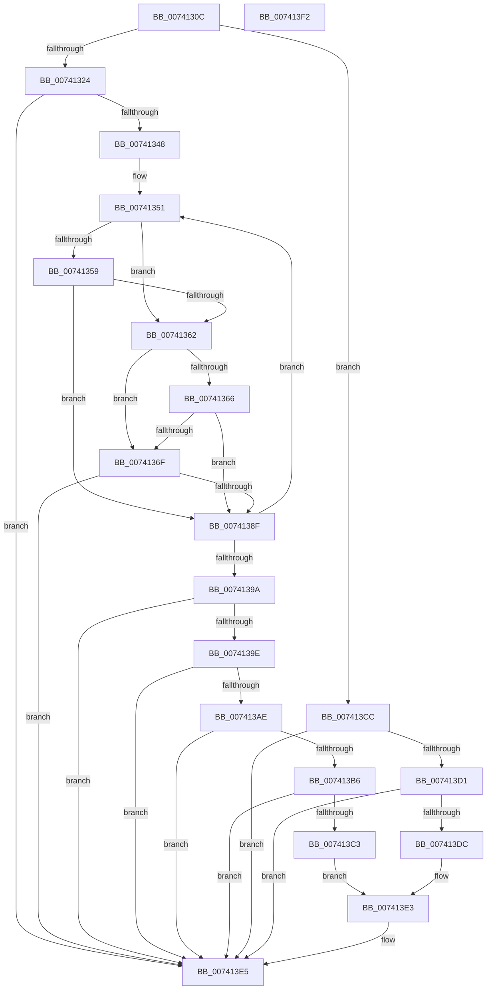

# PiDrvDbInit

- RVA: `0x0074130C`–`0x007413F3` (길이 `231` bytes)
- VA: `0x000000014074130C`
- 실행 섹션: `PAGE`
- PDB 이름 있음: `예`; PDB Function 태그: `아니요`
- unwind 정보 RVA: `0x0008A658`
- 디코드: `74`개 명령, `231/231` bytes 표시
- 미해석 바이트: `0` (있으면 어셈블리에 `.byte`로 보존)

> 이 문서는 커널 이미지의 기계어와 PDB 기호를 분석해 생성했습니다. 4번과 5번은 함수 원형과 자료형을 바이너리 사용 방식에서 추정한 C 해석이며 원본 소스 복구 결과는 아닙니다.

## 1. Dependencies

- 직접 호출 지점: **9**; 고유 호출 대상: **6**
- 직접 호출자로 확인된 함수: **1**
- RIP 상대 이미지 참조: **4**

### Outgoing calls
- `0x00741339` → [DrvDbOpenContext](../83/DrvDbOpenContext_function_00834F8C.md) (function, `0x00834F8C`)
- `0x00741359` → [CmIsStateSeparationEnabled](../../text/4A/CmIsStateSeparationEnabled_function_004A4754.md) (function, `0x004A4754`)
- `0x00741366` → [CmIsStateSeparationEnabled](../../text/4A/CmIsStateSeparationEnabled_function_004A4754.md) (function, `0x004A4754`)
- `0x00741384` → [PiDrvDbRegisterNode](PiDrvDbRegisterNode_function_00742658.md) (function, `0x00742658`)
- `0x007413A3` → [PiDrvDbEnumDriverStoreNodes](PiDrvDbEnumDriverStoreNodes_function_00740EF8.md) (function, `0x00740EF8`)
- `0x007413B8` → [PiDrvDbSuspendNodes](PiDrvDbSuspendNodes_function_00743E98.md) (function, `0x00743E98`)
- `0x007413C5` → [PiDrvDbSetupNodes](PiDrvDbSetupNodes_function_00743D0C.md) (function, `0x00743D0C`)
- `0x007413D1` → [PiDrvDbSetupNodes](PiDrvDbSetupNodes_function_00743D0C.md) (function, `0x00743D0C`)
- `0x007413DE` → [PiDrvDbSuspendNodes](PiDrvDbSuspendNodes_function_00743E98.md) (function, `0x00743E98`)

### Direct callers
- [PiPnpRtlInit](../73/PiPnpRtlInit_function_007300A4.md) at `0x00730243`

### Static image references
- `0x00741324` → RVA `0x00F8A870` (`.data`; read)
- `0x0074132B` → RVA `0x00F8A878` (`.data`; write)
- `0x00741332` → RVA `0x00F8A870` (`.data`; write)
- `0x0074134A` → RVA `0x0000A158` (`.rdata`; read)

## 2. Other-region calls and transfers

- 다른 실행 섹션으로 향하는 call: **2**
  - `0x00741359` → [CmIsStateSeparationEnabled](../../text/4A/CmIsStateSeparationEnabled_function_004A4754.md) (`PAGE` → `.text`)
  - `0x00741366` → [CmIsStateSeparationEnabled](../../text/4A/CmIsStateSeparationEnabled_function_004A4754.md) (`PAGE` → `.text`)
- 별도 외부 분기/꼬리 이동을 확인하지 못했습니다.

## 3. Assembly (complete function range)

```asm
0074130C  48 89 5C 24 10                  mov qword ptr [rsp + 0x10], rbx
00741311  57                              push rdi
00741312  48 83 EC 30                     sub rsp, 0x30
00741316  33 D2                           xor edx, edx
00741318  21 54 24 40                     and dword ptr [rsp + 0x40], edx
0074131C  85 C9                           test ecx, ecx
0074131E  0F 85 A8 00 00 00               jne 0x1407413cc
00741324  48 8D 05 45 95 84 00            lea rax, [rip + 0x849545]
0074132B  48 89 05 46 95 84 00            mov qword ptr [rip + 0x849546], rax
00741332  48 89 05 37 95 84 00            mov qword ptr [rip + 0x849537], rax
00741339  E8 4E 3C 0F 00                  call 0x140834f8c
0074133E  8B D0                           mov edx, eax
00741340  85 C0                           test eax, eax
00741342  0F 88 9D 00 00 00               js 0x1407413e5
00741348  33 FF                           xor edi, edi
0074134A  48 8D 1D 07 8E 8C FF            lea rbx, [rip - 0x7371f9]
00741351  8B 4B F0                        mov ecx, dword ptr [rbx - 0x10]
00741354  F6 C1 04                        test cl, 4
00741357  74 09                           je 0x140741362
00741359  E8 F6 33 D6 FF                  call 0x1404a4754
0074135E  84 C0                           test al, al
00741360  75 2D                           jne 0x14074138f
00741362  84 C9                           test cl, cl
00741364  79 09                           jns 0x14074136f
00741366  E8 E9 33 D6 FF                  call 0x1404a4754
0074136B  84 C0                           test al, al
0074136D  74 20                           je 0x14074138f
0074136F  48 8B 03                        mov rax, qword ptr [rbx]
00741372  8B D1                           mov edx, ecx
00741374  48 8B 4B E8                     mov rcx, qword ptr [rbx - 0x18]
00741378  45 33 C9                        xor r9d, r9d
0074137B  4C 8B 43 F8                     mov r8, qword ptr [rbx - 8]
0074137F  48 89 44 24 20                  mov qword ptr [rsp + 0x20], rax
00741384  E8 CF 12 00 00                  call 0x140742658
00741389  8B D0                           mov edx, eax
0074138B  85 C0                           test eax, eax
0074138D  78 56                           js 0x1407413e5
0074138F  FF C7                           inc edi
00741391  48 83 C3 20                     add rbx, 0x20
00741395  83 FF 03                        cmp edi, 3
00741398  72 B7                           jb 0x140741351
0074139A  85 D2                           test edx, edx
0074139C  78 47                           js 0x1407413e5
0074139E  48 8D 54 24 40                  lea rdx, [rsp + 0x40]
007413A3  E8 50 FB FF FF                  call 0x140740ef8
007413A8  8B D0                           mov edx, eax
007413AA  85 C0                           test eax, eax
007413AC  78 37                           js 0x1407413e5
007413AE  8B 54 24 40                     mov edx, dword ptr [rsp + 0x40]
007413B2  85 D2                           test edx, edx
007413B4  78 2F                           js 0x1407413e5
007413B6  B1 01                           mov cl, 1
007413B8  E8 DB 2A 00 00                  call 0x140743e98
007413BD  8B D0                           mov edx, eax
007413BF  85 C0                           test eax, eax
007413C1  78 22                           js 0x1407413e5
007413C3  33 C9                           xor ecx, ecx
007413C5  E8 42 29 00 00                  call 0x140743d0c
007413CA  EB 17                           jmp 0x1407413e3
007413CC  83 F9 02                        cmp ecx, 2
007413CF  75 14                           jne 0x1407413e5
007413D1  E8 36 29 00 00                  call 0x140743d0c
007413D6  8B D0                           mov edx, eax
007413D8  85 C0                           test eax, eax
007413DA  78 09                           js 0x1407413e5
007413DC  33 C9                           xor ecx, ecx
007413DE  E8 B5 2A 00 00                  call 0x140743e98
007413E3  8B D0                           mov edx, eax
007413E5  48 8B 5C 24 48                  mov rbx, qword ptr [rsp + 0x48]
007413EA  8B C2                           mov eax, edx
007413EC  48 83 C4 30                     add rsp, 0x30
007413F0  5F                              pop rdi
007413F1  C3                              ret
007413F2  CC                              int3
```

## 4. C-style interpretation (structured pseudocode)

```c
__int64 __fastcall PiDrvDbInit(int a1, int a2, __int64 a3, int a4)
{
    __int64 result;
    __int64 v_rbx;
    __int64 v_rdi;
    __int64 v_rsp;
    unsigned __int64 v_stack_m18;
    unsigned __int64 v_stack_p10;
    unsigned int v_stack_p8;

    v_stack_p10 = v_rbx;
    v_rsp = (v_rsp) - (48);
    a2 = 0;
    if (a1 != 0) goto loc_007413CC;
    *(unsigned __int64 *)(v_rip + 8688966) = v_rip + 8688965;
    *(unsigned __int64 *)(v_rip + 8688951) = v_rip + 8688965;
    result = DrvDbOpenContext(a1, a2, a3, a4);
    if (sign_flag) goto loc_007413E5;
    v_rdi = 0;
loc_00741351:
    if ((((unsigned __int8)((unsigned int)(*(unsigned int *)(v_rip - 7565817 - 16)))) & (4)) == 0) goto loc_00741362;
    result = CmIsStateSeparationEnabled((unsigned int)(*(unsigned int *)(v_rip - 7565817 - 16)), (unsigned int)((unsigned int)(result)), a3, a4);
    if ((unsigned __int8)(result) != 0) goto loc_0074138F;
loc_00741362:
    if (!sign_flag) goto loc_0074136F;
    result = CmIsStateSeparationEnabled((unsigned int)(*(unsigned int *)(v_rip - 7565817 - 16)), (unsigned int)((unsigned int)(result)), a3, a4);
    if ((unsigned __int8)(result) == 0) goto loc_0074138F;
loc_0074136F:
    a4 = 0;
    v_stack_m18 = *(unsigned __int64 *)(v_rip - 7565817);
    result = PiDrvDbRegisterNode(*(unsigned __int64 *)(v_rip - 7565817 - 24), (unsigned int)((unsigned int)((unsigned int)(*(unsigned int *)(v_rip - 7565817 - 16)))), *(unsigned __int64 *)(v_rip - 7565817 - 8), a4);
    if (sign_flag) goto loc_007413E5;
loc_0074138F:
    v_rdi = (unsigned int)((v_rdi) + 1);
    v_rbx = (v_rip - 7565817) + (32);
    if (((unsigned int)(v_rdi)) < 3) goto loc_00741351;
    if (sign_flag) goto loc_007413E5;
    result = PiDrvDbEnumDriverStoreNodes(*(unsigned __int64 *)(v_rip - 7565817 - 24), v_stack_p8, *(unsigned __int64 *)(v_rip - 7565817 - 8), a4);
    if (sign_flag) goto loc_007413E5;
    if (sign_flag) goto loc_007413E5;
    result = PiDrvDbSuspendNodes(1, (unsigned int)(v_stack_p8), *(unsigned __int64 *)(v_rip - 7565817 - 8), a4);
    if (sign_flag) goto loc_007413E5;
    a1 = 0;
    result = PiDrvDbSetupNodes(a1, (unsigned int)((unsigned int)(result)), *(unsigned __int64 *)(v_rip - 7565817 - 8), a4);
    goto loc_007413E3;
loc_007413CC:
    if (0 != 2) goto loc_007413E5;
    result = PiDrvDbSetupNodes(a1, (unsigned int)((unsigned int)(result)), *(unsigned __int64 *)(v_rip - 7565817 - 8), a4);
    if (sign_flag) goto loc_007413E5;
    a1 = 0;
    result = PiDrvDbSuspendNodes(a1, (unsigned int)((unsigned int)(result)), *(unsigned __int64 *)(v_rip - 7565817 - 8), a4);
loc_007413E3:
loc_007413E5:
    v_rsp = (v_rsp) + (48);
    return (unsigned int)((unsigned int)((unsigned int)((unsigned int)(result))));
}
```

## 5. (Beta) C Style

```c
int64_t PiDrvDbInit(int32_t Arg1, int32_t Arg2, int64_t Arg3, int32_t Arg4)
{
    int64_t result;
    int64_t local_rbx;
    int64_t local_rdi;
    int64_t local_rsp;
    uint64_t v_stack_m18;
    uint64_t v_stack_p10;
    uint32_t v_stack_p8;

    v_stack_p10 = local_rbx;
    local_rsp = (local_rsp) - (48);
    Arg2 = 0;
    if (Arg1 != 0) goto loc_007413CC;
    *(uint64_t *)(v_rip + 0x849546) = v_rip + 8688965;
    *(uint64_t *)(v_rip + 0x849537) = v_rip + 8688965;
    result = DrvDbOpenContext(Arg1, Arg2, Arg3, Arg4);
    if (sign_flag) goto loc_007413E5;
    local_rdi = 0;
loc_00741351:
    if ((((uint8_t)((uint32_t)(*(uint32_t *)(v_rip - 0x7371F9 - 0x10)))) & (4)) == 0) goto loc_00741362;
    result = CmIsStateSeparationEnabled((uint32_t)(*(uint32_t *)(v_rip - 0x7371F9 - 0x10)), (uint32_t)((uint32_t)(result)), Arg3, Arg4);
    if ((uint8_t)(result) != 0) goto loc_0074138F;
loc_00741362:
    if (!sign_flag) goto loc_0074136F;
    result = CmIsStateSeparationEnabled((uint32_t)(*(uint32_t *)(v_rip - 0x7371F9 - 0x10)), (uint32_t)((uint32_t)(result)), Arg3, Arg4);
    if ((uint8_t)(result) == 0) goto loc_0074138F;
loc_0074136F:
    Arg4 = 0;
    v_stack_m18 = *(uint64_t *)(v_rip - 0x7371F9);
    result = PiDrvDbRegisterNode(*(uint64_t *)(v_rip - 0x7371F9 - 0x18), (uint32_t)((uint32_t)((uint32_t)(*(uint32_t *)(v_rip - 0x7371F9 - 0x10)))), *(uint64_t *)(v_rip - 0x7371F9 - 0x8), Arg4);
    if (sign_flag) goto loc_007413E5;
loc_0074138F:
    local_rdi = (uint32_t)((local_rdi) + 1);
    local_rbx = (v_rip - 7565817) + (32);
    if (((uint32_t)(local_rdi)) < 3) goto loc_00741351;
    if (sign_flag) goto loc_007413E5;
    result = PiDrvDbEnumDriverStoreNodes(*(uint64_t *)(v_rip - 0x7371F9 - 0x18), v_stack_p8, *(uint64_t *)(v_rip - 0x7371F9 - 0x8), Arg4);
    if (sign_flag) goto loc_007413E5;
    if (sign_flag) goto loc_007413E5;
    result = PiDrvDbSuspendNodes(1, (uint32_t)(v_stack_p8), *(uint64_t *)(v_rip - 0x7371F9 - 0x8), Arg4);
    if (sign_flag) goto loc_007413E5;
    Arg1 = 0;
    result = PiDrvDbSetupNodes(Arg1, (uint32_t)((uint32_t)(result)), *(uint64_t *)(v_rip - 0x7371F9 - 0x8), Arg4);
    goto loc_007413E3;
loc_007413CC:
    if (0 != 2) goto loc_007413E5;
    result = PiDrvDbSetupNodes(Arg1, (uint32_t)((uint32_t)(result)), *(uint64_t *)(v_rip - 0x7371F9 - 0x8), Arg4);
    if (sign_flag) goto loc_007413E5;
    Arg1 = 0;
    result = PiDrvDbSuspendNodes(Arg1, (uint32_t)((uint32_t)(result)), *(uint64_t *)(v_rip - 0x7371F9 - 0x8), Arg4);
loc_007413E3:
loc_007413E5:
    local_rsp = (local_rsp) + (48);
    return (uint32_t)((uint32_t)((uint32_t)((uint32_t)(result))));
}
```

## 6. Execution-region graph

[열기: 2D/3D 그래프와 함수 탐색 컨트롤 패널](../../../control-panel.html?section=page&rva=0x0074130C&view=graph)

- 2D 그래프는 위에서 아래로 흐르고, 3D 그래프는 빈 공간을 드래그해 회전합니다. Shift+드래그는 이동, 휠은 확대·축소, 함수 노드 선택은 대상 보고서 이동입니다.

### Static fallback


