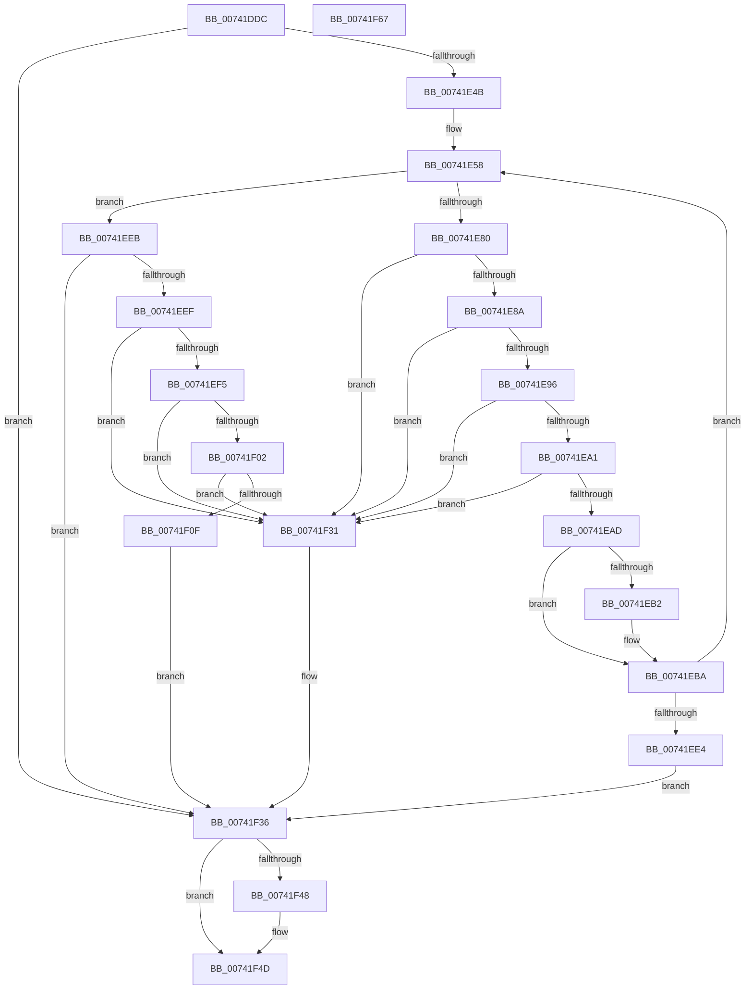

# PiDrvDbQueryHiveFileName

- RVA: `0x00741DDC`–`0x00741F68` (길이 `396` bytes)
- VA: `0x0000000140741DDC`
- 실행 섹션: `PAGE`
- PDB 이름 있음: `예`; PDB Function 태그: `아니요`
- unwind 정보 RVA: `0x000BD508`
- 디코드: `111`개 명령, `396/396` bytes 표시
- 미해석 바이트: `0` (있으면 어셈블리에 `.byte`로 보존)

> 이 문서는 커널 이미지의 기계어와 PDB 기호를 분석해 생성했습니다. 4번과 5번은 함수 원형과 자료형을 바이너리 사용 방식에서 추정한 C 해석이며 원본 소스 복구 결과는 아닙니다.

## 1. Dependencies

- 직접 호출 지점: **8**; 고유 호출 대상: **7**
- 직접 호출자로 확인된 함수: **1**
- RIP 상대 이미지 참조: **1**

### Outgoing calls
- `0x00741E15` → [RtlInitUnicodeString](../../text/42/RtlInitUnicodeString_function_0042A780.md) (function, `0x0042A780`)
- `0x00741E3C` → [PnpCtxRegOpenKey](../8E/PnpCtxRegOpenKey_function_008EF7B8.md) (function, `0x008EF7B8`)
- `0x00741E72` → [PnpCtxRegQueryValue](../99/PnpCtxRegQueryValue_function_009940FC.md) (function, `0x009940FC`)
- `0x00741EB5` → [ExFreePool](../../poolcode/B8/ExFreePool_function_00B82850.md) (function, `0x00B82850`)
- `0x00741ECF` → [ExAllocatePool2](../../poolcode/B8/ExAllocatePool2_function_00B820F0.md) (function, `0x00B820F0`)
- `0x00741F2A` → [RtlInitUnicodeString](../../text/42/RtlInitUnicodeString_function_0042A780.md) (function, `0x0042A780`)
- `0x00741F3A` → [RtlFreeAnsiString](../9C/RtlFreeAnsiString_function_009C0800.md) (function, `0x009C0800`)
- `0x00741F48` → [ZwClose](../../text/6A/ZwClose_function_006AD2B0.md) (function, `0x006AD2B0`)

### Direct callers
- [PiDrvDbMountNode](../AD/PiDrvDbMountNode_function_00AD4ECC.md) at `0x00AD4FF1`

### Static image references
- `0x00741E26` → RVA `0x00B00450` (` ?? ::NNGAKEGL::`string'`; read)

## 2. Other-region calls and transfers

- 다른 실행 섹션으로 향하는 call: **5**
  - `0x00741E15` → [RtlInitUnicodeString](../../text/42/RtlInitUnicodeString_function_0042A780.md) (`PAGE` → `.text`)
  - `0x00741EB5` → [ExFreePool](../../poolcode/B8/ExFreePool_function_00B82850.md) (`PAGE` → `POOLCODE`)
  - `0x00741ECF` → [ExAllocatePool2](../../poolcode/B8/ExAllocatePool2_function_00B820F0.md) (`PAGE` → `POOLCODE`)
  - `0x00741F2A` → [RtlInitUnicodeString](../../text/42/RtlInitUnicodeString_function_0042A780.md) (`PAGE` → `.text`)
  - `0x00741F48` → [ZwClose](../../text/6A/ZwClose_function_006AD2B0.md) (`PAGE` → `.text`)
- 별도 외부 분기/꼬리 이동을 확인하지 못했습니다.

## 3. Assembly (complete function range)

```asm
00741DDC  48 89 5C 24 08                  mov qword ptr [rsp + 8], rbx
00741DE1  55                              push rbp
00741DE2  56                              push rsi
00741DE3  57                              push rdi
00741DE4  41 54                           push r12
00741DE6  41 55                           push r13
00741DE8  41 56                           push r14
00741DEA  41 57                           push r15
00741DEC  48 8B EC                        mov rbp, rsp
00741DEF  48 83 EC 50                     sub rsp, 0x50
00741DF3  45 33 E4                        xor r12d, r12d
00741DF6  4C 8B FA                        mov r15, rdx
00741DF9  4C 8B F1                        mov r14, rcx
00741DFC  4C 89 65 E0                     mov qword ptr [rbp - 0x20], r12
00741E00  0F 57 C0                        xorps xmm0, xmm0
00741E03  44 89 65 58                     mov dword ptr [rbp + 0x58], r12d
00741E07  33 D2                           xor edx, edx
00741E09  44 89 65 50                     mov dword ptr [rbp + 0x50], r12d
00741E0D  48 8D 4D E8                     lea rcx, [rbp - 0x18]
00741E11  0F 11 45 E8                     movups xmmword ptr [rbp - 0x18], xmm0
00741E15  E8 66 89 CE FF                  call 0x14042a780
00741E1A  48 8D 45 E0                     lea rax, [rbp - 0x20]
00741E1E  45 33 C9                        xor r9d, r9d
00741E21  48 89 44 24 28                  mov qword ptr [rsp + 0x28], rax
00741E26  4C 8D 05 23 E6 3B 00            lea r8, [rip + 0x3be623]
00741E2D  BA 02 00 00 80                  mov edx, 0x80000002
00741E32  C7 44 24 20 01 00 00 00         mov dword ptr [rsp + 0x20], 1
00741E3A  33 C9                           xor ecx, ecx
00741E3C  E8 77 D9 1A 00                  call 0x1408ef7b8
00741E41  8B D8                           mov ebx, eax
00741E43  85 C0                           test eax, eax
00741E45  0F 88 EB 00 00 00               js 0x140741f36
00741E4B  48 8B 7D F0                     mov rdi, qword ptr [rbp - 0x10]
00741E4F  45 8D 6C 24 02                  lea r13d, [r12 + 2]
00741E54  0F B7 75 EA                     movzx esi, word ptr [rbp - 0x16]
00741E58  4D 8B 46 08                     mov r8, qword ptr [r14 + 8]
00741E5C  48 8D 45 58                     lea rax, [rbp + 0x58]
00741E60  48 8B 55 E0                     mov rdx, qword ptr [rbp - 0x20]
00741E64  4C 8D 4D 50                     lea r9, [rbp + 0x50]
00741E68  48 89 44 24 28                  mov qword ptr [rsp + 0x28], rax
00741E6D  48 89 7C 24 20                  mov qword ptr [rsp + 0x20], rdi
00741E72  E8 85 22 25 00                  call 0x1409940fc
00741E77  8B D8                           mov ebx, eax
00741E79  3D 23 00 00 C0                  cmp eax, 0xc0000023
00741E7E  75 6B                           jne 0x140741eeb
00741E80  83 7D 50 01                     cmp dword ptr [rbp + 0x50], 1
00741E84  0F 85 A7 00 00 00               jne 0x140741f31
00741E8A  8B 5D 58                        mov ebx, dword ptr [rbp + 0x58]
00741E8D  41 3B DD                        cmp ebx, r13d
00741E90  0F 82 9B 00 00 00               jb 0x140741f31
00741E96  0F B7 C6                        movzx eax, si
00741E99  3B D8                           cmp ebx, eax
00741E9B  0F 82 90 00 00 00               jb 0x140741f31
00741EA1  81 FB FE FF 00 00               cmp ebx, 0xfffe
00741EA7  0F 87 84 00 00 00               ja 0x140741f31
00741EAD  48 85 FF                        test rdi, rdi
00741EB0  74 08                           je 0x140741eba
00741EB2  48 8B CF                        mov rcx, rdi
00741EB5  E8 96 09 44 00                  call 0x140b82850
00741EBA  48 8B D3                        mov rdx, rbx
00741EBD  66 89 5D EA                     mov word ptr [rbp - 0x16], bx
00741EC1  B9 00 01 00 00                  mov ecx, 0x100
00741EC6  41 B8 53 74 72 67               mov r8d, 0x67727453
00741ECC  0F B7 F3                        movzx esi, bx
00741ECF  E8 1C 02 44 00                  call 0x140b820f0
00741ED4  48 89 45 F0                     mov qword ptr [rbp - 0x10], rax
00741ED8  48 8B F8                        mov rdi, rax
00741EDB  48 85 C0                        test rax, rax
00741EDE  0F 85 74 FF FF FF               jne 0x140741e58
00741EE4  BB 17 00 00 C0                  mov ebx, 0xc0000017
00741EE9  EB 4B                           jmp 0x140741f36
00741EEB  85 C0                           test eax, eax
00741EED  78 47                           js 0x140741f36
00741EEF  83 7D 50 01                     cmp dword ptr [rbp + 0x50], 1
00741EF3  75 3C                           jne 0x140741f31
00741EF5  8B 4D 58                        mov ecx, dword ptr [rbp + 0x58]
00741EF8  8D 41 FE                        lea eax, [rcx - 2]
00741EFB  3D FC FF 00 00                  cmp eax, 0xfffc
00741F00  77 2F                           ja 0x140741f31
00741F02  8B C1                           mov eax, ecx
00741F04  48 D1 E8                        shr rax, 1
00741F07  66 44 39 64 47 FE               cmp word ptr [rdi + rax*2 - 2], r12w
00741F0D  75 22                           jne 0x140741f31
00741F0F  66 89 4D EA                     mov word ptr [rbp - 0x16], cx
00741F13  33 D2                           xor edx, edx
00741F15  66 41 2B CD                     sub cx, r13w
00741F19  66 89 4D E8                     mov word ptr [rbp - 0x18], cx
00741F1D  48 8D 4D E8                     lea rcx, [rbp - 0x18]
00741F21  0F 10 45 E8                     movups xmm0, xmmword ptr [rbp - 0x18]
00741F25  F3 41 0F 7F 07                  movdqu xmmword ptr [r15], xmm0
00741F2A  E8 51 88 CE FF                  call 0x14042a780
00741F2F  EB 05                           jmp 0x140741f36
00741F31  BB 01 00 00 C0                  mov ebx, 0xc0000001
00741F36  48 8D 4D E8                     lea rcx, [rbp - 0x18]
00741F3A  E8 C1 E8 27 00                  call 0x1409c0800
00741F3F  48 8B 4D E0                     mov rcx, qword ptr [rbp - 0x20]
00741F43  48 85 C9                        test rcx, rcx
00741F46  74 05                           je 0x140741f4d
00741F48  E8 63 B3 F6 FF                  call 0x1406ad2b0
00741F4D  8B C3                           mov eax, ebx
00741F4F  48 8B 9C 24 90 00 00 00         mov rbx, qword ptr [rsp + 0x90]
00741F57  48 83 C4 50                     add rsp, 0x50
00741F5B  41 5F                           pop r15
00741F5D  41 5E                           pop r14
00741F5F  41 5D                           pop r13
00741F61  41 5C                           pop r12
00741F63  5F                              pop rdi
00741F64  5E                              pop rsi
00741F65  5D                              pop rbp
00741F66  C3                              ret
00741F67  CC                              int3
```

## 4. C-style interpretation (structured pseudocode)

```c
__int64 __fastcall PiDrvDbQueryHiveFileName(__int64 a1, __int64 a2, __int64 a3, int a4)
{
    __int64 result;
    __int64 v_r12;
    __int64 v_rsp;
    unsigned __int64 v_stack_m48;
    unsigned __int16 v_stack_m4E;
    unsigned __int64 v_stack_m50;
    unsigned __int64 v_stack_m58;
    unsigned __int64 v_stack_m60;
    unsigned int v_stack_m68;
    unsigned int v_stack_p18;
    unsigned int v_stack_p20;
    unsigned __int64 v_stack_p8;

    v_stack_p8 = v_rbx;
    v_rsp = (v_rsp) - (80);
    v_r12 = 0;
    v_stack_m58 = 0;
    v_stack_p20 = 0;
    a2 = 0;
    v_stack_p18 = 0;
    v_stack_m50 = v_xmm0;
    result = RtlInitUnicodeString(v_stack_m50, a2, a3, a4);
    a4 = 0;
    v_stack_m60 = v_stack_m58;
    v_stack_m68 = 1;
    a1 = 0;
    result = PnpCtxRegOpenKey(a1, (unsigned int)(0x80000002ULL), v_rip + 3925539, a4);
    if (sign_flag) goto loc_00741F36;
loc_00741E58:
    v_stack_m60 = v_stack_p20;
    v_stack_m68 = v_stack_m48;
    result = PnpCtxRegQueryValue(a1, v_stack_m58, *(unsigned __int64 *)(a1 + 8), v_stack_p18);
    if (((unsigned int)(result)) != 0xC0000023ULL) goto loc_00741EEB;
    if (v_stack_p18 != 1) goto loc_00741F31;
    if (((unsigned int)((unsigned int)(v_stack_p20))) < ((unsigned int)(v_r12 + 2))) goto loc_00741F31;
    if (((unsigned int)((unsigned int)(v_stack_p20))) < ((unsigned int)((unsigned __int16)(v_stack_m4E)))) goto loc_00741F31;
    if (((unsigned int)((unsigned int)(v_stack_p20))) > 0xFFFEULL) goto loc_00741F31;
    result = (unsigned __int16)(v_stack_m4E);
    if (v_stack_m48 != 0) {
        a1 = v_stack_m48;
        result = ExFreePool(a1, v_stack_m58, *(unsigned __int64 *)(a1 + 8), v_stack_p18);
    }
    v_stack_m4E = (unsigned __int16)((unsigned int)(v_stack_p20));
    result = ExAllocatePool2(256, (unsigned int)(v_stack_p20), (unsigned int)(0x67727453ULL), v_stack_p18);
    v_stack_m48 = result;
    if (result != 0) goto loc_00741E58;
    goto loc_00741F36;
loc_00741EEB:
    if (sign_flag) goto loc_00741F36;
    if (v_stack_p18 != 1) goto loc_00741F31;
    if (((unsigned int)((unsigned int)(v_stack_p20) - 2)) > 0xFFFCULL) goto loc_00741F31;
    result = ((unsigned int)((unsigned int)((unsigned int)(v_stack_p20)))) >> (1);
    if ((*(unsigned __int16 *)(result + result * 2 - 2)) != 0) goto loc_00741F31;
    v_stack_m4E = (unsigned __int16)((unsigned int)(v_stack_p20));
    a2 = 0;
    a1 = (unsigned __int16)(((unsigned int)(v_stack_p20)) - ((unsigned __int16)(v_r12 + 2)));
    v_stack_m50 = (unsigned __int16)(a1);
    *(unsigned __int64 *)(a2) = v_xmm0;
    result = RtlInitUnicodeString(v_stack_m50, a2, (unsigned int)(0x67727453ULL), v_stack_p18);
    goto loc_00741F36;
loc_00741F31:
loc_00741F36:
    result = RtlFreeAnsiString(v_stack_m50, a2, (unsigned int)(0x67727453ULL), v_stack_p18);
    if (v_stack_m58 != 0) {
        result = ZwClose(v_stack_m58, a2, (unsigned int)(0x67727453ULL), v_stack_p18);
    }
    v_rsp = (v_rsp) + (80);
    return (unsigned int)((unsigned int)((unsigned int)(0xC0000001ULL)));
}
```

## 5. (Beta) C Style

```c
int64_t PiDrvDbQueryHiveFileName(void *Arg1, void *Arg2, int64_t Arg3, int32_t Arg4)
{
    uint8_t *arg1 = (uint8_t *)Arg1;
    uint8_t *arg2 = (uint8_t *)Arg2;

    int64_t result;
    int64_t local_r12;
    int64_t local_rsp;
    uint64_t v_stack_m48;
    uint16_t v_stack_m4E;
    uint64_t v_stack_m50;
    uint64_t v_stack_m58;
    uint64_t v_stack_m60;
    uint32_t v_stack_m68;
    uint32_t v_stack_p18;
    uint32_t v_stack_p20;
    uint64_t v_stack_p8;

    v_stack_p8 = local_rbx;
    local_rsp = (local_rsp) - (80);
    local_r12 = 0;
    v_stack_m58 = 0;
    v_stack_p20 = 0;
    Arg2 = 0;
    v_stack_p18 = 0;
    v_stack_m50 = v_xmm0;
    result = RtlInitUnicodeString(v_stack_m50, Arg2, Arg3, Arg4);
    Arg4 = 0;
    v_stack_m60 = v_stack_m58;
    v_stack_m68 = 1;
    Arg1 = 0;
    result = PnpCtxRegOpenKey(Arg1, (uint32_t)(0x80000002ULL), v_rip + 3925539, Arg4);
    if (sign_flag) goto loc_00741F36;
loc_00741E58:
    v_stack_m60 = v_stack_p20;
    v_stack_m68 = v_stack_m48;
    result = PnpCtxRegQueryValue(Arg1, v_stack_m58, *(uint64_t *)(arg1 + 0x8), v_stack_p18);
    if (((uint32_t)(result)) != 0xC0000023ULL) goto loc_00741EEB;
    if (v_stack_p18 != 1) goto loc_00741F31;
    if (((uint32_t)((uint32_t)(v_stack_p20))) < ((uint32_t)(local_r12 + 2))) goto loc_00741F31;
    if (((uint32_t)((uint32_t)(v_stack_p20))) < ((uint32_t)((uint16_t)(v_stack_m4E)))) goto loc_00741F31;
    if (((uint32_t)((uint32_t)(v_stack_p20))) > 0xFFFEULL) goto loc_00741F31;
    result = (uint16_t)(v_stack_m4E);
    if (v_stack_m48 != 0) {
        Arg1 = v_stack_m48;
        result = ExFreePool(Arg1, v_stack_m58, *(uint64_t *)(arg1 + 0x8), v_stack_p18);
    }
    v_stack_m4E = (uint16_t)((uint32_t)(v_stack_p20));
    result = ExAllocatePool2(256, (uint32_t)(v_stack_p20), (uint32_t)(0x67727453ULL), v_stack_p18);
    v_stack_m48 = result;
    if (result != 0) goto loc_00741E58;
    goto loc_00741F36;
loc_00741EEB:
    if (sign_flag) goto loc_00741F36;
    if (v_stack_p18 != 1) goto loc_00741F31;
    if (((uint32_t)((uint32_t)(v_stack_p20) - 2)) > 0xFFFCULL) goto loc_00741F31;
    result = ((uint32_t)((uint32_t)((uint32_t)(v_stack_p20)))) >> (1);
    if ((*(uint16_t *)(result + result * 2 - 0x2)) != 0) goto loc_00741F31;
    v_stack_m4E = (uint16_t)((uint32_t)(v_stack_p20));
    Arg2 = 0;
    Arg1 = (uint16_t)(((uint32_t)(v_stack_p20)) - ((uint16_t)(local_r12 + 2)));
    v_stack_m50 = (uint16_t)(Arg1);
    *(uint64_t *)(arg2) = v_xmm0;
    result = RtlInitUnicodeString(v_stack_m50, Arg2, (uint32_t)(0x67727453ULL), v_stack_p18);
    goto loc_00741F36;
loc_00741F31:
loc_00741F36:
    result = RtlFreeAnsiString(v_stack_m50, Arg2, (uint32_t)(0x67727453ULL), v_stack_p18);
    if (v_stack_m58 != 0) {
        result = ZwClose(v_stack_m58, Arg2, (uint32_t)(0x67727453ULL), v_stack_p18);
    }
    local_rsp = (local_rsp) + (80);
    return (uint32_t)((uint32_t)((uint32_t)(0xC0000001ULL)));
}
```

### 관측된 메모리 오프셋

구조체 형식이 확인되지 않은 접근은 인자 기준의 오프셋으로만 기록했습니다.

| 기준 인자 | 오프셋 표현 | 폭 (bit) | 접근 |
|---|---:|---:|---|
| `Arg1` | `+ 0x8` | `64` | `R` |
| `Arg2` | `+ 0x0` | `128` | `W` |

## 6. Execution-region graph

[열기: 2D/3D 그래프와 함수 탐색 컨트롤 패널](../../../control-panel.html?section=page&rva=0x00741DDC&view=graph)

- 2D 그래프는 위에서 아래로 흐르고, 3D 그래프는 빈 공간을 드래그해 회전합니다. Shift+드래그는 이동, 휠은 확대·축소, 함수 노드 선택은 대상 보고서 이동입니다.

### Static fallback


