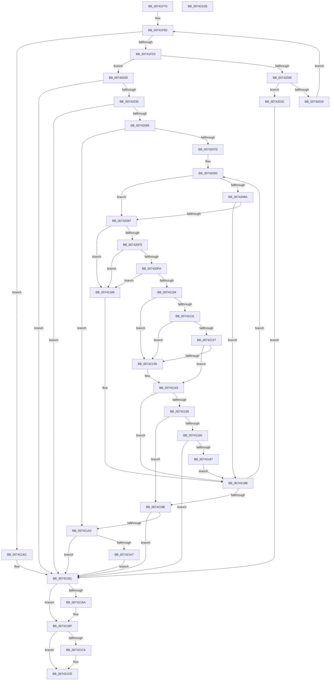

# PiDrvDbQuerySyncNodesUpdated

- RVA: `0x00741F70`–`0x007421EC` (길이 `636` bytes)
- VA: `0x0000000140741F70`
- 실행 섹션: `PAGE`
- PDB 이름 있음: `예`; PDB Function 태그: `아니요`
- unwind 정보 RVA: `0x000C9420`
- 디코드: `171`개 명령, `636/636` bytes 표시
- 미해석 바이트: `0` (있으면 어셈블리에 `.byte`로 보존)

> 이 문서는 커널 이미지의 기계어와 PDB 기호를 분석해 생성했습니다. 4번과 5번은 함수 원형과 자료형을 바이너리 사용 방식에서 추정한 C 해석이며 원본 소스 복구 결과는 아닙니다.

## 1. Dependencies

- 직접 호출 지점: **10**; 고유 호출 대상: **9**
- 직접 호출자로 확인된 함수: **1**
- RIP 상대 이미지 참조: **6**

### Outgoing calls
- `0x00741FBF` → [ExAllocatePool2](../../poolcode/B8/ExAllocatePool2_function_00B820F0.md) (function, `0x00B820F0`)
- `0x00741FF8` → [RtlGetPersistedStateLocation](../8C/RtlGetPersistedStateLocation_function_008C8DE0.md) (function, `0x008C8DE0`)
- `0x0074200B` → [ExFreePoolWithTag](../../poolcode/B8/ExFreePoolWithTag_function_00B82870.md) (function, `0x00B82870`)
- `0x00742057` → [PnpCtxRegCreateTree](../93/PnpCtxRegCreateTree_function_00931CA0.md) (function, `0x00931CA0`)
- `0x007420E3` → [PnpGetObjectProperty](../8E/PnpGetObjectProperty_function_008E2180.md) (function, `0x008E2180`)
- `0x00742126` → [PnpCtxRegQueryValue](../99/PnpCtxRegQueryValue_function_009940FC.md) (function, `0x009940FC`)
- `0x0074214E` → [RtlCompareMemory](../../text/6B/RtlCompareMemory_function_006BA670.md) (function, `0x006BA670`)
- `0x0074217C` → [PnpCtxRegSetValue](../99/PnpCtxRegSetValue_function_00991B8C.md) (function, `0x00991B8C`)
- `0x007421BA` → [ZwClose](../../text/6A/ZwClose_function_006AD2B0.md) (function, `0x006AD2B0`)
- `0x007421C9` → [ExFreePoolWithTag](../../poolcode/B8/ExFreePoolWithTag_function_00B82870.md) (function, `0x00B82870`)

### Direct callers
- [PpDevCfgInit](../../init/C3/PpDevCfgInit_function_00C351A4.md) at `0x00C3544C`
- [PpDevCfgInit](../../init/C3/PpDevCfgInit_function_00C351A4.md) at `0x00C354F4`

### Static image references
- `0x00741FDF` → RVA `0x00B00500` (` ?? ::NNGAKEGL::`string'`; read)
- `0x00741FEA` → RVA `0x00B00640` (` ?? ::NNGAKEGL::`string'`; read)
- `0x00742066` → RVA `0x00F8A870` (`.data`; read)
- `0x0074208A` → RVA `0x00E0A9E0` (`.data`; read)
- `0x007420AE` → RVA `0x00E66398` (`.data`; read)
- `0x007420D1` → RVA `0x00022EA0` (`.rdata`; read)

## 2. Other-region calls and transfers

- 다른 실행 섹션으로 향하는 call: **5**
  - `0x00741FBF` → [ExAllocatePool2](../../poolcode/B8/ExAllocatePool2_function_00B820F0.md) (`PAGE` → `POOLCODE`)
  - `0x0074200B` → [ExFreePoolWithTag](../../poolcode/B8/ExFreePoolWithTag_function_00B82870.md) (`PAGE` → `POOLCODE`)
  - `0x0074214E` → [RtlCompareMemory](../../text/6B/RtlCompareMemory_function_006BA670.md) (`PAGE` → `.text`)
  - `0x007421BA` → [ZwClose](../../text/6A/ZwClose_function_006AD2B0.md) (`PAGE` → `.text`)
  - `0x007421C9` → [ExFreePoolWithTag](../../poolcode/B8/ExFreePoolWithTag_function_00B82870.md) (`PAGE` → `POOLCODE`)
- 별도 외부 분기/꼬리 이동을 확인하지 못했습니다.

## 3. Assembly (complete function range)

```asm
00741F70  48 89 5C 24 08                  mov qword ptr [rsp + 8], rbx
00741F75  55                              push rbp
00741F76  56                              push rsi
00741F77  57                              push rdi
00741F78  41 54                           push r12
00741F7A  41 55                           push r13
00741F7C  41 56                           push r14
00741F7E  41 57                           push r15
00741F80  48 8B EC                        mov rbp, rsp
00741F83  48 81 EC 80 00 00 00            sub rsp, 0x80
00741F8A  33 DB                           xor ebx, ebx
00741F8C  4C 8B FA                        mov r15, rdx
00741F8F  44 8A E3                        mov r12b, bl
00741F92  48 89 5D E8                     mov qword ptr [rbp - 0x18], rbx
00741F96  48 89 5D F8                     mov qword ptr [rbp - 8], rbx
00741F9A  44 8A E9                        mov r13b, cl
00741F9D  48 89 5D F0                     mov qword ptr [rbp - 0x10], rbx
00741FA1  BE 08 02 00 00                  mov esi, 0x208
00741FA6  89 5D 58                        mov dword ptr [rbp + 0x58], ebx
00741FA9  89 5D E0                        mov dword ptr [rbp - 0x20], ebx
00741FAC  89 5D E4                        mov dword ptr [rbp - 0x1c], ebx
00741FAF  89 5D 50                        mov dword ptr [rbp + 0x50], ebx
00741FB2  8B D6                           mov edx, esi
00741FB4  B9 00 01 00 00                  mov ecx, 0x100
00741FB9  41 B8 50 70 64 62               mov r8d, 0x62647050
00741FBF  E8 2C 01 44 00                  call 0x140b820f0
00741FC4  48 8B F8                        mov rdi, rax
00741FC7  4C 8B F0                        mov r14, rax
00741FCA  48 85 C0                        test rax, rax
00741FCD  0F 84 D9 01 00 00               je 0x1407421ac
00741FD3  48 8D 45 50                     lea rax, [rbp + 0x50]
00741FD7  45 33 C9                        xor r9d, r9d
00741FDA  48 89 44 24 30                  mov qword ptr [rsp + 0x30], rax
00741FDF  4C 8D 05 1A E5 3B 00            lea r8, [rip + 0x3be51a]
00741FE6  89 74 24 28                     mov dword ptr [rsp + 0x28], esi
00741FEA  48 8D 0D 4F E6 3B 00            lea rcx, [rip + 0x3be64f]
00741FF1  33 D2                           xor edx, edx
00741FF3  4C 89 74 24 20                  mov qword ptr [rsp + 0x20], r14
00741FF8  E8 E3 6D 18 00                  call 0x1408c8de0
00741FFD  8B D8                           mov ebx, eax
00741FFF  3D 05 00 00 80                  cmp eax, 0x80000005
00742004  75 22                           jne 0x140742028
00742006  33 D2                           xor edx, edx
00742008  49 8B CE                        mov rcx, r14
0074200B  E8 60 08 44 00                  call 0x140b82870
00742010  33 DB                           xor ebx, ebx
00742012  8B FB                           mov edi, ebx
00742014  39 75 50                        cmp dword ptr [rbp + 0x50], esi
00742017  76 05                           jbe 0x14074201e
00742019  8B 75 50                        mov esi, dword ptr [rbp + 0x50]
0074201C  EB 94                           jmp 0x140741fb2
0074201E  BB E5 00 00 C0                  mov ebx, 0xc00000e5
00742023  E9 89 01 00 00                  jmp 0x1407421b1
00742028  85 C0                           test eax, eax
0074202A  0F 88 81 01 00 00               js 0x1407421b1
00742030  48 83 64 24 38 00               and qword ptr [rsp + 0x38], 0
00742036  48 8D 45 E8                     lea rax, [rbp - 0x18]
0074203A  48 89 44 24 30                  mov qword ptr [rsp + 0x30], rax
0074203F  45 33 C9                        xor r9d, r9d
00742042  48 83 64 24 28 00               and qword ptr [rsp + 0x28], 0
00742048  4D 8B C6                        mov r8, r14
0074204B  33 D2                           xor edx, edx
0074204D  C7 44 24 20 1F 00 02 00         mov dword ptr [rsp + 0x20], 0x2001f
00742055  33 C9                           xor ecx, ecx
00742057  E8 44 FC 1E 00                  call 0x140931ca0
0074205C  8B D8                           mov ebx, eax
0074205E  85 C0                           test eax, eax
00742060  0F 88 4B 01 00 00               js 0x1407421b1
00742066  48 8B 35 03 88 84 00            mov rsi, qword ptr [rip + 0x848803]
0074206D  48 8D 05 FC 87 84 00            lea rax, [rip + 0x8487fc]
00742074  48 3B F0                        cmp rsi, rax
00742077  0F 84 25 01 00 00               je 0x1407421a2
0074207D  41 BE 08 00 00 00               mov r14d, 8
00742083  8B 46 40                        mov eax, dword ptr [rsi + 0x40]
00742086  A8 04                           test al, 4
00742088  74 0D                           je 0x140742097
0074208A  80 3D 4F 89 6C 00 00            cmp byte ptr [rip + 0x6c894f], 0
00742091  0F 85 F4 00 00 00               jne 0x14074218b
00742097  83 64 24 50 00                  and dword ptr [rsp + 0x50], 0
0074209C  48 8D 45 E0                     lea rax, [rbp - 0x20]
007420A0  4C 8B 4E 48                     mov r9, qword ptr [rsi + 0x48]
007420A4  41 B8 07 00 00 00               mov r8d, 7
007420AA  48 8B 56 18                     mov rdx, qword ptr [rsi + 0x18]
007420AE  48 8B 0D E3 42 72 00            mov rcx, qword ptr [rip + 0x7242e3]
007420B5  48 89 44 24 48                  mov qword ptr [rsp + 0x48], rax
007420BA  48 8D 45 F8                     lea rax, [rbp - 8]
007420BE  44 89 74 24 40                  mov dword ptr [rsp + 0x40], r14d
007420C3  48 89 44 24 38                  mov qword ptr [rsp + 0x38], rax
007420C8  48 8D 45 58                     lea rax, [rbp + 0x58]
007420CC  48 89 44 24 30                  mov qword ptr [rsp + 0x30], rax
007420D1  48 8D 05 C8 0D 8E FF            lea rax, [rip - 0x71f238]
007420D8  48 89 44 24 28                  mov qword ptr [rsp + 0x28], rax
007420DD  48 83 64 24 20 00               and qword ptr [rsp + 0x20], 0
007420E3  E8 98 00 1A 00                  call 0x1408e2180
007420E8  85 C0                           test eax, eax
007420EA  0F 88 99 00 00 00               js 0x140742189
007420F0  83 7D 58 10                     cmp dword ptr [rbp + 0x58], 0x10
007420F4  0F 85 8F 00 00 00               jne 0x140742189
007420FA  44 39 75 E0                     cmp dword ptr [rbp - 0x20], r14d
007420FE  0F 85 85 00 00 00               jne 0x140742189
00742104  4C 8B 46 18                     mov r8, qword ptr [rsi + 0x18]
00742108  48 8D 45 50                     lea rax, [rbp + 0x50]
0074210C  48 8B 55 E8                     mov rdx, qword ptr [rbp - 0x18]
00742110  4C 8D 4D E4                     lea r9, [rbp - 0x1c]
00742114  48 89 44 24 28                  mov qword ptr [rsp + 0x28], rax
00742119  48 8D 45 F0                     lea rax, [rbp - 0x10]
0074211D  48 89 44 24 20                  mov qword ptr [rsp + 0x20], rax
00742122  44 89 75 50                     mov dword ptr [rbp + 0x50], r14d
00742126  E8 D1 1F 25 00                  call 0x1409940fc
0074212B  8B D8                           mov ebx, eax
0074212D  85 C0                           test eax, eax
0074212F  78 0C                           js 0x14074213d
00742131  83 7D E4 03                     cmp dword ptr [rbp - 0x1c], 3
00742135  75 06                           jne 0x14074213d
00742137  44 39 75 50                     cmp dword ptr [rbp + 0x50], r14d
0074213B  74 06                           je 0x140742143
0074213D  33 DB                           xor ebx, ebx
0074213F  48 21 5D F0                     and qword ptr [rbp - 0x10], rbx
00742143  4D 8B C6                        mov r8, r14
00742146  48 8D 55 F0                     lea rdx, [rbp - 0x10]
0074214A  48 8D 4D F8                     lea rcx, [rbp - 8]
0074214E  E8 1D 85 F7 FF                  call 0x1406ba670
00742153  49 3B C6                        cmp rax, r14
00742156  74 33                           je 0x14074218b
00742158  41 B4 01                        mov r12b, 1
0074215B  45 84 ED                        test r13b, r13b
0074215E  74 3E                           je 0x14074219e
00742160  4C 8B 46 18                     mov r8, qword ptr [rsi + 0x18]
00742164  48 8D 45 F8                     lea rax, [rbp - 8]
00742168  48 8B 55 E8                     mov rdx, qword ptr [rbp - 0x18]
0074216C  41 B9 03 00 00 00               mov r9d, 3
00742172  44 89 74 24 28                  mov dword ptr [rsp + 0x28], r14d
00742177  48 89 44 24 20                  mov qword ptr [rsp + 0x20], rax
0074217C  E8 0B FA 24 00                  call 0x140991b8c
00742181  8B D8                           mov ebx, eax
00742183  85 C0                           test eax, eax
00742185  78 2A                           js 0x1407421b1
00742187  EB 02                           jmp 0x14074218b
00742189  33 DB                           xor ebx, ebx
0074218B  48 8B 36                        mov rsi, qword ptr [rsi]
0074218E  48 8D 05 DB 86 84 00            lea rax, [rip + 0x8486db]
00742195  48 3B F0                        cmp rsi, rax
00742198  0F 85 E5 FE FF FF               jne 0x140742083
0074219E  85 DB                           test ebx, ebx
007421A0  78 0F                           js 0x1407421b1
007421A2  4D 85 FF                        test r15, r15
007421A5  74 0A                           je 0x1407421b1
007421A7  45 88 27                        mov byte ptr [r15], r12b
007421AA  EB 05                           jmp 0x1407421b1
007421AC  BB 9A 00 00 C0                  mov ebx, 0xc000009a
007421B1  48 8B 4D E8                     mov rcx, qword ptr [rbp - 0x18]
007421B5  48 85 C9                        test rcx, rcx
007421B8  74 05                           je 0x1407421bf
007421BA  E8 F1 B0 F6 FF                  call 0x1406ad2b0
007421BF  48 85 FF                        test rdi, rdi
007421C2  74 0A                           je 0x1407421ce
007421C4  33 D2                           xor edx, edx
007421C6  48 8B CF                        mov rcx, rdi
007421C9  E8 A2 06 44 00                  call 0x140b82870
007421CE  8B C3                           mov eax, ebx
007421D0  48 8B 9C 24 C0 00 00 00         mov rbx, qword ptr [rsp + 0xc0]
007421D8  48 81 C4 80 00 00 00            add rsp, 0x80
007421DF  41 5F                           pop r15
007421E1  41 5E                           pop r14
007421E3  41 5D                           pop r13
007421E5  41 5C                           pop r12
007421E7  5F                              pop rdi
007421E8  5E                              pop rsi
007421E9  5D                              pop rbp
007421EA  C3                              ret
007421EB  CC                              int3
```

## 4. C-style interpretation (structured pseudocode)

```c
__int64 __fastcall PiDrvDbQuerySyncNodesUpdated(unsigned __int8 a1, __int64 a2, __int64 a3, int a4)
{
    __int64 result;
    __int64 v_rbx;
    __int64 v_rsp;
    unsigned __int64 v_stack_m40;
    unsigned __int64 v_stack_m48;
    unsigned __int64 v_stack_m50;
    unsigned int v_stack_m54;
    unsigned int v_stack_m58;
    unsigned int v_stack_m68;
    unsigned __int64 v_stack_m70;
    unsigned int v_stack_m78;
    unsigned __int64 v_stack_m80;
    unsigned __int64 v_stack_m88;
    unsigned int v_stack_m90;
    unsigned __int64 v_stack_m98;
    unsigned int v_stack_p18;
    unsigned int v_stack_p20;
    unsigned __int64 v_stack_p8;

    v_stack_p8 = v_rbx;
    v_rsp = (v_rsp) - (128);
    v_rbx = 0;
    v_stack_m50 = 0;
    v_stack_m40 = 0;
    v_stack_m48 = 0;
    v_stack_p20 = 0;
    v_stack_m58 = 0;
    v_stack_m54 = 0;
    v_stack_p18 = 0;
loc_00741FB2:
    result = ExAllocatePool2(256, 520, (unsigned int)(0x62647050ULL), a4);
    if (result == 0) goto loc_007421AC;
    a4 = 0;
    v_stack_m88 = v_stack_p18;
    v_stack_m90 = 520;
    a2 = 0;
    v_stack_m98 = result;
    result = RtlGetPersistedStateLocation(v_rip + 3925583, a2, v_rip + 3925274, a4);
    if (((unsigned int)(result)) != 0x80000005ULL) goto loc_00742028;
    a2 = 0;
    result = ExFreePoolWithTag(result, a2, v_rip + 3925274, a4);
    v_rbx = 0;
    if (v_stack_p18 <= 520) goto loc_0074201E;
    goto loc_00741FB2;
loc_0074201E:
    goto loc_007421B1;
loc_00742028:
    if (sign_flag) goto loc_007421B1;
    v_stack_m88 = v_stack_m50;
    a4 = 0;
    a2 = 0;
    v_stack_m98 = 0x2001FULL;
    a1 = 0;
    result = PnpCtxRegCreateTree(a1, a2, result, a4);
    if (sign_flag) goto loc_007421B1;
    if ((*(unsigned __int64 *)(v_rip + 8685571)) == (v_rip + 8685564)) goto loc_007421A2;
loc_00742083:
    if ((((unsigned __int8)((unsigned int)(*(unsigned int *)(*(unsigned __int64 *)(v_rip + 8685571) + 64)))) & (4)) == 0) goto loc_00742097;
    if ((*(unsigned __int8 *)(v_rip + 7113039)) != 0) goto loc_0074218B;
loc_00742097:
    v_stack_m70 = v_stack_m58;
    v_stack_m78 = 8;
    v_stack_m80 = v_stack_m40;
    v_stack_m88 = v_stack_p20;
    v_stack_m90 = v_rip - 7467576;
    result = PnpGetObjectProperty(*(unsigned __int64 *)(v_rip + 7488227), *(unsigned __int64 *)(*(unsigned __int64 *)(v_rip + 8685571) + 24), 7, *(unsigned __int64 *)(*(unsigned __int64 *)(v_rip + 8685571) + 72));
    if (sign_flag) goto loc_00742189;
    if (v_stack_p20 != 16) goto loc_00742189;
    if (v_stack_m58 != 8) goto loc_00742189;
    v_stack_m90 = v_stack_p18;
    v_stack_m98 = v_stack_m48;
    v_stack_p18 = 8;
    result = PnpCtxRegQueryValue(*(unsigned __int64 *)(v_rip + 7488227), v_stack_m50, *(unsigned __int64 *)(*(unsigned __int64 *)(v_rip + 8685571) + 24), v_stack_m54);
    if (sign_flag) goto loc_0074213D;
    if (v_stack_m54 != 3) goto loc_0074213D;
    v_rbx = (unsigned int)((unsigned int)(result));
    if (v_stack_p18 != 8) {
        v_rbx = 0;
    }
    result = RtlCompareMemory(v_stack_m40, v_stack_m48, 8, v_stack_m54);
    if (result == 8) goto loc_0074218B;
    if (0 == 0) goto loc_0074219E;
    v_stack_m90 = 8;
    v_stack_m98 = v_stack_m40;
    result = PnpCtxRegSetValue(v_stack_m40, v_stack_m50, *(unsigned __int64 *)(*(unsigned __int64 *)(v_rip + 8685571) + 24), 3);
    if (sign_flag) goto loc_007421B1;
    goto loc_0074218B;
loc_00742189:
    v_rbx = 0;
loc_0074218B:
    if ((*(unsigned __int64 *)(*(unsigned __int64 *)(v_rip + 8685571))) != (v_rip + 8685275)) goto loc_00742083;
loc_0074219E:
    if (sign_flag) goto loc_007421B1;
loc_007421A2:
    if (0 == 0) goto loc_007421B1;
    *(unsigned __int8 *)(a2) = 1;
    goto loc_007421B1;
loc_007421AC:
loc_007421B1:
    result = v_rip + 8685275;
    if (v_stack_m50 != 0) {
        result = ZwClose(v_stack_m50, v_stack_m50, *(unsigned __int64 *)(*(unsigned __int64 *)(v_rip + 8685571) + 24), 3);
    }
    if (0 != 0) {
        a2 = 0;
        a1 = 0;
        result = ExFreePoolWithTag(a1, a2, *(unsigned __int64 *)(*(unsigned __int64 *)(v_rip + 8685571) + 24), 3);
    }
    v_rsp = (v_rsp) + (128);
    return (unsigned int)((unsigned int)((unsigned int)(0xC000009AULL)));
}
```

## 5. (Beta) C Style

```c
int64_t PiDrvDbQuerySyncNodesUpdated(uint8_t Arg1, int64_t Arg2, int64_t Arg3, int32_t Arg4)
{
    int64_t result;
    int64_t local_rbx;
    int64_t local_rsp;
    uint64_t v_stack_m40;
    uint64_t v_stack_m48;
    uint64_t v_stack_m50;
    uint32_t v_stack_m54;
    uint32_t v_stack_m58;
    uint32_t v_stack_m68;
    uint64_t v_stack_m70;
    uint32_t v_stack_m78;
    uint64_t v_stack_m80;
    uint64_t v_stack_m88;
    uint32_t v_stack_m90;
    uint64_t v_stack_m98;
    uint32_t v_stack_p18;
    uint32_t v_stack_p20;
    uint64_t v_stack_p8;

    v_stack_p8 = local_rbx;
    local_rsp = (local_rsp) - (128);
    local_rbx = 0;
    v_stack_m50 = 0;
    v_stack_m40 = 0;
    v_stack_m48 = 0;
    v_stack_p20 = 0;
    v_stack_m58 = 0;
    v_stack_m54 = 0;
    v_stack_p18 = 0;
loc_00741FB2:
    result = ExAllocatePool2(256, 520, (uint32_t)(0x62647050ULL), Arg4);
    if (result == 0) goto loc_007421AC;
    Arg4 = 0;
    v_stack_m88 = v_stack_p18;
    v_stack_m90 = 520;
    Arg2 = 0;
    v_stack_m98 = result;
    result = RtlGetPersistedStateLocation(v_rip + 3925583, Arg2, v_rip + 3925274, Arg4);
    if (((uint32_t)(result)) != 0x80000005ULL) goto loc_00742028;
    Arg2 = 0;
    result = ExFreePoolWithTag(result, Arg2, v_rip + 3925274, Arg4);
    local_rbx = 0;
    if (v_stack_p18 <= 520) goto loc_0074201E;
    goto loc_00741FB2;
loc_0074201E:
    goto loc_007421B1;
loc_00742028:
    if (sign_flag) goto loc_007421B1;
    v_stack_m88 = v_stack_m50;
    Arg4 = 0;
    Arg2 = 0;
    v_stack_m98 = 0x2001FULL;
    Arg1 = 0;
    result = PnpCtxRegCreateTree(Arg1, Arg2, result, Arg4);
    if (sign_flag) goto loc_007421B1;
    if ((*(uint64_t *)(v_rip + 0x848803)) == (v_rip + 8685564)) goto loc_007421A2;
loc_00742083:
    if ((((uint8_t)((uint32_t)(*(uint32_t *)(*(uint64_t *)(v_rip + 0x848803) + 0x40)))) & (4)) == 0) goto loc_00742097;
    if ((*(uint8_t *)(v_rip + 0x6C894F)) != 0) goto loc_0074218B;
loc_00742097:
    v_stack_m70 = v_stack_m58;
    v_stack_m78 = 8;
    v_stack_m80 = v_stack_m40;
    v_stack_m88 = v_stack_p20;
    v_stack_m90 = v_rip - 7467576;
    result = PnpGetObjectProperty(*(uint64_t *)(v_rip + 0x7242E3), *(uint64_t *)(*(uint64_t *)(v_rip + 0x848803) + 0x18), 7, *(uint64_t *)(*(uint64_t *)(v_rip + 0x848803) + 0x48));
    if (sign_flag) goto loc_00742189;
    if (v_stack_p20 != 16) goto loc_00742189;
    if (v_stack_m58 != 8) goto loc_00742189;
    v_stack_m90 = v_stack_p18;
    v_stack_m98 = v_stack_m48;
    v_stack_p18 = 8;
    result = PnpCtxRegQueryValue(*(uint64_t *)(v_rip + 0x7242E3), v_stack_m50, *(uint64_t *)(*(uint64_t *)(v_rip + 0x848803) + 0x18), v_stack_m54);
    if (sign_flag) goto loc_0074213D;
    if (v_stack_m54 != 3) goto loc_0074213D;
    local_rbx = (uint32_t)((uint32_t)(result));
    if (v_stack_p18 != 8) {
        local_rbx = 0;
    }
    result = RtlCompareMemory(v_stack_m40, v_stack_m48, 8, v_stack_m54);
    if (result == 8) goto loc_0074218B;
    if (0 == 0) goto loc_0074219E;
    v_stack_m90 = 8;
    v_stack_m98 = v_stack_m40;
    result = PnpCtxRegSetValue(v_stack_m40, v_stack_m50, *(uint64_t *)(*(uint64_t *)(v_rip + 0x848803) + 0x18), 3);
    if (sign_flag) goto loc_007421B1;
    goto loc_0074218B;
loc_00742189:
    local_rbx = 0;
loc_0074218B:
    if ((*(uint64_t *)(*(uint64_t *)(v_rip + 0x848803))) != (v_rip + 8685275)) goto loc_00742083;
loc_0074219E:
    if (sign_flag) goto loc_007421B1;
loc_007421A2:
    if (0 == 0) goto loc_007421B1;
    *(uint8_t *)(Arg2) = 1;
    goto loc_007421B1;
loc_007421AC:
loc_007421B1:
    result = v_rip + 8685275;
    if (v_stack_m50 != 0) {
        result = ZwClose(v_stack_m50, v_stack_m50, *(uint64_t *)(*(uint64_t *)(v_rip + 0x848803) + 0x18), 3);
    }
    if (0 != 0) {
        Arg2 = 0;
        Arg1 = 0;
        result = ExFreePoolWithTag(Arg1, Arg2, *(uint64_t *)(*(uint64_t *)(v_rip + 0x848803) + 0x18), 3);
    }
    local_rsp = (local_rsp) + (128);
    return (uint32_t)((uint32_t)((uint32_t)(0xC000009AULL)));
}
```

## 6. Execution-region graph

[열기: 2D/3D 그래프와 함수 탐색 컨트롤 패널](../../../control-panel.html?section=page&rva=0x00741F70&view=graph)

- 2D 그래프는 위에서 아래로 흐르고, 3D 그래프는 빈 공간을 드래그해 회전합니다. Shift+드래그는 이동, 휠은 확대·축소, 함수 노드 선택은 대상 보고서 이동입니다.

### Static fallback


