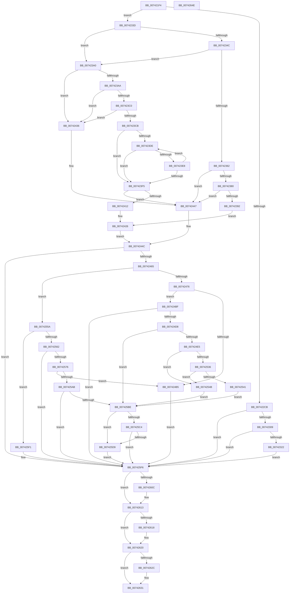

# PiDrvDbQuerySystemPathWin32

- RVA: `0x007421F4`–`0x0074264F` (길이 `1,115` bytes)
- VA: `0x00000001407421F4`
- 실행 섹션: `PAGE`
- PDB 이름 있음: `예`; PDB Function 태그: `아니요`
- unwind 정보 RVA: `0x000C92F4`
- 디코드: `276`개 명령, `1,115/1,115` bytes 표시
- 미해석 바이트: `0` (있으면 어셈블리에 `.byte`로 보존)

> 이 문서는 커널 이미지의 기계어와 PDB 기호를 분석해 생성했습니다. 4번과 5번은 함수 원형과 자료형을 바이너리 사용 방식에서 추정한 C 해석이며 원본 소스 복구 결과는 아닙니다.

## 1. Dependencies

- 직접 호출 지점: **26**; 고유 호출 대상: **16**
- 직접 호출자로 확인된 함수: **1**
- RIP 상대 이미지 참조: **8**

### Outgoing calls
- `0x00742263` → [RtlInitUnicodeString](../../text/42/RtlInitUnicodeString_function_0042A780.md) (function, `0x0042A780`)
- `0x0074226F` → [RtlInitUnicodeString](../../text/42/RtlInitUnicodeString_function_0042A780.md) (function, `0x0042A780`)
- `0x0074227B` → [RtlInitUnicodeString](../../text/42/RtlInitUnicodeString_function_0042A780.md) (function, `0x0042A780`)
- `0x007422C2` → [ZwOpenFile](../../text/6A/ZwOpenFile_function_006AD730.md) (function, `0x006AD730`)
- `0x007422F5` → [ObReferenceObjectByHandle](../86/ObReferenceObjectByHandle_function_00868DB0.md) (function, `0x00868DB0`)
- `0x00742313` → [IoQueryFileDosDeviceName](../8A/IoQueryFileDosDeviceName_function_008A6340.md) (function, `0x008A6340`)
- `0x00742331` → [RtlDuplicateUnicodeString](../93/RtlDuplicateUnicodeString_function_009321F0.md) (function, `0x009321F0`)
- `0x00742359` → [RtlPrefixUnicodeString](../8F/RtlPrefixUnicodeString_function_008F4F70.md) (function, `0x008F4F70`)
- `0x0074236E` → [RtlInitUnicodeString](../../text/42/RtlInitUnicodeString_function_0042A780.md) (function, `0x0042A780`)
- `0x007423B7` → [RtlPrefixUnicodeString](../8F/RtlPrefixUnicodeString_function_008F4F70.md) (function, `0x008F4F70`)
- `0x00742442` → [RtlInitUnicodeString](../../text/42/RtlInitUnicodeString_function_0042A780.md) (function, `0x0042A780`)
- `0x00742456` → [PiDrvDbFindNode](../../text/4F/PiDrvDbFindNode_function_004F8E60.md) (function, `0x004F8E60`)
- `0x00742482` → [RtlInitUnicodeString](../../text/42/RtlInitUnicodeString_function_0042A780.md) (function, `0x0042A780`)
- `0x007424A6` → [ExAllocatePool2](../../poolcode/B8/ExAllocatePool2_function_00B820F0.md) (function, `0x00B820F0`)
- `0x007424C9` → [RtlAppendUnicodeStringToString](../../text/40/RtlAppendUnicodeStringToString_function_0040FA50.md) (function, `0x0040FA50`)
- `0x007424EF` → [memset](../../text/6C/memset_function_006C6C40.md) (function, `0x006C6C40`)
- `0x0074252B` → [RtlpQueryRegistryValues](../8C/RtlpQueryRegistryValues_function_008C9050.md) (function, `0x008C9050`)
- `0x00742567` → [PiDrvDbGetNodeSystemRoot](PiDrvDbGetNodeSystemRoot_function_007411A4.md) (function, `0x007411A4`)
- `0x00742598` → [ExAllocatePool2](../../poolcode/B8/ExAllocatePool2_function_00B820F0.md) (function, `0x00B820F0`)
- `0x007425B3` → [RtlAppendUnicodeStringToString](../../text/40/RtlAppendUnicodeStringToString_function_0040FA50.md) (function, `0x0040FA50`)
- `0x007425CE` → [RtlAppendUnicodeStringToString](../../text/40/RtlAppendUnicodeStringToString_function_0040FA50.md) (function, `0x0040FA50`)
- `0x007425EA` → [RtlInitUnicodeString](../../text/42/RtlInitUnicodeString_function_0042A780.md) (function, `0x0042A780`)
- `0x007425FB` → [RtlFreeAnsiString](../9C/RtlFreeAnsiString_function_009C0800.md) (function, `0x009C0800`)
- `0x0074260E` → [ExFreePoolWithTag](../../poolcode/B8/ExFreePoolWithTag_function_00B82870.md) (function, `0x00B82870`)
- `0x0074261B` → [ObfDereferenceObject](../../text/2F/ObfDereferenceObject_function_002F9350.md) (function, `0x002F9350`)
- `0x0074262C` → [ZwClose](../../text/6A/ZwClose_function_006AD2B0.md) (function, `0x006AD2B0`)

### Direct callers
- [PiDrvDbResolveFilePathKeyValues](PiDrvDbResolveFilePathKeyValues_function_00742C00.md) at `0x00742D16`

### Static image references
- `0x007422CB` → RVA `0x00FC6AE0` (`ALMOSTRO`; read)
- `0x0074234F` → RVA `0x00B4AD48` (`PiDrvDbSystemRootNt`; read)
- `0x00742362` → RVA `0x00AFF500` (` ?? ::NNGAKEGL::`string'`; read)
- `0x007423AD` → RVA `0x00B4AE70` (`PiDrvDbDriverStoreNodesRoot`; read)
- `0x00742476` → RVA `0x00B004B0` (` ?? ::NNGAKEGL::`string'`; read)
- `0x007424D8` → RVA `0x00FC4148` (`.data`; read)
- `0x007424F4` → RVA `0x00B004D0` (` ?? ::NNGAKEGL::`string'`; read)
- `0x0074251C` → RVA `0x00B004F0` (` ?? ::NNGAKEGL::`string'`; read)

## 2. Other-region calls and transfers

- 다른 실행 섹션으로 향하는 call: **18**
  - `0x00742263` → [RtlInitUnicodeString](../../text/42/RtlInitUnicodeString_function_0042A780.md) (`PAGE` → `.text`)
  - `0x0074226F` → [RtlInitUnicodeString](../../text/42/RtlInitUnicodeString_function_0042A780.md) (`PAGE` → `.text`)
  - `0x0074227B` → [RtlInitUnicodeString](../../text/42/RtlInitUnicodeString_function_0042A780.md) (`PAGE` → `.text`)
  - `0x007422C2` → [ZwOpenFile](../../text/6A/ZwOpenFile_function_006AD730.md) (`PAGE` → `.text`)
  - `0x0074236E` → [RtlInitUnicodeString](../../text/42/RtlInitUnicodeString_function_0042A780.md) (`PAGE` → `.text`)
  - `0x00742442` → [RtlInitUnicodeString](../../text/42/RtlInitUnicodeString_function_0042A780.md) (`PAGE` → `.text`)
  - `0x00742456` → [PiDrvDbFindNode](../../text/4F/PiDrvDbFindNode_function_004F8E60.md) (`PAGE` → `.text`)
  - `0x00742482` → [RtlInitUnicodeString](../../text/42/RtlInitUnicodeString_function_0042A780.md) (`PAGE` → `.text`)
  - `0x007424A6` → [ExAllocatePool2](../../poolcode/B8/ExAllocatePool2_function_00B820F0.md) (`PAGE` → `POOLCODE`)
  - `0x007424C9` → [RtlAppendUnicodeStringToString](../../text/40/RtlAppendUnicodeStringToString_function_0040FA50.md) (`PAGE` → `.text`)
  - `0x007424EF` → [memset](../../text/6C/memset_function_006C6C40.md) (`PAGE` → `.text`)
  - `0x00742598` → [ExAllocatePool2](../../poolcode/B8/ExAllocatePool2_function_00B820F0.md) (`PAGE` → `POOLCODE`)
  - `0x007425B3` → [RtlAppendUnicodeStringToString](../../text/40/RtlAppendUnicodeStringToString_function_0040FA50.md) (`PAGE` → `.text`)
  - `0x007425CE` → [RtlAppendUnicodeStringToString](../../text/40/RtlAppendUnicodeStringToString_function_0040FA50.md) (`PAGE` → `.text`)
  - `0x007425EA` → [RtlInitUnicodeString](../../text/42/RtlInitUnicodeString_function_0042A780.md) (`PAGE` → `.text`)
  - `0x0074260E` → [ExFreePoolWithTag](../../poolcode/B8/ExFreePoolWithTag_function_00B82870.md) (`PAGE` → `POOLCODE`)
  - `0x0074261B` → [ObfDereferenceObject](../../text/2F/ObfDereferenceObject_function_002F9350.md) (`PAGE` → `.text`)
  - `0x0074262C` → [ZwClose](../../text/6A/ZwClose_function_006AD2B0.md) (`PAGE` → `.text`)
- 별도 외부 분기/꼬리 이동을 확인하지 못했습니다.

## 3. Assembly (complete function range)

```asm
007421F4  48 89 5C 24 10                  mov qword ptr [rsp + 0x10], rbx
007421F9  55                              push rbp
007421FA  56                              push rsi
007421FB  57                              push rdi
007421FC  41 54                           push r12
007421FE  41 55                           push r13
00742200  41 56                           push r14
00742202  41 57                           push r15
00742204  48 8D 6C 24 D0                  lea rbp, [rsp - 0x30]
00742209  48 81 EC 30 01 00 00            sub rsp, 0x130
00742210  45 33 E4                        xor r12d, r12d
00742213  0F 57 C0                        xorps xmm0, xmm0
00742216  4C 8B FA                        mov r15, rdx
00742219  44 89 65 84                     mov dword ptr [rbp - 0x7c], r12d
0074221D  0F 57 C9                        xorps xmm1, xmm1
00742220  44 89 65 9C                     mov dword ptr [rbp - 0x64], r12d
00742224  48 8B D9                        mov rbx, rcx
00742227  4C 89 A5 88 00 00 00            mov qword ptr [rbp + 0x88], r12
0074222E  49 8B CF                        mov rcx, r15
00742231  4C 89 A5 80 00 00 00            mov qword ptr [rbp + 0x80], r12
00742238  33 D2                           xor edx, edx
0074223A  4C 89 64 24 40                  mov qword ptr [rsp + 0x40], r12
0074223F  0F 11 45 B0                     movups xmmword ptr [rbp - 0x50], xmm0
00742243  45 8B F4                        mov r14d, r12d
00742246  44 89 65 70                     mov dword ptr [rbp + 0x70], r12d
0074224A  0F 11 44 24 58                  movups xmmword ptr [rsp + 0x58], xmm0
0074224F  4C 89 64 24 68                  mov qword ptr [rsp + 0x68], r12
00742254  0F 11 4C 24 30                  movups xmmword ptr [rsp + 0x30], xmm1
00742259  0F 11 44 24 48                  movups xmmword ptr [rsp + 0x48], xmm0
0074225E  0F 11 4C 24 70                  movups xmmword ptr [rsp + 0x70], xmm1
00742263  E8 18 85 CE FF                  call 0x14042a780
00742268  33 D2                           xor edx, edx
0074226A  48 8D 4C 24 30                  lea rcx, [rsp + 0x30]
0074226F  E8 0C 85 CE FF                  call 0x14042a780
00742274  33 D2                           xor edx, edx
00742276  48 8D 4C 24 48                  lea rcx, [rsp + 0x48]
0074227B  E8 00 85 CE FF                  call 0x14042a780
00742280  0F 57 C0                        xorps xmm0, xmm0
00742283  C7 44 24 28 21 00 00 00         mov dword ptr [rsp + 0x28], 0x21
0074228B  4C 8D 4D B0                     lea r9, [rbp - 0x50]
0074228F  C7 45 80 30 00 00 00            mov dword ptr [rbp - 0x80], 0x30
00742296  4C 8D 45 80                     lea r8, [rbp - 0x80]
0074229A  4C 89 65 88                     mov qword ptr [rbp - 0x78], r12
0074229E  BA 80 00 10 00                  mov edx, 0x100080
007422A3  C7 45 98 40 02 00 00            mov dword ptr [rbp - 0x68], 0x240
007422AA  48 8D 8D 88 00 00 00            lea rcx, [rbp + 0x88]
007422B1  48 89 5D 90                     mov qword ptr [rbp - 0x70], rbx
007422B5  F3 0F 7F 45 A0                  movdqu xmmword ptr [rbp - 0x60], xmm0
007422BA  C7 44 24 20 03 00 00 00         mov dword ptr [rsp + 0x20], 3
007422C2  E8 69 B4 F6 FF                  call 0x1406ad730
007422C7  85 C0                           test eax, eax
007422C9  78 72                           js 0x14074233d
007422CB  4C 8B 05 0E 48 88 00            mov r8, qword ptr [rip + 0x88480e]
007422D2  48 8D 44 24 40                  lea rax, [rsp + 0x40]
007422D7  48 8B 8D 88 00 00 00            mov rcx, qword ptr [rbp + 0x88]
007422DE  45 33 C9                        xor r9d, r9d
007422E1  4C 89 64 24 28                  mov qword ptr [rsp + 0x28], r12
007422E6  BA 80 00 00 00                  mov edx, 0x80
007422EB  48 89 44 24 20                  mov qword ptr [rsp + 0x20], rax
007422F0  4C 89 64 24 40                  mov qword ptr [rsp + 0x40], r12
007422F5  E8 B6 6A 12 00                  call 0x140868db0
007422FA  4C 8B 74 24 40                  mov r14, qword ptr [rsp + 0x40]
007422FF  8B D8                           mov ebx, eax
00742301  85 C0                           test eax, eax
00742303  0F 88 ED 02 00 00               js 0x1407425f6
00742309  48 8D 95 80 00 00 00            lea rdx, [rbp + 0x80]
00742310  49 8B CE                        mov rcx, r14
00742313  E8 28 40 16 00                  call 0x1408a6340
00742318  8B D8                           mov ebx, eax
0074231A  85 C0                           test eax, eax
0074231C  0F 88 D4 02 00 00               js 0x1407425f6
00742322  48 8B 95 80 00 00 00            mov rdx, qword ptr [rbp + 0x80]
00742329  41 8D 4C 24 01                  lea ecx, [r12 + 1]
0074232E  4D 8B C7                        mov r8, r15
00742331  E8 BA FE 1E 00                  call 0x1409321f0
00742336  8B D8                           mov ebx, eax
00742338  E9 B9 02 00 00                  jmp 0x1407425f6
0074233D  66 83 3B 16                     cmp word ptr [rbx], 0x16
00742341  BE 01 00 00 00                  mov esi, 1
00742346  44 8D 6E 01                     lea r13d, [rsi + 1]
0074234A  72 54                           jb 0x1407423a0
0074234C  44 8A C6                        mov r8b, sil
0074234F  48 8D 0D F2 89 40 00            lea rcx, [rip + 0x4089f2]
00742356  48 8B D3                        mov rdx, rbx
00742359  E8 12 2C 1B 00                  call 0x1408f4f70
0074235E  84 C0                           test al, al
00742360  74 3E                           je 0x1407423a0
00742362  48 8D 15 97 D1 3B 00            lea rdx, [rip + 0x3bd197]
00742369  48 8D 4C 24 58                  lea rcx, [rsp + 0x58]
0074236E  E8 0D 84 CE FF                  call 0x14042a780
00742373  0F B7 3B                        movzx edi, word ptr [rbx]
00742376  66 83 FF 18                     cmp di, 0x18
0074237A  0F 86 C7 00 00 00               jbe 0x140742447
00742380  48 8B 43 08                     mov rax, qword ptr [rbx + 8]
00742384  48 83 C0 16                     add rax, 0x16
00742388  66 83 38 5C                     cmp word ptr [rax], 0x5c
0074238C  0F 85 B5 00 00 00               jne 0x140742447
00742392  48 89 44 24 50                  mov qword ptr [rsp + 0x50], rax
00742397  66 83 EF 16                     sub di, 0x16
0074239B  E9 86 00 00 00                  jmp 0x140742426
007423A0  66 83 3B 26                     cmp word ptr [rbx], 0x26
007423A4  0F 86 8C 00 00 00               jbe 0x140742436
007423AA  44 8A C6                        mov r8b, sil
007423AD  48 8D 0D BC 8A 40 00            lea rcx, [rip + 0x408abc]
007423B4  48 8B D3                        mov rdx, rbx
007423B7  E8 B4 2B 1B 00                  call 0x1408f4f70
007423BC  84 C0                           test al, al
007423BE  74 76                           je 0x140742436
007423C0  48 8B 53 08                     mov rdx, qword ptr [rbx + 8]
007423C4  66 83 7A 24 5C                  cmp word ptr [rdx + 0x24], 0x5c
007423C9  75 6B                           jne 0x140742436
007423CB  48 83 C2 26                     add rdx, 0x26
007423CF  41 0F B7 CC                     movzx ecx, r12w
007423D3  48 89 54 24 60                  mov qword ptr [rsp + 0x60], rdx
007423D8  66 83 3A 5C                     cmp word ptr [rdx], 0x5c
007423DC  74 17                           je 0x1407423f5
007423DE  0F B7 C1                        movzx eax, cx
007423E1  66 44 39 24 42                  cmp word ptr [rdx + rax*2], r12w
007423E6  74 0D                           je 0x1407423f5
007423E8  66 03 CE                        add cx, si
007423EB  0F B7 C1                        movzx eax, cx
007423EE  66 83 3C 42 5C                  cmp word ptr [rdx + rax*2], 0x5c
007423F3  75 E9                           jne 0x1407423de
007423F5  66 03 C9                        add cx, cx
007423F8  0F B7 C1                        movzx eax, cx
007423FB  48 D1 E8                        shr rax, 1
007423FE  66 89 4C 24 58                  mov word ptr [rsp + 0x58], cx
00742403  66 89 4C 24 5A                  mov word ptr [rsp + 0x5a], cx
00742408  48 8D 04 42                     lea rax, [rdx + rax*2]
0074240C  66 83 38 5C                     cmp word ptr [rax], 0x5c
00742410  75 35                           jne 0x140742447
00742412  0F B7 3B                        movzx edi, word ptr [rbx]
00742415  48 89 44 24 50                  mov qword ptr [rsp + 0x50], rax
0074241A  2B 43 08                        sub eax, dword ptr [rbx + 8]
0074241D  48 D1 F8                        sar rax, 1
00742420  66 03 C0                        add ax, ax
00742423  66 2B F8                        sub di, ax
00742426  42 8D 04 2F                     lea eax, [rdi + r13]
0074242A  66 89 7C 24 48                  mov word ptr [rsp + 0x48], di
0074242F  66 89 44 24 4A                  mov word ptr [rsp + 0x4a], ax
00742434  EB 16                           jmp 0x14074244c
00742436  48 8D 15 C3 D0 3B 00            lea rdx, [rip + 0x3bd0c3]
0074243D  48 8D 4C 24 58                  lea rcx, [rsp + 0x58]
00742442  E8 39 83 CE FF                  call 0x14042a780
00742447  0F B7 7C 24 48                  movzx edi, word ptr [rsp + 0x48]
0074244C  48 8D 54 24 40                  lea rdx, [rsp + 0x40]
00742451  48 8D 4C 24 58                  lea rcx, [rsp + 0x58]
00742456  E8 05 6A DB FF                  call 0x1404f8e60
0074245B  8B D8                           mov ebx, eax
0074245D  85 C0                           test eax, eax
0074245F  0F 88 91 01 00 00               js 0x1407425f6
00742465  48 8B 4C 24 40                  mov rcx, qword ptr [rsp + 0x40]
0074246A  8B 41 40                        mov eax, dword ptr [rcx + 0x40]
0074246D  40 84 C6                        test sil, al
00742470  0F 84 E4 00 00 00               je 0x14074255a
00742476  48 8D 15 33 E0 3B 00            lea rdx, [rip + 0x3be033]
0074247D  48 8D 4C 24 70                  lea rcx, [rsp + 0x70]
00742482  E8 F9 82 CE FF                  call 0x14042a780
00742487  0F B7 44 24 70                  movzx eax, word ptr [rsp + 0x70]
0074248C  B9 00 01 00 00                  mov ecx, 0x100
00742491  66 03 C7                        add ax, di
00742494  41 B8 53 74 72 67               mov r8d, 0x67727453
0074249A  66 41 03 C5                     add ax, r13w
0074249E  0F B7 D0                        movzx edx, ax
007424A1  66 89 54 24 32                  mov word ptr [rsp + 0x32], dx
007424A6  E8 45 FC 43 00                  call 0x140b820f0
007424AB  48 89 44 24 38                  mov qword ptr [rsp + 0x38], rax
007424B0  48 85 C0                        test rax, rax
007424B3  75 0A                           jne 0x1407424bf
007424B5  BB 9A 00 00 C0                  mov ebx, 0xc000009a
007424BA  E9 37 01 00 00                  jmp 0x1407425f6
007424BF  48 8D 54 24 70                  lea rdx, [rsp + 0x70]
007424C4  48 8D 4C 24 30                  lea rcx, [rsp + 0x30]
007424C9  E8 82 D5 CC FF                  call 0x14040fa50
007424CE  8B D8                           mov ebx, eax
007424D0  85 C0                           test eax, eax
007424D2  0F 88 1E 01 00 00               js 0x1407425f6
007424D8  44 38 25 69 1C 88 00            cmp byte ptr [rip + 0x881c69], r12b
007424DF  0F 84 D9 00 00 00               je 0x1407425be
007424E5  33 D2                           xor edx, edx
007424E7  48 8D 4D C0                     lea rcx, [rbp - 0x40]
007424EB  44 8D 42 70                     lea r8d, [rdx + 0x70]
007424EF  E8 4C 47 F8 FF                  call 0x1406c6c40
007424F4  48 8D 05 D5 DF 3B 00            lea rax, [rip + 0x3bdfd5]
007424FB  C7 45 E0 00 00 00 04            mov dword ptr [rbp - 0x20], 0x4000000
00742502  48 89 45 D0                     mov qword ptr [rbp - 0x30], rax
00742506  4C 8D 45 C0                     lea r8, [rbp - 0x40]
0074250A  48 8D 45 70                     lea rax, [rbp + 0x70]
0074250E  C7 45 C8 24 01 00 00            mov dword ptr [rbp - 0x38], 0x124
00742515  45 33 C9                        xor r9d, r9d
00742518  48 89 45 D8                     mov qword ptr [rbp - 0x28], rax
0074251C  48 8D 15 CD DF 3B 00            lea rdx, [rip + 0x3bdfcd]
00742523  40 88 74 24 28                  mov byte ptr [rsp + 0x28], sil
00742528  41 8B CD                        mov ecx, r13d
0074252B  E8 20 6B 18 00                  call 0x1408c9050
00742530  8B D8                           mov ebx, eax
00742532  85 C0                           test eax, eax
00742534  78 15                           js 0x14074254b
00742536  8B 4D 70                        mov ecx, dword ptr [rbp + 0x70]
00742539  8D 41 BF                        lea eax, [rcx - 0x41]
0074253C  83 F8 19                        cmp eax, 0x19
0074253F  77 0A                           ja 0x14074254b
00742541  48 8B 44 24 38                  mov rax, qword ptr [rsp + 0x38]
00742546  66 89 08                        mov word ptr [rax], cx
00742549  EB 73                           jmp 0x1407425be
0074254B  48 8B 44 24 38                  mov rax, qword ptr [rsp + 0x38]
00742550  41 8B DC                        mov ebx, r12d
00742553  66 C7 00 58 00                  mov word ptr [rax], 0x58
00742558  EB 64                           jmp 0x1407425be
0074255A  A8 08                           test al, 8
0074255C  0F 84 8F 00 00 00               je 0x1407425f1
00742562  48 8D 54 24 68                  lea rdx, [rsp + 0x68]
00742567  E8 38 EC FF FF                  call 0x1407411a4
0074256C  8B D8                           mov ebx, eax
0074256E  85 C0                           test eax, eax
00742570  0F 88 80 00 00 00               js 0x1407425f6
00742576  48 8B 5C 24 68                  mov rbx, qword ptr [rsp + 0x68]
0074257B  0F B7 C7                        movzx eax, di
0074257E  B9 00 01 00 00                  mov ecx, 0x100
00742583  41 B8 53 74 72 67               mov r8d, 0x67727453
00742589  66 03 03                        add ax, word ptr [rbx]
0074258C  66 41 03 C5                     add ax, r13w
00742590  0F B7 D0                        movzx edx, ax
00742593  66 89 54 24 32                  mov word ptr [rsp + 0x32], dx
00742598  E8 53 FB 43 00                  call 0x140b820f0
0074259D  48 89 44 24 38                  mov qword ptr [rsp + 0x38], rax
007425A2  48 85 C0                        test rax, rax
007425A5  0F 84 0A FF FF FF               je 0x1407424b5
007425AB  48 8B D3                        mov rdx, rbx
007425AE  48 8D 4C 24 30                  lea rcx, [rsp + 0x30]
007425B3  E8 98 D4 CC FF                  call 0x14040fa50
007425B8  8B D8                           mov ebx, eax
007425BA  85 C0                           test eax, eax
007425BC  78 38                           js 0x1407425f6
007425BE  66 41 3B FD                     cmp di, r13w
007425C2  76 15                           jbe 0x1407425d9
007425C4  48 8D 54 24 48                  lea rdx, [rsp + 0x48]
007425C9  48 8D 4C 24 30                  lea rcx, [rsp + 0x30]
007425CE  E8 7D D4 CC FF                  call 0x14040fa50
007425D3  8B D8                           mov ebx, eax
007425D5  85 C0                           test eax, eax
007425D7  78 1D                           js 0x1407425f6
007425D9  0F 10 44 24 30                  movups xmm0, xmmword ptr [rsp + 0x30]
007425DE  33 D2                           xor edx, edx
007425E0  48 8D 4C 24 30                  lea rcx, [rsp + 0x30]
007425E5  F3 41 0F 7F 07                  movdqu xmmword ptr [r15], xmm0
007425EA  E8 91 81 CE FF                  call 0x14042a780
007425EF  EB 05                           jmp 0x1407425f6
007425F1  BB 25 02 00 C0                  mov ebx, 0xc0000225
007425F6  48 8D 4C 24 30                  lea rcx, [rsp + 0x30]
007425FB  E8 00 E2 27 00                  call 0x1409c0800
00742600  48 8B 8D 80 00 00 00            mov rcx, qword ptr [rbp + 0x80]
00742607  48 85 C9                        test rcx, rcx
0074260A  74 07                           je 0x140742613
0074260C  33 D2                           xor edx, edx
0074260E  E8 5D 02 44 00                  call 0x140b82870
00742613  4D 85 F6                        test r14, r14
00742616  74 08                           je 0x140742620
00742618  49 8B CE                        mov rcx, r14
0074261B  E8 30 6D BB FF                  call 0x1402f9350
00742620  48 8B 8D 88 00 00 00            mov rcx, qword ptr [rbp + 0x88]
00742627  48 85 C9                        test rcx, rcx
0074262A  74 05                           je 0x140742631
0074262C  E8 7F AC F6 FF                  call 0x1406ad2b0
00742631  8B C3                           mov eax, ebx
00742633  48 8B 9C 24 78 01 00 00         mov rbx, qword ptr [rsp + 0x178]
0074263B  48 81 C4 30 01 00 00            add rsp, 0x130
00742642  41 5F                           pop r15
00742644  41 5E                           pop r14
00742646  41 5D                           pop r13
00742648  41 5C                           pop r12
0074264A  5F                              pop rdi
0074264B  5E                              pop rsi
0074264C  5D                              pop rbp
0074264D  C3                              ret
0074264E  CC                              int3
```

## 4. C-style interpretation (structured pseudocode)

```c
__int64 __fastcall PiDrvDbQuerySystemPathWin32(__int64 a1, __int64 a2)
{
    __int64 result;
    __int64 v_r12;
    __int64 v_rdi;
    __int64 v_rsp;
    unsigned __int64 v_stack_m100;
    unsigned __int64 v_stack_m108;
    unsigned __int16 v_stack_m10E;
    unsigned __int64 v_stack_m110;
    unsigned __int64 v_stack_m118;
    unsigned __int16 v_stack_m11E;
    unsigned __int64 v_stack_m120;
    unsigned __int64 v_stack_m128;
    unsigned __int64 v_stack_m130;
    unsigned __int16 v_stack_m136;
    unsigned __int64 v_stack_m138;
    unsigned int v_stack_m140;
    unsigned int v_stack_m148;
    unsigned __int64 v_stack_m68;
    unsigned int v_stack_m88;
    unsigned __int64 v_stack_m90;
    unsigned __int64 v_stack_m98;
    unsigned int v_stack_mA0;
    unsigned __int64 v_stack_mA8;
    unsigned __int64 v_stack_mB8;
    unsigned __int64 v_stack_mC8;
    unsigned int v_stack_mCC;
    unsigned int v_stack_mD0;
    unsigned __int64 v_stack_mD8;
    unsigned __int64 v_stack_mE0;
    unsigned int v_stack_mE4;
    unsigned int v_stack_mE8;
    unsigned __int64 v_stack_mF8;
    unsigned __int64 v_stack_p10;
    unsigned __int64 v_stack_p18;
    unsigned __int64 v_stack_p20;
    unsigned int v_stack_p8;

    v_stack_p10 = v_rbx;
    v_rsp = (v_rsp) - (304);
    v_r12 = 0;
    v_stack_mE4 = 0;
    v_stack_mCC = 0;
    v_stack_p20 = 0;
    v_stack_p18 = 0;
    a2 = 0;
    v_stack_m128 = 0;
    v_stack_mB8 = v_xmm0;
    v_stack_p8 = 0;
    v_stack_m110 = v_xmm0;
    v_stack_m100 = 0;
    v_stack_m138 = v_xmm1;
    v_stack_m120 = v_xmm0;
    v_stack_mF8 = v_xmm1;
    result = RtlInitUnicodeString(a2, a2, a3, a4);
    a2 = 0;
    result = RtlInitUnicodeString(v_stack_m138, a2, a3, a4);
    a2 = 0;
    result = RtlInitUnicodeString(v_stack_m120, a2, a3, a4);
    v_stack_m140 = 33;
    v_stack_mE8 = 48;
    v_stack_mE0 = 0;
    v_stack_mD0 = 576;
    v_stack_mD8 = a1;
    v_stack_mC8 = v_xmm0;
    v_stack_m148 = 3;
    result = ZwOpenFile(v_stack_p20, (unsigned int)(0x100080ULL), v_stack_mE8, v_stack_mB8);
    if (sign_flag) goto loc_0074233D;
    a4 = 0;
    v_stack_m140 = 0;
    v_stack_m148 = v_stack_m128;
    v_stack_m128 = 0;
    result = ObReferenceObjectByHandle(v_stack_p20, 128, *(unsigned __int64 *)(v_rip + 8931342), a4);
    if (sign_flag) goto loc_007425F6;
    result = IoQueryFileDosDeviceName(v_stack_m128, v_stack_p18, *(unsigned __int64 *)(v_rip + 8931342), a4);
    if (sign_flag) goto loc_007425F6;
    result = RtlDuplicateUnicodeString(v_r12 + 1, v_stack_p18, 0, a4);
    goto loc_007425F6;
loc_0074233D:
    if ((*(unsigned __int16 *)((unsigned int)((unsigned int)(result)))) < 22) goto loc_007423A0;
    result = RtlPrefixUnicodeString(v_rip + 4229618, (unsigned int)((unsigned int)(result)), 1, a4);
    if ((unsigned __int8)(result) == 0) goto loc_007423A0;
    result = RtlInitUnicodeString(v_stack_m110, v_rip + 3920279, 1, a4);
    if (((unsigned __int16)(*(unsigned __int16 *)((unsigned int)((unsigned int)(result))))) <= 24) goto loc_00742447;
    result = (*(unsigned __int64 *)((unsigned int)((unsigned int)(result)) + 8)) + (22);
    if ((*(unsigned __int16 *)(result)) != 92) goto loc_00742447;
    v_stack_m118 = result;
    v_rdi = (unsigned __int16)((*(unsigned __int16 *)((unsigned int)((unsigned int)(result)))) - (22));
    goto loc_00742426;
loc_007423A0:
    if ((*(unsigned __int16 *)((unsigned int)((unsigned int)(result)))) <= 38) goto loc_00742436;
    result = RtlPrefixUnicodeString(v_rip + 4229820, (unsigned int)((unsigned int)(result)), 1, a4);
    if ((unsigned __int8)(result) == 0) goto loc_00742436;
    if ((*(unsigned __int16 *)(*(unsigned __int64 *)((unsigned int)((unsigned int)(result)) + 8) + 36)) != 92) goto loc_00742436;
    a2 = (*(unsigned __int64 *)((unsigned int)((unsigned int)(result)) + 8)) + (38);
    v_stack_m108 = a2;
    if ((*(unsigned __int16 *)(a2)) == 92) goto loc_007423F5;
loc_007423DE:
    if ((*(unsigned __int16 *)(a2 + 0 * 2)) == 0) goto loc_007423F5;
    a1 = (unsigned __int16)((0) + (1));
    if ((*(unsigned __int16 *)(a2 + (unsigned __int16)(a1) * 2)) != 92) goto loc_007423DE;
loc_007423F5:
    a1 = (unsigned __int16)((a1) + ((unsigned __int16)(a1)));
    result = ((unsigned __int16)(a1)) >> (1);
    v_stack_m110 = (unsigned __int16)(a1);
    v_stack_m10E = (unsigned __int16)(a1);
    if ((*(unsigned __int16 *)(a2 + result * 2)) != 92) goto loc_00742447;
    v_stack_m118 = a2 + result * 2;
    result = (unsigned int)((a2 + result * 2) - (*(unsigned int *)((unsigned int)((unsigned int)(result)) + 8)));
    result = (result) >> (1);
    result = (unsigned __int16)((result) + ((unsigned __int16)(result)));
    v_rdi = (unsigned __int16)((*(unsigned __int16 *)((unsigned int)((unsigned int)(result)))) - ((unsigned __int16)(result)));
loc_00742426:
    v_stack_m120 = (unsigned __int16)(v_rdi);
    v_stack_m11E = (unsigned __int16)(v_rdi + 1 + 1 * 1);
    goto loc_0074244C;
loc_00742436:
    result = RtlInitUnicodeString(v_stack_m110, v_rip + 3920067, 1, a4);
loc_00742447:
loc_0074244C:
    result = PiDrvDbFindNode(v_stack_m110, v_stack_m128, 1, a4);
    if (sign_flag) goto loc_007425F6;
    if (((1) & ((unsigned __int8)((unsigned int)(*(unsigned int *)(v_stack_m128 + 64))))) == 0) goto loc_0074255A;
    result = RtlInitUnicodeString(v_stack_mF8, v_rip + 3924019, 1, a4);
    result = (unsigned __int16)((v_stack_mF8) + ((unsigned __int16)(v_stack_m120)));
    result = (unsigned __int16)((result) + ((unsigned __int16)(1 + 1)));
    v_stack_m136 = (unsigned __int16)((unsigned __int16)(result));
    result = ExAllocatePool2(256, (unsigned __int16)(result), (unsigned int)(0x67727453ULL), a4);
    v_stack_m130 = result;
    if (result != 0) goto loc_007424BF;
loc_007424B5:
    goto loc_007425F6;
loc_007424BF:
    result = RtlAppendUnicodeStringToString(v_stack_m138, v_stack_mF8, (unsigned int)(0x67727453ULL), a4);
    if (sign_flag) goto loc_007425F6;
    if ((*(unsigned __int8 *)(v_rip + 8920169)) == 0) goto loc_007425BE;
    a2 = 0;
    result = memset(v_stack_mA8, a2, a2 + 112, a4);
    v_stack_m88 = 0x4000000ULL;
    v_stack_m98 = v_rip + 3923925;
    v_stack_mA0 = 292;
    a4 = 0;
    v_stack_m90 = v_stack_p8;
    v_stack_m140 = 1;
    result = RtlpQueryRegistryValues((unsigned int)((unsigned int)(1 + 1)), v_rip + 3923917, v_stack_mA8, a4);
    if (sign_flag) goto loc_0074254B;
    if (((unsigned int)((unsigned int)(v_stack_p8) - 65)) > 25) goto loc_0074254B;
    *(unsigned __int16 *)(v_stack_m130) = (unsigned __int16)((unsigned int)(v_stack_p8));
    goto loc_007425BE;
loc_0074254B:
    *(unsigned __int16 *)(v_stack_m130) = 88;
    goto loc_007425BE;
loc_0074255A:
    if ((((unsigned __int8)(v_stack_m130)) & (8)) == 0) goto loc_007425F1;
    result = PiDrvDbGetNodeSystemRoot((unsigned int)(v_stack_p8), v_stack_m100, v_stack_mA8, a4);
    if (sign_flag) goto loc_007425F6;
    result = (unsigned __int16)(((unsigned __int16)(v_stack_m120)) + (*(unsigned __int16 *)(v_stack_m100)));
    result = (unsigned __int16)((result) + ((unsigned __int16)(1 + 1)));
    v_stack_m136 = (unsigned __int16)((unsigned __int16)(result));
    result = ExAllocatePool2(256, (unsigned __int16)(result), (unsigned int)(0x67727453ULL), a4);
    v_stack_m130 = result;
    if (result == 0) goto loc_007424B5;
    result = RtlAppendUnicodeStringToString(v_stack_m138, v_stack_m100, (unsigned int)(0x67727453ULL), a4);
    if (sign_flag) goto loc_007425F6;
loc_007425BE:
    if (((unsigned __int16)(v_stack_m120)) <= ((unsigned __int16)(1 + 1))) goto loc_007425D9;
    result = RtlAppendUnicodeStringToString(v_stack_m138, v_stack_m120, (unsigned int)(0x67727453ULL), a4);
    if (sign_flag) goto loc_007425F6;
loc_007425D9:
    a2 = 0;
    *(unsigned __int64 *)(a2) = v_xmm0;
    result = RtlInitUnicodeString(v_stack_m138, a2, (unsigned int)(0x67727453ULL), a4);
    goto loc_007425F6;
loc_007425F1:
loc_007425F6:
    result = RtlFreeAnsiString(v_stack_m138, a2, (unsigned int)(0x67727453ULL), a4);
    if (v_stack_p18 != 0) {
        a2 = 0;
        result = ExFreePoolWithTag(v_stack_p18, a2, (unsigned int)(0x67727453ULL), a4);
    }
    if (v_stack_m128 != 0) {
        a1 = v_stack_m128;
        result = ObfDereferenceObject(a1, a2, (unsigned int)(0x67727453ULL), a4);
    }
    if (v_stack_p20 != 0) {
        result = ZwClose(v_stack_p20, a2, (unsigned int)(0x67727453ULL), a4);
    }
    v_rsp = (v_rsp) + (304);
    return (unsigned int)((unsigned int)((unsigned int)(0xC0000225ULL)));
}
```

## 5. (Beta) C Style

```c
int64_t PiDrvDbQuerySystemPathWin32(void *Arg1, void *Arg2)
{
    uint8_t *arg1 = (uint8_t *)Arg1;
    uint8_t *arg2 = (uint8_t *)Arg2;

    int64_t result;
    int64_t local_r12;
    int64_t local_rdi;
    int64_t local_rsp;
    uint64_t v_stack_m100;
    uint64_t v_stack_m108;
    uint16_t v_stack_m10E;
    uint64_t v_stack_m110;
    uint64_t v_stack_m118;
    uint16_t v_stack_m11E;
    uint64_t v_stack_m120;
    uint64_t v_stack_m128;
    uint64_t v_stack_m130;
    uint16_t v_stack_m136;
    uint64_t v_stack_m138;
    uint32_t v_stack_m140;
    uint32_t v_stack_m148;
    uint64_t v_stack_m68;
    uint32_t v_stack_m88;
    uint64_t v_stack_m90;
    uint64_t v_stack_m98;
    uint32_t v_stack_mA0;
    uint64_t v_stack_mA8;
    uint64_t v_stack_mB8;
    uint64_t v_stack_mC8;
    uint32_t v_stack_mCC;
    uint32_t v_stack_mD0;
    uint64_t v_stack_mD8;
    uint64_t v_stack_mE0;
    uint32_t v_stack_mE4;
    uint32_t v_stack_mE8;
    uint64_t v_stack_mF8;
    uint64_t v_stack_p10;
    uint64_t v_stack_p18;
    uint64_t v_stack_p20;
    uint32_t v_stack_p8;

    v_stack_p10 = local_rbx;
    local_rsp = (local_rsp) - (304);
    local_r12 = 0;
    v_stack_mE4 = 0;
    v_stack_mCC = 0;
    v_stack_p20 = 0;
    v_stack_p18 = 0;
    Arg2 = 0;
    v_stack_m128 = 0;
    v_stack_mB8 = v_xmm0;
    v_stack_p8 = 0;
    v_stack_m110 = v_xmm0;
    v_stack_m100 = 0;
    v_stack_m138 = v_xmm1;
    v_stack_m120 = v_xmm0;
    v_stack_mF8 = v_xmm1;
    result = RtlInitUnicodeString(Arg2, Arg2, a3, a4);
    Arg2 = 0;
    result = RtlInitUnicodeString(v_stack_m138, Arg2, a3, a4);
    Arg2 = 0;
    result = RtlInitUnicodeString(v_stack_m120, Arg2, a3, a4);
    v_stack_m140 = 33;
    v_stack_mE8 = 48;
    v_stack_mE0 = 0;
    v_stack_mD0 = 576;
    v_stack_mD8 = Arg1;
    v_stack_mC8 = v_xmm0;
    v_stack_m148 = 3;
    result = ZwOpenFile(v_stack_p20, (uint32_t)(0x100080ULL), v_stack_mE8, v_stack_mB8);
    if (sign_flag) goto loc_0074233D;
    a4 = 0;
    v_stack_m140 = 0;
    v_stack_m148 = v_stack_m128;
    v_stack_m128 = 0;
    result = ObReferenceObjectByHandle(v_stack_p20, 128, *(uint64_t *)(v_rip + 0x88480E), a4);
    if (sign_flag) goto loc_007425F6;
    result = IoQueryFileDosDeviceName(v_stack_m128, v_stack_p18, *(uint64_t *)(v_rip + 0x88480E), a4);
    if (sign_flag) goto loc_007425F6;
    result = RtlDuplicateUnicodeString(local_r12 + 1, v_stack_p18, 0, a4);
    goto loc_007425F6;
loc_0074233D:
    if ((*(uint16_t *)((uint32_t)((uint32_t)(result)))) < 22) goto loc_007423A0;
    result = RtlPrefixUnicodeString(v_rip + 4229618, (uint32_t)((uint32_t)(result)), 1, a4);
    if ((uint8_t)(result) == 0) goto loc_007423A0;
    result = RtlInitUnicodeString(v_stack_m110, v_rip + 3920279, 1, a4);
    if (((uint16_t)(*(uint16_t *)((uint32_t)((uint32_t)(result))))) <= 24) goto loc_00742447;
    result = (*(uint64_t *)((uint32_t)((uint32_t)(result)) + 0x8)) + (22);
    if ((*(uint16_t *)(result)) != 92) goto loc_00742447;
    v_stack_m118 = result;
    local_rdi = (uint16_t)((*(uint16_t *)((uint32_t)((uint32_t)(result)))) - (22));
    goto loc_00742426;
loc_007423A0:
    if ((*(uint16_t *)((uint32_t)((uint32_t)(result)))) <= 38) goto loc_00742436;
    result = RtlPrefixUnicodeString(v_rip + 4229820, (uint32_t)((uint32_t)(result)), 1, a4);
    if ((uint8_t)(result) == 0) goto loc_00742436;
    if ((*(uint16_t *)(*(uint64_t *)((uint32_t)((uint32_t)(result)) + 0x8) + 0x24)) != 92) goto loc_00742436;
    Arg2 = (*(uint64_t *)((uint32_t)((uint32_t)(result)) + 0x8)) + (38);
    v_stack_m108 = Arg2;
    if ((*(uint16_t *)(arg2)) == 92) goto loc_007423F5;
loc_007423DE:
    if ((*(uint16_t *)(arg2 + 0x0 * 2)) == 0) goto loc_007423F5;
    Arg1 = (uint16_t)((0) + (1));
    if ((*(uint16_t *)(arg2 + (uint16_t)(arg1) * 2)) != 92) goto loc_007423DE;
loc_007423F5:
    Arg1 = (uint16_t)((Arg1) + ((uint16_t)(Arg1)));
    result = ((uint16_t)(Arg1)) >> (1);
    v_stack_m110 = (uint16_t)(Arg1);
    v_stack_m10E = (uint16_t)(Arg1);
    if ((*(uint16_t *)(arg2 + result * 2)) != 92) goto loc_00742447;
    v_stack_m118 = Arg2 + result * 2;
    result = (uint32_t)((Arg2 + result * 2) - (*(uint32_t *)((uint32_t)((uint32_t)(result)) + 0x8)));
    result = (result) >> (1);
    result = (uint16_t)((result) + ((uint16_t)(result)));
    local_rdi = (uint16_t)((*(uint16_t *)((uint32_t)((uint32_t)(result)))) - ((uint16_t)(result)));
loc_00742426:
    v_stack_m120 = (uint16_t)(local_rdi);
    v_stack_m11E = (uint16_t)(local_rdi + 1 + 1 * 1);
    goto loc_0074244C;
loc_00742436:
    result = RtlInitUnicodeString(v_stack_m110, v_rip + 3920067, 1, a4);
loc_00742447:
loc_0074244C:
    result = PiDrvDbFindNode(v_stack_m110, v_stack_m128, 1, a4);
    if (sign_flag) goto loc_007425F6;
    if (((1) & ((uint8_t)((uint32_t)(*(uint32_t *)(v_stack_m128 + 0x40))))) == 0) goto loc_0074255A;
    result = RtlInitUnicodeString(v_stack_mF8, v_rip + 3924019, 1, a4);
    result = (uint16_t)((v_stack_mF8) + ((uint16_t)(v_stack_m120)));
    result = (uint16_t)((result) + ((uint16_t)(1 + 1)));
    v_stack_m136 = (uint16_t)((uint16_t)(result));
    result = ExAllocatePool2(256, (uint16_t)(result), (uint32_t)(0x67727453ULL), a4);
    v_stack_m130 = result;
    if (result != 0) goto loc_007424BF;
loc_007424B5:
    goto loc_007425F6;
loc_007424BF:
    result = RtlAppendUnicodeStringToString(v_stack_m138, v_stack_mF8, (uint32_t)(0x67727453ULL), a4);
    if (sign_flag) goto loc_007425F6;
    if ((*(uint8_t *)(v_rip + 0x881C69)) == 0) goto loc_007425BE;
    Arg2 = 0;
    result = memset(v_stack_mA8, Arg2, Arg2 + 112, a4);
    v_stack_m88 = 0x4000000ULL;
    v_stack_m98 = v_rip + 3923925;
    v_stack_mA0 = 292;
    a4 = 0;
    v_stack_m90 = v_stack_p8;
    v_stack_m140 = 1;
    result = RtlpQueryRegistryValues((uint32_t)((uint32_t)(1 + 1)), v_rip + 3923917, v_stack_mA8, a4);
    if (sign_flag) goto loc_0074254B;
    if (((uint32_t)((uint32_t)(v_stack_p8) - 65)) > 25) goto loc_0074254B;
    *(uint16_t *)(v_stack_m130) = (uint16_t)((uint32_t)(v_stack_p8));
    goto loc_007425BE;
loc_0074254B:
    *(uint16_t *)(v_stack_m130) = 88;
    goto loc_007425BE;
loc_0074255A:
    if ((((uint8_t)(v_stack_m130)) & (8)) == 0) goto loc_007425F1;
    result = PiDrvDbGetNodeSystemRoot((uint32_t)(v_stack_p8), v_stack_m100, v_stack_mA8, a4);
    if (sign_flag) goto loc_007425F6;
    result = (uint16_t)(((uint16_t)(v_stack_m120)) + (*(uint16_t *)(v_stack_m100)));
    result = (uint16_t)((result) + ((uint16_t)(1 + 1)));
    v_stack_m136 = (uint16_t)((uint16_t)(result));
    result = ExAllocatePool2(256, (uint16_t)(result), (uint32_t)(0x67727453ULL), a4);
    v_stack_m130 = result;
    if (result == 0) goto loc_007424B5;
    result = RtlAppendUnicodeStringToString(v_stack_m138, v_stack_m100, (uint32_t)(0x67727453ULL), a4);
    if (sign_flag) goto loc_007425F6;
loc_007425BE:
    if (((uint16_t)(v_stack_m120)) <= ((uint16_t)(1 + 1))) goto loc_007425D9;
    result = RtlAppendUnicodeStringToString(v_stack_m138, v_stack_m120, (uint32_t)(0x67727453ULL), a4);
    if (sign_flag) goto loc_007425F6;
loc_007425D9:
    Arg2 = 0;
    *(uint64_t *)(arg2) = v_xmm0;
    result = RtlInitUnicodeString(v_stack_m138, Arg2, (uint32_t)(0x67727453ULL), a4);
    goto loc_007425F6;
loc_007425F1:
loc_007425F6:
    result = RtlFreeAnsiString(v_stack_m138, Arg2, (uint32_t)(0x67727453ULL), a4);
    if (v_stack_p18 != 0) {
        Arg2 = 0;
        result = ExFreePoolWithTag(v_stack_p18, Arg2, (uint32_t)(0x67727453ULL), a4);
    }
    if (v_stack_m128 != 0) {
        Arg1 = v_stack_m128;
        result = ObfDereferenceObject(Arg1, Arg2, (uint32_t)(0x67727453ULL), a4);
    }
    if (v_stack_p20 != 0) {
        result = ZwClose(v_stack_p20, Arg2, (uint32_t)(0x67727453ULL), a4);
    }
    local_rsp = (local_rsp) + (304);
    return (uint32_t)((uint32_t)((uint32_t)(0xC0000225ULL)));
}
```

### 관측된 메모리 오프셋

구조체 형식이 확인되지 않은 접근은 인자 기준의 오프셋으로만 기록했습니다.

| 기준 인자 | 오프셋 표현 | 폭 (bit) | 접근 |
|---|---:|---:|---|
| `Arg1` | `+ 0x0` | `16` | `R` |
| `Arg1` | `+ 0x8` | `32` | `R` |
| `Arg1` | `+ 0x8` | `64` | `R` |
| `Arg2` | `+ 0x0` | `128` | `W` |

## 6. Execution-region graph

[열기: 2D/3D 그래프와 함수 탐색 컨트롤 패널](../../../control-panel.html?section=page&rva=0x007421F4&view=graph)

- 2D 그래프는 위에서 아래로 흐르고, 3D 그래프는 빈 공간을 드래그해 회전합니다. Shift+드래그는 이동, 휠은 확대·축소, 함수 노드 선택은 대상 보고서 이동입니다.

### Static fallback


