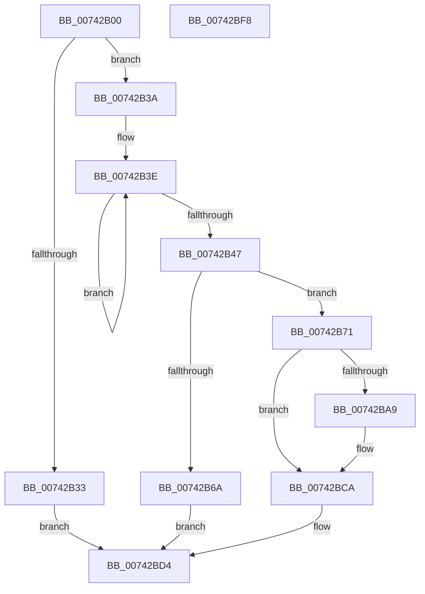

# PiDrvDbRegisterNodeCallback

- RVA: `0x00742B00`–`0x00742BF9` (길이 `249` bytes)
- VA: `0x0000000140742B00`
- 실행 섹션: `PAGE`
- PDB 이름 있음: `예`; PDB Function 태그: `아니요`
- unwind 정보 RVA: `0x00093E28`
- 디코드: `70`개 명령, `249/249` bytes 표시
- 미해석 바이트: `0` (있으면 어셈블리에 `.byte`로 보존)

> 이 문서는 커널 이미지의 기계어와 PDB 기호를 분석해 생성했습니다. 4번과 5번은 함수 원형과 자료형을 바이너리 사용 방식에서 추정한 C 해석이며 원본 소스 복구 결과는 아닙니다.

## 1. Dependencies

- 직접 호출 지점: **5**; 고유 호출 대상: **5**
- 직접 호출자로 확인된 함수: **1**
- RIP 상대 이미지 참조: **4**

### Outgoing calls
- `0x00742B28` → [wcsicmp](../../text/50/wcsicmp_function_00500080.md) (function, `0x00500080`)
- `0x00742B5D` → [ExAllocatePool2](../../poolcode/B8/ExAllocatePool2_function_00B820F0.md) (function, `0x00B820F0`)
- `0x00742B9E` → [RtlStringCchPrintfW](../../text/48/RtlStringCchPrintfW_function_00482D5C.md) (function, `0x00482D5C`)
- `0x00742BBB` → [PiDrvDbRegisterNode](PiDrvDbRegisterNode_function_00742658.md) (function, `0x00742658`)
- `0x00742BCF` → [ExFreePoolWithTag](../../poolcode/B8/ExFreePoolWithTag_function_00B82870.md) (function, `0x00B82870`)

### Direct callers
- [PiDrvDbEnumDriverStoreNodes](PiDrvDbEnumDriverStoreNodes_function_00740EF8.md) at `0x00740FEC`

### Static image references
- `0x00742B1B` → RVA `0x00AFF500` (` ?? ::NNGAKEGL::`string'`; read)
- `0x00742B71` → RVA `0x00B002B0` (` ?? ::NNGAKEGL::`string'`; read)
- `0x00742B82` → RVA `0x00B002E0` (` ?? ::NNGAKEGL::`string'`; read)
- `0x00742B8C` → RVA `0x00B00310` (` ?? ::NNGAKEGL::`string'`; read)

## 2. Other-region calls and transfers

- 다른 실행 섹션으로 향하는 call: **4**
  - `0x00742B28` → [wcsicmp](../../text/50/wcsicmp_function_00500080.md) (`PAGE` → `.text`)
  - `0x00742B5D` → [ExAllocatePool2](../../poolcode/B8/ExAllocatePool2_function_00B820F0.md) (`PAGE` → `POOLCODE`)
  - `0x00742B9E` → [RtlStringCchPrintfW](../../text/48/RtlStringCchPrintfW_function_00482D5C.md) (`PAGE` → `.text`)
  - `0x00742BCF` → [ExFreePoolWithTag](../../poolcode/B8/ExFreePoolWithTag_function_00B82870.md) (`PAGE` → `POOLCODE`)
- 별도 외부 분기/꼬리 이동을 확인하지 못했습니다.

## 3. Assembly (complete function range)

```asm
00742B00  48 89 5C 24 08                  mov qword ptr [rsp + 8], rbx
00742B05  48 89 6C 24 10                  mov qword ptr [rsp + 0x10], rbp
00742B0A  48 89 74 24 18                  mov qword ptr [rsp + 0x18], rsi
00742B0F  57                              push rdi
00742B10  41 56                           push r14
00742B12  41 57                           push r15
00742B14  48 83 EC 40                     sub rsp, 0x40
00742B18  4C 8B F2                        mov r14, rdx
00742B1B  4C 8D 3D DE C9 3B 00            lea r15, [rip + 0x3bc9de]
00742B22  49 8B D7                        mov rdx, r15
00742B25  48 8B F9                        mov rdi, rcx
00742B28  E8 53 D5 DB FF                  call 0x140500080
00742B2D  33 ED                           xor ebp, ebp
00742B2F  85 C0                           test eax, eax
00742B31  75 07                           jne 0x140742b3a
00742B33  8B DD                           mov ebx, ebp
00742B35  E9 9A 00 00 00                  jmp 0x140742bd4
00742B3A  48 83 C8 FF                     or rax, 0xffffffffffffffff
00742B3E  48 FF C0                        inc rax
00742B41  66 39 2C 47                     cmp word ptr [rdi + rax*2], bp
00742B45  75 F7                           jne 0x140742b3e
00742B47  8D 04 45 56 00 00 00            lea eax, [rax*2 + 0x56]
00742B4E  41 B8 50 70 64 62               mov r8d, 0x62647050
00742B54  8B D0                           mov edx, eax
00742B56  B9 00 01 00 00                  mov ecx, 0x100
00742B5B  8B D8                           mov ebx, eax
00742B5D  E8 8E F5 43 00                  call 0x140b820f0
00742B62  48 8B F0                        mov rsi, rax
00742B65  48 85 C0                        test rax, rax
00742B68  75 07                           jne 0x140742b71
00742B6A  BB 9A 00 00 C0                  mov ebx, 0xc000009a
00742B6F  EB 63                           jmp 0x140742bd4
00742B71  48 8D 05 38 D7 3B 00            lea rax, [rip + 0x3bd738]
00742B78  4C 89 7C 24 30                  mov qword ptr [rsp + 0x30], r15
00742B7D  48 89 44 24 28                  mov qword ptr [rsp + 0x28], rax
00742B82  4C 8D 0D 57 D7 3B 00            lea r9, [rip + 0x3bd757]
00742B89  48 D1 EB                        shr rbx, 1
00742B8C  4C 8D 05 7D D7 3B 00            lea r8, [rip + 0x3bd77d]
00742B93  48 8B D3                        mov rdx, rbx
00742B96  48 89 7C 24 20                  mov qword ptr [rsp + 0x20], rdi
00742B9B  48 8B CE                        mov rcx, rsi
00742B9E  E8 B9 01 D4 FF                  call 0x140482d5c
00742BA3  8B D8                           mov ebx, eax
00742BA5  85 C0                           test eax, eax
00742BA7  78 21                           js 0x140742bca
00742BA9  45 33 C9                        xor r9d, r9d
00742BAC  48 89 74 24 20                  mov qword ptr [rsp + 0x20], rsi
00742BB1  45 33 C0                        xor r8d, r8d
00742BB4  48 8B CF                        mov rcx, rdi
00742BB7  41 8D 51 0A                     lea edx, [r9 + 0xa]
00742BBB  E8 98 FA FF FF                  call 0x140742658
00742BC0  3D 00 00 00 40                  cmp eax, 0x40000000
00742BC5  8B D8                           mov ebx, eax
00742BC7  0F 44 DD                        cmove ebx, ebp
00742BCA  33 D2                           xor edx, edx
00742BCC  48 8B CE                        mov rcx, rsi
00742BCF  E8 9C FC 43 00                  call 0x140b82870
00742BD4  48 8B 6C 24 68                  mov rbp, qword ptr [rsp + 0x68]
00742BD9  48 8B 74 24 70                  mov rsi, qword ptr [rsp + 0x70]
00742BDE  41 89 1E                        mov dword ptr [r14], ebx
00742BE1  C1 EB 1F                        shr ebx, 0x1f
00742BE4  80 F3 01                        xor bl, 1
00742BE7  8A C3                           mov al, bl
00742BE9  48 8B 5C 24 60                  mov rbx, qword ptr [rsp + 0x60]
00742BEE  48 83 C4 40                     add rsp, 0x40
00742BF2  41 5F                           pop r15
00742BF4  41 5E                           pop r14
00742BF6  5F                              pop rdi
00742BF7  C3                              ret
00742BF8  CC                              int3
```

## 4. C-style interpretation (structured pseudocode)

```c
__int64 __fastcall PiDrvDbRegisterNodeCallback(__int64 a1, __int64 a2)
{
    __int64 result;
    __int64 v_rbp;
    __int64 v_rbx;
    __int64 v_rsp;
    unsigned __int64 v_stack_m28;
    unsigned __int64 v_stack_m30;
    unsigned __int64 v_stack_m38;
    unsigned __int64 v_stack_p10;
    unsigned __int64 v_stack_p18;
    unsigned __int64 v_stack_p8;

    v_stack_p8 = v_rbx;
    v_stack_p10 = v_rbp;
    v_stack_p18 = v_rsi;
    v_rsp = (v_rsp) - (64);
    result = wcsicmp(a1, v_rip + 3918302, a3, a4);
    v_rbp = 0;
    if ((unsigned int)(result) != 0) goto loc_00742B3A;
    goto loc_00742BD4;
loc_00742B3A:
    result = (result) | (-1);
loc_00742B3E:
    result = (result) + 1;
    if ((*(unsigned __int16 *)(a1 + result * 2)) != 0) goto loc_00742B3E;
    result = ExAllocatePool2(256, (unsigned int)((unsigned int)(result * 2 + 86)), (unsigned int)(0x62647050ULL), a4);
    if (result != 0) goto loc_00742B71;
    goto loc_00742BD4;
loc_00742B71:
    v_stack_m28 = v_rip + 3918302;
    v_stack_m30 = v_rip + 3921720;
    v_rbx = ((unsigned int)(0xC000009AULL)) >> (1);
    v_stack_m38 = a1;
    result = RtlStringCchPrintfW(result, v_rbx, v_rip + 3921789, v_rip + 3921751);
    v_rbx = (unsigned int)((unsigned int)(result));
    if (!(sign_flag)) {
        a4 = 0;
        v_stack_m38 = result;
        a3 = 0;
        a1 = a1;
        a2 = a4 + 10;
        result = PiDrvDbRegisterNode(a1, a2, a3, a4);
        v_rbx = (unsigned int)(result);
        if (((unsigned int)(result)) == 0x40000000ULL) { v_rbx = 0; }
    }
    a2 = 0;
    result = ExFreePoolWithTag(result, a2, a3, a4);
loc_00742BD4:
    *(unsigned int *)(a2) = (unsigned int)(v_rbx);
    v_rbx = (unsigned int)((v_rbx) >> (31));
    v_rbx = (unsigned __int8)((v_rbx) ^ (1));
    v_rsp = (v_rsp) + (64);
    return (unsigned __int8)(v_rbx);
}
```

## 5. (Beta) C Style

```c
int64_t PiDrvDbRegisterNodeCallback(void *Arg1, void *Arg2)
{
    uint8_t *arg1 = (uint8_t *)Arg1;
    uint8_t *arg2 = (uint8_t *)Arg2;

    int64_t result;
    int64_t local_rbp;
    int64_t local_rbx;
    int64_t local_rsp;
    uint64_t v_stack_m28;
    uint64_t v_stack_m30;
    uint64_t v_stack_m38;
    uint64_t v_stack_p10;
    uint64_t v_stack_p18;
    uint64_t v_stack_p8;

    v_stack_p8 = local_rbx;
    v_stack_p10 = local_rbp;
    v_stack_p18 = local_rsi;
    local_rsp = (local_rsp) - (64);
    result = wcsicmp(Arg1, v_rip + 3918302, a3, a4);
    local_rbp = 0;
    if ((uint32_t)(result) != 0) goto loc_00742B3A;
    goto loc_00742BD4;
loc_00742B3A:
    result = (result) | (-1);
loc_00742B3E:
    result = (result) + 1;
    if ((*(uint16_t *)(arg1 + result * 2)) != 0) goto loc_00742B3E;
    result = ExAllocatePool2(256, (uint32_t)((uint32_t)(result * 2 + 86)), (uint32_t)(0x62647050ULL), a4);
    if (result != 0) goto loc_00742B71;
    goto loc_00742BD4;
loc_00742B71:
    v_stack_m28 = v_rip + 3918302;
    v_stack_m30 = v_rip + 3921720;
    local_rbx = ((uint32_t)(0xC000009AULL)) >> (1);
    v_stack_m38 = Arg1;
    result = RtlStringCchPrintfW(result, local_rbx, v_rip + 3921789, v_rip + 3921751);
    local_rbx = (uint32_t)((uint32_t)(result));
    if (!(sign_flag)) {
        a4 = 0;
        v_stack_m38 = result;
        a3 = 0;
        Arg1 = Arg1;
        Arg2 = a4 + 10;
        result = PiDrvDbRegisterNode(Arg1, Arg2, a3, a4);
        local_rbx = (uint32_t)(result);
        if (((uint32_t)(result)) == 0x40000000ULL) { local_rbx = 0; }
    }
    Arg2 = 0;
    result = ExFreePoolWithTag(result, Arg2, a3, a4);
loc_00742BD4:
    *(uint32_t *)(arg2) = (uint32_t)(local_rbx);
    local_rbx = (uint32_t)((local_rbx) >> (31));
    local_rbx = (uint8_t)((local_rbx) ^ (1));
    local_rsp = (local_rsp) + (64);
    return (uint8_t)(local_rbx);
}
```

### 관측된 메모리 오프셋

구조체 형식이 확인되지 않은 접근은 인자 기준의 오프셋으로만 기록했습니다.

| 기준 인자 | 오프셋 표현 | 폭 (bit) | 접근 |
|---|---:|---:|---|
| `Arg1` | `+ 0x0 + rax*2` | `16` | `R` |
| `Arg2` | `+ 0x0` | `32` | `W` |

## 6. Execution-region graph

[열기: 2D/3D 그래프와 함수 탐색 컨트롤 패널](../../../control-panel.html?section=page&rva=0x00742B00&view=graph)

- 2D 그래프는 위에서 아래로 흐르고, 3D 그래프는 빈 공간을 드래그해 회전합니다. Shift+드래그는 이동, 휠은 확대·축소, 함수 노드 선택은 대상 보고서 이동입니다.

### Static fallback


