# PiDrvDbRegisterNode

- RVA: `0x00742658`–`0x00742AF8` (길이 `1,184` bytes)
- VA: `0x0000000140742658`
- 실행 섹션: `PAGE`
- PDB 이름 있음: `예`; PDB Function 태그: `아니요`
- unwind 정보 RVA: `0x000C93FC`
- 디코드: `307`개 명령, `1,184/1,184` bytes 표시
- 미해석 바이트: `0` (있으면 어셈블리에 `.byte`로 보존)

> 이 문서는 커널 이미지의 기계어와 PDB 기호를 분석해 생성했습니다. 4번과 5번은 함수 원형과 자료형을 바이너리 사용 방식에서 추정한 C 해석이며 원본 소스 복구 결과는 아닙니다.

## 1. Dependencies

- 직접 호출 지점: **24**; 고유 호출 대상: **19**
- 직접 호출자로 확인된 함수: **3**
- RIP 상대 이미지 참조: **8**

### Outgoing calls
- `0x007426D2` → [RtlInitUnicodeString](../../text/42/RtlInitUnicodeString_function_0042A780.md) (function, `0x0042A780`)
- `0x007426ED` → [PiDrvDbCreateNode](PiDrvDbCreateNode_function_00740AFC.md) (function, `0x00740AFC`)
- `0x00742721` → [ExAllocatePool2](../../poolcode/B8/ExAllocatePool2_function_00B820F0.md) (function, `0x00B820F0`)
- `0x00742758` → [RtlStringCchPrintfW](../../text/48/RtlStringCchPrintfW_function_00482D5C.md) (function, `0x00482D5C`)
- `0x00742797` → [DrvDbRegisterDatabase](../83/DrvDbRegisterDatabase_function_0083513C.md) (function, `0x0083513C`)
- `0x00742809` → [PnpSetObjectProperty](../8F/PnpSetObjectProperty_function_008F66E8.md) (function, `0x008F66E8`)
- `0x0074282B` → [RtlInitUnicodeString](../../text/42/RtlInitUnicodeString_function_0042A780.md) (function, `0x0042A780`)
- `0x0074283A` → [RtlFindUnicodeSubstring](../94/RtlFindUnicodeSubstring_function_00949FA0.md) (function, `0x00949FA0`)
- `0x007428C3` → [RtlInitUnicodeString](../../text/42/RtlInitUnicodeString_function_0042A780.md) (function, `0x0042A780`)
- `0x00742901` → [ZwOpenDirectoryObject](../../text/6A/ZwOpenDirectoryObject_function_006ADBD0.md) (function, `0x006ADBD0`)
- `0x0074294B` → [ZwCreateSymbolicLinkObject](../../text/6A/ZwCreateSymbolicLinkObject_function_006AE9D0.md) (function, `0x006AE9D0`)
- `0x007429A1` → [PnpGetObjectProperty](../8E/PnpGetObjectProperty_function_008E2180.md) (function, `0x008E2180`)
- `0x007429BA` → [RtlDuplicateUnicodeString](../93/RtlDuplicateUnicodeString_function_009321F0.md) (function, `0x009321F0`)
- `0x00742A08` → [PnpSetObjectProperty](../8F/PnpSetObjectProperty_function_008F66E8.md) (function, `0x008F66E8`)
- `0x00742A37` → [PnpCtxRegOpenKey](../8E/PnpCtxRegOpenKey_function_008EF7B8.md) (function, `0x008EF7B8`)
- `0x00742A55` → [PnpCtxRegisterMachineNode](../82/PnpCtxRegisterMachineNode_function_008292BC.md) (function, `0x008292BC`)
- `0x00742A6C` → [PiDrvDbDriverStoreNodesUpdated](PiDrvDbDriverStoreNodesUpdated_function_00740E9C.md) (function, `0x00740E9C`)
- `0x00742A81` → [ZwClose](../../text/6A/ZwClose_function_006AD2B0.md) (function, `0x006AD2B0`)
- `0x00742A8F` → [ZwClose](../../text/6A/ZwClose_function_006AD2B0.md) (function, `0x006AD2B0`)
- `0x00742A9D` → [ZwClose](../../text/6A/ZwClose_function_006AD2B0.md) (function, `0x006AD2B0`)
- `0x00742AA6` → [RtlFreeAnsiString](../9C/RtlFreeAnsiString_function_009C0800.md) (function, `0x009C0800`)
- `0x00742AB5` → [ExFreePoolWithTag](../../poolcode/B8/ExFreePoolWithTag_function_00B82870.md) (function, `0x00B82870`)
- `0x00742AC7` → [DrvDbUnregisterDatabase](../83/DrvDbUnregisterDatabase_function_008352E0.md) (function, `0x008352E0`)
- `0x00742ACF` → [PiDrvDbDestroyNode](PiDrvDbDestroyNode_function_00740DF8.md) (function, `0x00740DF8`)

### Direct callers
- [PiDrvDbInit](PiDrvDbInit_function_0074130C.md) at `0x00741384`
- [PiDrvDbRegisterNodeCallback](PiDrvDbRegisterNodeCallback_function_00742B00.md) at `0x00742BBB`
- [PiDrvDbMountNode](../AD/PiDrvDbMountNode_function_00AD4ECC.md) at `0x00AD501A`

### Static image references
- `0x00742738` → RVA `0x00B00330` (` ?? ::NNGAKEGL::`string'`; read)
- `0x00742751` → RVA `0x00B003D0` (` ?? ::NNGAKEGL::`string'`; read)
- `0x007427D7` → RVA `0x00E66398` (`.data`; read)
- `0x007427F0` → RVA `0x00021AC8` (`.rdata`; read)
- `0x0074281C` → RVA `0x00B002B0` (` ?? ::NNGAKEGL::`string'`; read)
- `0x007428B8` → RVA `0x00B002E0` (` ?? ::NNGAKEGL::`string'`; read)
- `0x007428D8` → RVA `0x00FD9AA8` (`PAGEDATA`; read)
- `0x00742966` → RVA `0x00022850` (`.rdata`; read)

## 2. Other-region calls and transfers

- 다른 실행 섹션으로 향하는 call: **11**
  - `0x007426D2` → [RtlInitUnicodeString](../../text/42/RtlInitUnicodeString_function_0042A780.md) (`PAGE` → `.text`)
  - `0x00742721` → [ExAllocatePool2](../../poolcode/B8/ExAllocatePool2_function_00B820F0.md) (`PAGE` → `POOLCODE`)
  - `0x00742758` → [RtlStringCchPrintfW](../../text/48/RtlStringCchPrintfW_function_00482D5C.md) (`PAGE` → `.text`)
  - `0x0074282B` → [RtlInitUnicodeString](../../text/42/RtlInitUnicodeString_function_0042A780.md) (`PAGE` → `.text`)
  - `0x007428C3` → [RtlInitUnicodeString](../../text/42/RtlInitUnicodeString_function_0042A780.md) (`PAGE` → `.text`)
  - `0x00742901` → [ZwOpenDirectoryObject](../../text/6A/ZwOpenDirectoryObject_function_006ADBD0.md) (`PAGE` → `.text`)
  - `0x0074294B` → [ZwCreateSymbolicLinkObject](../../text/6A/ZwCreateSymbolicLinkObject_function_006AE9D0.md) (`PAGE` → `.text`)
  - `0x00742A81` → [ZwClose](../../text/6A/ZwClose_function_006AD2B0.md) (`PAGE` → `.text`)
  - `0x00742A8F` → [ZwClose](../../text/6A/ZwClose_function_006AD2B0.md) (`PAGE` → `.text`)
  - `0x00742A9D` → [ZwClose](../../text/6A/ZwClose_function_006AD2B0.md) (`PAGE` → `.text`)
  - `0x00742AB5` → [ExFreePoolWithTag](../../poolcode/B8/ExFreePoolWithTag_function_00B82870.md) (`PAGE` → `POOLCODE`)
- 별도 외부 분기/꼬리 이동을 확인하지 못했습니다.

## 3. Assembly (complete function range)

```asm
00742658  48 8B C4                        mov rax, rsp
0074265B  48 89 58 10                     mov qword ptr [rax + 0x10], rbx
0074265F  48 89 70 18                     mov qword ptr [rax + 0x18], rsi
00742663  48 89 78 20                     mov qword ptr [rax + 0x20], rdi
00742667  48 89 48 08                     mov qword ptr [rax + 8], rcx
0074266B  55                              push rbp
0074266C  41 54                           push r12
0074266E  41 55                           push r13
00742670  41 56                           push r14
00742672  41 57                           push r15
00742674  48 8D 68 A9                     lea rbp, [rax - 0x57]
00742678  48 81 EC F0 00 00 00            sub rsp, 0xf0
0074267F  33 FF                           xor edi, edi
00742681  0F 57 C0                        xorps xmm0, xmm0
00742684  33 C0                           xor eax, eax
00742686  48 89 7D B7                     mov qword ptr [rbp - 0x49], rdi
0074268A  44 8B FA                        mov r15d, edx
0074268D  48 89 7D C7                     mov qword ptr [rbp - 0x39], rdi
00742691  48 8B F1                        mov rsi, rcx
00742694  48 89 7D FF                     mov qword ptr [rbp - 1], rdi
00742698  0F 57 C9                        xorps xmm1, xmm1
0074269B  48 89 7D BF                     mov qword ptr [rbp - 0x41], rdi
0074269F  33 D2                           xor edx, edx
007426A1  89 7D B3                        mov dword ptr [rbp - 0x4d], edi
007426A4  48 8D 4D 07                     lea rcx, [rbp + 7]
007426A8  89 7D AF                        mov dword ptr [rbp - 0x51], edi
007426AB  44 8B F7                        mov r14d, edi
007426AE  48 89 45 EF                     mov qword ptr [rbp - 0x11], rax
007426B2  44 8A EF                        mov r13b, dil
007426B5  89 45 F7                        mov dword ptr [rbp - 9], eax
007426B8  0F 11 45 9F                     movups xmmword ptr [rbp - 0x61], xmm0
007426BC  49 8B D9                        mov rbx, r9
007426BF  4D 8B E0                        mov r12, r8
007426C2  0F 11 4D 07                     movups xmmword ptr [rbp + 7], xmm1
007426C6  0F 11 45 17                     movups xmmword ptr [rbp + 0x17], xmm0
007426CA  0F 11 45 CF                     movups xmmword ptr [rbp - 0x31], xmm0
007426CE  0F 11 45 DF                     movups xmmword ptr [rbp - 0x21], xmm0
007426D2  E8 A9 80 CE FF                  call 0x14042a780
007426D7  4C 8B 4D 7F                     mov r9, qword ptr [rbp + 0x7f]
007426DB  48 8D 45 B7                     lea rax, [rbp - 0x49]
007426DF  4C 8B C3                        mov r8, rbx
007426E2  48 89 44 24 20                  mov qword ptr [rsp + 0x20], rax
007426E7  41 8B D7                        mov edx, r15d
007426EA  48 8B CE                        mov rcx, rsi
007426ED  E8 0A E4 FF FF                  call 0x140740afc
007426F2  48 8B 7D B7                     mov rdi, qword ptr [rbp - 0x49]
007426F6  8B D8                           mov ebx, eax
007426F8  85 C0                           test eax, eax
007426FA  0F 88 78 03 00 00               js 0x140742a78
00742700  8B 47 40                        mov eax, dword ptr [rdi + 0x40]
00742703  A8 01                           test al, 1
00742705  0F 85 A3 00 00 00               jne 0x1407427ae
0074270B  0F B7 5F 20                     movzx ebx, word ptr [rdi + 0x20]
0074270F  41 B8 50 70 64 62               mov r8d, 0x62647050
00742715  48 83 C3 20                     add rbx, 0x20
00742719  B9 00 01 00 00                  mov ecx, 0x100
0074271E  48 8B D3                        mov rdx, rbx
00742721  E8 CA F9 43 00                  call 0x140b820f0
00742726  4C 8B F0                        mov r14, rax
00742729  48 85 C0                        test rax, rax
0074272C  75 0A                           jne 0x140742738
0074272E  BB 9A 00 00 C0                  mov ebx, 0xc000009a
00742733  E9 3C 03 00 00                  jmp 0x140742a74
00742738  48 8D 05 F1 DB 3B 00            lea rax, [rip + 0x3bdbf1]
0074273F  48 D1 EB                        shr rbx, 1
00742742  48 8B D3                        mov rdx, rbx
00742745  48 89 44 24 20                  mov qword ptr [rsp + 0x20], rax
0074274A  4C 8D 4F 20                     lea r9, [rdi + 0x20]
0074274E  49 8B CE                        mov rcx, r14
00742751  4C 8D 05 78 DC 3B 00            lea r8, [rip + 0x3bdc78]
00742758  E8 FF 05 D4 FF                  call 0x140482d5c
0074275D  8B D8                           mov ebx, eax
0074275F  85 C0                           test eax, eax
00742761  0F 88 0D 03 00 00               js 0x140742a74
00742767  48 89 7C 24 38                  mov qword ptr [rsp + 0x38], rdi
0074276C  41 8B F7                        mov esi, r15d
0074276F  83 E6 08                        and esi, 8
00742772  4D 8B C4                        mov r8, r12
00742775  8B C6                           mov eax, esi
00742777  F7 D8                           neg eax
00742779  1B D2                           sbb edx, edx
0074277B  83 E2 02                        and edx, 2
0074277E  8B CA                           mov ecx, edx
00742780  83 C9 01                        or ecx, 1
00742783  41 F6 C7 40                     test r15b, 0x40
00742787  0F 44 CA                        cmove ecx, edx
0074278A  48 8B 55 5F                     mov rdx, qword ptr [rbp + 0x5f]
0074278E  89 4C 24 28                     mov dword ptr [rsp + 0x28], ecx
00742792  4C 89 74 24 20                  mov qword ptr [rsp + 0x20], r14
00742797  E8 A0 29 0F 00                  call 0x14083513c
0074279C  45 33 E4                        xor r12d, r12d
0074279F  8B D8                           mov ebx, eax
007427A1  85 C0                           test eax, eax
007427A3  0F 88 CB 02 00 00               js 0x140742a74
007427A9  41 B5 01                        mov r13b, 1
007427AC  EB 09                           jmp 0x1407427b7
007427AE  41 8B F7                        mov esi, r15d
007427B1  83 E6 08                        and esi, 8
007427B4  45 33 E4                        xor r12d, r12d
007427B7  85 F6                           test esi, esi
007427B9  0F 84 AD 02 00 00               je 0x140742a6c
007427BF  4C 8B 4F 48                     mov r9, qword ptr [rdi + 0x48]
007427C3  48 8D 77 30                     lea rsi, [rdi + 0x30]
007427C7  0F B7 06                        movzx eax, word ptr [rsi]
007427CA  41 B8 07 00 00 00               mov r8d, 7
007427D0  48 8B 57 18                     mov rdx, qword ptr [rdi + 0x18]
007427D4  83 C0 02                        add eax, 2
007427D7  48 8B 0D BA 3B 72 00            mov rcx, qword ptr [rip + 0x723bba]
007427DE  44 89 64 24 48                  mov dword ptr [rsp + 0x48], r12d
007427E3  89 44 24 40                     mov dword ptr [rsp + 0x40], eax
007427E7  48 8B 47 38                     mov rax, qword ptr [rdi + 0x38]
007427EB  48 89 44 24 38                  mov qword ptr [rsp + 0x38], rax
007427F0  48 8D 05 D1 F2 8D FF            lea rax, [rip - 0x720d2f]
007427F7  C7 44 24 30 12 00 00 00         mov dword ptr [rsp + 0x30], 0x12
007427FF  48 89 44 24 28                  mov qword ptr [rsp + 0x28], rax
00742804  4C 89 64 24 20                  mov qword ptr [rsp + 0x20], r12
00742809  E8 DA 3E 1B 00                  call 0x1408f66e8
0074280E  8B D8                           mov ebx, eax
00742810  85 C0                           test eax, eax
00742812  0F 88 5C 02 00 00               js 0x140742a74
00742818  48 8B 47 38                     mov rax, qword ptr [rdi + 0x38]
0074281C  48 8D 15 8D DA 3B 00            lea rdx, [rip + 0x3bda8d]
00742823  48 8D 4D 17                     lea rcx, [rbp + 0x17]
00742827  48 89 45 A7                     mov qword ptr [rbp - 0x59], rax
0074282B  E8 50 7F CE FF                  call 0x14042a780
00742830  41 B0 01                        mov r8b, 1
00742833  48 8D 55 17                     lea rdx, [rbp + 0x17]
00742837  48 8B CE                        mov rcx, rsi
0074283A  E8 61 77 20 00                  call 0x140949fa0
0074283F  48 85 C0                        test rax, rax
00742842  74 12                           je 0x140742856
00742844  8B C8                           mov ecx, eax
00742846  BE 02 00 00 00                  mov esi, 2
0074284B  2B 4F 38                        sub ecx, dword ptr [rdi + 0x38]
0074284E  48 D1 F9                        sar rcx, 1
00742851  66 03 C9                        add cx, cx
00742854  EB 50                           jmp 0x1407428a6
00742856  0F B7 06                        movzx eax, word ptr [rsi]
00742859  41 B8 FE FF 00 00               mov r8d, 0xfffe
0074285F  48 8B 55 A7                     mov rdx, qword ptr [rbp - 0x59]
00742863  BE 02 00 00 00                  mov esi, 2
00742868  66 89 45 9F                     mov word ptr [rbp - 0x61], ax
0074286C  0F B7 C8                        movzx ecx, ax
0074286F  66 3B C6                        cmp ax, si
00742872  76 1B                           jbe 0x14074288f
00742874  0F B7 C1                        movzx eax, cx
00742877  48 D1 E8                        shr rax, 1
0074287A  66 83 7C 42 FE 5C               cmp word ptr [rdx + rax*2 - 2], 0x5c
00742880  74 0D                           je 0x14074288f
00742882  66 41 03 C8                     add cx, r8w
00742886  66 89 4D 9F                     mov word ptr [rbp - 0x61], cx
0074288A  66 3B CE                        cmp cx, si
0074288D  77 E5                           ja 0x140742874
0074288F  66 3B CE                        cmp cx, si
00742892  76 16                           jbe 0x1407428aa
00742894  0F B7 C1                        movzx eax, cx
00742897  48 D1 E8                        shr rax, 1
0074289A  66 83 7C 42 FE 5C               cmp word ptr [rdx + rax*2 - 2], 0x5c
007428A0  75 08                           jne 0x1407428aa
007428A2  66 41 03 C8                     add cx, r8w
007428A6  66 89 4D 9F                     mov word ptr [rbp - 0x61], cx
007428AA  66 89 4D A1                     mov word ptr [rbp - 0x5f], cx
007428AE  41 F6 C7 10                     test r15b, 0x10
007428B2  0F 84 A2 00 00 00               je 0x14074295a
007428B8  48 8D 15 21 DA 3B 00            lea rdx, [rip + 0x3bda21]
007428BF  48 8D 4D 17                     lea rcx, [rbp + 0x17]
007428C3  E8 B8 7E CE FF                  call 0x14042a780
007428C8  48 8D 45 17                     lea rax, [rbp + 0x17]
007428CC  4C 89 65 D7                     mov qword ptr [rbp - 0x29], r12
007428D0  48 89 45 DF                     mov qword ptr [rbp - 0x21], rax
007428D4  4C 8D 45 CF                     lea r8, [rbp - 0x31]
007428D8  48 8B 05 C9 71 89 00            mov rax, qword ptr [rip + 0x8971c9]
007428DF  48 8D 4D C7                     lea rcx, [rbp - 0x39]
007428E3  41 BF 30 00 00 00               mov r15d, 0x30
007428E9  48 89 45 EF                     mov qword ptr [rbp - 0x11], rax
007428ED  BA 0F 00 0F 00                  mov edx, 0xf000f
007428F2  44 89 7D CF                     mov dword ptr [rbp - 0x31], r15d
007428F6  C7 45 E7 50 02 00 00            mov dword ptr [rbp - 0x19], 0x250
007428FD  4C 89 65 F7                     mov qword ptr [rbp - 9], r12
00742901  E8 CA B2 F6 FF                  call 0x1406adbd0
00742906  8B D8                           mov ebx, eax
00742908  85 C0                           test eax, eax
0074290A  0F 88 64 01 00 00               js 0x140742a74
00742910  48 8B 45 C7                     mov rax, qword ptr [rbp - 0x39]
00742914  4C 8D 4D 9F                     lea r9, [rbp - 0x61]
00742918  48 89 45 D7                     mov qword ptr [rbp - 0x29], rax
0074291C  4C 8D 45 CF                     lea r8, [rbp - 0x31]
00742920  48 8D 47 10                     lea rax, [rdi + 0x10]
00742924  44 89 7D CF                     mov dword ptr [rbp - 0x31], r15d
00742928  48 89 45 DF                     mov qword ptr [rbp - 0x21], rax
0074292C  48 8D 4D FF                     lea rcx, [rbp - 1]
00742930  48 8B 05 71 71 89 00            mov rax, qword ptr [rip + 0x897171]
00742937  BA 01 00 0F 00                  mov edx, 0xf0001
0074293C  48 89 45 EF                     mov qword ptr [rbp - 0x11], rax
00742940  C7 45 E7 50 02 00 00            mov dword ptr [rbp - 0x19], 0x250
00742947  4C 89 65 F7                     mov qword ptr [rbp - 9], r12
0074294B  E8 80 C0 F6 FF                  call 0x1406ae9d0
00742950  8B D8                           mov ebx, eax
00742952  85 C0                           test eax, eax
00742954  0F 88 1A 01 00 00               js 0x140742a74
0074295A  4C 8B 4F 48                     mov r9, qword ptr [rdi + 0x48]
0074295E  48 8D 45 AF                     lea rax, [rbp - 0x51]
00742962  48 8B 57 18                     mov rdx, qword ptr [rdi + 0x18]
00742966  4C 8D 3D E3 FE 8D FF            lea r15, [rip - 0x72011d]
0074296D  48 8B 0D 24 3A 72 00            mov rcx, qword ptr [rip + 0x723a24]
00742974  41 B8 07 00 00 00               mov r8d, 7
0074297A  44 89 64 24 50                  mov dword ptr [rsp + 0x50], r12d
0074297F  48 89 44 24 48                  mov qword ptr [rsp + 0x48], rax
00742984  48 8D 45 B3                     lea rax, [rbp - 0x4d]
00742988  44 89 64 24 40                  mov dword ptr [rsp + 0x40], r12d
0074298D  4C 89 64 24 38                  mov qword ptr [rsp + 0x38], r12
00742992  48 89 44 24 30                  mov qword ptr [rsp + 0x30], rax
00742997  4C 89 7C 24 28                  mov qword ptr [rsp + 0x28], r15
0074299C  4C 89 64 24 20                  mov qword ptr [rsp + 0x20], r12
007429A1  E8 DA F7 19 00                  call 0x1408e2180
007429A6  3D 25 02 00 C0                  cmp eax, 0xc0000225
007429AB  75 66                           jne 0x140742a13
007429AD  4C 8D 45 07                     lea r8, [rbp + 7]
007429B1  B9 01 00 00 00                  mov ecx, 1
007429B6  48 8D 55 9F                     lea rdx, [rbp - 0x61]
007429BA  E8 31 F8 1E 00                  call 0x1409321f0
007429BF  8B D8                           mov ebx, eax
007429C1  85 C0                           test eax, eax
007429C3  0F 88 AB 00 00 00               js 0x140742a74
007429C9  0F B7 45 07                     movzx eax, word ptr [rbp + 7]
007429CD  41 B8 07 00 00 00               mov r8d, 7
007429D3  4C 8B 4F 48                     mov r9, qword ptr [rdi + 0x48]
007429D7  03 C6                           add eax, esi
007429D9  48 8B 57 18                     mov rdx, qword ptr [rdi + 0x18]
007429DD  48 8B 0D B4 39 72 00            mov rcx, qword ptr [rip + 0x7239b4]
007429E4  44 89 64 24 48                  mov dword ptr [rsp + 0x48], r12d
007429E9  89 44 24 40                     mov dword ptr [rsp + 0x40], eax
007429ED  48 8B 45 0F                     mov rax, qword ptr [rbp + 0xf]
007429F1  48 89 44 24 38                  mov qword ptr [rsp + 0x38], rax
007429F6  C7 44 24 30 12 00 00 00         mov dword ptr [rsp + 0x30], 0x12
007429FE  4C 89 7C 24 28                  mov qword ptr [rsp + 0x28], r15
00742A03  4C 89 64 24 20                  mov qword ptr [rsp + 0x20], r12
00742A08  E8 DB 3C 1B 00                  call 0x1408f66e8
00742A0D  8B D8                           mov ebx, eax
00742A0F  85 C0                           test eax, eax
00742A11  78 61                           js 0x140742a74
00742A13  4C 8B 47 18                     mov r8, qword ptr [rdi + 0x18]
00742A17  48 8D 45 BF                     lea rax, [rbp - 0x41]
00742A1B  48 8B 0D 76 39 72 00            mov rcx, qword ptr [rip + 0x723976]
00742A22  45 33 C9                        xor r9d, r9d
00742A25  48 89 44 24 28                  mov qword ptr [rsp + 0x28], rax
00742A2A  BA 02 00 00 80                  mov edx, 0x80000002
00742A2F  C7 44 24 20 00 00 00 02         mov dword ptr [rsp + 0x20], 0x2000000
00742A37  E8 7C CD 1A 00                  call 0x1408ef7b8
00742A3C  8B D8                           mov ebx, eax
00742A3E  85 C0                           test eax, eax
00742A40  78 32                           js 0x140742a74
00742A42  48 8B 45 BF                     mov rax, qword ptr [rbp - 0x41]
00742A46  41 B8 03 00 00 00               mov r8d, 3
00742A4C  48 8B 57 18                     mov rdx, qword ptr [rdi + 0x18]
00742A50  48 89 44 24 20                  mov qword ptr [rsp + 0x20], rax
00742A55  E8 62 68 0E 00                  call 0x1408292bc
00742A5A  8B D8                           mov ebx, eax
00742A5C  3D 00 00 00 40                  cmp eax, 0x40000000
00742A61  75 05                           jne 0x140742a68
00742A63  41 8B DC                        mov ebx, r12d
00742A66  EB 04                           jmp 0x140742a6c
00742A68  85 C0                           test eax, eax
00742A6A  78 08                           js 0x140742a74
00742A6C  E8 2B E4 FF FF                  call 0x140740e9c
00742A71  49 8B FC                        mov rdi, r12
00742A74  48 8B 75 5F                     mov rsi, qword ptr [rbp + 0x5f]
00742A78  48 8B 4D BF                     mov rcx, qword ptr [rbp - 0x41]
00742A7C  48 85 C9                        test rcx, rcx
00742A7F  74 05                           je 0x140742a86
00742A81  E8 2A A8 F6 FF                  call 0x1406ad2b0
00742A86  48 8B 4D FF                     mov rcx, qword ptr [rbp - 1]
00742A8A  48 85 C9                        test rcx, rcx
00742A8D  74 05                           je 0x140742a94
00742A8F  E8 1C A8 F6 FF                  call 0x1406ad2b0
00742A94  48 8B 4D C7                     mov rcx, qword ptr [rbp - 0x39]
00742A98  48 85 C9                        test rcx, rcx
00742A9B  74 05                           je 0x140742aa2
00742A9D  E8 0E A8 F6 FF                  call 0x1406ad2b0
00742AA2  48 8D 4D 07                     lea rcx, [rbp + 7]
00742AA6  E8 55 DD 27 00                  call 0x1409c0800
00742AAB  4D 85 F6                        test r14, r14
00742AAE  74 0A                           je 0x140742aba
00742AB0  33 D2                           xor edx, edx
00742AB2  49 8B CE                        mov rcx, r14
00742AB5  E8 B6 FD 43 00                  call 0x140b82870
00742ABA  48 85 FF                        test rdi, rdi
00742ABD  74 15                           je 0x140742ad4
00742ABF  45 84 ED                        test r13b, r13b
00742AC2  74 08                           je 0x140742acc
00742AC4  48 8B D6                        mov rdx, rsi
00742AC7  E8 14 28 0F 00                  call 0x1408352e0
00742ACC  48 8B CF                        mov rcx, rdi
00742ACF  E8 24 E3 FF FF                  call 0x140740df8
00742AD4  4C 8D 9C 24 F0 00 00 00         lea r11, [rsp + 0xf0]
00742ADC  8B C3                           mov eax, ebx
00742ADE  49 8B 5B 38                     mov rbx, qword ptr [r11 + 0x38]
00742AE2  49 8B 73 40                     mov rsi, qword ptr [r11 + 0x40]
00742AE6  49 8B 7B 48                     mov rdi, qword ptr [r11 + 0x48]
00742AEA  49 8B E3                        mov rsp, r11
00742AED  41 5F                           pop r15
00742AEF  41 5E                           pop r14
00742AF1  41 5D                           pop r13
00742AF3  41 5C                           pop r12
00742AF5  5D                              pop rbp
00742AF6  C3                              ret
00742AF7  CC                              int3
```

## 4. C-style interpretation (structured pseudocode)

```c
__int64 __fastcall PiDrvDbRegisterNode(__int64 a1, int a2, __int64 a3, __int64 a4)
{
    __int64 result;
    __int64 v_r12;
    __int64 v_rbx;
    __int64 v_rdi;
    __int64 v_rsi;
    __int64 v_rsp;
    unsigned __int64 v_stack_m28;
    unsigned int v_stack_mC8;
    unsigned int v_stack_mD0;
    unsigned int v_stack_mD8;
    unsigned __int64 v_stack_mE0;
    unsigned int v_stack_mE8;
    unsigned int v_stack_mF0;
    unsigned __int64 v_stack_mF8;

    *(unsigned __int64 *)(v_rsp + 16) = v_rbx;
    *(unsigned __int64 *)(v_rsp + 24) = v_rsi;
    *(unsigned __int64 *)(v_rsp + 32) = v_rdi;
    *(unsigned __int64 *)(v_rsp + 8) = a1;
    v_rsp = (v_rsp) - (240);
    v_rdi = 0;
    result = 0;
    *(unsigned __int64 *)(v_rsp - 87 - 73) = 0;
    *(unsigned __int64 *)(v_rsp - 87 - 57) = 0;
    *(unsigned __int64 *)(v_rsp - 87 - 1) = 0;
    *(unsigned __int64 *)(v_rsp - 87 - 65) = 0;
    a2 = 0;
    *(unsigned int *)(v_rsp - 87 - 77) = 0;
    *(unsigned int *)(v_rsp - 87 - 81) = 0;
    *(unsigned __int64 *)(v_rsp - 87 - 17) = 0;
    *(unsigned int *)(v_rsp - 87 - 9) = 0;
    *(unsigned __int64 *)(v_rsp - 87 - 97) = v_xmm0;
    *(unsigned __int64 *)(v_rsp - 87 + 7) = v_xmm1;
    *(unsigned __int64 *)(v_rsp - 87 + 23) = v_xmm0;
    *(unsigned __int64 *)(v_rsp - 87 - 49) = v_xmm0;
    *(unsigned __int64 *)(v_rsp - 87 - 33) = v_xmm0;
    result = RtlInitUnicodeString(v_rsp - 87 + 7, a2, a3, a4);
    v_stack_mF8 = v_rsp - 87 - 73;
    result = PiDrvDbCreateNode(a1, (unsigned int)((unsigned int)((unsigned int)(a2))), a4, *(unsigned __int64 *)(v_rsp - 87 + 127));
    if (sign_flag) goto loc_00742A78;
    if ((((unsigned __int8)((unsigned int)(*(unsigned int *)(*(unsigned __int64 *)(v_rsp - 87 - 73) + 64)))) & (1)) != 0) goto loc_007427AE;
    v_rbx = (*(unsigned __int16 *)(*(unsigned __int64 *)(v_rsp - 87 - 73) + 32)) + (32);
    result = ExAllocatePool2(256, v_rbx, (unsigned int)(0x62647050ULL), *(unsigned __int64 *)(v_rsp - 87 + 127));
    if (result != 0) goto loc_00742738;
    goto loc_00742A74;
loc_00742738:
    v_rbx = ((unsigned int)(0xC000009AULL)) >> (1);
    v_stack_mF8 = v_rip + 3922929;
    result = RtlStringCchPrintfW(result, v_rbx, v_rip + 3923064, *(unsigned __int64 *)(v_rsp - 87 - 73) + 32);
    if (sign_flag) goto loc_00742A74;
    v_stack_mE0 = *(unsigned __int64 *)(v_rsp - 87 - 73);
    v_rsi = (unsigned int)(((unsigned int)((unsigned int)((unsigned int)(a2)))) & (8));
    result = (unsigned int)(-((unsigned int)((unsigned int)(v_rsi))));
    a2 = (unsigned int)((v_rbx) & (2));
    a1 = (unsigned int)(((unsigned int)(a2)) | (1));
    if ((((unsigned __int8)((unsigned int)(a2))) & (64)) == 0) { a1 = a2; }
    v_stack_mF0 = (unsigned int)(a1);
    v_stack_mF8 = result;
    result = DrvDbRegisterDatabase(a1, *(unsigned __int64 *)(v_rsp - 87 + 95), a3, *(unsigned __int64 *)(v_rsp - 87 - 73) + 32);
    v_r12 = 0;
    if (sign_flag) goto loc_00742A74;
    goto loc_007427B7;
loc_007427AE:
    v_rsi = (unsigned int)(((unsigned int)((unsigned int)((unsigned int)(a2)))) & (8));
    v_r12 = 0;
loc_007427B7:
    if ((unsigned int)(v_rsi) == 0) goto loc_00742A6C;
    result = (unsigned int)((*(unsigned __int16 *)(*(unsigned __int64 *)(v_rsp - 87 - 73) + 48)) + (2));
    v_stack_mD0 = 0;
    v_stack_mD8 = (unsigned int)(result);
    v_stack_mE0 = *(unsigned __int64 *)(*(unsigned __int64 *)(v_rsp - 87 - 73) + 56);
    v_stack_mE8 = 18;
    v_stack_mF0 = v_rip - 7474479;
    v_stack_mF8 = 0;
    result = PnpSetObjectProperty(*(unsigned __int64 *)(v_rip + 7486394), *(unsigned __int64 *)(*(unsigned __int64 *)(v_rsp - 87 - 73) + 24), 7, *(unsigned __int64 *)(*(unsigned __int64 *)(v_rsp - 87 - 73) + 72));
    if (sign_flag) goto loc_00742A74;
    *(unsigned __int64 *)(v_rsp - 87 - 89) = *(unsigned __int64 *)(*(unsigned __int64 *)(v_rsp - 87 - 73) + 56);
    result = RtlInitUnicodeString(v_rsp - 87 + 23, v_rip + 3922573, 7, *(unsigned __int64 *)(*(unsigned __int64 *)(v_rsp - 87 - 73) + 72));
    result = RtlFindUnicodeSubstring(*(unsigned __int64 *)(v_rsp - 87 - 73) + 48, v_rsp - 87 + 23, 1, *(unsigned __int64 *)(*(unsigned __int64 *)(v_rsp - 87 - 73) + 72));
    if (result == 0) goto loc_00742856;
    a1 = (unsigned int)(((unsigned int)((unsigned int)(result))) - (*(unsigned int *)(*(unsigned __int64 *)(v_rsp - 87 - 73) + 56)));
    a1 = (a1) >> (1);
    a1 = (unsigned __int16)((a1) + ((unsigned __int16)(a1)));
    goto loc_007428A6;
loc_00742856:
    *(unsigned __int16 *)(v_rsp - 87 - 97) = (unsigned __int16)(*(unsigned __int16 *)(2));
    if (((unsigned __int16)(*(unsigned __int16 *)(2))) <= 2) goto loc_0074288F;
loc_00742874:
    result = ((unsigned __int16)((unsigned __int16)(*(unsigned __int16 *)(2)))) >> (1);
    if ((*(unsigned __int16 *)(*(unsigned __int64 *)(v_rsp - 87 - 89) + result * 2 - 2)) == 92) goto loc_0074288F;
    a1 = (unsigned __int16)(((unsigned __int16)(*(unsigned __int16 *)(2))) + ((unsigned __int16)((unsigned int)(0xFFFEULL))));
    *(unsigned __int16 *)(v_rsp - 87 - 97) = (unsigned __int16)(a1);
    if (((unsigned __int16)(a1)) > 2) goto loc_00742874;
loc_0074288F:
    if (((unsigned __int16)(a1)) <= 2) goto loc_007428AA;
    result = ((unsigned __int16)(a1)) >> (1);
    if ((*(unsigned __int16 *)(*(unsigned __int64 *)(v_rsp - 87 - 89) + result * 2 - 2)) != 92) goto loc_007428AA;
    a1 = (unsigned __int16)((a1) + ((unsigned __int16)((unsigned int)(0xFFFEULL))));
loc_007428A6:
    *(unsigned __int16 *)(v_rsp - 87 - 97) = (unsigned __int16)(a1);
loc_007428AA:
    *(unsigned __int16 *)(v_rsp - 87 - 95) = (unsigned __int16)(a1);
    if ((((unsigned __int8)((unsigned int)(a2))) & (16)) == 0) goto loc_0074295A;
    result = RtlInitUnicodeString(v_rsp - 87 + 23, v_rip + 3922465, (unsigned int)(0xFFFEULL), *(unsigned __int64 *)(*(unsigned __int64 *)(v_rsp - 87 - 73) + 72));
    *(unsigned __int64 *)(v_rsp - 87 - 41) = 0;
    *(unsigned __int64 *)(v_rsp - 87 - 33) = v_rsp - 87 + 23;
    *(unsigned __int64 *)(v_rsp - 87 - 17) = *(unsigned __int64 *)(v_rip + 9007561);
    *(unsigned int *)(v_rsp - 87 - 49) = 48;
    *(unsigned int *)(v_rsp - 87 - 25) = 592;
    *(unsigned __int64 *)(v_rsp - 87 - 9) = 0;
    result = ZwOpenDirectoryObject(v_rsp - 87 - 57, (unsigned int)(0xF000FULL), v_rsp - 87 - 49, *(unsigned __int64 *)(*(unsigned __int64 *)(v_rsp - 87 - 73) + 72));
    if (sign_flag) goto loc_00742A74;
    *(unsigned __int64 *)(v_rsp - 87 - 41) = *(unsigned __int64 *)(v_rsp - 87 - 57);
    *(unsigned int *)(v_rsp - 87 - 49) = 48;
    *(unsigned __int64 *)(v_rsp - 87 - 33) = *(unsigned __int64 *)(v_rsp - 87 - 73) + 16;
    *(unsigned __int64 *)(v_rsp - 87 - 17) = *(unsigned __int64 *)(v_rip + 9007473);
    *(unsigned int *)(v_rsp - 87 - 25) = 592;
    *(unsigned __int64 *)(v_rsp - 87 - 9) = 0;
    result = ZwCreateSymbolicLinkObject(v_rsp - 87 - 1, (unsigned int)(0xF0001ULL), v_rsp - 87 - 49, v_rsp - 87 - 97);
    if (sign_flag) goto loc_00742A74;
loc_0074295A:
    v_stack_mC8 = 0;
    v_stack_mD0 = v_rsp - 87 - 81;
    v_stack_mD8 = 0;
    v_stack_mE0 = 0;
    v_stack_mE8 = v_rsp - 87 - 77;
    v_stack_mF0 = v_rip - 7471389;
    v_stack_mF8 = 0;
    result = PnpGetObjectProperty(*(unsigned __int64 *)(v_rip + 7485988), *(unsigned __int64 *)(*(unsigned __int64 *)(v_rsp - 87 - 73) + 24), 7, *(unsigned __int64 *)(*(unsigned __int64 *)(v_rsp - 87 - 73) + 72));
    if (((unsigned int)(result)) != 0xC0000225ULL) goto loc_00742A13;
    result = RtlDuplicateUnicodeString(1, v_rsp - 87 - 97, v_rsp - 87 + 7, *(unsigned __int64 *)(*(unsigned __int64 *)(v_rsp - 87 - 73) + 72));
    if (sign_flag) goto loc_00742A74;
    result = (unsigned int)((*(unsigned __int16 *)(v_rsp - 87 + 7)) + (2));
    v_stack_mD0 = 0;
    v_stack_mD8 = (unsigned int)(result);
    v_stack_mE0 = *(unsigned __int64 *)(v_rsp - 87 + 15);
    v_stack_mE8 = 18;
    v_stack_mF0 = v_rip - 7471389;
    v_stack_mF8 = 0;
    result = PnpSetObjectProperty(*(unsigned __int64 *)(v_rip + 7485876), *(unsigned __int64 *)(*(unsigned __int64 *)(v_rsp - 87 - 73) + 24), 7, *(unsigned __int64 *)(*(unsigned __int64 *)(v_rsp - 87 - 73) + 72));
    if (sign_flag) goto loc_00742A74;
loc_00742A13:
    a4 = 0;
    v_stack_mF0 = v_rsp - 87 - 65;
    v_stack_mF8 = 0x2000000ULL;
    result = PnpCtxRegOpenKey(*(unsigned __int64 *)(v_rip + 7485814), (unsigned int)(0x80000002ULL), *(unsigned __int64 *)(*(unsigned __int64 *)(v_rsp - 87 - 73) + 24), a4);
    if (sign_flag) goto loc_00742A74;
    v_stack_mF8 = *(unsigned __int64 *)(v_rsp - 87 - 65);
    result = PnpCtxRegisterMachineNode(*(unsigned __int64 *)(v_rip + 7485814), *(unsigned __int64 *)(*(unsigned __int64 *)(v_rsp - 87 - 73) + 24), 3, a4);
    if (((unsigned int)(result)) != 0x40000000ULL) goto loc_00742A68;
    goto loc_00742A6C;
loc_00742A68:
    v_rdi = *(unsigned __int64 *)(v_rsp - 87 - 73);
    if (!(sign_flag)) {
        result = PiDrvDbDriverStoreNodesUpdated(*(unsigned __int64 *)(v_rip + 7485814), *(unsigned __int64 *)(*(unsigned __int64 *)(v_rsp - 87 - 73) + 24), 3, a4);
        v_rdi = 0;
    }
loc_00742A78:
    if (*(unsigned __int64 *)(v_rsp - 87 - 65) != 0) {
        result = ZwClose(*(unsigned __int64 *)(v_rsp - 87 - 65), *(unsigned __int64 *)(*(unsigned __int64 *)(v_rsp - 87 - 73) + 24), 3, a4);
    }
    if (*(unsigned __int64 *)(v_rsp - 87 - 1) != 0) {
        result = ZwClose(*(unsigned __int64 *)(v_rsp - 87 - 1), *(unsigned __int64 *)(*(unsigned __int64 *)(v_rsp - 87 - 73) + 24), 3, a4);
    }
    if (*(unsigned __int64 *)(v_rsp - 87 - 57) != 0) {
        result = ZwClose(*(unsigned __int64 *)(v_rsp - 87 - 57), *(unsigned __int64 *)(*(unsigned __int64 *)(v_rsp - 87 - 73) + 24), 3, a4);
    }
    result = RtlFreeAnsiString(v_rsp - 87 + 7, *(unsigned __int64 *)(*(unsigned __int64 *)(v_rsp - 87 - 73) + 24), 3, a4);
    if (result != 0) {
        a2 = 0;
        a1 = result;
        result = ExFreePoolWithTag(a1, a2, 3, a4);
    }
    if (v_rdi == 0) goto loc_00742AD4;
    if (1 != 0) {
        a2 = *(unsigned __int64 *)(v_rsp - 87 + 95);
        result = DrvDbUnregisterDatabase(a1, a2, 3, a4);
    }
    result = PiDrvDbDestroyNode(v_rdi, a2, 3, a4);
loc_00742AD4:
    return 0;
}
```

## 5. (Beta) C Style

```c
int64_t PiDrvDbRegisterNode(int64_t Arg1, int32_t Arg2, int64_t Arg3, int64_t Arg4)
{
    int64_t result;
    int64_t local_r12;
    int64_t local_rbx;
    int64_t local_rdi;
    int64_t local_rsi;
    int64_t local_rsp;
    uint64_t v_stack_m28;
    uint32_t v_stack_mC8;
    uint32_t v_stack_mD0;
    uint32_t v_stack_mD8;
    uint64_t v_stack_mE0;
    uint32_t v_stack_mE8;
    uint32_t v_stack_mF0;
    uint64_t v_stack_mF8;

    *(uint64_t *)(local_rsp + 0x10) = local_rbx;
    *(uint64_t *)(local_rsp + 0x18) = local_rsi;
    *(uint64_t *)(local_rsp + 0x20) = local_rdi;
    *(uint64_t *)(local_rsp + 0x8) = Arg1;
    local_rsp = (local_rsp) - (240);
    local_rdi = 0;
    result = 0;
    *(uint64_t *)(local_rsp - 0x57 - 0x49) = 0;
    *(uint64_t *)(local_rsp - 0x57 - 0x39) = 0;
    *(uint64_t *)(local_rsp - 0x57 - 0x1) = 0;
    *(uint64_t *)(local_rsp - 0x57 - 0x41) = 0;
    Arg2 = 0;
    *(uint32_t *)(local_rsp - 0x57 - 0x4D) = 0;
    *(uint32_t *)(local_rsp - 0x57 - 0x51) = 0;
    *(uint64_t *)(local_rsp - 0x57 - 0x11) = 0;
    *(uint32_t *)(local_rsp - 0x57 - 0x9) = 0;
    *(uint64_t *)(local_rsp - 0x57 - 0x61) = v_xmm0;
    *(uint64_t *)(local_rsp - 0x57 + 0x7) = v_xmm1;
    *(uint64_t *)(local_rsp - 0x57 + 0x17) = v_xmm0;
    *(uint64_t *)(local_rsp - 0x57 - 0x31) = v_xmm0;
    *(uint64_t *)(local_rsp - 0x57 - 0x21) = v_xmm0;
    result = RtlInitUnicodeString(local_rsp - 87 + 7, Arg2, Arg3, Arg4);
    v_stack_mF8 = local_rsp - 87 - 73;
    result = PiDrvDbCreateNode(Arg1, (uint32_t)((uint32_t)((uint32_t)(Arg2))), Arg4, *(uint64_t *)(local_rsp - 0x57 + 0x7F));
    if (sign_flag) goto loc_00742A78;
    if ((((uint8_t)((uint32_t)(*(uint32_t *)(*(uint64_t *)(local_rsp - 0x57 - 0x49) + 0x40)))) & (1)) != 0) goto loc_007427AE;
    local_rbx = (*(uint16_t *)(*(uint64_t *)(local_rsp - 0x57 - 0x49) + 0x20)) + (32);
    result = ExAllocatePool2(256, local_rbx, (uint32_t)(0x62647050ULL), *(uint64_t *)(local_rsp - 0x57 + 0x7F));
    if (result != 0) goto loc_00742738;
    goto loc_00742A74;
loc_00742738:
    local_rbx = ((uint32_t)(0xC000009AULL)) >> (1);
    v_stack_mF8 = v_rip + 3922929;
    result = RtlStringCchPrintfW(result, local_rbx, v_rip + 3923064, *(uint64_t *)(local_rsp - 0x57 - 0x49) + 32);
    if (sign_flag) goto loc_00742A74;
    v_stack_mE0 = *(uint64_t *)(local_rsp - 0x57 - 0x49);
    local_rsi = (uint32_t)(((uint32_t)((uint32_t)((uint32_t)(Arg2)))) & (8));
    result = (uint32_t)(-((uint32_t)((uint32_t)(local_rsi))));
    Arg2 = (uint32_t)((local_rbx) & (2));
    Arg1 = (uint32_t)(((uint32_t)(Arg2)) | (1));
    if ((((uint8_t)((uint32_t)(Arg2))) & (64)) == 0) { Arg1 = Arg2; }
    v_stack_mF0 = (uint32_t)(Arg1);
    v_stack_mF8 = result;
    result = DrvDbRegisterDatabase(Arg1, *(uint64_t *)(local_rsp - 0x57 + 0x5F), Arg3, *(uint64_t *)(local_rsp - 0x57 - 0x49) + 32);
    local_r12 = 0;
    if (sign_flag) goto loc_00742A74;
    goto loc_007427B7;
loc_007427AE:
    local_rsi = (uint32_t)(((uint32_t)((uint32_t)((uint32_t)(Arg2)))) & (8));
    local_r12 = 0;
loc_007427B7:
    if ((uint32_t)(local_rsi) == 0) goto loc_00742A6C;
    result = (uint32_t)((*(uint16_t *)(*(uint64_t *)(local_rsp - 0x57 - 0x49) + 0x30)) + (2));
    v_stack_mD0 = 0;
    v_stack_mD8 = (uint32_t)(result);
    v_stack_mE0 = *(uint64_t *)(*(uint64_t *)(local_rsp - 0x57 - 0x49) + 0x38);
    v_stack_mE8 = 18;
    v_stack_mF0 = v_rip - 7474479;
    v_stack_mF8 = 0;
    result = PnpSetObjectProperty(*(uint64_t *)(v_rip + 0x723BBA), *(uint64_t *)(*(uint64_t *)(local_rsp - 0x57 - 0x49) + 0x18), 7, *(uint64_t *)(*(uint64_t *)(local_rsp - 0x57 - 0x49) + 0x48));
    if (sign_flag) goto loc_00742A74;
    *(uint64_t *)(local_rsp - 0x57 - 0x59) = *(uint64_t *)(*(uint64_t *)(local_rsp - 0x57 - 0x49) + 0x38);
    result = RtlInitUnicodeString(local_rsp - 87 + 23, v_rip + 3922573, 7, *(uint64_t *)(*(uint64_t *)(local_rsp - 0x57 - 0x49) + 0x48));
    result = RtlFindUnicodeSubstring(*(uint64_t *)(local_rsp - 0x57 - 0x49) + 48, local_rsp - 87 + 23, 1, *(uint64_t *)(*(uint64_t *)(local_rsp - 0x57 - 0x49) + 0x48));
    if (result == 0) goto loc_00742856;
    Arg1 = (uint32_t)(((uint32_t)((uint32_t)(result))) - (*(uint32_t *)(*(uint64_t *)(local_rsp - 0x57 - 0x49) + 0x38)));
    Arg1 = (Arg1) >> (1);
    Arg1 = (uint16_t)((Arg1) + ((uint16_t)(Arg1)));
    goto loc_007428A6;
loc_00742856:
    *(uint16_t *)(local_rsp - 0x57 - 0x61) = (uint16_t)(*(uint16_t *)(2));
    if (((uint16_t)(*(uint16_t *)(2))) <= 2) goto loc_0074288F;
loc_00742874:
    result = ((uint16_t)((uint16_t)(*(uint16_t *)(2)))) >> (1);
    if ((*(uint16_t *)(*(uint64_t *)(local_rsp - 0x57 - 0x59) + result * 2 - 0x2)) == 92) goto loc_0074288F;
    Arg1 = (uint16_t)(((uint16_t)(*(uint16_t *)(2))) + ((uint16_t)((uint32_t)(0xFFFEULL))));
    *(uint16_t *)(local_rsp - 0x57 - 0x61) = (uint16_t)(Arg1);
    if (((uint16_t)(Arg1)) > 2) goto loc_00742874;
loc_0074288F:
    if (((uint16_t)(Arg1)) <= 2) goto loc_007428AA;
    result = ((uint16_t)(Arg1)) >> (1);
    if ((*(uint16_t *)(*(uint64_t *)(local_rsp - 0x57 - 0x59) + result * 2 - 0x2)) != 92) goto loc_007428AA;
    Arg1 = (uint16_t)((Arg1) + ((uint16_t)((uint32_t)(0xFFFEULL))));
loc_007428A6:
    *(uint16_t *)(local_rsp - 0x57 - 0x61) = (uint16_t)(Arg1);
loc_007428AA:
    *(uint16_t *)(local_rsp - 0x57 - 0x5F) = (uint16_t)(Arg1);
    if ((((uint8_t)((uint32_t)(Arg2))) & (16)) == 0) goto loc_0074295A;
    result = RtlInitUnicodeString(local_rsp - 87 + 23, v_rip + 3922465, (uint32_t)(0xFFFEULL), *(uint64_t *)(*(uint64_t *)(local_rsp - 0x57 - 0x49) + 0x48));
    *(uint64_t *)(local_rsp - 0x57 - 0x29) = 0;
    *(uint64_t *)(local_rsp - 0x57 - 0x21) = local_rsp - 87 + 23;
    *(uint64_t *)(local_rsp - 0x57 - 0x11) = *(uint64_t *)(v_rip + 0x8971C9);
    *(uint32_t *)(local_rsp - 0x57 - 0x31) = 48;
    *(uint32_t *)(local_rsp - 0x57 - 0x19) = 592;
    *(uint64_t *)(local_rsp - 0x57 - 0x9) = 0;
    result = ZwOpenDirectoryObject(local_rsp - 87 - 57, (uint32_t)(0xF000FULL), local_rsp - 87 - 49, *(uint64_t *)(*(uint64_t *)(local_rsp - 0x57 - 0x49) + 0x48));
    if (sign_flag) goto loc_00742A74;
    *(uint64_t *)(local_rsp - 0x57 - 0x29) = *(uint64_t *)(local_rsp - 0x57 - 0x39);
    *(uint32_t *)(local_rsp - 0x57 - 0x31) = 48;
    *(uint64_t *)(local_rsp - 0x57 - 0x21) = *(uint64_t *)(local_rsp - 0x57 - 0x49) + 16;
    *(uint64_t *)(local_rsp - 0x57 - 0x11) = *(uint64_t *)(v_rip + 0x897171);
    *(uint32_t *)(local_rsp - 0x57 - 0x19) = 592;
    *(uint64_t *)(local_rsp - 0x57 - 0x9) = 0;
    result = ZwCreateSymbolicLinkObject(local_rsp - 87 - 1, (uint32_t)(0xF0001ULL), local_rsp - 87 - 49, local_rsp - 87 - 97);
    if (sign_flag) goto loc_00742A74;
loc_0074295A:
    v_stack_mC8 = 0;
    v_stack_mD0 = local_rsp - 87 - 81;
    v_stack_mD8 = 0;
    v_stack_mE0 = 0;
    v_stack_mE8 = local_rsp - 87 - 77;
    v_stack_mF0 = v_rip - 7471389;
    v_stack_mF8 = 0;
    result = PnpGetObjectProperty(*(uint64_t *)(v_rip + 0x723A24), *(uint64_t *)(*(uint64_t *)(local_rsp - 0x57 - 0x49) + 0x18), 7, *(uint64_t *)(*(uint64_t *)(local_rsp - 0x57 - 0x49) + 0x48));
    if (((uint32_t)(result)) != 0xC0000225ULL) goto loc_00742A13;
    result = RtlDuplicateUnicodeString(1, local_rsp - 87 - 97, local_rsp - 87 + 7, *(uint64_t *)(*(uint64_t *)(local_rsp - 0x57 - 0x49) + 0x48));
    if (sign_flag) goto loc_00742A74;
    result = (uint32_t)((*(uint16_t *)(local_rsp - 0x57 + 0x7)) + (2));
    v_stack_mD0 = 0;
    v_stack_mD8 = (uint32_t)(result);
    v_stack_mE0 = *(uint64_t *)(local_rsp - 0x57 + 0xF);
    v_stack_mE8 = 18;
    v_stack_mF0 = v_rip - 7471389;
    v_stack_mF8 = 0;
    result = PnpSetObjectProperty(*(uint64_t *)(v_rip + 0x7239B4), *(uint64_t *)(*(uint64_t *)(local_rsp - 0x57 - 0x49) + 0x18), 7, *(uint64_t *)(*(uint64_t *)(local_rsp - 0x57 - 0x49) + 0x48));
    if (sign_flag) goto loc_00742A74;
loc_00742A13:
    Arg4 = 0;
    v_stack_mF0 = local_rsp - 87 - 65;
    v_stack_mF8 = 0x2000000ULL;
    result = PnpCtxRegOpenKey(*(uint64_t *)(v_rip + 0x723976), (uint32_t)(0x80000002ULL), *(uint64_t *)(*(uint64_t *)(local_rsp - 0x57 - 0x49) + 0x18), Arg4);
    if (sign_flag) goto loc_00742A74;
    v_stack_mF8 = *(uint64_t *)(local_rsp - 0x57 - 0x41);
    result = PnpCtxRegisterMachineNode(*(uint64_t *)(v_rip + 0x723976), *(uint64_t *)(*(uint64_t *)(local_rsp - 0x57 - 0x49) + 0x18), 3, Arg4);
    if (((uint32_t)(result)) != 0x40000000ULL) goto loc_00742A68;
    goto loc_00742A6C;
loc_00742A68:
    local_rdi = *(uint64_t *)(local_rsp - 0x57 - 0x49);
    if (!(sign_flag)) {
        result = PiDrvDbDriverStoreNodesUpdated(*(uint64_t *)(v_rip + 0x723976), *(uint64_t *)(*(uint64_t *)(local_rsp - 0x57 - 0x49) + 0x18), 3, Arg4);
        local_rdi = 0;
    }
loc_00742A78:
    if (*(uint64_t *)(local_rsp - 0x57 - 0x41) != 0) {
        result = ZwClose(*(uint64_t *)(local_rsp - 0x57 - 0x41), *(uint64_t *)(*(uint64_t *)(local_rsp - 0x57 - 0x49) + 0x18), 3, Arg4);
    }
    if (*(uint64_t *)(local_rsp - 0x57 - 0x1) != 0) {
        result = ZwClose(*(uint64_t *)(local_rsp - 0x57 - 0x1), *(uint64_t *)(*(uint64_t *)(local_rsp - 0x57 - 0x49) + 0x18), 3, Arg4);
    }
    if (*(uint64_t *)(local_rsp - 0x57 - 0x39) != 0) {
        result = ZwClose(*(uint64_t *)(local_rsp - 0x57 - 0x39), *(uint64_t *)(*(uint64_t *)(local_rsp - 0x57 - 0x49) + 0x18), 3, Arg4);
    }
    result = RtlFreeAnsiString(local_rsp - 87 + 7, *(uint64_t *)(*(uint64_t *)(local_rsp - 0x57 - 0x49) + 0x18), 3, Arg4);
    if (result != 0) {
        Arg2 = 0;
        Arg1 = result;
        result = ExFreePoolWithTag(Arg1, Arg2, 3, Arg4);
    }
    if (local_rdi == 0) goto loc_00742AD4;
    if (1 != 0) {
        Arg2 = *(uint64_t *)(local_rsp - 0x57 + 0x5F);
        result = DrvDbUnregisterDatabase(Arg1, Arg2, 3, Arg4);
    }
    result = PiDrvDbDestroyNode(local_rdi, Arg2, 3, Arg4);
loc_00742AD4:
    return 0;
}
```

## 6. Execution-region graph

[열기: 2D/3D 그래프와 함수 탐색 컨트롤 패널](../../../control-panel.html?section=page&rva=0x00742658&view=graph)

- 2D 그래프는 위에서 아래로 흐르고, 3D 그래프는 빈 공간을 드래그해 회전합니다. Shift+드래그는 이동, 휠은 확대·축소, 함수 노드 선택은 대상 보고서 이동입니다.

### Static fallback

```mermaid
flowchart TD
  bb_00742658[BB_00742658]
  bb_00742700[BB_00742700]
  bb_0074270B[BB_0074270B]
  bb_0074272E[BB_0074272E]
  bb_00742738[BB_00742738]
  bb_00742767[BB_00742767]
  bb_007427A9[BB_007427A9]
  bb_007427AE[BB_007427AE]
  bb_007427B7[BB_007427B7]
  bb_007427BF[BB_007427BF]
  bb_00742818[BB_00742818]
  bb_00742844[BB_00742844]
  bb_00742856[BB_00742856]
  bb_00742874[BB_00742874]
  bb_00742882[BB_00742882]
  bb_0074288F[BB_0074288F]
  bb_00742894[BB_00742894]
  bb_007428A2[BB_007428A2]
  bb_007428A6[BB_007428A6]
  bb_007428AA[BB_007428AA]
  bb_007428B8[BB_007428B8]
  bb_00742910[BB_00742910]
  bb_0074295A[BB_0074295A]
  bb_007429AD[BB_007429AD]
  bb_007429C9[BB_007429C9]
  bb_00742A13[BB_00742A13]
  bb_00742A42[BB_00742A42]
  bb_00742A63[BB_00742A63]
  bb_00742A68[BB_00742A68]
  bb_00742A6C[BB_00742A6C]
  bb_00742A74[BB_00742A74]
  bb_00742A78[BB_00742A78]
  bb_00742A81[BB_00742A81]
  bb_00742A86[BB_00742A86]
  bb_00742A8F[BB_00742A8F]
  bb_00742A94[BB_00742A94]
  bb_00742A9D[BB_00742A9D]
  bb_00742AA2[BB_00742AA2]
  bb_00742AB0[BB_00742AB0]
  bb_00742ABA[BB_00742ABA]
  bb_00742ABF[BB_00742ABF]
  bb_00742AC4[BB_00742AC4]
  bb_00742ACC[BB_00742ACC]
  bb_00742AD4[BB_00742AD4]
  bb_00742AF7[BB_00742AF7]
  bb_00742658 -->|branch| bb_00742A78
  bb_00742658 -->|fallthrough| bb_00742700
  bb_00742700 -->|branch| bb_007427AE
  bb_00742700 -->|fallthrough| bb_0074270B
  bb_0074270B -->|branch| bb_00742738
  bb_0074270B -->|fallthrough| bb_0074272E
  bb_0074272E -->|branch| bb_00742A74
  bb_00742738 -->|branch| bb_00742A74
  bb_00742738 -->|fallthrough| bb_00742767
  bb_00742767 -->|branch| bb_00742A74
  bb_00742767 -->|fallthrough| bb_007427A9
  bb_007427A9 -->|branch| bb_007427B7
  bb_007427AE -->|flow| bb_007427B7
  bb_007427B7 -->|branch| bb_00742A6C
  bb_007427B7 -->|fallthrough| bb_007427BF
  bb_007427BF -->|branch| bb_00742A74
  bb_007427BF -->|fallthrough| bb_00742818
  bb_00742818 -->|branch| bb_00742856
  bb_00742818 -->|fallthrough| bb_00742844
  bb_00742844 -->|branch| bb_007428A6
  bb_00742856 -->|branch| bb_0074288F
  bb_00742856 -->|fallthrough| bb_00742874
  bb_00742874 -->|branch| bb_0074288F
  bb_00742874 -->|fallthrough| bb_00742882
  bb_00742882 -->|branch| bb_00742874
  bb_00742882 -->|fallthrough| bb_0074288F
  bb_0074288F -->|branch| bb_007428AA
  bb_0074288F -->|fallthrough| bb_00742894
  bb_00742894 -->|branch| bb_007428AA
  bb_00742894 -->|fallthrough| bb_007428A2
  bb_007428A2 -->|flow| bb_007428A6
  bb_007428A6 -->|flow| bb_007428AA
  bb_007428AA -->|branch| bb_0074295A
  bb_007428AA -->|fallthrough| bb_007428B8
  bb_007428B8 -->|branch| bb_00742A74
  bb_007428B8 -->|fallthrough| bb_00742910
  bb_00742910 -->|branch| bb_00742A74
  bb_00742910 -->|fallthrough| bb_0074295A
  bb_0074295A -->|branch| bb_00742A13
  bb_0074295A -->|fallthrough| bb_007429AD
  bb_007429AD -->|branch| bb_00742A74
  bb_007429AD -->|fallthrough| bb_007429C9
  bb_007429C9 -->|branch| bb_00742A74
  bb_007429C9 -->|fallthrough| bb_00742A13
  bb_00742A13 -->|branch| bb_00742A74
  bb_00742A13 -->|fallthrough| bb_00742A42
  bb_00742A42 -->|branch| bb_00742A68
  bb_00742A42 -->|fallthrough| bb_00742A63
  bb_00742A63 -->|branch| bb_00742A6C
  bb_00742A68 -->|branch| bb_00742A74
  bb_00742A68 -->|fallthrough| bb_00742A6C
  bb_00742A6C -->|flow| bb_00742A74
  bb_00742A74 -->|flow| bb_00742A78
  bb_00742A78 -->|branch| bb_00742A86
  bb_00742A78 -->|fallthrough| bb_00742A81
  bb_00742A81 -->|flow| bb_00742A86
  bb_00742A86 -->|branch| bb_00742A94
  bb_00742A86 -->|fallthrough| bb_00742A8F
  bb_00742A8F -->|flow| bb_00742A94
  bb_00742A94 -->|branch| bb_00742AA2
  bb_00742A94 -->|fallthrough| bb_00742A9D
  bb_00742A9D -->|flow| bb_00742AA2
  bb_00742AA2 -->|branch| bb_00742ABA
  bb_00742AA2 -->|fallthrough| bb_00742AB0
  bb_00742AB0 -->|flow| bb_00742ABA
  bb_00742ABA -->|branch| bb_00742AD4
  bb_00742ABA -->|fallthrough| bb_00742ABF
  bb_00742ABF -->|branch| bb_00742ACC
  bb_00742ABF -->|fallthrough| bb_00742AC4
  bb_00742AC4 -->|flow| bb_00742ACC
  bb_00742ACC -->|flow| bb_00742AD4
```


