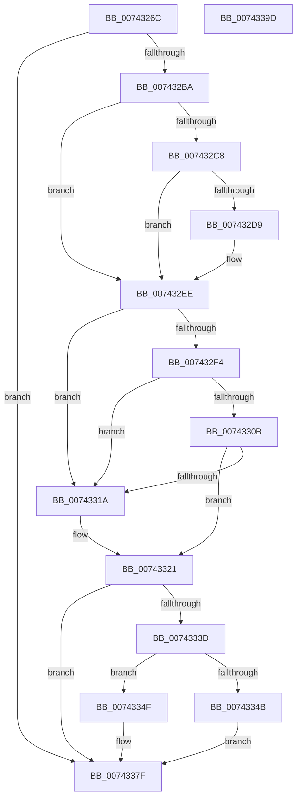

# PiDrvDbResolveKeyFilePaths

- RVA: `0x0074326C`–`0x0074339E` (길이 `306` bytes)
- VA: `0x000000014074326C`
- 실행 섹션: `PAGE`
- PDB 이름 있음: `예`; PDB Function 태그: `아니요`
- unwind 정보 RVA: `0x000C943C`
- 디코드: `89`개 명령, `306/306` bytes 표시
- 미해석 바이트: `0` (있으면 어셈블리에 `.byte`로 보존)

> 이 문서는 커널 이미지의 기계어와 PDB 기호를 분석해 생성했습니다. 4번과 5번은 함수 원형과 자료형을 바이너리 사용 방식에서 추정한 C 해석이며 원본 소스 복구 결과는 아닙니다.

## 1. Dependencies

- 직접 호출 지점: **9**; 고유 호출 대상: **8**
- 직접 호출자로 확인된 함수: **1**
- RIP 상대 이미지 참조: **2**

### Outgoing calls
- `0x0074329F` → [RtlInitUnicodeString](../../text/42/RtlInitUnicodeString_function_0042A780.md) (function, `0x0042A780`)
- `0x007432AB` → [IopQueryRegistryKeySystemPath](../99/IopQueryRegistryKeySystemPath_function_0099A1CC.md) (function, `0x0099A1CC`)
- `0x00743302` → [RtlPrefixUnicodeString](../8F/RtlPrefixUnicodeString_function_008F4F70.md) (function, `0x008F4F70`)
- `0x00743325` → [RtlInitUnicodeString](../../text/42/RtlInitUnicodeString_function_0042A780.md) (function, `0x0042A780`)
- `0x00743332` → [PiDrvDbFindNode](../../text/4F/PiDrvDbFindNode_function_004F8E60.md) (function, `0x004F8E60`)
- `0x0074334F` → [CmIsStateSeparationEnabled](../../text/4A/CmIsStateSeparationEnabled_function_004A4754.md) (function, `0x004A4754`)
- `0x0074335F` → [PiDrvDbGetNodeSystemRoot](PiDrvDbGetNodeSystemRoot_function_007411A4.md) (function, `0x007411A4`)
- `0x00743378` → [PiDrvDbResolveFilePathKeyValues](PiDrvDbResolveFilePathKeyValues_function_00742C00.md) (function, `0x00742C00`)
- `0x00743383` → [RtlFreeAnsiString](../9C/RtlFreeAnsiString_function_009C0800.md) (function, `0x009C0800`)

### Direct callers
- [PiDevCfgInitResolveContext](../96/PiDevCfgInitResolveContext_function_00965178.md) at `0x00965291`

### Static image references
- `0x007432FB` → RVA `0x00B4AE70` (`PiDrvDbDriverStoreNodesRoot`; read)
- `0x0074331A` → RVA `0x00AFF500` (` ?? ::NNGAKEGL::`string'`; read)

## 2. Other-region calls and transfers

- 다른 실행 섹션으로 향하는 call: **4**
  - `0x0074329F` → [RtlInitUnicodeString](../../text/42/RtlInitUnicodeString_function_0042A780.md) (`PAGE` → `.text`)
  - `0x00743325` → [RtlInitUnicodeString](../../text/42/RtlInitUnicodeString_function_0042A780.md) (`PAGE` → `.text`)
  - `0x00743332` → [PiDrvDbFindNode](../../text/4F/PiDrvDbFindNode_function_004F8E60.md) (`PAGE` → `.text`)
  - `0x0074334F` → [CmIsStateSeparationEnabled](../../text/4A/CmIsStateSeparationEnabled_function_004A4754.md) (`PAGE` → `.text`)
- 별도 외부 분기/꼬리 이동을 확인하지 못했습니다.

## 3. Assembly (complete function range)

```asm
0074326C  48 89 5C 24 08                  mov qword ptr [rsp + 8], rbx
00743271  48 89 74 24 20                  mov qword ptr [rsp + 0x20], rsi
00743276  55                              push rbp
00743277  57                              push rdi
00743278  41 56                           push r14
0074327A  48 8B EC                        mov rbp, rsp
0074327D  48 83 EC 40                     sub rsp, 0x40
00743281  0F 57 C0                        xorps xmm0, xmm0
00743284  48 8B F9                        mov rdi, rcx
00743287  33 F6                           xor esi, esi
00743289  48 8D 4D E0                     lea rcx, [rbp - 0x20]
0074328D  33 D2                           xor edx, edx
0074328F  48 89 75 30                     mov qword ptr [rbp + 0x30], rsi
00743293  0F 11 45 E0                     movups xmmword ptr [rbp - 0x20], xmm0
00743297  48 89 75 28                     mov qword ptr [rbp + 0x28], rsi
0074329B  0F 11 45 F0                     movups xmmword ptr [rbp - 0x10], xmm0
0074329F  E8 DC 74 CE FF                  call 0x14042a780
007432A4  48 8D 55 E0                     lea rdx, [rbp - 0x20]
007432A8  48 8B CF                        mov rcx, rdi
007432AB  E8 1C 6F 25 00                  call 0x14099a1cc
007432B0  8B D8                           mov ebx, eax
007432B2  85 C0                           test eax, eax
007432B4  0F 88 C5 00 00 00               js 0x14074337f
007432BA  0F B7 45 E0                     movzx eax, word ptr [rbp - 0x20]
007432BE  44 8D 76 02                     lea r14d, [rsi + 2]
007432C2  66 41 3B C6                     cmp ax, r14w
007432C6  72 26                           jb 0x1407432ee
007432C8  48 8B 55 E8                     mov rdx, qword ptr [rbp - 0x18]
007432CC  8B C8                           mov ecx, eax
007432CE  48 D1 E9                        shr rcx, 1
007432D1  66 83 7C 4A FE 5C               cmp word ptr [rdx + rcx*2 - 2], 0x5c
007432D7  75 15                           jne 0x1407432ee
007432D9  66 89 74 4A FE                  mov word ptr [rdx + rcx*2 - 2], si
007432DE  B9 FE FF 00 00                  mov ecx, 0xfffe
007432E3  0F B7 45 E0                     movzx eax, word ptr [rbp - 0x20]
007432E7  66 03 C1                        add ax, cx
007432EA  66 89 45 E0                     mov word ptr [rbp - 0x20], ax
007432EE  66 83 F8 26                     cmp ax, 0x26
007432F2  76 26                           jbe 0x14074331a
007432F4  41 B0 01                        mov r8b, 1
007432F7  48 8D 55 E0                     lea rdx, [rbp - 0x20]
007432FB  48 8D 0D 6E 7B 40 00            lea rcx, [rip + 0x407b6e]
00743302  E8 69 1C 1B 00                  call 0x1408f4f70
00743307  84 C0                           test al, al
00743309  74 0F                           je 0x14074331a
0074330B  48 8B 45 E8                     mov rax, qword ptr [rbp - 0x18]
0074330F  66 83 78 24 5C                  cmp word ptr [rax + 0x24], 0x5c
00743314  48 8D 50 26                     lea rdx, [rax + 0x26]
00743318  74 07                           je 0x140743321
0074331A  48 8D 15 DF C1 3B 00            lea rdx, [rip + 0x3bc1df]
00743321  48 8D 4D F0                     lea rcx, [rbp - 0x10]
00743325  E8 56 74 CE FF                  call 0x14042a780
0074332A  48 8D 55 28                     lea rdx, [rbp + 0x28]
0074332E  48 8D 4D F0                     lea rcx, [rbp - 0x10]
00743332  E8 29 5B DB FF                  call 0x1404f8e60
00743337  8B D8                           mov ebx, eax
00743339  85 C0                           test eax, eax
0074333B  78 42                           js 0x14074337f
0074333D  48 8B 4D 28                     mov rcx, qword ptr [rbp + 0x28]
00743341  8B 81 EC 01 00 00               mov eax, dword ptr [rcx + 0x1ec]
00743347  A8 01                           test al, 1
00743349  75 04                           jne 0x14074334f
0074334B  8B DE                           mov ebx, esi
0074334D  EB 30                           jmp 0x14074337f
0074334F  E8 00 14 D6 FF                  call 0x1404a4754
00743354  F6 D8                           neg al
00743356  48 8D 55 30                     lea rdx, [rbp + 0x30]
0074335A  1B DB                           sbb ebx, ebx
0074335C  41 23 DE                        and ebx, r14d
0074335F  E8 40 DE FF FF                  call 0x1407411a4
00743364  4C 8B 4D 30                     mov r9, qword ptr [rbp + 0x30]
00743368  4C 8D 45 E0                     lea r8, [rbp - 0x20]
0074336C  85 C0                           test eax, eax
0074336E  8D 53 01                        lea edx, [rbx + 1]
00743371  48 8B CF                        mov rcx, rdi
00743374  4C 0F 48 CE                     cmovs r9, rsi
00743378  E8 83 F8 FF FF                  call 0x140742c00
0074337D  8B D8                           mov ebx, eax
0074337F  48 8D 4D E0                     lea rcx, [rbp - 0x20]
00743383  E8 78 D4 27 00                  call 0x1409c0800
00743388  48 8B 74 24 78                  mov rsi, qword ptr [rsp + 0x78]
0074338D  8B C3                           mov eax, ebx
0074338F  48 8B 5C 24 60                  mov rbx, qword ptr [rsp + 0x60]
00743394  48 83 C4 40                     add rsp, 0x40
00743398  41 5E                           pop r14
0074339A  5F                              pop rdi
0074339B  5D                              pop rbp
0074339C  C3                              ret
0074339D  CC                              int3
```

## 4. C-style interpretation (structured pseudocode)

```c
__int64 __fastcall PiDrvDbResolveKeyFilePaths(__int64 a1, int a2)
{
    __int64 result;
    __int64 v_rbx;
    __int64 v_rsi;
    __int64 v_rsp;
    unsigned __int64 v_stack_m28;
    unsigned __int64 v_stack_m30;
    unsigned __int64 v_stack_m38;
    unsigned __int64 v_stack_p10;
    unsigned __int64 v_stack_p18;
    unsigned __int64 v_stack_p20;
    unsigned __int64 v_stack_p8;

    v_stack_p8 = v_rbx;
    v_stack_p20 = v_rsi;
    v_rsp = (v_rsp) - (64);
    v_rsi = 0;
    a2 = 0;
    v_stack_p18 = 0;
    v_stack_m38 = v_xmm0;
    v_stack_p10 = 0;
    v_stack_m28 = v_xmm0;
    result = RtlInitUnicodeString(v_stack_m38, a2, a3, a4);
    result = IopQueryRegistryKeySystemPath(a1, v_stack_m38, a3, a4);
    if (sign_flag) goto loc_0074337F;
    if (((unsigned __int16)(v_stack_m38)) < ((unsigned __int16)(v_rsi + 2))) goto loc_007432EE;
    a1 = ((unsigned int)((unsigned int)(v_stack_m38))) >> (1);
    result = v_stack_m38;
    if ((*(unsigned __int16 *)(v_stack_m30 + a1 * 2 - 2)) == 92) {
        *(unsigned __int16 *)(v_stack_m30 + a1 * 2 - 2) = 0;
        a1 = 0xFFFEULL;
        result = v_stack_m38;
        result = (unsigned __int16)((result) + ((unsigned __int16)(a1)));
        v_stack_m38 = (unsigned __int16)(result);
    }
    if (((unsigned __int16)(result)) <= 38) goto loc_0074331A;
    result = RtlPrefixUnicodeString(v_rip + 4225902, v_stack_m38, 1, a4);
    if ((unsigned __int8)(result) == 0) goto loc_0074331A;
    if ((*(unsigned __int16 *)(v_stack_m30 + 36)) != 92) {
        a2 = v_rip + 3916255;
    }
    result = RtlInitUnicodeString(v_stack_m28, a2, 1, a4);
    result = PiDrvDbFindNode(v_stack_m28, v_stack_p10, 1, a4);
    if (sign_flag) goto loc_0074337F;
    if ((((unsigned __int8)((unsigned int)(*(unsigned int *)(v_stack_p10 + 492)))) & (1)) != 0) goto loc_0074334F;
    goto loc_0074337F;
loc_0074334F:
    result = CmIsStateSeparationEnabled(v_stack_p10, v_stack_p10, 1, a4);
    result = (unsigned __int8)(-(result));
    v_rbx = (unsigned int)((0) & ((unsigned int)(v_rsi + 2)));
    result = PiDrvDbGetNodeSystemRoot(v_stack_p10, v_stack_p18, 1, a4);
    a4 = v_stack_p18;
    if (sign_flag) { a4 = 0; }
    result = PiDrvDbResolveFilePathKeyValues(a1, v_rbx + 1, v_stack_m38, a4);
loc_0074337F:
    result = RtlFreeAnsiString(v_stack_m38, v_rbx + 1, v_stack_m38, a4);
    v_rsp = (v_rsp) + (64);
    return (unsigned int)((unsigned int)((unsigned int)((unsigned int)(result))));
}
```

## 5. (Beta) C Style

```c
int64_t PiDrvDbResolveKeyFilePaths(int64_t Arg1, int32_t Arg2)
{
    int64_t result;
    int64_t local_rbx;
    int64_t local_rsi;
    int64_t local_rsp;
    uint64_t v_stack_m28;
    uint64_t v_stack_m30;
    uint64_t v_stack_m38;
    uint64_t v_stack_p10;
    uint64_t v_stack_p18;
    uint64_t v_stack_p20;
    uint64_t v_stack_p8;

    v_stack_p8 = local_rbx;
    v_stack_p20 = local_rsi;
    local_rsp = (local_rsp) - (64);
    local_rsi = 0;
    Arg2 = 0;
    v_stack_p18 = 0;
    v_stack_m38 = v_xmm0;
    v_stack_p10 = 0;
    v_stack_m28 = v_xmm0;
    result = RtlInitUnicodeString(v_stack_m38, Arg2, a3, a4);
    result = IopQueryRegistryKeySystemPath(Arg1, v_stack_m38, a3, a4);
    if (sign_flag) goto loc_0074337F;
    if (((uint16_t)(v_stack_m38)) < ((uint16_t)(local_rsi + 2))) goto loc_007432EE;
    Arg1 = ((uint32_t)((uint32_t)(v_stack_m38))) >> (1);
    result = v_stack_m38;
    if ((*(uint16_t *)(v_stack_m30 + Arg1 * 2 - 0x2)) == 92) {
        *(uint16_t *)(v_stack_m30 + Arg1 * 2 - 0x2) = 0;
        Arg1 = 0xFFFEULL;
        result = v_stack_m38;
        result = (uint16_t)((result) + ((uint16_t)(Arg1)));
        v_stack_m38 = (uint16_t)(result);
    }
    if (((uint16_t)(result)) <= 38) goto loc_0074331A;
    result = RtlPrefixUnicodeString(v_rip + 4225902, v_stack_m38, 1, a4);
    if ((uint8_t)(result) == 0) goto loc_0074331A;
    if ((*(uint16_t *)(v_stack_m30 + 0x24)) != 92) {
        Arg2 = v_rip + 3916255;
    }
    result = RtlInitUnicodeString(v_stack_m28, Arg2, 1, a4);
    result = PiDrvDbFindNode(v_stack_m28, v_stack_p10, 1, a4);
    if (sign_flag) goto loc_0074337F;
    if ((((uint8_t)((uint32_t)(*(uint32_t *)(v_stack_p10 + 0x1EC)))) & (1)) != 0) goto loc_0074334F;
    goto loc_0074337F;
loc_0074334F:
    result = CmIsStateSeparationEnabled(v_stack_p10, v_stack_p10, 1, a4);
    result = (uint8_t)(-(result));
    local_rbx = (uint32_t)((0) & ((uint32_t)(local_rsi + 2)));
    result = PiDrvDbGetNodeSystemRoot(v_stack_p10, v_stack_p18, 1, a4);
    a4 = v_stack_p18;
    if (sign_flag) { a4 = 0; }
    result = PiDrvDbResolveFilePathKeyValues(Arg1, local_rbx + 1, v_stack_m38, a4);
loc_0074337F:
    result = RtlFreeAnsiString(v_stack_m38, local_rbx + 1, v_stack_m38, a4);
    local_rsp = (local_rsp) + (64);
    return (uint32_t)((uint32_t)((uint32_t)((uint32_t)(result))));
}
```

## 6. Execution-region graph

[열기: 2D/3D 그래프와 함수 탐색 컨트롤 패널](../../../control-panel.html?section=page&rva=0x0074326C&view=graph)

- 2D 그래프는 위에서 아래로 흐르고, 3D 그래프는 빈 공간을 드래그해 회전합니다. Shift+드래그는 이동, 휠은 확대·축소, 함수 노드 선택은 대상 보고서 이동입니다.

### Static fallback


