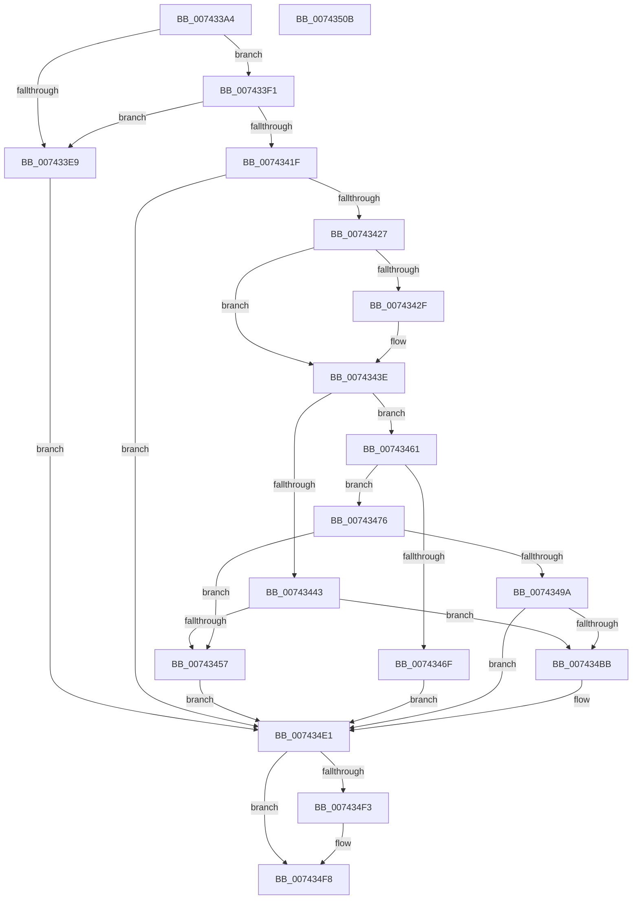

# PiDrvDbResolveNodeFilePaths

- RVA: `0x007433A4`–`0x0074350C` (길이 `360` bytes)
- VA: `0x00000001407433A4`
- 실행 섹션: `PAGE`
- PDB 이름 있음: `예`; PDB Function 태그: `아니요`
- unwind 정보 RVA: `0x000C9328`
- 디코드: `103`개 명령, `360/360` bytes 표시
- 미해석 바이트: `0` (있으면 어셈블리에 `.byte`로 보존)

> 이 문서는 커널 이미지의 기계어와 PDB 기호를 분석해 생성했습니다. 4번과 5번은 함수 원형과 자료형을 바이너리 사용 방식에서 추정한 C 해석이며 원본 소스 복구 결과는 아닙니다.

## 1. Dependencies

- 직접 호출 지점: **10**; 고유 호출 대상: **10**
- 직접 호출자로 확인된 함수: **1**
- RIP 상대 이미지 참조: **4**

### Outgoing calls
- `0x007433D5` → [RtlInitUnicodeString](../../text/42/RtlInitUnicodeString_function_0042A780.md) (function, `0x0042A780`)
- `0x00743411` → [PnpCtxRegOpenKey](../8E/PnpCtxRegOpenKey_function_008EF7B8.md) (function, `0x008EF7B8`)
- `0x0074342F` → [CmIsStateSeparationEnabled](../../text/4A/CmIsStateSeparationEnabled_function_004A4754.md) (function, `0x004A4754`)
- `0x0074344E` → [RtlCreateUnicodeString](../9B/RtlCreateUnicodeString_function_009BD860.md) (function, `0x009BD860`)
- `0x0074348C` → [ExAllocatePool2](../../poolcode/B8/ExAllocatePool2_function_00B820F0.md) (function, `0x00B820F0`)
- `0x007434B0` → [RtlUnicodeStringPrintf](../../text/48/RtlUnicodeStringPrintf_function_0048B984.md) (function, `0x0048B984`)
- `0x007434C2` → [PiDrvDbGetNodeSystemRoot](PiDrvDbGetNodeSystemRoot_function_007411A4.md) (function, `0x007411A4`)
- `0x007434DA` → [PiDrvDbResolveFilePathKeyValues](PiDrvDbResolveFilePathKeyValues_function_00742C00.md) (function, `0x00742C00`)
- `0x007434E5` → [RtlFreeAnsiString](../9C/RtlFreeAnsiString_function_009C0800.md) (function, `0x009C0800`)
- `0x007434F3` → [ZwClose](../../text/6A/ZwClose_function_006AD2B0.md) (function, `0x006AD2B0`)

### Direct callers
- [PiDrvDbSetupNodeHive](PiDrvDbSetupNodeHive_function_00743884.md) at `0x00743C8A`

### Static image references
- `0x007433FD` → RVA `0x00AFF170` (` ?? ::NNGAKEGL::`string'`; read)
- `0x00743443` → RVA `0x00B00620` (` ?? ::NNGAKEGL::`string'`; read)
- `0x0074349E` → RVA `0x00B002E0` (` ?? ::NNGAKEGL::`string'`; read)
- `0x007434A5` → RVA `0x00AFFFE0` (` ?? ::NNGAKEGL::`string'`; read)

## 2. Other-region calls and transfers

- 다른 실행 섹션으로 향하는 call: **5**
  - `0x007433D5` → [RtlInitUnicodeString](../../text/42/RtlInitUnicodeString_function_0042A780.md) (`PAGE` → `.text`)
  - `0x0074342F` → [CmIsStateSeparationEnabled](../../text/4A/CmIsStateSeparationEnabled_function_004A4754.md) (`PAGE` → `.text`)
  - `0x0074348C` → [ExAllocatePool2](../../poolcode/B8/ExAllocatePool2_function_00B820F0.md) (`PAGE` → `POOLCODE`)
  - `0x007434B0` → [RtlUnicodeStringPrintf](../../text/48/RtlUnicodeStringPrintf_function_0048B984.md) (`PAGE` → `.text`)
  - `0x007434F3` → [ZwClose](../../text/6A/ZwClose_function_006AD2B0.md) (`PAGE` → `.text`)
- 별도 외부 분기/꼬리 이동을 확인하지 못했습니다.

## 3. Assembly (complete function range)

```asm
007433A4  48 89 5C 24 10                  mov qword ptr [rsp + 0x10], rbx
007433A9  55                              push rbp
007433AA  56                              push rsi
007433AB  57                              push rdi
007433AC  41 56                           push r14
007433AE  41 57                           push r15
007433B0  48 8B EC                        mov rbp, rsp
007433B3  48 83 EC 40                     sub rsp, 0x40
007433B7  4C 8B F2                        mov r14, rdx
007433BA  48 8B F1                        mov rsi, rcx
007433BD  45 33 FF                        xor r15d, r15d
007433C0  48 8D 4D F0                     lea rcx, [rbp - 0x10]
007433C4  0F 57 C0                        xorps xmm0, xmm0
007433C7  4C 89 7D 40                     mov qword ptr [rbp + 0x40], r15
007433CB  33 D2                           xor edx, edx
007433CD  4C 89 7D 30                     mov qword ptr [rbp + 0x30], r15
007433D1  0F 11 45 F0                     movups xmmword ptr [rbp - 0x10], xmm0
007433D5  E8 A6 73 CE FF                  call 0x14042a780
007433DA  8B 86 EC 01 00 00               mov eax, dword ptr [rsi + 0x1ec]
007433E0  41 8D 7F 01                     lea edi, [r15 + 1]
007433E4  40 84 C7                        test dil, al
007433E7  75 08                           jne 0x1407433f1
007433E9  41 8B DF                        mov ebx, r15d
007433EC  E9 F0 00 00 00                  jmp 0x1407434e1
007433F1  48 8D 45 40                     lea rax, [rbp + 0x40]
007433F5  45 33 C9                        xor r9d, r9d
007433F8  48 89 44 24 28                  mov qword ptr [rsp + 0x28], rax
007433FD  4C 8D 05 6C BD 3B 00            lea r8, [rip + 0x3bbd6c]
00743404  49 8B D6                        mov rdx, r14
00743407  C7 44 24 20 19 00 02 00         mov dword ptr [rsp + 0x20], 0x20019
0074340F  33 C9                           xor ecx, ecx
00743411  E8 A2 C3 1A 00                  call 0x1408ef7b8
00743416  8B D8                           mov ebx, eax
00743418  3D 34 00 00 C0                  cmp eax, 0xc0000034
0074341D  74 CA                           je 0x1407433e9
0074341F  85 C0                           test eax, eax
00743421  0F 88 BA 00 00 00               js 0x1407434e1
00743427  8B 4E 40                        mov ecx, dword ptr [rsi + 0x40]
0074342A  40 84 CF                        test dil, cl
0074342D  75 0F                           jne 0x14074343e
0074342F  E8 20 13 D6 FF                  call 0x1404a4754
00743434  84 C0                           test al, al
00743436  BA 03 00 00 00                  mov edx, 3
0074343B  0F 45 FA                        cmovne edi, edx
0074343E  F6 C1 08                        test cl, 8
00743441  75 1E                           jne 0x140743461
00743443  48 8D 15 D6 D1 3B 00            lea rdx, [rip + 0x3bd1d6]
0074344A  48 8D 4D F0                     lea rcx, [rbp - 0x10]
0074344E  E8 0D A4 27 00                  call 0x1409bd860
00743453  84 C0                           test al, al
00743455  75 64                           jne 0x1407434bb
00743457  BB 9A 00 00 C0                  mov ebx, 0xc000009a
0074345C  E9 80 00 00 00                  jmp 0x1407434e1
00743461  0F B7 46 12                     movzx eax, word ptr [rsi + 0x12]
00743465  83 C0 26                        add eax, 0x26
00743468  3D FE FF 00 00                  cmp eax, 0xfffe
0074346D  76 07                           jbe 0x140743476
0074346F  BB 05 00 00 80                  mov ebx, 0x80000005
00743474  EB 6B                           jmp 0x1407434e1
00743476  8B D0                           mov edx, eax
00743478  B9 00 01 00 00                  mov ecx, 0x100
0074347D  41 B8 53 74 72 67               mov r8d, 0x67727453
00743483  66 44 89 7D F0                  mov word ptr [rbp - 0x10], r15w
00743488  66 89 45 F2                     mov word ptr [rbp - 0xe], ax
0074348C  E8 5F EC 43 00                  call 0x140b820f0
00743491  48 89 45 F8                     mov qword ptr [rbp - 8], rax
00743495  48 85 C0                        test rax, rax
00743498  74 BD                           je 0x140743457
0074349A  4C 8D 4E 10                     lea r9, [rsi + 0x10]
0074349E  4C 8D 05 3B CE 3B 00            lea r8, [rip + 0x3bce3b]
007434A5  48 8D 15 34 CB 3B 00            lea rdx, [rip + 0x3bcb34]
007434AC  48 8D 4D F0                     lea rcx, [rbp - 0x10]
007434B0  E8 CF 84 D4 FF                  call 0x14048b984
007434B5  8B D8                           mov ebx, eax
007434B7  85 C0                           test eax, eax
007434B9  78 26                           js 0x1407434e1
007434BB  48 8D 55 30                     lea rdx, [rbp + 0x30]
007434BF  48 8B CE                        mov rcx, rsi
007434C2  E8 DD DC FF FF                  call 0x1407411a4
007434C7  4C 8B 4D 30                     mov r9, qword ptr [rbp + 0x30]
007434CB  4C 8D 45 F0                     lea r8, [rbp - 0x10]
007434CF  85 C0                           test eax, eax
007434D1  8B D7                           mov edx, edi
007434D3  49 8B CE                        mov rcx, r14
007434D6  4D 0F 48 CF                     cmovs r9, r15
007434DA  E8 21 F7 FF FF                  call 0x140742c00
007434DF  8B D8                           mov ebx, eax
007434E1  48 8D 4D F0                     lea rcx, [rbp - 0x10]
007434E5  E8 16 D3 27 00                  call 0x1409c0800
007434EA  48 8B 4D 40                     mov rcx, qword ptr [rbp + 0x40]
007434EE  48 85 C9                        test rcx, rcx
007434F1  74 05                           je 0x1407434f8
007434F3  E8 B8 9D F6 FF                  call 0x1406ad2b0
007434F8  8B C3                           mov eax, ebx
007434FA  48 8B 5C 24 78                  mov rbx, qword ptr [rsp + 0x78]
007434FF  48 83 C4 40                     add rsp, 0x40
00743503  41 5F                           pop r15
00743505  41 5E                           pop r14
00743507  5F                              pop rdi
00743508  5E                              pop rsi
00743509  5D                              pop rbp
0074350A  C3                              ret
0074350B  CC                              int3
```

## 4. C-style interpretation (structured pseudocode)

```c
__int64 __fastcall PiDrvDbResolveNodeFilePaths(__int64 a1, __int64 a2, __int64 a3, int a4)
{
    __int64 result;
    __int64 v_r15;
    __int64 v_rbx;
    __int64 v_rdi;
    __int64 v_rsp;
    unsigned __int64 v_stack_m30;
    unsigned __int16 v_stack_m36;
    unsigned __int64 v_stack_m38;
    unsigned __int64 v_stack_m40;
    unsigned int v_stack_m48;
    unsigned __int64 v_stack_p10;
    unsigned __int64 v_stack_p18;
    unsigned __int64 v_stack_p8;

    v_stack_p10 = v_rbx;
    v_rsp = (v_rsp) - (64);
    v_r15 = 0;
    v_stack_p18 = 0;
    a2 = 0;
    v_stack_p8 = 0;
    v_stack_m38 = v_xmm0;
    result = RtlInitUnicodeString(v_stack_m38, a2, a3, a4);
    if ((((unsigned __int8)(v_r15 + 1)) & ((unsigned __int8)((unsigned int)(*(unsigned int *)(a1 + 492))))) != 0) goto loc_007433F1;
loc_007433E9:
    goto loc_007434E1;
loc_007433F1:
    a4 = 0;
    v_stack_m40 = v_stack_p18;
    v_stack_m48 = 0x20019ULL;
    a1 = 0;
    result = PnpCtxRegOpenKey(a1, 0, v_rip + 3915116, a4);
    if (((unsigned int)(result)) == 0xC0000034ULL) goto loc_007433E9;
    if (sign_flag) goto loc_007434E1;
    v_rdi = v_r15 + 1;
    if ((((unsigned __int8)(v_r15 + 1)) & ((unsigned __int8)((unsigned int)(*(unsigned int *)(a1 + 64))))) == 0) {
        result = CmIsStateSeparationEnabled((unsigned int)(*(unsigned int *)(a1 + 64)), 0, v_rip + 3915116, a4);
        a2 = 3;
        v_rdi = v_r15 + 1;
        if ((unsigned __int8)(result) != 0) { v_rdi = (unsigned int)(a2); }
    }
    if ((((unsigned __int8)((unsigned int)(*(unsigned int *)(a1 + 64)))) & (8)) != 0) goto loc_00743461;
    result = RtlCreateUnicodeString(v_stack_m38, v_rip + 3920342, v_rip + 3915116, a4);
    if ((unsigned __int8)(result) != 0) goto loc_007434BB;
loc_00743457:
    goto loc_007434E1;
loc_00743461:
    result = (unsigned int)((*(unsigned __int16 *)(a1 + 18)) + (38));
    if (((unsigned int)(result)) <= 0xFFFEULL) goto loc_00743476;
    goto loc_007434E1;
loc_00743476:
    v_stack_m38 = 0;
    v_stack_m36 = (unsigned __int16)(result);
    result = ExAllocatePool2(256, (unsigned int)((unsigned int)(result)), (unsigned int)(0x67727453ULL), a4);
    v_stack_m30 = result;
    if (result == 0) goto loc_00743457;
    result = RtlUnicodeStringPrintf(v_stack_m38, v_rip + 3918644, v_rip + 3919419, a1 + 16);
    v_rbx = (unsigned int)((unsigned int)(result));
    if (!(sign_flag)) {
        a2 = v_stack_p8;
        a1 = 0;
        result = PiDrvDbGetNodeSystemRoot(a1, a2, v_rip + 3919419, a1 + 16);
        a4 = v_stack_p8;
        a3 = v_stack_m38;
        a2 = (unsigned int)(v_rdi);
        a1 = a2;
        if (sign_flag) { a4 = 0; }
        result = PiDrvDbResolveFilePathKeyValues(a1, a2, a3, a4);
        v_rbx = (unsigned int)(result);
    }
    result = RtlFreeAnsiString(v_stack_m38, a2, a3, a4);
    if (v_stack_p18 != 0) {
        result = ZwClose(v_stack_p18, a2, a3, a4);
    }
    v_rsp = (v_rsp) + (64);
    return (unsigned int)((unsigned int)(v_rbx));
}
```

## 5. (Beta) C Style

```c
int64_t PiDrvDbResolveNodeFilePaths(void *Arg1, int64_t Arg2, int64_t Arg3, int32_t Arg4)
{
    uint8_t *arg1 = (uint8_t *)Arg1;

    int64_t result;
    int64_t local_r15;
    int64_t local_rbx;
    int64_t local_rdi;
    int64_t local_rsp;
    uint64_t v_stack_m30;
    uint16_t v_stack_m36;
    uint64_t v_stack_m38;
    uint64_t v_stack_m40;
    uint32_t v_stack_m48;
    uint64_t v_stack_p10;
    uint64_t v_stack_p18;
    uint64_t v_stack_p8;

    v_stack_p10 = local_rbx;
    local_rsp = (local_rsp) - (64);
    local_r15 = 0;
    v_stack_p18 = 0;
    Arg2 = 0;
    v_stack_p8 = 0;
    v_stack_m38 = v_xmm0;
    result = RtlInitUnicodeString(v_stack_m38, Arg2, Arg3, Arg4);
    if ((((uint8_t)(local_r15 + 1)) & ((uint8_t)((uint32_t)(*(uint32_t *)(arg1 + 0x1EC))))) != 0) goto loc_007433F1;
loc_007433E9:
    goto loc_007434E1;
loc_007433F1:
    Arg4 = 0;
    v_stack_m40 = v_stack_p18;
    v_stack_m48 = 0x20019ULL;
    Arg1 = 0;
    result = PnpCtxRegOpenKey(Arg1, 0, v_rip + 3915116, Arg4);
    if (((uint32_t)(result)) == 0xC0000034ULL) goto loc_007433E9;
    if (sign_flag) goto loc_007434E1;
    local_rdi = local_r15 + 1;
    if ((((uint8_t)(local_r15 + 1)) & ((uint8_t)((uint32_t)(*(uint32_t *)(arg1 + 0x40))))) == 0) {
        result = CmIsStateSeparationEnabled((uint32_t)(*(uint32_t *)(arg1 + 0x40)), 0, v_rip + 3915116, Arg4);
        Arg2 = 3;
        local_rdi = local_r15 + 1;
        if ((uint8_t)(result) != 0) { local_rdi = (uint32_t)(Arg2); }
    }
    if ((((uint8_t)((uint32_t)(*(uint32_t *)(arg1 + 0x40)))) & (8)) != 0) goto loc_00743461;
    result = RtlCreateUnicodeString(v_stack_m38, v_rip + 3920342, v_rip + 3915116, Arg4);
    if ((uint8_t)(result) != 0) goto loc_007434BB;
loc_00743457:
    goto loc_007434E1;
loc_00743461:
    result = (uint32_t)((*(uint16_t *)(arg1 + 0x12)) + (38));
    if (((uint32_t)(result)) <= 0xFFFEULL) goto loc_00743476;
    goto loc_007434E1;
loc_00743476:
    v_stack_m38 = 0;
    v_stack_m36 = (uint16_t)(result);
    result = ExAllocatePool2(256, (uint32_t)((uint32_t)(result)), (uint32_t)(0x67727453ULL), Arg4);
    v_stack_m30 = result;
    if (result == 0) goto loc_00743457;
    result = RtlUnicodeStringPrintf(v_stack_m38, v_rip + 3918644, v_rip + 3919419, Arg1 + 16);
    local_rbx = (uint32_t)((uint32_t)(result));
    if (!(sign_flag)) {
        Arg2 = v_stack_p8;
        Arg1 = 0;
        result = PiDrvDbGetNodeSystemRoot(Arg1, Arg2, v_rip + 3919419, Arg1 + 16);
        Arg4 = v_stack_p8;
        Arg3 = v_stack_m38;
        Arg2 = (uint32_t)(local_rdi);
        Arg1 = Arg2;
        if (sign_flag) { Arg4 = 0; }
        result = PiDrvDbResolveFilePathKeyValues(Arg1, Arg2, Arg3, Arg4);
        local_rbx = (uint32_t)(result);
    }
    result = RtlFreeAnsiString(v_stack_m38, Arg2, Arg3, Arg4);
    if (v_stack_p18 != 0) {
        result = ZwClose(v_stack_p18, Arg2, Arg3, Arg4);
    }
    local_rsp = (local_rsp) + (64);
    return (uint32_t)((uint32_t)(local_rbx));
}
```

### 관측된 메모리 오프셋

구조체 형식이 확인되지 않은 접근은 인자 기준의 오프셋으로만 기록했습니다.

| 기준 인자 | 오프셋 표현 | 폭 (bit) | 접근 |
|---|---:|---:|---|
| `Arg1` | `+ 0x10` | `64` | `R` |
| `Arg1` | `+ 0x12` | `16` | `R` |
| `Arg1` | `+ 0x40` | `32` | `R` |
| `Arg1` | `+ 0x1EC` | `32` | `R` |

## 6. Execution-region graph

[열기: 2D/3D 그래프와 함수 탐색 컨트롤 패널](../../../control-panel.html?section=page&rva=0x007433A4&view=graph)

- 2D 그래프는 위에서 아래로 흐르고, 3D 그래프는 빈 공간을 드래그해 회전합니다. Shift+드래그는 이동, 휠은 확대·축소, 함수 노드 선택은 대상 보고서 이동입니다.

### Static fallback


