# PiDrvDbResolveSystemFilePath

- RVA: `0x00743514`–`0x0074387D` (길이 `873` bytes)
- VA: `0x0000000140743514`
- 실행 섹션: `PAGE`
- PDB 이름 있음: `예`; PDB Function 태그: `아니요`
- unwind 정보 RVA: `0x000C92BC`
- 디코드: `255`개 명령, `873/873` bytes 표시
- 미해석 바이트: `0` (있으면 어셈블리에 `.byte`로 보존)

> 이 문서는 커널 이미지의 기계어와 PDB 기호를 분석해 생성했습니다. 4번과 5번은 함수 원형과 자료형을 바이너리 사용 방식에서 추정한 C 해석이며 원본 소스 복구 결과는 아닙니다.

## 1. Dependencies

- 직접 호출 지점: **11**; 고유 호출 대상: **6**
- 직접 호출자로 확인된 함수: **1**
- RIP 상대 이미지 참조: **2**

### Outgoing calls
- `0x00743582` → [RtlEqualUnicodeString](../93/RtlEqualUnicodeString_function_00932A20.md) (function, `0x00932A20`)
- `0x007435BA` → [RtlEqualUnicodeString](../93/RtlEqualUnicodeString_function_00932A20.md) (function, `0x00932A20`)
- `0x00743617` → [PiDrvDbFindSystemFilePathToken](PiDrvDbFindSystemFilePathToken_function_00741088.md) (function, `0x00741088`)
- `0x0074365A` → [PiDrvDbFindSystemFilePathToken](PiDrvDbFindSystemFilePathToken_function_00741088.md) (function, `0x00741088`)
- `0x007436AC` → [PiDrvDbFindSystemFilePathToken](PiDrvDbFindSystemFilePathToken_function_00741088.md) (function, `0x00741088`)
- `0x00743791` → [ExAllocatePool2](../../poolcode/B8/ExAllocatePool2_function_00B820F0.md) (function, `0x00B820F0`)
- `0x007437B9` → [memcpy](../../text/6C/memcpy_function_006C6840.md) (function, `0x006C6840`)
- `0x007437C2` → [ExFreePool](../../poolcode/B8/ExFreePool_function_00B82850.md) (function, `0x00B82850`)
- `0x007437DC` → [RtlAppendUnicodeStringToString](../../text/40/RtlAppendUnicodeStringToString_function_0040FA50.md) (function, `0x0040FA50`)
- `0x007437ED` → [RtlAppendUnicodeStringToString](../../text/40/RtlAppendUnicodeStringToString_function_0040FA50.md) (function, `0x0040FA50`)
- `0x0074385B` → [RtlAppendUnicodeStringToString](../../text/40/RtlAppendUnicodeStringToString_function_0040FA50.md) (function, `0x0040FA50`)

### Direct callers
- [PiDrvDbResolveFilePathKeyValues](PiDrvDbResolveFilePathKeyValues_function_00742C00.md) at `0x00743095`
- [PiDrvDbResolveFilePathKeyValues](PiDrvDbResolveFilePathKeyValues_function_00742C00.md) at `0x007431A6`

### Static image references
- `0x0074357B` → RVA `0x00B4AD48` (`PiDrvDbSystemRootNt`; read)
- `0x0074364F` → RVA `0x00B4B0F0` (`PiDrvDbSystemRootWin32`; read)

## 2. Other-region calls and transfers

- 다른 실행 섹션으로 향하는 call: **6**
  - `0x00743791` → [ExAllocatePool2](../../poolcode/B8/ExAllocatePool2_function_00B820F0.md) (`PAGE` → `POOLCODE`)
  - `0x007437B9` → [memcpy](../../text/6C/memcpy_function_006C6840.md) (`PAGE` → `.text`)
  - `0x007437C2` → [ExFreePool](../../poolcode/B8/ExFreePool_function_00B82850.md) (`PAGE` → `POOLCODE`)
  - `0x007437DC` → [RtlAppendUnicodeStringToString](../../text/40/RtlAppendUnicodeStringToString_function_0040FA50.md) (`PAGE` → `.text`)
  - `0x007437ED` → [RtlAppendUnicodeStringToString](../../text/40/RtlAppendUnicodeStringToString_function_0040FA50.md) (`PAGE` → `.text`)
  - `0x0074385B` → [RtlAppendUnicodeStringToString](../../text/40/RtlAppendUnicodeStringToString_function_0040FA50.md) (`PAGE` → `.text`)
- 별도 외부 분기/꼬리 이동을 확인하지 못했습니다.

## 3. Assembly (complete function range)

```asm
00743514  48 89 5C 24 20                  mov qword ptr [rsp + 0x20], rbx
00743519  4C 89 44 24 18                  mov qword ptr [rsp + 0x18], r8
0074351E  48 89 4C 24 08                  mov qword ptr [rsp + 8], rcx
00743523  55                              push rbp
00743524  56                              push rsi
00743525  57                              push rdi
00743526  41 54                           push r12
00743528  41 55                           push r13
0074352A  41 56                           push r14
0074352C  41 57                           push r15
0074352E  48 8B EC                        mov rbp, rsp
00743531  48 83 EC 60                     sub rsp, 0x60
00743535  45 33 D2                        xor r10d, r10d
00743538  8B CA                           mov ecx, edx
0074353A  0F 57 C0                        xorps xmm0, xmm0
0074353D  44 88 55 C0                     mov byte ptr [rbp - 0x40], r10b
00743541  45 8A F2                        mov r14b, r10b
00743544  44 89 55 C4                     mov dword ptr [rbp - 0x3c], r10d
00743548  41 8A FA                        mov dil, r10b
0074354B  44 89 75 CC                     mov dword ptr [rbp - 0x34], r14d
0074354F  83 E1 02                        and ecx, 2
00743552  89 7D C8                        mov dword ptr [rbp - 0x38], edi
00743555  8B F2                           mov esi, edx
00743557  89 4D D0                        mov dword ptr [rbp - 0x30], ecx
0074355A  41 8D 52 01                     lea edx, [r10 + 1]
0074355E  4D 8B E1                        mov r12, r9
00743561  49 8B C0                        mov rax, r8
00743564  41 8B DA                        mov ebx, r10d
00743567  0F 11 45 F0                     movups xmmword ptr [rbp - 0x10], xmm0
0074356B  45 8B EA                        mov r13d, r10d
0074356E  74 2C                           je 0x14074359c
00743570  48 85 C0                        test rax, rax
00743573  74 27                           je 0x14074359c
00743575  44 8A C2                        mov r8b, dl
00743578  48 8B C8                        mov rcx, rax
0074357B  48 8D 15 C6 77 40 00            lea rdx, [rip + 0x4077c6]
00743582  E8 99 F4 1E 00                  call 0x140932a20
00743587  45 33 D2                        xor r10d, r10d
0074358A  44 0F B6 F7                     movzx r14d, dil
0074358E  84 C0                           test al, al
00743590  41 8D 55 01                     lea edx, [r13 + 1]
00743594  44 0F 45 F2                     cmovne r14d, edx
00743598  44 89 75 CC                     mov dword ptr [rbp - 0x34], r14d
0074359C  4C 8B 7D 60                     mov r15, qword ptr [rbp + 0x60]
007435A0  23 F2                           and esi, edx
007435A2  89 75 48                        mov dword ptr [rbp + 0x48], esi
007435A5  74 2B                           je 0x1407435d2
007435A7  4D 85 FF                        test r15, r15
007435AA  74 26                           je 0x1407435d2
007435AC  4D 85 E4                        test r12, r12
007435AF  74 21                           je 0x1407435d2
007435B1  44 8A C2                        mov r8b, dl
007435B4  49 8B CF                        mov rcx, r15
007435B7  49 8B D4                        mov rdx, r12
007435BA  E8 61 F4 1E 00                  call 0x140932a20
007435BF  45 33 D2                        xor r10d, r10d
007435C2  40 0F B6 FF                     movzx edi, dil
007435C6  84 C0                           test al, al
007435C8  41 8D 42 01                     lea eax, [r10 + 1]
007435CC  0F 45 F8                        cmovne edi, eax
007435CF  89 7D C8                        mov dword ptr [rbp - 0x38], edi
007435D2  48 8B 7D 68                     mov rdi, qword ptr [rbp + 0x68]
007435D6  48 8B 45 40                     mov rax, qword ptr [rbp + 0x40]
007435DA  66 44 89 17                     mov word ptr [rdi], r10w
007435DE  0F 10 00                        movups xmm0, xmmword ptr [rax]
007435E1  F3 0F 7F 45 E0                  movdqu xmmword ptr [rbp - 0x20], xmm0
007435E6  48 8B 45 E8                     mov rax, qword ptr [rbp - 0x18]
007435EA  66 44 39 10                     cmp word ptr [rax], r10w
007435EE  0F 84 48 02 00 00               je 0x14074383c
007435F4  49 8B F2                        mov rsi, r10
007435F7  44 39 55 D0                     cmp dword ptr [rbp - 0x30], r10d
007435FB  0F 84 83 00 00 00               je 0x140743684
00743601  4C 39 55 50                     cmp qword ptr [rbp + 0x50], r10
00743605  74 37                           je 0x14074363e
00743607  45 84 F6                        test r14b, r14b
0074360A  75 32                           jne 0x14074363e
0074360C  48 8D 15 35 77 40 00            lea rdx, [rip + 0x407735]
00743613  48 8D 4D E0                     lea rcx, [rbp - 0x20]
00743617  E8 6C DA FF FF                  call 0x140741088
0074361C  45 33 D2                        xor r10d, r10d
0074361F  45 8D 72 01                     lea r14d, [r10 + 1]
00743623  48 85 C0                        test rax, rax
00743626  75 06                           jne 0x14074362e
00743628  44 88 75 CC                     mov byte ptr [rbp - 0x34], r14b
0074362C  EB 16                           jmp 0x140743644
0074362E  4C 8B 6D 50                     mov r13, qword ptr [rbp + 0x50]
00743632  48 8B F0                        mov rsi, rax
00743635  C7 45 C4 16 00 00 00            mov dword ptr [rbp - 0x3c], 0x16
0074363C  EB 06                           jmp 0x140743644
0074363E  41 BE 01 00 00 00               mov r14d, 1
00743644  4D 85 E4                        test r12, r12
00743647  74 3B                           je 0x140743684
00743649  44 38 55 C0                     cmp byte ptr [rbp - 0x40], r10b
0074364D  75 35                           jne 0x140743684
0074364F  48 8D 15 9A 7A 40 00            lea rdx, [rip + 0x407a9a]
00743656  48 8D 4D E0                     lea rcx, [rbp - 0x20]
0074365A  E8 29 DA FF FF                  call 0x140741088
0074365F  45 33 D2                        xor r10d, r10d
00743662  48 85 C0                        test rax, rax
00743665  75 06                           jne 0x14074366d
00743667  44 88 75 C0                     mov byte ptr [rbp - 0x40], r14b
0074366B  EB 17                           jmp 0x140743684
0074366D  48 85 F6                        test rsi, rsi
00743670  74 05                           je 0x140743677
00743672  48 3B C6                        cmp rax, rsi
00743675  73 0D                           jae 0x140743684
00743677  48 8B F0                        mov rsi, rax
0074367A  C7 45 C4 18 00 00 00            mov dword ptr [rbp - 0x3c], 0x18
00743681  4D 8B EC                        mov r13, r12
00743684  44 39 55 48                     cmp dword ptr [rbp + 0x48], r10d
00743688  74 3A                           je 0x1407436c4
0074368A  4D 85 E4                        test r12, r12
0074368D  74 35                           je 0x1407436c4
0074368F  44 38 55 C8                     cmp byte ptr [rbp - 0x38], r10b
00743693  75 2F                           jne 0x1407436c4
00743695  4D 85 FF                        test r15, r15
00743698  74 2A                           je 0x1407436c4
0074369A  B8 02 00 00 00                  mov eax, 2
0074369F  66 41 39 07                     cmp word ptr [r15], ax
007436A3  76 1F                           jbe 0x1407436c4
007436A5  49 8B D7                        mov rdx, r15
007436A8  48 8D 4D E0                     lea rcx, [rbp - 0x20]
007436AC  E8 D7 D9 FF FF                  call 0x140741088
007436B1  45 33 D2                        xor r10d, r10d
007436B4  48 85 C0                        test rax, rax
007436B7  0F 85 50 01 00 00               jne 0x14074380d
007436BD  41 8D 42 01                     lea eax, [r10 + 1]
007436C1  88 45 C8                        mov byte ptr [rbp - 0x38], al
007436C4  48 85 F6                        test rsi, rsi
007436C7  0F 84 6F 01 00 00               je 0x14074383c
007436CD  48 8B 4D 40                     mov rcx, qword ptr [rbp + 0x40]
007436D1  41 BB 02 00 00 00               mov r11d, 2
007436D7  8B 45 C4                        mov eax, dword ptr [rbp - 0x3c]
007436DA  4C 8B F6                        mov r14, rsi
007436DD  4C 2B 75 E8                     sub r14, qword ptr [rbp - 0x18]
007436E1  48 D1 E8                        shr rax, 1
007436E4  44 0F B7 01                     movzx r8d, word ptr [rcx]
007436E8  49 D1 FE                        sar r14, 1
007436EB  66 45 03 F6                     add r14w, r14w
007436EF  4C 8D 0C 46                     lea r9, [rsi + rax*2]
007436F3  66 44 89 75 E0                  mov word ptr [rbp - 0x20], r14w
007436F8  41 8B C1                        mov eax, r9d
007436FB  4C 89 4D F8                     mov qword ptr [rbp - 8], r9
007436FF  2B 41 08                        sub eax, dword ptr [rcx + 8]
00743702  48 D1 F8                        sar rax, 1
00743705  66 03 C0                        add ax, ax
00743708  66 44 2B C0                     sub r8w, ax
0074370C  41 0F B7 D0                     movzx edx, r8w
00743710  66 89 55 F0                     mov word ptr [rbp - 0x10], dx
00743714  43 8D 04 03                     lea eax, [r11 + r8]
00743718  66 89 45 F2                     mov word ptr [rbp - 0xe], ax
0074371C  41 0F B7 01                     movzx eax, word ptr [r9]
00743720  66 85 C0                        test ax, ax
00743723  74 33                           je 0x140743758
00743725  66 83 F8 5C                     cmp ax, 0x5c
00743729  0F 85 CC 00 00 00               jne 0x1407437fb
0074372F  41 0F B7 4D 00                  movzx ecx, word ptr [r13]
00743734  49 8B 45 08                     mov rax, qword ptr [r13 + 8]
00743738  48 D1 E9                        shr rcx, 1
0074373B  66 83 7C 48 FE 5C               cmp word ptr [rax + rcx*2 - 2], 0x5c
00743741  75 15                           jne 0x140743758
00743743  49 8D 41 02                     lea rax, [r9 + 2]
00743747  66 44 89 45 F2                  mov word ptr [rbp - 0xe], r8w
0074374C  66 41 2B D3                     sub dx, r11w
00743750  48 89 45 F8                     mov qword ptr [rbp - 8], rax
00743754  66 89 55 F0                     mov word ptr [rbp - 0x10], dx
00743758  0F B7 07                        movzx eax, word ptr [rdi]
0074375B  41 0F B7 5D 00                  movzx ebx, word ptr [r13]
00743760  41 03 DB                        add ebx, r11d
00743763  41 0F B7 CE                     movzx ecx, r14w
00743767  03 C8                           add ecx, eax
00743769  0F B7 C2                        movzx eax, dx
0074376C  03 C8                           add ecx, eax
0074376E  03 D9                           add ebx, ecx
00743770  81 FB FE FF 00 00               cmp ebx, 0xfffe
00743776  0F 87 B9 00 00 00               ja 0x140743835
0074377C  0F B7 47 02                     movzx eax, word ptr [rdi + 2]
00743780  3B D8                           cmp ebx, eax
00743782  76 4B                           jbe 0x1407437cf
00743784  8B D3                           mov edx, ebx
00743786  B9 00 01 00 00                  mov ecx, 0x100
0074378B  41 B8 53 74 72 67               mov r8d, 0x67727453
00743791  E8 5A E9 43 00                  call 0x140b820f0
00743796  48 8B F0                        mov rsi, rax
00743799  48 85 C0                        test rax, rax
0074379C  0F 84 8C 00 00 00               je 0x14074382e
007437A2  48 8B 57 08                     mov rdx, qword ptr [rdi + 8]
007437A6  48 85 D2                        test rdx, rdx
007437A9  74 1C                           je 0x1407437c7
007437AB  0F B7 07                        movzx eax, word ptr [rdi]
007437AE  66 85 C0                        test ax, ax
007437B1  74 0B                           je 0x1407437be
007437B3  44 8B C0                        mov r8d, eax
007437B6  48 8B CE                        mov rcx, rsi
007437B9  E8 82 30 F8 FF                  call 0x1406c6840
007437BE  48 8B 4F 08                     mov rcx, qword ptr [rdi + 8]
007437C2  E8 89 F0 43 00                  call 0x140b82850
007437C7  48 89 77 08                     mov qword ptr [rdi + 8], rsi
007437CB  66 89 5F 02                     mov word ptr [rdi + 2], bx
007437CF  66 45 85 F6                     test r14w, r14w
007437D3  74 12                           je 0x1407437e7
007437D5  48 8D 55 E0                     lea rdx, [rbp - 0x20]
007437D9  48 8B CF                        mov rcx, rdi
007437DC  E8 6F C2 CC FF                  call 0x14040fa50
007437E1  8B D8                           mov ebx, eax
007437E3  85 C0                           test eax, eax
007437E5  78 7B                           js 0x140743862
007437E7  49 8B D5                        mov rdx, r13
007437EA  48 8B CF                        mov rcx, rdi
007437ED  E8 5E C2 CC FF                  call 0x14040fa50
007437F2  45 33 D2                        xor r10d, r10d
007437F5  8B D8                           mov ebx, eax
007437F7  85 C0                           test eax, eax
007437F9  78 67                           js 0x140743862
007437FB  0F 28 45 F0                     movaps xmm0, xmmword ptr [rbp - 0x10]
007437FF  44 8B 75 CC                     mov r14d, dword ptr [rbp - 0x34]
00743803  66 0F 7F 45 E0                  movdqa xmmword ptr [rbp - 0x20], xmm0
00743808  E9 D9 FD FF FF                  jmp 0x1407435e6
0074380D  48 85 F6                        test rsi, rsi
00743810  74 09                           je 0x14074381b
00743812  48 3B C6                        cmp rax, rsi
00743815  0F 83 B2 FE FF FF               jae 0x1407436cd
0074381B  45 0F B7 37                     movzx r14d, word ptr [r15]
0074381F  48 8B F0                        mov rsi, rax
00743822  44 89 75 C4                     mov dword ptr [rbp - 0x3c], r14d
00743826  4D 8B EC                        mov r13, r12
00743829  E9 9F FE FF FF                  jmp 0x1407436cd
0074382E  BB 9A 00 00 C0                  mov ebx, 0xc000009a
00743833  EB 2D                           jmp 0x140743862
00743835  BB 05 00 00 80                  mov ebx, 0x80000005
0074383A  EB 26                           jmp 0x140743862
0074383C  85 DB                           test ebx, ebx
0074383E  78 22                           js 0x140743862
00743840  66 44 39 17                     cmp word ptr [rdi], r10w
00743844  75 07                           jne 0x14074384d
00743846  BB 25 02 00 C0                  mov ebx, 0xc0000225
0074384B  EB 15                           jmp 0x140743862
0074384D  66 44 39 55 E0                  cmp word ptr [rbp - 0x20], r10w
00743852  76 0E                           jbe 0x140743862
00743854  48 8D 55 E0                     lea rdx, [rbp - 0x20]
00743858  48 8B CF                        mov rcx, rdi
0074385B  E8 F0 C1 CC FF                  call 0x14040fa50
00743860  8B D8                           mov ebx, eax
00743862  8B C3                           mov eax, ebx
00743864  48 8B 9C 24 B8 00 00 00         mov rbx, qword ptr [rsp + 0xb8]
0074386C  48 83 C4 60                     add rsp, 0x60
00743870  41 5F                           pop r15
00743872  41 5E                           pop r14
00743874  41 5D                           pop r13
00743876  41 5C                           pop r12
00743878  5F                              pop rdi
00743879  5E                              pop rsi
0074387A  5D                              pop rbp
0074387B  C3                              ret
0074387C  CC                              int3
```

## 4. C-style interpretation (structured pseudocode)

```c
__int64 __fastcall PiDrvDbResolveSystemFilePath(__int64 a1, int a2, __int64 a3, __int64 a4, __int64 a5, __int64 a6)
{
    __int64 result;
    __int64 v_r10;
    __int64 v_r13;
    __int64 v_r14;
    __int64 v_rbx;
    __int64 v_rdi;
    __int64 v_rsi;
    __int64 v_rsp;
    unsigned __int64 v_stack_m40;
    unsigned __int16 v_stack_m46;
    unsigned __int64 v_stack_m48;
    unsigned __int64 v_stack_m50;
    unsigned __int64 v_stack_m58;
    unsigned int v_stack_m68;
    unsigned int v_stack_m6C;
    unsigned int v_stack_m70;
    unsigned int v_stack_m74;
    unsigned __int8 v_stack_m78;
    unsigned int v_stack_p10;
    unsigned __int64 v_stack_p18;
    unsigned __int64 v_stack_p20;
    unsigned __int64 v_stack_p8;

    v_stack_p20 = v_rbx;
    v_stack_p18 = a3;
    v_stack_p8 = a1;
    v_rsp = (v_rsp) - (96);
    v_r10 = 0;
    v_stack_m78 = 0;
    v_stack_m74 = 0;
    v_stack_m6C = 0;
    a1 = (unsigned int)(((unsigned int)(a2)) & (2));
    v_stack_m70 = 0;
    v_stack_m68 = (unsigned int)(a1);
    v_stack_m48 = v_xmm0;
    if (condition_is_equal) goto loc_0074359C;
    result = a3;
    v_r14 = 0;
    if (a3 != 0) {
        a3 = (unsigned __int8)(v_r10 + 1);
        a1 = a3;
        a2 = v_rip + 4224966;
        result = RtlEqualUnicodeString(a1, a2, a3, a4);
        v_r10 = 0;
        v_r14 = 0;
        a2 = 0 + 1;
        if ((unsigned __int8)(result) != 0) { v_r14 = a2; }
        v_stack_m6C = (unsigned int)(v_r14);
    }
    v_rsi = (unsigned int)(((unsigned int)(a2)) & (a2));
    v_stack_p10 = (unsigned int)(v_rsi);
    if (condition_is_equal) goto loc_007435D2;
    if (a5 == 0) goto loc_007435D2;
    v_rdi = 0;
    if (a4 != 0) {
        a3 = (unsigned __int8)(a2);
        a1 = a5;
        a2 = a4;
        result = RtlEqualUnicodeString(a1, a2, a3, a4);
        v_r10 = 0;
        v_rdi = 0;
        result = v_r10 + 1;
        if ((unsigned __int8)(result) != 0) { v_rdi = (unsigned int)(result); }
        v_stack_m70 = (unsigned int)(v_rdi);
    }
    *(unsigned __int16 *)(a6) = 0;
    v_stack_m58 = v_xmm0;
loc_007435E6:
    if ((*(unsigned __int16 *)(v_stack_m50)) == 0) goto loc_0074383C;
    if (v_stack_m68 == 0) goto loc_00743684;
    if (v_stack_p18 == 0) goto loc_0074363E;
    if ((unsigned __int8)(v_r14) != 0) goto loc_0074363E;
    result = PiDrvDbFindSystemFilePathToken(v_stack_m58, v_rip + 4224821, a3, a4);
    v_r10 = 0;
    if (result != 0) goto loc_0074362E;
    v_stack_m6C = (unsigned __int8)(v_r10 + 1);
    goto loc_00743644;
loc_0074362E:
    v_stack_m74 = 22;
    goto loc_00743644;
loc_0074363E:
loc_00743644:
    if (a4 == 0) goto loc_00743684;
    if (v_stack_m78 != 0) goto loc_00743684;
    result = PiDrvDbFindSystemFilePathToken(v_stack_m58, v_rip + 4225690, a3, a4);
    v_r10 = 0;
    if (result != 0) goto loc_0074366D;
    v_stack_m78 = 1;
    goto loc_00743684;
loc_0074366D:
    if (result == 0) goto loc_00743677;
    v_rsi = result;
    v_r13 = v_stack_p18;
    if (result < result) {
        v_rsi = result;
        v_stack_m74 = 24;
        v_r13 = a4;
    }
    if (v_stack_p10 == 0) goto loc_007436C4;
    if (a4 == 0) goto loc_007436C4;
    if (v_stack_m70 != 0) goto loc_007436C4;
    if (a5 == 0) goto loc_007436C4;
    if ((*(unsigned __int16 *)(a5)) <= 2) goto loc_007436C4;
    result = PiDrvDbFindSystemFilePathToken(v_stack_m58, a5, a3, a4);
    v_r10 = 0;
    if (result != 0) goto loc_0074380D;
    v_stack_m70 = (unsigned __int8)(v_r10 + 1);
loc_007436C4:
    if (v_rsi == 0) goto loc_0074383C;
loc_007436CD:
    v_r14 = (v_rsi) - (v_stack_m50);
    result = ((unsigned int)(v_stack_m74)) >> (1);
    v_r14 = (v_r14) >> (1);
    v_r14 = (unsigned __int16)((v_r14) + ((unsigned __int16)(v_r14)));
    v_stack_m58 = (unsigned __int16)(v_r14);
    v_stack_m40 = v_rsi + result * 2;
    result = (unsigned int)(((unsigned int)((unsigned int)(v_rsi + result * 2))) - (*(unsigned int *)(v_stack_p8 + 8)));
    result = (result) >> (1);
    result = (unsigned __int16)((result) + ((unsigned __int16)(result)));
    a3 = (unsigned __int16)((*(unsigned __int16 *)(v_stack_p8)) - ((unsigned __int16)(result)));
    v_stack_m48 = (unsigned __int16)((unsigned __int16)(a3));
    v_stack_m46 = (unsigned __int16)(2 + a3 * 1);
    if ((unsigned __int16)(*(unsigned __int16 *)(v_rsi + result * 2)) == 0) goto loc_00743758;
    if (((unsigned __int16)(*(unsigned __int16 *)(v_rsi + result * 2))) != 92) goto loc_007437FB;
    a1 = (*(unsigned __int16 *)(v_r13)) >> (1);
    result = *(unsigned __int64 *)(v_r13 + 8);
    if ((*(unsigned __int16 *)(*(unsigned __int64 *)(v_r13 + 8) + a1 * 2 - 2)) == 92) {
        result = v_rsi + result * 2 + 2;
        v_stack_m46 = (unsigned __int16)(a3);
        a2 = (unsigned __int16)(((unsigned __int16)(a3)) - (2));
        v_stack_m40 = result;
        v_stack_m48 = (unsigned __int16)(a2);
    }
    v_rbx = (unsigned int)((*(unsigned __int16 *)(v_r13)) + (2));
    a1 = (unsigned int)(((unsigned __int16)(v_r14)) + ((unsigned int)(*(unsigned __int16 *)(a6))));
    a1 = (unsigned int)((a1) + ((unsigned int)((unsigned __int16)(a2))));
    v_rbx = (unsigned int)((v_rbx) + ((unsigned int)(a1)));
    if (((unsigned int)(v_rbx)) > 0xFFFEULL) goto loc_00743835;
    if (((unsigned int)(v_rbx)) <= ((unsigned int)(*(unsigned __int16 *)(a6 + 2)))) goto loc_007437CF;
    result = ExAllocatePool2(256, (unsigned int)((unsigned int)(v_rbx)), (unsigned int)(0x67727453ULL), v_rsi + result * 2);
    if (result == 0) goto loc_0074382E;
    if (*(unsigned __int64 *)(a6 + 8) == 0) goto loc_007437C7;
    result = *(unsigned __int16 *)(a6);
    if ((unsigned __int16)(*(unsigned __int16 *)(a6)) != 0) {
        a3 = (unsigned int)(*(unsigned __int16 *)(a6));
        a1 = result;
        result = memcpy(a1, *(unsigned __int64 *)(a6 + 8), a3, v_rsi + result * 2);
    }
    result = ExFreePool(*(unsigned __int64 *)(a6 + 8), *(unsigned __int64 *)(a6 + 8), a3, v_rsi + result * 2);
loc_007437C7:
    *(unsigned __int64 *)(a6 + 8) = result;
    *(unsigned __int16 *)(a6 + 2) = (unsigned __int16)(v_rbx);
loc_007437CF:
    if ((unsigned __int16)(v_r14) == 0) goto loc_007437E7;
    result = RtlAppendUnicodeStringToString(a6, v_stack_m58, a3, v_rsi + result * 2);
    if (sign_flag) goto loc_00743862;
loc_007437E7:
    result = RtlAppendUnicodeStringToString(a6, v_r13, a3, v_rsi + result * 2);
    v_r10 = 0;
    if (sign_flag) goto loc_00743862;
loc_007437FB:
    v_stack_m58 = v_xmm0;
    goto loc_007435E6;
loc_0074380D:
    if (result == 0) goto loc_0074381B;
    if (result >= result) goto loc_007436CD;
loc_0074381B:
    v_stack_m74 = (unsigned int)(*(unsigned __int16 *)(a5));
    goto loc_007436CD;
loc_0074382E:
    goto loc_00743862;
loc_00743835:
    goto loc_00743862;
loc_0074383C:
    if (sign_flag) goto loc_00743862;
    if ((*(unsigned __int16 *)(a6)) != 0) goto loc_0074384D;
    goto loc_00743862;
loc_0074384D:
    v_rbx = (unsigned int)(0xC0000225ULL);
    if (v_stack_m58 >= = 0) {
        a2 = v_stack_m58;
        a1 = a6;
        result = RtlAppendUnicodeStringToString(a1, a2, a3, v_rsi + result * 2);
        v_rbx = (unsigned int)(result);
    }
    v_rsp = (v_rsp) + (96);
    return (unsigned int)((unsigned int)(v_rbx));
}
```

## 5. (Beta) C Style

```c
int64_t PiDrvDbResolveSystemFilePath(int64_t Arg1, int32_t Arg2, int64_t Arg3, int64_t Arg4, int64_t Arg5, void *Arg6)
{
    uint8_t *arg6 = (uint8_t *)Arg6;

    int64_t result;
    int64_t local_r10;
    int64_t local_r13;
    int64_t local_r14;
    int64_t local_rbx;
    int64_t local_rdi;
    int64_t local_rsi;
    int64_t local_rsp;
    uint64_t v_stack_m40;
    uint16_t v_stack_m46;
    uint64_t v_stack_m48;
    uint64_t v_stack_m50;
    uint64_t v_stack_m58;
    uint32_t v_stack_m68;
    uint32_t v_stack_m6C;
    uint32_t v_stack_m70;
    uint32_t v_stack_m74;
    uint8_t v_stack_m78;
    uint32_t v_stack_p10;
    uint64_t v_stack_p18;
    uint64_t v_stack_p20;
    uint64_t v_stack_p8;

    v_stack_p20 = local_rbx;
    v_stack_p18 = Arg3;
    v_stack_p8 = Arg1;
    local_rsp = (local_rsp) - (96);
    local_r10 = 0;
    v_stack_m78 = 0;
    v_stack_m74 = 0;
    v_stack_m6C = 0;
    Arg1 = (uint32_t)(((uint32_t)(Arg2)) & (2));
    v_stack_m70 = 0;
    v_stack_m68 = (uint32_t)(Arg1);
    v_stack_m48 = v_xmm0;
    if (condition_is_equal) goto loc_0074359C;
    result = Arg3;
    local_r14 = 0;
    if (Arg3 != 0) {
        Arg3 = (uint8_t)(local_r10 + 1);
        Arg1 = Arg3;
        Arg2 = v_rip + 4224966;
        result = RtlEqualUnicodeString(Arg1, Arg2, Arg3, Arg4);
        local_r10 = 0;
        local_r14 = 0;
        Arg2 = 0 + 1;
        if ((uint8_t)(result) != 0) { local_r14 = Arg2; }
        v_stack_m6C = (uint32_t)(local_r14);
    }
    local_rsi = (uint32_t)(((uint32_t)(Arg2)) & (Arg2));
    v_stack_p10 = (uint32_t)(local_rsi);
    if (condition_is_equal) goto loc_007435D2;
    if (Arg5 == 0) goto loc_007435D2;
    local_rdi = 0;
    if (Arg4 != 0) {
        Arg3 = (uint8_t)(Arg2);
        Arg1 = Arg5;
        Arg2 = Arg4;
        result = RtlEqualUnicodeString(Arg1, Arg2, Arg3, Arg4);
        local_r10 = 0;
        local_rdi = 0;
        result = local_r10 + 1;
        if ((uint8_t)(result) != 0) { local_rdi = (uint32_t)(result); }
        v_stack_m70 = (uint32_t)(local_rdi);
    }
    *(uint16_t *)(arg6) = 0;
    v_stack_m58 = v_xmm0;
loc_007435E6:
    if ((*(uint16_t *)(v_stack_m50)) == 0) goto loc_0074383C;
    if (v_stack_m68 == 0) goto loc_00743684;
    if (v_stack_p18 == 0) goto loc_0074363E;
    if ((uint8_t)(local_r14) != 0) goto loc_0074363E;
    result = PiDrvDbFindSystemFilePathToken(v_stack_m58, v_rip + 4224821, Arg3, Arg4);
    local_r10 = 0;
    if (result != 0) goto loc_0074362E;
    v_stack_m6C = (uint8_t)(local_r10 + 1);
    goto loc_00743644;
loc_0074362E:
    v_stack_m74 = 22;
    goto loc_00743644;
loc_0074363E:
loc_00743644:
    if (Arg4 == 0) goto loc_00743684;
    if (v_stack_m78 != 0) goto loc_00743684;
    result = PiDrvDbFindSystemFilePathToken(v_stack_m58, v_rip + 4225690, Arg3, Arg4);
    local_r10 = 0;
    if (result != 0) goto loc_0074366D;
    v_stack_m78 = 1;
    goto loc_00743684;
loc_0074366D:
    if (result == 0) goto loc_00743677;
    local_rsi = result;
    local_r13 = v_stack_p18;
    if (result < result) {
        local_rsi = result;
        v_stack_m74 = 24;
        local_r13 = Arg4;
    }
    if (v_stack_p10 == 0) goto loc_007436C4;
    if (Arg4 == 0) goto loc_007436C4;
    if (v_stack_m70 != 0) goto loc_007436C4;
    if (Arg5 == 0) goto loc_007436C4;
    if ((*(uint16_t *)(Arg5)) <= 2) goto loc_007436C4;
    result = PiDrvDbFindSystemFilePathToken(v_stack_m58, Arg5, Arg3, Arg4);
    local_r10 = 0;
    if (result != 0) goto loc_0074380D;
    v_stack_m70 = (uint8_t)(local_r10 + 1);
loc_007436C4:
    if (local_rsi == 0) goto loc_0074383C;
loc_007436CD:
    local_r14 = (local_rsi) - (v_stack_m50);
    result = ((uint32_t)(v_stack_m74)) >> (1);
    local_r14 = (local_r14) >> (1);
    local_r14 = (uint16_t)((local_r14) + ((uint16_t)(local_r14)));
    v_stack_m58 = (uint16_t)(local_r14);
    v_stack_m40 = local_rsi + result * 2;
    result = (uint32_t)(((uint32_t)((uint32_t)(local_rsi + result * 2))) - (*(uint32_t *)(v_stack_p8 + 0x8)));
    result = (result) >> (1);
    result = (uint16_t)((result) + ((uint16_t)(result)));
    Arg3 = (uint16_t)((*(uint16_t *)(v_stack_p8)) - ((uint16_t)(result)));
    v_stack_m48 = (uint16_t)((uint16_t)(Arg3));
    v_stack_m46 = (uint16_t)(2 + Arg3 * 1);
    if ((uint16_t)(*(uint16_t *)(local_rsi + result * 2)) == 0) goto loc_00743758;
    if (((uint16_t)(*(uint16_t *)(local_rsi + result * 2))) != 92) goto loc_007437FB;
    Arg1 = (*(uint16_t *)(local_r13)) >> (1);
    result = *(uint64_t *)(local_r13 + 0x8);
    if ((*(uint16_t *)(*(uint64_t *)(local_r13 + 0x8) + Arg1 * 2 - 0x2)) == 92) {
        result = local_rsi + result * 2 + 2;
        v_stack_m46 = (uint16_t)(Arg3);
        Arg2 = (uint16_t)(((uint16_t)(Arg3)) - (2));
        v_stack_m40 = result;
        v_stack_m48 = (uint16_t)(Arg2);
    }
    local_rbx = (uint32_t)((*(uint16_t *)(local_r13)) + (2));
    Arg1 = (uint32_t)(((uint16_t)(local_r14)) + ((uint32_t)(*(uint16_t *)(arg6))));
    Arg1 = (uint32_t)((Arg1) + ((uint32_t)((uint16_t)(Arg2))));
    local_rbx = (uint32_t)((local_rbx) + ((uint32_t)(Arg1)));
    if (((uint32_t)(local_rbx)) > 0xFFFEULL) goto loc_00743835;
    if (((uint32_t)(local_rbx)) <= ((uint32_t)(*(uint16_t *)(arg6 + 0x2)))) goto loc_007437CF;
    result = ExAllocatePool2(256, (uint32_t)((uint32_t)(local_rbx)), (uint32_t)(0x67727453ULL), local_rsi + result * 2);
    if (result == 0) goto loc_0074382E;
    if (*(uint64_t *)(arg6 + 0x8) == 0) goto loc_007437C7;
    result = *(uint16_t *)(arg6);
    if ((uint16_t)(*(uint16_t *)(arg6)) != 0) {
        Arg3 = (uint32_t)(*(uint16_t *)(arg6));
        Arg1 = result;
        result = memcpy(Arg1, *(uint64_t *)(arg6 + 0x8), Arg3, local_rsi + result * 2);
    }
    result = ExFreePool(*(uint64_t *)(arg6 + 0x8), *(uint64_t *)(arg6 + 0x8), Arg3, local_rsi + result * 2);
loc_007437C7:
    *(uint64_t *)(arg6 + 0x8) = result;
    *(uint16_t *)(arg6 + 0x2) = (uint16_t)(local_rbx);
loc_007437CF:
    if ((uint16_t)(local_r14) == 0) goto loc_007437E7;
    result = RtlAppendUnicodeStringToString(Arg6, v_stack_m58, Arg3, local_rsi + result * 2);
    if (sign_flag) goto loc_00743862;
loc_007437E7:
    result = RtlAppendUnicodeStringToString(Arg6, local_r13, Arg3, local_rsi + result * 2);
    local_r10 = 0;
    if (sign_flag) goto loc_00743862;
loc_007437FB:
    v_stack_m58 = v_xmm0;
    goto loc_007435E6;
loc_0074380D:
    if (result == 0) goto loc_0074381B;
    if (result >= result) goto loc_007436CD;
loc_0074381B:
    v_stack_m74 = (uint32_t)(*(uint16_t *)(Arg5));
    goto loc_007436CD;
loc_0074382E:
    goto loc_00743862;
loc_00743835:
    goto loc_00743862;
loc_0074383C:
    if (sign_flag) goto loc_00743862;
    if ((*(uint16_t *)(arg6)) != 0) goto loc_0074384D;
    goto loc_00743862;
loc_0074384D:
    local_rbx = (uint32_t)(0xC0000225ULL);
    if (v_stack_m58 >= = 0) {
        Arg2 = v_stack_m58;
        Arg1 = Arg6;
        result = RtlAppendUnicodeStringToString(Arg1, Arg2, Arg3, local_rsi + result * 2);
        local_rbx = (uint32_t)(result);
    }
    local_rsp = (local_rsp) + (96);
    return (uint32_t)((uint32_t)(local_rbx));
}
```

### 관측된 메모리 오프셋

구조체 형식이 확인되지 않은 접근은 인자 기준의 오프셋으로만 기록했습니다.

| 기준 인자 | 오프셋 표현 | 폭 (bit) | 접근 |
|---|---:|---:|---|
| `Arg6` | `+ 0x0` | `16` | `R` |
| `Arg6` | `+ 0x0` | `16` | `W` |
| `Arg6` | `+ 0x2` | `16` | `R` |
| `Arg6` | `+ 0x2` | `16` | `W` |
| `Arg6` | `+ 0x8` | `64` | `R` |
| `Arg6` | `+ 0x8` | `64` | `W` |

## 6. Execution-region graph

[열기: 2D/3D 그래프와 함수 탐색 컨트롤 패널](../../../control-panel.html?section=page&rva=0x00743514&view=graph)

- 2D 그래프는 위에서 아래로 흐르고, 3D 그래프는 빈 공간을 드래그해 회전합니다. Shift+드래그는 이동, 휠은 확대·축소, 함수 노드 선택은 대상 보고서 이동입니다.

### Static fallback

```mermaid
flowchart TD
  bb_00743514[BB_00743514]
  bb_00743570[BB_00743570]
  bb_00743575[BB_00743575]
  bb_0074359C[BB_0074359C]
  bb_007435A7[BB_007435A7]
  bb_007435AC[BB_007435AC]
  bb_007435B1[BB_007435B1]
  bb_007435D2[BB_007435D2]
  bb_007435E6[BB_007435E6]
  bb_007435F4[BB_007435F4]
  bb_00743601[BB_00743601]
  bb_00743607[BB_00743607]
  bb_0074360C[BB_0074360C]
  bb_00743628[BB_00743628]
  bb_0074362E[BB_0074362E]
  bb_0074363E[BB_0074363E]
  bb_00743644[BB_00743644]
  bb_00743649[BB_00743649]
  bb_0074364F[BB_0074364F]
  bb_00743667[BB_00743667]
  bb_0074366D[BB_0074366D]
  bb_00743672[BB_00743672]
  bb_00743677[BB_00743677]
  bb_00743684[BB_00743684]
  bb_0074368A[BB_0074368A]
  bb_0074368F[BB_0074368F]
  bb_00743695[BB_00743695]
  bb_0074369A[BB_0074369A]
  bb_007436A5[BB_007436A5]
  bb_007436BD[BB_007436BD]
  bb_007436C4[BB_007436C4]
  bb_007436CD[BB_007436CD]
  bb_00743725[BB_00743725]
  bb_0074372F[BB_0074372F]
  bb_00743743[BB_00743743]
  bb_00743758[BB_00743758]
  bb_0074377C[BB_0074377C]
  bb_00743784[BB_00743784]
  bb_007437A2[BB_007437A2]
  bb_007437AB[BB_007437AB]
  bb_007437B3[BB_007437B3]
  bb_007437BE[BB_007437BE]
  bb_007437C7[BB_007437C7]
  bb_007437CF[BB_007437CF]
  bb_007437D5[BB_007437D5]
  bb_007437E7[BB_007437E7]
  bb_007437FB[BB_007437FB]
  bb_0074380D[BB_0074380D]
  bb_00743812[BB_00743812]
  bb_0074381B[BB_0074381B]
  bb_0074382E[BB_0074382E]
  bb_00743835[BB_00743835]
  bb_0074383C[BB_0074383C]
  bb_00743840[BB_00743840]
  bb_00743846[BB_00743846]
  bb_0074384D[BB_0074384D]
  bb_00743854[BB_00743854]
  bb_00743862[BB_00743862]
  bb_0074387C[BB_0074387C]
  bb_00743514 -->|branch| bb_0074359C
  bb_00743514 -->|fallthrough| bb_00743570
  bb_00743570 -->|branch| bb_0074359C
  bb_00743570 -->|fallthrough| bb_00743575
  bb_00743575 -->|flow| bb_0074359C
  bb_0074359C -->|branch| bb_007435D2
  bb_0074359C -->|fallthrough| bb_007435A7
  bb_007435A7 -->|branch| bb_007435D2
  bb_007435A7 -->|fallthrough| bb_007435AC
  bb_007435AC -->|branch| bb_007435D2
  bb_007435AC -->|fallthrough| bb_007435B1
  bb_007435B1 -->|flow| bb_007435D2
  bb_007435D2 -->|flow| bb_007435E6
  bb_007435E6 -->|branch| bb_0074383C
  bb_007435E6 -->|fallthrough| bb_007435F4
  bb_007435F4 -->|branch| bb_00743684
  bb_007435F4 -->|fallthrough| bb_00743601
  bb_00743601 -->|branch| bb_0074363E
  bb_00743601 -->|fallthrough| bb_00743607
  bb_00743607 -->|branch| bb_0074363E
  bb_00743607 -->|fallthrough| bb_0074360C
  bb_0074360C -->|branch| bb_0074362E
  bb_0074360C -->|fallthrough| bb_00743628
  bb_00743628 -->|branch| bb_00743644
  bb_0074362E -->|branch| bb_00743644
  bb_0074363E -->|flow| bb_00743644
  bb_00743644 -->|branch| bb_00743684
  bb_00743644 -->|fallthrough| bb_00743649
  bb_00743649 -->|branch| bb_00743684
  bb_00743649 -->|fallthrough| bb_0074364F
  bb_0074364F -->|branch| bb_0074366D
  bb_0074364F -->|fallthrough| bb_00743667
  bb_00743667 -->|branch| bb_00743684
  bb_0074366D -->|branch| bb_00743677
  bb_0074366D -->|fallthrough| bb_00743672
  bb_00743672 -->|branch| bb_00743684
  bb_00743672 -->|fallthrough| bb_00743677
  bb_00743677 -->|flow| bb_00743684
  bb_00743684 -->|branch| bb_007436C4
  bb_00743684 -->|fallthrough| bb_0074368A
  bb_0074368A -->|branch| bb_007436C4
  bb_0074368A -->|fallthrough| bb_0074368F
  bb_0074368F -->|branch| bb_007436C4
  bb_0074368F -->|fallthrough| bb_00743695
  bb_00743695 -->|branch| bb_007436C4
  bb_00743695 -->|fallthrough| bb_0074369A
  bb_0074369A -->|branch| bb_007436C4
  bb_0074369A -->|fallthrough| bb_007436A5
  bb_007436A5 -->|branch| bb_0074380D
  bb_007436A5 -->|fallthrough| bb_007436BD
  bb_007436BD -->|flow| bb_007436C4
  bb_007436C4 -->|branch| bb_0074383C
  bb_007436C4 -->|fallthrough| bb_007436CD
  bb_007436CD -->|branch| bb_00743758
  bb_007436CD -->|fallthrough| bb_00743725
  bb_00743725 -->|branch| bb_007437FB
  bb_00743725 -->|fallthrough| bb_0074372F
  bb_0074372F -->|branch| bb_00743758
  bb_0074372F -->|fallthrough| bb_00743743
  bb_00743743 -->|flow| bb_00743758
  bb_00743758 -->|branch| bb_00743835
  bb_00743758 -->|fallthrough| bb_0074377C
  bb_0074377C -->|branch| bb_007437CF
  bb_0074377C -->|fallthrough| bb_00743784
  bb_00743784 -->|branch| bb_0074382E
  bb_00743784 -->|fallthrough| bb_007437A2
  bb_007437A2 -->|branch| bb_007437C7
  bb_007437A2 -->|fallthrough| bb_007437AB
  bb_007437AB -->|branch| bb_007437BE
  bb_007437AB -->|fallthrough| bb_007437B3
  bb_007437B3 -->|flow| bb_007437BE
  bb_007437BE -->|flow| bb_007437C7
  bb_007437C7 -->|flow| bb_007437CF
  bb_007437CF -->|branch| bb_007437E7
  bb_007437CF -->|fallthrough| bb_007437D5
  bb_007437D5 -->|branch| bb_00743862
  bb_007437D5 -->|fallthrough| bb_007437E7
  bb_007437E7 -->|branch| bb_00743862
  bb_007437E7 -->|fallthrough| bb_007437FB
  bb_007437FB -->|branch| bb_007435E6
  bb_0074380D -->|branch| bb_0074381B
  bb_0074380D -->|fallthrough| bb_00743812
  bb_00743812 -->|branch| bb_007436CD
  bb_00743812 -->|fallthrough| bb_0074381B
  bb_0074381B -->|branch| bb_007436CD
  bb_0074382E -->|branch| bb_00743862
  bb_00743835 -->|branch| bb_00743862
  bb_0074383C -->|branch| bb_00743862
  bb_0074383C -->|fallthrough| bb_00743840
  bb_00743840 -->|branch| bb_0074384D
  bb_00743840 -->|fallthrough| bb_00743846
  bb_00743846 -->|branch| bb_00743862
  bb_0074384D -->|branch| bb_00743862
  bb_0074384D -->|fallthrough| bb_00743854
  bb_00743854 -->|flow| bb_00743862
```


