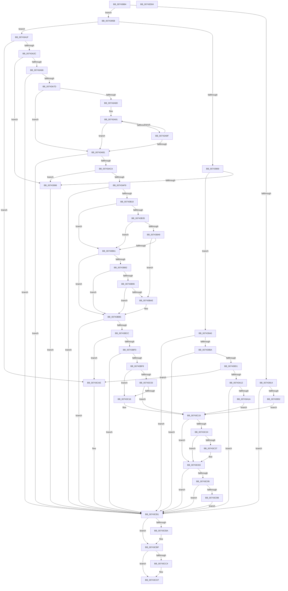

# PiDrvDbSetupNodeHive

- RVA: `0x00743884`–`0x00743D05` (길이 `1,153` bytes)
- VA: `0x0000000140743884`
- 실행 섹션: `PAGE`
- PDB 이름 있음: `예`; PDB Function 태그: `아니요`
- unwind 정보 RVA: `0x000C938C`
- 디코드: `298`개 명령, `1,153/1,153` bytes 표시
- 미해석 바이트: `0` (있으면 어셈블리에 `.byte`로 보존)

> 이 문서는 커널 이미지의 기계어와 PDB 기호를 분석해 생성했습니다. 4번과 5번은 함수 원형과 자료형을 바이너리 사용 방식에서 추정한 C 해석이며 원본 소스 복구 결과는 아닙니다.

## 1. Dependencies

- 직접 호출 지점: **30**; 고유 호출 대상: **15**
- 직접 호출자로 확인된 함수: **2**
- RIP 상대 이미지 참조: **6**

### Outgoing calls
- `0x007438E2` → [RtlInitUnicodeString](../../text/42/RtlInitUnicodeString_function_0042A780.md) (function, `0x0042A780`)
- `0x007438ED` → [RtlInitUnicodeString](../../text/42/RtlInitUnicodeString_function_0042A780.md) (function, `0x0042A780`)
- `0x007438F8` → [RtlInitUnicodeString](../../text/42/RtlInitUnicodeString_function_0042A780.md) (function, `0x0042A780`)
- `0x00743907` → [wcsicmp](../../text/50/wcsicmp_function_00500080.md) (function, `0x00500080`)
- `0x00743943` → [ZwOpenKey](../../text/6A/ZwOpenKey_function_006AD310.md) (function, `0x006AD310`)
- `0x00743988` → [ExAllocatePool2](../../poolcode/B8/ExAllocatePool2_function_00B820F0.md) (function, `0x00B820F0`)
- `0x007439AB` → [RtlAppendUnicodeToString](../../text/40/RtlAppendUnicodeToString_function_0040F990.md) (function, `0x0040F990`)
- `0x007439C2` → [RtlAppendUnicodeStringToString](../../text/40/RtlAppendUnicodeStringToString_function_0040FA50.md) (function, `0x0040FA50`)
- `0x00743A00` → [ZwOpenKey](../../text/6A/ZwOpenKey_function_006AD310.md) (function, `0x006AD310`)
- `0x00743A1F` → [CmIsStateSeparationEnabled](../../text/4A/CmIsStateSeparationEnabled_function_004A4754.md) (function, `0x004A4754`)
- `0x00743A54` → [ExAllocatePool2](../../poolcode/B8/ExAllocatePool2_function_00B820F0.md) (function, `0x00B820F0`)
- `0x00743A6E` → [RtlAppendUnicodeStringToString](../../text/40/RtlAppendUnicodeStringToString_function_0040FA50.md) (function, `0x0040FA50`)
- `0x00743AB9` → [RtlAppendUnicodeStringToString](../../text/40/RtlAppendUnicodeStringToString_function_0040FA50.md) (function, `0x0040FA50`)
- `0x00743AE4` → [ExAllocatePool2](../../poolcode/B8/ExAllocatePool2_function_00B820F0.md) (function, `0x00B820F0`)
- `0x00743B01` → [RtlAppendUnicodeStringToString](../../text/40/RtlAppendUnicodeStringToString_function_0040FA50.md) (function, `0x0040FA50`)
- `0x00743B1B` → [RtlInitUnicodeString](../../text/42/RtlInitUnicodeString_function_0042A780.md) (function, `0x0042A780`)
- `0x00743B40` → [RtlSuffixUnicodeString](../78/RtlSuffixUnicodeString_function_0078A780.md) (function, `0x0078A780`)
- `0x00743B6C` → [RtlInitUnicodeString](../../text/42/RtlInitUnicodeString_function_0042A780.md) (function, `0x0042A780`)
- `0x00743B8D` → [RtlSuffixUnicodeString](../78/RtlSuffixUnicodeString_function_0078A780.md) (function, `0x0078A780`)
- `0x00743BBD` → [RtlAppendUnicodeStringToString](../../text/40/RtlAppendUnicodeStringToString_function_0040FA50.md) (function, `0x0040FA50`)
- `0x00743BDE` → [PiDrvDbLoadHive](../A9/PiDrvDbLoadHive_function_00A91EE4.md) (function, `0x00A91EE4`)
- `0x00743C0D` → [wcsicmp](../../text/50/wcsicmp_function_00500080.md) (function, `0x00500080`)
- `0x00743C2E` → [wcsicmp](../../text/50/wcsicmp_function_00500080.md) (function, `0x00500080`)
- `0x00743C7E` → [PnpSetObjectProperty](../8F/PnpSetObjectProperty_function_008F66E8.md) (function, `0x008F66E8`)
- `0x00743C8A` → [PiDrvDbResolveNodeFilePaths](PiDrvDbResolveNodeFilePaths_function_007433A4.md) (function, `0x007433A4`)
- `0x00743CA5` → [PiDrvDbOverlayNodeHive](PiDrvDbOverlayNodeHive_function_00741990.md) (function, `0x00741990`)
- `0x00743CBA` → [ZwClose](../../text/6A/ZwClose_function_006AD2B0.md) (function, `0x006AD2B0`)
- `0x00743CCA` → [PiDrvDbUnloadHive](../A9/PiDrvDbUnloadHive_function_00A91FC0.md) (function, `0x00A91FC0`)
- `0x00743CD3` → [RtlFreeAnsiString](../9C/RtlFreeAnsiString_function_009C0800.md) (function, `0x009C0800`)
- `0x00743CDC` → [RtlFreeAnsiString](../9C/RtlFreeAnsiString_function_009C0800.md) (function, `0x009C0800`)

### Direct callers
- [PiDrvDbSetupNodes](PiDrvDbSetupNodes_function_00743D0C.md) at `0x00743E0D`
- [sub_00B46EDE](../B4/Unknown_function_00B46EDE.md) at `0x00B47044`

### Static image references
- `0x007438FD` → RVA `0x00AFF500` (` ?? ::NNGAKEGL::`string'`; read)
- `0x007439A0` → RVA `0x00B003E0` (` ?? ::NNGAKEGL::`string'`; read)
- `0x00743B10` → RVA `0x00B00350` (` ?? ::NNGAKEGL::`string'`; read)
- `0x00743C03` → RVA `0x00AFF430` (` ?? ::NNGAKEGL::`string'`; read)
- `0x00743C4C` → RVA `0x00E66398` (`.data`; read)
- `0x00743C65` → RVA `0x00021C28` (`.rdata`; read)

## 2. Other-region calls and transfers

- 다른 실행 섹션으로 향하는 call: **21**
  - `0x007438E2` → [RtlInitUnicodeString](../../text/42/RtlInitUnicodeString_function_0042A780.md) (`PAGE` → `.text`)
  - `0x007438ED` → [RtlInitUnicodeString](../../text/42/RtlInitUnicodeString_function_0042A780.md) (`PAGE` → `.text`)
  - `0x007438F8` → [RtlInitUnicodeString](../../text/42/RtlInitUnicodeString_function_0042A780.md) (`PAGE` → `.text`)
  - `0x00743907` → [wcsicmp](../../text/50/wcsicmp_function_00500080.md) (`PAGE` → `.text`)
  - `0x00743943` → [ZwOpenKey](../../text/6A/ZwOpenKey_function_006AD310.md) (`PAGE` → `.text`)
  - `0x00743988` → [ExAllocatePool2](../../poolcode/B8/ExAllocatePool2_function_00B820F0.md) (`PAGE` → `POOLCODE`)
  - `0x007439AB` → [RtlAppendUnicodeToString](../../text/40/RtlAppendUnicodeToString_function_0040F990.md) (`PAGE` → `.text`)
  - `0x007439C2` → [RtlAppendUnicodeStringToString](../../text/40/RtlAppendUnicodeStringToString_function_0040FA50.md) (`PAGE` → `.text`)
  - `0x00743A00` → [ZwOpenKey](../../text/6A/ZwOpenKey_function_006AD310.md) (`PAGE` → `.text`)
  - `0x00743A1F` → [CmIsStateSeparationEnabled](../../text/4A/CmIsStateSeparationEnabled_function_004A4754.md) (`PAGE` → `.text`)
  - `0x00743A54` → [ExAllocatePool2](../../poolcode/B8/ExAllocatePool2_function_00B820F0.md) (`PAGE` → `POOLCODE`)
  - `0x00743A6E` → [RtlAppendUnicodeStringToString](../../text/40/RtlAppendUnicodeStringToString_function_0040FA50.md) (`PAGE` → `.text`)
  - `0x00743AB9` → [RtlAppendUnicodeStringToString](../../text/40/RtlAppendUnicodeStringToString_function_0040FA50.md) (`PAGE` → `.text`)
  - `0x00743AE4` → [ExAllocatePool2](../../poolcode/B8/ExAllocatePool2_function_00B820F0.md) (`PAGE` → `POOLCODE`)
  - `0x00743B01` → [RtlAppendUnicodeStringToString](../../text/40/RtlAppendUnicodeStringToString_function_0040FA50.md) (`PAGE` → `.text`)
  - `0x00743B1B` → [RtlInitUnicodeString](../../text/42/RtlInitUnicodeString_function_0042A780.md) (`PAGE` → `.text`)
  - `0x00743B6C` → [RtlInitUnicodeString](../../text/42/RtlInitUnicodeString_function_0042A780.md) (`PAGE` → `.text`)
  - `0x00743BBD` → [RtlAppendUnicodeStringToString](../../text/40/RtlAppendUnicodeStringToString_function_0040FA50.md) (`PAGE` → `.text`)
  - `0x00743C0D` → [wcsicmp](../../text/50/wcsicmp_function_00500080.md) (`PAGE` → `.text`)
  - `0x00743C2E` → [wcsicmp](../../text/50/wcsicmp_function_00500080.md) (`PAGE` → `.text`)
  - `0x00743CBA` → [ZwClose](../../text/6A/ZwClose_function_006AD2B0.md) (`PAGE` → `.text`)
- 별도 외부 분기/꼬리 이동을 확인하지 못했습니다.

## 3. Assembly (complete function range)

```asm
00743884  48 8B C4                        mov rax, rsp
00743887  48 89 58 08                     mov qword ptr [rax + 8], rbx
0074388B  48 89 70 10                     mov qword ptr [rax + 0x10], rsi
0074388F  48 89 78 20                     mov qword ptr [rax + 0x20], rdi
00743893  55                              push rbp
00743894  41 54                           push r12
00743896  41 55                           push r13
00743898  41 56                           push r14
0074389A  41 57                           push r15
0074389C  48 8D 68 A1                     lea rbp, [rax - 0x5f]
007438A0  48 81 EC C0 00 00 00            sub rsp, 0xc0
007438A7  0F 57 C0                        xorps xmm0, xmm0
007438AA  33 C0                           xor eax, eax
007438AC  0F 57 C9                        xorps xmm1, xmm1
007438AF  48 89 45 27                     mov qword ptr [rbp + 0x27], rax
007438B3  48 8B F9                        mov rdi, rcx
007438B6  89 45 2F                        mov dword ptr [rbp + 0x2f], eax
007438B9  45 33 FF                        xor r15d, r15d
007438BC  48 8D 4D F7                     lea rcx, [rbp - 9]
007438C0  0F 11 45 07                     movups xmmword ptr [rbp + 7], xmm0
007438C4  4C 89 7D 77                     mov qword ptr [rbp + 0x77], r15
007438C8  45 8A EF                        mov r13b, r15b
007438CB  0F 11 45 17                     movups xmmword ptr [rbp + 0x17], xmm0
007438CF  4C 8B E2                        mov r12, rdx
007438D2  0F 11 45 F7                     movups xmmword ptr [rbp - 9], xmm0
007438D6  0F 11 4D D7                     movups xmmword ptr [rbp - 0x29], xmm1
007438DA  0F 11 45 C7                     movups xmmword ptr [rbp - 0x39], xmm0
007438DE  0F 11 4D E7                     movups xmmword ptr [rbp - 0x19], xmm1
007438E2  E8 99 6E CE FF                  call 0x14042a780
007438E7  33 D2                           xor edx, edx
007438E9  48 8D 4D D7                     lea rcx, [rbp - 0x29]
007438ED  E8 8E 6E CE FF                  call 0x14042a780
007438F2  33 D2                           xor edx, edx
007438F4  48 8D 4D C7                     lea rcx, [rbp - 0x39]
007438F8  E8 83 6E CE FF                  call 0x14042a780
007438FD  48 8D 15 FC BB 3B 00            lea rdx, [rip + 0x3bbbfc]
00743904  49 8B CC                        mov rcx, r12
00743907  E8 74 C7 DB FF                  call 0x140500080
0074390C  45 8D 77 02                     lea r14d, [r15 + 2]
00743910  85 C0                           test eax, eax
00743912  75 47                           jne 0x14074395b
00743914  48 8D 47 20                     lea rax, [rdi + 0x20]
00743918  C7 45 07 30 00 00 00            mov dword ptr [rbp + 7], 0x30
0074391F  0F 57 C0                        xorps xmm0, xmm0
00743922  48 89 45 17                     mov qword ptr [rbp + 0x17], rax
00743926  4C 8D 45 07                     lea r8, [rbp + 7]
0074392A  4C 89 7D 0F                     mov qword ptr [rbp + 0xf], r15
0074392E  BA 3F 00 0F 00                  mov edx, 0xf003f
00743933  C7 45 1F 40 02 00 00            mov dword ptr [rbp + 0x1f], 0x240
0074393A  48 8D 4D 77                     lea rcx, [rbp + 0x77]
0074393E  F3 0F 7F 45 27                  movdqu xmmword ptr [rbp + 0x27], xmm0
00743943  E8 C8 99 F6 FF                  call 0x1406ad310
00743948  8B D8                           mov ebx, eax
0074394A  85 C0                           test eax, eax
0074394C  0F 88 5F 03 00 00               js 0x140743cb1
00743952  48 8D 77 40                     lea rsi, [rdi + 0x40]
00743956  E9 BE 02 00 00                  jmp 0x140743c19
0074395B  48 8D 77 40                     lea rsi, [rdi + 0x40]
0074395F  8B 06                           mov eax, dword ptr [rsi]
00743961  A8 08                           test al, 8
00743963  0F 85 B6 00 00 00               jne 0x140743a1f
00743969  0F B7 45 F7                     movzx eax, word ptr [rbp - 9]
0074396D  B9 00 01 00 00                  mov ecx, 0x100
00743972  66 83 C0 26                     add ax, 0x26
00743976  66 44 89 7D C7                  mov word ptr [rbp - 0x39], r15w
0074397B  0F B7 D0                        movzx edx, ax
0074397E  41 B8 53 74 72 67               mov r8d, 0x67727453
00743984  66 89 55 C9                     mov word ptr [rbp - 0x37], dx
00743988  E8 63 E7 43 00                  call 0x140b820f0
0074398D  48 89 45 CF                     mov qword ptr [rbp - 0x31], rax
00743991  48 85 C0                        test rax, rax
00743994  75 0A                           jne 0x1407439a0
00743996  BB 9A 00 00 C0                  mov ebx, 0xc000009a
0074399B  E9 11 03 00 00                  jmp 0x140743cb1
007439A0  48 8D 15 39 CA 3B 00            lea rdx, [rip + 0x3bca39]
007439A7  48 8D 4D C7                     lea rcx, [rbp - 0x39]
007439AB  E8 E0 BF CC FF                  call 0x14040f990
007439B0  8B D8                           mov ebx, eax
007439B2  85 C0                           test eax, eax
007439B4  0F 88 F7 02 00 00               js 0x140743cb1
007439BA  48 8D 55 F7                     lea rdx, [rbp - 9]
007439BE  48 8D 4D C7                     lea rcx, [rbp - 0x39]
007439C2  E8 89 C0 CC FF                  call 0x14040fa50
007439C7  8B D8                           mov ebx, eax
007439C9  85 C0                           test eax, eax
007439CB  0F 88 E0 02 00 00               js 0x140743cb1
007439D1  48 8D 45 C7                     lea rax, [rbp - 0x39]
007439D5  C7 45 07 30 00 00 00            mov dword ptr [rbp + 7], 0x30
007439DC  0F 57 C0                        xorps xmm0, xmm0
007439DF  48 89 45 17                     mov qword ptr [rbp + 0x17], rax
007439E3  4C 8D 45 07                     lea r8, [rbp + 7]
007439E7  4C 89 7D 0F                     mov qword ptr [rbp + 0xf], r15
007439EB  BA 3F 00 0F 00                  mov edx, 0xf003f
007439F0  C7 45 1F 40 02 00 00            mov dword ptr [rbp + 0x1f], 0x240
007439F7  48 8D 4D 77                     lea rcx, [rbp + 0x77]
007439FB  F3 0F 7F 45 27                  movdqu xmmword ptr [rbp + 0x27], xmm0
00743A00  E8 0B 99 F6 FF                  call 0x1406ad310
00743A05  8B D8                           mov ebx, eax
00743A07  3D 34 00 00 C0                  cmp eax, 0xc0000034
00743A0C  0F 84 9C 02 00 00               je 0x140743cae
00743A12  85 C0                           test eax, eax
00743A14  0F 88 97 02 00 00               js 0x140743cb1
00743A1A  E9 FA 01 00 00                  jmp 0x140743c19
00743A1F  E8 30 0D D6 FF                  call 0x1404a4754
00743A24  84 C0                           test al, al
00743A26  0F 84 82 02 00 00               je 0x140743cae
00743A2C  66 44 89 7D D7                  mov word ptr [rbp - 0x29], r15w
00743A31  41 BE 00 01 00 00               mov r14d, 0x100
00743A37  44 0F B7 7D F7                  movzx r15d, word ptr [rbp - 9]
00743A3C  41 B8 53 74 72 67               mov r8d, 0x67727453
00743A42  41 0F B7 C7                     movzx eax, r15w
00743A46  41 8B CE                        mov ecx, r14d
00743A49  66 03 47 32                     add ax, word ptr [rdi + 0x32]
00743A4D  0F B7 D0                        movzx edx, ax
00743A50  66 89 55 D9                     mov word ptr [rbp - 0x27], dx
00743A54  E8 97 E6 43 00                  call 0x140b820f0
00743A59  48 89 45 DF                     mov qword ptr [rbp - 0x21], rax
00743A5D  48 85 C0                        test rax, rax
00743A60  0F 84 30 FF FF FF               je 0x140743996
00743A66  48 8D 57 30                     lea rdx, [rdi + 0x30]
00743A6A  48 8D 4D D7                     lea rcx, [rbp - 0x29]
00743A6E  E8 DD BF CC FF                  call 0x14040fa50
00743A73  8B D8                           mov ebx, eax
00743A75  85 C0                           test eax, eax
00743A77  0F 88 34 02 00 00               js 0x140743cb1
00743A7D  0F B7 4D D7                     movzx ecx, word ptr [rbp - 0x29]
00743A81  41 B8 02 00 00 00               mov r8d, 2
00743A87  66 41 3B C8                     cmp cx, r8w
00743A8B  76 24                           jbe 0x140743ab1
00743A8D  48 8B 55 DF                     mov rdx, qword ptr [rbp - 0x21]
00743A91  0F B7 C1                        movzx eax, cx
00743A94  48 D1 E8                        shr rax, 1
00743A97  66 83 7C 42 FE 5C               cmp word ptr [rdx + rax*2 - 2], 0x5c
00743A9D  74 12                           je 0x140743ab1
00743A9F  B8 FE FF 00 00                  mov eax, 0xfffe
00743AA4  66 03 C8                        add cx, ax
00743AA7  66 89 4D D7                     mov word ptr [rbp - 0x29], cx
00743AAB  66 41 3B C8                     cmp cx, r8w
00743AAF  77 E0                           ja 0x140743a91
00743AB1  48 8D 55 F7                     lea rdx, [rbp - 9]
00743AB5  48 8D 4D D7                     lea rcx, [rbp - 0x29]
00743AB9  E8 92 BF CC FF                  call 0x14040fa50
00743ABE  8B D8                           mov ebx, eax
00743AC0  33 C0                           xor eax, eax
00743AC2  85 DB                           test ebx, ebx
00743AC4  0F 88 E7 01 00 00               js 0x140743cb1
00743ACA  66 44 03 7F 22                  add r15w, word ptr [rdi + 0x22]
00743ACF  41 B8 53 74 72 67               mov r8d, 0x67727453
00743AD5  41 0F B7 D7                     movzx edx, r15w
00743AD9  49 8B CE                        mov rcx, r14
00743ADC  66 89 55 C9                     mov word ptr [rbp - 0x37], dx
00743AE0  66 89 45 C7                     mov word ptr [rbp - 0x39], ax
00743AE4  E8 07 E6 43 00                  call 0x140b820f0
00743AE9  45 33 FF                        xor r15d, r15d
00743AEC  48 89 45 CF                     mov qword ptr [rbp - 0x31], rax
00743AF0  48 85 C0                        test rax, rax
00743AF3  0F 84 9D FE FF FF               je 0x140743996
00743AF9  48 8D 57 20                     lea rdx, [rdi + 0x20]
00743AFD  48 8D 4D C7                     lea rcx, [rbp - 0x39]
00743B01  E8 4A BF CC FF                  call 0x14040fa50
00743B06  8B D8                           mov ebx, eax
00743B08  85 C0                           test eax, eax
00743B0A  0F 88 A1 01 00 00               js 0x140743cb1
00743B10  48 8D 15 39 C8 3B 00            lea rdx, [rip + 0x3bc839]
00743B17  48 8D 4D E7                     lea rcx, [rbp - 0x19]
00743B1B  E8 60 6C CE FF                  call 0x14042a780
00743B20  0F B7 5D E7                     movzx ebx, word ptr [rbp - 0x19]
00743B24  45 8D 77 02                     lea r14d, [r15 + 2]
00743B28  0F B7 45 C7                     movzx eax, word ptr [rbp - 0x39]
00743B2C  49 8D 0C 1E                     lea rcx, [r14 + rbx]
00743B30  48 3B C1                        cmp rax, rcx
00743B33  76 2C                           jbe 0x140743b61
00743B35  41 B0 01                        mov r8b, 1
00743B38  48 8D 55 C7                     lea rdx, [rbp - 0x39]
00743B3C  48 8D 4D E7                     lea rcx, [rbp - 0x19]
00743B40  E8 3B 6C 04 00                  call 0x14078a780
00743B45  84 C0                           test al, al
00743B47  74 18                           je 0x140743b61
00743B49  0F B7 55 C7                     movzx edx, word ptr [rbp - 0x39]
00743B4D  48 8B 45 CF                     mov rax, qword ptr [rbp - 0x31]
00743B51  8B CA                           mov ecx, edx
00743B53  48 2B CB                        sub rcx, rbx
00743B56  48 D1 E9                        shr rcx, 1
00743B59  66 83 7C 48 FE 5C               cmp word ptr [rax + rcx*2 - 2], 0x5c
00743B5F  75 4D                           jne 0x140743bae
00743B61  48 8D 15 98 B9 3B 00            lea rdx, [rip + 0x3bb998]
00743B68  48 8D 4D E7                     lea rcx, [rbp - 0x19]
00743B6C  E8 0F 6C CE FF                  call 0x14042a780
00743B71  0F B7 5D E7                     movzx ebx, word ptr [rbp - 0x19]
00743B75  0F B7 45 C7                     movzx eax, word ptr [rbp - 0x39]
00743B79  49 8D 0C 1E                     lea rcx, [r14 + rbx]
00743B7D  48 3B C1                        cmp rax, rcx
00743B80  76 33                           jbe 0x140743bb5
00743B82  41 B0 01                        mov r8b, 1
00743B85  48 8D 55 C7                     lea rdx, [rbp - 0x39]
00743B89  48 8D 4D E7                     lea rcx, [rbp - 0x19]
00743B8D  E8 EE 6B 04 00                  call 0x14078a780
00743B92  84 C0                           test al, al
00743B94  74 1F                           je 0x140743bb5
00743B96  0F B7 55 C7                     movzx edx, word ptr [rbp - 0x39]
00743B9A  48 8B 45 CF                     mov rax, qword ptr [rbp - 0x31]
00743B9E  8B CA                           mov ecx, edx
00743BA0  48 2B CB                        sub rcx, rbx
00743BA3  48 D1 E9                        shr rcx, 1
00743BA6  66 83 7C 48 FE 5C               cmp word ptr [rax + rcx*2 - 2], 0x5c
00743BAC  74 07                           je 0x140743bb5
00743BAE  66 2B D3                        sub dx, bx
00743BB1  66 89 55 C7                     mov word ptr [rbp - 0x39], dx
00743BB5  48 8D 55 F7                     lea rdx, [rbp - 9]
00743BB9  48 8D 4D C7                     lea rcx, [rbp - 0x39]
00743BBD  E8 8E BE CC FF                  call 0x14040fa50
00743BC2  8B D8                           mov ebx, eax
00743BC4  85 C0                           test eax, eax
00743BC6  0F 88 E5 00 00 00               js 0x140743cb1
00743BCC  4C 8D 4D 77                     lea r9, [rbp + 0x77]
00743BD0  41 B8 00 20 00 00               mov r8d, 0x2000
00743BD6  48 8D 55 D7                     lea rdx, [rbp - 0x29]
00743BDA  48 8D 4D C7                     lea rcx, [rbp - 0x39]
00743BDE  E8 01 E3 34 00                  call 0x140a91ee4
00743BE3  8B D8                           mov ebx, eax
00743BE5  3D 34 00 00 C0                  cmp eax, 0xc0000034
00743BEA  0F 84 BE 00 00 00               je 0x140743cae
00743BF0  85 C0                           test eax, eax
00743BF2  0F 88 B9 00 00 00               js 0x140743cb1
00743BF8  8B 87 EC 01 00 00               mov eax, dword ptr [rdi + 0x1ec]
00743BFE  41 84 C6                        test r14b, al
00743C01  74 13                           je 0x140743c16
00743C03  48 8D 15 26 B8 3B 00            lea rdx, [rip + 0x3bb826]
00743C0A  49 8B CC                        mov rcx, r12
00743C0D  E8 6E C4 DB FF                  call 0x140500080
00743C12  85 C0                           test eax, eax
00743C14  74 03                           je 0x140743c19
00743C16  41 B5 01                        mov r13b, 1
00743C19  8B 87 EC 01 00 00               mov eax, dword ptr [rdi + 0x1ec]
00743C1F  41 84 C6                        test r14b, al
00743C22  74 5F                           je 0x140743c83
00743C24  48 8D 15 05 B8 3B 00            lea rdx, [rip + 0x3bb805]
00743C2B  49 8B CC                        mov rcx, r12
00743C2E  E8 4D C4 DB FF                  call 0x140500080
00743C33  85 C0                           test eax, eax
00743C35  75 4C                           jne 0x140743c83
00743C37  0F B7 45 C7                     movzx eax, word ptr [rbp - 0x39]
00743C3B  41 B8 07 00 00 00               mov r8d, 7
00743C41  4C 8B 4F 48                     mov r9, qword ptr [rdi + 0x48]
00743C45  41 03 C6                        add eax, r14d
00743C48  48 8B 57 18                     mov rdx, qword ptr [rdi + 0x18]
00743C4C  48 8B 0D 45 27 72 00            mov rcx, qword ptr [rip + 0x722745]
00743C53  44 89 7C 24 48                  mov dword ptr [rsp + 0x48], r15d
00743C58  89 44 24 40                     mov dword ptr [rsp + 0x40], eax
00743C5C  48 8B 45 CF                     mov rax, qword ptr [rbp - 0x31]
00743C60  48 89 44 24 38                  mov qword ptr [rsp + 0x38], rax
00743C65  48 8D 05 BC DF 8D FF            lea rax, [rip - 0x722044]
00743C6C  C7 44 24 30 12 00 00 00         mov dword ptr [rsp + 0x30], 0x12
00743C74  48 89 44 24 28                  mov qword ptr [rsp + 0x28], rax
00743C79  4C 89 7C 24 20                  mov qword ptr [rsp + 0x20], r15
00743C7E  E8 65 2A 1B 00                  call 0x1408f66e8
00743C83  48 8B 55 77                     mov rdx, qword ptr [rbp + 0x77]
00743C87  48 8B CF                        mov rcx, rdi
00743C8A  E8 15 F7 FF FF                  call 0x1407433a4
00743C8F  8B D8                           mov ebx, eax
00743C91  85 C0                           test eax, eax
00743C93  78 1C                           js 0x140743cb1
00743C95  8B 06                           mov eax, dword ptr [rsi]
00743C97  A8 08                           test al, 8
00743C99  74 16                           je 0x140743cb1
00743C9B  4C 8B 45 77                     mov r8, qword ptr [rbp + 0x77]
00743C9F  49 8B D4                        mov rdx, r12
00743CA2  48 8B CF                        mov rcx, rdi
00743CA5  E8 E6 DC FF FF                  call 0x140741990
00743CAA  8B D8                           mov ebx, eax
00743CAC  EB 03                           jmp 0x140743cb1
00743CAE  41 8B DF                        mov ebx, r15d
00743CB1  48 8B 4D 77                     mov rcx, qword ptr [rbp + 0x77]
00743CB5  48 85 C9                        test rcx, rcx
00743CB8  74 05                           je 0x140743cbf
00743CBA  E8 F1 95 F6 FF                  call 0x1406ad2b0
00743CBF  45 84 ED                        test r13b, r13b
00743CC2  74 0B                           je 0x140743ccf
00743CC4  33 D2                           xor edx, edx
00743CC6  48 8D 4D C7                     lea rcx, [rbp - 0x39]
00743CCA  E8 F1 E2 34 00                  call 0x140a91fc0
00743CCF  48 8D 4D D7                     lea rcx, [rbp - 0x29]
00743CD3  E8 28 CB 27 00                  call 0x1409c0800
00743CD8  48 8D 4D C7                     lea rcx, [rbp - 0x39]
00743CDC  E8 1F CB 27 00                  call 0x1409c0800
00743CE1  4C 8D 9C 24 C0 00 00 00         lea r11, [rsp + 0xc0]
00743CE9  8B C3                           mov eax, ebx
00743CEB  49 8B 5B 30                     mov rbx, qword ptr [r11 + 0x30]
00743CEF  49 8B 73 38                     mov rsi, qword ptr [r11 + 0x38]
00743CF3  49 8B 7B 48                     mov rdi, qword ptr [r11 + 0x48]
00743CF7  49 8B E3                        mov rsp, r11
00743CFA  41 5F                           pop r15
00743CFC  41 5E                           pop r14
00743CFE  41 5D                           pop r13
00743D00  41 5C                           pop r12
00743D02  5D                              pop rbp
00743D03  C3                              ret
00743D04  CC                              int3
```

## 4. C-style interpretation (structured pseudocode)

```c
__int64 __fastcall PiDrvDbSetupNodeHive(__int64 a1, __int64 a2)
{
    __int64 result;
    __int64 v_r13;
    __int64 v_r15;
    __int64 v_rsp;
    unsigned __int64 v_stack_m28;
    unsigned int v_stack_mA0;
    unsigned int v_stack_mA8;
    unsigned __int64 v_stack_mB0;
    unsigned int v_stack_mB8;
    unsigned __int64 v_stack_mC0;
    unsigned __int64 v_stack_mC8;

    *(unsigned __int64 *)(v_rsp + 8) = v_rbx;
    *(unsigned __int64 *)(v_rsp + 16) = v_rsi;
    *(unsigned __int64 *)(v_rsp + 32) = v_rdi;
    v_rsp = (v_rsp) - (192);
    result = 0;
    *(unsigned __int64 *)(v_rsp - 95 + 39) = 0;
    *(unsigned int *)(v_rsp - 95 + 47) = 0;
    v_r15 = 0;
    *(unsigned __int64 *)(v_rsp - 95 + 7) = v_xmm0;
    *(unsigned __int64 *)(v_rsp - 95 + 119) = 0;
    *(unsigned __int64 *)(v_rsp - 95 + 23) = v_xmm0;
    *(unsigned __int64 *)(v_rsp - 95 - 9) = v_xmm0;
    *(unsigned __int64 *)(v_rsp - 95 - 41) = v_xmm1;
    *(unsigned __int64 *)(v_rsp - 95 - 57) = v_xmm0;
    *(unsigned __int64 *)(v_rsp - 95 - 25) = v_xmm1;
    result = RtlInitUnicodeString(v_rsp - 95 - 9, a2, a3, a4);
    a2 = 0;
    result = RtlInitUnicodeString(v_rsp - 95 - 41, a2, a3, a4);
    a2 = 0;
    result = RtlInitUnicodeString(v_rsp - 95 - 57, a2, a3, a4);
    result = wcsicmp(0, v_rip + 3914748, a3, a4);
    if ((unsigned int)(result) != 0) goto loc_0074395B;
    *(unsigned int *)(v_rsp - 95 + 7) = 48;
    *(unsigned __int64 *)(v_rsp - 95 + 23) = a1 + 32;
    *(unsigned __int64 *)(v_rsp - 95 + 15) = 0;
    *(unsigned int *)(v_rsp - 95 + 31) = 576;
    *(unsigned __int64 *)(v_rsp - 95 + 39) = v_xmm0;
    result = ZwOpenKey(v_rsp - 95 + 119, (unsigned int)(0xF003FULL), v_rsp - 95 + 7, a4);
    if (sign_flag) goto loc_00743CB1;
    goto loc_00743C19;
loc_0074395B:
    if ((((unsigned __int8)((unsigned int)(*(unsigned int *)(a1 + 64)))) & (8)) != 0) goto loc_00743A1F;
    result = (unsigned __int16)((*(unsigned __int16 *)(v_rsp - 95 - 9)) + (38));
    *(unsigned __int16 *)(v_rsp - 95 - 57) = 0;
    *(unsigned __int16 *)(v_rsp - 95 - 55) = (unsigned __int16)((unsigned __int16)(result));
    result = ExAllocatePool2(256, (unsigned __int16)(result), (unsigned int)(0x67727453ULL), a4);
    *(unsigned __int64 *)(v_rsp - 95 - 49) = result;
    if (result != 0) goto loc_007439A0;
loc_00743996:
    goto loc_00743CB1;
loc_007439A0:
    result = RtlAppendUnicodeToString(v_rsp - 95 - 57, v_rip + 3918393, (unsigned int)(0x67727453ULL), a4);
    if (sign_flag) goto loc_00743CB1;
    result = RtlAppendUnicodeStringToString(v_rsp - 95 - 57, v_rsp - 95 - 9, (unsigned int)(0x67727453ULL), a4);
    if (sign_flag) goto loc_00743CB1;
    *(unsigned int *)(v_rsp - 95 + 7) = 48;
    *(unsigned __int64 *)(v_rsp - 95 + 23) = v_rsp - 95 - 57;
    *(unsigned __int64 *)(v_rsp - 95 + 15) = 0;
    *(unsigned int *)(v_rsp - 95 + 31) = 576;
    *(unsigned __int64 *)(v_rsp - 95 + 39) = v_xmm0;
    result = ZwOpenKey(v_rsp - 95 + 119, (unsigned int)(0xF003FULL), v_rsp - 95 + 7, a4);
    if (((unsigned int)(result)) == 0xC0000034ULL) goto loc_00743CAE;
    if (sign_flag) goto loc_00743CB1;
    goto loc_00743C19;
loc_00743A1F:
    result = CmIsStateSeparationEnabled(v_rsp - 95 + 119, (unsigned int)(0xF003FULL), v_rsp - 95 + 7, a4);
    if ((unsigned __int8)(result) == 0) goto loc_00743CAE;
    *(unsigned __int16 *)(v_rsp - 95 - 41) = 0;
    result = (unsigned __int16)(((unsigned __int16)(*(unsigned __int16 *)(v_rsp - 95 - 9))) + (*(unsigned __int16 *)(a1 + 50)));
    *(unsigned __int16 *)(v_rsp - 95 - 39) = (unsigned __int16)((unsigned __int16)(result));
    result = ExAllocatePool2(256, (unsigned __int16)(result), (unsigned int)(0x67727453ULL), a4);
    *(unsigned __int64 *)(v_rsp - 95 - 33) = result;
    if (result == 0) goto loc_00743996;
    result = RtlAppendUnicodeStringToString(v_rsp - 95 - 41, a1 + 48, (unsigned int)(0x67727453ULL), a4);
    if (sign_flag) goto loc_00743CB1;
    if (((unsigned __int16)(*(unsigned __int16 *)(v_rsp - 95 - 41))) <= 2) goto loc_00743AB1;
loc_00743A91:
    result = ((unsigned __int16)(*(unsigned __int16 *)(v_rsp - 95 - 41))) >> (1);
    if ((*(unsigned __int16 *)(*(unsigned __int64 *)(v_rsp - 95 - 33) + result * 2 - 2)) == 92) goto loc_00743AB1;
    a1 = (unsigned __int16)((*(unsigned __int16 *)(v_rsp - 95 - 41)) + ((unsigned __int16)((unsigned int)(0xFFFEULL))));
    *(unsigned __int16 *)(v_rsp - 95 - 41) = (unsigned __int16)(a1);
    if (((unsigned __int16)(a1)) > 2) goto loc_00743A91;
loc_00743AB1:
    result = RtlAppendUnicodeStringToString(v_rsp - 95 - 41, v_rsp - 95 - 9, 2, a4);
    result = 0;
    if (sign_flag) goto loc_00743CB1;
    v_r15 = (unsigned __int16)((*(unsigned __int16 *)(v_rsp - 95 - 9)) + (*(unsigned __int16 *)(a1 + 34)));
    *(unsigned __int16 *)(v_rsp - 95 - 55) = (unsigned __int16)((unsigned __int16)(v_r15));
    *(unsigned __int16 *)(v_rsp - 95 - 57) = 0;
    result = ExAllocatePool2(256, (unsigned __int16)(v_r15), (unsigned int)(0x67727453ULL), a4);
    v_r15 = 0;
    *(unsigned __int64 *)(v_rsp - 95 - 49) = result;
    if (result == 0) goto loc_00743996;
    result = RtlAppendUnicodeStringToString(v_rsp - 95 - 57, a1 + 32, (unsigned int)(0x67727453ULL), a4);
    if (sign_flag) goto loc_00743CB1;
    result = RtlInitUnicodeString(v_rsp - 95 - 25, v_rip + 3917881, (unsigned int)(0x67727453ULL), a4);
    if ((*(unsigned __int16 *)(v_rsp - 95 - 57)) <= (v_r15 + 2 + *(unsigned __int16 *)(v_rsp - 95 - 25) * 1)) goto loc_00743B61;
    result = RtlSuffixUnicodeString(v_rsp - 95 - 25, v_rsp - 95 - 57, 1, a4);
    if ((unsigned __int8)(result) == 0) goto loc_00743B61;
    a1 = ((unsigned int)((unsigned int)(*(unsigned __int16 *)(v_rsp - 95 - 57)))) - (*(unsigned __int16 *)(v_rsp - 95 - 25));
    a1 = (a1) >> (1);
    if ((*(unsigned __int16 *)(*(unsigned __int64 *)(v_rsp - 95 - 49) + a1 * 2 - 2)) != 92) goto loc_00743BAE;
loc_00743B61:
    result = RtlInitUnicodeString(v_rsp - 95 - 25, v_rip + 3914136, 1, a4);
    if ((*(unsigned __int16 *)(v_rsp - 95 - 57)) <= (v_r15 + 2 + *(unsigned __int16 *)(v_rsp - 95 - 25) * 1)) goto loc_00743BB5;
    result = RtlSuffixUnicodeString(v_rsp - 95 - 25, v_rsp - 95 - 57, 1, a4);
    if ((unsigned __int8)(result) == 0) goto loc_00743BB5;
    a1 = ((unsigned int)((unsigned int)(*(unsigned __int16 *)(v_rsp - 95 - 57)))) - (*(unsigned __int16 *)(v_rsp - 95 - 25));
    a1 = (a1) >> (1);
    if ((*(unsigned __int16 *)(*(unsigned __int64 *)(v_rsp - 95 - 49) + a1 * 2 - 2)) != 92) {
        a2 = (unsigned __int16)((*(unsigned __int16 *)(v_rsp - 95 - 57)) - ((unsigned __int16)(*(unsigned __int16 *)(v_rsp - 95 - 25))));
        *(unsigned __int16 *)(v_rsp - 95 - 57) = (unsigned __int16)(a2);
    }
    result = RtlAppendUnicodeStringToString(v_rsp - 95 - 57, v_rsp - 95 - 9, 1, a4);
    if (sign_flag) goto loc_00743CB1;
    result = PiDrvDbLoadHive(v_rsp - 95 - 57, v_rsp - 95 - 41, (unsigned int)(0x2000ULL), v_rsp - 95 + 119);
    if (((unsigned int)(result)) == 0xC0000034ULL) goto loc_00743CAE;
    if (sign_flag) goto loc_00743CB1;
    if ((((unsigned __int8)(v_r15 + 2)) & ((unsigned __int8)((unsigned int)(*(unsigned int *)(a1 + 492))))) == 0) goto loc_00743C16;
    result = wcsicmp(a2, v_rip + 3913766, (unsigned int)(0x2000ULL), v_rsp - 95 + 119);
    v_r13 = 0;
    if ((unsigned int)(result) != 0) {
        v_r13 = 1;
    }
    if ((((unsigned __int8)(v_r15 + 2)) & ((unsigned __int8)((unsigned int)(*(unsigned int *)(a1 + 492))))) == 0) goto loc_00743C83;
    result = wcsicmp(a2, v_rip + 3913733, (unsigned int)(0x2000ULL), v_rsp - 95 + 119);
    if ((unsigned int)(result) == 0) {
        result = *(unsigned __int16 *)(v_rsp - 95 - 57);
        a3 = 7;
        a4 = *(unsigned __int64 *)(a1 + 72);
        result = (unsigned int)((result) + ((unsigned int)(v_r15 + 2)));
        a2 = *(unsigned __int64 *)(a1 + 24);
        a1 = *(unsigned __int64 *)(v_rip + 7481157);
        v_stack_mA0 = 0;
        v_stack_mA8 = (unsigned int)(result);
        result = *(unsigned __int64 *)(v_rsp - 95 - 49);
        v_stack_mB0 = result;
        result = v_rip - 7479364;
        v_stack_mB8 = 18;
        v_stack_mC0 = result;
        v_stack_mC8 = 0;
        result = PnpSetObjectProperty(a1, a2, a3, a4);
    }
    result = PiDrvDbResolveNodeFilePaths(a1, *(unsigned __int64 *)(v_rsp - 95 + 119), a3, a4);
    if (sign_flag) goto loc_00743CB1;
    if ((((unsigned __int8)((unsigned int)(*(unsigned int *)(a1 + 64)))) & (8)) == 0) goto loc_00743CB1;
    result = PiDrvDbOverlayNodeHive(a1, a2, *(unsigned __int64 *)(v_rsp - 95 + 119), a4);
    goto loc_00743CB1;
loc_00743CAE:
loc_00743CB1:
    if (*(unsigned __int64 *)(v_rsp - 95 + 119) != 0) {
        result = ZwClose(*(unsigned __int64 *)(v_rsp - 95 + 119), a2, *(unsigned __int64 *)(v_rsp - 95 + 119), a4);
    }
    if ((unsigned __int8)(v_r13) != 0) {
        a2 = 0;
        a1 = v_rsp - 95 - 57;
        result = PiDrvDbUnloadHive(a1, a2, *(unsigned __int64 *)(v_rsp - 95 + 119), a4);
    }
    result = RtlFreeAnsiString(v_rsp - 95 - 41, a2, *(unsigned __int64 *)(v_rsp - 95 + 119), a4);
    result = RtlFreeAnsiString(v_rsp - 95 - 57, a2, *(unsigned __int64 *)(v_rsp - 95 + 119), a4);
    return 0;
}
```

## 5. (Beta) C Style

```c
int64_t PiDrvDbSetupNodeHive(void *Arg1, int64_t Arg2)
{
    uint8_t *arg1 = (uint8_t *)Arg1;

    int64_t result;
    int64_t local_r13;
    int64_t local_r15;
    int64_t local_rsp;
    uint64_t v_stack_m28;
    uint32_t v_stack_mA0;
    uint32_t v_stack_mA8;
    uint64_t v_stack_mB0;
    uint32_t v_stack_mB8;
    uint64_t v_stack_mC0;
    uint64_t v_stack_mC8;

    *(uint64_t *)(local_rsp + 0x8) = local_rbx;
    *(uint64_t *)(local_rsp + 0x10) = local_rsi;
    *(uint64_t *)(local_rsp + 0x20) = local_rdi;
    local_rsp = (local_rsp) - (192);
    result = 0;
    *(uint64_t *)(local_rsp - 0x5F + 0x27) = 0;
    *(uint32_t *)(local_rsp - 0x5F + 0x2F) = 0;
    local_r15 = 0;
    *(uint64_t *)(local_rsp - 0x5F + 0x7) = v_xmm0;
    *(uint64_t *)(local_rsp - 0x5F + 0x77) = 0;
    *(uint64_t *)(local_rsp - 0x5F + 0x17) = v_xmm0;
    *(uint64_t *)(local_rsp - 0x5F - 0x9) = v_xmm0;
    *(uint64_t *)(local_rsp - 0x5F - 0x29) = v_xmm1;
    *(uint64_t *)(local_rsp - 0x5F - 0x39) = v_xmm0;
    *(uint64_t *)(local_rsp - 0x5F - 0x19) = v_xmm1;
    result = RtlInitUnicodeString(local_rsp - 95 - 9, Arg2, a3, a4);
    Arg2 = 0;
    result = RtlInitUnicodeString(local_rsp - 95 - 41, Arg2, a3, a4);
    Arg2 = 0;
    result = RtlInitUnicodeString(local_rsp - 95 - 57, Arg2, a3, a4);
    result = wcsicmp(0, v_rip + 3914748, a3, a4);
    if ((uint32_t)(result) != 0) goto loc_0074395B;
    *(uint32_t *)(local_rsp - 0x5F + 0x7) = 48;
    *(void **)(local_rsp - 0x5F + 0x17) = Arg1 + 32;
    *(uint64_t *)(local_rsp - 0x5F + 0xF) = 0;
    *(uint32_t *)(local_rsp - 0x5F + 0x1F) = 576;
    *(uint64_t *)(local_rsp - 0x5F + 0x27) = v_xmm0;
    result = ZwOpenKey(local_rsp - 95 + 119, (uint32_t)(0xF003FULL), local_rsp - 95 + 7, a4);
    if (sign_flag) goto loc_00743CB1;
    goto loc_00743C19;
loc_0074395B:
    if ((((uint8_t)((uint32_t)(*(uint32_t *)(arg1 + 0x40)))) & (8)) != 0) goto loc_00743A1F;
    result = (uint16_t)((*(uint16_t *)(local_rsp - 0x5F - 0x9)) + (38));
    *(uint16_t *)(local_rsp - 0x5F - 0x39) = 0;
    *(uint16_t *)(local_rsp - 0x5F - 0x37) = (uint16_t)((uint16_t)(result));
    result = ExAllocatePool2(256, (uint16_t)(result), (uint32_t)(0x67727453ULL), a4);
    *(uint64_t *)(local_rsp - 0x5F - 0x31) = result;
    if (result != 0) goto loc_007439A0;
loc_00743996:
    goto loc_00743CB1;
loc_007439A0:
    result = RtlAppendUnicodeToString(local_rsp - 95 - 57, v_rip + 3918393, (uint32_t)(0x67727453ULL), a4);
    if (sign_flag) goto loc_00743CB1;
    result = RtlAppendUnicodeStringToString(local_rsp - 95 - 57, local_rsp - 95 - 9, (uint32_t)(0x67727453ULL), a4);
    if (sign_flag) goto loc_00743CB1;
    *(uint32_t *)(local_rsp - 0x5F + 0x7) = 48;
    *(uint64_t *)(local_rsp - 0x5F + 0x17) = local_rsp - 95 - 57;
    *(uint64_t *)(local_rsp - 0x5F + 0xF) = 0;
    *(uint32_t *)(local_rsp - 0x5F + 0x1F) = 576;
    *(uint64_t *)(local_rsp - 0x5F + 0x27) = v_xmm0;
    result = ZwOpenKey(local_rsp - 95 + 119, (uint32_t)(0xF003FULL), local_rsp - 95 + 7, a4);
    if (((uint32_t)(result)) == 0xC0000034ULL) goto loc_00743CAE;
    if (sign_flag) goto loc_00743CB1;
    goto loc_00743C19;
loc_00743A1F:
    result = CmIsStateSeparationEnabled(local_rsp - 95 + 119, (uint32_t)(0xF003FULL), local_rsp - 95 + 7, a4);
    if ((uint8_t)(result) == 0) goto loc_00743CAE;
    *(uint16_t *)(local_rsp - 0x5F - 0x29) = 0;
    result = (uint16_t)(((uint16_t)(*(uint16_t *)(local_rsp - 0x5F - 0x9))) + (*(uint16_t *)(arg1 + 0x32)));
    *(uint16_t *)(local_rsp - 0x5F - 0x27) = (uint16_t)((uint16_t)(result));
    result = ExAllocatePool2(256, (uint16_t)(result), (uint32_t)(0x67727453ULL), a4);
    *(uint64_t *)(local_rsp - 0x5F - 0x21) = result;
    if (result == 0) goto loc_00743996;
    result = RtlAppendUnicodeStringToString(local_rsp - 95 - 41, Arg1 + 48, (uint32_t)(0x67727453ULL), a4);
    if (sign_flag) goto loc_00743CB1;
    if (((uint16_t)(*(uint16_t *)(local_rsp - 0x5F - 0x29))) <= 2) goto loc_00743AB1;
loc_00743A91:
    result = ((uint16_t)(*(uint16_t *)(local_rsp - 0x5F - 0x29))) >> (1);
    if ((*(uint16_t *)(*(uint64_t *)(local_rsp - 0x5F - 0x21) + result * 2 - 0x2)) == 92) goto loc_00743AB1;
    Arg1 = (uint16_t)((*(uint16_t *)(local_rsp - 0x5F - 0x29)) + ((uint16_t)((uint32_t)(0xFFFEULL))));
    *(uint16_t *)(local_rsp - 0x5F - 0x29) = (uint16_t)(Arg1);
    if (((uint16_t)(Arg1)) > 2) goto loc_00743A91;
loc_00743AB1:
    result = RtlAppendUnicodeStringToString(local_rsp - 95 - 41, local_rsp - 95 - 9, 2, a4);
    result = 0;
    if (sign_flag) goto loc_00743CB1;
    local_r15 = (uint16_t)((*(uint16_t *)(local_rsp - 0x5F - 0x9)) + (*(uint16_t *)(arg1 + 0x22)));
    *(uint16_t *)(local_rsp - 0x5F - 0x37) = (uint16_t)((uint16_t)(local_r15));
    *(uint16_t *)(local_rsp - 0x5F - 0x39) = 0;
    result = ExAllocatePool2(256, (uint16_t)(local_r15), (uint32_t)(0x67727453ULL), a4);
    local_r15 = 0;
    *(uint64_t *)(local_rsp - 0x5F - 0x31) = result;
    if (result == 0) goto loc_00743996;
    result = RtlAppendUnicodeStringToString(local_rsp - 95 - 57, Arg1 + 32, (uint32_t)(0x67727453ULL), a4);
    if (sign_flag) goto loc_00743CB1;
    result = RtlInitUnicodeString(local_rsp - 95 - 25, v_rip + 3917881, (uint32_t)(0x67727453ULL), a4);
    if ((*(uint16_t *)(local_rsp - 0x5F - 0x39)) <= (local_r15 + 2 + *(uint16_t *)(local_rsp - 0x5F - 0x19) * 1)) goto loc_00743B61;
    result = RtlSuffixUnicodeString(local_rsp - 95 - 25, local_rsp - 95 - 57, 1, a4);
    if ((uint8_t)(result) == 0) goto loc_00743B61;
    Arg1 = ((uint32_t)((uint32_t)(*(uint16_t *)(local_rsp - 0x5F - 0x39)))) - (*(uint16_t *)(local_rsp - 0x5F - 0x19));
    Arg1 = (Arg1) >> (1);
    if ((*(uint16_t *)(*(uint64_t *)(local_rsp - 0x5F - 0x31) + arg1 * 2 - 0x2)) != 92) goto loc_00743BAE;
loc_00743B61:
    result = RtlInitUnicodeString(local_rsp - 95 - 25, v_rip + 3914136, 1, a4);
    if ((*(uint16_t *)(local_rsp - 0x5F - 0x39)) <= (local_r15 + 2 + *(uint16_t *)(local_rsp - 0x5F - 0x19) * 1)) goto loc_00743BB5;
    result = RtlSuffixUnicodeString(local_rsp - 95 - 25, local_rsp - 95 - 57, 1, a4);
    if ((uint8_t)(result) == 0) goto loc_00743BB5;
    Arg1 = ((uint32_t)((uint32_t)(*(uint16_t *)(local_rsp - 0x5F - 0x39)))) - (*(uint16_t *)(local_rsp - 0x5F - 0x19));
    Arg1 = (Arg1) >> (1);
    if ((*(uint16_t *)(*(uint64_t *)(local_rsp - 0x5F - 0x31) + arg1 * 2 - 0x2)) != 92) {
        Arg2 = (uint16_t)((*(uint16_t *)(local_rsp - 0x5F - 0x39)) - ((uint16_t)(*(uint16_t *)(local_rsp - 0x5F - 0x19))));
        *(uint16_t *)(local_rsp - 0x5F - 0x39) = (uint16_t)(Arg2);
    }
    result = RtlAppendUnicodeStringToString(local_rsp - 95 - 57, local_rsp - 95 - 9, 1, a4);
    if (sign_flag) goto loc_00743CB1;
    result = PiDrvDbLoadHive(local_rsp - 95 - 57, local_rsp - 95 - 41, (uint32_t)(0x2000ULL), local_rsp - 95 + 119);
    if (((uint32_t)(result)) == 0xC0000034ULL) goto loc_00743CAE;
    if (sign_flag) goto loc_00743CB1;
    if ((((uint8_t)(local_r15 + 2)) & ((uint8_t)((uint32_t)(*(uint32_t *)(arg1 + 0x1EC))))) == 0) goto loc_00743C16;
    result = wcsicmp(Arg2, v_rip + 3913766, (uint32_t)(0x2000ULL), local_rsp - 95 + 119);
    local_r13 = 0;
    if ((uint32_t)(result) != 0) {
        local_r13 = 1;
    }
    if ((((uint8_t)(local_r15 + 2)) & ((uint8_t)((uint32_t)(*(uint32_t *)(arg1 + 0x1EC))))) == 0) goto loc_00743C83;
    result = wcsicmp(Arg2, v_rip + 3913733, (uint32_t)(0x2000ULL), local_rsp - 95 + 119);
    if ((uint32_t)(result) == 0) {
        result = *(uint16_t *)(local_rsp - 0x5F - 0x39);
        a3 = 7;
        a4 = *(uint64_t *)(arg1 + 0x48);
        result = (uint32_t)((result) + ((uint32_t)(local_r15 + 2)));
        Arg2 = *(uint64_t *)(arg1 + 0x18);
        Arg1 = *(uint64_t *)(v_rip + 0x722745);
        v_stack_mA0 = 0;
        v_stack_mA8 = (uint32_t)(result);
        result = *(uint64_t *)(local_rsp - 0x5F - 0x31);
        v_stack_mB0 = result;
        result = v_rip - 7479364;
        v_stack_mB8 = 18;
        v_stack_mC0 = result;
        v_stack_mC8 = 0;
        result = PnpSetObjectProperty(Arg1, Arg2, a3, a4);
    }
    result = PiDrvDbResolveNodeFilePaths(Arg1, *(uint64_t *)(local_rsp - 0x5F + 0x77), a3, a4);
    if (sign_flag) goto loc_00743CB1;
    if ((((uint8_t)((uint32_t)(*(uint32_t *)(arg1 + 0x40)))) & (8)) == 0) goto loc_00743CB1;
    result = PiDrvDbOverlayNodeHive(Arg1, Arg2, *(uint64_t *)(local_rsp - 0x5F + 0x77), a4);
    goto loc_00743CB1;
loc_00743CAE:
loc_00743CB1:
    if (*(uint64_t *)(local_rsp - 0x5F + 0x77) != 0) {
        result = ZwClose(*(uint64_t *)(local_rsp - 0x5F + 0x77), Arg2, *(uint64_t *)(local_rsp - 0x5F + 0x77), a4);
    }
    if ((uint8_t)(local_r13) != 0) {
        Arg2 = 0;
        Arg1 = local_rsp - 95 - 57;
        result = PiDrvDbUnloadHive(Arg1, Arg2, *(uint64_t *)(local_rsp - 0x5F + 0x77), a4);
    }
    result = RtlFreeAnsiString(local_rsp - 95 - 41, Arg2, *(uint64_t *)(local_rsp - 0x5F + 0x77), a4);
    result = RtlFreeAnsiString(local_rsp - 95 - 57, Arg2, *(uint64_t *)(local_rsp - 0x5F + 0x77), a4);
    return 0;
}
```

### 관측된 메모리 오프셋

구조체 형식이 확인되지 않은 접근은 인자 기준의 오프셋으로만 기록했습니다.

| 기준 인자 | 오프셋 표현 | 폭 (bit) | 접근 |
|---|---:|---:|---|
| `Arg1` | `+ 0x0` | `32` | `R` |
| `Arg1` | `+ 0x18` | `64` | `R` |
| `Arg1` | `+ 0x20` | `64` | `R` |
| `Arg1` | `+ 0x22` | `16` | `R` |
| `Arg1` | `+ 0x30` | `64` | `R` |
| `Arg1` | `+ 0x32` | `16` | `R` |
| `Arg1` | `+ 0x40` | `64` | `R` |
| `Arg1` | `+ 0x48` | `64` | `R` |
| `Arg1` | `+ 0x1EC` | `32` | `R` |

## 6. Execution-region graph

[열기: 2D/3D 그래프와 함수 탐색 컨트롤 패널](../../../control-panel.html?section=page&rva=0x00743884&view=graph)

- 2D 그래프는 위에서 아래로 흐르고, 3D 그래프는 빈 공간을 드래그해 회전합니다. Shift+드래그는 이동, 휠은 확대·축소, 함수 노드 선택은 대상 보고서 이동입니다.

### Static fallback


