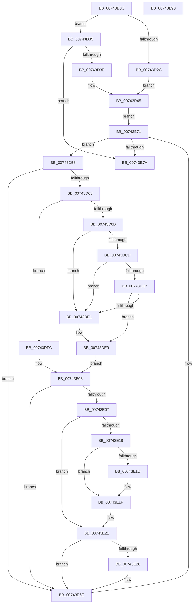

# PiDrvDbSetupNodes

- RVA: `0x00743D0C`–`0x00743E91` (길이 `389` bytes)
- VA: `0x0000000140743D0C`
- 실행 섹션: `PAGE`
- PDB 이름 있음: `예`; PDB Function 태그: `아니요`
- unwind 정보 RVA: `0x000C93B0`
- 디코드: `98`개 명령, `389/389` bytes 표시
- 미해석 바이트: `0` (있으면 어셈블리에 `.byte`로 보존)

> 이 문서는 커널 이미지의 기계어와 PDB 기호를 분석해 생성했습니다. 4번과 5번은 함수 원형과 자료형을 바이너리 사용 방식에서 추정한 C 해석이며 원본 소스 복구 결과는 아닙니다.

## 1. Dependencies

- 직접 호출 지점: **3**; 고유 호출 대상: **3**
- 직접 호출자로 확인된 함수: **1**
- RIP 상대 이미지 참조: **6**

### Outgoing calls
- `0x00743DC2` → [PnpGetObjectProperty](../8E/PnpGetObjectProperty_function_008E2180.md) (function, `0x008E2180`)
- `0x00743E0D` → [PiDrvDbSetupNodeHive](PiDrvDbSetupNodeHive_function_00743884.md) (function, `0x00743884`)
- `0x00743E65` → [PnpSetObjectProperty](../8F/PnpSetObjectProperty_function_008F66E8.md) (function, `0x008F66E8`)

### Direct callers
- [PiDrvDbInit](PiDrvDbInit_function_0074130C.md) at `0x007413C5`
- [PiDrvDbInit](PiDrvDbInit_function_0074130C.md) at `0x007413D1`

### Static image references
- `0x00743D2C` → RVA `0x00AFF500` (` ?? ::NNGAKEGL::`string'`; read)
- `0x00743D3E` → RVA `0x00AFF430` (` ?? ::NNGAKEGL::`string'`; read)
- `0x00743D45` → RVA `0x00F8A870` (`.data`; read)
- `0x00743D8A` → RVA `0x00E66398` (`.data`; read)
- `0x00743DB0` → RVA `0x000235F8` (`.rdata`; read)
- `0x00743E2B` → RVA `0x00022BC8` (`.rdata`; read)

## 2. Other-region calls and transfers

- 다른 실행 섹션으로 향하는 call: **0**
- 별도 외부 분기/꼬리 이동을 확인하지 못했습니다.

## 3. Assembly (complete function range)

```asm
00743D0C  48 8B C4                        mov rax, rsp
00743D0F  48 89 58 18                     mov qword ptr [rax + 0x18], rbx
00743D13  55                              push rbp
00743D14  56                              push rsi
00743D15  57                              push rdi
00743D16  41 55                           push r13
00743D18  41 56                           push r14
00743D1A  48 83 EC 60                     sub rsp, 0x60
00743D1E  33 FF                           xor edi, edi
00743D20  8B E9                           mov ebp, ecx
00743D22  21 78 08                        and dword ptr [rax + 8], edi
00743D25  21 78 10                        and dword ptr [rax + 0x10], edi
00743D28  85 C9                           test ecx, ecx
00743D2A  75 09                           jne 0x140743d35
00743D2C  4C 8D 35 CD B7 3B 00            lea r14, [rip + 0x3bb7cd]
00743D33  EB 10                           jmp 0x140743d45
00743D35  83 FD 02                        cmp ebp, 2
00743D38  0F 85 3C 01 00 00               jne 0x140743e7a
00743D3E  4C 8D 35 EB B6 3B 00            lea r14, [rip + 0x3bb6eb]
00743D45  48 8B 1D 24 6B 84 00            mov rbx, qword ptr [rip + 0x846b24]
00743D4C  4C 8D 2D 1D 6B 84 00            lea r13, [rip + 0x846b1d]
00743D53  E9 19 01 00 00                  jmp 0x140743e71
00743D58  8B 43 40                        mov eax, dword ptr [rbx + 0x40]
00743D5B  A8 04                           test al, 4
00743D5D  0F 85 0B 01 00 00               jne 0x140743e6e
00743D63  85 ED                           test ebp, ebp
00743D65  0F 85 91 00 00 00               jne 0x140743dfc
00743D6B  21 6C 24 50                     and dword ptr [rsp + 0x50], ebp
00743D6F  48 8D 84 24 98 00 00 00         lea rax, [rsp + 0x98]
00743D77  4C 8B 4B 48                     mov r9, qword ptr [rbx + 0x48]
00743D7B  48 8D B3 EC 01 00 00            lea rsi, [rbx + 0x1ec]
00743D82  48 8B 53 18                     mov rdx, qword ptr [rbx + 0x18]
00743D86  44 8D 45 07                     lea r8d, [rbp + 7]
00743D8A  48 8B 0D 07 26 72 00            mov rcx, qword ptr [rip + 0x722607]
00743D91  48 89 44 24 48                  mov qword ptr [rsp + 0x48], rax
00743D96  48 8D 84 24 90 00 00 00         lea rax, [rsp + 0x90]
00743D9E  C7 44 24 40 04 00 00 00         mov dword ptr [rsp + 0x40], 4
00743DA6  48 89 74 24 38                  mov qword ptr [rsp + 0x38], rsi
00743DAB  48 89 44 24 30                  mov qword ptr [rsp + 0x30], rax
00743DB0  48 8D 05 41 F8 8D FF            lea rax, [rip - 0x7207bf]
00743DB7  48 89 44 24 28                  mov qword ptr [rsp + 0x28], rax
00743DBC  48 83 64 24 20 00               and qword ptr [rsp + 0x20], 0
00743DC2  E8 B9 E3 19 00                  call 0x1408e2180
00743DC7  8B F8                           mov edi, eax
00743DC9  85 C0                           test eax, eax
00743DCB  78 14                           js 0x140743de1
00743DCD  83 BC 24 90 00 00 00 07         cmp dword ptr [rsp + 0x90], 7
00743DD5  75 0A                           jne 0x140743de1
00743DD7  83 BC 24 98 00 00 00 04         cmp dword ptr [rsp + 0x98], 4
00743DDF  74 08                           je 0x140743de9
00743DE1  C7 06 33 00 00 00               mov dword ptr [rsi], 0x33
00743DE7  33 FF                           xor edi, edi
00743DE9  48 8D B3 F0 01 00 00            lea rsi, [rbx + 0x1f0]
00743DF0  83 26 00                        and dword ptr [rsi], 0
00743DF3  83 4B 40 20                     or dword ptr [rbx + 0x40], 0x20
00743DF7  8B 43 40                        mov eax, dword ptr [rbx + 0x40]
00743DFA  EB 07                           jmp 0x140743e03
00743DFC  48 8D B3 F0 01 00 00            lea rsi, [rbx + 0x1f0]
00743E03  A8 20                           test al, 0x20
00743E05  74 67                           je 0x140743e6e
00743E07  49 8B D6                        mov rdx, r14
00743E0A  48 8B CB                        mov rcx, rbx
00743E0D  E8 72 FA FF FF                  call 0x140743884
00743E12  8B F8                           mov edi, eax
00743E14  85 C0                           test eax, eax
00743E16  79 09                           jns 0x140743e21
00743E18  83 3E 00                        cmp dword ptr [rsi], 0
00743E1B  7C 02                           jl 0x140743e1f
00743E1D  89 06                           mov dword ptr [rsi], eax
00743E1F  33 FF                           xor edi, edi
00743E21  83 FD 02                        cmp ebp, 2
00743E24  75 48                           jne 0x140743e6e
00743E26  83 64 24 48 00                  and dword ptr [rsp + 0x48], 0
00743E2B  48 8D 05 96 ED 8D FF            lea rax, [rip - 0x72126a]
00743E32  4C 8B 4B 48                     mov r9, qword ptr [rbx + 0x48]
00743E36  44 8D 45 05                     lea r8d, [rbp + 5]
00743E3A  48 8B 53 18                     mov rdx, qword ptr [rbx + 0x18]
00743E3E  48 8B 0D 53 25 72 00            mov rcx, qword ptr [rip + 0x722553]
00743E45  C7 44 24 40 04 00 00 00         mov dword ptr [rsp + 0x40], 4
00743E4D  48 89 74 24 38                  mov qword ptr [rsp + 0x38], rsi
00743E52  C7 44 24 30 18 00 00 00         mov dword ptr [rsp + 0x30], 0x18
00743E5A  48 89 44 24 28                  mov qword ptr [rsp + 0x28], rax
00743E5F  48 83 64 24 20 00               and qword ptr [rsp + 0x20], 0
00743E65  E8 7E 28 1B 00                  call 0x1408f66e8
00743E6A  83 63 40 DF                     and dword ptr [rbx + 0x40], 0xffffffdf
00743E6E  48 8B 1B                        mov rbx, qword ptr [rbx]
00743E71  49 3B DD                        cmp rbx, r13
00743E74  0F 85 DE FE FF FF               jne 0x140743d58
00743E7A  48 8B 9C 24 A0 00 00 00         mov rbx, qword ptr [rsp + 0xa0]
00743E82  8B C7                           mov eax, edi
00743E84  48 83 C4 60                     add rsp, 0x60
00743E88  41 5E                           pop r14
00743E8A  41 5D                           pop r13
00743E8C  5F                              pop rdi
00743E8D  5E                              pop rsi
00743E8E  5D                              pop rbp
00743E8F  C3                              ret
00743E90  CC                              int3
```

## 4. C-style interpretation (structured pseudocode)

```c
__int64 __fastcall PiDrvDbSetupNodes(int a1)
{
    __int64 result;
    __int64 v_rdi;
    __int64 v_rsp;
    unsigned int v_stack_m38;
    unsigned __int64 v_stack_m40;
    unsigned int v_stack_m48;
    unsigned __int64 v_stack_m50;
    unsigned __int64 v_stack_m58;
    unsigned __int64 v_stack_m60;
    unsigned __int64 v_stack_m68;
    unsigned __int64 v_stack_p10;
    unsigned __int64 v_stack_p18;
    unsigned __int64 v_stack_p8;

    *(unsigned __int64 *)(v_rsp + 24) = v_rbx;
    v_rsp = (v_rsp) - (96);
    v_rdi = 0;
    if (a1 != 0) goto loc_00743D35;
    goto loc_00743D45;
loc_00743D35:
    if (((unsigned int)((unsigned int)(a1))) != 2) goto loc_00743E7A;
loc_00743D45:
    goto loc_00743E71;
loc_00743D58:
    if ((((unsigned __int8)((unsigned int)(*(unsigned int *)(*(unsigned __int64 *)(v_rip + 8678180) + 64)))) & (4)) != 0) goto loc_00743E6E;
    if ((unsigned int)((unsigned int)(a1)) != 0) goto loc_00743DFC;
    v_stack_m40 = v_stack_p10;
    v_stack_m48 = 4;
    v_stack_m50 = *(unsigned __int64 *)(v_rip + 8678180) + 492;
    v_stack_m58 = v_stack_p8;
    v_stack_m60 = v_rip - 7473087;
    result = PnpGetObjectProperty(*(unsigned __int64 *)(v_rip + 7480839), *(unsigned __int64 *)(*(unsigned __int64 *)(v_rip + 8678180) + 24), (unsigned int)(a1) + 7, *(unsigned __int64 *)(*(unsigned __int64 *)(v_rip + 8678180) + 72));
    if (sign_flag) goto loc_00743DE1;
    if (v_stack_p8 != 7) goto loc_00743DE1;
    v_rdi = (unsigned int)((unsigned int)(result));
    if (v_stack_p10 != 4) {
        *(unsigned int *)(*(unsigned __int64 *)(v_rip + 8678180) + 492) = 51;
        v_rdi = 0;
    }
    goto loc_00743E03;
loc_00743DFC:
loc_00743E03:
    if ((((unsigned __int8)((unsigned int)(*(unsigned int *)(*(unsigned __int64 *)(v_rip + 8678180) + 64)))) & (32)) == 0) goto loc_00743E6E;
    result = PiDrvDbSetupNodeHive(*(unsigned __int64 *)(v_rip + 8678180), v_rip + 3913451, (unsigned int)(a1) + 7, *(unsigned __int64 *)(*(unsigned __int64 *)(v_rip + 8678180) + 72));
    if (!sign_flag) goto loc_00743E21;
    if ((*(unsigned int *)(*(unsigned __int64 *)(v_rip + 8678180) + 496)) >= 0) {
        *(unsigned int *)(*(unsigned __int64 *)(v_rip + 8678180) + 496) = (unsigned int)(result);
    }
    v_rdi = 0;
loc_00743E21:
    if (((unsigned int)((unsigned int)(a1))) == 2) {
        result = v_rip - 7475818;
        a4 = *(unsigned __int64 *)(*(unsigned __int64 *)(v_rip + 8678180) + 72);
        a3 = (unsigned int)(a1) + 5;
        a2 = *(unsigned __int64 *)(*(unsigned __int64 *)(v_rip + 8678180) + 24);
        a1 = *(unsigned __int64 *)(v_rip + 7480659);
        v_stack_m48 = 4;
        v_stack_m50 = *(unsigned __int64 *)(v_rip + 8678180) + 496;
        v_stack_m58 = 24;
        v_stack_m60 = result;
        result = PnpSetObjectProperty(a1, a2, a3, a4);
    }
loc_00743E71:
    if ((*(unsigned __int64 *)(*(unsigned __int64 *)(v_rip + 8678180))) != (v_rip + 8678173)) goto loc_00743D58;
loc_00743E7A:
    v_rsp = (v_rsp) + (96);
    return 0;
}
```

## 5. (Beta) C Style

```c
int64_t PiDrvDbSetupNodes(int32_t Arg1)
{
    int64_t result;
    int64_t local_rdi;
    int64_t local_rsp;
    uint32_t v_stack_m38;
    uint64_t v_stack_m40;
    uint32_t v_stack_m48;
    uint64_t v_stack_m50;
    uint64_t v_stack_m58;
    uint64_t v_stack_m60;
    uint64_t v_stack_m68;
    uint64_t v_stack_p10;
    uint64_t v_stack_p18;
    uint64_t v_stack_p8;

    *(uint64_t *)(local_rsp + 0x18) = local_rbx;
    local_rsp = (local_rsp) - (96);
    local_rdi = 0;
    if (Arg1 != 0) goto loc_00743D35;
    goto loc_00743D45;
loc_00743D35:
    if (((uint32_t)((uint32_t)(Arg1))) != 2) goto loc_00743E7A;
loc_00743D45:
    goto loc_00743E71;
loc_00743D58:
    if ((((uint8_t)((uint32_t)(*(uint32_t *)(*(uint64_t *)(v_rip + 0x846B24) + 0x40)))) & (4)) != 0) goto loc_00743E6E;
    if ((uint32_t)((uint32_t)(Arg1)) != 0) goto loc_00743DFC;
    v_stack_m40 = v_stack_p10;
    v_stack_m48 = 4;
    v_stack_m50 = *(uint64_t *)(v_rip + 0x846B24) + 492;
    v_stack_m58 = v_stack_p8;
    v_stack_m60 = v_rip - 7473087;
    result = PnpGetObjectProperty(*(uint64_t *)(v_rip + 0x722607), *(uint64_t *)(*(uint64_t *)(v_rip + 0x846B24) + 0x18), (uint32_t)(Arg1) + 7, *(uint64_t *)(*(uint64_t *)(v_rip + 0x846B24) + 0x48));
    if (sign_flag) goto loc_00743DE1;
    if (v_stack_p8 != 7) goto loc_00743DE1;
    local_rdi = (uint32_t)((uint32_t)(result));
    if (v_stack_p10 != 4) {
        *(uint32_t *)(*(uint64_t *)(v_rip + 0x846B24) + 0x1EC) = 51;
        local_rdi = 0;
    }
    goto loc_00743E03;
loc_00743DFC:
loc_00743E03:
    if ((((uint8_t)((uint32_t)(*(uint32_t *)(*(uint64_t *)(v_rip + 0x846B24) + 0x40)))) & (32)) == 0) goto loc_00743E6E;
    result = PiDrvDbSetupNodeHive(*(uint64_t *)(v_rip + 0x846B24), v_rip + 3913451, (uint32_t)(Arg1) + 7, *(uint64_t *)(*(uint64_t *)(v_rip + 0x846B24) + 0x48));
    if (!sign_flag) goto loc_00743E21;
    if ((*(uint32_t *)(*(uint64_t *)(v_rip + 0x846B24) + 0x1F0)) >= 0) {
        *(uint32_t *)(*(uint64_t *)(v_rip + 0x846B24) + 0x1F0) = (uint32_t)(result);
    }
    local_rdi = 0;
loc_00743E21:
    if (((uint32_t)((uint32_t)(Arg1))) == 2) {
        result = v_rip - 7475818;
        a4 = *(uint64_t *)(*(uint64_t *)(v_rip + 0x846B24) + 0x48);
        a3 = (uint32_t)(Arg1) + 5;
        a2 = *(uint64_t *)(*(uint64_t *)(v_rip + 0x846B24) + 0x18);
        Arg1 = *(uint64_t *)(v_rip + 0x722553);
        v_stack_m48 = 4;
        v_stack_m50 = *(uint64_t *)(v_rip + 0x846B24) + 496;
        v_stack_m58 = 24;
        v_stack_m60 = result;
        result = PnpSetObjectProperty(Arg1, a2, a3, a4);
    }
loc_00743E71:
    if ((*(uint64_t *)(*(uint64_t *)(v_rip + 0x846B24))) != (v_rip + 8678173)) goto loc_00743D58;
loc_00743E7A:
    local_rsp = (local_rsp) + (96);
    return 0;
}
```

## 6. Execution-region graph

[열기: 2D/3D 그래프와 함수 탐색 컨트롤 패널](../../../control-panel.html?section=page&rva=0x00743D0C&view=graph)

- 2D 그래프는 위에서 아래로 흐르고, 3D 그래프는 빈 공간을 드래그해 회전합니다. Shift+드래그는 이동, 휠은 확대·축소, 함수 노드 선택은 대상 보고서 이동입니다.

### Static fallback


