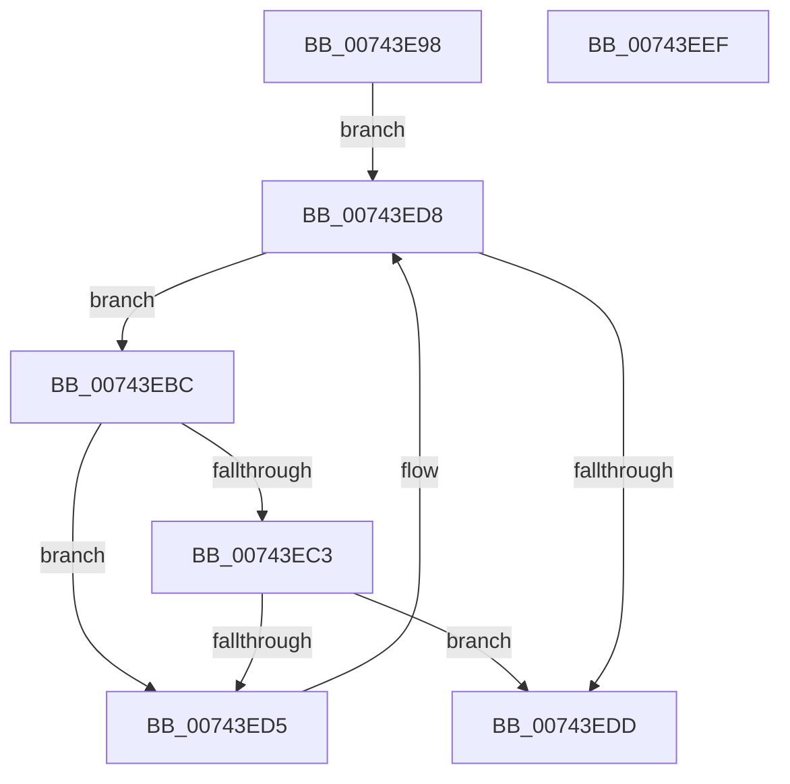

# PiDrvDbSuspendNodes

- RVA: `0x00743E98`–`0x00743EF0` (길이 `88` bytes)
- VA: `0x0000000140743E98`
- 실행 섹션: `PAGE`
- PDB 이름 있음: `예`; PDB Function 태그: `아니요`
- unwind 정보 RVA: `0x00060BC4`
- 디코드: `28`개 명령, `88/88` bytes 표시
- 미해석 바이트: `0` (있으면 어셈블리에 `.byte`로 보존)

> 이 문서는 커널 이미지의 기계어와 PDB 기호를 분석해 생성했습니다. 4번과 5번은 함수 원형과 자료형을 바이너리 사용 방식에서 추정한 C 해석이며 원본 소스 복구 결과는 아닙니다.

## 1. Dependencies

- 직접 호출 지점: **1**; 고유 호출 대상: **1**
- 직접 호출자로 확인된 함수: **1**
- RIP 상대 이미지 참조: **1**

### Outgoing calls
- `0x00743ECA` → [DrvDbSuspendDatabase](../83/DrvDbSuspendDatabase_function_0083522C.md) (function, `0x0083522C`)

### Direct callers
- [PiDrvDbInit](PiDrvDbInit_function_0074130C.md) at `0x007413B8`
- [PiDrvDbInit](PiDrvDbInit_function_0074130C.md) at `0x007413DE`

### Static image references
- `0x00743EA7` → RVA `0x00F8A870` (`.data`; read)

## 2. Other-region calls and transfers

- 다른 실행 섹션으로 향하는 call: **0**
- 별도 외부 분기/꼬리 이동을 확인하지 못했습니다.

## 3. Assembly (complete function range)

```asm
00743E98  48 89 5C 24 08                  mov qword ptr [rsp + 8], rbx
00743E9D  48 89 74 24 10                  mov qword ptr [rsp + 0x10], rsi
00743EA2  57                              push rdi
00743EA3  48 83 EC 20                     sub rsp, 0x20
00743EA7  48 8B 1D C2 69 84 00            mov rbx, qword ptr [rip + 0x8469c2]
00743EAE  48 8D 35 BB 69 84 00            lea rsi, [rip + 0x8469bb]
00743EB5  40 8A F9                        mov dil, cl
00743EB8  33 D2                           xor edx, edx
00743EBA  EB 1C                           jmp 0x140743ed8
00743EBC  8B 43 40                        mov eax, dword ptr [rbx + 0x40]
00743EBF  A8 02                           test al, 2
00743EC1  75 12                           jne 0x140743ed5
00743EC3  48 8B 53 18                     mov rdx, qword ptr [rbx + 0x18]
00743EC7  44 8A C7                        mov r8b, dil
00743ECA  E8 5D 13 0F 00                  call 0x14083522c
00743ECF  8B D0                           mov edx, eax
00743ED1  85 C0                           test eax, eax
00743ED3  78 08                           js 0x140743edd
00743ED5  48 8B 1B                        mov rbx, qword ptr [rbx]
00743ED8  48 3B DE                        cmp rbx, rsi
00743EDB  75 DF                           jne 0x140743ebc
00743EDD  48 8B 5C 24 30                  mov rbx, qword ptr [rsp + 0x30]
00743EE2  8B C2                           mov eax, edx
00743EE4  48 8B 74 24 38                  mov rsi, qword ptr [rsp + 0x38]
00743EE9  48 83 C4 20                     add rsp, 0x20
00743EED  5F                              pop rdi
00743EEE  C3                              ret
00743EEF  CC                              int3
```

## 4. C-style interpretation (structured pseudocode)

```c
__int64 __fastcall PiDrvDbSuspendNodes(unsigned __int8 a1, int a2)
{
    __int64 result;
    __int64 v_rsp;
    unsigned __int64 v_stack_p10;
    unsigned __int64 v_stack_p8;

    v_stack_p8 = v_rbx;
    v_stack_p10 = v_rsi;
    v_rsp = (v_rsp) - (32);
    a2 = 0;
    goto loc_00743ED8;
loc_00743EBC:
    if ((((unsigned __int8)((unsigned int)(*(unsigned int *)(*(unsigned __int64 *)(v_rip + 8677826) + 64)))) & (2)) != 0) goto loc_00743ED5;
    result = DrvDbSuspendDatabase(a1, *(unsigned __int64 *)(*(unsigned __int64 *)(v_rip + 8677826) + 24), a1, a4);
    if (sign_flag) goto loc_00743EDD;
loc_00743ED5:
loc_00743ED8:
    if ((*(unsigned __int64 *)(*(unsigned __int64 *)(v_rip + 8677826))) != (v_rip + 8677819)) goto loc_00743EBC;
loc_00743EDD:
    v_rsp = (v_rsp) + (32);
    return (unsigned int)((unsigned int)((unsigned int)((unsigned int)(result))));
}
```

## 5. (Beta) C Style

```c
int64_t PiDrvDbSuspendNodes(uint8_t Arg1, int32_t Arg2)
{
    int64_t result;
    int64_t local_rsp;
    uint64_t v_stack_p10;
    uint64_t v_stack_p8;

    v_stack_p8 = local_rbx;
    v_stack_p10 = local_rsi;
    local_rsp = (local_rsp) - (32);
    Arg2 = 0;
    goto loc_00743ED8;
loc_00743EBC:
    if ((((uint8_t)((uint32_t)(*(uint32_t *)(*(uint64_t *)(v_rip + 0x8469C2) + 0x40)))) & (2)) != 0) goto loc_00743ED5;
    result = DrvDbSuspendDatabase(Arg1, *(uint64_t *)(*(uint64_t *)(v_rip + 0x8469C2) + 0x18), Arg1, a4);
    if (sign_flag) goto loc_00743EDD;
loc_00743ED5:
loc_00743ED8:
    if ((*(uint64_t *)(*(uint64_t *)(v_rip + 0x8469C2))) != (v_rip + 8677819)) goto loc_00743EBC;
loc_00743EDD:
    local_rsp = (local_rsp) + (32);
    return (uint32_t)((uint32_t)((uint32_t)((uint32_t)(result))));
}
```

## 6. Execution-region graph

[열기: 2D/3D 그래프와 함수 탐색 컨트롤 패널](../../../control-panel.html?section=page&rva=0x00743E98&view=graph)

- 2D 그래프는 위에서 아래로 흐르고, 3D 그래프는 빈 공간을 드래그해 회전합니다. Shift+드래그는 이동, 휠은 확대·축소, 함수 노드 선택은 대상 보고서 이동입니다.

### Static fallback


