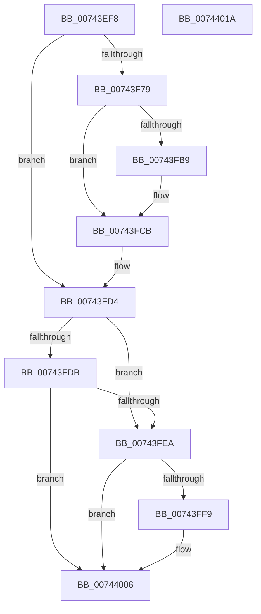

# PiDrvDbUnregisterNode

- RVA: `0x00743EF8`–`0x0074401B` (길이 `291` bytes)
- VA: `0x0000000140743EF8`
- 실행 섹션: `PAGE`
- PDB 이름 있음: `예`; PDB Function 태그: `아니요`
- unwind 정보 RVA: `0x000C93E8`
- 디코드: `77`개 명령, `291/291` bytes 표시
- 미해석 바이트: `0` (있으면 어셈블리에 `.byte`로 보존)

> 이 문서는 커널 이미지의 기계어와 PDB 기호를 분석해 생성했습니다. 4번과 5번은 함수 원형과 자료형을 바이너리 사용 방식에서 추정한 C 해석이며 원본 소스 복구 결과는 아닙니다.

## 1. Dependencies

- 직접 호출 지점: **10**; 고유 호출 대상: **9**
- 직접 호출자로 확인된 함수: **1**
- RIP 상대 이미지 참조: **2**

### Outgoing calls
- `0x00743F32` → [RtlInitUnicodeString](../../text/42/RtlInitUnicodeString_function_0042A780.md) (function, `0x0042A780`)
- `0x00743F70` → [ZwOpenDirectoryObject](../../text/6A/ZwOpenDirectoryObject_function_006ADBD0.md) (function, `0x006ADBD0`)
- `0x00743FB0` → [ZwOpenSymbolicLinkObject](../../text/6A/ZwOpenSymbolicLinkObject_function_006AF7F0.md) (function, `0x006AF7F0`)
- `0x00743FBD` → [ZwMakeTemporaryObject](../../text/6A/ZwMakeTemporaryObject_function_006AF3F0.md) (function, `0x006AF3F0`)
- `0x00743FC6` → [ZwClose](../../text/6A/ZwClose_function_006AD2B0.md) (function, `0x006AD2B0`)
- `0x00743FCF` → [ZwClose](../../text/6A/ZwClose_function_006AD2B0.md) (function, `0x006AD2B0`)
- `0x00743FDF` → [PnpCtxUnregisterMachineNode](../82/PnpCtxUnregisterMachineNode_function_008294DC.md) (function, `0x008294DC`)
- `0x00743FEE` → [DrvDbUnregisterDatabase](../83/DrvDbUnregisterDatabase_function_008352E0.md) (function, `0x008352E0`)
- `0x00743FFC` → [PiDrvDbDestroyNode](PiDrvDbDestroyNode_function_00740DF8.md) (function, `0x00740DF8`)
- `0x00744001` → [PiDrvDbDriverStoreNodesUpdated](PiDrvDbDriverStoreNodesUpdated_function_00740E9C.md) (function, `0x00740E9C`)

### Direct callers
- [PiDrvDbUnmountNode](../70/PiDrvDbUnmountNode_function_00704D48.md) at `0x00704D91`

### Static image references
- `0x00743F0C` → RVA `0x00B002E0` (` ?? ::NNGAKEGL::`string'`; read)
- `0x00743F51` → RVA `0x00FD9AA8` (`PAGEDATA`; read)

## 2. Other-region calls and transfers

- 다른 실행 섹션으로 향하는 call: **6**
  - `0x00743F32` → [RtlInitUnicodeString](../../text/42/RtlInitUnicodeString_function_0042A780.md) (`PAGE` → `.text`)
  - `0x00743F70` → [ZwOpenDirectoryObject](../../text/6A/ZwOpenDirectoryObject_function_006ADBD0.md) (`PAGE` → `.text`)
  - `0x00743FB0` → [ZwOpenSymbolicLinkObject](../../text/6A/ZwOpenSymbolicLinkObject_function_006AF7F0.md) (`PAGE` → `.text`)
  - `0x00743FBD` → [ZwMakeTemporaryObject](../../text/6A/ZwMakeTemporaryObject_function_006AF3F0.md) (`PAGE` → `.text`)
  - `0x00743FC6` → [ZwClose](../../text/6A/ZwClose_function_006AD2B0.md) (`PAGE` → `.text`)
  - `0x00743FCF` → [ZwClose](../../text/6A/ZwClose_function_006AD2B0.md) (`PAGE` → `.text`)
- 별도 외부 분기/꼬리 이동을 확인하지 못했습니다.

## 3. Assembly (complete function range)

```asm
00743EF8  48 89 5C 24 18                  mov qword ptr [rsp + 0x18], rbx
00743EFD  48 89 7C 24 20                  mov qword ptr [rsp + 0x20], rdi
00743F02  55                              push rbp
00743F03  48 8B EC                        mov rbp, rsp
00743F06  48 83 EC 60                     sub rsp, 0x60
00743F0A  33 C0                           xor eax, eax
00743F0C  48 8D 15 CD C3 3B 00            lea rdx, [rip + 0x3bc3cd]
00743F13  21 45 EC                        and dword ptr [rbp - 0x14], eax
00743F16  48 8B F9                        mov rdi, rcx
00743F19  48 21 45 18                     and qword ptr [rbp + 0x18], rax
00743F1D  48 8D 4D C0                     lea rcx, [rbp - 0x40]
00743F21  48 21 45 10                     and qword ptr [rbp + 0x10], rax
00743F25  0F 57 C0                        xorps xmm0, xmm0
00743F28  89 45 D4                        mov dword ptr [rbp - 0x2c], eax
00743F2B  21 45 D4                        and dword ptr [rbp - 0x2c], eax
00743F2E  0F 11 45 C0                     movups xmmword ptr [rbp - 0x40], xmm0
00743F32  E8 49 68 CE FF                  call 0x14042a780
00743F37  48 83 65 D8 00                  and qword ptr [rbp - 0x28], 0
00743F3C  48 8D 45 C0                     lea rax, [rbp - 0x40]
00743F40  48 83 65 F8 00                  and qword ptr [rbp - 8], 0
00743F45  4C 8D 45 D0                     lea r8, [rbp - 0x30]
00743F49  48 89 45 E0                     mov qword ptr [rbp - 0x20], rax
00743F4D  48 8D 4D 18                     lea rcx, [rbp + 0x18]
00743F51  48 8B 05 50 5B 89 00            mov rax, qword ptr [rip + 0x895b50]
00743F58  BB 30 00 00 00                  mov ebx, 0x30
00743F5D  BA 0F 00 0F 00                  mov edx, 0xf000f
00743F62  48 89 45 F0                     mov qword ptr [rbp - 0x10], rax
00743F66  89 5D D0                        mov dword ptr [rbp - 0x30], ebx
00743F69  C7 45 E8 50 02 00 00            mov dword ptr [rbp - 0x18], 0x250
00743F70  E8 5B 9C F6 FF                  call 0x1406adbd0
00743F75  85 C0                           test eax, eax
00743F77  78 5B                           js 0x140743fd4
00743F79  48 8B 45 18                     mov rax, qword ptr [rbp + 0x18]
00743F7D  4C 8D 45 D0                     lea r8, [rbp - 0x30]
00743F81  48 83 65 F8 00                  and qword ptr [rbp - 8], 0
00743F86  48 8D 4D 10                     lea rcx, [rbp + 0x10]
00743F8A  48 89 45 D8                     mov qword ptr [rbp - 0x28], rax
00743F8E  BA 00 00 01 00                  mov edx, 0x10000
00743F93  48 8D 47 10                     lea rax, [rdi + 0x10]
00743F97  89 5D D0                        mov dword ptr [rbp - 0x30], ebx
00743F9A  48 89 45 E0                     mov qword ptr [rbp - 0x20], rax
00743F9E  48 8B 05 03 5B 89 00            mov rax, qword ptr [rip + 0x895b03]
00743FA5  48 89 45 F0                     mov qword ptr [rbp - 0x10], rax
00743FA9  C7 45 E8 40 02 00 00            mov dword ptr [rbp - 0x18], 0x240
00743FB0  E8 3B B8 F6 FF                  call 0x1406af7f0
00743FB5  85 C0                           test eax, eax
00743FB7  78 12                           js 0x140743fcb
00743FB9  48 8B 4D 10                     mov rcx, qword ptr [rbp + 0x10]
00743FBD  E8 2E B4 F6 FF                  call 0x1406af3f0
00743FC2  48 8B 4D 10                     mov rcx, qword ptr [rbp + 0x10]
00743FC6  E8 E5 92 F6 FF                  call 0x1406ad2b0
00743FCB  48 8B 4D 18                     mov rcx, qword ptr [rbp + 0x18]
00743FCF  E8 DC 92 F6 FF                  call 0x1406ad2b0
00743FD4  8B 47 40                        mov eax, dword ptr [rdi + 0x40]
00743FD7  A8 08                           test al, 8
00743FD9  74 0F                           je 0x140743fea
00743FDB  48 8B 57 18                     mov rdx, qword ptr [rdi + 0x18]
00743FDF  E8 F8 54 0E 00                  call 0x1408294dc
00743FE4  8B D8                           mov ebx, eax
00743FE6  85 C0                           test eax, eax
00743FE8  78 1C                           js 0x140744006
00743FEA  48 8B 57 18                     mov rdx, qword ptr [rdi + 0x18]
00743FEE  E8 ED 12 0F 00                  call 0x1408352e0
00743FF3  8B D8                           mov ebx, eax
00743FF5  85 C0                           test eax, eax
00743FF7  78 0D                           js 0x140744006
00743FF9  48 8B CF                        mov rcx, rdi
00743FFC  E8 F7 CD FF FF                  call 0x140740df8
00744001  E8 96 CE FF FF                  call 0x140740e9c
00744006  4C 8D 5C 24 60                  lea r11, [rsp + 0x60]
0074400B  8B C3                           mov eax, ebx
0074400D  49 8B 5B 20                     mov rbx, qword ptr [r11 + 0x20]
00744011  49 8B 7B 28                     mov rdi, qword ptr [r11 + 0x28]
00744015  49 8B E3                        mov rsp, r11
00744018  5D                              pop rbp
00744019  C3                              ret
0074401A  CC                              int3
```

## 4. C-style interpretation (structured pseudocode)

```c
__int64 __fastcall PiDrvDbUnregisterNode(__int64 a1)
{
    __int64 result;
    __int64 v_rsp;
    unsigned __int64 v_stack_m10;
    unsigned __int64 v_stack_m18;
    unsigned int v_stack_m1C;
    unsigned int v_stack_m20;
    unsigned __int64 v_stack_m28;
    unsigned __int64 v_stack_m30;
    unsigned int v_stack_m34;
    unsigned __int64 v_stack_m38;
    unsigned __int64 v_stack_m48;
    unsigned __int64 v_stack_m8;
    unsigned __int64 v_stack_p10;
    unsigned __int64 v_stack_p18;
    unsigned __int64 v_stack_p20;
    unsigned __int64 v_stack_p8;

    v_stack_p18 = v_rbx;
    v_stack_p20 = v_rdi;
    v_rsp = (v_rsp) - (96);
    result = 0;
    v_stack_m34 = 0;
    v_stack_m48 = v_xmm0;
    result = RtlInitUnicodeString(v_stack_m48, v_rip + 3916749, a3, a4);
    v_stack_m28 = v_stack_m48;
    v_stack_m18 = *(unsigned __int64 *)(v_rip + 9001808);
    v_stack_m38 = 48;
    v_stack_m20 = 592;
    result = ZwOpenDirectoryObject(v_stack_p10, (unsigned int)(0xF000FULL), v_stack_m38, a4);
    if (sign_flag) goto loc_00743FD4;
    v_stack_m30 = v_stack_p10;
    v_stack_m38 = 48;
    v_stack_m28 = a1 + 16;
    v_stack_m18 = *(unsigned __int64 *)(v_rip + 9001731);
    v_stack_m20 = 576;
    result = ZwOpenSymbolicLinkObject(v_stack_p8, (unsigned int)(0x10000ULL), v_stack_m38, a4);
    if (!(sign_flag)) {
        a1 = v_stack_p8;
        result = ZwMakeTemporaryObject(a1, (unsigned int)(0x10000ULL), v_stack_m38, a4);
        a1 = v_stack_p8;
        result = ZwClose(a1, (unsigned int)(0x10000ULL), v_stack_m38, a4);
    }
    result = ZwClose(v_stack_p10, (unsigned int)(0x10000ULL), v_stack_m38, a4);
loc_00743FD4:
    if ((((unsigned __int8)((unsigned int)(*(unsigned int *)(a1 + 64)))) & (8)) == 0) goto loc_00743FEA;
    result = PnpCtxUnregisterMachineNode(v_stack_p10, *(unsigned __int64 *)(a1 + 24), v_stack_m38, a4);
    if (sign_flag) goto loc_00744006;
loc_00743FEA:
    result = DrvDbUnregisterDatabase(v_stack_p10, *(unsigned __int64 *)(a1 + 24), v_stack_m38, a4);
    if (!(sign_flag)) {
        a1 = a1;
        result = PiDrvDbDestroyNode(a1, *(unsigned __int64 *)(a1 + 24), v_stack_m38, a4);
        result = PiDrvDbDriverStoreNodesUpdated(a1, *(unsigned __int64 *)(a1 + 24), v_stack_m38, a4);
    }
    return (unsigned int)((unsigned int)((unsigned int)((unsigned int)(result))));
}
```

## 5. (Beta) C Style

```c
int64_t PiDrvDbUnregisterNode(void *Arg1)
{
    uint8_t *arg1 = (uint8_t *)Arg1;

    int64_t result;
    int64_t local_rsp;
    uint64_t v_stack_m10;
    uint64_t v_stack_m18;
    uint32_t v_stack_m1C;
    uint32_t v_stack_m20;
    uint64_t v_stack_m28;
    uint64_t v_stack_m30;
    uint32_t v_stack_m34;
    uint64_t v_stack_m38;
    uint64_t v_stack_m48;
    uint64_t v_stack_m8;
    uint64_t v_stack_p10;
    uint64_t v_stack_p18;
    uint64_t v_stack_p20;
    uint64_t v_stack_p8;

    v_stack_p18 = local_rbx;
    v_stack_p20 = local_rdi;
    local_rsp = (local_rsp) - (96);
    result = 0;
    v_stack_m34 = 0;
    v_stack_m48 = v_xmm0;
    result = RtlInitUnicodeString(v_stack_m48, v_rip + 3916749, a3, a4);
    v_stack_m28 = v_stack_m48;
    v_stack_m18 = *(uint64_t *)(v_rip + 0x895B50);
    v_stack_m38 = 48;
    v_stack_m20 = 592;
    result = ZwOpenDirectoryObject(v_stack_p10, (uint32_t)(0xF000FULL), v_stack_m38, a4);
    if (sign_flag) goto loc_00743FD4;
    v_stack_m30 = v_stack_p10;
    v_stack_m38 = 48;
    v_stack_m28 = Arg1 + 16;
    v_stack_m18 = *(uint64_t *)(v_rip + 0x895B03);
    v_stack_m20 = 576;
    result = ZwOpenSymbolicLinkObject(v_stack_p8, (uint32_t)(0x10000ULL), v_stack_m38, a4);
    if (!(sign_flag)) {
        Arg1 = v_stack_p8;
        result = ZwMakeTemporaryObject(Arg1, (uint32_t)(0x10000ULL), v_stack_m38, a4);
        Arg1 = v_stack_p8;
        result = ZwClose(Arg1, (uint32_t)(0x10000ULL), v_stack_m38, a4);
    }
    result = ZwClose(v_stack_p10, (uint32_t)(0x10000ULL), v_stack_m38, a4);
loc_00743FD4:
    if ((((uint8_t)((uint32_t)(*(uint32_t *)(arg1 + 0x40)))) & (8)) == 0) goto loc_00743FEA;
    result = PnpCtxUnregisterMachineNode(v_stack_p10, *(uint64_t *)(arg1 + 0x18), v_stack_m38, a4);
    if (sign_flag) goto loc_00744006;
loc_00743FEA:
    result = DrvDbUnregisterDatabase(v_stack_p10, *(uint64_t *)(arg1 + 0x18), v_stack_m38, a4);
    if (!(sign_flag)) {
        Arg1 = Arg1;
        result = PiDrvDbDestroyNode(Arg1, *(uint64_t *)(arg1 + 0x18), v_stack_m38, a4);
        result = PiDrvDbDriverStoreNodesUpdated(Arg1, *(uint64_t *)(arg1 + 0x18), v_stack_m38, a4);
    }
    return (uint32_t)((uint32_t)((uint32_t)((uint32_t)(result))));
}
```

### 관측된 메모리 오프셋

구조체 형식이 확인되지 않은 접근은 인자 기준의 오프셋으로만 기록했습니다.

| 기준 인자 | 오프셋 표현 | 폭 (bit) | 접근 |
|---|---:|---:|---|
| `Arg1` | `+ 0x10` | `64` | `R` |
| `Arg1` | `+ 0x18` | `64` | `R` |
| `Arg1` | `+ 0x40` | `32` | `R` |

## 6. Execution-region graph

[열기: 2D/3D 그래프와 함수 탐색 컨트롤 패널](../../../control-panel.html?section=page&rva=0x00743EF8&view=graph)

- 2D 그래프는 위에서 아래로 흐르고, 3D 그래프는 빈 공간을 드래그해 회전합니다. Shift+드래그는 이동, 휠은 확대·축소, 함수 노드 선택은 대상 보고서 이동입니다.

### Static fallback


