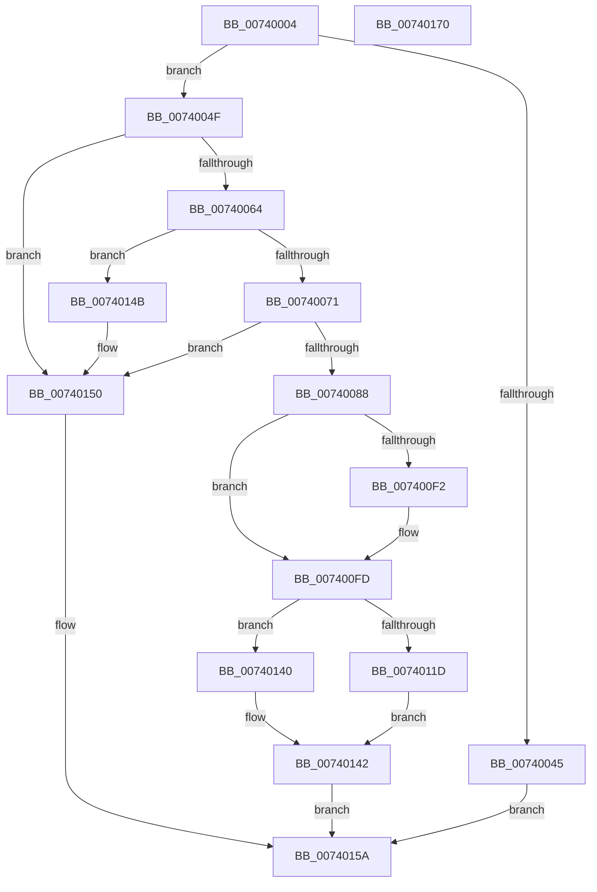

# PiIommuAllocateExtension

- RVA: `0x00740004`–`0x00740171` (길이 `365` bytes)
- VA: `0x0000000140740004`
- 실행 섹션: `PAGE`
- PDB 이름 있음: `예`; PDB Function 태그: `아니요`
- unwind 정보 RVA: `0x000C9264`
- 디코드: `118`개 명령, `365/365` bytes 표시
- 미해석 바이트: `0` (있으면 어셈블리에 `.byte`로 보존)

> 이 문서는 커널 이미지의 기계어와 PDB 기호를 분석해 생성했습니다. 4번과 5번은 함수 원형과 자료형을 바이너리 사용 방식에서 추정한 C 해석이며 원본 소스 복구 결과는 아닙니다.

## 1. Dependencies

- 직접 호출 지점: **6**; 고유 호출 대상: **5**
- 직접 호출자로 확인된 함수: **1**
- RIP 상대 이미지 참조: **1**

### Outgoing calls
- `0x00740038` → [ExAllocatePool2](../../poolcode/B8/ExAllocatePool2_function_00B820F0.md) (function, `0x00B820F0`)
- `0x00740055` → [PipIommuRetrieveDeviceId](PipIommuRetrieveDeviceId_function_00740308.md) (function, `0x00740308`)
- `0x00740079` → [guard_dispatch_icall](../../text/6B/guard_dispatch_icall_function_006BAAD0.md) (function, `0x006BAAD0`)
- `0x007400F8` → [PnpTraceIommuDeviceProperties](../73/PnpTraceIommuDeviceProperties_function_0073CC80.md) (function, `0x0073CC80`)
- `0x00740112` → [guard_dispatch_icall](../../text/6B/guard_dispatch_icall_function_006BAAD0.md) (function, `0x006BAAD0`)
- `0x00740153` → [PiIommuFreeExtension](PiIommuFreeExtension_function_007401D8.md) (function, `0x007401D8`)

### Direct callers
- [PipDmgInitializeIommuExtension](../73/PipDmgInitializeIommuExtension_function_0073C0B8.md) at `0x0073C183`

### Static image references
- `0x007400FD` → RVA `0x00E06D28` (`.data`; read)

## 2. Other-region calls and transfers

- 다른 실행 섹션으로 향하는 call: **3**
  - `0x00740038` → [ExAllocatePool2](../../poolcode/B8/ExAllocatePool2_function_00B820F0.md) (`PAGE` → `POOLCODE`)
  - `0x00740079` → [guard_dispatch_icall](../../text/6B/guard_dispatch_icall_function_006BAAD0.md) (`PAGE` → `.text`)
  - `0x00740112` → [guard_dispatch_icall](../../text/6B/guard_dispatch_icall_function_006BAAD0.md) (`PAGE` → `.text`)
- 별도 외부 분기/꼬리 이동을 확인하지 못했습니다.

## 3. Assembly (complete function range)

```asm
00740004  48 89 5C 24 08                  mov qword ptr [rsp + 8], rbx
00740009  55                              push rbp
0074000A  56                              push rsi
0074000B  57                              push rdi
0074000C  41 56                           push r14
0074000E  41 57                           push r15
00740010  48 8B EC                        mov rbp, rsp
00740013  48 83 EC 20                     sub rsp, 0x20
00740017  83 65 48 00                     and dword ptr [rbp + 0x48], 0
0074001B  4D 8B F8                        mov r15, r8
0074001E  48 8B F2                        mov rsi, rdx
00740021  C6 45 40 00                     mov byte ptr [rbp + 0x40], 0
00740025  4C 8B F1                        mov r14, rcx
00740028  BA 18 00 00 00                  mov edx, 0x18
0074002D  B9 00 01 00 00                  mov ecx, 0x100
00740032  41 B8 50 6E 70 64               mov r8d, 0x64706e50
00740038  E8 B3 20 44 00                  call 0x140b820f0
0074003D  48 8B D8                        mov rbx, rax
00740040  48 85 C0                        test rax, rax
00740043  75 0A                           jne 0x14074004f
00740045  BF 9A 00 00 C0                  mov edi, 0xc000009a
0074004A  E9 0B 01 00 00                  jmp 0x14074015a
0074004F  48 8B D3                        mov rdx, rbx
00740052  48 8B CE                        mov rcx, rsi
00740055  E8 AE 02 00 00                  call 0x140740308
0074005A  8B F8                           mov edi, eax
0074005C  85 C0                           test eax, eax
0074005E  0F 88 EC 00 00 00               js 0x140740150
00740064  48 8B 46 38                     mov rax, qword ptr [rsi + 0x38]
00740068  48 85 C0                        test rax, rax
0074006B  0F 84 DA 00 00 00               je 0x14074014b
00740071  48 8B 4E 08                     mov rcx, qword ptr [rsi + 8]
00740075  48 8D 55 48                     lea rdx, [rbp + 0x48]
00740079  E8 52 AA F7 FF                  call 0x1406baad0
0074007E  8B F8                           mov edi, eax
00740080  85 C0                           test eax, eax
00740082  0F 88 C8 00 00 00               js 0x140740150
00740088  8B 4D 48                        mov ecx, dword ptr [rbp + 0x48]
0074008B  41 B0 01                        mov r8b, 1
0074008E  8A 43 10                        mov al, byte ptr [rbx + 0x10]
00740091  D1 E9                           shr ecx, 1
00740093  24 F7                           and al, 0xf7
00740095  41 22 C8                        and cl, r8b
00740098  C0 E1 03                        shl cl, 3
0074009B  0A C8                           or cl, al
0074009D  88 4B 10                        mov byte ptr [rbx + 0x10], cl
007400A0  80 E1 FB                        and cl, 0xfb
007400A3  8A 45 48                        mov al, byte ptr [rbp + 0x48]
007400A6  41 22 C0                        and al, r8b
007400A9  C0 E0 02                        shl al, 2
007400AC  0A C1                           or al, cl
007400AE  88 43 10                        mov byte ptr [rbx + 0x10], al
007400B1  24 DF                           and al, 0xdf
007400B3  8B 4D 48                        mov ecx, dword ptr [rbp + 0x48]
007400B6  C1 E9 03                        shr ecx, 3
007400B9  41 22 C8                        and cl, r8b
007400BC  C0 E1 05                        shl cl, 5
007400BF  0A C8                           or cl, al
007400C1  8A 43 11                        mov al, byte ptr [rbx + 0x11]
007400C4  88 4B 10                        mov byte ptr [rbx + 0x10], cl
007400C7  24 FD                           and al, 0xfd
007400C9  8B 55 48                        mov edx, dword ptr [rbp + 0x48]
007400CC  80 E1 EF                        and cl, 0xef
007400CF  C1 EA 02                        shr edx, 2
007400D2  41 22 D0                        and dl, r8b
007400D5  C0 E2 04                        shl dl, 4
007400D8  0A D1                           or dl, cl
007400DA  88 53 10                        mov byte ptr [rbx + 0x10], dl
007400DD  8B 4D 48                        mov ecx, dword ptr [rbp + 0x48]
007400E0  C1 E9 04                        shr ecx, 4
007400E3  41 22 C8                        and cl, r8b
007400E6  02 C9                           add cl, cl
007400E8  0A C8                           or cl, al
007400EA  88 4B 11                        mov byte ptr [rbx + 0x11], cl
007400ED  F6 C2 24                        test dl, 0x24
007400F0  74 0B                           je 0x1407400fd
007400F2  8B 55 48                        mov edx, dword ptr [rbp + 0x48]
007400F5  49 8B CE                        mov rcx, r14
007400F8  E8 83 CB FF FF                  call 0x14073cc80
007400FD  48 8B 05 24 6C 6C 00            mov rax, qword ptr [rip + 0x6c6c24]
00740104  48 8D 55 40                     lea rdx, [rbp + 0x40]
00740108  48 8B 0B                        mov rcx, qword ptr [rbx]
0074010B  48 8B 80 98 00 00 00            mov rax, qword ptr [rax + 0x98]
00740112  E8 B9 A9 F7 FF                  call 0x1406baad0
00740117  8B F8                           mov edi, eax
00740119  85 C0                           test eax, eax
0074011B  78 23                           js 0x140740140
0074011D  8A 4D 40                        mov cl, byte ptr [rbp + 0x40]
00740120  8A 43 10                        mov al, byte ptr [rbx + 0x10]
00740123  80 E1 02                        and cl, 2
00740126  24 BF                           and al, 0xbf
00740128  C0 E1 05                        shl cl, 5
0074012B  0A C8                           or cl, al
0074012D  88 4B 10                        mov byte ptr [rbx + 0x10], cl
00740130  80 E1 7F                        and cl, 0x7f
00740133  8A 45 40                        mov al, byte ptr [rbp + 0x40]
00740136  C0 E0 07                        shl al, 7
00740139  0A C8                           or cl, al
0074013B  88 4B 10                        mov byte ptr [rbx + 0x10], cl
0074013E  EB 02                           jmp 0x140740142
00740140  33 FF                           xor edi, edi
00740142  C7 43 14 02 00 00 00            mov dword ptr [rbx + 0x14], 2
00740149  EB 0F                           jmp 0x14074015a
0074014B  BF BB 00 00 C0                  mov edi, 0xc00000bb
00740150  48 8B CB                        mov rcx, rbx
00740153  E8 80 00 00 00                  call 0x1407401d8
00740158  33 DB                           xor ebx, ebx
0074015A  49 89 1F                        mov qword ptr [r15], rbx
0074015D  8B C7                           mov eax, edi
0074015F  48 8B 5C 24 50                  mov rbx, qword ptr [rsp + 0x50]
00740164  48 83 C4 20                     add rsp, 0x20
00740168  41 5F                           pop r15
0074016A  41 5E                           pop r14
0074016C  5F                              pop rdi
0074016D  5E                              pop rsi
0074016E  5D                              pop rbp
0074016F  C3                              ret
00740170  CC                              int3
```

## 4. C-style interpretation (structured pseudocode)

```c
__int64 __fastcall PiIommuAllocateExtension(__int64 a1, __int64 a2, __int64 a3)
{
    __int64 result;
    __int64 v_rbx;
    __int64 v_rdi;
    __int64 v_rsp;
    unsigned __int8 v_stack_p18;
    unsigned int v_stack_p20;
    unsigned __int64 v_stack_p8;

    v_stack_p8 = v_rbx;
    v_rsp = (v_rsp) - (32);
    v_stack_p18 = 0;
    result = ExAllocatePool2(256, 24, (unsigned int)(0x64706E50ULL), a4);
    if (result != 0) goto loc_0074004F;
    goto loc_0074015A;
loc_0074004F:
    result = PipIommuRetrieveDeviceId(a2, result, (unsigned int)(0x64706E50ULL), a4);
    if (sign_flag) goto loc_00740150;
    if (*(unsigned __int64 *)(a2 + 56) == 0) goto loc_0074014B;
    result = guard_dispatch_icall(*(unsigned __int64 *)(a2 + 8), v_stack_p20, (unsigned int)(0x64706E50ULL), a4);
    if (sign_flag) goto loc_00740150;
    a1 = (unsigned int)(((unsigned int)(v_stack_p20)) >> (1));
    result = (unsigned __int8)((*(unsigned __int8 *)(result + 16)) & (247));
    a1 = (unsigned __int8)((a1) & (1));
    a1 = (unsigned __int8)((a1) << (3));
    a1 = (unsigned __int8)((a1) | ((unsigned __int8)(result)));
    *(unsigned __int8 *)(result + 16) = (unsigned __int8)(a1);
    a1 = (unsigned __int8)((a1) & (251));
    result = (unsigned __int8)((v_stack_p20) & (1));
    result = (unsigned __int8)((result) << (2));
    result = (unsigned __int8)((result) | ((unsigned __int8)(a1)));
    *(unsigned __int8 *)(result + 16) = (unsigned __int8)(result);
    result = (unsigned __int8)((result) & (223));
    a1 = (unsigned int)(((unsigned int)(v_stack_p20)) >> (3));
    a1 = (unsigned __int8)((a1) & (1));
    a1 = (unsigned __int8)((a1) << (5));
    a1 = (unsigned __int8)((a1) | ((unsigned __int8)(result)));
    *(unsigned __int8 *)(result + 16) = (unsigned __int8)(a1);
    result = (unsigned __int8)((*(unsigned __int8 *)(result + 17)) & (253));
    a1 = (unsigned __int8)((a1) & (239));
    a2 = (unsigned int)(((unsigned int)(v_stack_p20)) >> (2));
    a2 = (unsigned __int8)((a2) & (1));
    a2 = (unsigned __int8)((a2) << (4));
    a2 = (unsigned __int8)((a2) | ((unsigned __int8)(a1)));
    *(unsigned __int8 *)(result + 16) = (unsigned __int8)(a2);
    a1 = (unsigned int)(((unsigned int)(v_stack_p20)) >> (4));
    a1 = (unsigned __int8)((a1) & (1));
    a1 = (unsigned __int8)((a1) + ((unsigned __int8)(a1)));
    a1 = (unsigned __int8)((a1) | ((unsigned __int8)(result)));
    *(unsigned __int8 *)(result + 17) = (unsigned __int8)(a1);
    if ((((unsigned __int8)(a2)) & (36)) != 0) {
        a2 = v_stack_p20;
        a1 = a1;
        result = PnpTraceIommuDeviceProperties(a1, a2, 1, a4);
    }
    result = guard_dispatch_icall(*(unsigned __int64 *)(result), v_stack_p18, 1, a4);
    if (sign_flag) goto loc_00740140;
    a1 = (unsigned __int8)((v_stack_p18) & (2));
    result = (unsigned __int8)((*(unsigned __int8 *)(result + 16)) & (191));
    a1 = (unsigned __int8)((a1) << (5));
    a1 = (unsigned __int8)((a1) | ((unsigned __int8)(result)));
    *(unsigned __int8 *)(result + 16) = (unsigned __int8)(a1);
    a1 = (unsigned __int8)((a1) & (127));
    result = (unsigned __int8)((v_stack_p18) << (7));
    a1 = (unsigned __int8)((a1) | ((unsigned __int8)(result)));
    *(unsigned __int8 *)(result + 16) = (unsigned __int8)(a1);
    goto loc_00740142;
loc_00740140:
    v_rdi = 0;
loc_00740142:
    *(unsigned int *)(result + 20) = 2;
    goto loc_0074015A;
loc_0074014B:
loc_00740150:
    result = PiIommuFreeExtension(result, v_stack_p18, 1, a4);
    v_rbx = 0;
loc_0074015A:
    *(unsigned __int64 *)(a3) = 0;
    v_rsp = (v_rsp) + (32);
    return (unsigned int)((unsigned int)((unsigned int)(0xC00000BBULL)));
}
```

## 5. (Beta) C Style

```c
int64_t PiIommuAllocateExtension(int64_t Arg1, void *Arg2, void *Arg3)
{
    uint8_t *arg2 = (uint8_t *)Arg2;
    uint8_t *arg3 = (uint8_t *)Arg3;

    int64_t result;
    int64_t local_rbx;
    int64_t local_rdi;
    int64_t local_rsp;
    uint8_t v_stack_p18;
    uint32_t v_stack_p20;
    uint64_t v_stack_p8;

    v_stack_p8 = local_rbx;
    local_rsp = (local_rsp) - (32);
    v_stack_p18 = 0;
    result = ExAllocatePool2(256, 24, (uint32_t)(0x64706E50ULL), a4);
    if (result != 0) goto loc_0074004F;
    goto loc_0074015A;
loc_0074004F:
    result = PipIommuRetrieveDeviceId(Arg2, result, (uint32_t)(0x64706E50ULL), a4);
    if (sign_flag) goto loc_00740150;
    if (*(uint64_t *)(arg2 + 0x38) == 0) goto loc_0074014B;
    result = guard_dispatch_icall(*(uint64_t *)(arg2 + 0x8), v_stack_p20, (uint32_t)(0x64706E50ULL), a4);
    if (sign_flag) goto loc_00740150;
    Arg1 = (uint32_t)(((uint32_t)(v_stack_p20)) >> (1));
    result = (uint8_t)((*(uint8_t *)(result + 0x10)) & (247));
    Arg1 = (uint8_t)((Arg1) & (1));
    Arg1 = (uint8_t)((Arg1) << (3));
    Arg1 = (uint8_t)((Arg1) | ((uint8_t)(result)));
    *(uint8_t *)(result + 0x10) = (uint8_t)(Arg1);
    Arg1 = (uint8_t)((Arg1) & (251));
    result = (uint8_t)((v_stack_p20) & (1));
    result = (uint8_t)((result) << (2));
    result = (uint8_t)((result) | ((uint8_t)(Arg1)));
    *(uint8_t *)(result + 0x10) = (uint8_t)(result);
    result = (uint8_t)((result) & (223));
    Arg1 = (uint32_t)(((uint32_t)(v_stack_p20)) >> (3));
    Arg1 = (uint8_t)((Arg1) & (1));
    Arg1 = (uint8_t)((Arg1) << (5));
    Arg1 = (uint8_t)((Arg1) | ((uint8_t)(result)));
    *(uint8_t *)(result + 0x10) = (uint8_t)(Arg1);
    result = (uint8_t)((*(uint8_t *)(result + 0x11)) & (253));
    Arg1 = (uint8_t)((Arg1) & (239));
    Arg2 = (uint32_t)(((uint32_t)(v_stack_p20)) >> (2));
    Arg2 = (uint8_t)((Arg2) & (1));
    Arg2 = (uint8_t)((Arg2) << (4));
    Arg2 = (uint8_t)((Arg2) | ((uint8_t)(Arg1)));
    *(uint8_t *)(result + 0x10) = (uint8_t)(Arg2);
    Arg1 = (uint32_t)(((uint32_t)(v_stack_p20)) >> (4));
    Arg1 = (uint8_t)((Arg1) & (1));
    Arg1 = (uint8_t)((Arg1) + ((uint8_t)(Arg1)));
    Arg1 = (uint8_t)((Arg1) | ((uint8_t)(result)));
    *(uint8_t *)(result + 0x11) = (uint8_t)(Arg1);
    if ((((uint8_t)(Arg2)) & (36)) != 0) {
        Arg2 = v_stack_p20;
        Arg1 = Arg1;
        result = PnpTraceIommuDeviceProperties(Arg1, Arg2, 1, a4);
    }
    result = guard_dispatch_icall(*(uint64_t *)(result), v_stack_p18, 1, a4);
    if (sign_flag) goto loc_00740140;
    Arg1 = (uint8_t)((v_stack_p18) & (2));
    result = (uint8_t)((*(uint8_t *)(result + 0x10)) & (191));
    Arg1 = (uint8_t)((Arg1) << (5));
    Arg1 = (uint8_t)((Arg1) | ((uint8_t)(result)));
    *(uint8_t *)(result + 0x10) = (uint8_t)(Arg1);
    Arg1 = (uint8_t)((Arg1) & (127));
    result = (uint8_t)((v_stack_p18) << (7));
    Arg1 = (uint8_t)((Arg1) | ((uint8_t)(result)));
    *(uint8_t *)(result + 0x10) = (uint8_t)(Arg1);
    goto loc_00740142;
loc_00740140:
    local_rdi = 0;
loc_00740142:
    *(uint32_t *)(result + 0x14) = 2;
    goto loc_0074015A;
loc_0074014B:
loc_00740150:
    result = PiIommuFreeExtension(result, v_stack_p18, 1, a4);
    local_rbx = 0;
loc_0074015A:
    *(uint64_t *)(arg3) = 0;
    local_rsp = (local_rsp) + (32);
    return (uint32_t)((uint32_t)((uint32_t)(0xC00000BBULL)));
}
```

### 관측된 메모리 오프셋

구조체 형식이 확인되지 않은 접근은 인자 기준의 오프셋으로만 기록했습니다.

| 기준 인자 | 오프셋 표현 | 폭 (bit) | 접근 |
|---|---:|---:|---|
| `Arg2` | `+ 0x8` | `64` | `R` |
| `Arg2` | `+ 0x38` | `64` | `R` |
| `Arg3` | `+ 0x0` | `64` | `W` |

## 6. Execution-region graph

[열기: 2D/3D 그래프와 함수 탐색 컨트롤 패널](../../../control-panel.html?section=page&rva=0x00740004&view=graph)

- 2D 그래프는 위에서 아래로 흐르고, 3D 그래프는 빈 공간을 드래그해 회전합니다. Shift+드래그는 이동, 휠은 확대·축소, 함수 노드 선택은 대상 보고서 이동입니다.

### Static fallback


