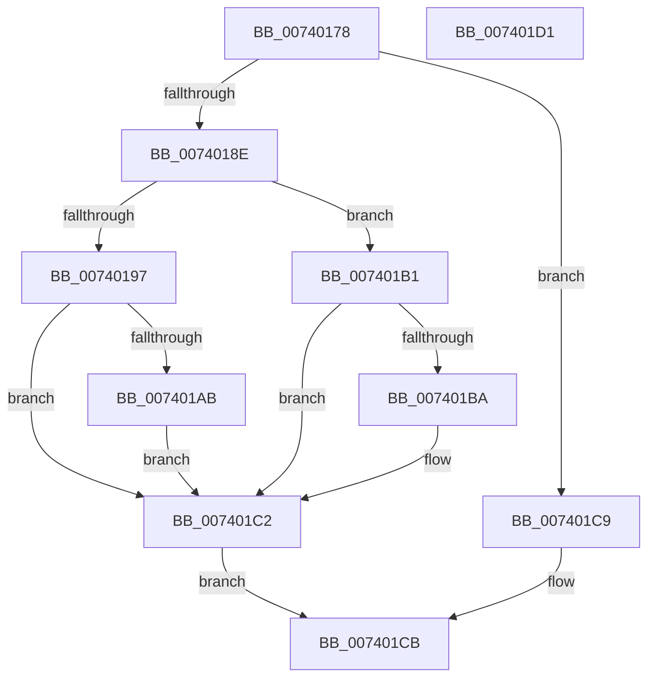

# PiIommuBlockDevice

- RVA: `0x00740178`–`0x007401D2` (길이 `90` bytes)
- VA: `0x0000000140740178`
- 실행 섹션: `PAGE`
- PDB 이름 있음: `예`; PDB Function 태그: `아니요`
- unwind 정보 RVA: `0x0005CF00`
- 디코드: `28`개 명령, `90/90` bytes 표시
- 미해석 바이트: `0` (있으면 어셈블리에 `.byte`로 보존)

> 이 문서는 커널 이미지의 기계어와 PDB 기호를 분석해 생성했습니다. 4번과 5번은 함수 원형과 자료형을 바이너리 사용 방식에서 추정한 C 해석이며 원본 소스 복구 결과는 아닙니다.

## 1. Dependencies

- 직접 호출 지점: **1**; 고유 호출 대상: **1**
- 직접 호출자로 확인된 함수: **3**
- RIP 상대 이미지 참조: **3**

### Outgoing calls
- `0x007401A2` → [guard_dispatch_icall](../../text/6B/guard_dispatch_icall_function_006BAAD0.md) (function, `0x006BAAD0`)

### Direct callers
- [PnpIommuBlockUnblockDevice](PnpIommuBlockUnblockDevice_function_00740408.md) at `0x00740487`
- [sub_00B347A2](../B3/Unknown_function_00B347A2.md) at `0x00B347B1`
- [sub_00B49BD6](../B4/Unknown_function_00B49BD6.md) at `0x00B49BE2`

### Static image references
- `0x0074018E` → RVA `0x00F8A9A8` (`.data`; read)
- `0x00740197` → RVA `0x00E00C20` (`.data`; read)
- `0x007401B1` → RVA `0x00F8B408` (`.data`; read)

## 2. Other-region calls and transfers

- 다른 실행 섹션으로 향하는 call: **1**
  - `0x007401A2` → [guard_dispatch_icall](../../text/6B/guard_dispatch_icall_function_006BAAD0.md) (`PAGE` → `.text`)
- 별도 외부 분기/꼬리 이동을 확인하지 못했습니다.

## 3. Assembly (complete function range)

```asm
00740178  40 53                           push rbx
0074017A  48 83 EC 20                     sub rsp, 0x20
0074017E  48 8B D9                        mov rbx, rcx
00740181  B8 01 00 00 C0                  mov eax, 0xc0000001
00740186  8A 49 10                        mov cl, byte ptr [rcx + 0x10]
00740189  F6 C1 02                        test cl, 2
0074018C  74 3B                           je 0x1407401c9
0074018E  80 3D 13 A8 84 00 00            cmp byte ptr [rip + 0x84a813], 0
00740195  74 1A                           je 0x1407401b1
00740197  48 8B 05 82 0A 6C 00            mov rax, qword ptr [rip + 0x6c0a82]
0074019E  48 8B 4B 08                     mov rcx, qword ptr [rbx + 8]
007401A2  E8 29 A9 F7 FF                  call 0x1406baad0
007401A7  85 C0                           test eax, eax
007401A9  78 17                           js 0x1407401c2
007401AB  80 63 10 FD                     and byte ptr [rbx + 0x10], 0xfd
007401AF  EB 11                           jmp 0x1407401c2
007401B1  80 3D 50 B2 84 00 00            cmp byte ptr [rip + 0x84b250], 0
007401B8  74 08                           je 0x1407401c2
007401BA  80 E1 FD                        and cl, 0xfd
007401BD  88 4B 10                        mov byte ptr [rbx + 0x10], cl
007401C0  33 C0                           xor eax, eax
007401C2  48 83 63 08 00                  and qword ptr [rbx + 8], 0
007401C7  EB 02                           jmp 0x1407401cb
007401C9  33 C0                           xor eax, eax
007401CB  48 83 C4 20                     add rsp, 0x20
007401CF  5B                              pop rbx
007401D0  C3                              ret
007401D1  CC                              int3
```

## 4. C-style interpretation (structured pseudocode)

```c
__int64 __fastcall PiIommuBlockDevice(__int64 a1)
{
    __int64 result;
    __int64 v_rsp;

    v_rsp = (v_rsp) - (32);
    if ((((unsigned __int8)(*(unsigned __int8 *)(a1 + 16))) & (2)) == 0) goto loc_007401C9;
    if ((*(unsigned __int8 *)(v_rip + 8693779)) == 0) goto loc_007401B1;
    result = guard_dispatch_icall(*(unsigned __int64 *)(a1 + 8), a2, a3, a4);
    if (sign_flag) goto loc_007401C2;
    goto loc_007401C2;
loc_007401B1:
    if ((*(unsigned __int8 *)(v_rip + 8696400)) != 0) {
        a1 = (unsigned __int8)((*(unsigned __int64 *)(a1 + 8)) & (253));
        *(unsigned __int8 *)(a1 + 16) = (unsigned __int8)(a1);
        result = 0;
    }
    goto loc_007401CB;
loc_007401C9:
    result = 0;
loc_007401CB:
    v_rsp = (v_rsp) + (32);
    return result;
}
```

## 5. (Beta) C Style

```c
int64_t PiIommuBlockDevice(void *Arg1)
{
    uint8_t *arg1 = (uint8_t *)Arg1;

    int64_t result;
    int64_t local_rsp;

    local_rsp = (local_rsp) - (32);
    if ((((uint8_t)(*(uint8_t *)(arg1 + 0x10))) & (2)) == 0) goto loc_007401C9;
    if ((*(uint8_t *)(v_rip + 0x84A813)) == 0) goto loc_007401B1;
    result = guard_dispatch_icall(*(uint64_t *)(arg1 + 0x8), a2, a3, a4);
    if (sign_flag) goto loc_007401C2;
    goto loc_007401C2;
loc_007401B1:
    if ((*(uint8_t *)(v_rip + 0x84B250)) != 0) {
        Arg1 = (uint8_t)((*(uint64_t *)(arg1 + 0x8)) & (253));
        *(uint8_t *)(arg1 + 0x10) = (uint8_t)(Arg1);
        result = 0;
    }
    goto loc_007401CB;
loc_007401C9:
    result = 0;
loc_007401CB:
    local_rsp = (local_rsp) + (32);
    return result;
}
```

### 관측된 메모리 오프셋

구조체 형식이 확인되지 않은 접근은 인자 기준의 오프셋으로만 기록했습니다.

| 기준 인자 | 오프셋 표현 | 폭 (bit) | 접근 |
|---|---:|---:|---|
| `Arg1` | `+ 0x8` | `64` | `R` |
| `Arg1` | `+ 0x8` | `64` | `R/W` |
| `Arg1` | `+ 0x10` | `8` | `R` |
| `Arg1` | `+ 0x10` | `8` | `R/W` |
| `Arg1` | `+ 0x10` | `8` | `W` |

## 6. Execution-region graph

[열기: 2D/3D 그래프와 함수 탐색 컨트롤 패널](../../../control-panel.html?section=page&rva=0x00740178&view=graph)

- 2D 그래프는 위에서 아래로 흐르고, 3D 그래프는 빈 공간을 드래그해 회전합니다. Shift+드래그는 이동, 휠은 확대·축소, 함수 노드 선택은 대상 보고서 이동입니다.

### Static fallback


