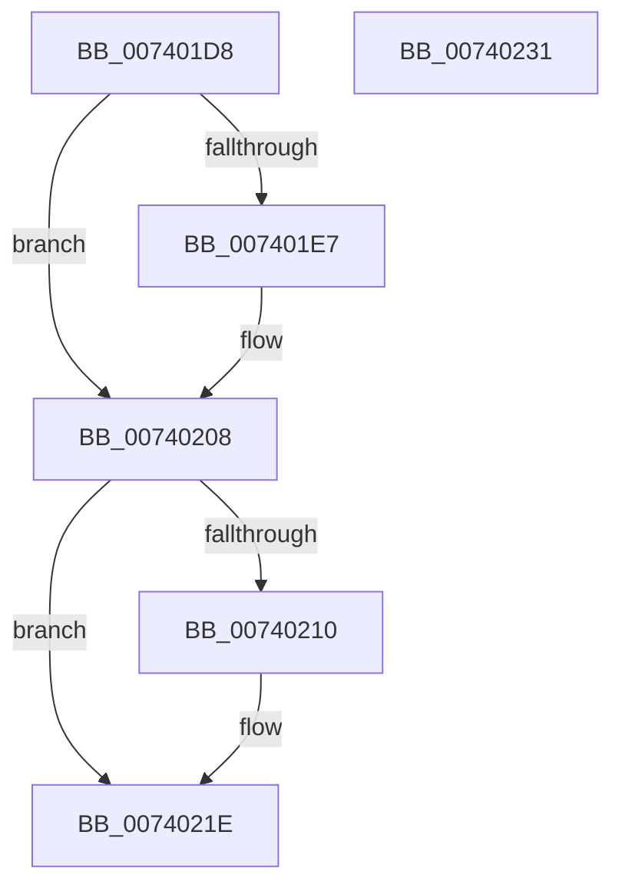

# PiIommuFreeExtension

- RVA: `0x007401D8`–`0x00740232` (길이 `90` bytes)
- VA: `0x00000001407401D8`
- 실행 섹션: `PAGE`
- PDB 이름 있음: `예`; PDB Function 태그: `아니요`
- unwind 정보 RVA: `0x00064C80`
- 디코드: `25`개 명령, `90/90` bytes 표시
- 미해석 바이트: `0` (있으면 어셈블리에 `.byte`로 보존)

> 이 문서는 커널 이미지의 기계어와 PDB 기호를 분석해 생성했습니다. 4번과 5번은 함수 원형과 자료형을 바이너리 사용 방식에서 추정한 C 해석이며 원본 소스 복구 결과는 아닙니다.

## 1. Dependencies

- 직접 호출 지점: **3**; 고유 호출 대상: **2**
- 직접 호출자로 확인된 함수: **2**
- RIP 상대 이미지 참조: **0**

### Outgoing calls
- `0x00740202` → [KeBugCheckEx](../../text/4F/KeBugCheckEx_function_004FD660.md) (function, `0x004FD660`)
- `0x00740215` → [ExFreePoolWithTag](../../poolcode/B8/ExFreePoolWithTag_function_00B82870.md) (function, `0x00B82870`)
- `0x00740226` → [ExFreePoolWithTag](../../poolcode/B8/ExFreePoolWithTag_function_00B82870.md) (function, `0x00B82870`)

### Direct callers
- [PiIommuAllocateExtension](PiIommuAllocateExtension_function_00740004.md) at `0x00740153`
- [PipDmgDestroyIommuExtension](../A2/PipDmgDestroyIommuExtension_function_00A2857C.md) at `0x00A28598`

### Static image references
- 디코드된 RIP-relative 메모리 참조가 없습니다.

## 2. Other-region calls and transfers

- 다른 실행 섹션으로 향하는 call: **3**
  - `0x00740202` → [KeBugCheckEx](../../text/4F/KeBugCheckEx_function_004FD660.md) (`PAGE` → `.text`)
  - `0x00740215` → [ExFreePoolWithTag](../../poolcode/B8/ExFreePoolWithTag_function_00B82870.md) (`PAGE` → `POOLCODE`)
  - `0x00740226` → [ExFreePoolWithTag](../../poolcode/B8/ExFreePoolWithTag_function_00B82870.md) (`PAGE` → `POOLCODE`)
- 별도 외부 분기/꼬리 이동을 확인하지 못했습니다.

## 3. Assembly (complete function range)

```asm
007401D8  40 53                           push rbx
007401DA  48 83 EC 30                     sub rsp, 0x30
007401DE  F6 41 10 02                     test byte ptr [rcx + 0x10], 2
007401E2  48 8B D9                        mov rbx, rcx
007401E5  74 21                           je 0x140740208
007401E7  44 0F B7 49 10                  movzx r9d, word ptr [rcx + 0x10]
007401EC  4C 8B C1                        mov r8, rcx
007401EF  B9 CA 00 00 00                  mov ecx, 0xca
007401F4  48 C7 44 24 20 01 10 00 00      mov qword ptr [rsp + 0x20], 0x1001
007401FD  BA 11 00 00 00                  mov edx, 0x11
00740202  E8 59 D4 DB FF                  call 0x1404fd660
00740207  CC                              int3
00740208  48 8B 09                        mov rcx, qword ptr [rcx]
0074020B  48 85 C9                        test rcx, rcx
0074020E  74 0E                           je 0x14074021e
00740210  BA 50 6E 70 64                  mov edx, 0x64706e50
00740215  E8 56 26 44 00                  call 0x140b82870
0074021A  48 83 23 00                     and qword ptr [rbx], 0
0074021E  BA 50 6E 70 64                  mov edx, 0x64706e50
00740223  48 8B CB                        mov rcx, rbx
00740226  E8 45 26 44 00                  call 0x140b82870
0074022B  48 83 C4 30                     add rsp, 0x30
0074022F  5B                              pop rbx
00740230  C3                              ret
00740231  CC                              int3
```

## 4. C-style interpretation (structured pseudocode)

```c
__int64 __fastcall PiIommuFreeExtension(__int64 a1)
{
    __int64 result;
    __int64 v_rsp;
    unsigned __int64 v_stack_m18;

    v_rsp = (v_rsp) - (48);
    if (((*(unsigned __int8 *)(a1 + 16)) & (2)) != 0) {
        a4 = *(unsigned __int16 *)(a1 + 16);
        a3 = a1;
        a1 = 202;
        v_stack_m18 = 0x1001ULL;
        a2 = 17;
        result = KeBugCheckEx(a1, a2, a3, a4);
    }
    if (*(unsigned __int64 *)(a1) != 0) {
        a2 = 0x64706E50ULL;
        result = ExFreePoolWithTag(*(unsigned __int64 *)(a1), a2, a3, a4);
    }
    result = ExFreePoolWithTag(a1, (unsigned int)(0x64706E50ULL), a3, a4);
    v_rsp = (v_rsp) + (48);
    return result;
}
```

## 5. (Beta) C Style

```c
int64_t PiIommuFreeExtension(void *Arg1)
{
    uint8_t *arg1 = (uint8_t *)Arg1;

    int64_t result;
    int64_t local_rsp;
    uint64_t v_stack_m18;

    local_rsp = (local_rsp) - (48);
    if (((*(uint8_t *)(arg1 + 0x10)) & (2)) != 0) {
        a4 = *(uint16_t *)(arg1 + 0x10);
        a3 = Arg1;
        Arg1 = 202;
        v_stack_m18 = 0x1001ULL;
        a2 = 17;
        result = KeBugCheckEx(Arg1, a2, a3, a4);
    }
    if (*(uint64_t *)(arg1) != 0) {
        a2 = 0x64706E50ULL;
        result = ExFreePoolWithTag(*(uint64_t *)(arg1), a2, a3, a4);
    }
    result = ExFreePoolWithTag(Arg1, (uint32_t)(0x64706E50ULL), a3, a4);
    local_rsp = (local_rsp) + (48);
    return result;
}
```

### 관측된 메모리 오프셋

구조체 형식이 확인되지 않은 접근은 인자 기준의 오프셋으로만 기록했습니다.

| 기준 인자 | 오프셋 표현 | 폭 (bit) | 접근 |
|---|---:|---:|---|
| `Arg1` | `+ 0x0` | `64` | `R/W` |
| `Arg1` | `+ 0x10` | `8` | `R` |
| `Arg1` | `+ 0x10` | `16` | `R` |

## 6. Execution-region graph

[열기: 2D/3D 그래프와 함수 탐색 컨트롤 패널](../../../control-panel.html?section=page&rva=0x007401D8&view=graph)

- 2D 그래프는 위에서 아래로 흐르고, 3D 그래프는 빈 공간을 드래그해 회전합니다. Shift+드래그는 이동, 휠은 확대·축소, 함수 노드 선택은 대상 보고서 이동입니다.

### Static fallback


