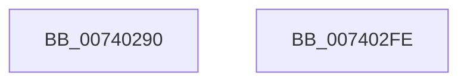

# PiIommuSaveDeviceAtsSettings

- RVA: `0x00740290`–`0x007402FF` (길이 `111` bytes)
- VA: `0x0000000140740290`
- 실행 섹션: `PAGE`
- PDB 이름 있음: `예`; PDB Function 태그: `아니요`
- unwind 정보 RVA: `0x0005CC98`
- 디코드: `26`개 명령, `111/111` bytes 표시
- 미해석 바이트: `0` (있으면 어셈블리에 `.byte`로 보존)

> 이 문서는 커널 이미지의 기계어와 PDB 기호를 분석해 생성했습니다. 4번과 5번은 함수 원형과 자료형을 바이너리 사용 방식에서 추정한 C 해석이며 원본 소스 복구 결과는 아닙니다.

## 1. Dependencies

- 직접 호출 지점: **1**; 고유 호출 대상: **1**
- 직접 호출자로 확인된 함수: **1**
- RIP 상대 이미지 참조: **2**

### Outgoing calls
- `0x007402F4` → [PnpSetObjectProperty](../8F/PnpSetObjectProperty_function_008F66E8.md) (function, `0x008F66E8`)

### Direct callers
- [PiDmaGuardProcessPreAddDevice](../A2/PiDmaGuardProcessPreAddDevice_function_00A27B50.md) at `0x00A27BDB`

### Static image references
- `0x007402AA` → RVA `0x00E66398` (`.data`; read)
- `0x007402DC` → RVA `0x00021050` (`.rdata`; read)

## 2. Other-region calls and transfers

- 다른 실행 섹션으로 향하는 call: **0**
- 별도 외부 분기/꼬리 이동을 확인하지 못했습니다.

## 3. Assembly (complete function range)

```asm
00740290  4C 8B DC                        mov r11, rsp
00740293  48 83 EC 58                     sub rsp, 0x58
00740297  83 64 24 48 00                  and dword ptr [rsp + 0x48], 0
0074029C  4C 8B CA                        mov r9, rdx
0074029F  48 8B 81 D0 02 00 00            mov rax, qword ptr [rcx + 0x2d0]
007402A6  48 8B 51 30                     mov rdx, qword ptr [rcx + 0x30]
007402AA  48 8B 0D E7 60 72 00            mov rcx, qword ptr [rip + 0x7260e7]
007402B1  44 8A 40 10                     mov r8b, byte ptr [rax + 0x10]
007402B5  8A 40 10                        mov al, byte ptr [rax + 0x10]
007402B8  41 80 E0 40                     and r8b, 0x40
007402BC  C0 E8 02                        shr al, 2
007402BF  44 0A C0                        or r8b, al
007402C2  49 8D 43 08                     lea rax, [r11 + 8]
007402C6  41 C0 E8 05                     shr r8b, 5
007402CA  45 88 43 08                     mov byte ptr [r11 + 8], r8b
007402CE  41 B8 01 00 00 00               mov r8d, 1
007402D4  45 89 43 E8                     mov dword ptr [r11 - 0x18], r8d
007402D8  49 89 43 E0                     mov qword ptr [r11 - 0x20], rax
007402DC  48 8D 05 6D 0D 8E FF            lea rax, [rip - 0x71f293]
007402E3  C7 44 24 30 03 10 00 00         mov dword ptr [rsp + 0x30], 0x1003
007402EB  49 89 43 D0                     mov qword ptr [r11 - 0x30], rax
007402EF  49 83 63 C8 00                  and qword ptr [r11 - 0x38], 0
007402F4  E8 EF 63 1B 00                  call 0x1408f66e8
007402F9  48 83 C4 58                     add rsp, 0x58
007402FD  C3                              ret
007402FE  CC                              int3
```

## 4. C-style interpretation (structured pseudocode)

```c
__int64 __fastcall PiIommuSaveDeviceAtsSettings(__int64 a1, __int64 a2)
{
    __int64 result;
    __int64 v_rsp;
    unsigned int v_stack_m10;
    unsigned int v_stack_m28;

    v_rsp = (v_rsp) - (88);
    a3 = (unsigned __int8)((*(unsigned __int8 *)(*(unsigned __int64 *)(a1 + 720) + 16)) & (64));
    result = (unsigned __int8)((*(unsigned __int8 *)(*(unsigned __int64 *)(a1 + 720) + 16)) >> (2));
    a3 = (unsigned __int8)((a3) | ((unsigned __int8)(result)));
    a3 = (unsigned __int8)((a3) >> (5));
    *(unsigned __int8 *)(v_rsp + 8) = (unsigned __int8)(a3);
    *(unsigned int *)(v_rsp - 24) = 1;
    *(unsigned __int64 *)(v_rsp - 32) = v_rsp + 8;
    v_stack_m28 = 0x1003ULL;
    *(unsigned __int64 *)(v_rsp - 48) = v_rip - 7467667;
    result = PnpSetObjectProperty(*(unsigned __int64 *)(v_rip + 7495911), *(unsigned __int64 *)(a1 + 48), 1, a2);
    v_rsp = (v_rsp) + (88);
    return result;
}
```

## 5. (Beta) C Style

```c
int64_t PiIommuSaveDeviceAtsSettings(void *Arg1, int64_t Arg2)
{
    uint8_t *arg1 = (uint8_t *)Arg1;

    int64_t result;
    int64_t local_rsp;
    uint32_t v_stack_m10;
    uint32_t v_stack_m28;

    local_rsp = (local_rsp) - (88);
    a3 = (uint8_t)((*(uint8_t *)(*(uint64_t *)(arg1 + 0x2D0) + 0x10)) & (64));
    result = (uint8_t)((*(uint8_t *)(*(uint64_t *)(arg1 + 0x2D0) + 0x10)) >> (2));
    a3 = (uint8_t)((a3) | ((uint8_t)(result)));
    a3 = (uint8_t)((a3) >> (5));
    *(uint8_t *)(local_rsp + 0x8) = (uint8_t)(a3);
    *(uint32_t *)(local_rsp - 0x18) = 1;
    *(uint64_t *)(local_rsp - 0x20) = local_rsp + 8;
    v_stack_m28 = 0x1003ULL;
    *(uint64_t *)(local_rsp - 0x30) = v_rip - 7467667;
    result = PnpSetObjectProperty(*(uint64_t *)(v_rip + 0x7260E7), *(uint64_t *)(arg1 + 0x30), 1, Arg2);
    local_rsp = (local_rsp) + (88);
    return result;
}
```

### 관측된 메모리 오프셋

구조체 형식이 확인되지 않은 접근은 인자 기준의 오프셋으로만 기록했습니다.

| 기준 인자 | 오프셋 표현 | 폭 (bit) | 접근 |
|---|---:|---:|---|
| `Arg1` | `+ 0x30` | `64` | `R` |
| `Arg1` | `+ 0x2D0` | `64` | `R` |

## 6. Execution-region graph

[열기: 2D/3D 그래프와 함수 탐색 컨트롤 패널](../../../control-panel.html?section=page&rva=0x00740290&view=graph)

- 2D 그래프는 위에서 아래로 흐르고, 3D 그래프는 빈 공간을 드래그해 회전합니다. Shift+드래그는 이동, 휠은 확대·축소, 함수 노드 선택은 대상 보고서 이동입니다.

### Static fallback


