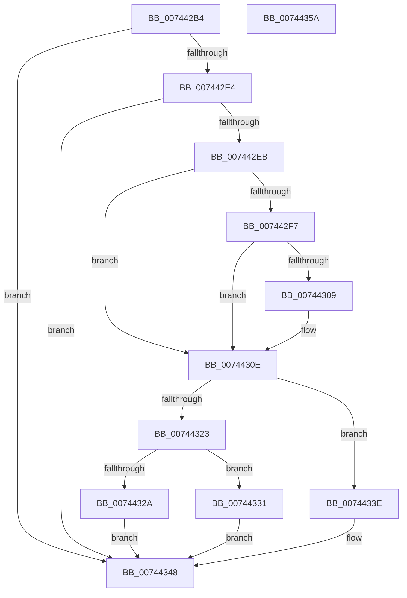

# PiProcessQueryRemoveNoFdo

- RVA: `0x007442B4`–`0x0074435B` (길이 `167` bytes)
- VA: `0x00000001407442B4`
- 실행 섹션: `PAGE`
- PDB 이름 있음: `예`; PDB Function 태그: `아니요`
- unwind 정보 RVA: `0x00060BC4`
- 디코드: `45`개 명령, `167/167` bytes 표시
- 미해석 바이트: `0` (있으면 어셈블리에 `.byte`로 보존)

> 이 문서는 커널 이미지의 기계어와 PDB 기호를 분석해 생성했습니다. 4번과 5번은 함수 원형과 자료형을 바이너리 사용 방식에서 추정한 C 해석이며 원본 소스 복구 결과는 아닙니다.

## 1. Dependencies

- 직접 호출 지점: **5**; 고유 호출 대상: **5**
- 직접 호출자로 확인된 함수: **1**
- RIP 상대 이미지 참조: **0**

### Outgoing calls
- `0x007442C6` → [PiGetTargetDeviceNode](../A0/PiGetTargetDeviceNode_function_00A0506C.md) (function, `0x00A0506C`)
- `0x00744300` → [PipIsProblemReadonly](../72/PipIsProblemReadonly_function_0072DA44.md) (function, `0x0072DA44`)
- `0x00744309` → [PipClearDevNodeProblem](../A2/PipClearDevNodeProblem_function_00A27C8C.md) (function, `0x00A27C8C`)
- `0x0074432A` → [PnpRestartDeviceNode](../72/PnpRestartDeviceNode_function_0072CD60.md) (function, `0x0072CD60`)
- `0x00744337` → [PipSetDevNodeProblem](../8F/PipSetDevNodeProblem_function_008FDE0C.md) (function, `0x008FDE0C`)

### Direct callers
- [PnpProcessQueryRemoveAndEject](../A0/PnpProcessQueryRemoveAndEject_function_00A05170.md) at `0x00A0559C`

### Static image references
- 디코드된 RIP-relative 메모리 참조가 없습니다.

## 2. Other-region calls and transfers

- 다른 실행 섹션으로 향하는 call: **0**
- 별도 외부 분기/꼬리 이동을 확인하지 못했습니다.

## 3. Assembly (complete function range)

```asm
007442B4  48 89 5C 24 08                  mov qword ptr [rsp + 8], rbx
007442B9  48 89 74 24 10                  mov qword ptr [rsp + 0x10], rsi
007442BE  57                              push rdi
007442BF  48 83 EC 20                     sub rsp, 0x20
007442C3  48 8B F1                        mov rsi, rcx
007442C6  E8 A1 0D 2C 00                  call 0x140a0506c
007442CB  48 8B F8                        mov rdi, rax
007442CE  33 DB                           xor ebx, ebx
007442D0  8B 80 2C 01 00 00               mov eax, dword ptr [rax + 0x12c]
007442D6  8D 90 FD FC FF FF               lea edx, [rax - 0x303]
007442DC  F7 C2 EE FF FF FF               test edx, 0xffffffee
007442E2  75 64                           jne 0x140744348
007442E4  3D 13 03 00 00                  cmp eax, 0x313
007442E9  74 5D                           je 0x140744348
007442EB  F7 87 8C 01 00 00 00 60 00 00   test dword ptr [rdi + 0x18c], 0x6000
007442F5  74 17                           je 0x14074430e
007442F7  8B 97 94 01 00 00               mov edx, dword ptr [rdi + 0x194]
007442FD  48 8B CF                        mov rcx, rdi
00744300  E8 3F 97 FE FF                  call 0x14072da44
00744305  85 C0                           test eax, eax
00744307  75 05                           jne 0x14074430e
00744309  E8 7E 39 2E 00                  call 0x140a27c8c
0074430E  8B 8E 98 00 00 00               mov ecx, dword ptr [rsi + 0x98]
00744314  83 E1 02                        and ecx, 2
00744317  F7 87 8C 01 00 00 00 60 00 00   test dword ptr [rdi + 0x18c], 0x6000
00744321  75 1B                           jne 0x14074433e
00744323  85 C9                           test ecx, ecx
00744325  48 8B CF                        mov rcx, rdi
00744328  75 07                           jne 0x140744331
0074432A  E8 31 8A FE FF                  call 0x14072cd60
0074432F  EB 17                           jmp 0x140744348
00744331  8B 56 10                        mov edx, dword ptr [rsi + 0x10]
00744334  45 33 C0                        xor r8d, r8d
00744337  E8 D0 9A 1B 00                  call 0x1408fde0c
0074433C  EB 0A                           jmp 0x140744348
0074433E  85 C9                           test ecx, ecx
00744340  B8 0D 00 00 C0                  mov eax, 0xc000000d
00744345  0F 44 D8                        cmove ebx, eax
00744348  48 8B 74 24 38                  mov rsi, qword ptr [rsp + 0x38]
0074434D  8B C3                           mov eax, ebx
0074434F  48 8B 5C 24 30                  mov rbx, qword ptr [rsp + 0x30]
00744354  48 83 C4 20                     add rsp, 0x20
00744358  5F                              pop rdi
00744359  C3                              ret
0074435A  CC                              int3
```

## 4. C-style interpretation (structured pseudocode)

```c
__int64 __fastcall PiProcessQueryRemoveNoFdo(__int64 a1, __int64 a2, int a3)
{
    __int64 result;
    __int64 v_rbx;
    __int64 v_rsp;
    unsigned __int64 v_stack_p10;
    unsigned __int64 v_stack_p8;

    v_stack_p8 = v_rbx;
    v_stack_p10 = v_rsi;
    v_rsp = (v_rsp) - (32);
    result = PiGetTargetDeviceNode(a1, a2, a3, a4);
    v_rbx = 0;
    if ((((unsigned int)((unsigned int)(*(unsigned int *)(result + 300)) - 771)) & (0xFFFFFFEEULL)) != 0) goto loc_00744348;
    if (((unsigned int)((unsigned int)(*(unsigned int *)(result + 300)))) == 787) goto loc_00744348;
    if (((*(unsigned int *)(result + 396)) & (0x6000ULL)) == 0) goto loc_0074430E;
    result = PipIsProblemReadonly(result, (unsigned int)(*(unsigned int *)(result + 404)), a3, a4);
    if ((unsigned int)(result) == 0) {
        result = PipClearDevNodeProblem(result, (unsigned int)(*(unsigned int *)(result + 404)), a3, a4);
    }
    a1 = (unsigned int)(((unsigned int)(*(unsigned int *)(a1 + 152))) & (2));
    if (((*(unsigned int *)(result + 396)) & (0x6000ULL)) != 0) goto loc_0074433E;
    if ((unsigned int)(a1) != 0) goto loc_00744331;
    result = PnpRestartDeviceNode(result, (unsigned int)(*(unsigned int *)(result + 404)), a3, a4);
    goto loc_00744348;
loc_00744331:
    a3 = 0;
    result = PipSetDevNodeProblem(result, (unsigned int)(*(unsigned int *)(a1 + 16)), a3, a4);
    goto loc_00744348;
loc_0074433E:
    if ((unsigned int)(result) == 0) { v_rbx = (unsigned int)((unsigned int)(0xC000000DULL)); }
loc_00744348:
    v_rsp = (v_rsp) + (32);
    return (unsigned int)((unsigned int)(v_rbx));
}
```

## 5. (Beta) C Style

```c
int64_t PiProcessQueryRemoveNoFdo(void *Arg1, int64_t Arg2, int32_t Arg3)
{
    uint8_t *arg1 = (uint8_t *)Arg1;

    int64_t result;
    int64_t local_rbx;
    int64_t local_rsp;
    uint64_t v_stack_p10;
    uint64_t v_stack_p8;

    v_stack_p8 = local_rbx;
    v_stack_p10 = local_rsi;
    local_rsp = (local_rsp) - (32);
    result = PiGetTargetDeviceNode(Arg1, Arg2, Arg3, a4);
    local_rbx = 0;
    if ((((uint32_t)((uint32_t)(*(uint32_t *)(result + 0x12C)) - 771)) & (0xFFFFFFEEULL)) != 0) goto loc_00744348;
    if (((uint32_t)((uint32_t)(*(uint32_t *)(result + 0x12C)))) == 787) goto loc_00744348;
    if (((*(uint32_t *)(result + 0x18C)) & (0x6000ULL)) == 0) goto loc_0074430E;
    result = PipIsProblemReadonly(result, (uint32_t)(*(uint32_t *)(result + 0x194)), Arg3, a4);
    if ((uint32_t)(result) == 0) {
        result = PipClearDevNodeProblem(result, (uint32_t)(*(uint32_t *)(result + 0x194)), Arg3, a4);
    }
    Arg1 = (uint32_t)(((uint32_t)(*(uint32_t *)(arg1 + 0x98))) & (2));
    if (((*(uint32_t *)(result + 0x18C)) & (0x6000ULL)) != 0) goto loc_0074433E;
    if ((uint32_t)(Arg1) != 0) goto loc_00744331;
    result = PnpRestartDeviceNode(result, (uint32_t)(*(uint32_t *)(result + 0x194)), Arg3, a4);
    goto loc_00744348;
loc_00744331:
    Arg3 = 0;
    result = PipSetDevNodeProblem(result, (uint32_t)(*(uint32_t *)(arg1 + 0x10)), Arg3, a4);
    goto loc_00744348;
loc_0074433E:
    if ((uint32_t)(result) == 0) { local_rbx = (uint32_t)((uint32_t)(0xC000000DULL)); }
loc_00744348:
    local_rsp = (local_rsp) + (32);
    return (uint32_t)((uint32_t)(local_rbx));
}
```

### 관측된 메모리 오프셋

구조체 형식이 확인되지 않은 접근은 인자 기준의 오프셋으로만 기록했습니다.

| 기준 인자 | 오프셋 표현 | 폭 (bit) | 접근 |
|---|---:|---:|---|
| `Arg1` | `+ 0x10` | `32` | `R` |
| `Arg1` | `+ 0x98` | `32` | `R` |

## 6. Execution-region graph

[열기: 2D/3D 그래프와 함수 탐색 컨트롤 패널](../../../control-panel.html?section=page&rva=0x007442B4&view=graph)

- 2D 그래프는 위에서 아래로 흐르고, 3D 그래프는 빈 공간을 드래그해 회전합니다. Shift+드래그는 이동, 휠은 확대·축소, 함수 노드 선택은 대상 보고서 이동입니다.

### Static fallback


