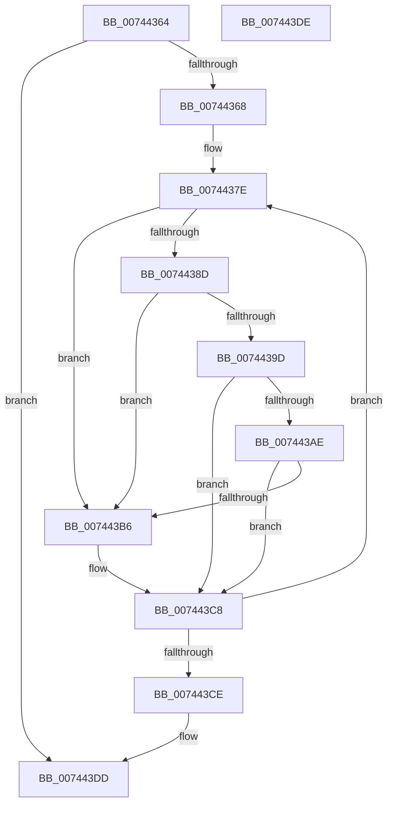

# PiSendTargetDeviceRemoveCanceledNotification

- RVA: `0x00744364`–`0x007443DF` (길이 `123` bytes)
- VA: `0x0000000140744364`
- 실행 섹션: `PAGE`
- PDB 이름 있음: `예`; PDB Function 태그: `아니요`
- unwind 정보 RVA: `0x000C9474`
- 디코드: `38`개 명령, `123/123` bytes 표시
- 미해석 바이트: `0` (있으면 어셈블리에 `.byte`로 보존)

> 이 문서는 커널 이미지의 기계어와 PDB 기호를 분석해 생성했습니다. 4번과 5번은 함수 원형과 자료형을 바이너리 사용 방식에서 추정한 C 해석이며 원본 소스 복구 결과는 아닙니다.

## 1. Dependencies

- 직접 호출 지점: **1**; 고유 호출 대상: **1**
- 직접 호출자로 확인된 함수: **2**
- RIP 상대 이미지 참조: **1**

### Outgoing calls
- `0x007443C3` → [PnpNotifyTargetDeviceChange](../95/PnpNotifyTargetDeviceChange_function_00954790.md) (function, `0x00954790`)

### Direct callers
- [PipSendTargetDeviceQueryRemoveNotification](../A0/PipSendTargetDeviceQueryRemoveNotification_function_00A04518.md) at `0x00A045F2`
- [PiProcessQueryAndCancelRemoval](../A0/PiProcessQueryAndCancelRemoval_function_00A05A58.md) at `0x00A05BAE`

### Static image references
- `0x007443B9` → RVA `0x00012320` (`.rdata`; read)

## 2. Other-region calls and transfers

- 다른 실행 섹션으로 향하는 call: **0**
- 별도 외부 분기/꼬리 이동을 확인하지 못했습니다.

## 3. Assembly (complete function range)

```asm
00744364  85 D2                           test edx, edx
00744366  74 75                           je 0x1407443dd
00744368  48 89 5C 24 08                  mov qword ptr [rsp + 8], rbx
0074436D  48 89 74 24 10                  mov qword ptr [rsp + 0x10], rsi
00744372  57                              push rdi
00744373  48 83 EC 20                     sub rsp, 0x20
00744377  8B FA                           mov edi, edx
00744379  48 8B F1                        mov rsi, rcx
0074437C  33 DB                           xor ebx, ebx
0074437E  8B C7                           mov eax, edi
00744380  2B C3                           sub eax, ebx
00744382  FF C8                           dec eax
00744384  48 8B 14 C6                     mov rdx, qword ptr [rsi + rax*8]
00744388  48 85 D2                        test rdx, rdx
0074438B  74 29                           je 0x1407443b6
0074438D  48 8B 82 38 01 00 00            mov rax, qword ptr [rdx + 0x138]
00744394  48 8B 48 28                     mov rcx, qword ptr [rax + 0x28]
00744398  48 85 C9                        test rcx, rcx
0074439B  74 19                           je 0x1407443b6
0074439D  8B 89 2C 01 00 00               mov ecx, dword ptr [rcx + 0x12c]
007443A3  8D 81 FF FC FF FF               lea eax, [rcx - 0x301]
007443A9  83 F8 03                        cmp eax, 3
007443AC  76 1A                           jbe 0x1407443c8
007443AE  81 F9 14 03 00 00               cmp ecx, 0x314
007443B4  74 12                           je 0x1407443c8
007443B6  45 33 C9                        xor r9d, r9d
007443B9  48 8D 0D 60 DF 8C FF            lea rcx, [rip - 0x7320a0]
007443C0  45 33 C0                        xor r8d, r8d
007443C3  E8 C8 03 21 00                  call 0x140954790
007443C8  FF C3                           inc ebx
007443CA  3B DF                           cmp ebx, edi
007443CC  72 B0                           jb 0x14074437e
007443CE  48 8B 5C 24 30                  mov rbx, qword ptr [rsp + 0x30]
007443D3  48 8B 74 24 38                  mov rsi, qword ptr [rsp + 0x38]
007443D8  48 83 C4 20                     add rsp, 0x20
007443DC  5F                              pop rdi
007443DD  C3                              ret
007443DE  CC                              int3
```

## 4. C-style interpretation (structured pseudocode)

```c
__int64 __fastcall PiSendTargetDeviceRemoveCanceledNotification(__int64 a1, int a2, int a3, int a4)
{
    __int64 result;
    __int64 v_rbx;
    __int64 v_rsp;
    unsigned __int64 v_stack_p10;
    unsigned __int64 v_stack_p8;

    if (a2 == 0) goto loc_007443DD;
    v_stack_p8 = v_rbx;
    v_stack_p10 = v_rsi;
    v_rsp = (v_rsp) - (32);
    v_rbx = 0;
loc_0074437E:
    result = (unsigned int)(((unsigned int)((unsigned int)((unsigned int)(a2)))) - (0));
    result = (unsigned int)((result) - 1);
    if (*(unsigned __int64 *)(a1 + result * 8) == 0) goto loc_007443B6;
    if (*(unsigned __int64 *)(*(unsigned __int64 *)(*(unsigned __int64 *)(a1 + result * 8) + 312) + 40) == 0) goto loc_007443B6;
    if (((unsigned int)((unsigned int)(*(unsigned int *)(*(unsigned __int64 *)(*(unsigned __int64 *)(*(unsigned __int64 *)(a1 + result * 8) + 312) + 40) + 300)) - 769)) <= 3) goto loc_007443C8;
    result = (unsigned int)(*(unsigned int *)(*(unsigned __int64 *)(*(unsigned __int64 *)(*(unsigned __int64 *)(a1 + result * 8) + 312) + 40) + 300)) - 769;
    if (((unsigned int)((unsigned int)(*(unsigned int *)(*(unsigned __int64 *)(*(unsigned __int64 *)(*(unsigned __int64 *)(a1 + result * 8) + 312) + 40) + 300)))) != 788) {
        a4 = 0;
        a1 = v_rip - 7544992;
        a3 = 0;
        result = PnpNotifyTargetDeviceChange(a1, *(unsigned __int64 *)(a1 + result * 8), a3, a4);
    }
    v_rbx = (unsigned int)((v_rbx) + 1);
    if (((unsigned int)(v_rbx)) < ((unsigned int)((unsigned int)(a2)))) goto loc_0074437E;
    v_rsp = (v_rsp) + (32);
loc_007443DD:
    return result;
}
```

## 5. (Beta) C Style

```c
int64_t PiSendTargetDeviceRemoveCanceledNotification(void *Arg1, int32_t Arg2, int32_t Arg3, int32_t Arg4)
{
    uint8_t *arg1 = (uint8_t *)Arg1;

    int64_t result;
    int64_t local_rbx;
    int64_t local_rsp;
    uint64_t v_stack_p10;
    uint64_t v_stack_p8;

    if (Arg2 == 0) goto loc_007443DD;
    v_stack_p8 = local_rbx;
    v_stack_p10 = local_rsi;
    local_rsp = (local_rsp) - (32);
    local_rbx = 0;
loc_0074437E:
    result = (uint32_t)(((uint32_t)((uint32_t)((uint32_t)(Arg2)))) - (0));
    result = (uint32_t)((result) - 1);
    if (*(uint64_t *)(arg1 + result * 8) == 0) goto loc_007443B6;
    if (*(uint64_t *)(*(uint64_t *)(*(uint64_t *)(arg1 + result * 8) + 0x138) + 0x28) == 0) goto loc_007443B6;
    if (((uint32_t)((uint32_t)(*(uint32_t *)(*(uint64_t *)(*(uint64_t *)(*(uint64_t *)(arg1 + result * 8) + 0x138) + 0x28) + 0x12C)) - 769)) <= 3) goto loc_007443C8;
    result = (uint32_t)(*(uint32_t *)(*(uint64_t *)(*(uint64_t *)(*(uint64_t *)(arg1 + result * 8) + 0x138) + 0x28) + 0x12C)) - 769;
    if (((uint32_t)((uint32_t)(*(uint32_t *)(*(uint64_t *)(*(uint64_t *)(*(uint64_t *)(arg1 + result * 8) + 0x138) + 0x28) + 0x12C)))) != 788) {
        Arg4 = 0;
        Arg1 = v_rip - 7544992;
        Arg3 = 0;
        result = PnpNotifyTargetDeviceChange(Arg1, *(uint64_t *)(arg1 + result * 8), Arg3, Arg4);
    }
    local_rbx = (uint32_t)((local_rbx) + 1);
    if (((uint32_t)(local_rbx)) < ((uint32_t)((uint32_t)(Arg2)))) goto loc_0074437E;
    local_rsp = (local_rsp) + (32);
loc_007443DD:
    return result;
}
```

### 관측된 메모리 오프셋

구조체 형식이 확인되지 않은 접근은 인자 기준의 오프셋으로만 기록했습니다.

| 기준 인자 | 오프셋 표현 | 폭 (bit) | 접근 |
|---|---:|---:|---|
| `Arg1` | `+ 0x0 + rax*8` | `64` | `R` |

## 6. Execution-region graph

[열기: 2D/3D 그래프와 함수 탐색 컨트롤 패널](../../../control-panel.html?section=page&rva=0x00744364&view=graph)

- 2D 그래프는 위에서 아래로 흐르고, 3D 그래프는 빈 공간을 드래그해 회전합니다. Shift+드래그는 이동, 휠은 확대·축소, 함수 노드 선택은 대상 보고서 이동입니다.

### Static fallback


